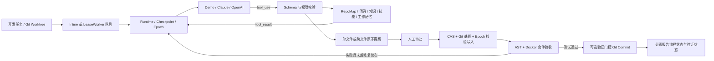
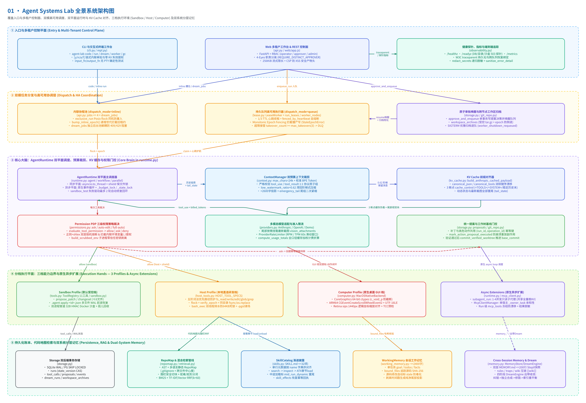
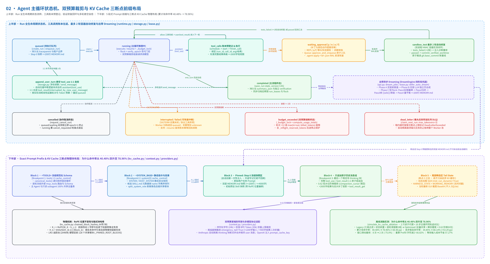
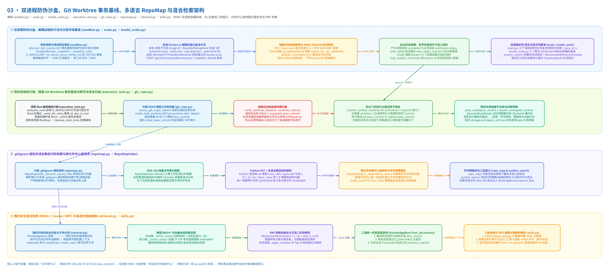
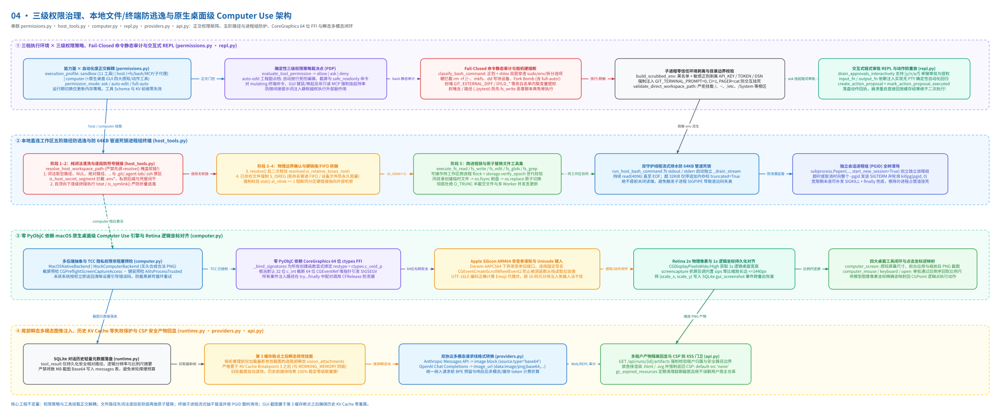
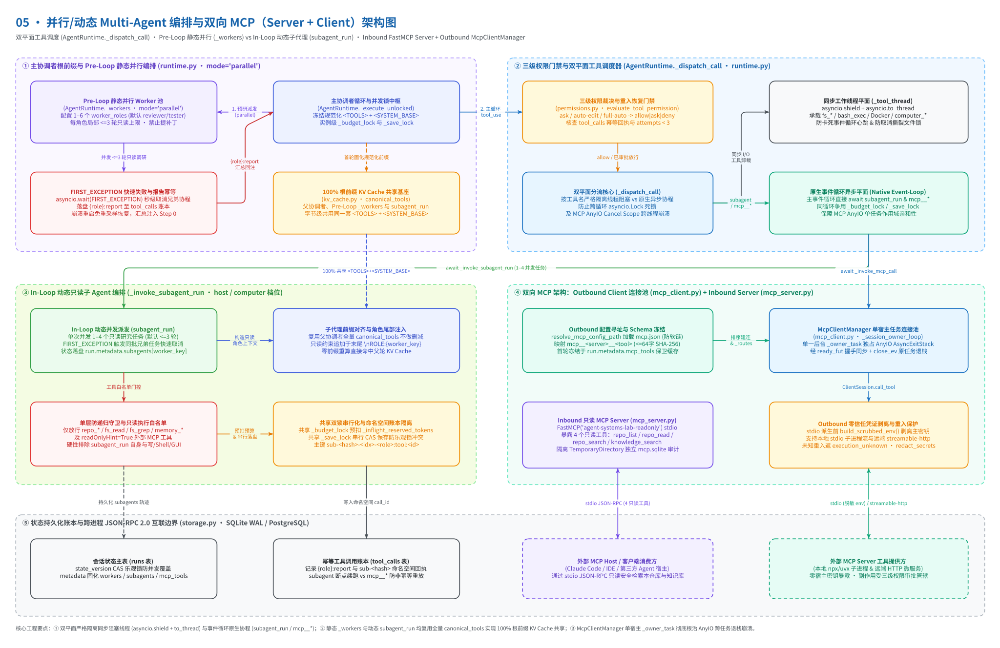
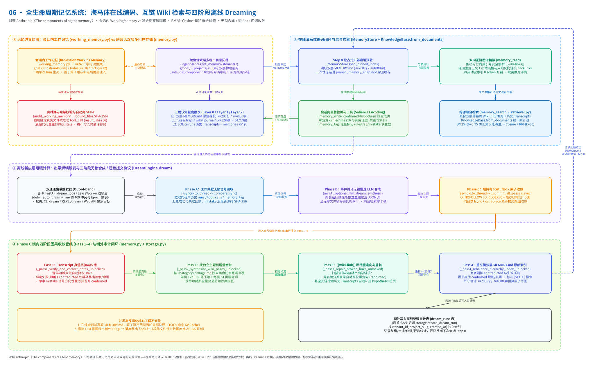
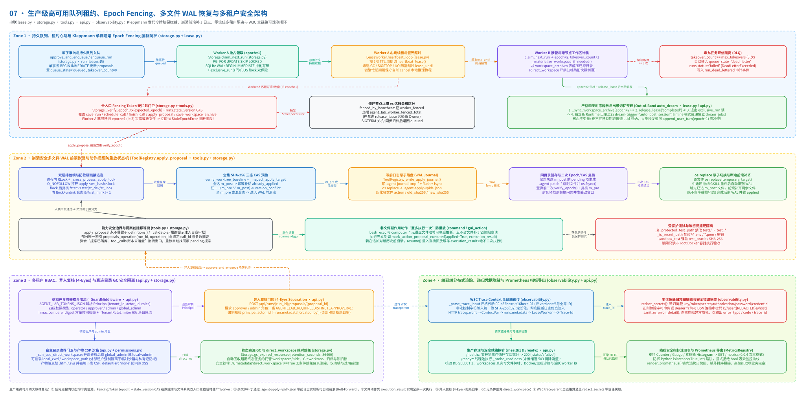

# Agent Systems Lab

**面向 Agent 系统研发面试的代码开发 Agent。** 用一条可运行的代码变更链路，理解模型、工具、检索、上下文、记忆、审批、恢复与评测如何配合。

项目受 [Anthropic 的 Agent 工程文章](https://www.anthropic.com/research/building-effective-agents)启发。20 篇文章的原文链接、代码对应位置和实现边界见 [阅读地图](docs/anthropic-reading-map.md)。源代码包含中文模块说明、关键决策注释与测试案例，便于逐步学习。

> **全栈工程设计大典与前沿复盘导航（已验证基线：43 个 Python 模块 · 8 步 Schema 迁移 · 617 项离线 + 1 项真实 PostgreSQL 测试 · 17/17 离线评测 · PR `#1` `a674d9f` 11/11 CI & GitGuardian 全绿）**：
> - **[7 卷全栈工程设计大典总导航（`docs/design/README.md`）](docs/design/README.md)** — 覆盖全部 48 个核心源码/脚本文件 + 2 个协议模板的源码级架构设计、文件→卷次速查表、4 条端到端请求生命周期全链路走读与按角色阅读路线。
> - **[2026 前沿 Agent Harness 架构设计与复盘手册（`docs/frontier-harness-engineering.md`）](docs/frontier-harness-engineering.md)** — 4 个批次、12/12 前沿方案（Plan Mode、CaMeL/Egress DLP、三厂商原生缓存、模糊编辑、PTC、Horizon 战役、Shadow Workspace、Merkle 语义索引、Playwright ARIA、MCP/A2A、Brain/Hands 解耦、Cron/Webhook 与 Trace→Eval 飞轮）的完整设计权衡与复盘。

## 先运行，再读代码

需要 Python 3.11+ 与 [uv](https://docs.astral.sh/uv/)。不需要模型密钥即可演示；零配置命令开箱即用。

```bash
git clone https://github.com/CambridgeZ/agent-systems-lab.git
cd agent-systems-lab
uv sync --locked --extra dev --extra mcp
uv run agent-lab doctor
uv run agent-lab serve
```

打开 **http://127.0.0.1:8765**。你可以运行单文件示例（`sample`）或基于真实 Git worktree 的跨文件结算示例（`multi_file`），查看补丁提案、RepoMap 符号结构、带来源的工作记忆和队列 Worker 租约状态，再点击“批准并继续”。**审批前不修改任何文件；每个任务都在独立副本或分离 HEAD 的 Git worktree 中运行。**

命令行也可零密钥开箱体验：

```bash
# 本地目录交互式多轮工作台（无密钥自动离线 demo；配置 .env 后自动识别 Claude / OpenAI）
uv run agent-lab code --cwd . --permission-mode auto-edit

# 自动恢复当前目录最近一次未归档会话（--continue / -c），或查看任务表格并按前 6~8 位短前缀恢复
uv run agent-lab code -c
uv run agent-lab list
uv run agent-lab code --resume <short_id>

# 到待审批状态停止，输出 run id、proposal id 和 diff 所需的原文
uv run agent-lab demo

# 多文件真实 Git worktree 场景：跨 checkout.py / discounts.py 原子提案、容器验收与验证门控提交
uv run agent-lab demo --template multi_file --auto-approve

# 并行只读 Worker 分别分析代码和测试建议，再由主 Agent 提出补丁
uv run agent-lab demo --mode parallel --auto-approve

# 持久队列 + 租约续期 + epoch fencing + DLQ 毒丸隔离 + Worker 独立指标端口（终端 1 启动 API，终端 2 启动独立 Worker）
uv run agent-lab serve --dispatch queue
uv run agent-lab worker --worker-id local-worker-1 --lease-ttl 15 --poll-interval 0.8 --metrics-port 9101

# 任务协作取消与过期资源回收（终态 worktree、归档快照、陈旧锁与孤儿沙箱容器）
uv run agent-lab cancel <run_id> --reason operator_abort
uv run agent-lab gc --retention-seconds 86400

# 本机存活探针、就绪探针与 Prometheus 指标导出
curl -s http://127.0.0.1:8765/healthz
curl -s http://127.0.0.1:8765/readyz
curl -s http://127.0.0.1:8765/metrics

# 控制流回归测试与隔离评测
uv run --extra dev --extra mcp pytest -q
uv run --extra dev ruff check src tests scripts
uv run agent-lab eval --report reports/eval.json

# 5 任务编码基准流水线验证（需本地已有 python:3.12-slim 镜像；reference 仅验证评测流水线）
uv run agent-lab model-eval --provider reference --report reports/model-eval.json

# Harness 级 KV Cache 命中率与阶梯压缩离线消融实验（对比 Legacy 40.48% vs Optimized 78.96%）
uv run agent-lab kv-benchmark --report docs/kv-cache-ablation-sample.json
```

`demo` 与 `model-eval --provider reference` 都是显式标注的确定性基线，用来检验 harness 控制流、Git worktree、容器回执与修复循环，**不代表任何 LLM 的真实编码能力**。真实模式支持官方 Anthropic Messages API（`--provider anthropic`）与 OpenAI 兼容 Chat Completions API（`--provider openai`），需配置账户密钥后独立实测模型得分。

## 可以从项目中学到什么

| 主题 | 可运行机制 | 主要代码 |
|---|---|---|
| Agent 循环、端到端流式与实时引导 | `RunStreamBroker` 跨线程零轮询事件总线、Anthropic `messages.stream()` 与 OpenAI SSE + `reasoning_content` 思维链流式输出、实时 bash 标准输出（`bash_output_delta`）、事件驱动 SSE `/api/runs/{id}/stream`、瞬时协作取消（`cancel_active_run`）、并发只读工具波次（`_partition_tool_waves`）、零 CAS 争用 `run_steering_messages` 实时引导与 `waiting_approval` 转向接管 | [streaming.py](src/agent_lab/streaming.py)、[runtime.py](src/agent_lab/runtime.py)、[providers.py](src/agent_lab/providers.py)、[storage.py](src/agent_lab/storage.py) |
| 真实仓库与多文件原子变更 | 绑定 40 位 `base_commit` 的独立 Git worktree、跨文件 `propose_changeset`（`modify`/`create`/`delete`）、`.agent-apply-*.json` 写前日志（WAL）崩溃前滚恢复、验证通过后推进 `base_commit` 并门控提交 | [git_repo.py](src/agent_lab/git_repo.py)、[tools.py](src/agent_lab/tools.py)、[multi_file_repo](data/multi_file_repo) |
| 测试驱动修复循环 | 受控容器 `run_suite` 回执驱动最多 `max_repair_rounds=2` 轮自动诊断修复；严格分离 `run.status` 与 `verification.status` | [runtime.py](src/agent_lab/runtime.py)、[sandbox.py](src/agent_lab/sandbox.py) |
| 代码地图（Tree-sitter/PPR）与 LSP 语义智能 | `RepoMapIndex` 支持 512 KiB 单文件解析上限、可选 `tree_sitter_language_pack` 多语言 AST（缺失无损回退词法扫描）与确定性 Personalized PageRank；`LspClientManager` 提供 `lsp_query`（定义/引用/悬停/符号/诊断）与文件编辑后自动附加静态诊断 | [repomap.py](src/agent_lab/repomap.py)、[lsp_client.py](src/agent_lab/lsp_client.py)、[tools.py](src/agent_lab/tools.py) |
| Workflow、并行研究与异构/隔离写能力子 Agent | 固定检索前置；`worker_roles` 并发研究；`subagent_run` 遵循 Effort-Scaling 与四要素契约，支持 `readonly` / `operator` 写能力 + Git `worktree` 独立隔离、异构模型档位路由（`fast`/`inherit`/`reasoning`）、后台异步派发（`run_in_background` + `subagent_status`）、洁净 `PARENT_CONTEXT_BRIEF`、根前缀缓存共享与浓缩报告交接 | [runtime.py](src/agent_lab/runtime.py)、[架构专题](docs/computer-use-and-memory-architecture.md) |
| 本地操控、OS 内核沙箱、常驻 PTY 与联网防护 | `HostKernelSandbox`（macOS Seatbelt SBPL / Linux `bwrap`，`AGENT_LAB_HOST_SANDBOX=auto\|strict\|off`）；`fs_*` 五阶路径防护、`BackgroundProcessManager` 常驻 PTY 与后台进程管理（`bash_output`/`bash_write`/`bash_kill`/`bash_list`）及 SSRF 防护 `web_fetch`/`web_search` | [host_tools.py](src/agent_lab/host_tools.py)、[repl.py](src/agent_lab/repl.py)、[架构专题](docs/computer-use-and-memory-architecture.md) |
| 声明式权限规则、生命周期钩子与 `/rewind` 检查点 | 信任门控的 `.agent-lab/settings.json` 权限规则引擎（`PermissionRuleEngine`：`deny`→`ask`→`allow`/`session_grants`）+ `ask`/`auto-edit`/`full-auto`；确定性生命周期钩子（`SessionStart`/`UserPromptSubmit`/`PreToolUse`/`PostToolUse`/`PreCompact`/`Stop`）；内容寻址轮次前文件检查点与 `/rewind`（`both`/`files`/`messages`） | [permissions.py](src/agent_lab/permissions.py)、[hooks.py](src/agent_lab/hooks.py)、[checkpoints.py](src/agent_lab/checkpoints.py) |
| 桌面级 GUI 操控与用户多模态附件 | macOS 原生 `CoreGraphics`/`ApplicationServices` `ctypes` + 无障碍树 `ax_tree` 定位 + `LinuxX11ComputerBackend` + `MockComputerBackend`；支持用户多模态图像附件（`POST /api/runs/{id}/attachments`），与截图统一瞬态置尾零前缀失效 | [computer.py](src/agent_lab/computer.py)、[providers.py](src/agent_lab/providers.py)、[api.py](src/agent_lab/api.py) |
| 工具接口与策略 | JSON Schema、行区间读取、字面量检索、路径/硬链接约束、跨进程文件锁、工具审计 | [tools.py](src/agent_lab/tools.py) |
| RAG 与可插拔神经检索 | 围栏代码块安全分块、camelCase/snake_case 子词分词、BM25 + TF-IDF + RRF 融合；内置 `LocalSubwordDenseEmbedder`、`OpenAICompatibleEmbedder` 与 `HttpReranker` 可插拔适配器 | [retrieval.py](src/agent_lab/retrieval.py) |
| 两级上下文压缩、美元成本账本与 KV Cache | 字符 + BPE token 双重预算；Tier-1 微压缩（`micro_compact_messages` 剥离陈旧 `thinking` 与超大旧工具结果）+ Tier-2 `80% → 55%` 滞回压缩、同拍原位 `COMPACTION_SUMMARY` 与可选 LLM 语义摘要（`use_llm=True`）；USD 成本账本（`compute_cost_usd`）与 `max_cost_usd` 熔断；三断点 `cache_control` / `prompt_cache_key` | [context.py](src/agent_lab/context.py)、[kv_cache.py](src/agent_lab/kv_cache.py)、[providers.py](src/agent_lab/providers.py)、[专题说明](docs/context-skills-state.md) |
| 带来源的结构化工作记忆 | `<= 2400` 字符的 `goal/constraints/todos/facts`；工具事实追踪关联源码 `bound_files` SHA-256 哈希、支持显式删除与过期事实淘汰，变更后自动标为 `stale` | [working_memory.py](src/agent_lab/working_memory.py)、[context.py](src/agent_lab/context.py) |
| 跨会话分层记忆、互链 Wiki 与实证 Dreaming | 双层 `CLAUDE.md` + `MEMORY.md`（`<= 200` 行预载）+ `[[wiki-links]]` 图谱 + 四阶段离线 Dreaming：实证门控（无验证来源的 LLM 页强制降级 `hypothesis`）、已完成会话 `verified_facts` 自动晋升、排除软墓碑的衰减回收 GC 与加权排序、`dry_run` 预览与 `rollback_last_dream` 一键回滚 | [memory.py](src/agent_lab/memory.py)、[retrieval.py](src/agent_lab/retrieval.py)、[架构专题](docs/computer-use-and-memory-architecture.md) |
| 多通道技能路由（Skills） | 多通道路由器（`/skill` 显式指令 + `paths`/`globs` 路径匹配 + BM25/TF-IDF/RRF 混合检索）、章节级按需加载/卸载、运行期动态置尾快照与版本去重 | [skills.py](src/agent_lab/skills.py)、[retrieval.py](src/agent_lab/retrieval.py)、[code-review](skills/code-review/SKILL.md) |
| 多租户 RBAC、HttpOnly Cookie 与安全审计 | `AGENT_LAB_TOKENS_JSON` 多角色令牌、`HttpOnly` 会话 Cookie（`/api/auth/session`）、持久化 `security_audit_logs`（`GET /api/audit-logs`）、租户隔离、滑动窗口限流与双人复核 | [api.py](src/agent_lab/api.py)、[storage.py](src/agent_lab/storage.py)、[生产高可用专题](docs/production-ha-hardening.md) |
| 长任务恢复、版本化迁移与生命周期 GC | 版本化 `schema_migrations`（8 步幂等迁移）、调用账本、worker checkpoint、`state_version` 乐观锁 CAS、跨节点 `workspace_archives` 快照、`agent-lab gc` 过期工作区与孤儿容器回收 | [storage.py](src/agent_lab/storage.py)、[runtime.py](src/agent_lab/runtime.py)、[execution_lock.py](src/agent_lab/execution_lock.py) |
| 持久队列、连接池、Fencing 与 DLQ | `run_leases` + `worker_nodes`、单事务 `approve_and_enqueue`、PostgreSQL `psycopg_pool` 连接池 + `FOR UPDATE SKIP LOCKED`、提案确定性 FIFO 排序（`fifo_seq`）、`epoch` 拦截僵尸写入与 `dead_letter` 毒丸隔离 | [lease.py](src/agent_lab/lease.py)、[storage.py](src/agent_lab/storage.py)、[生产高可用专题](docs/production-ha-hardening.md) |
| 人工审批与崩溃原子性 | 审批绑定具体提案与各文件 SHA-256，跨文件写前日志（WAL）前滚恢复、重复应用幂等识别 | [tools.py](src/agent_lab/tools.py) |
| 双进程防伪沙盒与远程池 | 外层 Supervisor 管道 HMAC 回执 + 子进程 `sys.addaudithook` 阻断栈帧/`ctypes` 伪造；原生兼容 `src/` 布局与 `pytest` 风格函数测试；支持 `RemoteHTTPSandboxBackend` | [sandbox.py](src/agent_lab/sandbox.py)、[沙盒专题](docs/sandbox-mechanisms.md) |
| MCP（Server + 阈值延迟加载 Client） | 官方 MCP SDK v1 的 `stdio` 只读服务器 + `McpClientManager`（支持外部 `stdio` / `streamable-http` + OAuth PKCE、环境变量脱敏、Schema 冻结及超阈值延迟加载 `mcp_tool_search`） | [mcp_server.py](src/agent_lab/mcp_server.py)、[mcp_client.py](src/agent_lab/mcp_client.py)、[test_mcp.py](tests/test_mcp.py) |
| A2A（Agent2Agent 双向协同协议） | 对外暴露标准 AgentCard（`/.well-known/agent-card.json` 与 `/.well-known/agent.json`）及兼容 v0.2/v0.3 与 v1.0 的 JSON-RPC 2.0 `/a2a`（含 SSE 流式推送）；对内通过声明式 `a2a.json`、`A2AClientManager` 与受权限门控的 `a2a_*` 工具委托远端智能体 | [a2a.py](src/agent_lab/a2a.py)、[a2a.example.json](a2a.example.json)、[cli.py](src/agent_lab/cli.py)、[repl.py](src/agent_lab/repl.py) |
| 评测体系与层次化可观测性 | 10 个控制流场景 + **7 大子系统离线评测**（`run_subsystem_evals`）+ 5 个真实 Git/Docker 编码基准 + 无偏 `pass@k` + `LLMJudge` + SWE-bench 适配器；层次化 W3C/OTLP Span 追踪（`start_span`）+ API/Worker 独立 `--metrics-port` Prometheus 导出 | [observability.py](src/agent_lab/observability.py)、[lease.py](src/agent_lab/lease.py)、[evals.py](src/agent_lab/evals.py)、[model_evals.py](src/agent_lab/model_evals.py) |
| 工程交付 | FastAPI、CLI、中文网页、锁定依赖、GitHub Actions、Dockerfile | [web](web)、[CI](.github/workflows/ci.yml) |

这些主题覆盖 Agent 系统研发的核心讨论面。Transformer、模型训练/微调、推理服务和分布式平台的基础知识列在面试指南中，当前仓库没有实现训练或推理引擎。






## Excalidraw 全栈架构图集（7 幅可交互画布）

仓库提供覆盖全栈源码模块的 **7 幅 Excalidraw v2 可编辑画布**（`docs/diagrams/*.excalidraw`）及由零第三方依赖脚本 [`scripts/render_excalidraw_svg.py`](scripts/render_excalidraw_svg.py) 确定性渲染的纯矢量 SVG（`docs/diagrams/svg/*.svg`）。完整打开指南（支持 VS Code / Cursor Excalidraw 插件、[excalidraw.com](https://excalidraw.com) 与 Obsidian）及模块映射见 **[Excalidraw 系统架构图集索引 (`docs/diagrams/README.md`)](docs/diagrams/README.md)**。

<details>
<summary><strong>01 · 全景系统架构图</strong> — 入口控制面、双模高可用调度、双平面运行时、三档执行环境与双系统记忆全景</summary>

- **可编辑画布**：[`docs/diagrams/01-system-overview.excalidraw`](docs/diagrams/01-system-overview.excalidraw) ｜ **高清矢量图**：[`docs/diagrams/svg/01-system-overview.svg`](docs/diagrams/svg/01-system-overview.svg)


</details>

<details open>
<summary><strong>02 · Agent 主循环状态机与 KV Cache 三断点布局</strong> — Run 全生命周期流转、80%→55% 自动滞回阶梯裁剪与 40.48% → 78.96% 缓存前缀对齐物理布局</summary>

- **可编辑画布**：[`docs/diagrams/02-agent-loop-and-kv-cache.excalidraw`](docs/diagrams/02-agent-loop-and-kv-cache.excalidraw) ｜ **高清矢量图**：[`docs/diagrams/svg/02-agent-loop-and-kv-cache.svg`](docs/diagrams/svg/02-agent-loop-and-kv-cache.svg)



</details>

<details>
<summary><strong>03 · 双进程防伪沙盒、Git Worktree 事务基线、RepoMap 与混合检索</strong> — HMAC 双进程容器验收、40 位基线门控提交、多语言代码中心度地图与围栏安全 RRF 检索</summary>

- **可编辑画布**：[`docs/diagrams/03-sandbox-git-and-retrieval.excalidraw`](docs/diagrams/03-sandbox-git-and-retrieval.excalidraw) ｜ **高清矢量图**：[`docs/diagrams/svg/03-sandbox-git-and-retrieval.svg`](docs/diagrams/svg/03-sandbox-git-and-retrieval.svg)



</details>

<details open>
<summary><strong>04 · 三级权限治理、本地文件/终端防逃逸与原生桌面级 Computer Use</strong> — 正交权限矩阵、五阶路径与进程组防护、CoreGraphics 64 位 FFI、Retina 坐标对齐与瞬态多模态闭环</summary>

- **可编辑画布**：[`docs/diagrams/04-host-permissions-and-computer-use.excalidraw`](docs/diagrams/04-host-permissions-and-computer-use.excalidraw) ｜ **高清矢量图**：[`docs/diagrams/svg/04-host-permissions-and-computer-use.svg`](docs/diagrams/svg/04-host-permissions-and-computer-use.svg)



</details>

<details>
<summary><strong>05 · 并行/动态 Multi-Agent 编排与双向 MCP 架构</strong> — 同步/异步双平面分流、Pre-Loop 静态并行、In-Loop 动态只读 <code>subagent_run</code> 与双向 MCP（Server + 单宿主 Task Client）</summary>

- **可编辑画布**：[`docs/diagrams/05-multi-agent-and-mcp.excalidraw`](docs/diagrams/05-multi-agent-and-mcp.excalidraw) ｜ **高清矢量图**：[`docs/diagrams/svg/05-multi-agent-and-mcp.svg`](docs/diagrams/svg/05-multi-agent-and-mcp.svg)



</details>

<details open>
<summary><strong>06 · 海马体在线编码、互链 Wiki 检索与四阶段离线 Dreaming</strong> — 会话内 <code>WorkingMemory</code> vs 跨会话双层 <code>CLAUDE.md</code> / <code>MEMORY.md</code>、双向 <code>[[wiki-links]]</code> 与无锁合成 + 短 <code>flock</code> 四遍睡眠巩固</summary>

- **可编辑画布**：[`docs/diagrams/06-memory-hierarchy-and-dreaming.excalidraw`](docs/diagrams/06-memory-hierarchy-and-dreaming.excalidraw) ｜ **高清矢量图**：[`docs/diagrams/svg/06-memory-hierarchy-and-dreaming.svg`](docs/diagrams/svg/06-memory-hierarchy-and-dreaming.svg)



</details>

<details>
<summary><strong>07 · 生产级高可用队列租约、Epoch Fencing、多文件 WAL 恢复与可观测性</strong> — Kleppmann 世代令牌脑裂拦截、死信隔离、崩溃前滚补丁日志、异人复核 RBAC 与 W3C/Prometheus 全链路可观测</summary>

- **可编辑画布**：[`docs/diagrams/07-ha-queue-wal-and-observability.excalidraw`](docs/diagrams/07-ha-queue-wal-and-observability.excalidraw) ｜ **高清矢量图**：[`docs/diagrams/svg/07-ha-queue-wal-and-observability.svg`](docs/diagrams/svg/07-ha-queue-wal-and-observability.svg)



</details>

## 学习顺序

1. [5 分钟演示手册](docs/demo-walkthrough.md)：运行、审批、拒绝、恢复、看轨迹。
2. [**7 卷全栈工程设计大典总导航 (`docs/design/README.md`)**](docs/design/README.md)：按模块逐行核验的 7 卷架构详述、全仓 48 个核心源码文件（+2 个模板）→ 卷次速查表、4 条跨卷端到端生命周期走读与按角色阅读路线。
3. [**2026 前沿 Agent Harness 架构设计与复盘手册 (`docs/frontier-harness-engineering.md`)**](docs/frontier-harness-engineering.md)：4 批次 12/12 前沿能力的设计选型、安全不变量与分批深度复盘。
4. [**7 幅 Excalidraw 系统架构图集**](docs/diagrams/README.md)：按模块对照源码交互式走读全栈控制流与数据流。
5. [14 天学习路线](docs/learning-path.md)：每天读什么、改什么、怎样验证。
6. [系统架构与设计取舍](docs/architecture.md)：先读状态机，再沿模块接口看实现。
7. [**本地操控、实时引导、多通道技能/MCP、子 Agent 与分层 Dreaming 架构专题**](docs/computer-use-and-memory-architecture.md)：三级权限矩阵、运行期 `run_steering_messages` 零锁竞争实时引导与 `waiting_approval` 转向接管、macOS CoreGraphics 64 位 FFI、多通道技能路由器、阈值门控 `mcp_tool_search`、Anthropic 四要素子 Agent 契约与四阶段离线 Dreaming。
8. [**生产级高可用、多租户安全与沙盒加固专题**](docs/production-ha-hardening.md)：Epoch Fencing、DLQ 毒丸隔离、多文件写前日志（WAL）前滚恢复、双进程 HMAC 防伪沙盒、多租户 RBAC/双人复核与 Prometheus/W3C 可观测性。
9. [20 篇 Anthropic 文章对应地图](docs/anthropic-reading-map.md)：每篇对应机制、代码和未实现部分。
10. [44 道基础面试问题](docs/interview-guide.md) + [36 道进阶补充](docs/interview-supplement.md)：加上[沙盒专题 8 题（81—88）](docs/sandbox-mechanisms.md)，共 88 题，覆盖协议、上下文、Skill、恢复、代码检索、评测、成本与隔离机制。
11. [长上下文、Skill 与工具状态专项说明](docs/context-skills-state.md)：压缩规则、崩溃窗口、可复制实验和高可用边界。
12. [Harness 级 KV Cache 命中率优化原理](docs/kv-cache-harness.md)：为什么代码 Agent 必须做前缀对齐、RoPE 与链式块哈希失效原理、6 项落地机制与消融数据。
13. [沙盒机制与隔离探针](docs/sandbox-mechanisms.md)：文件/网络/资源边界、双进程防伪回执、远程执行池与可信度局限。
14. [验证记录](docs/validation.md)：交付时实际运行了什么，哪些需要额外环境。

阅读代码建议从 `AgentRuntime.start → execute → Provider.complete → ToolRegistry.execute` 开始，接着看审批与恢复测试。避免只背术语；能解释失败场景更有说服力。

## 配置真实模型（Claude / OpenAI）与评测

CLI 启动时会自动加载当前目录或仓库根目录下的 `.env`（仅填充未设置的环境变量，永不覆盖已导出的 Shell 环境变量），并在 `AGENT_PROVIDER` 未显式设置时按已配置密钥自动选择 `anthropic` 或 `openai`。推荐通过向导在 30 秒内完成首次配置并体检环境：

```bash
# 交互向导创建 0600 权限 .env（默认不覆盖已有文件；也可传 --provider anthropic|openai --non-interactive）
uv run agent-lab init

# 一键体检 .env/模型就绪度、Docker 与 python:3.12-slim、OS 内核沙箱、LSP、Python 可选扩展与 macOS TCC 权限
uv run agent-lab doctor
uv run agent-lab doctor --json

# 自动读取 .env 启动交互式工作台、继续最近会话（-c / --continue）或开启桌面 GUI（macOS 自动预检 TCC 权限）
uv run agent-lab code --cwd . --permission-mode auto-edit
uv run agent-lab code -c
uv run agent-lab code --cwd . --permission-mode full-auto --gui

# 如需连接外部 MCP Server，准备配置文件后传入 --mcp-config <path>；也可配合 --env-file .env 显式指定环境文件
uv run --env-file .env agent-lab serve --dispatch queue

# 针对本地任意 Git 仓库创建隔离 worktree 并运行修复任务
uv run --env-file .env agent-lab run '定位并修复失败的单元测试' --provider anthropic --repo /path/to/local/git-repo

# 在 5 个真实仓库编码基准上运行真实模型评测（需 Docker 已拉取 python:3.12-slim）
uv run --env-file .env agent-lab model-eval --provider anthropic --trials 1 --report reports/model-eval-live.json
```

如需增强终端补全与富文本渲染，可按需安装可选 `tui` 扩展：`uv sync --extra tui`（安装 `prompt-toolkit` 与 `rich`）。

凭证只从服务端环境变量读取，默认仅连接官方端点（`https://api.anthropic.com` 或 `https://api.openai.com/v1`，自定义网关需显式开启 `AGENT_ALLOW_CUSTOM_BASE_URL=1`），绝不传入模型上下文、容器环境或数据库。真实调用会计费，原生支持端到端流式输出（Anthropic `messages.stream()`、OpenAI SSE 与 `reasoning_content` 思维链流式增量）并通过 `RunStreamBroker` 与事件驱动 SSE `GET /api/runs/{id}/stream` 实时推送。模型请求支持滑动窗口 RPM/TPM 准入限流、超时、有限重试与动态输出上限；预算系统同时做请求前 BPE token 在途预留、响应后全量缓存 token 加权折算（`compute_usage_totals`）与**美元级成本账本（`compute_cost_usd`，支持 `AGENT_LAB_MODEL_PRICING_JSON` 自定义费率及 `max_cost_usd` 前后置双重熔断上限）**，但**应用层预算仍不是云账单级硬上限**。

## 多协议模型网关配置与热切换（`gateways.json`）

除 `.env` 环境变量外，仓库通过声明式 [`gateways.json`](gateways.example.json)（实现见 [`src/agent_lab/gateways.py`](src/agent_lab/gateways.py)）统一管理多厂商、多协议模型网关 Profile，支持在 **CLI、REPL 与 Web 控制面**之间无缝切换且全程零密钥回显。

### 支持的 4 种真实线协议（及离线 `demo`）

| 规范协议（`protocol`） | 适配器与端点 | 默认凭据变量 | 典型用途 |
|---|---|---|---|
| `anthropic_messages` | `AnthropicProvider` (`https://api.anthropic.com`) | `ANTHROPIC_API_KEY` | Claude 4.5 / 4.6，支持三断点 Prompt Caching 与 Extended Thinking |
| `openai_chat` | `OpenAICompatibleProvider` (`https://api.openai.com/v1`) | `OPENAI_API_KEY` | OpenAI Chat Completions 及 DeepSeek / vLLM / SGLang / OpenRouter / 本地 Ollama |
| `openai_responses` | `OpenAIResponsesProvider` (`/v1/responses`) | `OPENAI_API_KEY` | GPT-5 / o3 / Codex，原生支持 `reasoning` 与 `function_call` 协议项 |
| `gemini_generate_content` | `GeminiNativeProvider` (`https://generativelanguage.googleapis.com/v1beta`) | `GEMINI_API_KEY` | Google Gemini 原生 `streamGenerateContent`、函数调用与思考预算 |

> 参考模板见根目录 [`gateways.example.json`](gateways.example.json)。配置发现优先级为：`--gateway-config` / `AGENT_LAB_GATEWAYS_FILE` > 已信任工作区 `<workspace>/.agent-lab/gateways.json` > `<state_dir>/gateways.json` > `~/.agent-lab/gateways.json`。默认仅放行对应协议官方 HTTPS 端点并阻断云元数据 IMDS/SSRF，接入本地 Ollama 或企业自建代理需在 Profile 中显式设置 `"allow_custom_base_url": true`。

### CLI、REPL 与 Web UI 使用方式

```bash
# 1. 生成 0600 权限起始 gateways.json（默认写入 .agent-lab/gateways.json，可用 --path / --force 指定）
uv run agent-lab gateway init

# 2. 查看所有 Profile、活跃标记 (*)、线协议、模型、端点与脱敏凭证就绪状态
uv run agent-lab gateway list
uv run agent-lab gateway list --json

# 3. 原子切换默认活跃网关 Profile，并通过 doctor 校验 gateway_config 项
uv run agent-lab gateway use openai-responses
uv run agent-lab doctor --json

# 4. 在 code / run / serve / worker 中通过 --gateway 或 --gateway-config 指定网关（也支持直传 --provider openai_responses|gemini）
uv run agent-lab code --gateway claude-anthropic --cwd .
uv run agent-lab run '检查并修复边界条件' --gateway gemini-native --cwd .
uv run agent-lab serve --gateway openai-responses
uv run agent-lab worker --gateway-config ~/.agent-lab/gateways.json
```

- **REPL 会话内热切换（保留对话历史）**：在 `agent-lab code` 中输入 `/gateway` 查看当前活跃 Profile、线协议、解析模型、`base_url` 与可用列表（TTY 下支持编号交互选择），或输入 `/gateway <profile>`（支持 `Tab` 补全 Profile 名）在**不丢失对话上下文**的前提下原地切换协议与模型。
- **Web UI 实时切换**：启动 `agent-lab serve` 后可在网页控制面直接查看各多协议 Profile 及其脱敏凭证状态，并在线切换活跃网关 Profile 与协议模型，无需重启服务进程。

## A2A（Agent2Agent）双向协议协同

仓库内置完整的 **A2A（Agent2Agent）双向协议适配层**（核心实现见 [`src/agent_lab/a2a.py`](src/agent_lab/a2a.py)），既可作为 A2A Server 对外发布能力卡片与接收跨智能体任务，也可作为 A2A Client 发现并委托远端协同智能体。

### 1. 服务端：AgentCard 发现与双版本 JSON-RPC 2.0 `/a2a`

- **AgentCard 发现端点**：同时提供规范主路径 `GET /.well-known/agent-card.json`、兼容路径 `GET /.well-known/agent.json` 以及认证扩展卡片 `GET /extendedAgentCard`，声明本节点的技能列表、输入/输出模式、安全方案与流式能力。
- **JSON-RPC 2.0 `POST /a2a`（同时兼容 A2A v0.2/v0.3 与 v1.0 方法名 + SSE 流式推送）**：
  - 提交/续跑任务：`message/send` / `SendMessage` / `tasks/send`
  - 流式任务执行（SSE `status-update` & `artifact-update`）：`message/stream` / `SendStreamingMessage` / `tasks/sendSubscribe`
  - 查询与管理任务：`tasks/get` / `GetTask`、`tasks/list` / `ListTasks`、`tasks/cancel` / `CancelTask`、`tasks/resubscribe` / `SubscribeToTask`

### 2. 客户端：声明式 `a2a.json` 对端配置与权限门控委托

- 通过声明式 [`a2a.json`](a2a.example.json)（示例模板见根目录 [`a2a.example.json`](a2a.example.json)）配置远端协同智能体，文件采用 `0600` 原子替换、`O_NOFOLLOW` 防软/硬链、SSRF/云元数据 IMDS 阻断（连接本机或内网 Agent 需显式配置 `"allow_private_network": true`）及全程凭证脱敏。
- Agent 运行时内置 5 个 A2A 工具：`a2a_list_agents`、`a2a_discover_agent`、`a2a_get_task` 为只读默认放行；具备远端副作用的 `a2a_send_task` 与 `a2a_cancel_task` 受三级权限矩阵、声明式 `A2A(<peer>)` 规则与人工审批（`a2a_call`）门控。

### 3. CLI、REPL 与 Web UI 使用方式

```bash
# 1. 生成 0600 权限起始 a2a.json（默认写入 .agent-lab/a2a.json）
uv run agent-lab a2a init

# 2. 列出已配置远端 A2A 对端（脱敏视图）并体检 a2a_peers 状态
uv run agent-lab a2a list
uv run agent-lab a2a list --json
uv run agent-lab doctor --json

# 3. 输出本节点 AgentCard JSON，或通过 --url 发现远端 AgentCard
uv run agent-lab a2a card --base-url http://127.0.0.1:8787
uv run agent-lab a2a card --url https://agent.example.com

# 4. 向已配置的远端对端委托任务（支持 --task-id 续跑与 --async 非阻塞提交）
uv run agent-lab a2a send local-reviewer '审查当前模块边界条件'
uv run agent-lab a2a send local-reviewer '补充回归建议' --task-id <task_id> --async
```

- **REPL 交互命令**：在 `agent-lab code` 中支持 `/a2a [list | discover <peer> | send <peer> <prompt>]` 及层级 `Tab` 补全，可直接查看对端列表、实时探测远端 AgentCard 或向远端智能体委托任务。
- **Web UI 面板**：在右侧检视面板「工具规则」分页中的 **A2A 远端智能体协同 (Agent2Agent)** 卡片（或按 `⌘K` 选择「打开 A2A 协同智能体配置」）内，可直接打开本节点 `/.well-known/agent-card.json`、选择对端点击「发现 Card」预览能力、在线编辑脱敏 `a2a.json` 并审批 `a2a_call` 提案。

## 两级上下文压缩、端到端流式、OS 沙箱与渐进式工具/技能加载

`ContextManager` 采用序列化字符上限（`context_chars`）与校准 BPE token 上限（`max_tokens`，可选 `tiktoken`）**双重预算门控**，并按**两级压缩**策略兼顾超长轨迹与 KV Cache 命中率：
- **Tier-1 轻量微压缩（`micro_compact_messages`）**：触达 `80%` 高水位前先剥离陈旧 `thinking` 块并紧缩早期超大 `tool_result` 存根（保留最近 3 个原子组与持久化单调 `micro_compaction_cursors` 守住前缀稳定性）；
- **Tier-2 `80% → 55%` 自动滞回阶梯压缩**：任一预算维度仍达 `80%` 高水位时，按完整 `assistant(tool_use) + user(tool_result)` 原子组一次性批量折叠早期历史回落至 `55%` 低水位，并在同拍原位注入结构化滚动摘要（**In-Place `COMPACTION_SUMMARY`**）；同时支持通过 `/compact` 或 `POST /api/runs/{id}/compact` 按需手动整理，并可选启用 **LLM 语义压缩（`use_llm=True`）** 交由 `fast` 档模型提炼并经 `finalize_llm_compaction_summary` 逐行防注入消毒（失败安全回退确定性摘要）。完整工具结果仍先入 SQLite/PostgreSQL 账本（>2600 字符按需经 `tool_result_get` 分页回取，单次上限 **8000 字符**），极端超长尾部先紧急紧缩，绝不静默截断源码或 JSON。

为从源头控制工具上下文并提升执行吞吐与安全性：
- **多通道技能路由与延迟 MCP**：`skills.py` 融合 `/skill` 显式点名、`paths`/`globs` 路径感知与 BM25/TF-IDF/RRF 混合检索按章节渐进披露；外部 MCP 工具超阈值时经 `mcp_tool_search` 延迟激活，守住根 `<TOOLS>` 缓存前缀。
- **并发只读工具波次与异构/隔离写能力子 Agent**：主循环通过 `_partition_tool_waves` 将连续 `>=2` 个无副作用只读调用（含只读 MCP）切分为并发 `asyncio.gather` 波次执行，而写操作、命中 `ask` 规则或存在 `PreToolUse` 钩子的调用严格串行；`subagent_run` 除只读探索外还支持 `mode="operator"` 写能力 + Git `worktree` 独立隔离、异构模型档位路由（`fast`/`inherit`/`reasoning`）与 `run_in_background` 后台异步派发（配合 `subagent_status` 查询），同时保留 Effort-Scaling、四要素契约、洁净 `PARENT_CONTEXT_BRIEF`、根前缀缓存共享与浓缩报告交接。
- **OS 内核沙箱、声明式规则、生命周期钩子与 `/rewind` 时间旅行**：宿主机子进程命令经 `HostKernelSandbox`（macOS Seatbelt SBPL / Linux `bwrap`，`AGENT_LAB_HOST_SANDBOX=auto|strict|off`）约束写入与敏感目录读取，配合 `BackgroundProcessManager` 常驻 PTY/后台进程管理（`bash_output`/`bash_write`/`bash_kill`/`bash_list`）、LSP 语义查询 `lsp_query` 与编辑后自动静态诊断，以及 SSRF 防护 `web_fetch`/`web_search`；支持信任门控的 `.agent-lab/settings.json` 声明式权限规则（`PermissionRuleEngine`：`deny → ask → allow / session_grants`）、确定性生命周期钩子（`hooks.py`：`SessionStart`/`UserPromptSubmit`/`PreToolUse`/`PostToolUse`/`PreCompact`/`Stop`），以及内容寻址的轮次前文件检查点与 `/rewind`（`POST /api/runs/{id}/rewind`，支持 `both`/`files`/`messages` 三模式回退并自动闭合悬空 `tool_use`）。
- **端到端流式输出、实时引导与多模态附件**：`RunStreamBroker` 将模型增量（`thinking_delta`/`text_delta`/`tool_use_start`/`input_json_delta`）、实时终端输出（`bash_output_delta`）与子 Agent 进度推送至事件驱动 SSE `GET /api/runs/{id}/stream`，并配合 `cancel_active_run` 实现瞬时协作取消；运行中指令经零 CAS 争用 `run_steering_messages` 收件箱安全注入，`waiting_approval` 状态下发送指令可自动转向接管；用户上传的多模态图像附件（`POST /api/runs/{id}/attachments`）与 GUI 截图统一落盘为独立产物并在缓存断点之后瞬态附加。

为防止旧对话裁剪后丢失精确中间结论，模型还可调用 `working_memory_write` 维护总长不超过 2400 字符的**带来源结构化工作记忆（`WorkingMemory`：`goal`、`constraints`、`todos`、`facts`）**，追踪关联源码 `bound_files` SHA-256 哈希并在底层变更后自动标为 `stale`。在跨会话维度，系统提供双层 `CLAUDE.md` + `MEMORY.md`（`<= 200` 行 / `<= 4000` 字符 Step 0 预载）与 `[[wiki-links]]` 知识图谱，并升级四阶段离线 **Dreaming**：实施**实证门控**（无已验证 `file:@sha` 或成功 `call:` 凭据的 LLM 合成页一律强制降级为 `hypothesis`）、自动将已完成会话的 `verified_facts` 与修复教训沉淀入库、提供**排除软墓碑的衰减回收 GC 与多因子加权排序**（状态/反链/命中频次/近因衰减），以及 `dry_run` 变更预览与 `rollback_last_dream` 一键快照回滚（`GET /api/memory/dream/snapshots`、`POST /api/memory/dream/rollback`）。详见[长上下文与状态专项说明](docs/context-skills-state.md)与[分层记忆及 Dreaming 架构专题](docs/computer-use-and-memory-architecture.md)。可直接查看状态和原始证据：

```bash
uv run agent-lab calls <run_id>
uv run agent-lab result <run_id> <call_id> --offset 0 --limit 4000
```

API 对应 `GET /api/runs/{run_id}/calls` 和 `GET /api/runs/{run_id}/tool-result?call_id=...&offset=0&limit=4000`（`limit` 最大支持 `8000`）；任务详情还返回上下文统计、压缩摘要版本、KV Cache 命中率、租约状态和活动 Skill 的版本信息。

## 验证、MCP 与数据目录

- `verify_python` 只做 AST 解析，不执行生成代码，不能证明业务正确。
- 容器测试（单文件 `run` 与多文件套件 `run_suite`）支持本地 Docker（需事先 `docker pull python:3.12-slim`，固定 64 位镜像摘要）或通过 `AGENT_LAB_SANDBOX_URL` + `AGENT_LAB_SANDBOX_TOKEN` 委托给隔离的 `RemoteHTTPSandboxBackend`（`POST /api/internal/sandbox/execute`）。容器内采用**外层 Supervisor + 管道 32 字节密钥 HMAC-SHA256 防伪回执 + 子进程 `sys.addaudithook`**（拦截 `ctypes`、`gc` 对象遍历与 `sys._getframe` 栈帧窃取，并清洗标准输出中的伪造标记），原生支持 `src/` 布局与 `pytest` 风格函数/异步测试发现；没有沙盒环境时返回 `sandbox_unavailable`，绝不退回宿主机执行代码。
- `run.status == "completed"` 仅代表控制流结束；业务测试是否通过必须看 `run.metadata.verification.status`（`passed` / `failed` / `syntax_only` / `unavailable` / `unknown` / `not_run`）。测试失败时主循环自动进入最多 `max_repair_rounds=2` 轮测试驱动修复；仅当 `verification.status == "passed"` 时才允许在任务 worktree 上创建验证门控的 Git commit，并同步推进 `git.base_commit` 以支持后续增量变更。
- MCP 双向支持：
  - 作为只读 MCP Server：`uv run --extra mcp python -m agent_lab.mcp_server --workspace data/sample_repo`。
  - 作为 MCP Client：在 `host` / `computer` 档位下通过 `--mcp-config <path>`、`AGENT_LAB_MCP_CONFIG` 或 `.agent-lab/mcp.json` 连接外部 `stdio` / `streamable-http` MCP Server，自动映射为 `mcp__<server>__<tool>`、冻结工具 Schema，并在外部工具数量超过内联阈值时自动切换为**延迟目录模式**（通过 `mcp_tool_search` 按需混合检索并动态激活，避免挤占首轮 `<TOOLS>` 上下文）。
- 默认状态在 `.agent-lab/state.db`（内置 8 步版本化 `schema_migrations`，含 A2A 上下文索引、Push 配置与 Cron/Webhook 触发器防重放表，亦支持通过 `AGENT_LAB_STORAGE_DSN=postgresql://...` 切换至 PostgreSQL 并自动启用 `psycopg_pool`、`pg_notify` 推送唤醒与提案 FIFO `fifo_seq` 排序），任务副本与 worktree 在 `.agent-lab/workspaces/`；可通过 `agent-lab gc` 或 `POST /api/admin/gc` 定期清理过期终态工作区、`workspace_archives` 快照、陈旧锁与带过期标签的孤儿容器。
- **2026 前沿 Harness 完整能力矩阵（12/12 落地与深度复盘）**：系统已分 4 个批次完整落地只读 `Plan Mode` + `ask_user_question`、统一出站密钥 **Egress DLP + CaMeL 污点追踪**、三厂商原生上下文/缓存工程（Anthropic Context Editing & Server Compaction / OpenAI Responses 加密推理与 `/responses/compact` / Gemini `cachedContents`）、4 级模糊编辑与 `fs_sketch_edit`、本地沙箱 **PTC（`ptc_exec`）**、多会话超长程 **Horizon Harness + 机械边界 Lint（`agent-lab horizon`）**、**Shadow Workspaces（`shadow_verify_edits`）**、持久化 **Merkle 增量语义代码索引（`agent-lab index`）**、**Playwright ARIA 浏览器层**、**MCP 双向回调 & A2A 流式/HMAC Push**、脑手解耦 **`WorkspaceExecutionBackend` + `TurnPipeline` 洋葱中间件**、**Cron/Webhook 触发器（`agent-lab trigger`）** 与 **线上 Trace→Eval 回归飞轮（`agent-lab eval --harvest`）**。完整设计权衡、不变量、源码定位与复盘自检见 **[2026 前沿 Agent Harness 架构设计与复盘手册](docs/frontier-harness-engineering.md)**。
- `data/sample_repo/`、`data/multi_file_repo/` 与 `data/evals/coding_benchmark/` 均是刻意包含缺陷的受控样本仓库；验收测试仅在受控容器中执行。流水线验证样例见 [model-eval-sample.json](docs/model-eval-sample.json)。

可选容器部署：

```bash
docker build -t agent-systems-lab .
docker run --rm -p 127.0.0.1:8765:8765 agent-systems-lab
```

监听非回环地址时强制要求配置 `AGENT_LAB_TOKEN` 或多租户 `AGENT_LAB_TOKENS_JSON`。不要向应用容器挂载宿主机 Docker socket；生产环境请通过 `AGENT_LAB_SANDBOX_URL` 将沙盒执行转发至独立受管沙盒节点。

## 实现范围

这是面向学习、系统设计面试与生产高可用演进验证的**可运行代码 Agent 工程**（当前主干基线：**43 个 Python 模块**、**8 步 `schema_migrations`**、**617 项离线测试 + 1 项真实 PostgreSQL 集成测试**、**17 / 17 核心与子系统离线评测**、PR `#1` `a674d9f` **11 / 11 CI & GitGuardian 门禁全绿**）。全部核心不变量均有自动化测试覆盖（包含单元/并发故障注入测试、10 项离线控制流回归、**7 大核心子系统离线评测** `run_subsystem_evals`、5 项真实 Git worktree + Docker 编码基准、无偏 `pass@k`、`LLMJudge`、SWE-bench 适配器、Trace→Eval 飞轮与 KV Cache 消融实验），详见 [7 卷全栈工程设计大典](docs/design/README.md)、[2026 前沿 Harness 复盘手册](docs/frontier-harness-engineering.md)、[生产高可用加固专题](docs/production-ha-hardening.md) 与 [验证记录](docs/validation.md)。当前仍需如实区分的工程边界：

- **评测诚实性**：仓库内置 `demo` 与 `reference` 结果仅证明 harness 与沙盒闭环无误；未在无外部 API 密钥的 CI 中冒充真实 Claude / OpenAI 编码得分。
- **单机 SQLite 默认开箱 vs 跨节点 PostgreSQL 集群**：`Storage` 原生内置版本化 `schema_migrations`、`PostgresBackendConfig`（`psycopg_pool` 连接池、`FOR UPDATE SKIP LOCKED` 队列锁、FIFO `fifo_seq` 提案顺序、`state_version` 乐观锁 CAS、单调 `epoch` fencing、`dead_letter` 死信队列与 `workspace_archives` 快照表），默认零配置使用本地 SQLite WAL；跨机生产部署需配置外部 PostgreSQL 实例与独立远程沙盒池。
- **代码智能与按需增强依赖**：`RepoMapIndex` 原生支持 512 KiB 解析上限、确定性 Personalized PageRank 与可选 `tree_sitter_language_pack` 多语言 AST（未安装时无损回退零依赖结构扫描），`LspClientManager` 自动探测本机语言服务器并在缺失时零报错降级；神经向量检索提供 `LocalSubwordDenseEmbedder` / `OpenAICompatibleEmbedder` / `HttpReranker` 可插拔适配器，默认离线运行保持零外部模型依赖。
- **多租户安全加固 vs 企业级 IAM/微虚拟机**：API 已实现多租户 RBAC、**`HttpOnly` Cookie 会话鉴权**（`/api/auth/session`）、持久化 **`security_audit_logs`**、双人复核、OS 内核级 **`HostKernelSandbox`**（macOS Seatbelt SBPL / Linux `bwrap`）、层次化 W3C/OTLP Span 追踪与 API/Worker `--metrics-port` Prometheus 指标；企业 OIDC SSO、KMS 密钥轮换与 gVisor/Firecracker 微虚拟机内核隔离属于后续集群演进方向。
