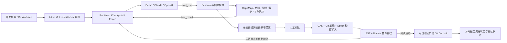
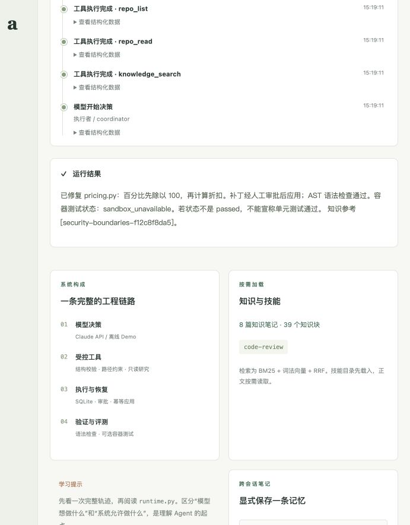

# Agent Systems Lab

**面向 Agent 系统研发面试的代码开发 Agent。** 用一条可运行的代码变更链路，理解模型、工具、检索、上下文、记忆、审批、恢复与评测如何配合。

项目受 [Anthropic 的 Agent 工程文章](https://www.anthropic.com/research/building-effective-agents)启发。20 篇文章的原文链接、代码对应位置和实现边界见 [阅读地图](docs/anthropic-reading-map.md)。源代码包含中文模块说明、关键决策注释与测试案例，便于逐步学习。

## 先运行，再读代码

需要 Python 3.11+ 与 [uv](https://docs.astral.sh/uv/)。不需要模型密钥即可演示。

```bash
git clone https://github.com/CambridgeZ/agent-systems-lab.git
cd agent-systems-lab
uv sync --locked --extra dev --extra mcp
uv run agent-lab serve
```

打开 **http://127.0.0.1:8765**。你可以运行单文件示例（`sample`）或基于真实 Git worktree 的跨文件结算示例（`multi_file`），查看补丁提案、RepoMap 符号结构、带来源的工作记忆和队列 Worker 租约状态，再点击“批准并继续”。**审批前不修改任何文件；每个任务都在独立副本或分离 HEAD 的 Git worktree 中运行。**

命令行也可体验：

```bash
# 到待审批状态停止，输出 run id、proposal id 和 diff 所需的原文
uv run agent-lab demo

# 多文件真实 Git worktree 场景：跨 checkout.py / discounts.py 原子提案、容器验收与验证门控提交
uv run agent-lab demo --template multi_file --auto-approve

# 并行只读 Worker 分别分析代码和测试建议，再由主 Agent 提出补丁
uv run agent-lab demo --mode parallel --auto-approve

# 类似 Claude Code / Codex 的本地目录交互式多轮工作台（支持终端命令、全功能文件操作、子 Agent、外部 MCP 与可选桌面 GUI）
uv run --env-file .env agent-lab code --cwd . --permission-mode auto-edit
uv run --env-file .env agent-lab code --cwd . --permission-mode full-auto --gui --mcp-config .agent-lab/mcp.json

# 持久队列 + 租约续期 + epoch fencing + DLQ 毒丸隔离（终端 1 启动 API，终端 2 启动独立 Worker）
uv run agent-lab serve --dispatch queue
uv run agent-lab worker --worker-id local-worker-1 --lease-ttl 15 --poll-interval 0.8

# 任务协作取消与过期资源回收（终态 worktree、归档快照、陈旧锁与孤儿沙箱容器）
uv run agent-lab cancel <run_id> --reason operator_abort
uv run agent-lab gc --retention-seconds 86400

# 本机存活探针、就绪探针与 Prometheus 指标导出
curl -s http://127.0.0.1:8765/healthz
curl -s http://127.0.0.1:8765/readyz
curl -s http://127.0.0.1:8765/metrics

# 控制流回归测试与隔离评测
uv run --extra dev --extra mcp pytest -q
uv run --extra dev ruff check src tests scripts
uv run agent-lab eval --report reports/eval.json

# 5 任务编码基准流水线验证（需本地已有 python:3.12-slim 镜像；reference 仅验证评测流水线）
uv run agent-lab model-eval --provider reference --report reports/model-eval.json

# Harness 级 KV Cache 命中率与阶梯压缩离线消融实验（对比 Legacy 40.48% vs Optimized 78.96%）
uv run agent-lab kv-benchmark --report docs/kv-cache-ablation-sample.json
```

`demo` 与 `model-eval --provider reference` 都是显式标注的确定性基线，用来检验 harness 控制流、Git worktree、容器回执与修复循环，**不代表任何 LLM 的真实编码能力**。真实模式支持官方 Anthropic Messages API（`--provider anthropic`）与 OpenAI 兼容 Chat Completions API（`--provider openai`），需配置账户密钥后独立实测模型得分。

## 可以从项目中学到什么

| 主题 | 可运行机制 | 主要代码 |
|---|---|---|
| Agent 循环与工具调用 | `tool_use → tool_result → 再决策`，停止原因校验、`max_tokens` 截断续写、协作式 `cancel` 与优雅关机 `interrupted` | [runtime.py](src/agent_lab/runtime.py)、[providers.py](src/agent_lab/providers.py) |
| 真实仓库与多文件原子变更 | 绑定 40 位 `base_commit` 的独立 Git worktree、跨文件 `propose_changeset`（`modify`/`create`/`delete`）、`.agent-apply-*.json` 写前日志（WAL）崩溃前滚恢复、验证通过后推进 `base_commit` 并门控提交 | [git_repo.py](src/agent_lab/git_repo.py)、[tools.py](src/agent_lab/tools.py)、[multi_file_repo](data/multi_file_repo) |
| 测试驱动修复循环 | 受控容器 `run_suite` 回执驱动最多 `max_repair_rounds=2` 轮自动诊断修复；严格分离 `run.status` 与 `verification.status` | [runtime.py](src/agent_lab/runtime.py)、[sandbox.py](src/agent_lab/sandbox.py) |
| 多语言代码地图与符号检索 | `RepoMapIndex` 支持 Python AST 与 TS/JS/Go/Rust/Java 静态结构解析，自动遵循 `.gitignore`、按跨文件引用度排序、遵守字符预算并按 SHA-256 增量刷新 | [repomap.py](src/agent_lab/repomap.py)、[tools.py](src/agent_lab/tools.py) |
| Workflow、并行研究与动态子 Agent | 固定检索前置；`worker_roles`（1—6 个只读 Worker）并发研究；`host`/`computer` 档位支持 `subagent_run` 动态并发派发 1—4 个防递归子 Agent 并共享 KV Cache 前缀 | [runtime.py](src/agent_lab/runtime.py) |
| 本地直连操控与三级权限策略 | `fs_read`/`fs_write`/`fs_edit`/`fs_glob`/`fs_grep` + 脱敏进程组 `bash_exec`；`ask` / `auto-edit` / `full-auto` 三级权限档位与毁机命令硬拦截；`agent-lab code` 多轮交互工作台 | [host_tools.py](src/agent_lab/host_tools.py)、[permissions.py](src/agent_lab/permissions.py)、[repl.py](src/agent_lab/repl.py) |
| 桌面级 GUI 操控（Computer Use） | macOS 原生 `CoreGraphics`/`ApplicationServices` `ctypes` 键鼠注入、`screencapture` + `sips` Retina 逻辑坐标对齐、瞬态多模态视觉图像注入与 `MockComputerBackend` 无头验证 | [computer.py](src/agent_lab/computer.py)、[providers.py](src/agent_lab/providers.py) |
| 工具接口与策略 | JSON Schema、行区间读取、字面量检索、路径/硬链接约束、跨进程文件锁、工具审计 | [tools.py](src/agent_lab/tools.py) |
| RAG | 围栏代码块安全的 Markdown 标题分块、camelCase/snake_case 子词分词、BM25 + TF-IDF（或可插拔稠密 `embedder`/`reranker`）+ RRF 融合 | [retrieval.py](src/agent_lab/retrieval.py) |
| 双重预算上下文工程 | 序列化字符上限 + 校准 BPE token 估算（可选 `tiktoken`）双重预算；原子组裁剪、紧急尾部压缩、在途 token 预留与全量缓存 token 折算 | [context.py](src/agent_lab/context.py)、[providers.py](src/agent_lab/providers.py)、[专题说明](docs/context-skills-state.md) |
| Harness 级 KV Cache 优化 | 瞬态状态置尾、确定性紧凑 JSON、62% 高低水位阶梯压缩、多子代理根前缀共享、Anthropic 三断点 `cache_control` + OpenAI `prompt_cache_key`、链式块哈希观测 | [kv_cache.py](src/agent_lab/kv_cache.py)、[原理与消融文档](docs/kv-cache-harness.md) |
| 带来源的结构化工作记忆 | `<= 2400` 字符的 `goal/constraints/todos/facts`；工具事实追踪关联源码 `bound_files` 哈希、支持显式删除与过期事实淘汰，变更后自动标为 `stale` | [working_memory.py](src/agent_lab/working_memory.py)、[context.py](src/agent_lab/context.py) |
| 跨会话分层记忆、互链 Wiki 与 Dreaming | 用户全局 + 项目双层 `MEMORY.md`（`<= 200` 行有界预载）+ `[[wiki-links]]` 笔记图谱 + Wiki/历史会话 Transcript 混合 RRF 检索 + 每次会话结束自动触发四阶段离线 Dreaming（Transcript 真值纠错、独立主题合成、断链修复、索引升降级） | [memory.py](src/agent_lab/memory.py)、[retrieval.py](src/agent_lab/retrieval.py) |
| Skills | 有界元数据发现、章节索引、按章节加载/卸载、运行期动态置尾快照、版本去重与缓存失效 | [skills.py](src/agent_lab/skills.py)、[code-review](skills/code-review/SKILL.md) |
| 多租户 RBAC 与职责分离 | `AGENT_LAB_TOKENS_JSON` 多角色令牌（`operator`/`approver`/`admin`）、租户隔离任务与 `memories` 作用域、滑动窗口限流、`AGENT_LAB_REQUIRE_DISTINCT_APPROVER=1` 双人复核 | [api.py](src/agent_lab/api.py)、[storage.py](src/agent_lab/storage.py)、[生产高可用专题](docs/production-ha-hardening.md) |
| 长任务恢复与生命周期 GC | 调用账本、worker checkpoint、`state_version` 乐观锁 CAS、跨节点 `workspace_archives` 快照、`agent-lab gc` 过期工作区与孤儿容器回收 | [runtime.py](src/agent_lab/runtime.py)、[storage.py](src/agent_lab/storage.py)、[execution_lock.py](src/agent_lab/execution_lock.py) |
| 持久队列、租约、Fencing 与 DLQ | `run_leases` + `worker_nodes`、单事务 `approve_and_enqueue`、PostgreSQL `FOR UPDATE SKIP LOCKED` DSN 适配、`epoch` 拦截僵尸写入、超限接管自动入死信队列（`dead_letter`） | [lease.py](src/agent_lab/lease.py)、[storage.py](src/agent_lab/storage.py)、[生产高可用专题](docs/production-ha-hardening.md) |
| 人工审批与崩溃原子性 | 审批绑定具体提案与各文件 SHA-256，跨文件写前日志（WAL）前滚恢复、重复应用幂等识别 | [tools.py](src/agent_lab/tools.py) |
| 双进程防伪沙盒与远程池 | 外层 Supervisor 管道 HMAC 回执 + 子进程 `sys.addaudithook` 阻断栈帧/`ctypes` 伪造；原生兼容 `src/` 布局与 `pytest` 风格函数测试；支持 `RemoteHTTPSandboxBackend` | [sandbox.py](src/agent_lab/sandbox.py)、[沙盒专题](docs/sandbox-mechanisms.md) |
| MCP（Server + Client） | 官方 MCP SDK v1 的 `stdio` 只读服务器 + `McpClientManager`（支持连接外部 `stdio` / `streamable-http` MCP Server、子进程环境变量脱敏与工具 Schema 冻结） | [mcp_server.py](src/agent_lab/mcp_server.py)、[mcp_client.py](src/agent_lab/mcp_client.py)、[test_mcp.py](tests/test_mcp.py) |
| 评测与生产可观测性 | 10 个控制流场景 + 5 个真实 Git/Docker 编码基准、`/healthz` `/readyz` `/metrics`（Prometheus）、W3C `traceparent` 追踪与脱敏日志 | [observability.py](src/agent_lab/observability.py)、[evals.py](src/agent_lab/evals.py)、[model_evals.py](src/agent_lab/model_evals.py) |
| 工程交付 | FastAPI、CLI、中文网页、锁定依赖、GitHub Actions、Dockerfile | [web](web)、[CI](.github/workflows/ci.yml) |

这些主题覆盖 Agent 系统研发的核心讨论面。Transformer、模型训练/微调、推理服务和分布式平台的基础知识列在面试指南中，当前仓库没有实现训练或推理引擎。





## 学习顺序

1. [5 分钟演示手册](docs/demo-walkthrough.md)：运行、审批、拒绝、恢复、看轨迹。
2. [14 天学习路线](docs/learning-path.md)：每天读什么、改什么、怎样验证。
3. [系统架构与设计取舍](docs/architecture.md)：先读状态机，再沿模块接口看实现。
4. [**生产级高可用、多租户安全与沙盒加固专题**](docs/production-ha-hardening.md)：Epoch Fencing、DLQ 毒丸隔离、多文件写前日志（WAL）前滚恢复、双进程 HMAC 防伪沙盒、多租户 RBAC/双人复核与 Prometheus/W3C 可观测性。
5. [20 篇 Anthropic 文章对应地图](docs/anthropic-reading-map.md)：每篇对应机制、代码和未实现部分。
6. [44 道基础面试问题](docs/interview-guide.md) + [36 道进阶补充](docs/interview-supplement.md)：加上[沙盒专题 8 题（81—88）](docs/sandbox-mechanisms.md)，共 88 题，覆盖协议、上下文、Skill、恢复、代码检索、评测、成本与隔离机制。
7. [长上下文、Skill 与工具状态专项说明](docs/context-skills-state.md)：压缩规则、崩溃窗口、可复制实验和高可用边界。
8. [Harness 级 KV Cache 命中率优化原理](docs/kv-cache-harness.md)：为什么代码 Agent 必须做前缀对齐、RoPE 与链式块哈希失效原理、6 项落地机制与消融数据。
9. [沙盒机制与隔离探针](docs/sandbox-mechanisms.md)：文件/网络/资源边界、双进程防伪回执、远程执行池与可信度局限。
10. [验证记录](docs/validation.md)：交付时实际运行了什么，哪些需要额外环境。

阅读代码建议从 `AgentRuntime.start → execute → Provider.complete → ToolRegistry.execute` 开始，接着看审批与恢复测试。避免只背术语；能解释失败场景更有说服力。

## 配置真实模型（Claude / OpenAI）与评测

```bash
cp .env.example .env
# 编辑 .env，填写 ANTHROPIC_API_KEY + ANTHROPIC_MODEL（AGENT_PROVIDER=anthropic）
# 或 OPENAI_API_KEY + OPENAI_MODEL（AGENT_PROVIDER=openai）。不要提交 .env。
uv run --env-file .env agent-lab serve --dispatch queue

# 针对本地任意 Git 仓库创建隔离 worktree 并运行修复任务
uv run --env-file .env agent-lab run '定位并修复失败的单元测试' --provider anthropic --repo /path/to/local/git-repo

# 在 5 个真实仓库编码基准上运行真实模型评测（需 Docker 已拉取 python:3.12-slim）
uv run --env-file .env agent-lab model-eval --provider anthropic --trials 1 --report reports/model-eval-live.json
```

凭证只从服务端环境变量读取，默认仅连接官方端点（`https://api.anthropic.com` 或 `https://api.openai.com/v1`，自定义网关需显式开启 `AGENT_ALLOW_CUSTOM_BASE_URL=1`），绝不传入模型上下文、容器环境或数据库。真实调用会计费。模型请求支持滑动窗口 RPM/TPM 准入限流、超时、有限重试与动态输出上限；预算系统同时做请求前 BPE token 在途预留与响应后全量缓存 token 加权折算（`compute_usage_totals` 区分 Anthropic `cache_creation_input_tokens`/`cache_read_input_tokens` 与 OpenAI `cached_tokens`），但**应用层预算仍不是云账单级硬上限**。`ContextManager` 支持序列化字符预算（`context_chars`）与校准 BPE token 预算（`max_tokens`，显式开启 `AGENT_LAB_USE_TIKTOKEN=1` 时调用 `cl100k_base`）双重门控。

## 长上下文怎样压缩与恢复

完整工具结果先存 SQLite。超过 2600 字符的结果向模型提供关键状态、900 字符预览、结果 SHA-256 和 `tool_result_get` 回取引用；模型每次最多取 1200 字符。分页本身不再压成引用，避免循环读取。旧对话按完整工具往返裁剪，固定保留原任务、执行状态、活动 Skill 快照与最新消息组；若单轮尾部参数或结果过大，先做推理视图紧急尾部压缩（`_project_history(..., emergency_tail=True)`），仍装不下时显式返回 `ContextOverflow`，不截断源码或 JSON。

Skill 先搜索元数据，再看章节索引，按需加载正文。活动正文最多 4 个技能、合计 6000 字符；同一技能只保留一个版本，运行期中途加载的技能自动置尾以保护历史 KV Cache 前缀。快照随任务落盘，磁盘更新不会悄悄改变运行中版本。调用账本则记录 `scheduled/running/succeeded/failed/waiting_approval/unknown`、参数哈希、尝试和完整结果；已完成调用直接复用，无法确认的容器执行不会自动重跑。同机每个 run 使用非阻塞文件锁，协程取消时等待已派发同步工具结束并落盘再释放锁。

为防止旧对话裁剪后丢失关键中间结论，模型还可调用 `working_memory_write` 维护总长不超过 2400 字符的结构化工作记忆（`goal`、`constraints`、`todos`、`facts`），支持按 ID 显式删除与过期条目自动淘汰（`remove_todo_ids`、`remove_fact_ids`、`prune_stale_facts`、`auto_evict_stale`）。每条 `fact` 必须校验工作区文件的当前 SHA-256 或已提交成功 `tool_calls` 的结果 SHA-256（并自动记录工具调用涉及源码的 `bound_files` 哈希）；一旦底层文件在后续补丁中改变，下一轮组装上下文前 `audit_working_memory` 会自动将该事实降级为 `stale`（`file_hash_changed` 或 `bound_file_hash_changed`），且工作记忆永远位于 `HARNESS_STATE` 之后，不能伪造或覆盖审批记录。

这属于**确定性视图压缩 + 带来源校验的结构化工作记忆**，未使用模型生成无来源语义摘要。详见[专项说明与离线实验](docs/context-skills-state.md)。可直接查看状态和原始证据：

```bash
uv run agent-lab calls <run_id>
uv run agent-lab result <run_id> <call_id> --offset 0 --limit 1200
```

API 对应 `GET /api/runs/{run_id}/calls` 和 `GET /api/runs/{run_id}/tool-result?call_id=...&offset=0&limit=1200`；任务详情还返回上下文统计、KV Cache 命中率、租约状态和活动 Skill 的版本信息。

## 验证、MCP 与数据目录

- `verify_python` 只做 AST 解析，不执行生成代码，不能证明业务正确。
- 容器测试（单文件 `run` 与多文件套件 `run_suite`）支持本地 Docker（需事先 `docker pull python:3.12-slim`，固定 64 位镜像摘要）或通过 `AGENT_LAB_SANDBOX_URL` + `AGENT_LAB_SANDBOX_TOKEN` 委托给隔离的 `RemoteHTTPSandboxBackend`（`POST /api/internal/sandbox/execute`）。容器内采用**外层 Supervisor + 管道 32 字节密钥 HMAC-SHA256 防伪回执 + 子进程 `sys.addaudithook`**（拦截 `ctypes`、`gc` 对象遍历与 `sys._getframe` 栈帧窃取，并清洗标准输出中的伪造标记），原生支持 `src/` 布局与 `pytest` 风格函数/异步测试发现；没有沙盒环境时返回 `sandbox_unavailable`，绝不退回宿主机执行代码。
- `run.status == "completed"` 仅代表控制流结束；业务测试是否通过必须看 `run.metadata.verification.status`（`passed` / `failed` / `syntax_only` / `unavailable` / `unknown` / `not_run`）。测试失败时主循环自动进入最多 `max_repair_rounds=2` 轮测试驱动修复；仅当 `verification.status == "passed"` 时才允许在任务 worktree 上创建验证门控的 Git commit，并同步推进 `git.base_commit` 以支持后续增量变更。
- MCP 双向支持：
  - 作为只读 MCP Server：`uv run --extra mcp python -m agent_lab.mcp_server --workspace data/sample_repo`。
  - 作为 MCP Client：在 `host` / `computer` 档位下通过 `--mcp-config <path>`、`AGENT_LAB_MCP_CONFIG` 或 `.agent-lab/mcp.json` 连接外部 `stdio` / `streamable-http` MCP Server，自动映射为 `mcp__<server>__<tool>` 并冻结工具 Schema。
- 默认状态在 `.agent-lab/state.db`（亦支持通过 `AGENT_LAB_STORAGE_DSN=postgresql://...` 切换至 PostgreSQL），任务副本与 worktree 在 `.agent-lab/workspaces/`；可通过 `agent-lab gc` 或 `POST /api/admin/gc` 定期清理过期终态工作区、`workspace_archives` 快照、陈旧锁与带过期标签的孤儿容器。
- `data/sample_repo/`、`data/multi_file_repo/` 与 `data/evals/coding_benchmark/` 均是刻意包含缺陷的受控样本仓库；验收测试仅在受控容器中执行。流水线验证样例见 [model-eval-sample.json](docs/model-eval-sample.json)。

可选容器部署：

```bash
docker build -t agent-systems-lab .
docker run --rm -p 127.0.0.1:8765:8765 agent-systems-lab
```

监听非回环地址时强制要求配置 `AGENT_LAB_TOKEN` 或多租户 `AGENT_LAB_TOKENS_JSON`。不要向应用容器挂载宿主机 Docker socket；生产环境请通过 `AGENT_LAB_SANDBOX_URL` 将沙盒执行转发至独立受管沙盒节点。

## 实现范围

这是面向学习、系统设计面试与生产高可用演进验证的**可运行代码 Agent 工程**。全部核心不变量均有自动化测试覆盖（包含单元/并发故障注入测试、10 项离线控制流回归、5 项真实 Git worktree + Docker 编码基准与 KV Cache 消融实验），详见[生产高可用加固专题](docs/production-ha-hardening.md)与[验证记录](docs/validation.md)。当前仍需如实区分的工程边界：

- **评测诚实性**：仓库内置 `demo` 与 `reference` 结果仅证明 harness 与沙盒闭环无误；未在无外部 API 密钥的 CI 中冒充真实 Claude / OpenAI 编码得分。
- **单机 SQLite 默认开箱 vs 跨节点 PostgreSQL 集群**：`Storage` 原生内置 `PostgresBackendConfig`（`FOR UPDATE SKIP LOCKED` 队列锁、`state_version` 乐观锁 CAS、单调 `epoch` fencing、`dead_letter` 死信队列与 `workspace_archives` 快照表），但默认零配置启动使用本地 SQLite WAL；跨机生产部署需配置外部 PostgreSQL 实例与独立远程沙盒池。
- **轻量多语言静态索引 vs 完整编译器前端**：`RepoMapIndex` 对 Python 使用 `ast`、对 TS/JS/Go/Rust/Java 使用零宿主执行的静态结构扫描并遵守 `.gitignore`，未引入原生 C 扩展 Tree-sitter 或跨仓库类型推导 LSP。
- **令牌级多租户 RBAC vs 企业 IAM/KMS**：API 已实现多租户数据隔离、`operator`/`approver`/`admin` 角色鉴权、双人复核（职责分离）、租户级限流、W3C Trace-ID 与 Prometheus `/metrics`，尚未对接企业 OIDC SSO、KMS 密钥轮换或 gVisor/Firecracker 微虚拟机内核隔离。
