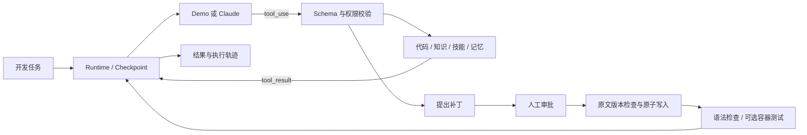

# Agent Systems Lab

**面向 Agent 系统研发面试的代码开发 Agent。** 用一条可运行的代码变更链路，理解模型、工具、检索、上下文、记忆、审批、恢复与评测如何配合。

项目受 [Anthropic 的 Agent 工程文章](https://www.anthropic.com/research/building-effective-agents)启发。20 篇文章的原文链接、代码对应位置和实现边界见 [阅读地图](docs/anthropic-reading-map.md)。源代码包含中文模块说明、关键决策注释与测试案例，便于逐步学习。

## 先运行，再读代码

需要 Python 3.11+ 与 [uv](https://docs.astral.sh/uv/)。不需要模型密钥即可演示。

```bash
git clone https://github.com/CambridgeZ/agent-systems-lab.git
cd agent-systems-lab
uv sync --locked --extra dev --extra mcp
uv run agent-lab serve
```

打开 **http://127.0.0.1:8765**。点击“开始运行”，查看 `pricing.py` 折扣 bug 的补丁，再点击“批准并继续”。**审批前不修改文件；每个任务使用独立示例副本。**

命令行也可体验：

```bash
# 到待审批状态停止，输出 run id、proposal id 和 diff 所需的原文
uv run agent-lab demo

# 显式授权自动应用内置示例补丁，适合快速演示
uv run agent-lab demo --auto-approve

# 两个只读 Worker 分别分析代码和测试建议，再由主 Agent 提出补丁
uv run agent-lab demo --mode parallel --auto-approve

# 控制流回归测试与隔离评测
uv run --extra dev --extra mcp pytest -q
uv run --extra dev ruff check src tests
uv run agent-lab eval --report reports/eval.json
```

`demo` 是可复演的固定脚本，仅支持内置折扣场景。真实模式使用官方 Anthropic Python SDK / Messages API，由模型选择工具；尚未在本项目交付环境完成真实模型联调。不要把 demo 的回归结果当成模型编码成功率。

## 可以从项目中学到什么

| 主题 | 可运行机制 | 主要代码 |
|---|---|---|
| Agent 循环与工具调用 | `tool_use → tool_result → 再决策`，停止原因校验与轮次上限 | [runtime.py](src/agent_lab/runtime.py)、[providers.py](src/agent_lab/providers.py) |
| Workflow 与并行研究 | 固定检索前置；两个固定角色 Worker 独立上下文、只读权限、共享预算 | [runtime.py](src/agent_lab/runtime.py) |
| 工具接口与策略 | JSON Schema、字面量检索、路径约束、结构化错误、工具审计 | [tools.py](src/agent_lab/tools.py) |
| RAG | 带标题/小节背景分块、BM25、TF-IDF 词法向量、RRF 排名融合、可版本化引用 | [retrieval.py](src/agent_lab/retrieval.py) |
| 上下文工程 | system/tools/messages 总字符预算；固定执行状态；原子裁剪；大结果引用与分页回取 | [context.py](src/agent_lab/context.py)、[专题说明](docs/context-skills-state.md) |
| Skills | 有界元数据发现、章节索引、按章节加载/卸载、版本快照、去重与缓存失效 | [skills.py](src/agent_lab/skills.py)、[code-review](skills/code-review/SKILL.md) |
| 跨会话记忆 | 用户显式保存笔记，模型可读取；scope 与执行日志分离 | [storage.py](src/agent_lab/storage.py)、[api.py](src/agent_lab/api.py) |
| 长任务恢复 | 调用账本、worker checkpoint、参数/结果哈希、幂等提案、未知结果策略、同机执行互斥 | [runtime.py](src/agent_lab/runtime.py)、[storage.py](src/agent_lab/storage.py)、[execution_lock.py](src/agent_lab/execution_lock.py) |
| 人工审批与幂等 | 审批绑定具体提案和原文 SHA-256，CAS 检查、原子替换、重复应用识别 | [tools.py](src/agent_lab/tools.py) |
| 代码验证边界 | AST 语法检查；Docker 受限快照、固定镜像 ID、禁网/只读/非 root、资源与输出上限、清理回执 | [sandbox.py](src/agent_lab/sandbox.py)、[沙盒专题](docs/sandbox-mechanisms.md) |
| MCP | 官方 MCP SDK v1 的 stdio 只读服务器与真实协议集成测试 | [mcp_server.py](src/agent_lab/mcp_server.py)、[test_mcp.py](tests/test_mcp.py) |
| 评测与可观察性 | 10 个隔离场景、最终文件状态 grader、受限算术检查、事件日志、SSE | [evals.py](src/agent_lab/evals.py)、[api.py](src/agent_lab/api.py) |
| 工程交付 | FastAPI、CLI、中文网页、锁定依赖、GitHub Actions、Dockerfile | [web](web)、[CI](.github/workflows/ci.yml) |

这些主题覆盖 Agent 系统研发的核心讨论面。Transformer、模型训练/微调、推理服务和分布式平台的基础知识列在面试指南中，当前仓库没有实现训练或推理引擎。




## 学习顺序

1. [5 分钟演示手册](docs/demo-walkthrough.md)：运行、审批、拒绝、恢复、看轨迹。
2. [14 天学习路线](docs/learning-path.md)：每天读什么、改什么、怎样验证。
3. [系统架构与设计取舍](docs/architecture.md)：先读状态机，再沿模块接口看实现。
4. [20 篇 Anthropic 文章对应地图](docs/anthropic-reading-map.md)：每篇对应机制、代码和未实现部分。
5. [44 道基础面试问题](docs/interview-guide.md) + [36 道进阶补充](docs/interview-supplement.md)：加上[沙盒专题 8 题（81—88）](docs/sandbox-mechanisms.md)，共 88 题，覆盖协议、上下文、Skill、恢复、代码检索、评测、成本与隔离机制。
6. [长上下文、Skill 与工具状态专项说明](docs/context-skills-state.md)：压缩规则、崩溃窗口、可复制实验和高可用边界。
7. [沙盒机制与隔离探针](docs/sandbox-mechanisms.md)：文件/网络/资源边界、镜像与快照、超时与日志限制、可信度局限。
8. [验证记录](docs/validation.md)：交付时实际运行了什么，哪些需要额外环境。

阅读代码建议从 `AgentRuntime.start → execute → Provider.complete → ToolRegistry.execute` 开始，接着看审批与恢复测试。避免只背术语；能解释失败场景更有说服力。

## 配置真实 Claude

```bash
cp .env.example .env
# 编辑 .env，填写 ANTHROPIC_API_KEY、账户可用的 ANTHROPIC_MODEL，
# 并把 AGENT_PROVIDER 改为 anthropic。不要提交 .env。
uv run --env-file .env agent-lab serve

# CLI 的 provider 需显式指定；读取同一份环境配置
uv run --env-file .env agent-lab run '分析并修复 pricing.py 的折扣计算' --provider anthropic
```

凭证只从服务端环境变量读取，固定访问 `https://api.anthropic.com`，不传入模型上下文或数据库。真实调用会计费。模型请求有超时、有限重试和输出上限；总 token 按响应后的 usage 计量，**总预算不是严格费用上限**。`context_chars` 限制本地 `system/tools/messages` 整体 JSON 的序列化字符数，包含字段名和标点；不包含服务商隐藏包装，不保证真实 token 上限。

## 长上下文怎样压缩与恢复

完整工具结果先存 SQLite。超过 2600 字符的结果向模型提供关键状态、900 字符预览、结果 SHA-256 和 `tool_result_get` 回取引用；模型每次最多取 1200 字符。分页本身不再压成引用，避免循环读取。旧对话按完整工具往返裁剪，固定保留原任务、执行状态、活动 Skill 快照与最新消息组。必需内容装不下时显式返回 `ContextOverflow`，不截断源码或 JSON。

Skill 先搜索元数据，再看章节索引，按需加载正文。活动正文最多 4 个技能、合计 6000 字符；同一技能只保留一个版本。快照随任务落盘，磁盘更新不会悄悄改变运行中版本。调用账本则记录 `scheduled/running/succeeded/failed/waiting_approval/unknown`、参数哈希、尝试和完整结果；已完成调用直接复用，无法确认的容器执行不会自动重跑。同机每个 run 使用非阻塞文件锁，协程取消时等待已派发同步工具结束并落盘再释放锁。

这属于**确定性视图压缩**，未使用模型生成语义摘要。详见[专项说明与离线实验](docs/context-skills-state.md)。可直接查看状态和原始证据：

```bash
uv run agent-lab calls <run_id>
uv run agent-lab result <run_id> <call_id> --offset 0 --limit 1200
```

API 对应 `GET /api/runs/{run_id}/calls` 和 `GET /api/runs/{run_id}/tool-result?call_id=...&offset=0&limit=1200`；任务详情还返回上下文统计和活动 Skill 的版本信息。

## 验证、MCP 与数据目录

- `verify_python` 只做 AST 解析，不执行生成代码，不能证明业务正确。
- 容器测试需要已启动 Docker，并事先执行 `docker pull python:3.12-slim`。工具本身不联网拉镜像；先解析本地镜像 ID，再用该 ID 执行。仅挂载受限 Python 文件副本，不把原工作区或 `.env` 挂进去。没有环境时返回 `sandbox_unavailable`，不退回宿主机执行代码。
- MCP 只读服务器：`uv run --extra mcp python -m agent_lab.mcp_server --workspace data/sample_repo`。它可被兼容客户端连接；主循环内部直接调用工具，并未实现远程 MCP client。
- 状态在 `.agent-lab/state.db`，任务副本在 `.agent-lab/workspaces/`；这些目录均被 Git 忽略。`agent-lab --state <目录>` 可切换状态目录。
- `data/sample_repo/` 是刻意包含 bug 的合成样本；项目测试不应直接把这个 bug 当成失败项。验收 fixture 仅在受控容器中执行。
- `reports/eval.json` 是本机评测报告；`data/knowledge/` 是原创学习笔记，没有打包 Anthropic 文章全文或个人资料。

可选容器部署：

```bash
docker build -t agent-systems-lab .
docker run --rm -p 127.0.0.1:8765:8765 agent-systems-lab
```

不要向应用容器挂载宿主机 Docker socket；嵌套执行池需独立设计。此容器命令只部署网页应用，不自动启用代码执行沙箱。

## 实现范围

这是面向学习与作品集的**单机教学工程**。已实现的约束有对应测试；真实 Docker 代码执行路径已在 GitHub Actions 验证，尚未验证真实模型表现或生产负载。检索使用词法向量，未接语义 embedding / cross-encoder；并行模式是固定双 Worker；记忆没有自动整合；MCP 仅暴露只读工具；应用不克隆或修改你的其他仓库。

SQLite、API 后台任务和 POSIX 同机文件锁适合 macOS/Linux 本地单用户运行。多机高可用方案仍需持久队列、租约与 fencing、故障接管、共享存储、执行池、用户/租户隔离及负载验证。文档逐项解释了这些扩展的动机与验收方法，面试时应准确区分已实现的故障恢复和未来多副本部署。
