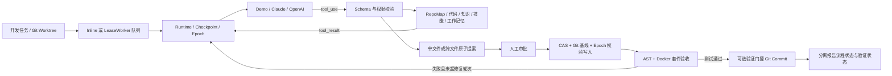

# Agent Systems Lab

**面向 Agent 系统研发面试的代码开发 Agent。** 用一条可运行的代码变更链路，理解模型、工具、检索、上下文、记忆、审批、恢复与评测如何配合。

项目受 [Anthropic 的 Agent 工程文章](https://www.anthropic.com/research/building-effective-agents)启发。20 篇文章的原文链接、代码对应位置和实现边界见 [阅读地图](docs/anthropic-reading-map.md)。源代码包含中文模块说明、关键决策注释与测试案例，便于逐步学习。

## 先运行，再读代码

需要 Python 3.11+ 与 [uv](https://docs.astral.sh/uv/)。不需要模型密钥即可演示。

```bash
git clone https://github.com/CambridgeZ/agent-systems-lab.git
cd agent-systems-lab
uv sync --locked --extra dev --extra mcp
uv run agent-lab serve
```

打开 **http://127.0.0.1:8765**。你可以运行单文件示例（`sample`）或基于真实 Git worktree 的跨文件结算示例（`multi_file`），查看补丁提案、RepoMap 符号结构、带来源的工作记忆和队列 Worker 租约状态，再点击“批准并继续”。**审批前不修改任何文件；每个任务都在独立副本或分离 HEAD 的 Git worktree 中运行。**

命令行也可体验：

```bash
# 到待审批状态停止，输出 run id、proposal id 和 diff 所需的原文
uv run agent-lab demo

# 多文件真实 Git worktree 场景：跨 checkout.py / discounts.py 原子提案、容器验收与验证门控提交
uv run agent-lab demo --template multi_file --auto-approve

# 两个只读 Worker 分别分析代码和测试建议，再由主 Agent 提出补丁
uv run agent-lab demo --mode parallel --auto-approve

# 持久队列 + 租约续期 + epoch fencing 模式（终端 1 启动 API，终端 2 启动独立 Worker）
uv run agent-lab serve --dispatch queue
uv run agent-lab worker --worker-id local-worker-1

# 控制流回归测试与隔离评测
uv run --extra dev --extra mcp pytest -q
uv run --extra dev ruff check src tests scripts
uv run agent-lab eval --report reports/eval.json

# 5 任务编码基准流水线验证（需本地已有 python:3.12-slim 镜像；reference 仅验证评测流水线）
uv run agent-lab model-eval --provider reference --report reports/model-eval.json
```

`demo` 与 `model-eval --provider reference` 都是显式标注的确定性基线，用来检验 harness 控制流、Git worktree、容器回执与修复循环，**不代表任何 LLM 的真实编码能力**。真实模式支持官方 Anthropic Messages API（`--provider anthropic`）与 OpenAI 兼容 Chat Completions API（`--provider openai`），需配置账户密钥后独立实测模型得分。

## 可以从项目中学到什么

| 主题 | 可运行机制 | 主要代码 |
|---|---|---|
| Agent 循环与工具调用 | `tool_use → tool_result → 再决策`，停止原因校验与轮次上限 | [runtime.py](src/agent_lab/runtime.py)、[providers.py](src/agent_lab/providers.py) |
| 真实仓库与多文件变更 | 绑定 40 位 `base_commit` 的独立 Git worktree、跨文件原子 `propose_changeset`、CAS + 基线复核、测试通过后自动 Git commit | [git_repo.py](src/agent_lab/git_repo.py)、[tools.py](src/agent_lab/tools.py)、[multi_file_repo](data/multi_file_repo) |
| 测试驱动修复循环 | 受控容器 `run_suite` 回执驱动最多 `max_repair_rounds=2` 轮自动诊断修复；严格分离 `run.status` 与 `verification.status` | [runtime.py](src/agent_lab/runtime.py)、[sandbox.py](src/agent_lab/sandbox.py) |
| 代码地图与符号检索 | 纯 AST `RepoMapIndex` 按跨文件引用度排序、遵守字符预算、按文件 SHA-256 增量刷新缓存，支持 `repo_map` 与 `symbol_search` | [repomap.py](src/agent_lab/repomap.py)、[tools.py](src/agent_lab/tools.py) |
| Workflow 与并行研究 | 固定检索前置；两个固定角色 Worker 独立上下文、只读权限、共享预算 | [runtime.py](src/agent_lab/runtime.py) |
| 工具接口与策略 | JSON Schema、字面量检索、路径约束、结构化错误、工具审计 | [tools.py](src/agent_lab/tools.py) |
| RAG | 带标题/小节背景分块、BM25、TF-IDF 词法向量、RRF 排名融合、可版本化引用 | [retrieval.py](src/agent_lab/retrieval.py) |
| 上下文工程 | system/tools/messages 总字符预算；固定执行状态；原子裁剪；大结果引用与分页回取 | [context.py](src/agent_lab/context.py)、[专题说明](docs/context-skills-state.md) |
| 带来源的结构化工作记忆 | `<= 2400` 字符的 `goal/constraints/todos/facts` 跨裁剪保留；事实强制核验文件或 `tool_calls` SHA-256，文件变更后自动标为 `stale` | [working_memory.py](src/agent_lab/working_memory.py)、[context.py](src/agent_lab/context.py) |
| Skills | 有界元数据发现、章节索引、按章节加载/卸载、版本快照、去重与缓存失效 | [skills.py](src/agent_lab/skills.py)、[code-review](skills/code-review/SKILL.md) |
| 跨会话记忆 | 用户显式保存笔记，模型可读取；scope 与执行日志分离 | [storage.py](src/agent_lab/storage.py)、[api.py](src/agent_lab/api.py) |
| 长任务恢复 | 调用账本、worker checkpoint、参数/结果哈希、幂等提案、未知结果策略、同机执行互斥 | [runtime.py](src/agent_lab/runtime.py)、[storage.py](src/agent_lab/storage.py)、[execution_lock.py](src/agent_lab/execution_lock.py) |
| 持久队列、租约与 fencing | `run_leases` + `worker_nodes`、心跳续租、超时接管、单调递增 `epoch` 令牌拦截僵尸 Worker 写库与写文件（`StaleEpochError`） | [lease.py](src/agent_lab/lease.py)、[storage.py](src/agent_lab/storage.py)、[api.py](src/agent_lab/api.py) |
| 人工审批与幂等 | 审批绑定具体提案和原文 SHA-256，CAS 检查、原子替换、重复应用识别 | [tools.py](src/agent_lab/tools.py) |
| 代码验证边界 | AST 语法检查；Docker 单测与多文件套件受限快照、固定镜像 ID、禁网/只读/非 root、资源与输出上限、清理回执 | [sandbox.py](src/agent_lab/sandbox.py)、[沙盒专题](docs/sandbox-mechanisms.md) |
| MCP | 官方 MCP SDK v1 的 stdio 只读服务器与真实协议集成测试 | [mcp_server.py](src/agent_lab/mcp_server.py)、[test_mcp.py](tests/test_mcp.py) |
| 评测与可观察性 | 10 个离线控制流场景 + 5 个真实 Git/Docker 编码基准任务（区分 `model_failure` 与 `infrastructure_failure`）、SSE、事件审计 | [evals.py](src/agent_lab/evals.py)、[model_evals.py](src/agent_lab/model_evals.py)、[coding_benchmark](data/evals/coding_benchmark) |
| 工程交付 | FastAPI、CLI、中文网页、锁定依赖、GitHub Actions、Dockerfile | [web](web)、[CI](.github/workflows/ci.yml) |

这些主题覆盖 Agent 系统研发的核心讨论面。Transformer、模型训练/微调、推理服务和分布式平台的基础知识列在面试指南中，当前仓库没有实现训练或推理引擎。




## 学习顺序

1. [5 分钟演示手册](docs/demo-walkthrough.md)：运行、审批、拒绝、恢复、看轨迹。
2. [14 天学习路线](docs/learning-path.md)：每天读什么、改什么、怎样验证。
3. [系统架构与设计取舍](docs/architecture.md)：先读状态机，再沿模块接口看实现。
4. [20 篇 Anthropic 文章对应地图](docs/anthropic-reading-map.md)：每篇对应机制、代码和未实现部分。
5. [44 道基础面试问题](docs/interview-guide.md) + [36 道进阶补充](docs/interview-supplement.md)：加上[沙盒专题 8 题（81—88）](docs/sandbox-mechanisms.md)，共 88 题，覆盖协议、上下文、Skill、恢复、代码检索、评测、成本与隔离机制。
6. [长上下文、Skill 与工具状态专项说明](docs/context-skills-state.md)：压缩规则、崩溃窗口、可复制实验和高可用边界。
7. [沙盒机制与隔离探针](docs/sandbox-mechanisms.md)：文件/网络/资源边界、镜像与快照、超时与日志限制、可信度局限。
8. [验证记录](docs/validation.md)：交付时实际运行了什么，哪些需要额外环境。

阅读代码建议从 `AgentRuntime.start → execute → Provider.complete → ToolRegistry.execute` 开始，接着看审批与恢复测试。避免只背术语；能解释失败场景更有说服力。

## 配置真实模型（Claude / OpenAI）与评测

```bash
cp .env.example .env
# 编辑 .env，填写 ANTHROPIC_API_KEY + ANTHROPIC_MODEL（AGENT_PROVIDER=anthropic）
# 或 OPENAI_API_KEY + OPENAI_MODEL（AGENT_PROVIDER=openai）。不要提交 .env。
uv run --env-file .env agent-lab serve --dispatch queue

# 针对本地任意 Git 仓库创建隔离 worktree 并运行修复任务
uv run --env-file .env agent-lab run '定位并修复失败的单元测试' --provider anthropic --repo /path/to/local/git-repo

# 在 5 个真实仓库编码基准上运行真实模型评测（需 Docker 已拉取 python:3.12-slim）
uv run --env-file .env agent-lab model-eval --provider anthropic --trials 1 --report reports/model-eval-live.json
```

凭证只从服务端环境变量读取，默认仅连接官方端点（`https://api.anthropic.com` 或 `https://api.openai.com/v1`，自定义网关需显式开启 `AGENT_ALLOW_CUSTOM_BASE_URL=1`），绝不传入模型上下文、容器环境或数据库。真实调用会计费。模型请求有超时、有限重试和输出上限；总 token 按响应后的 usage 计量，**总预算不是严格费用上限**。`context_chars` 限制本地 `system/tools/messages` 整体 JSON 的序列化字符数，包含字段名和标点；不包含服务商隐藏包装，不保证真实 token 上限。

## 长上下文怎样压缩与恢复

完整工具结果先存 SQLite。超过 2600 字符的结果向模型提供关键状态、900 字符预览、结果 SHA-256 和 `tool_result_get` 回取引用；模型每次最多取 1200 字符。分页本身不再压成引用，避免循环读取。旧对话按完整工具往返裁剪，固定保留原任务、执行状态、活动 Skill 快照与最新消息组。必需内容装不下时显式返回 `ContextOverflow`，不截断源码或 JSON。

Skill 先搜索元数据，再看章节索引，按需加载正文。活动正文最多 4 个技能、合计 6000 字符；同一技能只保留一个版本。快照随任务落盘，磁盘更新不会悄悄改变运行中版本。调用账本则记录 `scheduled/running/succeeded/failed/waiting_approval/unknown`、参数哈希、尝试和完整结果；已完成调用直接复用，无法确认的容器执行不会自动重跑。同机每个 run 使用非阻塞文件锁，协程取消时等待已派发同步工具结束并落盘再释放锁。

为防止旧对话裁剪后丢失关键中间结论，模型还可调用 `working_memory_write` 维护总长不超过 2400 字符的结构化工作记忆（`goal`、`constraints`、`todos`、`facts`）。每条 `fact` 必须附带工作区文件的当前 SHA-256 或已提交 `tool_calls` 的结果 SHA-256；一旦目标文件在后续补丁中改变，下一轮组装上下文前 `audit_working_memory` 会自动将该事实降级为 `stale`（`file_hash_changed`），且工作记忆永远位于 `HARNESS_STATE` 之后，不能伪造或覆盖审批记录。

这属于**确定性视图压缩 + 带来源校验的结构化工作记忆**，未使用模型生成无来源语义摘要。详见[专项说明与离线实验](docs/context-skills-state.md)。可直接查看状态和原始证据：

```bash
uv run agent-lab calls <run_id>
uv run agent-lab result <run_id> <call_id> --offset 0 --limit 1200
```

API 对应 `GET /api/runs/{run_id}/calls` 和 `GET /api/runs/{run_id}/tool-result?call_id=...&offset=0&limit=1200`；任务详情还返回上下文统计和活动 Skill 的版本信息。

## 验证、MCP 与数据目录

- `verify_python` 只做 AST 解析，不执行生成代码，不能证明业务正确。
- 容器测试（单文件 `run` 与多文件套件 `run_suite`）需要已启动 Docker，并事先执行 `docker pull python:3.12-slim`。工具本身不联网拉镜像；先解析本地 64 位镜像摘要，再用该 ID 执行。仅挂载受限 Python 只读副本并校验全部受保护 `tests/` 文件 SHA-256 与预期用例数回执，不把原工作区、`.git` 或 `.env` 挂进容器。没有环境时返回 `sandbox_unavailable`，绝不退回宿主机执行代码。
- `run.status == "completed"` 仅代表控制流结束；业务测试是否通过必须看 `run.metadata.verification.status`（`passed` / `failed` / `syntax_only` / `unavailable` / `unknown` / `not_run`）。测试失败时主循环自动进入最多 `max_repair_rounds=2` 轮测试驱动修复；仅当 `verification.status == "passed"` 时才允许在任务 worktree 上创建验证门控的 Git commit。
- MCP 只读服务器：`uv run --extra mcp python -m agent_lab.mcp_server --workspace data/sample_repo`。它可被兼容客户端连接；主循环内部直接调用工具，并未实现远程 MCP client。
- 状态在 `.agent-lab/state.db`，任务副本与 worktree 在 `.agent-lab/workspaces/`；这些目录均被 Git 忽略。`agent-lab --state <目录>` 可切换状态目录。
- `data/sample_repo/`、`data/multi_file_repo/` 与 `data/evals/coding_benchmark/` 均是刻意包含缺陷的受控样本仓库；验收测试仅在受控容器中执行。流水线验证样例见 [model-eval-sample.json](docs/model-eval-sample.json)。

可选容器部署：

```bash
docker build -t agent-systems-lab .
docker run --rm -p 127.0.0.1:8765:8765 agent-systems-lab
```

不要向应用容器挂载宿主机 Docker socket；嵌套执行池需独立设计。此容器命令只部署网页应用，不自动启用代码执行沙箱。

## 实现范围

这是面向学习与作品集的**单机多进程可验证工程**。全部约束均有自动化测试（273 项单元测试、10 项控制流回归、5 项真实 Git worktree + Docker 编码基准流水线），并在本机 Docker Desktop 与 GitHub Actions Linux 容器中双重验证。当前仍需如实区分的工程边界：

- **评测诚实性**：仓库内置 `demo` 与 `reference` 结果仅证明 harness 与沙盒闭环无误；未在无外部 API 密钥的 CI 中冒充真实 Claude / OpenAI 编码得分。
- **单机 SQLite 队列 vs 跨主机分布式集群**：`run_leases`、心跳续期、过期接管与单调递增 `epoch` fencing 已在单机多进程（API + 独立 `agent-lab worker`）下完整闭环并拦截僵尸写入；跨主机多副本部署仍需替换为 Postgres/etcd 共享事务存储、对象/Git 远端仓库与独立沙盒执行池。
- **纯 AST RepoMap vs 完整编译器前端**：`RepoMapIndex` 基于标准库 `ast` 计算 Python 定义与跨文件导入权重，未接多语言 Tree-sitter 或带类型推导的 LSP。
- **单用户信任边界**：检索使用词法向量（BM25 + TF-IDF + RRF），并行模式为固定双只读 Worker，尚未实现企业多租户 ACL 与生产负载压测。
