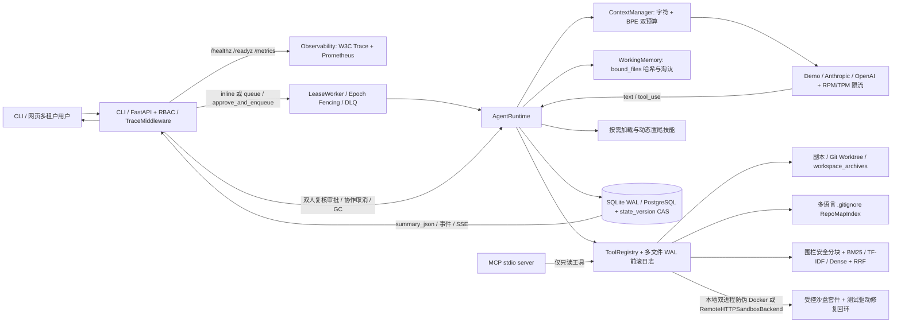
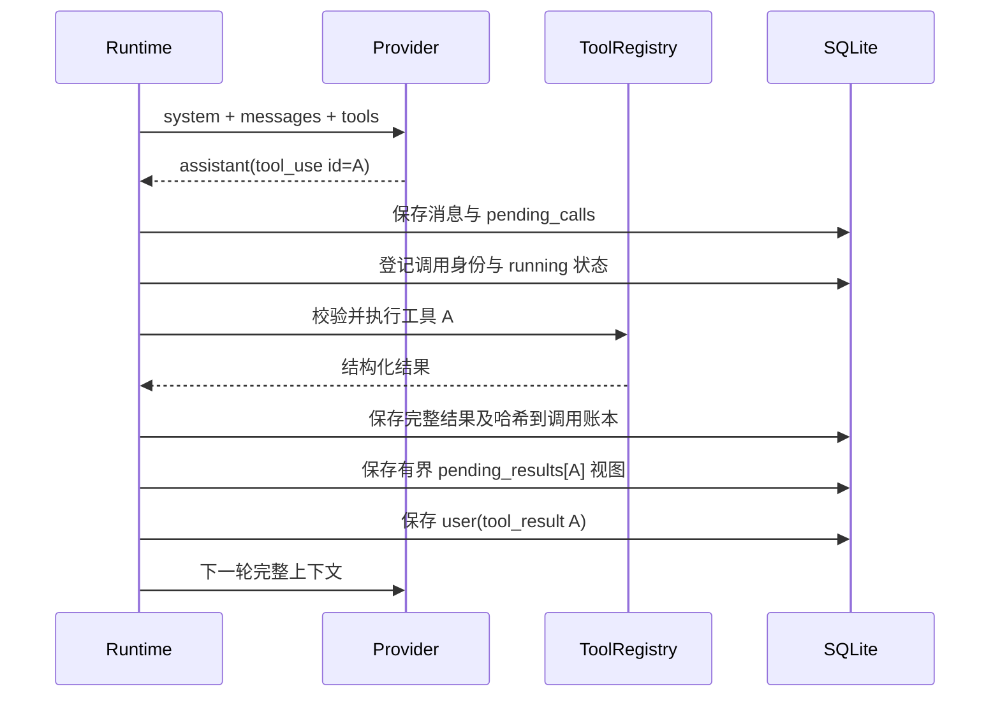
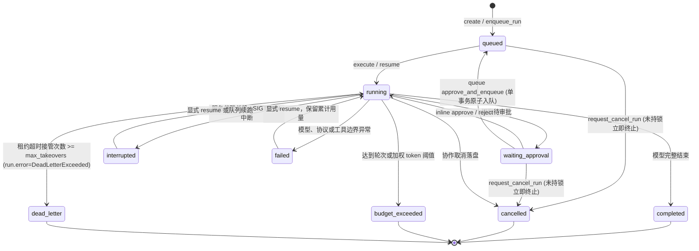

# 从一次补丁理解 Agent 系统架构

本项目让一个代码修复任务经过读取证据、提出补丁、人工审批、应用与验证。模型负责选择工具；执行框架负责校验、权限、状态和资源边界。学习重点是两者如何配合，而非把模型回复直接当成完成事实。

当前范围覆盖 **本机单进程内联模式（`inline`）与多进程/跨节点持久队列模式（`queue`，支持 SQLite WAL 或 PostgreSQL DSN）、Python 单文件示例与真实 Git worktree 多文件仓库**。CLI 和网页支持复制 `data/sample_repo`、为 `data/multi_file_repo` 创建隔离的分离 HEAD Git worktree，或通过 `--repo` 对本地 Git 仓库创建受控 worktree，不会污染原分支。离线 `demo` 与评测 `reference` 以确定性脚本复演；`anthropic` 与 `openai` 适配器支持真实模型联调与 5 任务编码基准评测。关于租约接管、死信队列、崩溃前滚恢复、多租户 RBAC 与沙盒防伪加固的完整说明见 [生产级高可用与安全加固专题](production-ha-hardening.md)。

## 1. 模块与数据流



| 模块 | 应回答的问题 | 入口 |
|---|---|---|
| 运行时 | 下一轮何时开始、测试失败如何触发有界修复、协作取消与门控提交如何衔接？ | [`runtime.py`](../src/agent_lab/runtime.py) |
| 队列、租约与死信 | Worker 崩溃后如何接管、如何拦截僵尸进程写入、毒丸任务如何隔离进 `dead_letter`？ | [`lease.py`](../src/agent_lab/lease.py)、[`storage.py`](../src/agent_lab/storage.py) |
| Git 工作树与归档 | 多文件修改怎样绑定并推进 `base_commit`、跨节点如何打包校验 `workspace_archives`？ | [`git_repo.py`](../src/agent_lab/git_repo.py) |
| 多语言代码地图 | 如何在遵守 `.gitignore` 与字符预算的前提下静态提取多语言符号与跨文件中心度？ | [`repomap.py`](../src/agent_lab/repomap.py) |
| 工作记忆 | 裁剪旧历史后如何保留追踪 `bound_files` 源码哈希、支持显式删除且自动判旧的事实？ | [`working_memory.py`](../src/agent_lab/working_memory.py) |
| KV 缓存优化 | 如何通过瞬态置尾、阶梯水位压缩与共享工具前缀避免级联重算？ | [`kv_cache.py`](../src/agent_lab/kv_cache.py)、[专题文档](kv-cache-harness.md) |
| 模型适配与限流 | Anthropic / OpenAI 缓存计费如何折算、RPM/TPM 滑动窗口如何准入限流？ | [`providers.py`](../src/agent_lab/providers.py) |
| 工具层与写前日志 | 参数、路径、跨文件 `modify/create/delete` 写前日志（WAL）前滚恢复和 `epoch` 怎样校验？ | [`tools.py`](../src/agent_lab/tools.py) |
| 存储层 | `state_version` 乐观锁、`summary_json`、`workspace_archives` 与 PostgreSQL DSN 如何协同？ | [`storage.py`](../src/agent_lab/storage.py) |
| 双预算上下文 | 序列化字符与校准 BPE token 双重上限下，怎样保留协议原子组与紧急尾部投影？ | [`context.py`](../src/agent_lab/context.py) |
| 检索 | 围栏代码块如何防误切、复合标识符如何分词、词法与可选稠密向量怎样 RRF 融合？ | [`retrieval.py`](../src/agent_lab/retrieval.py) |
| 技能 | 怎样先看目录，再按章节加载并将运行期动态技能置尾？ | [`skills.py`](../src/agent_lab/skills.py) |
| 沙盒与远程执行池 | 双进程管道 HMAC 回执如何防伪造、`RemoteHTTPSandboxBackend` 与孤儿容器回收如何工作？ | [`sandbox.py`](../src/agent_lab/sandbox.py)、[沙盒专题](sandbox-mechanisms.md) |
| 可观测性 | W3C `traceparent` 跨队列传播、敏感凭据脱敏日志与 Prometheus 指标注册表如何实现？ | [`observability.py`](../src/agent_lab/observability.py) |
| 服务层与多租户安全 | 多租户 RBAC、双人复核职责分离、存活/就绪探针、取消与生命周期 GC 如何暴露？ | [`api.py`](../src/agent_lab/api.py) |
| MCP | 怎样把相同只读工具暴露给标准协议客户端？ | [`mcp_server.py`](../src/agent_lab/mcp_server.py) |
| 评测 | 控制流回归与真实仓库 Docker 编码基准怎样分层评分？ | [`evals.py`](../src/agent_lab/evals.py)、[`model_evals.py`](../src/agent_lab/model_evals.py) |

## 2. 三种执行模式

三个模式共用工具校验、审批、持久化和验证路径，区别在于主循环之前如何收集证据。

| 模式 | 实际控制流 | 可用于解释 | 当前限制 |
|---|---|---|---|
| `agent` | 直接进入 `complete → tool_use → execute → tool_result` 循环 | 模型根据观察选择下一步工具 | demo 由脚本选工具；真实模型才具有动态选择能力 |
| `workflow` | 代码固定执行目录读取和知识检索，再进入共享模型循环 | 把确定性步骤放在生成步骤之前 | 后半段仍是工具循环，并非完全固定的端到端 DAG |
| `parallel` | 按 `metadata.worker_roles`（默认 `["reviewer", "tester"]`，支持配置 1—6 个去重角色）并发启动只读 worker，基于 `asyncio.FIRST_EXCEPTION` 首错快速取消兄弟任务，全部完成后汇总进入主循环 | 独立上下文、并发检索、共享预算锁、fast-fail 取消与写入收敛 | 角色列表由任务配置静态声明，不存在模型运行期自发递归拆分子任务的动态 planner |

每个只读 worker 最多进行三轮模型调用，主流程和 worker 共享 `_budget_lock` 与在途预留配额，统一计入任务的全局轮次与 token 上限。为了与主协调者 100% 共享底层 KV Cache 的 Tools + System 前缀块，worker 发送相同的规范化工具 schema，但在执行器侧严格限制只允许调用 `repo_list`、`repo_map`、`symbol_search`、`repo_git_status`、`repo_read`、`repo_search`、`knowledge_search`、`tool_result_get`；任何写工具或技能修改调用都会被直接拦截并返回 `permission_denied`。若任一 worker 抛出预算超限、协议错误或外部取消异常，调度循环立即取消其余未完成 worker 并等待其落盘收尾后再向上传播异常。主流程是唯一能提出补丁的生成路径，人类审批入口则不在模型工具目录中。

## 3. 一次工具往返



一条 assistant 消息可能请求多个工具。下一条 user 消息需要包含所有相应 `tool_result`，不能把其中一个结果单独丢掉。运行时先保存工具调用批次，再保存每个已完成结果，恢复时复用已保存结果。出现待审批提案后，本批次其余工具会收到 `deferred_until_approval`，避免把应用前的验证误当成补丁后的验证。

调用账本绑定 `run_id + call_id + 工具名 + 规范化参数哈希`。完整结果先入账本，后保存对话视图；两次保存之间崩溃时从账本补齐。提案创建使用同一调用的操作幂等键，即使在创建后、结果提交前退出也不会新增重复提案。无法确认的容器执行记为 `unknown`，不自动重跑。worker 对话、批次及轮次也持久化。文件系统与 SQLite 仍不是一个事务，不能承诺任意外部副作用 exactly-once；详细窗口见[专项说明](context-skills-state.md)。

## 4. 运行状态与审批



`completed` 表示流程结束，不自动表示业务验收成功：运行时在 `run.metadata.verification` 中显式维护独立的验证状态（`passed`、`failed`、`syntax_only`、`unavailable`、`unknown`、`not_run`）。审批应用补丁后，若容器测试返回 `tests_failed` 且已用修复轮数小于 `max_repair_rounds`（默认 2），运行时会将失败摘要与测试输出注入下一轮，驱动模型重新定位并提出新提案；耗尽修复预算仍未通过时标记 `repair_rounds_exhausted` 并保持 `verification.status == "failed"`。仅当容器测试真实执行且全部通过（`verification.status == "passed"`）时，Git worktree 任务才会调用 `commit_verified_worktree` 生成验证提交，同时保留 `git.initial_base_commit` 并将 `git.base_commit`（与当前 `registry.base_commit`）原子推进至新提交 SHA，从而允许后续轮次在干净的新基线上继续提出增量提案而不会误触脏基线拦截。

在持久队列模式（`dispatch_mode == "queue"`）下，审批接口调用 `Storage.approve_and_enqueue` 在单个数据库写事务中同时更新 `proposals` 决策（含审批人 `decided_by`）并将 `run_leases` 置为 `queued`（`action='resume'`）；即使上一轮进入等待状态的 Worker 稍后才调用 `release_lease(..., final_state='waiting_approval')`，存储层检测到同世代已抢先入队也会幂等放行，彻底消除“审批已写库但入队前崩溃”或“旧 Worker 延迟释放覆盖新审批队列状态”的双重竞态。对于取消请求（`agent-lab cancel` 或 `POST /api/runs/{run_id}/cancel`），若任务处于 `queued` 或 `waiting_approval` 且无活跃 Worker 持锁，会立即递增 `epoch` 并转为终态 `cancelled`；若正在运行，则写入 `cancel_requested` 标记并在下一轮检查点协作退出，而进程收到 `SIGTERM` 关机取消协程时则记为可恢复的 `interrupted`。

提案支持单文件 `propose_patch` 与跨文件原子 `propose_changeset`（最多 6 个文件，支持 `.py`/`.toml`/`.json`/`.yaml`/`.yml`/`.cfg`/`.ini` 的 `modify`、`create`、`delete` 操作，创建提案前对 `.py`/`.json`/`.toml` 执行语法预检）。应用阶段通过进程内 `RLock` 与跨进程文件锁 `_cross_process_apply_lock` 互斥，并采用**写前日志（WAL）前滚恢复协议**（`.agent-apply-<proposal_id>.json`）弥合多文件 `os.replace` / `unlink` 中途断电或 `SIGKILL` 窗口：

1. 全集预检每个目标文件的当前状态：必须全部等于原始版本 `old_sha256`（`create` 为不存在），或全部等于目标版本 `new_sha256`（`delete` 为已删除），抑或处于上次中断留下的混合中间态（每个文件要么等于 `old_sha256` 要么等于 `new_sha256`）。若任一文件偏离上述两者，立即拒绝并返回 `version_conflict`。
2. 在修改任何业务文件前，先 `fsync` 原子落盘 `.agent-apply-<proposal_id>.json` 写前日志，再为所有待写入文件生成同目录临时文件并 `fsync`。
3. 再次执行 `verify_epoch` 校验世代令牌未被抢占后，仅对尚未达到目标状态的文件执行 `os.replace` 或 `unlink`（前滚补齐），随后登记 `mark_proposal_applied` 并清理写前日志文件；若检测到从中断状态前滚恢复，事件与返回值显式标记 `recovered_partial_apply: true`。

审批决定不能在同一提案上任意翻转；拒绝后的新方案需要新提案。启用 `AGENT_LAB_REQUIRE_DISTINCT_APPROVER=1` 时，API 强制校验 `principal.actor_id != metadata.created_by`，防止任务发起人自行批准高风险变更。

## 5. 核心持久化表与存储后端（SQLite WAL / PostgreSQL DSN）

| 记录 | 保存内容 | 作用与边界 |
|---|---|---|
| `runs` | 完整状态 `body`、单调递增 `state_version`、索引列 `tenant_id` / `status_col` / `updated_at_col`、轻量投影 `summary_json` | `save_run` 执行 `WHERE id=? AND state_version=?` 乐观锁 CAS 防并发丢更新；`list_runs` 直接读取 `summary_json` 避免反序列化大体积历史 `messages` |
| `run_leases` / `worker_nodes` | 队列状态（含 `dead_letter`/`cancelled`/`interrupted`）、动作（`execute`/`resume`）、持有者、过期时间、单调递增 `epoch` 与超时接管计数 `takeover_count` | 支持独立 `agent-lab worker` 心跳续租、过期接管、僵尸写入拦截（`StaleEpochError`），并在 `takeover_count >= max_takeovers`（默认 3）时自动隔离毒丸任务至 `dead_letter` |
| `workspace_archives` | `run_id`、单调递增 `epoch`、`git_head` 与受控 tar.gz 快照二进制 `archive`（`BLOB` / `BYTEA`） | 支持跨无共享磁盘的 Worker 节点传输与恢复工作区，且严格拒绝任何 `archive_epoch < stored_epoch` 的滞后 Worker 覆盖归档 |
| `events` | 模型调用、工具审计、审批、租约接管、死信隔离与完成等公开行为 | 供 UI、SSE 和 CLI 增量拉取；不要求保存隐藏思维链 |
| `tool_calls` | 参数与结果哈希、状态、尝试历史及完整结果 | 执行身份去重、`tool_result_get` 按需分页与未知副作用恢复策略 |
| `proposals` | 单文件或跨文件（`files` + `operation_id` 唯一索引）待应用代码、操作类型、版本摘要、审批人（`decided_by`）与应用状态 | 绑定可审查对象与幂等创建键，支持多文件 WAL 前滚恢复与重复应用识别 |
| `memories` | `scope`（本地 `user` 或多租户隔离 `tenant:{tenant_id}:user`）、`key`、`value`、更新时间 | 租户隔离的跨会话持久笔记；仅由人工通过受 RBAC 保护的 API 写入，模型仅只读调用 `memory_get` |

存储层通过 `Storage.from_dsn` 支持双后端透明切换：默认使用本地 SQLite 文件（开启 `WAL`、`busy_timeout=10000`、可配置 `AGENT_LAB_SQLITE_SYNC` 默认 `NORMAL`，建表与迁移在并发 Barrier 下带退避重试）；当配置 `AGENT_LAB_STORAGE_DSN=postgresql://...` 且安装 `psycopg` 时，自动切换至 `PostgresBackendConfig` 与 `_PostgresConnectionAdapter`，将队列领取升级为 `SELECT ... FOR UPDATE SKIP LOCKED`，使多副本 `agent-lab worker` 与无状态 API 节点可在共享 PostgreSQL 上无锁竞争消费并复用同一套 `epoch` fencing、`state_version` CAS 与 `workspace_archives` 协议。生命周期回收命令 `agent-lab gc`（或 `POST /api/admin/gc`）按保留窗口统一清理终态工作区/Git worktree、`workspace_archives` 快照与陈旧锁文件。

## 6. 上下文、技能与检索各负责什么

- **双重预算上下文与结构化工作记忆**：`ContextManager` 同时支持序列化字符上限（`max_chars`）与零外部依赖校准 BPE token 上限（`max_tokens`，显式设置 `AGENT_LAB_USE_TIKTOKEN=1` 且本地已安装时调用 `cl100k_base`），按 `0.62` 低水位阶梯裁剪完整历史消息组；若单轮尾部参数或结果过大，运行时先执行紧急尾部压缩（`_project_history(..., emergency_tail=True)`），避免直接溢出。工作记忆（`<= 2400` 字符的 `goal/constraints/todos/facts`）通过 `working_memory_write` 支持按 ID 显式删除与过期条目自动淘汰（`remove_todo_ids`、`remove_fact_ids`、`prune_done_todos`、`prune_stale_facts`、`auto_evict_stale`）。当事实来源为 `tool_call`（如 `repo_read`、`symbol_search`、`repo_search`、`tool_result_get`）时，写入阶段会自动提取并记录关联工作区文件的 `bound_files` SHA-256；一旦后续补丁修改了任一关联源文件，下一轮 `audit_working_memory` 立即将其翻转为 `stale`（`bound_file_hash_changed` 或 `file_hash_changed`），且工作记忆恒定置于 `HARNESS_STATE` 之后。
- **多语言 `.gitignore` 感知代码地图（RepoMap）**：`RepoMapIndex` 对 Python 使用标准库 `ast` 完整提取签名与引用，对 TypeScript / JavaScript（`.ts`/`.tsx`/`.js`/`.jsx`）、Go（`.go`）、Rust（`.rs`）与 Java（`.java`）使用零宿主执行的纯静态行级结构解析；自动解析并遵循仓库 `.gitignore` 规则，跳过虚拟环境、构建产物与敏感凭据文件，按跨文件引用中心度排序，并在超大仓库截断时透明上报 `index_truncated`，按单文件 SHA-256 增量刷新缓存（`RLock` 线程安全）。
- **技能（Skills）**：提供按需操作说明。先按预算选元数据，再 `skill_search` / `skill_inspect` / `skill_load` 指定章节 / `skill_unload`；运行期中途加载的动态技能自动归入尾部瞬态区（`mid_run_dynamic`），防止破坏历史轮次的 KV Cache 前缀。仅支持受限单行元数据及 Markdown ATX 章节，不执行技能脚本。
- **租户隔离跨会话记忆**：按 `Principal.memory_scope()`（本地 `user` 或 `tenant:{tenant_id}:user`）隔离存储，与当前对话历史、外部证据严格分离。
- **围栏安全检索（Retrieval）**：Markdown 分块器先通过 `_tag_fenced_lines` 识别 ``` 与 ~~~ 围栏代码块，防止代码块内的 `# 注释` 被误判为章节标题切碎代码；分词器在保留完整标识符与数字的同时拆分 `camelCase` 与 `snake_case` 子词。默认离线使用 BM25 + TF-IDF cosine + RRF（`Σ 1/(60+rank)`）融合，并原生支持注入稠密向量 `embedder` 与二阶段 `reranker`。

默认离线词项向量能透明验证排序融合管线，但不替代神经网络语义 embedding；返回结果附带来源与 `[chunk_id]`，引用存在仍不等同于完整答案蕴含校验。

## 7. 验证分层与双进程防伪沙盒

| 验证路径 | 实际做了什么 | 不能推出什么 |
|---|---|---|
| `verify_python` | 对文件调用 `ast.parse`，不导入或运行 | 业务计算正确、测试通过、代码无副作用 |
| 离线 eval 算术 grader | 白名单解释目标函数最后一条 return 的纯算术表达式，检查若干输入 | 整个函数所有控制流正确、完整单测通过 |
| 双进程防伪 `sandbox_test` / 远程沙盒池 | 固定 64 位 image ID、只读快照、禁网/非 root/资源上限；外层 Supervisor 持随机 32 字节密钥经专用匿名管道校验子进程 HMAC-SHA256 回执并清洗标准输出伪造标记，子进程通过 `sys.addaudithook` 阻断 `ctypes`/`gc`/`sys._getframe` 探测；兼容 `src/` 布局与 `pytest` 风格顶层同步/异步测试函数；支持 `RemoteHTTPSandboxBackend` 转发与孤儿容器定时回收 | 抵御宿主机 Linux 内核级容器逃逸漏洞（高敌对多租户仍需 gVisor / Firecracker 微虚拟机） |

本地 Docker 路径要求守护进程可用且已有 `python:3.12-slim`（工具绝不自动联网拉镜像）；当配置 `AGENT_LAB_SANDBOX_URL`（与可选 `AGENT_LAB_SANDBOX_TOKEN`）时，`SandboxRunner` 将完成本地防符号链接快照与 `test_oracles` 校验后的文件集通过 `RemoteHTTPSandboxBackend` 发送至隔离沙盒节点的 `POST /api/internal/sandbox/execute`，避免向 Web/Worker 容器挂载宿主机 Docker socket。每个受管容器均打上 `agent-lab.managed=1` 与 `agent-lab.expires-at` 标签，`reap_orphan_containers`（集成于 `agent-lab gc` 与 `/api/admin/gc`）可主动清理进程崩溃遗留的超期孤儿容器。详见[沙盒专题](sandbox-mechanisms.md)与[验证记录](validation.md)。

## 8. 预算、全量缓存计费与生产可观测性

默认每任务最多 12 轮模型调用，累计有效 token 阈值 30000，序列化字符预算 24000，单次最大输出 `max_output_tokens` 4096（遇到 `max_tokens` 纯文本截断时最多自动续写 2 次）。每次调用前通过 `estimate_bpe_tokens` 在 `_budget_lock` 内预留 `_inflight_reserved_tokens`，并可选启用 `ProviderRateLimiter`（`AGENT_LAB_RPM_LIMIT` / `AGENT_LAB_TPM_LIMIT` 60 秒滑动窗口准入限流，响应后按实际消耗差额退补）。

响应返回后，`compute_usage_totals` 对不同服务商的缓存 token 做精确折算，杜绝缓存流量漏计：
- **Anthropic（叠加报告）**：`total_input_tokens = input_tokens + cache_creation_input_tokens + cache_read_input_tokens`，同时按 `1.25x` 写入、`0.10x` 命中计算加权计费 `billed_input_tokens`。
- **OpenAI（包含报告）**：`prompt_tokens` 已包含 `cached_tokens`，按未命中部分 + `0.25x` 缓存命中计算 `billed_input_tokens`。
运行时取 `max(input_tokens + output_tokens, billed_tokens)` 作为预算熔断依据。

可观测性由 [`observability.py`](../src/agent_lab/observability.py) 与 API 中间件统一承载：
- **端到端分布式追踪**：HTTP 入口解析 W3C `traceparent` 或 `X-Trace-Id` 并在响应头回传 `X-Trace-Id`；创建任务时将 `format_traceparent` 持久化至 `run.metadata.traceparent`，异步 `agent-lab worker` 跨进程消费时通过 `bind_trace_context` 恢复同一 `trace_id`。
- **脱敏结构化日志与错误边界**：`redact_secrets` 自动递归屏蔽含 `key/token/secret/authorization/password/credential` 的键以及字符串内的 `Bearer ...` 和 DSN 密码；`sanitize_error_detail` 仅输出安全错误码、可重试标志与 `trace_id`。
- **探针与 Prometheus 指标**：提供 `/healthz`（存活）、`/readyz`（探测数据库连通性、工作区可写性、沙盒模式与活跃 Worker 数，异常返回 503）、`/metrics`（Prometheus Text Exposition 0.0.4，开启鉴权时受 Bearer 保护）及 `/api/metrics` JSON 快照。

## 9. 多租户安全加固与生产演进边界

API 服务层现已内置多租户安全控制（详见 [**生产级高可用、多租户安全与沙盒加固专题**](production-ha-hardening.md)）：

1. **多租户 RBAC 与职责分离**：通过 `AGENT_LAB_TOKENS_JSON` 为每个令牌绑定 `tenant_id`、`actor_id` 与角色集合（`operator` 创建/恢复/写记忆、`approver` 审批补丁、`admin` 执行 GC 及可选 `global_admin` 跨租户巡检）；跨租户访问任务返回 404 防枚举，开启 `AGENT_LAB_REQUIRE_DISTINCT_APPROVER=1` 强制创建人与审批人分离。监听非回环地址时 CLI 强制要求配置鉴权令牌。
2. **准入保护与背压控制**：中间件对请求体流式限长（默认 256 KiB，内部远程沙盒端点默认 4 MiB，超限返回 413），配合租户级 RPM 滑动窗口限流、`inline` 并发上限与 `queue` 最大排队深度（`AGENT_LAB_MAX_QUEUE_DEPTH`，超限返回 429）。
3. **跨节点高可用与死信隔离**：`PostgresBackendConfig`（`FOR UPDATE SKIP LOCKED`）+ 单调 `epoch` fencing + `state_version` 乐观锁 + `workspace_archives` + 超限接管 `dead_letter` 隔离毒丸任务。
4. **后续面向超大规模企业集群的演进方向**：将静态 JSON 令牌升级为 OIDC/JWT 短期令牌与 KMS 密钥轮换；为远程沙盒工作节点引入 gVisor (`runsc`) 或 Firecracker 微虚拟机隔离；将 `workspace_archives` 大体积快照外置至 S3 兼容对象存储。

对应的文章、面试追问与练习见 [生产高可用加固专题](production-ha-hardening.md)、[阅读地图](anthropic-reading-map.md)、[面试指南](interview-guide.md) 与 [14 天学习路线](learning-path.md)。
