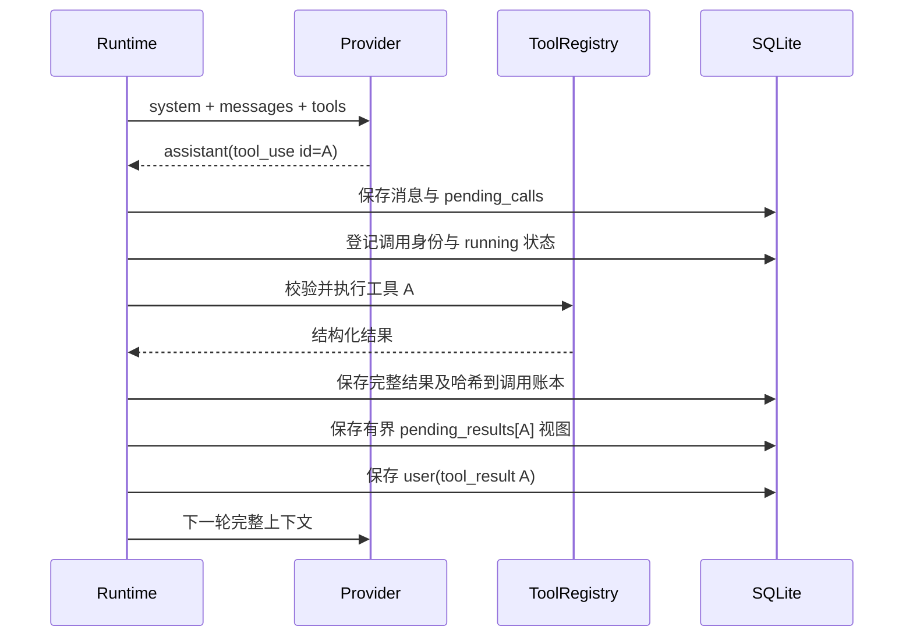
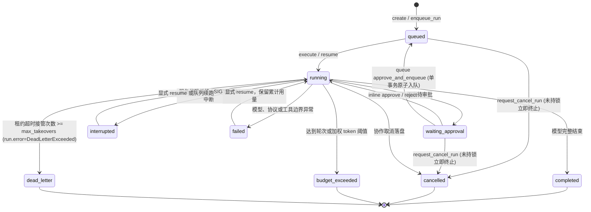

# 从一次补丁理解 Agent 系统架构

本项目让一个代码修复任务经过读取证据、提出补丁、人工审批、应用与验证。模型负责选择工具；执行框架负责校验、权限、状态和资源边界。学习重点是两者如何配合，而非把模型回复直接当成完成事实。

当前范围覆盖 **本机单进程内联模式（`inline`）与多进程/跨节点持久队列模式（`queue`，支持 SQLite WAL 或 PostgreSQL DSN + `psycopg_pool` 连接池）、隔离沙箱仓库（`sandbox`）与本地直连/桌面 GUI 工作台（`host` / `computer`）**。CLI 和网页既支持复制 `data/sample_repo`、为 `data/multi_file_repo` 或 `--repo` 创建隔离的分离 HEAD Git worktree，也支持通过 `agent-lab code`（或 `--cwd`）在三级权限档位（`ask` / `auto-edit` / `full-auto`）、信任门控的声明式 `.agent-lab/settings.json` 规则、确定性生命周期钩子（`hooks.py`）与 OS 内核级 `HostKernelSandbox`（macOS Seatbelt SBPL / Linux `bwrap`）保护下直接操控本地目录、驱动常驻 PTY 后台进程、调用 LSP 语义智能与 SSRF 防护联网工具、接入端到端 SSE 流式（`RunStreamBroker`）与 `/rewind` 轮次检查点回退，并在会话结束后自动运行实证门控的四阶段离线 Dreaming（支持 `dry_run` 预览与 `rollback_last_dream` 回滚）。关于租约接管、死信队列、崩溃前滚恢复、多租户 RBAC 与沙盒防伪加固见 [生产级高可用与安全加固专题](production-ha-hardening.md)；关于本地操控、端到端流式、OS 沙箱/钩子、子 Agent 与分层 Dreaming 记忆的深度设计见 [本地操控、桌面 GUI、MCP 与分层记忆架构专题](computer-use-and-memory-architecture.md)。

> **交互式全栈架构图集（7 幅 Excalidraw 画布）**：仓库在 [`docs/diagrams/README.md`](diagrams/README.md) 中提供与源码一一对应的 7 幅 Excalidraw v2 架构图（支持 VS Code/Cursor Excalidraw 插件、[excalidraw.com](https://excalidraw.com) 或 Obsidian 打开编辑）：
> - [`01-system-overview.excalidraw`](diagrams/01-system-overview.excalidraw) — 全景五平面系统架构总览
> - [`02-agent-loop-and-kv-cache.excalidraw`](diagrams/02-agent-loop-and-kv-cache.excalidraw) — Agent 主循环状态机、双预算裁剪与 KV Cache 三断点前缀布局
> - [`03-sandbox-git-and-retrieval.excalidraw`](diagrams/03-sandbox-git-and-retrieval.excalidraw) — 双进程防伪沙盒、Git Worktree 事务基线、多语言 RepoMap 与混合检索
> - [`04-host-permissions-and-computer-use.excalidraw`](diagrams/04-host-permissions-and-computer-use.excalidraw) — 三级权限治理、本地文件/终端防逃逸与原生桌面级 Computer Use
> - [`05-multi-agent-and-mcp.excalidraw`](diagrams/05-multi-agent-and-mcp.excalidraw) — 并行/动态 Multi-Agent 编排与双向 MCP（Server + Client）
> - [`06-memory-hierarchy-and-dreaming.excalidraw`](diagrams/06-memory-hierarchy-and-dreaming.excalidraw) — 海马体在线编码、互链 Wiki 检索与四阶段离线 Dreaming
> - [`07-ha-queue-wal-and-observability.excalidraw`](diagrams/07-ha-queue-wal-and-observability.excalidraw) — 生产级高可用队列租约、Epoch Fencing、多文件 WAL 恢复与多租户可观测性

## 1. 模块与数据流

```mermaid
flowchart LR
    User[CLI REPL / 网页多租户工作台] --> API[CLI / FastAPI + RBAC/Cookie / TraceMiddleware]
    API -->|/healthz /readyz /metrics + OTLP| Obs[Observability: W3C/OTLP Spans + Prometheus]
    API -->|/api/runs/{id}/stream SSE| Broker[RunStreamBroker 跨线程流式代理]
    API -->|inline / queue / approve_and_enqueue| Lease[LeaseWorker / Epoch Fencing / DLQ / --metrics-port]
    Lease --> Runtime[AgentRuntime: 双平面调度 + 并发只读波次 + Hooks]
    Runtime --> Broker
    Runtime --> Context[ContextManager: Tier-1 微压缩 + Tier-2 滞回/LLM 压缩 + 瞬态图像]
    Runtime --> WM[WorkingMemory: 会话内 bound_files 哈希]
    Runtime <--> Mem[MemoryStore + DreamEngine: 实证门控 + GC + dry_run/回滚]
    Context --> Provider[Demo / Anthropic stream / OpenAI SSE+reasoning + 成本账本]
    Provider -->|stream / tool_use| Runtime
    Runtime --> Perm[PermissionRuleEngine + ask/auto-edit/full-auto + HookManager]
    Perm --> Registry[ToolRegistry + HostKernelSandbox + PTY + LSP + Checkpoints]
    Runtime -->|原生异步平面| SubMCP[subagent_run worktree/异构/后台 + McpClientManager]
    Registry --> Repo[副本 / Git Worktree / 本地直连目录]
    Registry --> RepoMap[Tree-sitter/PPR 512KiB RepoMapIndex + LspClientManager]
    Registry --> KB[围栏安全分块 + BM25 / 可插拔 Embedder & Reranker + RRF]
    Runtime --> Skills[多通道技能路由与动态置尾]
    Runtime --> Storage[(SQLite WAL / PostgreSQL psycopg_pool + schema_migrations)]
    Registry -->|双进程防伪 Docker 或 RemoteHTTPSandboxBackend| Docker[受控沙盒套件 + 测试驱动修复回环]
    Storage -->|summary_json / 事件 / 审计日志| API
    API --> User
    MCP[MCP stdio server] -->|仅只读工具| Registry
```

| 模块 | 应回答的问题 | 入口 |
|---|---|---|
| 运行时 | 并发只读波次与双平面工具如何分流、测试失败如何有界修复、`max_cost_usd` 熔断、瞬时取消与出带 Dreaming 如何衔接？ | [`runtime.py`](../src/agent_lab/runtime.py) |
| 端到端流式代理 | `RunStreamBroker` 如何跨线程扇出模型增量、`bash_output_delta` 与子 Agent 进度并支持 `after_seq` 断线回放？ | [`streaming.py`](../src/agent_lab/streaming.py) |
| 轮次检查点与回退 | 内容寻址 SHA-256 首改快照如何实现 `/rewind`（`both`/`files`/`messages`）并自动闭合悬空 `tool_use`？ | [`checkpoints.py`](../src/agent_lab/checkpoints.py) |
| 确定性生命周期钩子 | `SessionStart`/`UserPromptSubmit`/`PreToolUse`/`PostToolUse`/`PreCompact`/`Stop` 如何实现零配置零开销与否决门禁？ | [`hooks.py`](../src/agent_lab/hooks.py) |
| LSP 语义代码智能 | Stdio JSON-RPC 2.0 `LspClientManager` 如何提供 `lsp_query` 与编辑后自动静态诊断并在缺失语言服务器时优雅降级？ | [`lsp_client.py`](../src/agent_lab/lsp_client.py) |
| 声明式权限与命令分级 | 信任门控 `.agent-lab/settings.json` 规则（`deny`→`ask`→`allow`/`session_grants`）、三级档位与毁机硬拦截如何协作？ | [`permissions.py`](../src/agent_lab/permissions.py) |
| 本地工具、OS 沙箱、PTY 与联网 | `HostKernelSandbox`（macOS Seatbelt SBPL / Linux `bwrap`）、五阶防逃逸、`BackgroundProcessManager` 常驻 PTY 与 SSRF 防护 `web_fetch`/`web_search` 如何实现？ | [`host_tools.py`](../src/agent_lab/host_tools.py) |
| 桌面级 GUI 操控 | macOS `CoreGraphics` 64 位 FFI + 无障碍树 `ax_tree` + `LinuxX11ComputerBackend` 与 Retina 逻辑坐标怎样对齐？ | [`computer.py`](../src/agent_lab/computer.py) |
| 分层记忆与实证 Dreaming | 双层 `CLAUDE.md`/`MEMORY.md`、实证门控 `hypothesis`、`verified_facts` 晋升、排除墓碑 GC、`dry_run` 预览与 `rollback_last_dream` 如何协同？ | [`memory.py`](../src/agent_lab/memory.py) |
| 外部 MCP 连接池 | AnyIO 单宿主 Task 亲和性、OAuth PKCE、Run 级工具 Schema 冻结与超阈值 `mcp_tool_search` 延迟发现怎样保障？ | [`mcp_client.py`](../src/agent_lab/mcp_client.py) |
| 交互式终端与 CLI | `[y/n/a/f]` 链式内联审批、零缓存失效权限切换与无 PTY 确定性测试怎样实现？ | [`repl.py`](../src/agent_lab/repl.py)、[`cli.py`](../src/agent_lab/cli.py) |
| 队列、租约、死信与指标服务 | Worker 崩溃接管、僵尸写入拦截、`dead_letter` 隔离与独立 `--metrics-port`（`WorkerMetricsServer`）如何工作？ | [`lease.py`](../src/agent_lab/lease.py)、[`storage.py`](../src/agent_lab/storage.py) |
| Git 工作树与归档 | 多文件修改怎样绑定并推进 `base_commit`、跨节点如何打包校验 `workspace_archives`？ | [`git_repo.py`](../src/agent_lab/git_repo.py) |
| 多语言代码地图 | 512 KiB 解析上限、可选 `tree_sitter_language_pack` 多语言 AST 与确定性 Personalized PageRank 如何排序？ | [`repomap.py`](../src/agent_lab/repomap.py) |
| 会话内工作记忆 | 裁剪旧历史后如何保留追踪 `bound_files` 源码哈希、支持显式删除且自动判旧的事实？ | [`working_memory.py`](../src/agent_lab/working_memory.py) |
| KV 缓存优化 | 如何通过瞬态置尾、阶梯水位压缩与共享工具前缀避免级联重算？ | [`kv_cache.py`](../src/agent_lab/kv_cache.py)、[专题文档](kv-cache-harness.md) |
| 模型适配、流式、路由与成本账本 | Anthropic `messages.stream()`、OpenAI SSE + `reasoning_content`、`fast`/`inherit`/`reasoning` 模型路由、瞬态图像附件、USD 成本账本与 RPM/TPM 限流如何实现？ | [`providers.py`](../src/agent_lab/providers.py) |
| 工具层与写前日志 | 分档能力挂载、跨文件 `modify/create/delete` WAL 前滚恢复与动作提案幂等怎样校验？ | [`tools.py`](../src/agent_lab/tools.py) |
| 存储层与版本化迁移 | 6 步版本化 `schema_migrations`、PostgreSQL `psycopg_pool` 连接池、提案 FIFO `fifo_seq`、`run_checkpoints` 与 `security_audit_logs` 如何协同？ | [`storage.py`](../src/agent_lab/storage.py) |
| 两级上下文压缩 | Tier-1 `micro_compact_messages` + Tier-2 `80%→55%` 滞回压缩、同拍原位 `COMPACTION_SUMMARY` 与可选 LLM 语义摘要怎样运行？ | [`context.py`](../src/agent_lab/context.py) |
| 统一混合检索与神经适配器 | 围栏安全切块、BM25 + RRF 及可插拔 `LocalSubwordDenseEmbedder`/`OpenAICompatibleEmbedder`/`HttpReranker` 如何组合？ | [`retrieval.py`](../src/agent_lab/retrieval.py) |
| 技能 | 怎样经 `/skill` + `paths`/`globs` + RRF 多通道路由、按章节加载并将运行期动态技能置尾？ | [`skills.py`](../src/agent_lab/skills.py) |
| 沙盒与远程执行池 | 双进程管道 HMAC 回执如何防伪造、`RemoteHTTPSandboxBackend` 与孤儿容器回收如何工作？ | [`sandbox.py`](../src/agent_lab/sandbox.py)、[沙盒专题](sandbox-mechanisms.md) |
| 层次化可观测性 | W3C `traceparent` + 层次化 OTLP Span（`start_span` / `AGENT_LAB_OTLP_ENDPOINT`）、脱敏日志与 Prometheus 指标如何实现？ | [`observability.py`](../src/agent_lab/observability.py) |
| 服务层与多租户安全 | 多租户 RBAC、`HttpOnly` Cookie 会话鉴权、`security_audit_logs`、事件驱动 SSE `/api/runs/{id}/stream`、`/rewind`、图像附件与 `/api/memory/dream/*` 如何暴露？ | [`api.py`](../src/agent_lab/api.py) |
| MCP Server | 怎样把相同只读工具（含 `repo_map`/`symbol_search`）暴露给标准协议客户端？ | [`mcp_server.py`](../src/agent_lab/mcp_server.py) |
| 评测体系 | 10 项控制流回归 + 7 大核心子系统离线评测 + 5 项 Docker 编码基准 + 无偏 `pass@k` + `LLMJudge` + SWE-bench 适配器怎样分层评分？ | [`evals.py`](../src/agent_lab/evals.py)、[`model_evals.py`](../src/agent_lab/model_evals.py) |

## 2. 三种编排模式、并发工具波次、增强子 Agent 与三档执行环境

三个顶层编排模式共用工具校验、权限/钩子裁决、持久化和验证路径，区别在于主循环之前如何收集证据；在主循环内部，运行时按 `_partition_tool_waves` 自动将连续 `>=2` 个无副作用只读调用（含只读外部 MCP）归入并发 `asyncio.gather` 波次加速执行，而写操作、命中声明式 `ask` 规则或存在 `PreToolUse` 钩子的调用严格保持串行。在 `host` / `computer` 执行档位下，主循环运行期还可调用 `subagent_run` 动态并发派发 1—4 个子 Agent（同时支持只读调研 `mode="readonly"` 与继承权限策略的写能力 `mode="operator"`）。

| 模式 | 实际控制流 | 可用于解释 | 当前限制 |
|---|---|---|---|
| `agent` | 直接进入 `stream/complete → tool_use → 并发只读波次/串行写 → tool_result` 循环（`host`/`computer` 档位支持 `subagent_run`/`subagent_status` 动态派生 `readonly` 或 `worktree` 隔离 `operator` 子 Agent） | 模型根据观察动态选择工具或派发异构/后台子任务 | demo 由脚本选工具；子 Agent 严格禁止递归再派生 `subagent_run` |
| `workflow` | 代码固定执行目录读取和知识检索，再进入共享模型循环 | 把确定性步骤放在生成步骤之前 | 后半段仍是工具循环，并非完全固定的端到端 DAG |
| `parallel` | 按 `metadata.worker_roles`（默认 `["reviewer", "tester"]`，支持配置 1—6 个去重角色）并发启动只读 worker，基于 `asyncio.FIRST_EXCEPTION` 首错快速取消兄弟任务，全部完成后汇总进入主循环 | 独立上下文、并发检索、共享预算锁、fast-fail 取消与写入收敛 | 前置 `parallel` 角色列表由任务配置声明；运行期动态拆解则通过 `subagent_run` 工具完成 |

每个只读 worker 与动态 `subagent_run` 子任务均通过共享 `_budget_lock` 与在途预留配额统一计入任务的全局轮次、token 与美元成本（`max_cost_usd`）上限。`subagent_run` 现支持四项增强能力：① **工作区隔离**：`mode="operator"` 在多子任务并发且仓库为 Git 时默认启用 `isolation="worktree"`，为每个写能力子 Agent 分配独立 Git worktree；② **异构模型路由**：每项任务可配置 `model_tier: "fast" | "inherit" | "reasoning"`（映射 `AGENT_LAB_FAST_MODEL` / 主模型 / `AGENT_LAB_REASONING_MODEL`）；③ **后台异步执行**：设置 `run_in_background=True` 立即返回 `job_id`，通过 `subagent_status` 随时查询进度与报告；④ **前缀共享与洁净上下文**：仅注入精炼 `PARENT_CONTEXT_BRIEF`，复用父协调者规范化 `<TOOLS> + <SYSTEM>` 根前缀以命中 KV Cache，并实时经 `RunStreamBroker` 发布 `subagent_progress`。运行环境能力面由 `execution_profile`（`sandbox` / `host` / `computer`）、`permission_mode`（`ask` / `auto-edit` / `full-auto`）、声明式 `.agent-lab/settings.json` 规则与生命周期钩子正交控制，详见 [本地操控、桌面 GUI 与分层记忆架构专题](computer-use-and-memory-architecture.md)。

## 3. 一次工具往返



一条 assistant 消息可能请求多个工具。下一条 user 消息需要包含所有相应 `tool_result`，不能把其中一个结果单独丢掉。运行时先保存工具调用批次，按 `_partition_tool_waves` 将连续 `>=2` 个无副作用只读调用并发执行、写操作与审批/钩子调用严格串行执行，并逐项保存已完成结果（恢复时复用已保存结果）。在 `host`/`computer` 档位下，文件写前自动经 [`checkpoints.py`](../src/agent_lab/checkpoints.py) 落盘内容寻址首改快照（供 `/rewind` 按 `both`/`files`/`messages` 回退），编辑完成后自动经 [`lsp_client.py`](../src/agent_lab/lsp_client.py) 附加 `get_file_diagnostics` 静态诊断；整个调用周期受 [`hooks.py`](../src/agent_lab/hooks.py) 的 `SessionStart`/`UserPromptSubmit`/`PreToolUse`/`PostToolUse`/`PreCompact`/`Stop` 生命周期钩子介入，同时模型增量（Anthropic `messages.stream()`、OpenAI SSE + `reasoning_content`）、实时 bash stdout（`bash_output_delta`）与子 Agent 进度经 [`streaming.py`](../src/agent_lab/streaming.py) `RunStreamBroker` 实时推送至事件驱动 SSE `GET /api/runs/{id}/stream`。出现待审批提案后，本批次其余工具会收到 `deferred_until_approval`，避免把应用前的验证误当成补丁后的验证。

调用账本绑定 `run_id + call_id + 工具名 + 规范化参数哈希`。完整结果先入账本，后保存对话视图；两次保存之间崩溃时从账本补齐。提案创建使用同一调用的操作幂等键，即使在创建后、结果提交前退出也不会新增重复提案。无法确认的容器执行记为 `unknown`，不自动重跑。worker 对话、批次及轮次也持久化。文件系统与 SQLite 仍不是一个事务，不能承诺任意外部副作用 exactly-once；详细窗口见[专项说明](context-skills-state.md)。

## 4. 运行状态与审批



`completed` 表示流程结束，不自动表示业务验收成功：运行时在 `run.metadata.verification` 中显式维护独立的验证状态（`passed`、`failed`、`syntax_only`、`unavailable`、`unknown`、`not_run`）。审批应用补丁后，若容器测试返回 `tests_failed` 且已用修复轮数小于 `max_repair_rounds`（默认 2），运行时会将失败摘要与测试输出注入下一轮，驱动模型重新定位并提出新提案；耗尽修复预算仍未通过时标记 `repair_rounds_exhausted` 并保持 `verification.status == "failed"`。仅当容器测试真实执行且全部通过（`verification.status == "passed"`）时，Git worktree 任务才会调用 `commit_verified_worktree` 生成验证提交，同时保留 `git.initial_base_commit` 并将 `git.base_commit`（与当前 `registry.base_commit`）原子推进至新提交 SHA，从而允许后续轮次在干净的新基线上继续提出增量提案而不会误触脏基线拦截。

在持久队列模式（`dispatch_mode == "queue"`）下，审批接口调用 `Storage.approve_and_enqueue` 在单个数据库写事务中同时更新 `proposals` 决策（含审批人 `decided_by`）并将 `run_leases` 置为 `queued`（`action='resume'`）；即使上一轮进入等待状态的 Worker 稍后才调用 `release_lease(..., final_state='waiting_approval')`，存储层检测到同世代已抢先入队也会幂等放行，彻底消除“审批已写库但入队前崩溃”或“旧 Worker 延迟释放覆盖新审批队列状态”的双重竞态。对于取消请求（`agent-lab cancel` 或 `POST /api/runs/{run_id}/cancel`），若任务处于 `queued` 或 `waiting_approval` 且无活跃 Worker 持锁，会立即递增 `epoch` 并转为终态 `cancelled`；若正在运行，则写入 `cancel_requested` 标记并立即经 `cancel_active_run` 同时触发 `threading.Event` 与 `asyncio.Event` 中断在途流式响应、等待沙盒槽位及活跃 bash 进程组实现瞬时协作取消，而进程收到 `SIGTERM` 关机取消协程时则记为可恢复的 `interrupted`。在模型准备结束当前任务时，`Stop` 生命周期钩子还可返回 `veto: true` 否决过早收敛并驱使模型继续验证。

提案支持单文件 `propose_patch` 与跨文件原子 `propose_changeset`（最多 6 个文件，支持 `.py`/`.toml`/`.json`/`.yaml`/`.yml`/`.cfg`/`.ini` 的 `modify`、`create`、`delete` 操作，创建提案前对 `.py`/`.json`/`.toml` 执行语法预检），所有待审提案按单调递增 `fifo_seq` 维持确定性 FIFO 顺序。应用阶段通过进程内 `RLock` 与跨进程文件锁 `_cross_process_apply_lock` 互斥，并采用**写前日志（WAL）前滚恢复协议**（`.agent-apply-<proposal_id>.json`）弥合多文件 `os.replace` / `unlink` 中途断电或 `SIGKILL` 窗口：

1. 全集预检每个目标文件的当前状态：必须全部等于原始版本 `old_sha256`（`create` 为不存在），或全部等于目标版本 `new_sha256`（`delete` 为已删除），抑或处于上次中断留下的混合中间态（每个文件要么等于 `old_sha256` 要么等于 `new_sha256`）。若任一文件偏离上述两者，立即拒绝并返回 `version_conflict`。
2. 在修改任何业务文件前，先 `fsync` 原子落盘 `.agent-apply-<proposal_id>.json` 写前日志，再为所有待写入文件生成同目录临时文件并 `fsync`。
3. 再次执行 `verify_epoch` 校验世代令牌未被抢占后，仅对尚未达到目标状态的文件执行 `os.replace` 或 `unlink`（前滚补齐），随后登记 `mark_proposal_applied` 并清理写前日志文件；若检测到从中断状态前滚恢复，事件与返回值显式标记 `recovered_partial_apply: true`。

审批决定不能在同一提案上任意翻转；拒绝后的新方案需要新提案。在 `host` / `computer` 档位下，除文件补丁外，需要人工确认的高风险动作（`mutating` 类 `bash_exec`、桌面 GUI 键鼠/唤起动作与非只读外部 MCP 调用）同样通过 `Storage.create_action_proposal` 生成统一审查提案（附带 `suggested_grant_pattern` 供用户写入本会话 `session_grants` 减少重复审批，并先经信任门控 `.agent-lab/settings.json` 的 `PermissionRuleEngine` 按 `deny → ask → allow / session_grants` 裁决），并在执行完成后由 `mark_action_proposal_executed` 持久化动作回执，防止进程崩溃重放导致非幂等副作用二次执行。启用 `AGENT_LAB_REQUIRE_DISTINCT_APPROVER=1` 时，API 强制校验 `principal.actor_id != metadata.created_by`，防止任务发起人自行批准高风险变更。

## 5. 核心持久化表与存储后端（SQLite WAL / PostgreSQL `psycopg_pool`）

| 记录 | 保存内容 | 作用与边界 |
|---|---|---|
| `schema_migrations` | 迁移版本号（`1`–`6`）、名称与执行时间 | 幂等版本化 Schema 演进（核心表基线、`proposals.fifo_seq`、`run_checkpoints`、`security_audit_logs`、`events` `trace_id`/`span_id`、会话重命名/归档/分叉与游标分页） |
| `runs` | 完整状态 `body`、单调递增 `state_version`、索引列 `tenant_id` / `status_col` / `updated_at_col`、会话管理列（标题/归档/父分叉）与轻量投影 `summary_json` | `save_run` 执行 `WHERE id=? AND state_version=?` 乐观锁 CAS 防并发丢更新；`append_user_turn` 自动闭合悬空 `tool_use` 并线性延展预算；`list_runs` 直接读取 `summary_json` 并支持游标分页与搜索过滤 |
| `run_steering_messages` | 运行中零 CAS 争用实时引导指令收件箱 | 纯追加写入，规避与活跃 Worker `runs.state_version` 写入冲突，在工具步闭合安全边界原子排空注入 |
| `run_checkpoints` | 轮次索引、消息截断位置、内容寻址 pre-edit 文件快照清单（SHA-256 Blob 存于 `<state_dir>/checkpoints/`） | 支撑 `/rewind` 按 `both`/`files`/`messages` 三模式时间旅行回退 |
| `run_leases` / `worker_nodes` | 队列状态（含 `dead_letter`/`cancelled`/`interrupted`）、动作（`execute`/`resume`）、持有者、过期时间、单调递增 `epoch` 与超时接管计数 `takeover_count` | 支持独立 `agent-lab worker` 心跳续租、过期接管、僵尸写入拦截（`StaleEpochError`），并在 `takeover_count >= max_takeovers`（默认 3）时自动隔离毒丸任务至 `dead_letter` |
| `workspace_archives` | `run_id`、单调递增 `epoch`、`git_head` 与受控 tar.gz 快照二进制 `archive`（`BLOB` / `BYTEA`） | 支持跨无共享磁盘的 Worker 节点传输与恢复工作区，且严格拒绝任何 `archive_epoch < stored_epoch` 的滞后 Worker 覆盖归档 |
| `events` | 模型调用、工具审计、审批、GUI 截图比例尺、租约接管、死信隔离与关联 `trace_id`/`span_id` | 供 UI、事件驱动 SSE 补齐与 CLI 拉取；不要求保存隐藏思维链 |
| `tool_calls` | 参数与结果哈希、状态、尝试历史及完整结果 | 执行身份去重、`tool_result_get` 按需分页与未知副作用恢复策略 |
| `proposals` | 单文件/跨文件补丁或高风险动作载荷（`files` / `action_payload` + `operation_id` 唯一索引）、确定性 FIFO 序号 `fifo_seq`、审批人（`decided_by`）与应用/执行回执 | 绑定可审查对象、幂等创建键与 FIFO 审批顺序，统一承载多文件 WAL 前滚恢复与外部动作防重放 |
| `security_audit_logs` | 租户、操作者 `actor_id`、事件类型、资源目标、决策结果、`trace_id` 与结构化审计载荷 | 持久记录登录/登出、审批决策、规则变更、回退与管理 GC 等高敏安全操作（`GET /api/audit-logs`） |
| `memories` + 双层记忆目录 | 数据库人工 KV 偏好 + `.agent-lab/memory/<tenant>/` 下的 `global` 与 `projects/<slug>` 双层 `CLAUDE.md`/`MEMORY.md`（`<=200` 行）、`[[wiki-links]]` 主题页、`.archive/` 回收区与 Dreaming 回滚快照 | 租户隔离的跨会话持久认知图谱；`sandbox` 仅只读人工 KV，`host`/`computer` 支持实证门控写入与离线四阶段 Dreaming 巩固 |
| `dream_runs` | `dream_id`、`tenant_id`、`project_slug`、`run_id`、`trigger`、四阶段统计与完整 JSON 审计报告 | 独立记录每次会话后自动或手动触发的离线记忆整理轨迹，不占用主任务队列与并发槽位 |

存储层通过 `Storage.from_dsn` 支持双后端透明切换，并统一通过 6 步版本化 `schema_migrations` 完成幂等升级：默认使用本地 SQLite 文件（开启 `WAL`、`busy_timeout=10000`、可配置 `AGENT_LAB_SQLITE_SYNC` 默认 `NORMAL`，建表与迁移在并发 Barrier 下带退避重试）；当配置 `AGENT_LAB_STORAGE_DSN=postgresql://...` 且安装 `psycopg` 时，自动切换至 `PostgresBackendConfig` 与 `_PostgresConnectionAdapter`，优先惰性初始化实例级 **`psycopg_pool.ConnectionPool` 连接池**（缺失 `psycopg_pool` 或 `pool_size<=0` 时优雅回退直连），并将队列领取升级为 `SELECT ... FOR UPDATE SKIP LOCKED`，使多副本 `agent-lab worker` 与无状态 API 节点可在共享 PostgreSQL 上无锁竞争消费并复用同一套 `epoch` fencing、`state_version` CAS、`fifo_seq` 与 `workspace_archives` 协议。生命周期回收命令 `agent-lab gc`（或 `POST /api/admin/gc`）按保留窗口统一清理终态临时工作区/Git worktree、`workspace_archives` 快照与陈旧锁文件，并对 `direct_workspace=True` 的用户真实本地仓库实施绝对删除豁免。

## 6. 上下文、技能、双系统记忆、代码智能与检索各负责什么

- **两级上下文压缩与会话内结构化工作记忆（Working Memory）**：`ContextManager` 同时支持序列化字符上限（`max_chars`）与校准 BPE token 上限（`max_tokens`，可选 `tiktoken`），采用两级压缩兼顾上下文长度与 KV Cache 命中率：**Tier-1 轻量微压缩（`micro_compact_messages`）**在触达 `80%` 高水位前先剥离陈旧 `thinking` 块与超大旧 `tool_result` 存根（保留最近 3 组并持久化单调 `micro_compaction_cursors`）；**Tier-2 `80% → 55%` 自动滞回压缩**在仍超水位时成批折叠完整历史原子组并在同拍原位注入 `COMPACTION_SUMMARY`（手动 `/compact` 与 `compact_context` 还支持可选 **LLM 语义摘要 `use_llm=True`**，交由 `fast` 档模型总结并经 `finalize_llm_compaction_summary` 逐行防注入消毒，异常时回退确定性摘要）。会话内工作记忆（`<= 2400` 字符的 `goal/constraints/todos/facts`）追踪关联源码 `bound_files` SHA-256，文件变更后自动翻转为 `stale`，并与桌面截图及用户上传的多模态图像附件统一置于缓存断点之后的尾部瞬态区。
- **多语言代码地图（RepoMap）与 LSP 语义代码智能**：`RepoMapIndex` 支持单文件最高 **512 KiB** 解析上限（`_MAX_PARSE_BYTES`），对 Python 使用标准库 `ast`，对 TS/JS/Go/Rust/Java 优先使用可选 **`tree_sitter_language_pack` 多语言 AST**（未安装时无损回退零依赖词法结构扫描器），自动遵循 `.gitignore` 并通过确定性幂迭代 **Personalized PageRank** 结合 `camelCase`/`snake_case` 子词查询增强排序；配合 [`lsp_client.py`](../src/agent_lab/lsp_client.py) 的 `LspClientManager` 提供 `lsp_query`（定义/引用/悬停/符号/诊断）与文件编辑后自动静态诊断，实现从全仓导航到编译器级语义定位的完整闭环。
- **多通道技能路由（Skills）**：融合 `/skill` 显式点名、`paths`/`globs` 工作区路径匹配与 BM25/TF-IDF/RRF 混合检索，按目录 → `skill_inspect` → `skill_load` 章节快照（运行期动态置尾）渐进披露，不执行第三方技能内嵌脚本。
- **跨会话双层记忆与实证 Dreaming（`MemoryStore` + `DreamEngine`）**：会话启动 Step 0 将全局 + 项目双层 `CLAUDE.md` / `MEMORY.md`（`<= 200` 行 / `<= 4000` 字符）快照注入前缀头部，执行期按需读写带源码哈希与回执凭据的 `[[wiki-links]]` 知识图谱；会话终态后出带触发四阶段离线 `DreamEngine`，实施**实证门控（无已验证 `file:@sha` 或成功 `call:` 证明的 LLM 合成页强制降级为 `hypothesis`）**、自动将已完成会话的 **`verified_facts`** 与修复教训沉淀入库、执行**排除软墓碑的衰减回收 GC（归档至 `.archive/`）与多因子加权排序**，并支持 **`dry_run` 变更预览**与写前快照驱动的 **`rollback_last_dream` 一键回滚**。详见 [本地操控、桌面 GUI、MCP 与分层记忆架构专题](computer-use-and-memory-architecture.md)。
- **围栏安全统一混合检索与可插拔神经适配器（Retrieval）**：`KnowledgeBase` 与动态记忆/Transcript 检索共用围栏安全切块、子词分词与 BM25 + RRF 融合管线，原生内置 **`LocalSubwordDenseEmbedder`、`OpenAICompatibleEmbedder`（带缓存与回退）与 `HttpReranker`**，通过 `AGENT_LAB_EMBEDDING_URL` / `AGENT_LAB_EMBEDDING_MODE` 按需接入神经向量检索与二阶段重排（默认离线保持零网络与零权重依赖）。

## 7. 验证分层、双层沙盒隔离与离线/基准评测体系

| 验证与隔离路径 | 实际做了什么 | 不能推出什么 |
|---|---|---|
| `verify_python` | 对文件调用 `ast.parse`，不导入或运行 | 业务计算正确、测试通过、代码无副作用 |
| `HostKernelSandbox`（宿主机 OS 内核沙箱） | 对 `host`/`computer` 档位 `bash_exec` 在 macOS 自动注入 Seatbelt SBPL（`sandbox-exec`）、在 Linux 通过 `bwrap` 隔离，限制仅工作区/临时目录可写并屏蔽敏感家目录与可选网络（`AGENT_LAB_HOST_SANDBOX=auto\|strict\|off`）；配合 SSRF 防护 `web_fetch`/`web_search` | 替代不可信多租户代码执行的容器/微虚拟机边界 |
| 双进程防伪 `sandbox_test` / 远程沙盒池 | 固定 64 位 image ID、只读快照、禁网/非 root/资源上限；外层 Supervisor 持随机 32 字节密钥经专用匿名管道校验子进程 HMAC-SHA256 回执并清洗标准输出伪造标记，子进程通过 `sys.addaudithook` 阻断 `ctypes`/`gc`/`sys._getframe` 探测；支持 `RemoteHTTPSandboxBackend` 转发与孤儿容器回收 | 抵御宿主机 Linux 内核级容器逃逸漏洞（高敌对多租户仍需 gVisor / Firecracker 微虚拟机） |
| 离线与真实基准评测（`evals.py` + `model_evals.py`） | 10 项控制流回归 + **7 大核心子系统离线评测**（`run_subsystem_evals`：自动滞回压缩保针、实时引导、延迟 MCP 检索、子 Agent 隔离、Dreaming 证伪与实证门控、Computer Use `ax_tree` 定位、SSRF 与 OS 沙箱防御）+ 5 项 Git/Docker 编码基准 + **无偏 `pass@k`（`estimate_pass_at_k`）+ `LLMJudge` + SWE-bench 适配器（`FAIL_TO_PASS`/`PASS_TO_PASS`）** | 离线 `demo`/`reference` 得分不代表真实 LLM 编码能力 |

本地 Docker 路径要求守护进程可用且已有 `python:3.12-slim`（工具绝不自动联网拉镜像）；当配置 `AGENT_LAB_SANDBOX_URL`（与可选 `AGENT_LAB_SANDBOX_TOKEN`）时，`SandboxRunner` 将完成本地防符号链接快照与 `test_oracles` 校验后的文件集通过 `RemoteHTTPSandboxBackend` 发送至隔离沙盒节点的 `POST /api/internal/sandbox/execute`，避免向 Web/Worker 容器挂载宿主机 Docker socket。每个受管容器均打上 `agent-lab.managed=1` 与 `agent-lab.expires-at` 标签，`reap_orphan_containers`（集成于 `agent-lab gc` 与 `/api/admin/gc`）可主动清理进程崩溃遗留的超期孤儿容器。详见[沙盒专题](sandbox-mechanisms.md)与[验证记录](validation.md)。

## 8. 预算、USD 成本账本与层次化生产可观测性

默认每任务最多 12 轮模型调用，累计有效 token 阈值 30000，序列化字符预算 24000，单次最大输出 `max_output_tokens` 4096（遇到 `max_tokens` 纯文本截断时最多自动续写 2 次）。每次调用前通过 `estimate_bpe_tokens` 在 `_budget_lock` 内预留 `_inflight_reserved_tokens`，并可选启用 `ProviderRateLimiter`（`AGENT_LAB_RPM_LIMIT` / `AGENT_LAB_TPM_LIMIT` 60 秒滑动窗口准入限流，响应后按实际消耗差额退补）。

响应返回后，`compute_usage_totals` 与 **`compute_cost_usd`**（支持通过 `AGENT_LAB_MODEL_PRICING_JSON` 覆盖或新增私有模型费率）对不同服务商的缓存 token 做精确折算与美元计费，杜绝缓存流量漏计：
- **Anthropic（叠加报告）**：`total_input_tokens = input_tokens + cache_creation_input_tokens + cache_read_input_tokens`，按 `1.25x` 写入、`0.10x` 命中折算加权 `billed_input_tokens` 与精确美元成本 `cost_usd`。
- **OpenAI（包含报告）**：`prompt_tokens` 已包含 `cached_tokens`，按未命中部分 + `0.25x` 缓存命中折算 `billed_input_tokens` 与 `cost_usd`。
运行时取 `max(input_tokens + output_tokens, billed_tokens)` 作为 token 预算熔断依据，并在每次模型调用前后双重校核 **`max_cost_usd`** 美元上限，超限立即触发 `BudgetExceeded` 停止后续调用。

可观测性由 [`observability.py`](../src/agent_lab/observability.py)、[`lease.py`](../src/agent_lab/lease.py) 与 API 中间件统一承载：
- **层次化 W3C / OTLP Span 追踪**：HTTP 入口解析 W3C `traceparent` 或 `X-Trace-Id` 并回传 `X-Trace-Id`，任务持久化 `traceparent` 供异步 `agent-lab worker` 跨进程恢复；运行时通过 **`start_span` / `SpanRecord`** 生成合规 16-hex `span_id` 与 `parent_span_id` 构成层级调用树，事件落库同步记录 `trace_id`/`span_id`；配置 `AGENT_LAB_OTLP_ENDPOINT` 时由后台无阻塞 `_BackgroundOTLPExporter` 导出 OTLP/HTTP Span（内置 DNS/IP SSRF 校验与 302 重定向阻断）。
- **脱敏结构化日志与错误边界**：`redact_secrets` 自动递归屏蔽含 `key/token/secret/authorization/password/credential` 的键以及字符串内的 `Bearer ...` 和 DSN 密码；`sanitize_error_detail` 仅输出安全错误码、可重试标志与 `trace_id`。
- **探针、API 指标与 Worker 独立 `--metrics-port`**：API 提供 `/healthz`、`/readyz`、`/metrics`（Prometheus Text Exposition 0.0.4）与 `/api/metrics`；独立队列进程 `agent-lab worker --metrics-port <port>` 启动 [`WorkerMetricsServer`](../src/agent_lab/lease.py) 暴露 Worker 专属 `/healthz` 与 `/metrics`（支持 `AGENT_LAB_WORKER_METRICS_TOKEN` Bearer 鉴权），使 API 与 Worker 副本均可直接被 Prometheus 采集。

## 9. 多租户安全加固与生产演进边界

API 服务层现已内置多租户安全控制（详见 [**生产级高可用、多租户安全与沙盒加固专题**](production-ha-hardening.md)）：

1. **多租户 RBAC、`HttpOnly` Cookie 鉴权、审计日志与职责分离**：通过 `AGENT_LAB_TOKENS_JSON` 为每个令牌绑定 `tenant_id`、`actor_id` 与角色集合（`operator`/`approver`/`admin` 及可选 `global_admin`），并支持经 `POST/GET/DELETE /api/auth/session` 签发与吊销 **`HttpOnly` 会话 Cookie（`agent_lab_session`）** 免去浏览器前端在 `localStorage` 暴露裸令牌；所有登录/登出、审批、规则修改、`/rewind` 与管理 GC 等关键安全操作均持久化至 **`security_audit_logs`**（支持 `GET /api/audit-logs` 租户隔离查询）；跨租户访问返回 404 防枚举，开启 `AGENT_LAB_REQUIRE_DISTINCT_APPROVER=1` 强制创建人与审批人分离。监听非回环地址时 CLI 强制要求配置鉴权令牌。
2. **准入保护、信任门控与背压控制**：中间件对请求体流式限长（默认 256 KiB，图像附件与内部远程沙盒端点按上限分流，超限返回 413），配合租户级 RPM 滑动窗口限流、`inline` 并发上限与 `queue` 最大排队深度（`AGENT_LAB_MAX_QUEUE_DEPTH`，超限返回 429）；项目级 `.agent-lab/settings.json` 权限规则与命令钩子强制通过工作区信任校验（`is_workspace_trusted`）方才生效。
3. **跨节点高可用与死信隔离**：版本化 `schema_migrations` + `PostgresBackendConfig`（`psycopg_pool` 连接池 + `FOR UPDATE SKIP LOCKED`）+ 提案 FIFO `fifo_seq` + 单调 `epoch` fencing + `state_version` 乐观锁 + `workspace_archives` + 超限接管 `dead_letter` 隔离毒丸任务。
4. **后续面向超大规模企业集群的演进方向**：将静态 JSON 令牌升级为 OIDC/JWT 短期令牌与 KMS 密钥轮换；为远程沙盒工作节点引入 gVisor (`runsc`) 或 Firecracker 微虚拟机隔离；将 `workspace_archives` 大体积快照外置至 S3 兼容对象存储。

对应的文章、面试追问与练习见 [本地操控、桌面 GUI、MCP 与分层记忆架构专题](computer-use-and-memory-architecture.md)、[生产高可用加固专题](production-ha-hardening.md)、[阅读地图](anthropic-reading-map.md)、[面试指南](interview-guide.md) 与 [14 天学习路线](learning-path.md)。
