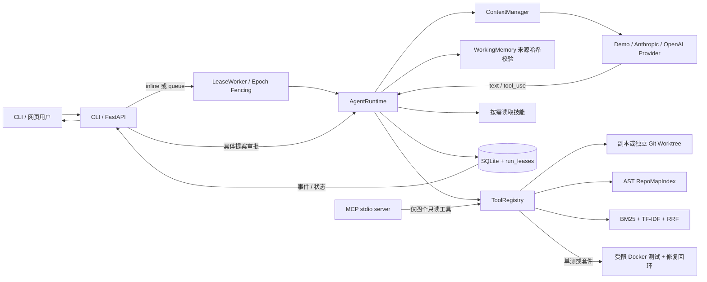
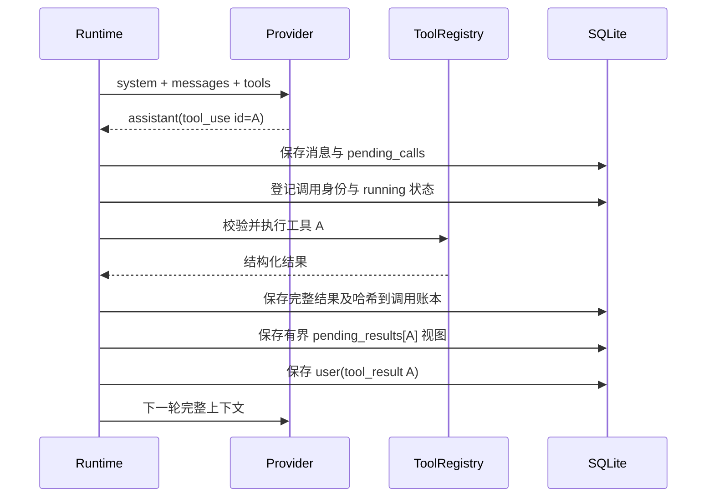
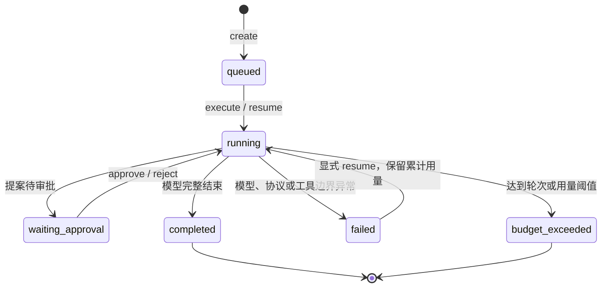

# 从一次补丁理解 Agent 系统架构

本项目让一个代码修复任务经过读取证据、提出补丁、人工审批、应用与验证。模型负责选择工具；执行框架负责校验、权限、状态和资源边界。学习重点是两者如何配合，而非把模型回复直接当成完成事实。

当前范围是 **单机（支持 API 与持久队列 Worker 分离）、Python 单文件示例或真实 Git worktree 多文件仓库**。CLI 和网页支持复制 `data/sample_repo`、为 `data/multi_file_repo` 创建隔离的分离 HEAD Git worktree，或通过 `--repo` 对本地 Git 仓库创建受控 worktree，不会污染原分支。离线 `demo` 与评测 `reference` 以确定性脚本复演；`anthropic` 与 `openai` 适配器支持真实模型联调与 5 任务编码基准评测。

## 1. 模块与数据流

| 模块 | 应回答的问题 | 入口 |
|---|---|---|
| 运行时 | 下一轮何时开始、测试失败如何触发有界修复、何时门控提交？ | [`runtime.py`](../src/agent_lab/runtime.py) |
| 队列与租约 | Worker 崩溃或停顿后怎样接管且阻止僵尸进程覆盖状态？ | [`lease.py`](../src/agent_lab/lease.py)、[`storage.py`](../src/agent_lab/storage.py) |
| Git 工作树 | 多文件修改怎样绑定 `base_commit` 并在测试通过后安全提交？ | [`git_repo.py`](../src/agent_lab/git_repo.py) |
| 代码地图 | 如何在固定字符预算内定位高中心度文件与跨文件符号定义？ | [`repomap.py`](../src/agent_lab/repomap.py) |
| 工作记忆 | 压缩旧对话后如何保留带 SHA-256 证据校验且自动判旧的事实？ | [`working_memory.py`](../src/agent_lab/working_memory.py) |
| 模型适配 | Anthropic / OpenAI 返回值如何变成统一消息与 usage？ | [`providers.py`](../src/agent_lab/providers.py) |
| 工具层 | 参数、路径、跨文件原子替换、Git 基线和 epoch 怎样校验？ | [`tools.py`](../src/agent_lab/tools.py) |
| 存储层 | 哪些内容必须跨进程重启保存并校验世代令牌？ | [`storage.py`](../src/agent_lab/storage.py) |
| 上下文 | 历史太长时怎样保留协议完整性与工作记忆？ | [`context.py`](../src/agent_lab/context.py) |
| 检索 | 证据如何分块、排序、携带版本引用？ | [`retrieval.py`](../src/agent_lab/retrieval.py) |
| 技能 | 怎样先看目录，再加载相关操作说明？ | [`skills.py`](../src/agent_lab/skills.py) |
| 服务层 | 创建独立工作区、后台任务和网页观察如何连接？ | [`api.py`](../src/agent_lab/api.py) |
| MCP | 怎样把相同只读工具暴露给标准协议客户端？ | [`mcp_server.py`](../src/agent_lab/mcp_server.py) |
| 评测 | 控制流回归与真实仓库 Docker 编码基准怎样分层评分？ | [`evals.py`](../src/agent_lab/evals.py)、[`model_evals.py`](../src/agent_lab/model_evals.py) |

## 2. 三种执行模式

三个模式共用工具校验、审批、持久化和验证路径，区别在于主循环之前如何收集证据。

| 模式 | 实际控制流 | 可用于解释 | 当前限制 |
|---|---|---|---|
| `agent` | 直接进入 `complete → tool_use → execute → tool_result` 循环 | 模型根据观察选择下一步工具 | demo 由脚本选工具；真实模型才具有动态选择能力 |
| `workflow` | 代码固定执行目录读取和知识检索，再进入共享模型循环 | 把确定性步骤放在生成步骤之前 | 后半段仍是工具循环，并非完全固定的端到端 DAG |
| `parallel` | `reviewer`、`tester` 两个只读 worker 并发研究，汇总后进入主循环 | 独立上下文、并行检索、共享预算与写入收敛 | 角色由代码固定，不存在模型动态分解任务的 planner |

worker 每个最多进行三轮模型调用，主流程和 worker 都计入任务的全局轮次上限。它们只获得 `repo_list`、`repo_read`、`repo_search`、`knowledge_search`；即便返回越权的写工具调用，执行器也会拒绝。主流程是唯一能提出补丁的生成路径，人类审批入口则不在模型工具目录中。

## 3. 一次工具往返

一条 assistant 消息可能请求多个工具。下一条 user 消息需要包含所有相应 `tool_result`，不能把其中一个结果单独丢掉。运行时先保存工具调用批次，再保存每个已完成结果，恢复时复用已保存结果。出现待审批提案后，本批次其余工具会收到 `deferred_until_approval`，避免把应用前的验证误当成补丁后的验证。

调用账本绑定 `run_id + call_id + 工具名 + 规范化参数哈希`。完整结果先入账本，后保存对话视图；两次保存之间崩溃时从账本补齐。提案创建使用同一调用的操作幂等键，即使在创建后、结果提交前退出也不会新增重复提案。无法确认的容器执行记为 `unknown`，不自动重跑。worker 对话、批次及轮次也持久化。文件系统与 SQLite 仍不是一个事务，不能承诺任意外部副作用 exactly-once；详细窗口见[专项说明](context-skills-state.md)。

## 4. 运行状态与审批

`completed` 表示流程结束，不自动表示业务验收成功：运行时在 `run.metadata.verification` 中显式维护独立的验证状态（`passed`、`failed`、`syntax_only`、`unavailable`、`unknown`、`not_run`）。审批应用补丁后，若容器测试返回 `tests_failed` 且已用修复轮数小于 `max_repair_rounds`（默认 2），运行时会将失败摘要与测试输出注入下一轮，驱动模型重新定位并提出新提案；耗尽修复预算仍未通过时标记 `repair_rounds_exhausted` 并保持 `verification.status == "failed"`。仅当容器测试真实执行且全部通过（`verification.status == "passed"`）时，Git worktree 任务才会调用 `commit_verified_worktree` 生成本地验证提交。

尚未决定的提案调用 `resume` 会保持等待状态。等待状态绑定具体提案 ID，不能用旧提案重放跳过新的审批。若决定已保存、进程却在更新 run 状态前退出，`resume` 会协调这个已批准或已拒绝的提案；已写文件通过目标摘要识别，安全补记状态。用量或轮次已超限的任务不会因 `resume` 而清零预算。

提案支持单文件 `propose_patch` 与跨文件原子 `propose_changeset`（`files_json` 保存每个目标路径的原始内容、新内容与各自 SHA-256）。应用前统一校验当前 lease `epoch` 与 Git worktree 基线（禁止偏离 `base_commit` 或混入未授权脏文件），跨文件应用先对全集做 CAS 预检与同目录临时文件落盘，全部就绪后再逐一原子替换：

1. 当前内容等于原始版本：将新内容写入同目录临时文件，刷新并原子替换，再登记已应用。
2. 当前内容已经等于目标版本：作为重复应用或写入后中断的恢复，补记应用状态。
3. 当前内容与两者都不同：返回 `version_conflict`，保留外部修改。

审批决定不能在同一提案上任意翻转；拒绝后的新方案需要新提案。应用发生版本冲突时，该任务停止；继续学习请创建新任务并重新读取代码，`resume` 不会跳过冲突审批。文件摘要校验处理常见版本冲突，进程内锁串行化同一工作区的应用；它们不构成抵御恶意并发文件系统操作的完整 OS 级隔离。

## 5. SQLite 里的核心持久化表

| 记录 | 保存内容 | 作用与边界 |
|---|---|---|
| `runs` | 任务、provider、mode、状态、消息、步数、usage、工作区/Git 元数据、结构化工作记忆与独立 `verification` 状态 | 恢复执行并区分流程完成与测试通过 |
| `run_leases` / `worker_nodes` | 队列动作（`execute`/`resume`/`approve`）、当前持有者、过期时间与单调递增 `epoch` | 支持独立 `agent-lab worker` 心跳续租、超时接管与僵尸写入拦截（`StaleEpochError`） |
| `events` | 模型调用、工具审计、审批与完成等公开行为 | 供 UI、SSE 和 CLI 查看；不要求保存隐藏思维链 |
| `tool_calls` | 参数与结果哈希、状态、尝试及完整结果 | 执行身份去重、按需分页与恢复策略 |
| `proposals` | 单文件或跨文件（`files_json`）待应用代码、版本摘要、审批与应用状态 | 绑定可审查对象，支持多文件全集 CAS 冲突检测与幂等应用 |
| `memories` | scope、key、value、更新时间 | 简单持久笔记；当前应用使用固定 `user` scope |

当前记忆由用户通过网页或 API 显式保存，模型只能调用 `memory_get` 读取。系统没有自动抽取、反思整合、遗忘、事实置信度或多用户记忆隔离。记忆内容仍是可能过时的数据，不会授予工具权限。

SQLite 使用独立连接、WAL 与 FULL 同步事务。除默认 `inline` 单进程模式外，开启 `AGENT_LAB_DISPATCH=queue` 后 API 仅负责入队与状态观察，由独立 `agent-lab worker` 进程竞争租约、后台心跳续期并在旧 Worker 过期后递增 `epoch` 接管；任何携带旧 `epoch` 的滞后 Worker 在更新数据库或落盘补丁时都会立即触发 `StaleEpochError` 并中止写入。需要注意：SQLite 仍是单机存储引擎，跨主机多副本高可用还需将同一套 `epoch` fencing 协议迁移至 Postgres/etcd 并配合共享仓库存储。

## 6. 上下文、技能与检索各负责什么

- **上下文与结构化工作记忆**决定这一轮发给模型哪些信息。大结果先存账本，再投影为状态/哈希/回取引用；固定保留原任务、`HARNESS_STATE` 权威审批状态、有界工作记忆（`<= 2400` 字符的 `goal/constraints/todos/facts`）、活动技能与最近完整消息组。工作记忆中的事实写入时必须校验工作区文件或已提交工具结果的真实 SHA-256，后续文件一旦变更自动翻转为 `stale`，且绝不覆盖 `HARNESS_STATE`。
- **代码地图（RepoMap）**为多文件仓库提供纯 AST 符号骨架。`RepoMapIndex` 解析类/函数签名与跨文件引用权重，在给定字符预算内输出高中心度文件摘要，并按单文件 SHA-256 增量刷新缓存。
- **技能**提供操作说明。先按预算选元数据，再 search/inspect/load 指定章节/unload；正文按版本快照落盘，去重并限制总活动预算。元数据与正文有版本失效缓存。仅支持受限单行元数据及 Markdown ATX 章节，不执行技能脚本，也不声称完整实现某个 Skills 标准。
- **记忆**保存跨会话用户笔记。它与当前对话历史、外部证据均分开存储。
- **检索**在原创学习笔记中找证据。Markdown 标题提供确定性背景，正文分块后使用 BM25 与 TF-IDF cosine 排序，再用 `Σ 1/(60+rank)` 合并。chunk ID 与文档路径、块序号及正文版本绑定。

词项向量能说明排序融合，但不是语义 embedding。当前没有向量数据库、LLM 生成 chunk 背景或 cross-encoder。返回结果附带来源和 chunk ID，生成器被要求按 `[chunk_id]` 引用；引用存在不等于语义支持成立，系统尚未实现完整的答案蕴含检查。

## 7. 验证分层

| 验证路径 | 实际做了什么 | 不能推出什么 |
|---|---|---|
| `verify_python` | 对文件调用 `ast.parse`，不导入或运行 | 业务计算正确、测试通过、代码无副作用 |
| 离线 eval 算术 grader | 白名单解释目标函数最后一条 return 的纯算术表达式，检查若干输入 | 整个函数所有控制流正确、完整单测通过 |
| 可选 `sandbox_test` | 固定 image ID、受限 Python 副本、只读/禁网/非 root/资源上限、流式日志上限、四项测试回执与清理确认 | 完整多租户安全、任意仓库兼容、同进程测试不可伪造或未知漏洞不可利用 |

Docker 路径要求守护进程可用，且本地已有 `python:3.12-slim`。工具不会自动拉镜像；复制受限 Python 文件并重验验收测试，挂载只读副本而非原工作区；不传主机密钥、代理环境或 Docker socket。执行绑定 image ID、快照和 policy 哈希，输出最多16384字节，超限/超时终止并清理容器，退出0但缺四项测试回执也不会通过。详见[沙盒专题](sandbox-mechanisms.md)与[验证记录](validation.md)。本机守护进程不可用，没有宿主机执行降级路径。

## 8. 预算、异常与观察

默认每任务最多 12 轮模型调用，累计 token 阈值 30000，system/tools/messages 序列化字符预算 24000；每次输出上限最多 2048。真实模型使用 SDK 请求超时和有限网络重试。网络失败后保留已扣轮次，显式恢复不会绕过限制。SDK 内部重试属于同一次应用调用，实际网络尝试数可能多于轮次数。

token 使用量在响应返回后累加；并行请求也可能已经在途。这个阈值用于停止后续调用，不能当作精确费用硬上限。上下文窗口、真实计费、缓存 token 和服务端规则需要单独评估。

网页通过 JSON API 轮询展示事件，另提供 SSE `/stream` 接口。浏览器断开不取消任务；服务重启后需要显式恢复。原始 SDK 异常只保存类型，避免把异常中的请求细节直接展示；仓库内容和工具参数仍可能进入事件，因此真实数据接入前还需要脱敏、保留策略和访问控制。

## 9. 生产化扩展的顺序

当前本机 API 提供可选 Bearer token、Origin 检查与主机名约束，不能代替企业身份体系。若扩展到团队使用，优先把以下约束变成测试：

1. 用户身份与租户授权贯穿任务、工作区、记忆、检索和事件，检索前按 ACL 过滤。
2. 作业队列与租约定义唯一执行者，取消和重试有明确语义；数据库更新有版本控制。
3. 控制面持有模型凭证，执行面只获得短期最小权限；使用受维护的隔离执行池。
4. 建立跨仓库未见缺陷集与真实模型评测，报告成功率、延迟分位数、成本和环境失败。
5. 在检索、上下文和多 Agent 策略上做消融实验，再决定是否增加复杂度。

对应的文章、面试追问与练习见 [阅读地图](anthropic-reading-map.md)、[面试指南](interview-guide.md) 与 [14 天学习路线](learning-path.md)。
