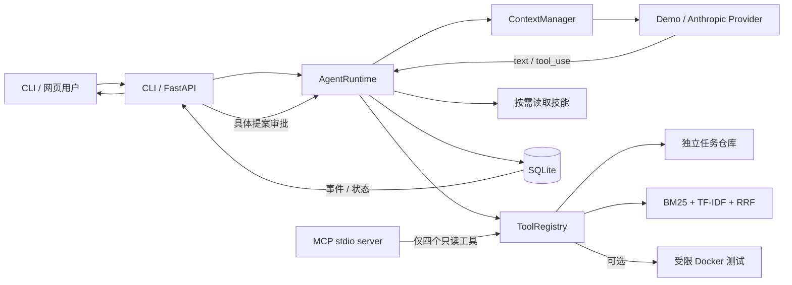
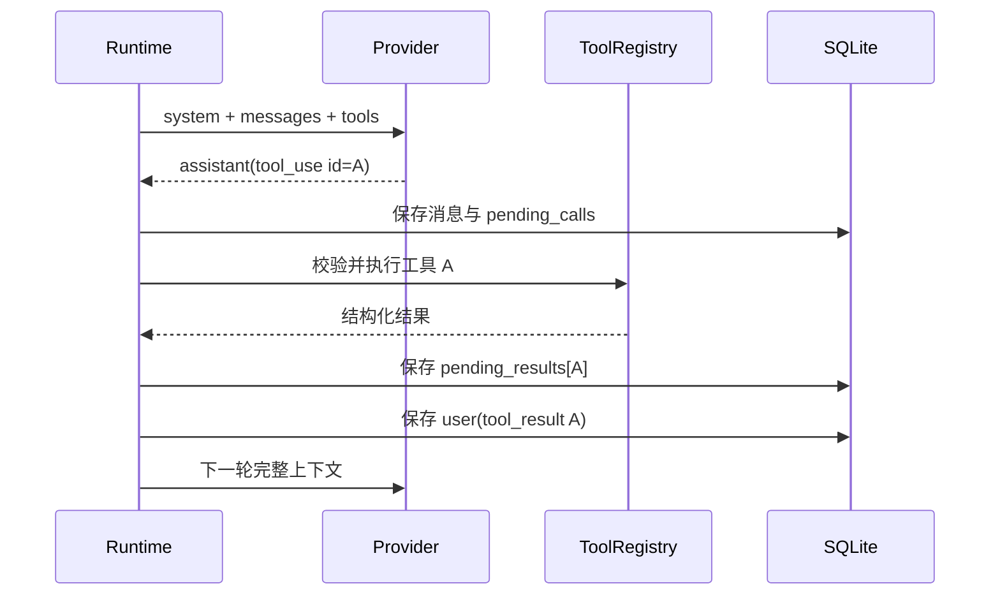
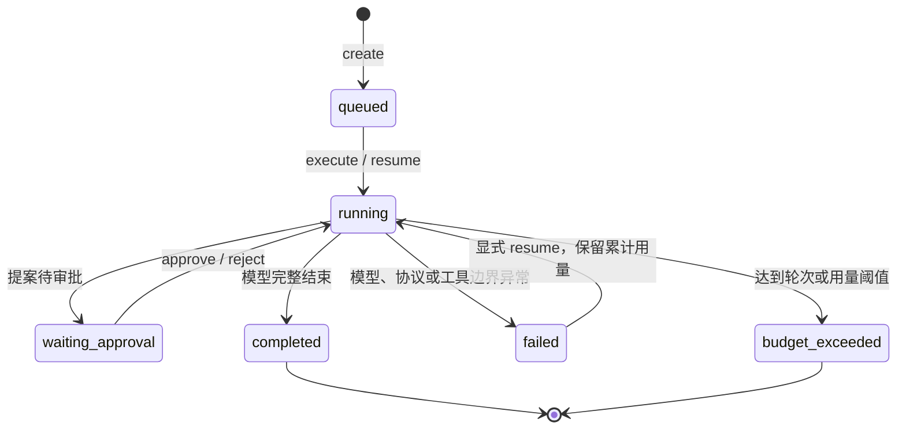

# 从一次补丁理解 Agent 系统架构

本项目让一个代码修复任务经过读取证据、提出补丁、人工审批、应用与验证。模型负责选择工具；执行框架负责校验、权限、状态和资源边界。学习重点是两者如何配合，而非把模型回复直接当成完成事实。

当前范围是 **单机、单进程、Python 示例仓库**。CLI 和网页每次创建任务都会复制一份 `data/sample_repo`，不会修改该模板或自动接管任意现有仓库。离线 `demo` 以确定性脚本复演；`anthropic` 适配器使用官方 SDK 调用 Messages API，需要自行配置并验证真实模型。

## 1. 模块与数据流

| 模块 | 应回答的问题 | 入口 |
|---|---|---|
| 运行时 | 下一轮什么时候开始、何时等待、失败怎样恢复？ | [`runtime.py`](../src/agent_lab/runtime.py) |
| 模型适配 | SDK 返回值如何变成统一消息与 usage？ | [`providers.py`](../src/agent_lab/providers.py) |
| 工具层 | 参数、路径、文件版本和副作用怎样校验？ | [`tools.py`](../src/agent_lab/tools.py) |
| 存储层 | 哪些内容必须跨进程重启保存？ | [`storage.py`](../src/agent_lab/storage.py) |
| 上下文 | 历史太长时怎样保留协议完整性？ | [`context.py`](../src/agent_lab/context.py) |
| 检索 | 证据如何分块、排序、携带版本引用？ | [`retrieval.py`](../src/agent_lab/retrieval.py) |
| 技能 | 怎样先看目录，再加载相关操作说明？ | [`skills.py`](../src/agent_lab/skills.py) |
| 服务层 | 创建独立工作区、后台任务和网页观察如何连接？ | [`api.py`](../src/agent_lab/api.py) |
| MCP | 怎样把相同只读工具暴露给标准协议客户端？ | [`mcp_server.py`](../src/agent_lab/mcp_server.py) |
| 评测 | 谁检查最终文件与审批状态？ | [`evals.py`](../src/agent_lab/evals.py) |

## 2. 三种执行模式

三个模式共用工具校验、审批、持久化和验证路径，区别在于主循环之前如何收集证据。

| 模式 | 实际控制流 | 可用于解释 | 当前限制 |
|---|---|---|---|
| `agent` | 直接进入 `complete → tool_use → execute → tool_result` 循环 | 模型根据观察选择下一步工具 | demo 由脚本选工具；真实模型才具有动态选择能力 |
| `workflow` | 代码固定执行目录读取和知识检索，再进入共享模型循环 | 把确定性步骤放在生成步骤之前 | 后半段仍是工具循环，并非完全固定的端到端 DAG |
| `parallel` | `reviewer`、`tester` 两个只读 worker 并发研究，汇总后进入主循环 | 独立上下文、并行检索、共享预算与写入收敛 | 角色由代码固定，不存在模型动态分解任务的 planner |

worker 每个最多进行三轮模型调用，主流程和 worker 都计入任务的全局轮次上限。它们只获得 `repo_list`、`repo_read`、`repo_search`、`knowledge_search`；即便返回越权的写工具调用，执行器也会拒绝。主流程是唯一能提出补丁的生成路径，人类审批入口则不在模型工具目录中。

## 3. 一次工具往返

一条 assistant 消息可能请求多个工具。下一条 user 消息需要包含所有相应 `tool_result`，不能把其中一个结果单独丢掉。运行时先保存工具调用批次，再保存每个已完成结果，恢复时复用已保存结果。出现待审批提案后，本批次其余工具会收到 `deferred_until_approval`，避免把应用前的验证误当成补丁后的验证。

这类 checkpoint 能减少重复执行，但文件系统和 SQLite 并不是同一个事务，不能据此承诺所有副作用 exactly-once。提案创建与结果落盘之间的极短崩溃窗口仍可能留下未被主循环引用的记录；生产系统需要更完整的操作幂等键与作业事务设计。

## 4. 运行状态与审批

`completed` 表示流程结束，不自动表示业务验收成功。判断代码是否正确仍要看验证事件。尚未决定的提案调用 `resume` 会保持等待状态。等待状态绑定具体提案 ID，不能用旧提案重放跳过新的审批。若决定已保存、进程却在更新 run 状态前退出，`resume` 会协调这个已批准或已拒绝的提案；已写文件通过目标摘要识别，安全补记状态。用量或轮次已超限的任务不会因 `resume` 而清零预算。

提案保存原始内容、新内容、各自 SHA-256、所属 run 与审批状态。应用时有三种结果：

1. 当前内容等于原始版本：将新内容写入同目录临时文件，刷新并原子替换，再登记已应用。
2. 当前内容已经等于目标版本：作为重复应用或写入后中断的恢复，补记应用状态。
3. 当前内容与两者都不同：返回 `version_conflict`，保留外部修改。

审批决定不能在同一提案上任意翻转；拒绝后的新方案需要新提案。应用发生版本冲突时，该任务停止；继续学习请创建新任务并重新读取代码，`resume` 不会跳过冲突审批。文件摘要校验处理常见版本冲突，进程内锁串行化同一工作区的应用；它们不构成抵御恶意并发文件系统操作的完整 OS 级隔离。

## 5. SQLite 里的四种信息

| 记录 | 保存内容 | 作用与边界 |
|---|---|---|
| `runs` | 任务、provider、mode、状态、消息、步数、usage、工作区绑定与待执行批次 | 恢复执行，不只保存聊天最后一句 |
| `events` | 模型调用、工具审计、审批与完成等公开行为 | 供 UI、SSE 和 CLI 查看；不要求保存隐藏思维链 |
| `proposals` | 待应用代码、版本摘要、审批与应用状态 | 绑定可审查对象，支持冲突检测与幂等应用 |
| `memories` | scope、key、value、更新时间 | 简单持久笔记；当前应用使用固定 `user` scope |

当前记忆由用户通过网页或 API 显式保存，模型只能调用 `memory_get` 读取。系统没有自动抽取、反思整合、遗忘、事实置信度或多用户记忆隔离。记忆内容仍是可能过时的数据，不会授予工具权限。

SQLite 使用独立连接、WAL 和事务，适合这里的本机学习服务。`jobs` 映射与运行中任务排他控制存在于服务进程内；不支持多个 Uvicorn worker 同时接管同一个运行，也没有分布式 lease、heartbeat 或抢占恢复。

## 6. 上下文、技能与检索各负责什么

- **上下文**决定这一轮发给模型哪些消息。裁剪保留最初任务与最近完整消息组，整体删除旧工具往返；没有用模型生成语义摘要。限制单位是序列化字符数，不含全部系统指令或工具 schema，也不保证等于真实 token 上限。
- **技能**提供操作说明。模型先看到 `name/description`，需要时调用 `skill_load`。仅支持受限的单行元数据，不执行技能脚本，也不声称完整实现了某个 Skills 标准。
- **记忆**保存跨会话用户笔记。它与当前对话历史、外部证据均分开存储。
- **检索**在原创学习笔记中找证据。Markdown 标题提供确定性背景，正文分块后使用 BM25 与 TF-IDF cosine 排序，再用 `Σ 1/(60+rank)` 合并。chunk ID 与文档路径、块序号及正文版本绑定。

词项向量能说明排序融合，但不是语义 embedding。当前没有向量数据库、LLM 生成 chunk 背景或 cross-encoder。返回结果附带来源和 chunk ID，生成器被要求按 `[chunk_id]` 引用；引用存在不等于语义支持成立，系统尚未实现完整的答案蕴含检查。

## 7. 验证分层

| 验证路径 | 实际做了什么 | 不能推出什么 |
|---|---|---|
| `verify_python` | 对文件调用 `ast.parse`，不导入或运行 | 业务计算正确、测试通过、代码无副作用 |
| 离线 eval 算术 grader | 白名单解释目标函数最后一条 return 的纯算术表达式，检查若干输入 | 整个函数所有控制流正确、完整单测通过 |
| 可选 `sandbox_test` | 在受限 Docker 容器运行受保护的 `unittest` | 完整多租户安全、任意仓库兼容或未知漏洞不可利用 |

Docker 路径要求守护进程可用，且本地已有 `python:3.12-slim`。工具不会自动拉镜像，不把主机密钥或 Docker socket 挂入待测容器；使用只读仓库挂载、禁网、非 root、权限和资源限制，以及超时清理。当前交付环境没有可用 Docker 守护进程，容器真实执行仍需后续验证。Docker 不可用时没有宿主机执行降级路径。

## 8. 预算、异常与观察

默认每任务最多 12 轮模型调用，累计 token 阈值 30000，消息字符预算 24000；每次输出上限最多 2048。真实模型使用 SDK 请求超时和有限网络重试。网络失败后保留已扣轮次，显式恢复不会绕过限制。SDK 内部重试属于同一次应用调用，实际网络尝试数可能多于轮次数。

token 使用量在响应返回后累加；并行请求也可能已经在途。这个阈值用于停止后续调用，不能当作精确费用硬上限。上下文窗口、真实计费、缓存 token 和服务端规则需要单独评估。

网页通过 JSON API 轮询展示事件，另提供 SSE `/stream` 接口。浏览器断开不取消任务；服务重启后需要显式恢复。原始 SDK 异常只保存类型，避免把异常中的请求细节直接展示；仓库内容和工具参数仍可能进入事件，因此真实数据接入前还需要脱敏、保留策略和访问控制。

## 9. 生产化扩展的顺序

当前本机 API 提供可选 Bearer token、Origin 检查与主机名约束，不能代替企业身份体系。若扩展到团队使用，优先把以下约束变成测试：

1. 用户身份与租户授权贯穿任务、工作区、记忆、检索和事件，检索前按 ACL 过滤。
2. 作业队列与租约定义唯一执行者，取消和重试有明确语义；数据库更新有版本控制。
3. 控制面持有模型凭证，执行面只获得短期最小权限；使用受维护的隔离执行池。
4. 建立跨仓库未见缺陷集与真实模型评测，报告成功率、延迟分位数、成本和环境失败。
5. 在检索、上下文和多 Agent 策略上做消融实验，再决定是否增加复杂度。

对应的文章、面试追问与练习见 [阅读地图](anthropic-reading-map.md)、[面试指南](interview-guide.md) 与 [14 天学习路线](learning-path.md)。
