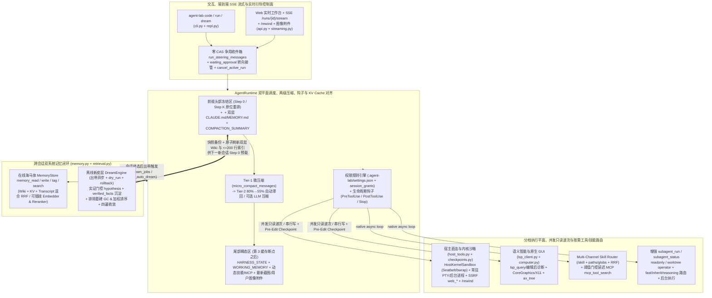

# 本地操控、端到端流式、OS 沙箱/钩子、子 Agent 与分层 Dreaming 记忆架构详解

本文档深入剖析 `agent-systems-lab` 在基础沙箱补丁闭环之上构建的核心工程子系统：**本地直连文件/终端操控、OS 内核级子进程沙箱（`HostKernelSandbox`）与常驻 PTY/后台进程管理**、**声明式 `.agent-lab/settings.json` 权限规则 + `session_grants` 与确定性生命周期钩子（`HookManager`）**、**轮次前内容寻址文件检查点与 `/rewind` 时间旅行（`CheckpointManager`）**、**LSP 语义代码智能（`LspClientManager`）与 SSRF 防护联网工具**、**原生桌面级 GUI（含 `ax_tree`）与用户多模态图像附件**、**两级微压缩 + `80% → 55%` 自动滞回压缩与可选 LLM 语义摘要**、**并发只读工具波次与支持 Git worktree 隔离/异构模型路由/后台运行的 `subagent_run`**、**端到端事件驱动流式（`RunStreamBroker` + SSE）与瞬时协作取消/运行期实时引导**，以及对照 Anthropic《The components of agent memory》（2026-11）落地的**实证门控双层记忆与四阶段离线 Dreaming（`dry_run` 预览、衰减 GC 与 `rollback_last_dream` 回滚）**。全文所有模块路径、类名、函数名、数据表与状态机均与仓库真实代码一一对应。

---

## 1. 全景架构：三档执行环境 × 权限规则/钩子治理

### 1.1 能力面（Execution Profile）与自动化度（Permission Mode / Rules / Hooks）正交解耦

在具备本地读写、Shell 执行、GUI 点击与外部插件调用能力的现代 Coding Agent（如 Claude Code 与 Codex CLI）中，仅靠系统提示词叮嘱模型“不要越权”无法防御间接提示词注入（Indirect Prompt Injection）。本项目在 [`permissions.py`](../src/agent_lab/permissions.py)、[`hooks.py`](../src/agent_lab/hooks.py) 与 [`runtime.py`](../src/agent_lab/runtime.py) 中将**挂载哪些工具（`execution_profile`）**、**声明式规则/三级档位放行策略（`PermissionRuleEngine` + `permission_mode`）**与**确定性生命周期拦截（`HookManager`）**设计为正交分层防线：

| 执行档位 (`execution_profile`) | 典型入口 | 挂载的工具集能力边界 | 默认权限档位 | 跨会话自主记忆 |
| :--- | :--- | :--- | :--- | :--- |
| **`sandbox`**（默认） | `agent-lab demo`、`eval`、`model-eval`、未传 `--cwd` 的 `run` | 仅挂载 11 个受控研发工具（`repo_*`、`propose_patch`、`propose_changeset`、`verify_python`、禁网只读容器 `sandbox_test` 等），彻底隐藏任意 Shell 与宿主机直写入口 | `ask` | 仅人工只读 `memory_get`（保持离线评测零外部状态漂移） |
| **`host`** | `agent-lab code`、`run --cwd <dir>`、Web `local_cwd`（仅本机管理员） | 在基础工具之上增量挂载 `HOST_TOOL_SPECS`（`fs_*`、`bash_exec`、`bash_output`/`bash_write`/`bash_kill`/`bash_list`）、`LSP_TOOL_SPECS`（`lsp_query`）、`WEB_TOOL_SPECS`（SSRF 防护 `web_fetch`/`web_search`）、动态并发/隔离 `subagent_run`/`subagent_status`、分层 Wiki `MEMORY_TOOL_SPECS` 与外部 `mcp__<server>__<tool>` | `auto-edit` | 启用双层 `MEMORY.md` 头部预载 + 会话后自动离线 Dreaming |
| **`computer`** | `agent-lab code --gui`、`run --cwd <dir> --gui` | 在 `host` 全量能力之上再挂载 `COMPUTER_TOOL_SPECS`（`computer_screen`、`computer_mouse`、`computer_keyboard`、`computer_open`，支持 `ax_tree` 无障碍树控件定位），激活多模态视觉感知—动作闭环 | `auto-edit`（截屏自动放行，键鼠点击与唤起默认拦截待审） | 同 `host` |

在此基础上，`PermissionRuleEngine` 先按 **`deny` → `ask` → `allow` / `session_grants`** 优先级求值声明式规则（来自全局 `<state_dir>/settings.json` 与经信任校验的 `<workspace>/.agent-lab/settings.json`），未命中时回落至 `evaluate_tool_permission(tool_name, args, permission_mode, mcp_read_only=...)` 返回确定性三态裁决（`allow` / `ask` / `deny`），随后由 `PreToolUse` 钩子执行最终允许/拒绝/参数改写裁决：

| 工具/动作风险等级 | `ask`（步步确认） | `auto-edit`（工程甜点档） | `full-auto`（全自动受控档） |
| :--- | :--- | :--- | :--- |
| 毁机级 Shell 命令（`rm -rf /` 或 `~`、`mkfs`、`dd` 写块设备、Fork Bomb、关机擦盘） | **`deny`（硬熔断）** | **`deny`（硬熔断）** | **`deny`（硬熔断）** |
| 工作区只读检索、AST 代码地图、`computer_screen` 截屏、外部 `readOnlyHint=True` 的 MCP 工具 | `allow` | `allow` | `allow` |
| 静态证明无副作用的终端命令（`classify_bash_command == "safe_readonly"`，如受控 `git diff`、`pytest`、`ruff check`） | `ask` | `allow` | `allow` |
| 受工作区五阶路径防护约束的文件编辑（`fs_write`、`fs_edit`、`propose_patch`、`propose_changeset`） | `ask` | `allow` | `allow` |
| 潜在副作用终端命令（`mutating`）、桌面键鼠注入（`computer_mouse`/`keyboard`/`open`）、非只读外部 MCP 调用 | `ask` | `ask` | `allow` |

### 1.2 端到端数据流与 KV Cache 前缀保护闭环



### 1.3 子系统源码与自动化测试映射表

| 子系统 | 核心源码模块 | 关键工程不变量 | 对应回归测试套件 |
| :--- | :--- | :--- | :--- |
| 端到端流式与瞬时取消 | [`streaming.py`](../src/agent_lab/streaming.py)、[`providers.py`](../src/agent_lab/providers.py)、[`api.py`](../src/agent_lab/api.py) | `RunStreamBroker` 跨线程零轮询扇出 + 单调 `seq` 断线回放；Anthropic `messages.stream()` / OpenAI SSE + `reasoning_content`；`bash_output_delta`；事件驱动 SSE `/api/runs/{id}/stream` 与 `cancel_active_run` | [`tests/test_multiturn_repl_and_web.py`](../tests/test_multiturn_repl_and_web.py) |
| 声明式权限规则与钩子 | [`permissions.py`](../src/agent_lab/permissions.py)、[`hooks.py`](../src/agent_lab/hooks.py) | 信任门控 `.agent-lab/settings.json`（`deny`→`ask`→`allow`/`session_grants`）；双层毁机熔断与凭证剥离；`HookManager` 七类生命周期钩子（`PreToolUse`/`PostToolUse`/`Stop` 否决等）与零配置 O(1) 零开销 | [`tests/test_host_tools_and_permissions.py`](../tests/test_host_tools_and_permissions.py) |
| 本地工具、OS 内核沙箱、PTY 与联网 | [`host_tools.py`](../src/agent_lab/host_tools.py) | `HostKernelSandbox`（macOS Seatbelt SBPL / Linux `bwrap`）；五阶防软硬链路径校验；`BackgroundProcessManager` 常驻 PTY 与有界环形日志（`bash_output`/`bash_write`/`bash_kill`/`bash_list`）；SSRF 防护 `web_fetch`/`web_search` | [`tests/test_host_tools_and_permissions.py`](../tests/test_host_tools_and_permissions.py) |
| 轮次检查点 `/rewind` 与 LSP 智能 | [`checkpoints.py`](../src/agent_lab/checkpoints.py)、[`lsp_client.py`](../src/agent_lab/lsp_client.py) | 内容寻址 SHA-256 轮次首改快照与 `both`/`files`/`messages` 三模式 `/rewind`（`O_NOFOLLOW` + 悬空 `tool_use` 闭合）；Stdio JSON-RPC 2.0 LSP `lsp_query` 与编辑后自动静态诊断 | [`tests/test_host_tools_and_permissions.py`](../tests/test_host_tools_and_permissions.py) |
| 桌面级 GUI 与用户图像附件 | [`computer.py`](../src/agent_lab/computer.py)、[`providers.py`](../src/agent_lab/providers.py)、[`api.py`](../src/agent_lab/api.py) | `CoreGraphics` 64 位 FFI + `ax_tree` 无障碍树定位 + `LinuxX11ComputerBackend` + `MockComputerBackend`；用户多模态图像附件与截屏统一瞬态置尾，不污染 KV 前缀与数据库消息体 | [`tests/test_computer_use.py`](../tests/test_computer_use.py) |
| 两级压缩与可选 LLM 语义摘要 | [`context.py`](../src/agent_lab/context.py)、[`runtime.py`](../src/agent_lab/runtime.py) | Tier-1 `micro_compact_messages` 剥离陈旧 `thinking`/超大旧结果 + Tier-2 `80%→55%` 滞回压缩；同拍原位 `COMPACTION_SUMMARY` 与可选 `use_llm=True` 语义压缩（`fast` 档 + 消毒回退）；USD 成本账本与 `max_cost_usd` | [`tests/test_long_context_and_claude_md.py`](../tests/test_long_context_and_claude_md.py)、[`tests/test_context_budget.py`](../tests/test_context_budget.py) |
| 多通道技能与阈值延迟 MCP | [`skills.py`](../src/agent_lab/skills.py)、[`mcp_client.py`](../src/agent_lab/mcp_client.py)、[`retrieval.py`](../src/agent_lab/retrieval.py) | `/skill` 显式点名 + `paths`/`globs` 路径感知 + BM25/TF-IDF/RRF 路由；超阈值外部 MCP 延迟 `mcp_tool_search` + OAuth PKCE；AnyIO 单宿主 `_owner_task` | [`tests/test_subagent_and_mcp_client.py`](../tests/test_subagent_and_mcp_client.py)、[`tests/test_skill_loading.py`](../tests/test_skill_loading.py) |
| 并发波次与增强子 Agent 编排 | [`runtime.py`](../src/agent_lab/runtime.py) | 连续只读调用自动归入并发波次（`_partition_tool_waves`）；`subagent_run` 支持 `readonly`/`operator` + Git `worktree` 隔离、`fast`/`inherit`/`reasoning` 模型路由与 `run_in_background` + `subagent_status` | [`tests/test_subagent_and_mcp_client.py`](../tests/test_subagent_and_mcp_client.py) |
| 分层记忆、实证 Dreaming 与神经检索 | [`memory.py`](../src/agent_lab/memory.py)、[`retrieval.py`](../src/agent_lab/retrieval.py) | 双层 `CLAUDE.md`/`MEMORY.md`；实证门控（无证明 LLM 页强制 `hypothesis`）、`verified_facts` 晋升、排除墓碑 GC 与多因子加权排序、`dry_run` 预览与 `rollback_last_dream` 回滚；可插拔神经 Embedder/Reranker | [`tests/test_agent_memory_and_dreaming.py`](../tests/test_agent_memory_and_dreaming.py) |

---

## 2. 本地直连工作区与三级权限治理（`permissions.py` + `host_tools.py`）

### 2.1 为什么 `classify_bash_command` 必须做纵深静态审计？

在 `auto-edit` 档位下，为避免开发者每次跑 `git status` 或 `pytest` 都点一次确认导致“审批疲劳（Approval Fatigue）”，框架会自动放行 `safe_readonly` 命令。这要求分类器严格遵循**失败闭合（Fail-Closed）**原则——任何无法静态证明 100% 只读的命令一律归入 `mutating`（或 `blocked`）：

1. **双层毁机熔断（`_CATASTROPHIC_PATTERNS` + `_has_catastrophic_rm_tokens`）**：表层正则秒拒 Fork Bomb（`:(){ :|:& };:`）、`mkfs`、`dd of=/dev/...`、磁盘擦除与关机指令；词法分词器穿透 `sudo`、`env`、长短选项拆分（如 `rm -r -f -- /` 或 `rm --recursive ~`）核验递归删除高危目标，在包括 `full-auto` 在内的任何档位下一律硬拒绝。
2. **封堵内联环境变量 RCE**：POSIX Shell 允许 `GIT_EXTERNAL_DIFF=./pwn.sh git diff` 或 `DYLD_INSERT_LIBRARIES=evil.dylib pytest`。分类器仅允许 `LC_ALL`、`LANG`、`TZ`、`NO_COLOR`、`TERM`、`PYTHONDONTWRITEBYTECODE` 等纯显示/编码变量内联出现，其余内联赋值一律按 `mutating` 拦截审批。
3. **封堵跨工具链 `./` 路径提权**：在 `auto-edit` 模式下 `fs_write` 免审批；若分类器仅检查 `Path(argv[0]).name == "pytest"`，被注入劫持的模型即可先 `fs_write("pytest", malicious_script)` 再调 `bash_exec("./pytest")` 实现零审批任意代码执行。因此凡 `argv[0]` 含 `/` 或 `\` 一律禁止判为只读，强制走系统受控 `$PATH`。
4. **子进程零信任环境变量剥离（`build_scrubbed_env`）**：派生终端或本地 MCP 子进程前，通过精确黑名单 + 敏感词正则剔除 `ANTHROPIC_API_KEY`、`OPENAI_API_KEY`、`AGENT_LAB_TOKEN`、数据库 DSN 与云密钥，同时注入 `GIT_TERMINAL_PROMPT=0`、`CI=1`、`PAGER=cat` 防止交互式分页器挂死后台进程。

### 2.2 五阶工作区路径防逃逸与崩溃原子写

`resolve_host_workspace_path` 严格禁止在检查符号链接之前直接调用 `Path.resolve()`（因为 `resolve()` 会静默跟随软链，既可能掩盖 `.env.link -> safe.txt` 的敏感命名，也可能引发检查与打开之间的路径折叠逃逸）：

1. **纯词法清洗与禁区拦截**：拒绝空路径、NUL 字节、绝对路径、`..` 回溯段、`.git` / `.agent-lab` / `.ssh` 元数据目录以及 `is_host_secret_segment`（`.env*`、私钥后缀、凭证词干）；
2. **自顶向下逐段 `is_symlink()` 检查**：从已校验的工作区根开始逐级拼接并执行底层 `lstat`，任何一级父目录或目标文件本身为符号链接立即拒绝；
3. **物理边界二次确认**：`resolve()` 后校验 `resolved.is_relative_to(ws_root)`；
4. **硬链接与特殊文件防御**：对已存在目标检查 `stat()`，强制要求常规文件（拒绝命名管道 FIFO 或设备文件防读取永久阻塞）且 `st_nlink == 1`（防止通过同分区硬链接指向工作区外敏感文件）；
5. **跨进程 `flock` + `epoch` + 同目录原子替换**：`_atomic_write_host_file` 在工作区跨进程排他锁内先调 `storage.verify_epoch` 拦截过期 Worker，再于 `target.parent` 同挂载点创建临时文件、`os.fsync` 刷盘后调用 `os.replace` 原子切换目录项，杜绝 `O_TRUNC` 半截空文件与并发丢失更新（Lost Update）。

### 2.3 后台流排水防 64KB 管道死锁、进程组清场与常驻 PTY / 后台进程管理

在 `run_host_bash_command` 中直接使用 `proc.wait(timeout)` 后再读管道会踩中两个经典的操作系统级陷阱：
- **匿名管道满缓冲死锁**：OS 管道缓冲区通常仅 16KB—64KB；一旦子进程输出超过 64KB，子进程 `write()` 阻塞等待父进程读取，而父进程阻塞在 `wait()` 等待子进程退出，形成永久死锁。本实现为 `stdout` 与 `stderr` 各启动独立守护线程 `_drain_stream` 持续 `read(4096)` 直至 EOF（同时可通过回调将实时行流式发布为 `bash_output_delta`）；超出 32 KiB 预算后仅停止追加内存列表并标记 `truncated=True`，但**绝不停止抽干管道**（避免关闭读端触发子进程 `SIGPIPE` 异常退出码失真）。
- **孤儿孙进程泄漏与句柄占住**：`bash -c` 常派生后台子进程或编译工作进程；若超时只杀外层 `bash` PID，孙进程会被 `init/launchd` 收养并继续占住管道写端，导致排水线程 `join()` 挂死。因此子进程统一以 `start_new_session=True` 创立独立进程组，超时或取消时由 `_terminate_process_group` 向整个 `-pgid` 发送 `SIGTERM`、轮询 `os.killpg(pgid, 0)` 探测全组存活状态，宽限期未退尽则补发 `SIGKILL`，并在 `finally` 中无条件兜底清场。
- **常驻 PTY 与后台进程池（`BackgroundProcessManager`）**：对需要持续运行的服务或交互式 REPL，`bash_exec(background=True, use_pty=True|False)` 将命令纳入运行级有界进程管理器（默认上限 6 个并发后台进程、128 KiB 环形日志缓冲与单调递增字符 `offset`/`next_offset`），支持 `pty.openpty()` 伪终端分配，并通过 **`bash_output`、`bash_write`、`bash_kill`、`bash_list`** 实现非阻塞增量日志追踪、标准输入交互与进程组回收。

### 2.4 OS 内核沙箱（`HostKernelSandbox`）、声明式规则、生命周期钩子、LSP 与 `/rewind` 检查点

1. **跨平台 OS 内核子进程沙箱（`HostKernelSandbox`，[`host_tools.py`](../src/agent_lab/host_tools.py)）**：除应用层路径校验外，宿主机 `bash_exec` 在 macOS 上自动通过 `sandbox-exec` 注入动态 SBPL 策略、在 Linux 上通过 `bwrap`（bubblewrap）隔离文件系统命名空间，将写权限限定在工作区与临时目录，阻断读取 `~/.ssh` / `~/.aws` 等敏感目录并支持按需断网。由 `AGENT_LAB_HOST_SANDBOX` 控制三档行为：`auto`（默认，探测自检通过则启用）、`strict`（失败闭合，无可用内核沙箱时拒绝执行并返回 `sandbox_unavailable`）、`off`（显式关闭）。
2. **信任门控的声明式权限规则（`.agent-lab/settings.json`）与会话授权（`session_grants`）**：[`permissions.py`](../src/agent_lab/permissions.py) 的 `PermissionRuleEngine` 加载全局 `<state_dir>/settings.json` 与经信任校验（`is_workspace_trusted`：`AGENT_LAB_TRUSTED_WORKSPACES` / `trusted_workspaces.json` / 全局 `trusted_workspaces`）的项目 `<workspace>/.agent-lab/settings.json`，严格按 **`deny` → `ask` → `allow` / `session_grants`** 顺序裁决（支持文件路径 glob、Bash 命令模式、WebFetch 域名与 MCP 规范名；`allow` 模式严禁借 `&&`/`;`/`|` 拼装绕过），并在审批提案上附带 `suggested_grant_pattern` 支持用户一次授权本会话同类操作（Web/API 提供 `GET/PUT /api/settings/rules`）。
3. **确定性生命周期钩子（`HookManager`，[`hooks.py`](../src/agent_lab/hooks.py)）**：支持 `SessionStart`、`UserPromptSubmit`、`PreToolUse`、`PostToolUse`、`PreCompact`、`Stop`（及 `Notification`）事件，同时接受受信任 `settings.json` 中的命令式钩子与编程式 Python 回调，按 glob/正则 `matcher` 匹配；未配置时 O(1) 零开销跳过，命令钩子强制剥离宿主机凭证并按进程组回收，按每条规则的 `on_error: "allow" | "deny"` 决定异常策略。可在 `PreToolUse` 拦截或改写输入、在 `PostToolUse` 注入额外上下文与诊断、在 `Stop` 阶段返回 `veto: true` 否决模型过早结束。
4. **轮次前内容寻址检查点与 `/rewind`（`CheckpointManager`，[`checkpoints.py`](../src/agent_lab/checkpoints.py)）**：每次文件写/改前在 `<state_dir>/checkpoints/<run_id>/blobs/<sha256>` 按 SHA-256 原子落盘该轮首次修改前的原始字节（`First-Touch Snapshot`，配合 `run_checkpoints` 表、逐段防软链与 `O_NOFOLLOW` 校验）。经 `POST /api/runs/{run_id}/rewind`（或 `/rewind`）支持 `scope="both" | "files" | "messages"` 三模式时间旅行回退，按时间逆序精确还原或删除新建文件、自动闭合截断后悬空的 `tool_use` 块并重置上下文压缩游标。
5. **LSP 语义代码智能与 SSRF 防护联网工具**：[`lsp_client.py`](../src/agent_lab/lsp_client.py) 的 `LspClientManager` 以严格 UTF-8 字节 `Content-Length` 分帧对接本地语言服务器（`basedpyright-langserver`/`pyright-langserver`、`typescript-language-server`、`gopls`、`rust-analyzer`，缺失时零报错降级），暴露 `lsp_query`（`goToDefinition`/`findReferences`/`hover`/`documentSymbol`/`workspaceSymbol`/`diagnostics`）并在文件编辑后自动附加 `get_file_diagnostics` 静态诊断；`WEB_TOOL_SPECS` 提供 **`web_fetch` / `web_search`**，强制校验 DNS 解析后的目标 IP，阻断私网、回环、链路本地与云元数据 SSRF 跳转。

---

## 3. 桌面级 GUI 操控（Computer Use）与瞬态多模态注入（`computer.py` + `providers.py`）

### 3.1 零 PyObjC 依赖的 macOS 原生 CoreGraphics 64 位 FFI、无障碍树 `ax_tree` 与 Linux X11 支持

[`computer.py`](../src/agent_lab/computer.py) 中的 `MacOSNativeBackend` 通过标准库 `ctypes` 直连 `CoreGraphics` 与 `ApplicationServices`（同时提供面向 Linux 桌面的 `LinuxX11ComputerBackend` 与无头测试桩 `MockComputerBackend`），解决了跨语言底层调用的五大工程难点：

1. **64 位指针防截断与内核句柄释放**：`ctypes` 默认将未声明 `restype` 的 C 函数返回值当作 32 位有符号 `c_int`。在 64 位 macOS 进程中，`CGEventCreateMouseEvent` 等返回的 `CGEventRef` 堆地址高 32 位非零；一旦被截断再传入 `CGEventPost` 或 `CFRelease`，进程立即触发 `SIGSEGV` 段错误。`_bind_signatures` 为所有创建函数显式绑定 `restype = ctypes.c_void_p`，并在每个事件注入路径的 `try...finally` 中配对调用 `CFRelease` 防止 WindowServer 对象泄漏。
2. **Apple Silicon ARM64 非变参 ABI 对齐**：在 Darwin ARM64（AAPCS64）调用约定下，固定命名参数通过寄存器 `x0`–`x7` 传递，而 C 变参函数（`...`）的匿名参数强制压栈传递。原版 `CGEventCreateScrollWheelEvent` 是变参函数，若用固定 `argtypes` 调用会导致被调函数从栈上读到未初始化垃圾值；因此必须选用固定参数签名的 `CGEventCreateScrollWheelEvent2`。
3. **Retina 物理像素与 CGEvent 逻辑点对齐**：macOS Retina 显示器下 `screencapture` 产出的 PNG 分辨率通常为逻辑桌面的 `2x`，而 `CGEvent` 鼠标坐标运行在 `1x` 逻辑点空间。`take_screenshot` 先查询 `CGDisplayPixelsWide/High` 获取逻辑宽高，再用系统内置 `sips` 将截图缩放对齐（长边上限 `1440px`），同时将 `(scale_x, scale_y)` 写入 SQLite `gui_screenshot` 事件；即使任务在点击审批处挂起（`waiting_approval`）并跨进程重启恢复，`execute_computer_tool` 也会倒序扫描持久化事件精确还原比例尺，根治“看准点偏”。
4. **无障碍树控件定位（`ax_tree`）**：支持提取前台窗口的 `AXUIElement` 控件层级（角色、标题与逻辑几何矩形），让模型将视觉观察与精确控件坐标结合，显著降低纯像素猜测点击偏差。
5. **TCC 隐私权限非阻塞预检与 UTF-16LE Unicode 键入**：截屏前调用 `CGPreflightScreenCaptureAccess`、键鼠注入前调用 `AXIsProcessTrusted`，未获授权时立即返回清晰的英文/中文系统设置引导错误码（避免截出空白桌面壁纸或事件被静默丢弃导致模型死循环重试）；任意文本输入通过 UTF-16LE 编码（正确计算 Emoji 代理对 UTF-16 码元长度）按 16 字符分块调用 `CGEventKeyboardSetUnicodeString`，不受当前中英文输入法键盘布局干扰。

### 3.2 为什么多模态截图与用户图像附件绝不写入 SQLite `messages`，且必须置于第 3 缓存断点之后？

若将每轮数百 KB 至数 MB 的 PNG Base64 直接存入 `run["messages"]`：
- SQLite `runs.body` 会在数轮内膨胀至数十 MB，拖垮每次 checkpoint 写入；
- 巨大的 Base64 字符串会瞬间击穿 `ContextManager` 的字符/Token 水位线，迫使早期代码上下文被频繁裁剪，进而触发全序列 RoPE 位置偏移与 KV Cache 级联失效。

本项目的解法（见 [`runtime.py`](../src/agent_lab/runtime.py) `_collect_recent_vision_attachments`、[`api.py`](../src/agent_lab/api.py) 与 [`providers.py`](../src/agent_lab/providers.py)）：
1. 桌面截图与**用户上传的多模态图像附件**（支持通过 `POST /api/runs/{id}/attachments` 或在创建任务/发送消息时携带 `attachments`，经文件名与魔数校验后落盘）均仅以独立文件存于运行产物目录，对话历史中只记录轻量路径与尺寸元数据；Web 预览通过 `GET /api/runs/{id}/artifacts/{path}` 提供，并强制附带 `Content-Security-Policy: default-src 'none'; img-src 'self'` 与 `Cache-Control: private, max-age=60` 封堵同源 XSS 与代理串号；
2. 仅在当轮调用支持视觉的真实模型前，按需从磁盘读取最新一轮截图及当轮用户图像附件，通过 `vision_attachments` 参数传入适配器；
3. `AnthropicProvider` 先对稳定前缀调用 `build_anthropic_cached_payload` 打好全部 3 处 `cache_control: {"type": "ephemeral"}` 断点（`<TOOLS>`、`<SYSTEM>`、稳定历史末尾），**最后**才将瞬态图像块追加在最末条 `user` 消息尾部。这样下一轮产生新截图或新附件时，前序所有代码阅读与推理历史的 KV Cache 保持 **100% 字节级命中**。

---

## 4. 两级压缩、并行工具波次、增强子 Agent、端到端流式与实时引导

### 4.1 两级微压缩 + `80% → 55%` 自动滞回压缩与可选 LLM 语义摘要（`context.py` + `runtime.py`）

长链路代码修复极易在数十轮文件读取与测试输出后耗尽上下文窗口；若采用“每超一步就从头部滑窗裁掉一条”的朴素做法，每一步都会改变第 1 条消息之后的全部 RoPE 位置编码，导致 Prompt KV Cache 命中率暴跌至 0%。本项目通过**两级压缩（Tier-1 微压缩 → Tier-2 高低水位滞回压缩）+ 同拍原位摘要 + 可选 LLM 语义摘要**解决该矛盾：

1. **Tier-1 轻量微压缩（`micro_compact_messages`）**：当上下文逼近 `80%` 高水位线时，先在不裁剪消息组结构的前提下，剥离较早轮次的陈旧 `thinking` 块并将早期超大 `tool_result` 收敛为紧凑存根（默认保护最近 3 个原子组），同时持久化单调递进的 `micro_compaction_cursors` 并在事件流记录 `context_micro_compacted`，使后续轮次无需反复改写前缀即可回收大量空间。
2. **Tier-2 `80% → 55%` 自动滞回阶梯压缩（Automatic Hysteresis Compaction）**：若经 Tier-1 微压缩后任一预算维度（字符或校准 BPE Token）仍达 **`80%` 高水位（`high_watermark_ratio=0.80`）**，系统按完整的 `assistant(tool_use) + user(tool_result)` 原子组一次性批量折叠早期对话直至回落到 **`55%` 低水位（`low_watermark_ratio=0.55`）**，腾出 `25%` 连续缓存命中窗口（并触发 `PreCompact` 生命周期钩子）。
3. **同拍原位 `COMPACTION_SUMMARY` 与可选 LLM 语义摘要（`use_llm=True`）**：当 `compaction_cursor` 推进时，默认在**第 $K$ 步当拍**调用零模型开销的 `build_compaction_summary` 提取早期用户追问、已修改/检视文件、退出码与可回查 `call_id` 索引原位注入 `pinned` 区；在 `/compact` 或 `compact_context(..., use_llm=True)` 场景下还可选启用 **LLM 语义摘要**（经 `build_llm_compaction_prompt` 路由至 `fast` 档模型生成语义要点，并由 `finalize_llm_compaction_summary` 逐行消毒防伪造协议头，异常时自动回退确定性摘要）。此外，运行时同步维护 **USD 美元成本账本（`compute_cost_usd`）** 并在请求前后双重校核 `max_cost_usd` 熔断上限。

### 4.2 多通道技能路由器、阈值门控延迟 MCP 与并发只读工具波次

如果把数十个本地技能全文和上百个外部 MCP 工具的完整 JSON Schema 在 Step 0 一次性塞入 `<SYSTEM>` 与 `<TOOLS>`，尚未开始读代码就会白白吃掉数万 Token 并加速触碰 `80%` 压缩水位线。系统在工具与技能入口实施按需披露与波次加速：

1. **Multi-Channel Skill Router（`skills.py` + `retrieval.py`）**：技能路由融合三条正交通道——
   - **显式指令通道（`/skill` Explicit）**：用户在任务提示词或追问中显式点名 `/skill-name`（如 `/code-review`）时，赋予最高确定性优先级直接命中；
   - **工作区路径感知通道（`paths` / `globs`）**：解析技能元数据中的路径匹配规则（如前端组件、SQL 迁移或特定子目录 glob），结合当前触及或工作区活跃文件路径自动召回领域技能；
   - **混合词法/统计检索通道（BM25 + TF-IDF + RRF）**：复用 `retrieval.py` 的驼峰/蛇形子词分词器与倒数秩融合（RRF），对技能名称、描述及章节标题做高精度排序，再按“元数据目录 → `skill_inspect` 章节大纲 → `skill_load` 按章节固定不可变快照（运行期中途加载自动置尾 `mid_run_dynamic=True`）”三级渐进披露。
2. **Threshold-Gated Deferred MCP `mcp_tool_search`（`mcp_client.py` + `runtime.py`）**：
   - **AnyIO 单宿主 Task 亲和性、OAuth PKCE 与 64 字符防碰撞路由**：`McpClientManager` 为每个 `stdio` / `streamable-http` Server 维护专职后台 `_owner_task` 独占持有 `AsyncExitStack`（根治跨协程退出 AnyIO Cancel Scope 抛 `RuntimeError`），支持 `McpOAuthTokenProvider` PKCE 鉴权与资源/提示词读取，并将工具映射为 `mcp__<server>__<tool>`（超 64 字符附加 8 位 SHA-256 指纹）；
   - **阈值门控延迟加载**：外部 MCP 工具超阈值时，首轮 `<TOOLS>` 仅挂载轻量 `mcp_tool_search` 与延迟目录摘要，按需检索激活调用，守住根前缀缓存。
3. **并发只读工具波次（`_partition_tool_waves`，`runtime.py`）**：当单轮模型一次返回多个工具调用时，运行时将连续 `>=2` 个无副作用只读工具（如多个 `fs_read`/`fs_grep`/`repo_read`/`lsp_query` 及 `readOnlyHint=True` 外部 MCP）划入并行波次以 `asyncio.gather` 并发执行，显著缩短多文件调研尾延迟；凡涉及写操作、命中声明式 `ask` 规则或存在 `PreToolUse` 钩子的调用则严格串行执行，保住审批门控与确定性顺序。

### 4.3 增强动态子 Agent 编排：Worktree 写隔离、异构模型路由与后台运行（`runtime.py`）

`AgentRuntime._dispatch_call` 将同步阻塞 I/O 工具（经 `asyncio.to_thread` + `asyncio.shield` 保护）与事件循环原生异步工具（`subagent_run` / `subagent_status` / `mcp__*`）严格分流。对照 Anthropic《How we built our multi-agent research system》的工程经验并结合工程落地需求，`subagent_run` 落地了以下核心能力：

1. **Effort-Scaling 与四要素显式委派契约**：按问题复杂度分级（单文件原地解决、双面核查 1—2 个、跨多模块 3—4 个），每项子任务显式声明 `role`、`prompt`、`scope_boundaries` 与 `expected_output`。
2. **写能力 `operator` 与 Git `worktree` 并发隔离**：除默认的 `mode="readonly"` 只读调研外，支持 `mode="operator"` 继承当前权限策略执行文件编辑与命令；配合 `isolation="worktree"`（多 `operator` 并发且仓库为 Git 时默认启用）为每个子 Agent 分配独立 Git worktree，彻底避免并发写入互相覆盖。
3. **异构模型档位路由（`model_tier`）**：每个子任务可指定 `model_tier: "fast" | "inherit" | "reasoning"`（经 `resolve_model_for_tier` 映射至 `AGENT_LAB_FAST_MODEL` / 主模型 / `AGENT_LAB_REASONING_MODEL`），实现“廉价快速模型并行广度扫描 + 高阶推理模型深度诊断”的成本/精度帕累托最优；后台辅助调用（如 LLM 摘要、Dreaming）同样透明路由至 `fast` 档位。
4. **洁净上下文、根前缀缓存共享、后台运行与浓缩报告交接**：子 Agent 在独立洁净历史中仅接收有界 `PARENT_CONTEXT_BRIEF`（剔除 `subagent_run` 自身防递归），复用父级 `<TOOLS>` + `<SYSTEM>` 根前缀以命中 KV Cache；支持 `run_in_background=True` 异步返回 `job_id` 并通过 **`subagent_status`** 随时查询进度与汇总报告，同时实时向 `RunStreamBroker` 发布 `subagent_progress` 流式帧，最终交接有界浓缩结论报告。

### 4.4 端到端流式（`RunStreamBroker` + SSE）、瞬时取消与运行期实时引导（`streaming.py` + `storage.py` + `api.py`）

1. **端到端零轮询流式架构（`RunStreamBroker` + `GET /api/runs/{id}/stream`）**：
   - [`streaming.py`](../src/agent_lab/streaming.py) 为每个 `run_id` 维护单调递增 `seq` 与有界环形缓冲（默认 256 条），支持跨线程安全发布（后台 bash 排水线程通过 `loop.call_soon_threadsafe` 无锁桥接至任意订阅事件循环）与慢消费者背压隔离（满队丢最旧帧绝不阻塞生产者）；
   - **全链路真实流式**：`AnthropicProvider` 使用官方 `client.messages.stream()`，`OpenAICompatProvider` 解析原生 SSE 并保留/透传 `reasoning_content` 思维链增量，统一发射 `thinking_delta`、`text_delta`、`tool_use_start`、`input_json_delta`、`bash_output_delta`、`subagent_progress`、`event` 与 `run_status`；
   - **事件驱动 SSE 与瞬时协作取消**：`GET /api/runs/{id}/stream` 通过 `StreamingResponse` 按 `after_seq` 断线无损补齐并事件驱动推送（取代固定间隔轮询）；`cancel_active_run` 同时触发 `threading.Event` 与 `asyncio.Event` 并中断在途流式响应、等待中的沙盒槽位及活跃 bash 进程组，实现毫秒级协作取消。
2. **`run_steering_messages` 零 CAS 锁竞争收件箱（Zero-CAS-Contention Inbox）**：
   - 活跃 `AgentRuntime` / `LeaseWorker` 高频更新 `runs` 表并校验 `state_version` 乐观锁 CAS；当任务处于 `running` / `queued` 时，`POST /api/runs/{id}/messages` 仅以纯追加（INSERT）写入独立 `run_steering_messages` 收件箱表，返回 `{"queued_steering": true}`，与主表 **零锁竞争**；
   - 运行时在每批 `user(tool_result)` 落盘后的安全协议边界原子排空收件箱并合并进对话，兼顾零冲突、消息协议 100% 合法与前序 KV Cache 无损保留。
3. **`waiting_approval` 转向接管与多轮工作台**：
   - 在 `waiting_approval` 状态下直接发送转向指令，`Storage.append_user_turn` 会原子撤销全部挂起 `waiting_proposal_ids`、补齐闭合 `tool_result` 并按新方向立即续跑；CLI `agent-lab code` 支持 `[y / n / a=auto-edit / f=full-auto]` 零缓存失效提权与 `/compact`、`/dream`，Web 工作台提供事件驱动 SSE 实时流、`/rewind` 时间旅行回退与多模态图像上传。

---

## 5. 跨会话双层记忆、互链 Wiki 图谱、实证 Dreaming 与可插拔神经检索（`memory.py` + `retrieval.py`）

对照 Anthropic 研究文章《The components of agent memory》（2026-11），[`memory.py`](../src/agent_lab/memory.py) 将跨会话长期记忆建模为**“对未来会话效用的先验预测（Prediction of Future Utility）”**，严格区分会话内工作记忆（[`working_memory.py`](../src/agent_lab/working_memory.py)，随单次任务生灭）与跨会话分层认知图谱（`MemoryStore` + `DreamEngine`）。

### 5.1 为什么分三层结构，且顶层 `MEMORY.md` 硬限 `<= 200` 行 / `<= 4000` 字符？

| 层级 | 存储形态与隔离域 | 加载时机与 KV Cache 影响 | 核心职责与防退化约束 |
| :--- | :--- | :--- | :--- |
| **Layer 0：常驻准则与导航索引** | 用户全局 `global/{CLAUDE.md, MEMORY.md}` + 项目专属 `projects/<slug>/{CLAUDE.md, MEMORY.md}` 及工作区根 `CLAUDE.md` / `AGENTS.md`（多租户按 `_safe_dir_component(tenant_id)` 物理隔离） | 仅在会话创建 Step 0 一次性快照至 `run.metadata.pinned_memory_snapshot` 注入前缀头部；冷启动为空时 **0 Token 开销** | `MEMORY.md` 硬限合计 **`<= 200` 行、`<= 4000` 字符**；严禁模型通过普通 `memory_write` 未经受控接口随意篡改索引，会话中途写新笔记绝不回刷当前会话头部快照，确保多轮推理 100% 命中前缀缓存 |
| **Layer 1：互链主题 Wiki** | `rules/*.md`（工程铁律）、`traps/*.md`（反直觉踩坑警告）、`wiki/*.md`（架构与领域专题）、`journal/*.md`（过冷/淘汰页归档至 `.archive/`） | 模型看到 `MEMORY.md` 指针后按需调用 `memory_read` 展开正文及正/反向 `[[wiki-links]]` 邻接图（自动累加 `hit_count` 与 `last_accessed_at`） | 头部携带确定性认知元数据（`status`: `confirmed`/`hypothesis`/`stale`/`contradicted` 及加密凭据 `sources`）；单页硬限 `12,000` 字符、每层活跃页上限 `64` 页（**计数排除 `contradicted` 软墓碑**），严拒瞬态屏幕或全文源码拷贝 |
| **Layer 2：原始历史回溯与可插拔神经检索** | SQLite/PostgreSQL 中的历史已完成/中断会话 Transcripts + 显式 `memory_tag` 显著性路标 + 人工 KV 偏好 | 调用 `memory_search` 时与非 `contradicted` 的双层 Wiki 共同送入 [`KnowledgeBase.from_documents`](../src/agent_lab/retrieval.py) | 共享围栏安全切块、驼峰/蛇形子词分词、BM25 + RRF（`k=60`）与**加权认知排序**（状态/反链/命中频次/近因衰减）；原生内置可插拔 **`LocalSubwordDenseEmbedder`、`OpenAICompatibleEmbedder`（带缓存与回退）与 `HttpReranker`**，通过 `AGENT_LAB_EMBEDDING_URL`/`AGENT_LAB_EMBEDDING_MODE` 按需启用 |

### 5.2 在线海马体（`MemoryStore`）的凭据核验、衰减 GC 与加权排序

1. **多租户防串号与逐段防软链**：`_safe_dir_component` 将非安全字符替换为下划线并强制追加 10 位 SHA-256 十六进制后缀（彻底消除 `acme:prod` 与 `acme_prod` 折叠碰撞串租户隐患）；`_ensure_safe_tree_segment` 自顶向下逐段执行 `lstat` 拒绝符号链接，`_memory_scope_lock` 使用 `O_NOFOLLOW | O_CLOEXEC` + `fcntl.flock` 配合 `_atomic_write_text`（同目录 `fsync + os.replace`）保障并发无撕裂读写。
2. **防提示词注入与凭据门控**：所有写入文本先经 `sanitize_memory_text` 递归脱敏密钥，并中和行首伪造的 `HARNESS_STATE` / `WORKING_MEMORY` / `PINNED_AGENT_MEMORY` 协议头；调用 `memory_write` 时，`_enrich_and_verify_sources` 自动比对当前工作区文件 SHA-256（生成 `file:<path>@<sha256>`）及当前会话 `tool_calls` 账本，若显式引用了不存在或执行失败的工具调用，写入会被降级为 `hypothesis` 或标记待核验。
3. **排除墓碑的衰减回收 GC（`_gc_layer_unlocked`）与多因子加权排序（`_page_rank_score`）**：活跃页配额统计严格排除 `status == "contradicted"` 软墓碑，防止历史证伪记录占满活跃容量；逼近配额上限或超过保留窗口（`contradicted` 7 天、`stale` 14 天、未验证 `hypothesis` 7 天）时，按命中次数、反链数与近因综合冷度将淘汰页原子归档至 `.archive/`（保留可追溯审计）；检索与索引重排综合认知状态（`confirmed > hypothesis > stale`）、入站反链数、`hit_count` 频次与 `last_accessed_at` 近因衰减打分。
4. **围栏与行内反引号安全的 `[[wiki-links]]` 解析**：`extract_wiki_links` 与原位重写器先复用 `retrieval._tag_fenced_lines` 屏蔽 ``` / ~~~ 代码块，再逐行跳过单/多反引号行内代码片段（如 `` `a[[0]]` ``），杜绝把嵌套数组切片误判为知识图谱链接。

### 5.3 离线新皮层（`DreamEngine`）：三阶段无锁推理、实证门控、`dry_run` 预览与快照回滚

每次 `host` / `computer` 会话进入终态后（或人工执行 `agent-lab dream`、REPL `/dream`、`POST /api/memory/dream`），`DreamEngine.dream` 按**“慢速推理完全无锁，磁盘提交毫秒级短锁，写入前原子快照备份，审计落库移出文件锁外”**的并发协议运行，绝不阻塞前台新会话读写或引发文件锁与数据库锁的 AB-BA 死锁：

- **Phase A（`asyncio.to_thread` 无锁快照采集）**：从数据库拉取同租户同项目作用域的历史会话、工具调用回执与显著性标记，构建不可伪造的执行真值集合 `_collect_ground_truth_signals`——包含成功/失败 `call_id`、`mistake` 纠错声明、工作区文件当前最新 SHA-256、经历修复后跑通容器测试的 `repair_lessons`，以及**已完成会话中非 `stale` 的结构化工作记忆 `verified_facts`**。
- **Phase B（事件循环完全无锁可选 LLM 合成）**：仅当 `provider.supports_dreaming == True` 时（通过 `_TierRoutedProvider` 透明路由至 `fast` 档位降低成本），提示模型按独立主题产出结构化 JSON 候选页，严禁将多份独立材料揉成单篇大杂烩。
- **Phase C（`asyncio.to_thread` 持作用域 `flock` 串行执行快照备份 + 四遍收敛，支持 `dry_run=True` 无副作用预览）**：
  - **写前原子快照与 `rollback_last_dream`**：非 `dry_run` 模式下，在修改任何文件前先由 `create_dream_snapshot_unlocked` 原子保存双层文件完整快照；一旦发现 Dreaming 误写、误删或误归档，可通过 `rollback_last_dream(snapshot_id=...)`（API 对应 `GET /api/memory/dream/snapshots` 与 `POST /api/memory/dream/rollback`）一键精确回滚。传入 `dry_run=True` 时完整运行四遍推演并输出 `planned_diffs` 预览报告，绝不改写磁盘或生成快照。
  1. **Pass 1 — 对照执行真值核验与纠错（`_pass1_verify_and_correct_notes_unlocked`）**：核查现有全部 Wiki 页的 `sources`——绑定失败工具调用的错误断言打上软墓碑 `status: contradicted`（从 `MEMORY.md` 与 `memory_search` 屏蔽）；源码 SHA-256 漂移的笔记降级为 `stale`；命中 `mistake` 纠错信号的陷阱页原地追加修正结论并升级为 `confirmed`。
  2. **Pass 2 — 实证门控主题归并与 `verified_facts` 晋升（`_pass2_synthesize_wiki_pages_unlocked`）**：自动将 `verified_facts`（携带真实 `bound_files` `file:@sha` 或 `source_call_id` 凭据的工作记忆事实）与 `repair_lessons` 沉淀为持久主题页；对 Phase B LLM 合成页强制启用 **`enforce_proof_for_confirmed=True` 实证门控**——凡未通过 `_verify_and_classify_sources` 校验出有效 `file:@sha` 或已成功 `call:` 证明的页面，一律强制降级为 `status="hypothesis"`，从机制上阻断 LLM 幻觉伪装为高优 `confirmed` 规则；逼近活页上限（排除 `contradicted` 墓碑）时先自动触发 `_gc_layer_unlocked` 腾出配额。
  3. **Pass 3 — 互链图谱断链修复与实证补桩（`_pass3_repair_broken_links_unlocked`）**：扫描全部非 `contradicted` 页面的出站 `[[target]]`，规范化重定向跨目录同名目标（`repointed`），或基于历史 Transcript 实证自动补建 `status: hypothesis` 桩页消除死链。
  4. **Pass 4 — 加权排序重平衡双层 `MEMORY.md`（`_pass4_rebalance_hierarchy_index_unlocked`）**：剔除所有 `contradicted` 与失效指针，按 `_page_rank_score`（状态 × 反链 × 命中频次 × 近因衰减）将高价值 `confirmed` 规则/陷阱置顶晋升，为 `stale` 挂上 `[STALE]` 警示徽章，并严格裁剪在 `<= 200` 行 / `<= 4000` 字符预算内原子写回。

### 5.4 为什么自动 Dreaming 必须“出带（Out-of-Band）”解耦运行？

这是分布式队列与并发 Web 服务极易踩中的时序陷阱（见 [`api.py`](../src/agent_lab/api.py) `dream_jobs` 与 [`lease.py`](../src/agent_lab/lease.py) `defer_auto_dream=True`）：
- 在 FastAPI `inline` 模式下，前台任务并发槽位 `jobs` 上限为 4；若把会话结束后的 `dream()` 留在 `jobs[run_id]` 协程内执行，不仅白白挤占并发配额导致新请求误报 `429 inline_capacity_exceeded`，还会导致用户在看到助手回复后立刻发送第二轮追问（`POST /api/runs/{id}/messages`）时撞上 `run_id in jobs` 返回 `409 Conflict`！因此 API 将后台睡眠整理挂载在独立集合 `dream_jobs` 上，关机时统一优雅排空。
- 在持久队列 `LeaseWorker` 模式下，Worker 注入 `defer_auto_dream=True`，严格按 **`pack_workspace_archive` -> `release_lease` -> 退出 `exclusive_run` 文件锁 -> 独立 Runtime 后台执行 `dream()`** 顺序推进：既防止用户在 Dreaming 期间发起追问递增 `epoch` 导致当前 Worker 归档抛 `StaleEpochError`，也确保 Dreaming 网络抖动绝不会把已成功完成的编码任务误标为 `failed`。

---

## 6. 动手体验与高频面试追问

### 6.1 本地命令行快速复验

```bash
# 1. 运行本专题对应的 6 组核心自动化回归测试
uv run --no-sync pytest tests/test_host_tools_and_permissions.py tests/test_computer_use.py \
  tests/test_subagent_and_mcp_client.py tests/test_multiturn_repl_and_web.py \
  tests/test_agent_memory_and_dreaming.py tests/test_long_context_and_claude_md.py -q

# 2. 启动本地交互式工作台（体验 /mode 零缓存失效切换、/memory 索引检视与 /dream 离线巩固）
uv run --env-file .env agent-lab code --cwd . --permission-mode auto-edit

# 3. 针对当前项目手动运行一次四阶段离线 Dreaming 并查看 JSON 审计报告
uv run --env-file .env agent-lab dream --cwd . --goal "梳理权限边界与缓存不变量"
```

### 6.2 精选系统设计面试问答

1. **问：如何在支持多模态桌面截图、中途切换权限、外部海量 MCP 工具和跨会话长期记忆的同时，依然保持高比例的大模型 KV Cache 命中率？**
   - **答**：严格执行“前缀只追加、动态全置尾、双水位滞回重排”原则：① 外部 MCP 工具未超阈值时冻结于 `run.metadata.mcp_tools`，超阈值时仅暴露 `mcp_tool_search` 将按需发现推迟到运行期，子 Agent 100% 复用父级 `<TOOLS>` 与 `<SYSTEM>` 根前缀；② 顶层双层 `CLAUDE.md` / `MEMORY.md`（`<=200` 行）在 Step 0 一次性快照进 `pinned_memory_snapshot`；③ 上下文低于 `80%` 高水位时绝不滑窗裁剪，触达 `80%` 时一次性折叠原子组回落至 `55%` 低水位并在 Step K 当拍原位注入 `COMPACTION_SUMMARY`；④ 每步变化的 `HARNESS_STATE`、`WORKING_MEMORY`、中途加载的技能与最新桌面截图 `vision_attachments` 全部置于第 3 处 `cache_control` 断点之后的最末条消息尾部。
2. **问：为什么运行中实时引导（Live User Steering）必须新建独立的 `run_steering_messages` 收件箱表，而不能直接往 `runs` 主表的 `messages` 数组里追加用户消息？**
   - **答**：这是典型的并发写热点与协议原子性问题。首先，活跃的 Worker 每执行一步都在更新 `runs` 表并校验 `state_version` 乐观锁 CAS——若 API 请求在 Worker 执行耗时 `bash_exec` 或模型推理期间直接修改 `runs` 行，必然触发一方 CAS 失败回滚；其次，Anthropic Messages API 硬性要求 `assistant(tool_use)` 之后必须紧邻配对的 `user(tool_result)`，若在工具尚未返回时把普通用户文本插在中间，下一轮请求会直接触发 `400 invalid_request_error`。使用独立的纯追加 `run_steering_messages` 表实现写路径零锁争用，再由 Worker 自己在当前批次 `tool_result` 落盘后的安全协议边界排空合并，同时兼顾了高并发零冲突与消息协议 100% 合法。
3. **问：会话内 `WorkingMemory`（`working_memory.py`）、滚动摘要 `COMPACTION_SUMMARY`（`context.py`）与跨会话 `MemoryStore + DreamEngine`（`memory.py`）三者各自解决什么问题，为什么不能合并？**
   - **答**：三者处于完全正交的时间尺度与保真度层级：`COMPACTION_SUMMARY` 是单次长会话跨越 `80% → 55%` 自动压缩水位线时自动生成的**早期轨迹全景目录**（带 `call_id` 供 `tool_result_get` 按需回查原文）；`WorkingMemory`（`<=2400` 字符）是模型显式维护的**当前任务实时状态板**（`goal`、`todos` 与绑定实时源码 SHA-256 的精确 `facts`，底层文件一改自动标 `stale`）；而 `MemoryStore + DreamEngine` 服务于**跨会话长期复用**的工程准则与领域知识沉淀（`CLAUDE.md`、`MEMORY.md` 与互链 `[[wiki-links]]`），需在会话后经四阶段离线 Dreaming 对照执行真值去伪存真。
4. **问：为什么 `DreamEngine` 不直接在整场 `dream()` 外层加一把文件大锁，而要拆成 Phase A/B/C 三阶段？**
   - **答**：Phase B 可能包含耗时数秒至数十秒的远程 LLM 语义提炼请求；若持文件排他锁等待网络 I/O，同一项目下的所有前台交互会话在调用 `memory_read` / `memory_search` 时都会被长时间卡死。拆分为 Phase A 无锁读取快照、Phase B 完全无锁异步推理、Phase C 在 `asyncio.to_thread` 内持毫秒级 `flock` 重验真值并原子 `os.replace` 提交（且把 `storage.record_dream_run` 放在释放文件锁之后），同时消除了前台尾延迟毛刺与“文件锁 ↔ 数据库锁”交叉等待死锁。

更多底层机制可结合 [系统架构总览](architecture.md)、[生产级高可用与安全加固专题](production-ha-hardening.md)、[Harness 级 KV Cache 原理](kv-cache-harness.md) 与 [20 篇 Anthropic 文章对应地图](anthropic-reading-map.md) 对照阅读。
