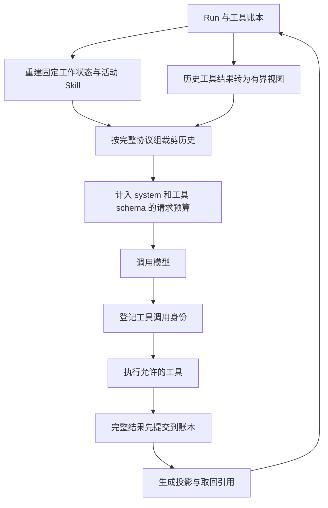
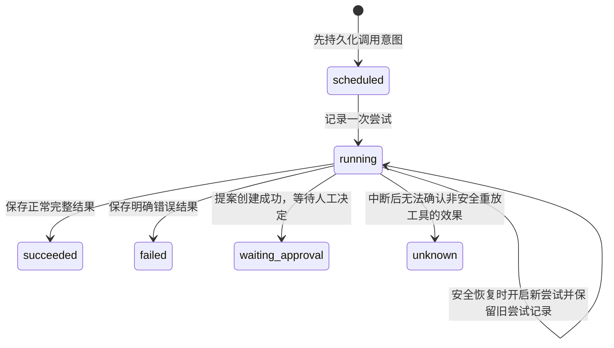

# 长任务 Agent：上下文、Skill 与工具状态为什么要分开管理

本项目把三件事分开：数据库保存执行事实，模型只接收当前需要的证据，确定性代码控制工具执行与审批。这样可以缩小每轮请求，并在进程退出后恢复已经记录的工作。它支持同一 POSIX 主机的每 run 进程互斥；后台调度仍在本地进程中，尚未实现多副本高可用。

阅读顺序建议是 [context.py](../src/agent_lab/context.py) → [skills.py](../src/agent_lab/skills.py) → [storage.py](../src/agent_lab/storage.py) → [runtime.py](../src/agent_lab/runtime.py)。下面的参数描述对应当前实现，不代表通用 Agent 框架标准。

## 1. 先区分三种“记住”

| 内容 | 当前保存位置 | 用途 | 不能据此推导的能力 |
| --- | --- | --- | --- |
| Run checkpoint | `runs.body`：任务、消息、待完成工具批次、活动 Skill、预算等 JSON | 恢复执行器控制流程 | 不等于外部系统已经执行成功 |
| 工具调用账本 | `tool_calls`：调用身份、参数、状态、尝试次数、完整结果及哈希 | 找回结果、检测重复调用、判断如何恢复 | 不自动让任意副作用 exactly-once |
| 事件与模型消息 | `events`、run/worker 的 `messages` | 审计可观察行为、重建对话；新工具消息可以只保存短投影 | 事件流并不保证含每个工具结果的完整正文 |
| 当前推理上下文 | 每轮临时构建的 `system + tools + messages` | 让模型选择下一步 | 从上下文移除不等于删除数据库记录 |
| 活动 Skill 快照 | run 的 `metadata.active_skills`，每轮作为固定参考资料插入 | 保持本次任务选定的操作方法与版本 | 不能授予新工具权限 |
| 用户记忆 | `memories` 表 | 用户显式保存的跨任务笔记 | 不保证事实仍然有效，模型没有自主写入权限 |

例如：上轮 `repo_read` 返回了完整文件，数据库保留结果；本轮模型可能只收到路径、结果摘要哈希、短摘录和取回方法。模型需要某段代码时继续读页，不能因为“数据库里有”就假设“本轮模型也看到了”。



这条流程优化的是信息如何进入上下文，以及执行状态如何恢复。它没有压缩模型权重，也没有要求保存模型隐藏思维链。

## 2. 请求预算：这里严格检查的是字符，不是 token

`AgentRuntime._complete()` 先计算固定开销，再把剩余空间交给 `ContextManager.build()`：

```python
reserved_chars = len(compact_json({
    "system": system,
    "tools": tools,
    "messages": [],
})) - 2
effective_message_budget = context_chars - reserved_chars
request_chars = reserved_chars + compact_json_length(kept_messages)
```

这里的 `compact_json` 使用 `ensure_ascii=False` 和紧凑分隔符。减掉的 `2` 是空数组 `[]`，随后用真实消息数组长度替换。请求外层字段名、标点、system 指令、工具描述和输入 schema 都计入这个本地口径；活动 Skill 和固定状态作为消息计入。默认 `context_chars=24000`。

这个边界比“只数用户对话长度”完整，但要说清楚四个限制：

1. 字符数不是 UTF-8 字节数，也不是真实 tokenizer 的 token 数。中文、英文、代码、JSON 的比例不同。
2. 这是本地构建的 `system/tools/messages` JSON 口径，不包括服务商隐藏包装，也不是 SDK 最终 HTTP 请求每一个字段的大小保证。
3. `max_tokens` 总量按响应后的 `usage` 累加；模型输入或并行在途调用仍可能让累计量越界。超过后会停止后续调用，不能宣传为严格费用上限。
4. 上下文装得下只说明格式和空间可接受，不说明模型一定能正确利用其中每条信息。

调试时查看 `context_built` / `context_overflow` 事件或 `metadata.context_stats`。`request_chars`、`reserved_chars`、`pinned_chars`、`dropped_groups` 能解释为什么发生裁剪；不能把它们命名为“节省 token”或“节省费用”。真实成本需要服务端 usage，效果需要同一任务与验收标准的对照实验。

## 3. 裁剪必须保持工具协议完整

模型的一次 assistant 消息可能同时包含多个 `tool_use`。随后一条 user 消息必须含所有对应的 `tool_result`：

```text
assistant: tool_use(read-1), tool_use(search-1)
user:      tool_result(read-1), tool_result(search-1)
```

这两条消息是一个原子组。`ContextManager._atomic_groups()` 会先验证角色、非空唯一 ID、紧邻关系和一一对应关系，再决定删哪些旧组。即使错误消息足够旧、原本会被删除，也不会借裁剪掩盖协议错误。

当前保留规则是：最初的 user 任务、显式固定状态、最新完整消息组必须保留；空间不足时从最早的其他历史组开始删除。普通文本消息各自成组。它不会截掉 JSON 后半截，不会保留没有调用的结果，也不会把最近一次工具交换拆开。

如果原任务、固定状态和最新完整组仍然超过预算，抛出 `ContextOverflow`，记录诊断后停止本轮。正确处理方式是减少活动 Skill、缩小工具输出投影、让用户拆任务或提高经过评估的预算；当前实现不会暗中截断必要内容。

注意：删除旧历史会丢失本轮可见的旧细节。虽然底层记录还在，模型也不一定知道该找哪一条；当前项目没有通用的历史语义搜索工具。因此裁剪通知要求重新读取证据，不能承诺“无损长上下文”。

### 固定状态为什么比让模型自由总结更容易核验

`_pinned()` 从持久状态生成 `HARNESS_STATE`，包含 run ID、状态、最近四个审批决定、当前等待的提案 ID，以及最近六个工具调用的 ID/名称/状态。工具状态通过 `call_summaries(limit=6)` 只读 SQL 索引列，不为生成几个状态字段而加载、解析所有完整结果 JSON。审批决定带提案 ID、文件路径和新版本哈希；完整提案仍在 `proposals` 表。活动 Skill 另以带版本的 `SKILL_SNAPSHOT` 加入。

这些内容有可追溯的记录来源，不是模型编写的“我已经完成了什么”。但固定状态只是有界索引：最近六个工具状态不等于所有结果，`approved` 也不等于业务测试通过，仍要回查实际结果。

固定消息使用普通 `user` 文本角色，不升级为 system 权限；ContextManager 拒绝用 pinned 注入 assistant、tool_use 或 tool_result。system 仍明确规定仓库内容、记忆、worker 与 Skill 都不能改变权限。字符级裁剪也不会改变工具的代码白名单。

## 4. 大结果：保存全文，给模型短视图，必要时分页

`_execute_call()` 先通过 `Storage.finish_call()` 保存完整工具结果，再由 `_project_result()` 生成模型可见视图。当前阈值是结果规范化 JSON 超过 `2600` 字符时投影；普通小结果直接返回。

大结果投影保留可用的 `ok/code/path/proposal_id/requires_approval/status` 等控制字段，并附：

- `call_id` 和工具名：定位这次调用。
- `result_sha256` 和 `total_chars`：识别结果版本与完整长度。
- `excerpt`：前 `900` 字符的预览，明确标记内容已省略。
- `retrieve`：调用 `tool_result_get` 的起始参数。

`excerpt` 可能在 JSON 字符串或一行源码中间结束。它不是独立可解析的 JSON，也不是完整代码；不能直接拿它构造补丁或推断未展示的逻辑。

`tool_result_get` 按本 run 的 call ID 读取账本结果，模型可传的 `limit` 为 `1..1200` 字符。响应含 `sha256`、`offset`、`next_offset`、`content_format="json_text_page"`。offset 是规范化 JSON 文本的字符位置，不是字节偏移或源码行号。底层 Storage 给内部调用者提供更大的分页上限；模型工具 schema 的上限更小。

取回时固定同一 `call_id` 和 `sha256`，按 `next_offset` 拼接各页后，才能将全文交给 `json.loads()`。单页不能保证独立解析。分页工具本身已经是有界视图，因此不再次压成指向自身的引用，否则模型将永远读不到正文。它也不能读取其他 run 的结果。

### “裁剪、投影、语义摘要”不是同一个操作

| 操作 | 当前是否实现 | 做了什么 | 主要风险 |
| --- | --- | --- | --- |
| 原子裁剪 | 是 | 从本轮请求移除完整旧消息组 | 旧证据不再可见；需要重新读取 |
| 固定状态 | 是 | 从持久记录重建有出处的控制信息与 Skill 快照 | 状态索引有范围上限，不能代替全部证据 |
| 结果投影与分页 | 是 | 完整结果留在账本，模型收到可取回引用 | 只看摘录可能误判，分页也消耗轮次与上下文 |
| 语义摘要 | 否 | 让模型归纳长文本、决定哪些语义可以省略 | 可能丢弃约束、误述事实、丢失来源 |
| 向量化历史检索 | 否 | 为历史建立语义索引，按任务查询 | 检索遗漏、权限过滤、版本失效需要另行设计 |

因此面试中准确的说法是：“实现了有界上下文和可回取结果，保留执行状态与协议完整性。”不能说“实现了任意长度、无损语义压缩”。未来若加摘要，应保存摘要来源区间、源记录哈希、约束与未完成事项，验证后再使用；摘要不能覆盖原始审计记录。

## 5. Skill 逐层加载：少带正文，固定本次任务版本

本项目的 Skill 是受限的本地 Markdown 资料，只支持单行 `name` / `description` 元数据，**不执行 Skill 内脚本，也不声称兼容完整 YAML 或全部 Skills 标准**。

### 从发现到卸载

```text
元数据目录 → skill_search → skill_inspect → skill_load(name, section?)
                                         ↓
                                 活动快照进入后续上下文
                                         ↓
                              skill_unload(name) 释放空间
```

| 阶段 | 代码行为 | 对上下文的影响 |
| --- | --- | --- |
| 发现 | `catalog()` 读取有界 frontmatter，最多收集 32 个有效 Skill | 不预载所有正文 |
| 初始候选 | `_system()` 按任务做词面排序，默认最多 8 条、元数据 JSON 不超过 2400 字符 | system 只带有界候选元数据 |
| 搜索 | `skill_search` 使用 `select()` 的有界词面匹配 | 返回候选，不自动激活正文；不是向量路由 |
| 查看索引 | `skill_inspect` 返回章节标题、文件 SHA-256、正文字符数 | 不把正文加入活动上下文；内部仍需读取文件生成索引 |
| 加载 | `skill_load` 保存整份正文或指定标题对应章节的快照 | 后续每轮插入这份活动快照；工具响应只回状态与哈希 |
| 卸载 | `skill_unload` 从活动快照字典删除该名称 | 后续不再固定注入；已有审计记录与历史不因此删除 |

“词面排序”主要按查询词在名称/描述中出现与否评分，相同分数按名称排序；没有语义理解、置信度阈值或保证召回所有相关 Skill。目录上限也意味着大规模技能库需要分层索引或独立检索服务，不能单纯把目录堆大。

按章节加载使用 Markdown 标题匹配：选择唯一同名标题，从该标题开始，直到下一个同级或更高层级标题。它是一个有限的标题解析器，不是完整 Markdown AST。先 inspect 可以避免标题不存在或重名；一个 Skill 名称只有一个活动快照，加载同名的另一个章节会替换前一个，当前不能并存同名的多个独立章节。

### 快照与缓存分别解决什么

每份快照有两个哈希：`sha256` 标识完整 SKILL.md，`content_sha256` 标识实际加载的正文或章节。正文保存在 run checkpoint 中；恢复该 run 时用已存快照，不因为磁盘文件更新就悄悄改变任务方法。需要升级时显式重新加载，生成新快照。

活动快照与 `skill_effects[call_id]` 回执在同一份 run checkpoint 中提交。这弥合了一个容易忽视的窗口：Skill 已加载并保存，但工具账本尚未来得及 `finish_call` 就退出。恢复同一次调用时返回原回执，不重新读取已经改版的磁盘文件；卸载也保存对应回执。它保证的是同一调用恢复时不偷偷更换已提交的 Skill 效果，显式新调用仍可选择新版本。

重复加载同一名称、完整文件版本和章节会返回 `already_loaded=true`；活动字典不会新增一份相同正文。它仍要执行工具与版本检查，也不等于服务商 prompt cache 命中。`already_loaded` 与“无需任何 I/O/模型费用”没有直接等价关系。

`SkillCatalog` 的进程内缓存减少的是本地文件读取：正文按名称、mtime、ctime、大小与 inode 组成的签名缓存，最多 32 条；元数据独立缓存，目录阶段只读最多 4096 字节的头部。文件签名改变会重新读取，读取前后签名不一致则报错。进程重启后这些内存缓存消失，已持久化的 run 快照仍存在。

当前活动限额是最多 4 个 Skill、正文合计 6000 字符。超出时返回 `skill_budget_exceeded`，让模型按章节加载或先卸载，不静默截断。单个源文件另受 24000 **字节**限制；这与正文活动预算的**字符**口径不同。

Skill 名称、目录边界、符号链接和多重硬链接都有检查。它们限制本地读文件范围，不能证明 Skill 文本可信；维护者仍需审阅版本，正文仍处于低于系统策略的信任级别。

## 6. 工具调用账本：恢复首先要确认“这是哪一次调用”

对话中的 `tool_use_id` 负责协议配对，账本负责执行身份。协调者用 `(run_id, call_id)` 做主键；worker 另加角色前缀，避免不同对话的模型 ID 冲突。内部键过长时使用稳定 SHA-256 派生键，原模型 ID 仍留在协议消息里。Provider 返回的工具 ID 在本项目限为 1—128 位字母、数字、短横线或下划线；冒号留给内部命名空间，这属于本项目约束，不代表所有模型服务的统一规则。账本还绑定工具名与规范化参数哈希。

```text
tool_calls
  PRIMARY KEY (run_id, call_id)
  name, arguments_sha256, status, created_at
  body = 参数、attempts、时间、完整结果、result_sha256、attempt_history

proposals
  UNIQUE (run_id, operation_id)  -- operation_id 非空时
```

`canonical_json()` 递归排序对象键，使用紧凑 JSON，拒绝 NaN 等非 JSON 数值。字典键顺序改变不会制造新参数身份。相同 call ID 配相同工具名与参数时返回原记录；相同 ID 改工具或改参数会报 `tool_call_identity_conflict`，不会偷偷执行另一件事。

这是一种调用身份去重，不是“只要名字相同就缓存”。两个不同 call ID 读取同一文件是两次独立观察；同一 call ID 的已完成结果则复用账本里原来的观察。

### 状态机与空结果



这是 Runtime 的正常执行路径图。Storage 也允许将已排队调用直接记为失败，例如审批后延期、worker 权限拒绝或导入旧 checkpoint 的已有结果；不要把图误读为数据库强制每条结果都经历 running。

是否已有结果检查的是 `result_sha256 is not None`，不是 `if result`。空字典、空列表、`False` 都可能是有效结果。结果状态默认按 `requires_approval` / `ok` 推导；`waiting_approval` 只表示这次工具返回了待审批提案，**不表示补丁已经写入**。补丁批准、拒绝、应用的事实仍需查询 proposal 与审批事件。

执行前有输入 JSON Schema 校验，额外工具与普通工具均限制字段；运行期仍检查路径、文件版本、权限与大小。schema 通过只证明参数形状可接受，不能证明该操作已授权、内容正确或没有提示注入。`operation_id` 来自执行器的 call ID，不是允许模型自由传入的提案参数。

### 为什么要有 unknown

`running` 只说明数据库里没有完成记录。假设工具已经调用外部服务，进程在保存结果前退出，恢复时既不能证明“没执行”，也不能证明“执行成功”。直接重试可能重复副作用，直接报成功也不真实。

当前 Runtime 对显式安全列表中的只读/可幂等工具允许有限恢复尝试，同一调用最多三次尝试。只读重放保证的是不重复危险副作用，文件或知识库变化后读到的内容仍可能不同。`propose_patch` 之所以能重放，是因为下文的数据库幂等键，并非因为创建提案没有状态变化。

不在安全重放列表中的工具，例如中断中的 `sandbox_test`，会记录 `execution_unknown`，`tests_executed=null`，停止自动重跑；`null` 表示无法确认，不能解释成测试通过或确定未执行。需要重试时发起新的调用。当前也没有通用的第三方查询接口去自动消除 unknown。

工具明确失败并已有完整结果时，同一 call ID 返回原错误，不会无限重试。模型若修正参数，应生成新的 call ID；重复使用旧 ID 改参数会被拒绝。

### 并行 worker 与固定 workflow 也必须持久化

`parallel` 模式里的 reviewer / tester 有各自保存的 messages、轮次、pending_calls、pending_results 和最终报告。重启后继续未完成批次，不能只恢复协调者再从头启动 worker。它们共享任务的模型轮次和 usage 计量，并受局部三轮限制；角色与只读工具集合由代码固定，不是任意动态多 Agent 调度。

worker 工具结果进入同一账本，长报告也作为 `worker_report` 保存，再把短投影交给协调者。协调者可以按报告的 call ID 取回完整内容；不能因为报告来自另一个模型就视为可信事实。`workflow` 模式的固定 `repo_list` / `knowledge_search` 阶段也使用账本与稳定内部调用 ID，避免恢复准备阶段时无条件重复执行。这两种模式都有持久轨迹，但尚无跨主机调度、动态任务依赖图或 worker 独立服务。

### 从 CLI/API 检查真实状态

```bash
uv run agent-lab calls <run_id>
uv run agent-lab result <run_id> <call_id> --offset 0 --limit 1200
```

也可使用 `GET /api/runs/{run_id}/calls` 读取轻量调用摘要，以及 `GET /api/runs/{run_id}/tool-result?call_id=...&offset=0&limit=1200` 读取结果页。HTTP 结果页允许的最大 limit 为 8000，模型工具仍是 1200。摘要接口默认返回最近至多 200 次调用，没有实现完整账本列表的游标翻页；结果分页与列表分页不要混淆。API 仍受本地服务的统一鉴权规则约束，尚无多用户租户授权模型。

## 7. 崩溃窗口：哪些已经弥合，哪些仍然存在

每个 SQLite 操作独立开启连接和事务，启用 WAL、外键、FULL synchronous 与锁等待；调度和状态修改使用 `BEGIN IMMEDIATE`。它提高本地持久状态的一致性，但多个表、run checkpoint、事件、文件系统和模型服务之间没有一个共同事务。

| 崩溃位置 | 当前恢复策略 | 仍需理解的边界 |
| --- | --- | --- |
| 调用已登记，尚未开始 | 保留 scheduled 身份，按保存的待执行批次继续 | 不代表工具执行过 |
| 工具已经开始，完成结果尚未提交 | 安全列表有限重放；其余标记 unknown | 无法从 running 推断是否产生副作用 |
| 完整结果已提交，run 消息还没保存 | 同 call ID 找到账本结果，重建投影与消息 | events/run 与账本不是同一事务，不能只靠事件条数判断执行次数 |
| 提案创建后、工具结果保存前 | `(run_id, operation_id)` 唯一键找回原提案，并验证补丁身份 | 仅保证本地提案创建幂等；不是任意外部操作 exactly-once |
| 人工决定保存后、run 更新前 | resume 协调当前绑定的提案，不能用历史提案替代当前审批 | 不允许批准与拒绝反复翻转 |
| 文件替换后、`applied` 标记保存前 | 文件等于 `new_sha256` 时补记；等于旧哈希才允许替换；其他版本拒绝覆盖 | 文件与数据库不是同一个事务，单文件替换也不是多文件事务 |
| 模型响应返回后、usage/checkpoint 保存前 | 当前没有服务商请求级事务或通用结果查询 | 可能丢失本地计量或再次请求；轮次预扣也不是严格计费一致性 |

文件写入采用同目录临时文件、文件 fsync 和 `os.replace`，能够避免把半份目标文件暴露给正常读者；它不等于已实现完整的掉电恢复协议、多文件原子提交或跨主机存储复制。真实生产部署还需要匹配所用文件系统的持久化与备份策略。

旧版本 checkpoint 中已经完成的工具往返，可以通过 `_hydrate_journal()` 导入账本而不执行工具；它不是对任意损坏日志的修复器。完整结果当前落在 SQLite JSON 中，没有实现无限结果大小、对象存储分层、加密、自动脱敏或保留期清理；仓库读取与分页等工具的自身限制仍然必要。

## 8. “可恢复”与“高可用”之间还差什么

当前适合演示：同一机器的本地文件系统、持久 SQLite 文件和每个 run 的隔离工作区；退出后重新创建 Runtime 恢复 run。`execute()`、`resume()`、`approve()` 公共入口通过 [execution_lock.py](../src/agent_lab/execution_lock.py) 的非阻塞 POSIX `flock` 争用同一 run 锁；内部继续执行使用 unlocked 方法，避免重复加锁。独立 CLI 与 API 进程不能同时执行同一个 run，拿不到锁会抛出 `RunBusy`；API 后台将这种情况记为 `run_busy` 事件，不覆盖持锁者的任务状态。这不意味着后台任务冲突必然同步返回 HTTP 409。

进程退出后内核释放持有的 flock。锁文件本身要保留：删除后重建会生成不同 inode，可能让两个执行者分别持有两个“同名”锁。锁目录与文件有符号链接/硬链接防护；适用范围是同一 POSIX 主机、本地文件系统和遵循这些入口的执行器，不承诺网络文件系统或跨主机正确性。同 run 的锁也不等于任意两个 run 对同一外部工作区的全局互斥。

另一个边界是 `asyncio.to_thread`：取消协程不会停止已经启动的同步线程。当前 `_tool_thread()` 使用 shield，收到协程取消后等待该线程完成、把结果写入账本，才释放 run 锁，避免旧线程仍在执行时新 CLI 取得锁。它会延后取消完成时间；真正终止进程仍需依靠 running/unknown 恢复策略。这不是通用的外部服务取消、回滚或业务补偿方案。

API 的后台 job 表与共享预算锁仍属于进程内状态；SQLite 事务不等于跨机器任务租约。把服务复制到其他主机、绕过公共入口，或让多个 run 共用可写工作区，仍可能重复执行或互相覆盖。生产改造可按以下顺序进行，每项都需要故障注入验证：

| 目标 | 需要补的机制 | 要验证的失败场景 |
| --- | --- | --- |
| 多 worker 接任务 | 持久任务队列、claim/lease、心跳、租约超时 | worker 退出后任务能够被接管，正常任务不会同时领两次 |
| 防止过期 worker 写回 | 单调递增 fencing token，存储/工作区写入校验 token | 旧 worker 暂停后恢复，不能覆盖新 owner 的结果 |
| 防止 run JSON 丢更新 | 状态版本号 + CAS，或按规范化表事务更新 | 两个执行器同时保存，不会后写覆盖先写 |
| 模型和工具限流 | 共享 admission control、在途预算预留、租户配额 | 多副本同时发起请求仍遵守共享限制 |
| 审批与外部副作用可靠衔接 | 审批绑定版本、幂等键、outbox/inbox、查询与补偿 | 外部成功但本地超时，能够核对而不是盲目重放 |
| 数据可用性 | 可靠数据库部署、备份恢复、对象存储结果分层 | 单机磁盘丢失后能够恢复到已定义的 RPO/RTO |
| 取消与可观测性 | 取消传播、子进程清理、关联 ID、受控敏感数据记录 | 取消后旧任务不继续写，工具超时不遗留无限进程 |

这些是扩展方向，不是本仓库已经具备的能力。恢复正确性、可用性、模型回答质量应分别评估；多加几个 Agent、容器或数据库连接不会自动形成高可用系统。

## 9. 两个无需模型密钥的可复现实验

在仓库根目录运行以下例子。它们只创建临时数据库或内存对象，不修改样例代码，不调用真实模型；打印值由本地运行计算，没有预先填入性能结论。

### 实验 A：观察完整组裁剪，而不是声称 token 压缩率

```bash
uv run python - <<'PY'
import json
from agent_lab.context import ContextManager

def exchange(call_id, text):
    return [
        {"role": "assistant", "content": [{"type": "tool_use", "id": call_id,
         "name": "repo_read", "input": {"path": "pricing.py"}}]},
        {"role": "user", "content": [{"type": "tool_result", "tool_use_id": call_id,
         "content": text}]},
    ]

history = [{"role": "user", "content": "修复折扣；写入必须审批"}]
history += exchange("old-read", "旧文件证据\n" * 2000)
history += exchange("latest-check", '{"syntax_ok":true,"tests_executed":false}')
pinned = [{"role": "user", "content": "HARNESS_STATE: proposal-1 已应用，待业务测试"}]
manager = ContextManager(max_chars=1800)
kept = manager.build(history, pinned=pinned, reserved_chars=400)
print(json.dumps(manager.stats(), ensure_ascii=False, indent=2))
print("保留角色:", [m["role"] for m in kept])
assert kept[-2:] == history[-2:]             # 最新调用与结果一起保留
assert "old-read" not in str(kept)           # 旧组整体移除
assert kept[1] == pinned[0]                  # 固定状态仍在
assert len(history) == 5                     # 持久历史原对象没有被裁掉
assert manager.stats()["request_chars"] <= 1800
PY
```

该实验中的 pinned 文字是手工构造的教学输入，用于测试裁剪机制；真实 Runtime 从持久记录重建固定状态。本地执行此例时，原消息为 14508 字符，保留消息为 434 字符，另加预留 400 字符，得到请求 834 字符，移除一个完整旧工具组。这是上述合成输入的机械结果，不是生产任务的压缩率。观察 `original_chars`、`kept_chars` 和 `reserved_chars` 的关系，不把字符差额换算成未经测量的 token 或质量收益。

### 实验 B：先存完整结果，再按页取回并核验哈希

```bash
uv run python - <<'PY'
import json
import tempfile
from pathlib import Path
from agent_lab.storage import Storage, canonical_json, digest

with tempfile.TemporaryDirectory() as directory:
    storage = Storage(Path(directory) / "state.db")
    run = storage.create_run("观察大结果分页")
    storage.schedule_call(run["id"], "read-1", "repo_read", {"path": "sample.py"})
    storage.start_call(run["id"], "read-1")
    original = {"ok": True, "path": "sample.py", "content": "print('示例')\n" * 1000}
    storage.finish_call(run["id"], "read-1", original)
    parts, offset, expected_hash = [], 0, None
    while True:
        page = storage.get_call_result(run["id"], "read-1", offset=offset, limit=1200)
        expected_hash = expected_hash or page["sha256"]
        assert page["sha256"] == expected_hash
        parts.append(page["content"])
        if page["next_offset"] is None:
            break
        offset = page["next_offset"]
    restored_text = "".join(parts)
    assert digest(restored_text) == expected_hash
    assert restored_text == canonical_json(original)
    assert json.loads(restored_text) == original
    print({"完整结果字符": len(restored_text), "读取页数": len(parts), "哈希一致": True})
PY
```

本地执行此例得到完整 JSON 13043 字符、11 页，拼接结果与原对象及哈希一致。这里证明的是分页可回取同一完整结果，不是证明模型能零成本理解全文。实际 `_project_result()` 的阈值、短视图字段及特殊分页逻辑需结合 runtime 阅读。要比较长任务优化效果，固定任务、模型、工具版本、验收用例和预算，分别记录 usage、成功率、延迟、调用数、unknown/恢复结果；不能只比较一次返回文本的长度。

## 10. 面试时如何讲这三个优化

可以用一分钟描述：“我把执行状态和模型上下文分开。每次模型请求把 system 和工具 schema 也纳入本地字符预算，按完整工具往返裁剪旧历史；原任务、当前审批状态与活动 Skill 快照保留。大工具结果先落到账本，模型拿短投影和可校验的分页引用。Skill 先搜索元数据、看章节，再固定内容哈希加载，重复加载不会重复常驻，卸载释放后续上下文。工具账本用 run/call ID 绑定工具与参数哈希，结果先提交再更新对话；只读和幂等提案可以有限恢复，无法确认的执行标记 unknown。同机 flock 防止 CLI 与 API 同时执行一个 run，现在具备本地恢复与互斥，尚未实现跨机器租约、fencing 与严格费用上限。”

继续追问时要能解释三个具体失败例子：孤立 tool_result 会违反协议；外部执行成功但本地未落盘不能盲目重试；上下文删除了历史，模型仍需显式取回证据。这比只说“做了压缩、缓存、重试”更容易验证。
