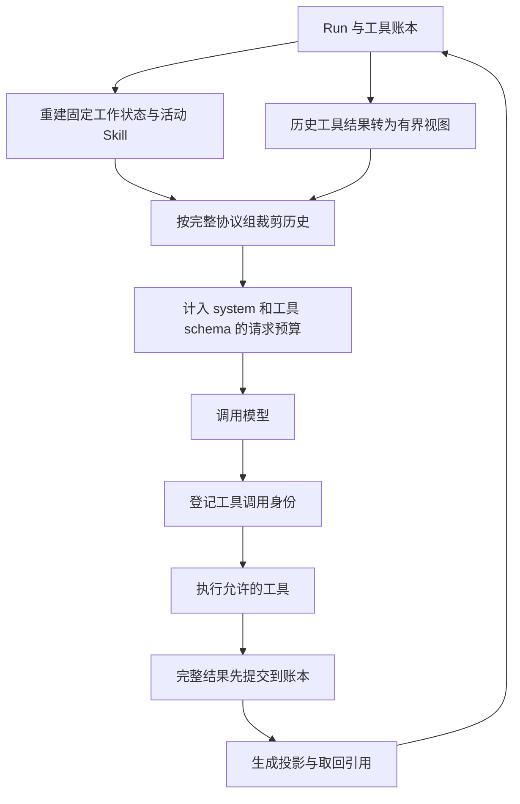
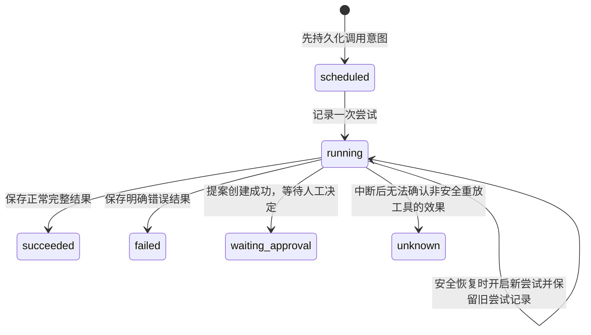

# 长任务 Agent：上下文、Skill 与工具状态为什么要分开管理

本项目把三件事分开：数据库保存执行事实，模型只接收当前需要的证据，确定性代码控制工具执行与审批。这样可以缩小每轮请求，并在进程退出或节点切换后恢复已经记录的工作。它同时支持同机 POSIX `flock` 互斥与基于持久队列租约（`LeaseWorker` + 单调递增 `epoch` fencing token + `workspace_archives` 归档同步）的多 Worker 故障接管，并可通过 `postgresql://` DSN 切换至 PostgreSQL `FOR UPDATE SKIP LOCKED` 队列后端。

阅读顺序建议是 [context.py](../src/agent_lab/context.py) → [working_memory.py](../src/agent_lab/working_memory.py) → [skills.py](../src/agent_lab/skills.py) → [storage.py](../src/agent_lab/storage.py) → [runtime.py](../src/agent_lab/runtime.py)。下面的参数描述对应当前实现，不代表通用 Agent 框架标准。

## 1. 先区分几种“记住”

| 内容 | 当前保存位置 | 用途 | 不能据此推导的能力 |
| --- | --- | --- | --- |
| Run checkpoint | `runs.body`（带 `state_version` CAS）：任务、消息、待完成批次、活动 Skill、预算等 | 恢复执行器控制流程 | 不等于外部系统已经执行成功 |
| 工具调用账本 | `tool_calls`：调用身份、参数、状态、尝试次数、完整结果及哈希 | 找回结果、检测重复调用、判断如何恢复 | 不自动让任意外部副作用 exactly-once |
| 事件与模型消息 | `events`、run/worker 的 `messages` | 审计可观察行为、重建对话；新工具消息只保存有界投影 | 事件流并不保证含每个工具结果的完整正文 |
| 当前推理上下文 | 每轮临时构建的 `system + tools + messages` | 让模型选择下一步 | 从上下文移除不等于删除数据库记录 |
| 结构化工作记忆 | `metadata.working_memory`：带文件/工具哈希校验的 `goal/constraints/todos/facts` | 跨裁剪保留待办与可重验事实；源码变更后自动标 `stale` | 不能绑定失败调用，也不替代提案审批记录 |
| 活动 Skill 快照 | `metadata.active_skills`：初始快照置前，运行期动态加载快照置尾 | 保持本次任务选定的操作方法与版本，保护历史 KV 前缀 | 不能授予新工具权限 |
| 用户记忆 | `memories` 表 | 用户显式保存的跨任务笔记 | 不保证事实仍然有效，模型没有自主写入权限 |

例如：上轮 `repo_read` 返回了完整文件，数据库保留结果；本轮模型可能只收到路径、结果摘要哈希、短摘录和取回方法。模型需要某段代码时继续读页，不能因为“数据库里有”就假设“本轮模型也看到了”。



这条流程优化的是信息如何进入上下文，以及执行状态如何恢复。它没有压缩模型权重，也没有要求保存模型隐藏思维链。

## 2. 请求预算：序列化字符与校准 BPE Token 双上限

`AgentRuntime._complete()` 先计算 `system + tools` 的固定开销，再交给 `ContextManager.build()` 同时校验**字符上限**（`max_chars`）与可选的**校准 BPE Token 上限**（`max_tokens`）：

```python
reserved = len(canonical_json({"system": system, "tools": tools, "messages": []})) - 2
est_tokens = estimate_bpe_tokens({"system": system, "tools": tools, "messages": kept_messages})
```

- **零外部依赖 BPE 估算器（`estimate_bpe_tokens`）**：[`context.py`](../src/agent_lab/context.py) 按英文词根、数字块、CJK 汉字（`1.5x` 权重）、转义序列、JSON 结构符对与消息角色开销（`_MESSAGE_BPE_OVERHEAD = 4`）做确定性分段估算；若显式设置 `AGENT_LAB_USE_TIKTOKEN=1` 且本地已安装 `tiktoken`，则自动切换至 `cl100k_base` 精确编码。
- **双天花板裁剪（`max_chars` + `max_tokens`）**：`ContextManager(max_chars=24000, max_tokens=...)` 支持同时传入字符预算与 `reserved_tokens` / `max_tokens` 双重上限；任一维度超限都会触发原子消息组裁剪与低水位阶梯回落（`budget_kind="chars_and_bpe_tokens"`）。
- **并发在途预留与加权计费防击穿**：并行子代理共享 `self._budget_lock`，请求发出前先按 `estimate_bpe_tokens(...) + min(output_cap, 512)` 预占 `_inflight_reserved_tokens` 并收紧单轮 `output_cap`；响应返回后由 [`compute_usage_totals()`](../src/agent_lab/providers.py) 汇总全量输入（含 Anthropic `cache_creation_input_tokens` 1.25x 写入溢价与缓存读取折扣）写入 `billed_tokens`，以 `max(input + output, billed_tokens)` 共同防止长上下文预算被击穿。

仍需说明三个工程边界：

1. 默认零依赖估算器与不同商业模型私有分词器存在细微偏差，最终财务核算仍以服务端 `usage` 回执为准。
2. 本地 `system/tools/messages` 口径不包含模型网关注入的隐藏安全包装。
3. 上下文装得下只说明格式和空间可接受，不说明模型一定能正确利用其中每条信息。

调试时查看 `context_built` / `context_overflow` 事件或 `metadata.context_stats`（含 `request_chars`、`reserved_chars`、`estimated_tokens`、`request_tokens`、`compaction_cursor`、`dropped_groups`）。

## 3. 裁剪协议完整性、大补丁防死锁与结构化工作记忆

模型的一次 assistant 消息可能同时包含多个 `tool_use`。随后一条 user 消息必须含所有对应的 `tool_result`：

```text
assistant: tool_use(read-1), tool_use(search-1)
user:      tool_result(read-1), tool_result(search-1)
```

这两条消息是一个原子组。`ContextManager._atomic_groups()` 会先验证角色、非空唯一 ID、紧邻关系和一一对应关系，再决定删哪些旧组。即使错误消息足够旧、原本会被删除，也不会借裁剪掩盖协议错误。

当前保留规则是：最初的 user 任务、前置固定技能快照（`pinned`）、最新完整消息组（`tail[-1]`）与尾部瞬态状态（`tail_state`）必须保留；空间不足时从最早的其他历史组开始删除，并在触发水位后一次性回落至 `low_watermark_ratio=0.62` 以保护后续轮次的 KV Cache 前缀。

### 历史 `tool_use.input` 投影与紧急 `tail[-1]` 二次紧缩（消除大补丁死锁）

仅投影 `tool_result` 并不能覆盖所有超限场景：当模型在 `propose_patch` 或多文件 `propose_changeset` 中提交数千字符的 `old_text/new_text`（或单轮并发发出多达 8 个工具调用）时，庞大的参数位于 `assistant.tool_use.input` 内。若不做处理，一旦该轮成为唯一保留的 `tail[-1]`，任务就会永久卡死在 `ContextOverflow`。为此 [`AgentRuntime._project_history()`](../src/agent_lab/runtime.py) 实现了两级只读推理投影（不修改持久审计原文）：

1. **常规历史输入投影**：对非最新 assistant 轮次（`idx < latest_assistant_idx`）中规范化 JSON 超过 `2600` 字符的 `tool_use.input`，替换为 `{"_omitted_large_input": true, "call_id": ..., "chars": ...}` 有界占位符。
2. **紧急尾部紧缩（`emergency_tail=True`）**：若常规裁剪删光所有早期组后 `tail[-1]` 仍触发 `ContextOverflow`，`_complete()` 自动启用 `emergency_tail=True` 重试构建——将最新一组内超过 `1200` 字符的 `tool_use.input` 折叠为占位符，并将超过 `900` 字符的 `tool_result` 二次压缩为保留关键状态码、前 `200` 字符预览及 `tool_result_get` 引用的紧凑视图。只有二次紧缩后仍超出预算（例如原始 prompt 本身越界），才抛出 `ContextOverflow`。

注意：删除旧历史会丢失本轮可见的旧细节。裁剪通知明确要求模型必要时通过 `repo_read` 或 `tool_result_get` 重新读取证据。

### 固定状态与带哈希防毒化的结构化工作记忆（Working Memory）

`AgentRuntime._tail_state()` 每轮在对话末尾注入两类可核验状态（使用普通 `user` 角色，不升级为 `system` 权限）：

1. **`HARNESS_STATE`**：从持久记录生成 `run_id`、`status`、最近 4 个审批决定、当前等待的提案 ID，以及通过 `call_summaries(limit=6)` 只读索引列取出的最近 6 次调用状态。
2. **`WORKING_MEMORY`（[`working_memory.py`](../src/agent_lab/working_memory.py)）**：允许模型维护有界的 `goal`（≤300 字）、`constraints`（≤8 条）、`todos`（≤10 项）与 `facts`（≤12 条，总投影预算 `_MAX_MEMORY_CHARS = 2400` 字符），并通过四项机制防止“错误摘要污染后续推理”：
   - **拒绝绑定失败或未完成调用**：当 `source_type="tool_call"` 时，`_verify_fact_source()` 严格校验该调用已落盘、`status == "succeeded"`、`result_sha256` 非空且 `result.get("ok") is not False`；失败报错、待审批或不存在的调用一律以 `unverified_source` 拒绝写入。
   - **关联工作区文件哈希追踪（`bound_files`）**：仅校验 `tool_call.result_sha256` 不足以发现“先 `repo_read` 记录事实、随后补丁修改了源码”的过期情况（因为账本中的历史调用结果不会变）。`_extract_tool_call_paths()` 会提取 `repo_read`、`symbol_search`、`repo_search`、`verify_python`、`propose_patch`、`propose_changeset` 以及一跳 `tool_result_get` 所指向的工作区文件路径并记录当时的 SHA-256 到 `bound_files`。一旦后续补丁修改或删除了对应文件，`audit_working_memory()` 实时重验时会立即将该事实降级为 `status="stale"`（`stale_reason="bound_file_hash_changed"` 或 `"file_hash_changed"`）。
   - **显式增删与自动淘汰过期事实**：`working_memory_write` 支持 `remove_todo_ids`、`prune_done_todos`、`todos[].status="deleted"` 以及 `remove_fact_ids`、`prune_stale_facts`、`facts[].status="deleted"`；当事实条数超 12 条或总字符超 2400 时，默认开启的 `auto_evict_stale=True` 会按 `recorded_at` 从早到晚自动驱逐非本轮新增的 `stale` 事实，腾出预算空间。
   - **确定性无噪声推理视图**：`prompt_view_working_memory()` 剥离数据库审计字段 `recorded_at` 与内部 `bound_files` 映射，避免墙钟时间戳破坏缓存一致性。

## 4. 大结果：保存全文，给模型短视图，必要时分页

`_execute_call()` 先通过 `Storage.finish_call()` 保存完整工具结果，再由 `_project_result()` 生成模型可见视图。当前阈值是结果规范化 JSON 超过 `2600` 字符时投影；普通小结果直接返回。

大结果投影保留可用的 `ok/code/path/proposal_id/requires_approval/status` 等控制字段，并附：

- `call_id` 和工具名：定位这次调用。
- `result_sha256` 和 `total_chars`：识别结果版本与完整长度。
- `excerpt`：前 `900` 字符的预览，明确标记内容已省略。
- `retrieve`：调用 `tool_result_get` 的起始参数。

`excerpt` 可能在 JSON 字符串或一行源码中间结束。它不是独立可解析的 JSON，也不是完整代码；不能直接拿它构造补丁或推断未展示的逻辑。

`tool_result_get` 按本 run 的 call ID 读取账本结果，模型可传的 `limit` 为 `1..1200` 字符。响应含 `sha256`、`offset`、`next_offset`、`content_format="json_text_page"`。offset 是规范化 JSON 文本的字符位置，不是字节偏移或源码行号。底层 Storage 给内部调用者提供更大的分页上限；模型工具 schema 的上限更小。

取回时固定同一 `call_id` 和 `sha256`，按 `next_offset` 拼接各页后，才能将全文交给 `json.loads()`。单页不能保证独立解析。分页工具本身已经是有界视图，因此不再次压成指向自身的引用，否则模型将永远读不到正文。它也不能读取其他 run 的结果。

### “裁剪、投影、语义摘要”不是同一个操作

| 操作 | 当前是否实现 | 做了什么 | 主要风险 |
| --- | --- | --- | --- |
| 原子裁剪 | 是 | 从本轮请求移除完整旧消息组 | 旧证据不再可见；需要重新读取 |
| 固定状态 | 是 | 从持久记录重建有出处的控制信息与 Skill 快照 | 状态索引有范围上限，不能代替全部证据 |
| 结果投影与分页 | 是 | 完整结果留在账本，模型收到可取回引用 | 只看摘录可能误判，分页也消耗轮次与上下文 |
| 语义摘要 | 否 | 让模型归纳长文本、决定哪些语义可以省略 | 可能丢弃约束、误述事实、丢失来源 |
| 向量化历史检索 | 否 | 为历史建立语义索引，按任务查询 | 检索遗漏、权限过滤、版本失效需要另行设计 |

因此面试中准确的说法是：“实现了有界上下文和可回取结果，保留执行状态与协议完整性。”不能说“实现了任意长度、无损语义压缩”。未来若加摘要，应保存摘要来源区间、源记录哈希、约束与未完成事项，验证后再使用；摘要不能覆盖原始审计记录。

## 5. Skill 逐层加载：少带正文，固定本次任务版本

本项目的 Skill 是受限的本地 Markdown 资料，只支持单行 `name` / `description` 元数据，**不执行 Skill 内脚本，也不声称兼容完整 YAML 或全部 Skills 标准**。

### 从发现到卸载

```text
元数据目录 → skill_search → skill_inspect → skill_load(name, section?)
                                         ↓
                                 活动快照进入后续上下文
                                         ↓
                              skill_unload(name) 释放空间
```

| 阶段 | 代码行为 | 对上下文的影响 |
| --- | --- | --- |
| 发现与诊断 | `catalog()` 最多收集 32 个有效 Skill；`catalog_status()` 额外返回 `total_discovered`、`truncated`、`invalid_skipped` | 不预载正文，且超上限截断或损坏/符号链接跳过均可观测 |
| 初始候选 | `_system()` 按任务做词面筛选后再按 `name` 字典序稳定排列，最多 8 条、JSON ≤ 2400 字符 | system 只带有界候选元数据，并保持跨任务根前缀稳定 |
| 搜索 | `skill_search` 使用 `select()` 的有界词面匹配 | 返回候选，不自动激活正文；不是向量路由 |
| 查看索引 | `skill_inspect` 返回章节标题、文件 SHA-256、正文字符数 | 不把正文加入活动上下文；内部仍需读取文件生成索引 |
| 加载 | `skill_load` 保存整份正文或指定章节快照（运行中途加载标记 `mid_run_dynamic=True`） | 首轮前置固定，中途加载追加在 `tail_state`，保护历史 KV 前缀 |
| 卸载 | `skill_unload` 从活动快照字典删除该名称 | 后续不再注入；若原为中途加载技能，卸载同样零破坏历史前缀 |

“词面排序”主要按查询词在名称/描述中出现与否评分，相同分数按名称排序；没有语义理解、置信度阈值或保证召回所有相关 Skill。为防止目录超过 `MAX_CATALOG = 32` 或存在格式损坏条目时静默丢失，`SkillCatalog.catalog_status()` 会显式报告总发现数 `total_discovered`、`truncated` 布尔标记以及因格式错误或符号链接被跳过的目录名列表 `invalid_skipped`。

解析器兼容 LF（`\n`）与 Windows CRLF（`\r\n`）换行的 `SKILL.md`：`_frontmatter_bounds()` 同时识别 `---\n` / `---\r\n` 与 `\r?\n---(?:\r?\n|$)` 结束边界，并拒绝 `|` / `>` 等多行 YAML 标记或重复字段；`_headings()` 在兼容 CRLF 的同时会自动跳过 ``` 或 `~~~` 代码围栏内部的 `#` 注释行，按原始文本偏移精确切出唯一同名章节。一个 Skill 名称只有一个活动快照，加载同名的另一个章节会替换前一个。

### 快照与缓存分别解决什么

每份快照有两个哈希：`sha256` 标识完整 SKILL.md，`content_sha256` 标识实际加载的正文或章节。正文保存在 run checkpoint 中；恢复该 run 时用已存快照，不因为磁盘文件更新就悄悄改变任务方法。需要升级时显式重新加载，生成新快照。

活动快照与 `skill_effects[call_id]` 回执在同一份 run checkpoint 中提交。这弥合了一个容易忽视的窗口：Skill 已加载并保存，但工具账本尚未来得及 `finish_call` 就退出。恢复同一次调用时返回原回执，不重新读取已经改版的磁盘文件；卸载也保存对应回执。它保证的是同一调用恢复时不偷偷更换已提交的 Skill 效果，显式新调用仍可选择新版本。

重复加载同一名称、完整文件版本和章节会返回 `already_loaded=true`；活动字典不会新增一份相同正文。它仍要执行工具与版本检查，也不等于服务商 prompt cache 命中。`already_loaded` 与“无需任何 I/O/模型费用”没有直接等价关系。

`SkillCatalog` 的进程内缓存减少的是本地文件读取：正文按名称、mtime、ctime、大小与 inode 组成的签名缓存，最多 32 条；元数据独立缓存，目录阶段只读最多 4096 字节的头部。文件签名改变会重新读取，读取前后签名不一致则报错。进程重启后这些内存缓存消失，已持久化的 run 快照仍存在。

当前活动限额是最多 4 个 Skill、正文合计 6000 字符。超出时返回 `skill_budget_exceeded`，让模型按章节加载或先卸载，不静默截断。单个源文件另受 24000 **字节**限制；这与正文活动预算的**字符**口径不同。

Skill 名称、目录边界、符号链接和多重硬链接都有检查。它们限制本地读文件范围，不能证明 Skill 文本可信；维护者仍需审阅版本，正文仍处于低于系统策略的信任级别。

## 6. 工具调用账本：恢复首先要确认“这是哪一次调用”

对话中的 `tool_use_id` 负责协议配对，账本负责执行身份。协调者用 `(run_id, call_id)` 做主键；worker 另加角色前缀，避免不同对话的模型 ID 冲突。内部键过长时使用稳定 SHA-256 派生键，原模型 ID 仍留在协议消息里。Provider 返回的工具 ID 在本项目限为 1—128 位字母、数字、短横线或下划线；冒号留给内部命名空间，这属于本项目约束，不代表所有模型服务的统一规则。账本还绑定工具名与规范化参数哈希。

```text
tool_calls
  PRIMARY KEY (run_id, call_id)
  name, arguments_sha256, status, created_at
  body = 参数、attempts、时间、完整结果、result_sha256、attempt_history

proposals
  UNIQUE (run_id, operation_id)  -- operation_id 非空时
```

`canonical_json()` 递归排序对象键，使用紧凑 JSON，拒绝 NaN 等非 JSON 数值。字典键顺序改变不会制造新参数身份。相同 call ID 配相同工具名与参数时返回原记录；相同 ID 改工具或改参数会报 `tool_call_identity_conflict`，不会偷偷执行另一件事。

这是一种调用身份去重，不是“只要名字相同就缓存”。两个不同 call ID 读取同一文件是两次独立观察；同一 call ID 的已完成结果则复用账本里原来的观察。

### 状态机与空结果



这是 Runtime 的正常执行路径图。Storage 也允许将已排队调用直接记为失败，例如审批后延期、worker 权限拒绝或导入旧 checkpoint 的已有结果；不要把图误读为数据库强制每条结果都经历 running。

是否已有结果检查的是 `result_sha256 is not None`，不是 `if result`。空字典、空列表、`False` 都可能是有效结果。结果状态默认按 `requires_approval` / `ok` 推导；`waiting_approval` 只表示这次工具返回了待审批提案，**不表示补丁已经写入**。补丁批准、拒绝、应用的事实仍需查询 proposal 与审批事件。

执行前有输入 JSON Schema 校验，额外工具与普通工具均限制字段；运行期仍检查路径、文件版本、权限与大小。schema 通过只证明参数形状可接受，不能证明该操作已授权、内容正确或没有提示注入。`operation_id` 来自执行器的 call ID，不是允许模型自由传入的提案参数。

### 为什么要有 unknown

`running` 只说明数据库里没有完成记录。假设工具已经调用外部服务，进程在保存结果前退出，恢复时既不能证明“没执行”，也不能证明“执行成功”。直接重试可能重复副作用，直接报成功也不真实。

当前 Runtime 对显式安全列表中的只读/可幂等工具允许有限恢复尝试，同一调用最多三次尝试。只读重放保证的是不重复危险副作用，文件或知识库变化后读到的内容仍可能不同。`propose_patch` 之所以能重放，是因为下文的数据库幂等键，并非因为创建提案没有状态变化。

不在安全重放列表中的工具，例如中断中的 `sandbox_test`，会记录 `execution_unknown`，`tests_executed=null`，停止自动重跑；`null` 表示无法确认，不能解释成测试通过或确定未执行。需要重试时发起新的调用。当前也没有通用的第三方查询接口去自动消除 unknown。

工具明确失败并已有完整结果时，同一 call ID 返回原错误，不会无限重试。模型若修正参数，应生成新的 call ID；重复使用旧 ID 改参数会被拒绝。

### 并行 worker 与固定 workflow 也必须持久化

`parallel` 模式里的 reviewer / tester 有各自保存的 messages、轮次、pending_calls、pending_results 和最终报告。重启后继续未完成批次，不能只恢复协调者再从头启动 worker。它们共享任务的模型轮次和 usage 计量，并受局部三轮限制；角色与只读工具集合由代码固定，不是任意动态多 Agent 调度。

worker 工具结果进入同一账本，长报告也作为 `worker_report` 保存，再把短投影交给协调者。协调者可以按报告的 call ID 取回完整内容；不能因为报告来自另一个模型就视为可信事实。`workflow` 模式的固定 `repo_list` / `knowledge_search` 阶段也使用账本与稳定内部调用 ID，避免恢复准备阶段时无条件重复执行。这两种模式都有持久轨迹，但尚无跨主机调度、动态任务依赖图或 worker 独立服务。

### 从 CLI/API 检查真实状态

```bash
uv run agent-lab calls <run_id>
uv run agent-lab result <run_id> <call_id> --offset 0 --limit 1200
```

也可使用 `GET /api/runs/{run_id}/calls` 读取轻量调用摘要，以及 `GET /api/runs/{run_id}/tool-result?call_id=...&offset=0&limit=1200` 读取结果页。HTTP 结果页允许的最大 limit 为 8000，模型工具仍是 1200。摘要接口默认返回最近至多 200 次调用，没有实现完整账本列表的游标翻页；结果分页与列表分页不要混淆。API 仍受本地服务的统一鉴权规则约束，尚无多用户租户授权模型。

## 7. 崩溃窗口：哪些已经弥合，哪些仍然存在

每个数据库操作独立开启事务：SQLite 模式启用 WAL、外键、可配置 `synchronous` 与 `BEGIN IMMEDIATE`（并发首次建表带退避重试）；PostgreSQL 模式使用标准事务与 `FOR UPDATE SKIP LOCKED`。同时 `runs` 表通过 `state_version` 乐观锁（CAS）与 `expected_epoch` 世代校验阻止过期覆盖。

| 崩溃位置 | 当前已实现的恢复策略 | 仍需理解的边界 |
| --- | --- | --- |
| 调用已登记，尚未开始 | 保留 `scheduled` 身份，按保存的 `pending_calls` 批次继续 | 不代表工具执行过 |
| 工具已经开始，完成结果尚未提交 | `SAFE_REPLAY` 列表有限重放（≤3 次）；其余标记 `unknown` | 无法从 `running` 推断非幂等外部工具是否已产生副作用 |
| 完整结果已提交，run 消息还没保存 | 同 `call_id` 找回账本结果，重建投影与协议消息 | `events` / `runs` 与 `tool_calls` 不是同一事务 |
| 提案创建后、工具结果保存前 | `(run_id, operation_id)` 唯一索引找回原提案，并逐文件校验补丁身份 | 仅保证本地单/多文件提案创建幂等，非任意外部 API 幂等 |
| 人工审批与队列唤醒之间 | `Storage.approve_and_enqueue()` 在单事务内原子写入审批结果并将 `run_leases` 置为 `queued (action='resume')`；`release_lease()` 对抢先入队状态保持幂等 | 审批不可反复翻转；内联模式中断后由 `resume` 协调当前绑定提案 |
| 单文件或多文件变更集中途崩溃、`applied` 标记保存前 | `ToolRegistry.apply_proposal()` 先持跨进程锁并写入 `.agent-apply-<id>.json` 写前日志（fsync + `os.replace`），逐个校验各文件属于 `old_sha256` 或 `new_sha256`（含 `create`/`delete`），崩溃重启后对未完成文件执行前滚（Roll-Forward），全部落盘并标记 `applied` 后清理日志 | 若审批后工作区文件被外部篡改为既非 `old_sha256` 也非 `new_sha256` 的第三状态，会显式报 `version_conflict` 拒绝覆盖 |
| Worker 收到 `SIGTERM` / `CancelledError` 停机 | `_tool_thread()` shield 等待在途同步线程落盘；`LeaseWorker` 在未被抢占时同步归档并将租约退回 `queued`（`worker_shutdown_requeued`），`AgentRuntime` 标记 `interrupted` 或协作式 `cancelled` | `SIGKILL` / 断电无法走优雅退队，需等待 `lease_until` 超时后由新世代 Worker 接管 |
| 模型响应返回后、usage/checkpoint 保存前 | 轮次在请求前预扣并落盘，并行在途请求通过 `_inflight_reserved_tokens` 预留配额 | 模型服务商侧无跨系统两阶段提交，极端崩溃仍可能重发单轮请求 |

旧版本 checkpoint 中已经完成的工具往返可通过 `_hydrate_journal()` 导入账本而不执行工具。对于终态任务的磁盘与数据库膨胀，`Storage.gc_expired_resources()` 支持按保留期统一回收已结束任务的隔离工作区 / Git worktree（含 `git worktree prune`）、`workspace_archives` 快照以及通过 `cleanup_stale_locks()` 非阻塞独占二次核验的无主陈旧 `.lock` 文件。

## 8. 从“单机可恢复”到“多 Worker 容错”：代码已落地机制与外部部署边界

本仓库现已将同机内核锁与数据库层租约隔离打通，覆盖单机多进程及共享事务存储的多 Worker 接管链路：

1. **统一 `flock` + 单调递增 `epoch` 世代隔离**：`execute()`、`resume()`、`approve()` 与 `LeaseWorker` 均通过 [`execution_lock.py`](../src/agent_lab/execution_lock.py) 争用非阻塞 POSIX `flock`；内联执行器启动时调用 `bump_inline_epoch()` 递增世代并拦截活跃队列租约，队列 Worker 每次接管自动将 `epoch + 1`。所有数据库写路径（`save_run`、`schedule_call`、`start_call`、`finish_call`、`create_proposal`、`mark_proposal_applied`、`save_workspace_archive`）及工作区补丁/Git 提交前均强制执行 `_verify_epoch_tx()`，旧世代僵尸 Worker 恢复执行会立即抛出 `StaleEpochError`。
2. **`0711` 仅执行权限祖先目录安全穿透**：生产容器与多用户宿主机常将 `/home/<user>` 或父挂载点设为 `0711`（允许 `x` 穿透但禁止 `r` 列目录）。`_open_database_parent()` 优先使用 `O_PATH | O_DIRECTORY | O_NOFOLLOW` 逐层打开目录描述符；在不支持 `O_PATH`（如 macOS）且祖先目录返回 `EACCES`/`EPERM` 时，自动回退至 `_verify_parent_prefixes_and_open()` 逐级 `lstat` 拒绝符号链接后再安全打开目标锁目录。
3. **死信队列（`max_takeovers` DLQ）与跨节点工作区归档（`workspace_archives`）**：`claim_next_run(max_takeovers=3)` 对反复超时被接管的毒丸任务自动转入 `dead_letter`（标记 `DeadLetterExceeded` 并记录 `run_dead_lettered` 事件），避免拖垮整个 Worker 池；开启 `AGENT_LAB_SYNC_WORKSPACE_ARCHIVE=1`（或已有归档）时，Worker 会在接管前通过 `unpack_workspace_archive()` 将最新世代的工作区快照物化到本地目录，并在执行或 `SIGTERM` 优雅退队时通过 `save_workspace_archive()` 回写（同样受 `epoch` 防倒退保护）。

代码层已完成机制与外部多节点基础设施边界对照如下：

| 目标维度 | 本仓库代码已实现的机制 | 跨物理节点生产部署仍需配套的外部边界 |
| --- | --- | --- |
| 多 Worker 队列与毒丸隔离 | `run_leases` 表、`LeaseWorker` 心跳续租、超时接管、`max_takeovers` 自动转入 `dead_letter`、`SIGTERM` 优雅退回 `queued` | 需部署外部高可用 PostgreSQL 实例（通过 `Storage.from_dsn("postgresql://...")` 启用 `FOR UPDATE SKIP LOCKED`），SQLite 文件不可挂载于 NFS |
| 防止过期 Worker 脑裂写回 | 单调递增 `epoch` fencing token + `bump_inline_epoch` + 工作区写前日志与归档世代校验 | 若未来接入外部发邮件/支付等第三方非幂等 API，仍需目标服务端支持幂等键或 Outbox 对账 |
| 防止并发丢更新 | `runs.state_version` 乐观锁（CAS）+ 规范化 `tool_calls`/`proposals` 独立行事务 | 超大工具结果若突破百 MB 量级，生产上宜外置到 S3/OSS 对象存储而非存单列 JSON |
| 审批与重入队一致性 | `approve_and_enqueue()` 单事务原子提交审批决策与 `queued/resume` 状态 | 多租户细粒度 RBAC 权限体系需结合企业网关/IAM 扩展 |
| 准入限流与预算保护 | `ProviderRateLimiter`（RPM/TPM 滑动窗口预留与回填）+ `_inflight_reserved_tokens` 并发预占 + 缓存加权 `billed_tokens` | 当前限流器为单进程内存态；多副本全局配额需接入外部 Redis 令牌桶或统一 LLM Gateway |
| 资源回收与数据持久性 | `gc_expired_resources()` 自动清理过期 worktree、`workspace_archives` 与无主 `.lock` 文件 | 生产级 RPO/RTO 仍依赖托管数据库的流复制、PITR 时间点恢复与异地备份 |

## 9. 两个无需模型密钥的可复现实验

在仓库根目录运行以下例子。它们只创建临时数据库或内存对象，不修改样例代码，不调用真实模型；打印值由本地运行计算，没有预先填入性能结论。

### 实验 A：观察完整组裁剪，而不是声称 token 压缩率

```bash
uv run python - <<'PY'
import json
from agent_lab.context import ContextManager

def exchange(call_id, text):
    return [
        {"role": "assistant", "content": [{"type": "tool_use", "id": call_id,
         "name": "repo_read", "input": {"path": "pricing.py"}}]},
        {"role": "user", "content": [{"type": "tool_result", "tool_use_id": call_id,
         "content": text}]},
    ]

history = [{"role": "user", "content": "修复折扣；写入必须审批"}]
history += exchange("old-read", "旧文件证据\n" * 2000)
history += exchange("latest-check", '{"syntax_ok":true,"tests_executed":false}')
pinned = [{"role": "user", "content": "HARNESS_STATE: proposal-1 已应用，待业务测试"}]
manager = ContextManager(max_chars=1800)
kept = manager.build(history, pinned=pinned, reserved_chars=400)
print(json.dumps(manager.stats(), ensure_ascii=False, indent=2))
print("保留角色:", [m["role"] for m in kept])
assert kept[-2:] == history[-2:]             # 最新调用与结果一起保留
assert "old-read" not in str(kept)           # 旧组整体移除
assert kept[1] == pinned[0]                  # 固定状态仍在
assert len(history) == 5                     # 持久历史原对象没有被裁掉
assert manager.stats()["request_chars"] <= 1800
PY
```

该实验中的 pinned 文字是手工构造的教学输入，用于测试裁剪机制；真实 Runtime 从持久记录重建固定状态。本地执行此例时，原消息为 14508 字符，保留消息为 434 字符，另加预留 400 字符，得到请求 834 字符，移除一个完整旧工具组。这是上述合成输入的机械结果，不是生产任务的压缩率。观察 `original_chars`、`kept_chars` 和 `reserved_chars` 的关系，不把字符差额换算成未经测量的 token 或质量收益。

### 实验 B：先存完整结果，再按页取回并核验哈希

```bash
uv run python - <<'PY'
import json
import tempfile
from pathlib import Path
from agent_lab.storage import Storage, canonical_json, digest

with tempfile.TemporaryDirectory() as directory:
    storage = Storage(Path(directory) / "state.db")
    run = storage.create_run("观察大结果分页")
    storage.schedule_call(run["id"], "read-1", "repo_read", {"path": "sample.py"})
    storage.start_call(run["id"], "read-1")
    original = {"ok": True, "path": "sample.py", "content": "print('示例')\n" * 1000}
    storage.finish_call(run["id"], "read-1", original)
    parts, offset, expected_hash = [], 0, None
    while True:
        page = storage.get_call_result(run["id"], "read-1", offset=offset, limit=1200)
        expected_hash = expected_hash or page["sha256"]
        assert page["sha256"] == expected_hash
        parts.append(page["content"])
        if page["next_offset"] is None:
            break
        offset = page["next_offset"]
    restored_text = "".join(parts)
    assert digest(restored_text) == expected_hash
    assert restored_text == canonical_json(original)
    assert json.loads(restored_text) == original
    print({"完整结果字符": len(restored_text), "读取页数": len(parts), "哈希一致": True})
PY
```

本地执行此例得到完整 JSON 13043 字符、11 页，拼接结果与原对象及哈希一致。这里证明的是分页可回取同一完整结果，不是证明模型能零成本理解全文。实际 `_project_result()` 的阈值、短视图字段及特殊分页逻辑需结合 runtime 阅读。要比较长任务优化效果，固定任务、模型、工具版本、验收用例和预算，分别记录 usage、成功率、延迟、调用数、unknown/恢复结果；不能只比较一次返回文本的长度。

## 10. 面试时如何讲这三个优化

可以用一分钟描述：“我把执行状态和模型上下文分开。每次模型请求同时受序列化字符与校准 BPE token 双重预算约束，按完整工具往返与高低水位裁剪旧历史，并对超大 `tool_use.input` 及溢出尾组做二次紧缩防死锁；动态变化的 `HARNESS_STATE`、带 `bound_files` 哈希防毒化校验的 `WORKING_MEMORY` 以及运行中途加载的 Skill 快照统一追加在对话末尾以保护 KV Cache 前缀。大工具结果先落到账本，模型拿短投影和分页引用。工具账本与多文件补丁写前日志绑定调用身份、状态版本号与单调递增 `epoch` fencing token；同机 `flock`、持久队列 `LeaseWorker`、死信队列与 `workspace_archives` 归档共同保证故障接管一致性，跨物理机器部署只需挂载高可用 PostgreSQL 与全局网关限流。”

继续追问时要能解释三个具体失败例子：孤立 tool_result 会违反协议；外部执行成功但本地未落盘不能盲目重试；上下文删除了历史，模型仍需显式取回证据。这比只说“做了压缩、缓存、重试”更容易验证。
