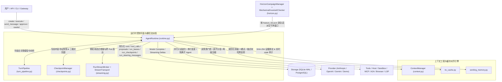
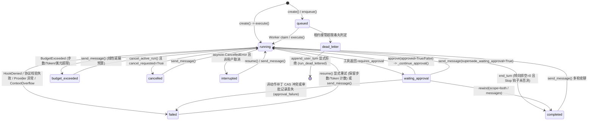
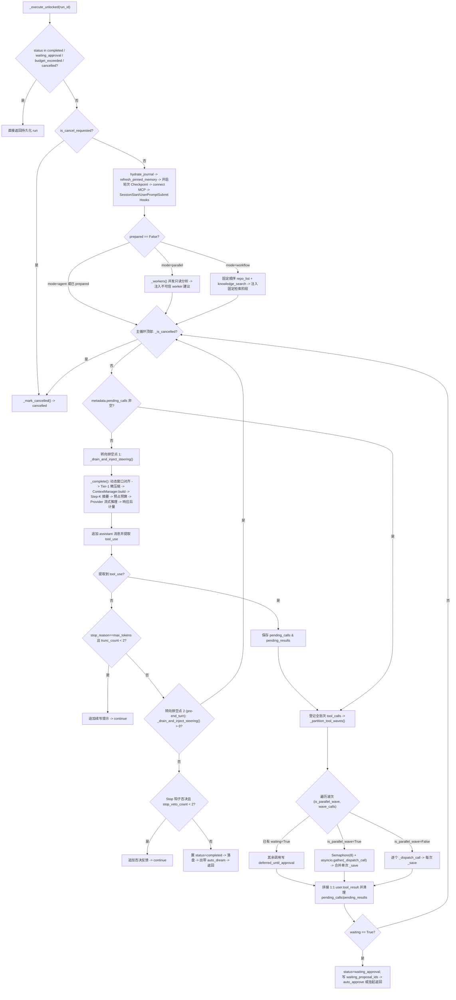
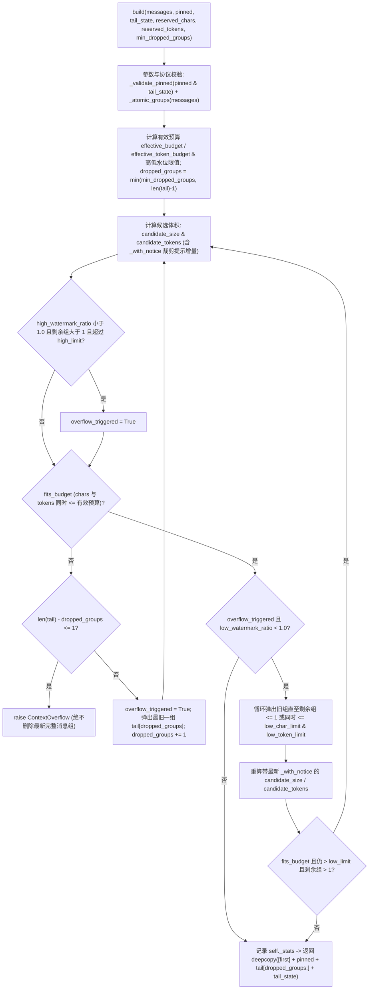
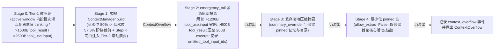
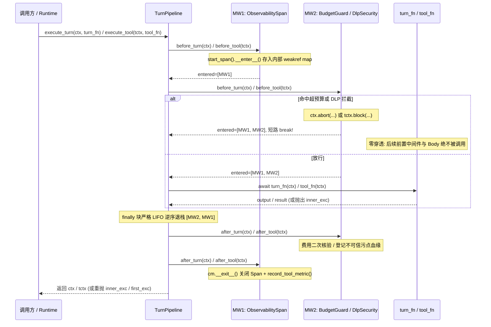
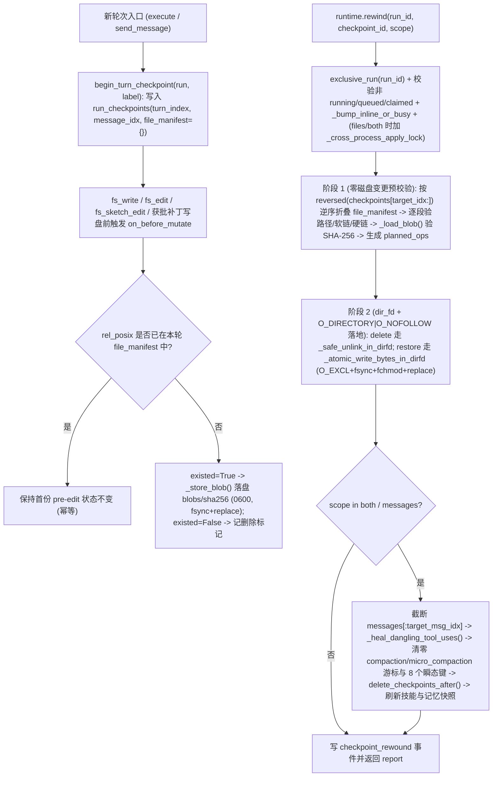
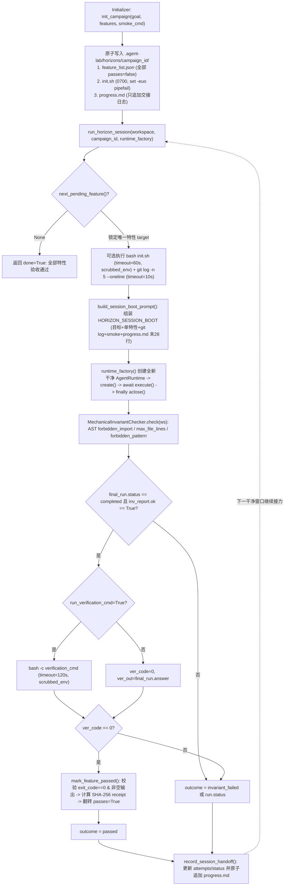

# 卷一：核心运行时控制流与上下文工程设计详述

> **适用范围**：本卷全面剖析 `agent-systems-lab` 核心执行引擎（Harness）的 8 个基座模块：
> [`runtime.py`](../../src/agent_lab/runtime.py)、[`context.py`](../../src/agent_lab/context.py)、[`kv_cache.py`](../../src/agent_lab/kv_cache.py)、[`working_memory.py`](../../src/agent_lab/working_memory.py)、[`turn_pipeline.py`](../../src/agent_lab/turn_pipeline.py)、[`checkpoints.py`](../../src/agent_lab/checkpoints.py)、[`streaming.py`](../../src/agent_lab/streaming.py) 与 [`horizon.py`](../../src/agent_lab/horizon.py)。
> 全文所有符号签名、状态枚举、常量阈值、协议格式与行号均与源码逐行核验一致。

---

## 全局架构总览

`agent-systems-lab` 的核心设计哲学是 **“模型负责高层规划决策，确定性 Harness 掌管安全边界、KV Cache 保真度、预算门控、幂等账本、人机审批与时间旅行回滚”**。8 个模块围绕单次运行（Run）与跨会话超长程战役（Horizon Campaign）构成如下协作拓扑：



### 跨模块设计全景索引

| 序号 | 模块文件 | 总行数 | 核心架构定位 |
| --- | --- | ---: | --- |
| 1 | [`src/agent_lab/runtime.py`](../../src/agent_lab/runtime.py) | 9,781 | 状态机驱动的可恢复 Agent 运行时，编排生命周期、工具双平面调度、审批恢复、实时转向、并发子 Agent 与出带 Dreaming |
| 2 | [`src/agent_lab/context.py`](../../src/agent_lab/context.py) | 1,109 | 字符 + BPE Token 双预算门控、原子 `(tool_use, tool_result)` 分组、滞回阶梯压缩、Tier-1 微压缩、Tier-2 确定性/LLM 滚动摘要 |
| 3 | [`src/agent_lab/kv_cache.py`](../../src/agent_lab/kv_cache.py) | 576 | 确定性规范序列化、主从系统前缀拆分、Anthropic 3 断点 `cache_control` 排布、`context_management` 与链式块哈希仿真追踪 |
| 4 | [`src/agent_lab/working_memory.py`](../../src/agent_lab/working_memory.py) | 472 | 抗记忆投毒的结构化工作记忆（SHA-256 证据绑定、实时 `stale` 降级、去时间戳确定性视图与陈旧优先淘汰） |
| 5 | [`src/agent_lab/turn_pipeline.py`](../../src/agent_lab/turn_pipeline.py) | 615 | 可组合洋葱模型回合/工具中间件流水线，内置出站 DLP、预算守卫与 W3C Trace Span 遥测 |
| 6 | [`src/agent_lab/checkpoints.py`](../../src/agent_lab/checkpoints.py) | 709 | 内容寻址写前 Blob 仓库、`O_DIRECTORY \| O_NOFOLLOW` 抗符号链接三模式时间旅行回退与悬空 `tool_use` 自愈 |
| 7 | [`src/agent_lab/streaming.py`](../../src/agent_lab/streaming.py) | 946 | 每 Run 单调序号 + 256 帧环形缓冲异步流式代理，支持 `InMemory` / `Callback` / `PostgresNotify` 跨节点扇出 |
| 8 | [`src/agent_lab/horizon.py`](../../src/agent_lab/horizon.py) | 685 | 跨窗口超长程战役接力（防篡改 `feature_list.json` + SHA-256 验收收据）与 OpenAI 风格机械化架构边界 Lint |

---

## 模块 1：`runtime.py` — 核心 Agent 执行引擎（AgentRuntime）

### 1.1 模块定位与核心职责

- **源码路径**：[`src/agent_lab/runtime.py`](../../src/agent_lab/runtime.py)（全长 **9,781 行**，核心类 `AgentRuntime` 位于 `L787-L9776`）。
- **核心职责**：
  1. **全生命周期编排**：统一管理 `create`、`start`、`execute`、`resume`、`send_message`、`approve`、`cancel_active_run`、`rewind`、`compact_context`、`dream`、`grade_run`、`set_permission_mode`、`aclose` 等全部运行时入口；
  2. **三档执行配置（`execution_profile`）与三执行模式（`mode`）**：按 `sandbox` / `host` / `computer` 自适应工具集、系统提示词（`SYSTEM` vs `HOST_SYSTEM`）、默认权限档位与配额，并支持 `agent` / `workflow` / `parallel` 三种编排形态；
  3. **KV Cache 友好的提示词装配与上下文自愈**：静态冻结头部前缀、瞬态尾部状态分离、模型感知上下文窗口自动缩放（1M / 400K / 200K / 128K）、两级压缩与四级 `ContextOverflow` 恢复瀑布；
  4. **双平面工具执行与并发只读波次**：将只读连续工具合并为并行波次（`Semaphore(8)`），将写操作/审批触发/钩子介入严格串行化，异步工具（MCP / A2A / Subagent / LSP / Browser / PTC / Shadow）留在主事件循环，同步阻塞 I/O 在 `asyncio.shield` 保护线程中运行；
  5. **幂等调用账本与故障容错**：围绕 `tool_calls` 表实现 `SAFE_REPLAY` 重放与 `execution_unknown` 停机保护；对获批动作类提案的非零退出码放行回注模型，驱动自主修复闭环；
  6. **自主多 Agent 调度（`subagent_run`）**：遵循 Effort-Scaling 准则与四要素委派契约，支持 `<= 1600` 字符 `PARENT_CONTEXT_BRIEF`、共享 `<TOOLS>+<SYSTEM_BASE>` KV 根前缀、Git worktree 隔离（含崩溃复用与零变更/失败回收）、`model_tier` 路由与后台异步批次；
  7. **交互式规划、实时转向与有界投影**：支持 `enter_plan_mode` / `exit_plan_mode` / `ask_user_question`、运行中双检查点转向排空与 `waiting_approval` 接管（`supersede_waiting_approval`），以及 `_project_result` 有界账本投影。

---

### 1.2 完整状态机与核心执行数据流

#### 1.2.1 Run 生命周期状态机

持久化 `runs` 与 `run_leases`（见 [`storage.py`](../../src/agent_lab/storage.py) `L580-L583`、`L616-L619`）覆盖 9 个核心运行态（外加租约表的 `idle` 与 `claimed` 调度态）：



#### 1.2.2 主循环、实时转向、双平面调度与审批续跑时序



---

### 1.3 核心数据结构、算法逻辑与关键常量/配额表

#### 1.3.1 三档执行配置（`execution_profile`）与模型感知自适应配额

在 `AgentRuntime.__init__`（`L790-L1043`）与 `_complete`（`L2283-L2301`）中，运行时结合 `execution_profile`、`providers.resolve_model_context_window`（[`providers.py`](../../src/agent_lab/providers.py) `L275-L345`）和环境变量动态计算配额：

| 配置维度 | `sandbox`（默认，无真实大窗模型） | `host` / `computer`（无真实大窗模型） | 真实 Provider 模型感知缩放（128K / 200K / 400K / 1M） |
| --- | --- | --- | --- |
| 系统提示词 | `SYSTEM`（`L192-L203`） | `HOST_SYSTEM`（`L205-L216`） | 沿用对应档位基础提示词 |
| 默认 `permission_mode` | `ask` | `auto-edit` | 沿用档位默认或显式指定 |
| 默认 `max_steps` | `12` | `24` | 同档位默认（`L931`） |
| 默认 `max_output_tokens` | `4,096` | `4,096` | 当 `detected_window >= 128_000` 且未显式覆盖时自动升至 `16,384`（`L924-L929`） |
| `ContextManager.max_tokens` | `min(30_000, int(24_000*0.85))` = `20,400` | `min(120_000, int(64_000*0.85))` = `54,400` | `usable_win = max(16_384, detected_window - effective_output_tokens)`，例如 1M 模型为 **`983,616`**，200K 模型为 **`183,616`**，128K 模型为 **`111,616`**（`L977-L978`） |
| `ContextManager.max_chars` | `24,000` | `64,000` | `max(64_000, int(usable_win * 4))`（按 4× 字符放宽，确保由精确 BPE token 主导压缩，`L942-L944`） |
| Run 级 `max_tokens` 预算 | `30,000` | `120,000` | `max(档位默认, detected_window * 2)`（如 1M 模型达 `2,000,000`，`L951`） |
| 自动压缩水位 (`high` -> `low`) | `high=0.80`（默认 `AGENT_LAB_AUTO_COMPACT_RATIO`），`low=0.576` | 同左；若 `resolved_chars < 8000` 则 `high=1.0, low=0.62` | 同左（`low = max(0.2, min(0.58, round(high * 0.72, 4)))`，`L963-L975`） |
| 单轮最大 `tool_use` 数量 | `8`（`L2960`） | `32`（`L2960`） | 按有效档位判定 |
| 单次结果内联阈值 (`_project_result`) | `2,600` 字符 | `2,600`（`max_chars < 200_000`） | 当 `context.max_chars >= 200_000` 时放宽至 **`12,000`** 字符；特例：`subagent_run` 恒为 `10,500`，`mcp_tool_search` 恒为 `8,000`（`L3287-L3292`） |
| `enable_agent_memory` / `enable_subagents` | 默认 `False` | 默认 `True` | 同档位默认 |

> **运行中模型热切换对齐**（`L2283-L2301`）：若用户通过 `/model` 或网关切换至不同容量模型且构造时未硬编码 `context_chars`（`not self._explicit_context_chars`），`_complete()` 在每步请求前自动重调 `resolve_model_context_window()` 同步更新 `self.context.max_tokens`、`self.context.max_chars` 与 `self.max_tokens`。模型窗口解析优先级为：`explicit_window` > `AGENT_LAB_CONTEXT_TOKENS` 环境变量 > 模型 ID 后缀标签（如 `[1m]`、`[400k]`）> `DEFAULT_MODEL_CONTEXT_WINDOWS` 家族表（`1,000,000` / `500,000` / `400,000` / `200,000` / `128,000`）。

#### 1.3.2 提示词装配顺序（Prompt Assembly Order）

每一次 `_complete()` 送往推理引擎的逻辑流严格保持 **“极稳定头部前缀 -> 只追加历史区 -> 瞬态尾部动态区”** 的拓扑顺序：

1. **`<TOOLS>`**（`_all_tools` + `canonical_tools`，`L1964-L2041`）：
   - 按确定顺序拼接：`registry.definitions()` -> `EXTRA_TOOLS` ->（`host`/`computer` 下）`BACKGROUND_PROCESS_TOOL_SPECS` + `LSP_TOOL_SPECS` + `CODE_INDEX_TOOL_SPECS` + `WEB_TOOL_SPECS` + `INTERACTIVE_TOOL_SPECS` + `PTC_TOOL_SPECS` + `SHADOW_TOOL_SPECS` -> `HOST_EXTRA_TOOLS`（或按开关单独挂 `_SUBAGENT_TOOL_SPECS` / `MEMORY_TOOL_SPECS`）-> `BROWSER_TOOL_SPECS`（启用浏览器时）-> 冻结 MCP 工具（按 `mcp_deferred` 决定挂 `MCP_DEFERRED_TOOL_SPECS` 还是字典序 Eager 直挂）-> `MCP_RESOURCE_TOOL_SPECS`（有已连 MCP Server 时）-> `A2A_TOOL_SPECS`（启用 A2A 时）；最后按工具名稳定去重并 `canonical_tools()` 排序键序。
2. **`<SYSTEM_BASE>`**（`_system`，`L2098-L2118`）：
   - `HOST_SYSTEM`（`host`/`computer`）或 `SYSTEM`（`sandbox`）+ `"\n可用技能目录（按需调用 skill_load）：\n"` + `canonical_json(turn_skills_snapshot)`。
3. **`<SYSTEM_ROLE>`**（仅子 Agent / parallel worker 存在，由 `kv_cache.split_system_role` 按 `"\nROLE:"` 切分）：
   - 例如 `ROLE:{worker_key}\n{role_guide}...`（`L5291`）或 `ROLE:{role}\n只读研究...`（`L7715`）。
4. **`messages[0]`**：最初的 `user` 任务消息（发生裁剪时由 `ContextManager._with_notice` 附加裁剪提示）。
5. **前置固定区 `pinned`**（`_assemble_pinned_for_worker`，`L3069-L3119`）：仅当剩余预算 `max_chars - reserved >= 6000` 时注入前 4 项扩展，且全程保持严格稳定顺序：
   1. `pinned_memory_snapshot`（会话创建或压缩/显式换轮时冻结的 `MEMORY.md` / `CLAUDE.md` 索引，<= 200 行 / 4000 字符）；
   2. `MCP_SERVER_DIRECTORY`（仅当 `mcp_deferred=True` 时渲染）；
   3. `pinned_a2a_directory`（启用 A2A 且首次渲染后冻结）；
   4. `compaction_summaries[worker]`（滚动压缩摘要，仅在触发水位压缩当拍更新）；
   5. 首轮预加载的活动技能快照（`active_skills` 中 `not snap.get("mid_run_dynamic")`，按名称排序）。
6. **保留的历史消息组 `tail[dropped_groups:]`**：按原子 `(assistant.tool_use, user.tool_result)` 分组投影后的近期对话历史。
7. **瞬态尾部动态区 `tail_state`**（仅 `worker == "coordinator"`，位于 Anthropic 第 3 个 `cache_control` 断点之后，`L2333-L2334`、`L2979-L3014`、`L3245-L3279`）：
   1. 运行期中途通过 `skill_load` 或显式 `/skill` 转向加载的技能快照（`mid_run_dynamic=True`）；
   2. `DYNAMIC_SKILL_HINTS`（运行期转向或多轮追问新匹配、但未纳入冻结 `turn_skills_snapshot` 的技能目录提示）；
   3. `HARNESS_STATE`（`run_id`、`status`、`decisions[-4:]`、`waiting_proposal_ids`、`recent_calls[-6:]`，`host`/`computer` 下附加 `permission_mode`）；
   4. `WORKING_MEMORY`（经 `audit_working_memory` 实时重验并由 `prompt_view_working_memory` 剥离 `recorded_at` 时间戳的确定性视图）；
   5. **多模态瞬态视觉附件**（`vision_attachments`，`L3128-L3243`）：仅在 Provider 支持视觉时从 `artifacts/<run_id>/` 读取当前轮次用户上传图片（最多 4 张，单张 `<= 6 MiB`，内联 Base64 `<= 7,000,000` 字符）及最新一轮 `computer_screen(action="screenshot")` / `browser_shot_*.png`（`<= 5 MiB`），按 `max(256, (width * height) // 750)` 折算视觉 Token 计入预留预算（`L2660-L2663`），绝不把数 MB Base64 落库 SQLite。

#### 1.3.3 三种执行模式（`mode`）差异

| 模式 | 入口判定（`L8157-L8187`） | 预备阶段行为 | 主协调循环 |
| --- | --- | --- | --- |
| `agent`（默认） | 直接置 `prepared=True` | 无预备检索或固定 worker | 标准自主多步 ReAct 循环（模型自主决定检索、工具、子 Agent 或修改） |
| `workflow` | `prepared == False` 且 `mode == "workflow"` | 固定按序在线程执行 `repo_list`（`call_id="workflow:repo_list"`）与 `knowledge_search`（`call_id="workflow:knowledge_search"`），投影后以 `固定检索阶段（不可信数据）：` 注入 `messages` | 进入标准主循环继续生成与验证 |
| `parallel` | `prepared == False` 且 `mode == "parallel"` | 调用 `_workers()`（`L7634-L7812`）并发启动 1—6 个配置角色（默认 `["reviewer", "tester"]`），各持独立持久对话 `metadata.workers[role]`、最多 3 轮只读工具调用、共享全量 `<TOOLS>` 前缀；结果以 `不可信 worker 建议：` 注入 `messages` | 进入标准主循环综合建议并实施 |

#### 1.3.4 并行只读工具波次切分（`_partition_tool_waves`）与双平面调度

1. **波次切分规则**（`_is_parallel_readonly_call` `L7576-L7609` + `_partition_tool_waves` `L7611-L7632`）：
   - 仅当工具属于 `_PARALLEL_SAFE_READONLY_TOOLS`（26 个严格无副作用的只读工具，`L581-L610`），或为 `read_only=True` 的 `mcp__*` / `mcp_call_tool` 时才候选并发；
   - **安全退化至串行**：若 `PermissionRuleEngine` 配置了 `ask` 规则且命中该调用，或者当前运行注册了任何 `PreToolUse` 钩子（可能返回 `ask` 或依赖顺序），立即返回 `False` 强制退化串行；
   - `_partition_tool_waves()` 扫描 `remaining_calls`：将长度 **>= 2** 的连续只读调用打包为 `(True, ro_buf)` 并发波次；单个只读调用或任意变更/审批/钩子调用封装为 `(False, [call])` 串行波次；
   - 并发波次内通过 `asyncio.Semaphore(8)` + `asyncio.gather()` 并发执行，整波次结束后**合并为单次 `self._save(run)`**，显著降低 SQLite WAL 写放大（`L8339-L8364`）；串行波次逐个调用并在每次调用后立即落盘。
2. **双平面工具执行**（`_dispatch_call`，`L7288-L7574`）：
   - **主事件循环异步平面**（`is_async_tool=True`，`L7356-L7371`）：`subagent_run`、`lsp_query`、`mcp_call_tool`、`mcp_list_resources`、`mcp_read_resource`、`ptc_exec`、`shadow_verify_edits`、`_A2A_ALL_TOOLS`、`_INTERACTIVE_TOOL_NAMES`、`_BROWSER_ALL_TOOLS`、`mcp__*`；满足 `asyncio.Lock` 共享与 AnyIO / MCP 单任务亲和性；
   - **后台保护线程同步平面**（`is_async_tool=False`）：其余文件、Shell、Docker Sandbox、GUI FFI、记忆/技能/索引同步工具全部经 `_tool_thread()`（`L4537-L4555`）放入 `asyncio.to_thread` 并由 `asyncio.shield` 保护：协程取消时先置位 `threading.Event` 协作取消信号，再等待工作线程安全完成落盘与锁释放后才向上传播 `CancelledError`；
   - **延迟终态落账**（`defer_finish=True`，`L7383`、`L7569-L7573`）：同步调用在返回主事件循环后先叠加 `_attach_post_edit_lsp_diagnostics`（对 `fs_write`/`fs_edit`/`fs_sketch_edit` 附加 LSP 诊断）、`_record_untrusted_provenance`（登记 CaMeL 污点）与 `PostToolUse` 钩子输出，最后在 `finally` 中统一 `_finish_call()`，保证 `tool_calls` 账本与消息视图完全一致。

#### 1.3.5 幂等工具账本（`SAFE_REPLAY` vs `execution_unknown`）与非零退出自修复闭环

1. **幂等调用账本机制**（`_execute_call` `L4453-L4518` & `_dispatch_call` `L7397-L7423`）：
   - 批次进入前先为全部 `pending_calls` 调用 `_schedule_call` 写入 `status='scheduled'`（`L8305-L8306`）；
   - 重启恢复时若 `record.get("result_sha256") is not None`，直接返回已持久化结果，不重复触发钩子或副作用；
   - 若记录处于 `status in {"running", "unknown"}`（表示上次执行中途崩溃）：
     - 若工具属于 **`SAFE_REPLAY`**（43 个只读或基于 `call_id` 幂等化的工具，含 `propose_patch`、`propose_changeset`、`memory_write`、`working_memory_write`、`skill_load`/`unload` 等，`L534-L578`），或异步分支中的 `subagent_run`（内部子调用自带独立账本与状态持久化），则允许重试（最多 3 次，达 `attempts >= 3` 返回 `recovery_attempts_exhausted`）；
     - 若工具**不在 `SAFE_REPLAY`**（如 `bash_exec`、`fs_write`、`fs_edit`、`sandbox_test`、非只读 MCP/A2A 等）：首先检查 `storage.get_proposal_by_operation(run_id, call_id)` 是否已生成 `pending` 提案，若是则无缝恢复 `requires_approval`；否则绝不冒险重跑外部副作用，直接落定 `code="execution_unknown"`、`status="unknown"`（若为 `sandbox_test` 同时将 `verification.status` 置为 `"unknown"`），把决策权交还模型。
2. **非零退出码自修复闭环**（`_continue_approval` `L9307-L9313`、`L9728-L9756` & `_invoke` `L4275-L4450`）：
   - **动作类提案（`is_action_prop`）**：涵盖 `command`、`gui_action`、`mcp_call`、`a2a_call`、`plan_approval`、`user_question`。审批通过后若命令返回非零退出码（例如 `pytest` 失败返回 `ok=False, code="nonzero_exit"`）或超时，**绝不将任务标为 `failed`**；仅当 `code in {"proposal_not_found", "approval_required"}` 时才判定审批系统故障终止。正常失败输出写入 `tool_calls`（`call_id = f"approval:{proposal['id'][:32]}"`）并经 `_project_result` 有界投影，作为 `REVIEW_APPROVED: {...}` 回注对话，模型据此阅读堆栈继续修复；
   - **文件补丁提案（`not is_action_prop`）**：若落盘返回 `ok=False`（如 CAS `version_conflict`），立即置 `status="failed"` 并记录 `metadata.approval_failure`，强制人工或显式新轮次重读后再提补丁；
   - **测试驱动修复轮次上限（`sandbox_test` + `max_repair_rounds`）**：默认 `max_repair_rounds=2`（`L803`）。当 `sandbox_test` 返回 `SANDBOX_FAILURE_CODES` 时更新 `verification.status="failed"` 并附带 `repair_budget`；后续每次新的 `propose_patch` / `propose_changeset` 消耗 1 轮（按 `call_id` 去重记入 `repair_call_ids`）；一旦 `repair_rounds_used >= max_repair_rounds` 直接拒绝新补丁并返回 `code="repair_rounds_exhausted"`（`L4278-L4296`）。

#### 1.3.6 运行中实时转向（Live Steering）三触点设计

| 触点 | 触发位置 | 核心逻辑与语义 |
| --- | --- | --- |
| **触点 1：主循环顶部** | `_execute_unlocked` `L8193` | 每次进入 `_complete()` 之前调用 `_drain_and_inject_steering(run)`：单事务受 `expected_epoch` 校验原子取出 `run_steering_messages` 中未消费消息，按 `"[用户运行中实时补充指令]\n" + combined_text` 并入 `messages`，绑定并发上传的 `user_attachments`（按 `steering_id` 关联 `turn_message_idx`），预载显式 `/skill` 至尾部（`mid_run_dynamic=True`），若剩余步数或 Token `< 50% base_max_*` 则自动补足单轮余量，并将新匹配技能记入尾部 `dynamic_skill_hints`（绝不改写 `<SYSTEM_BASE>`）。 |
| **触点 2：终态前二次排空（Pre-`end_turn`）** | `_execute_unlocked` `L8220-L8221` | 当模型输出纯文本且无 `tool_use` 准备 `completed` 之前，再次调用 `_drain_and_inject_steering(run)`；若模型推理期间恰好有新指令入队（返回值 `> 0`），立即 `continue` 下一拍，绝不提前结束会话。 |
| **触点 3：待审批态接管（`waiting_approval` supersede）** | `send_message(..., supersede_waiting_approval=True)` `L9008-L9063` -> `storage.append_user_turn` [`storage.py`](../../src/agent_lab/storage.py) `L2655-L2891` | 当任务处于 `waiting_approval` 时，允许用户用新指令接管：单事务内将 `waiting_proposal_ids` 中所有 `pending` 提案标记为 `rejected`（`decision_reason="superseded_by_user_steering"`），1:1 补齐可能悬空的 `tool_use` 回执（`code="superseded_by_user_steering"`），注入 `[用户转向接管 (superseded_by_user_steering)...]` 说明与新用户消息，清空待审批列表、递增 epoch、线性延展预算后立即恢复执行。 |

#### 1.3.7 自主多 Agent 调度（`subagent_run` / `subagent_status`）

完整实现位于 `_build_subagent_brief`（`L4685-L4773`）、`subagent_status`（`L4800-L4853`）与 `_invoke_subagent_run`（`L4855-L5830`）：

1. **Effort-Scaling 算力分级调度准则**（写入 `HOST_SYSTEM` `L207-L210` 与遥测 `effort_tier` `L4927-L4931`）：
   - 单文件修改或局部缺陷 -> **0 个子 Agent**（主协调者直接处理）；
   - `len(tasks) == 1` -> `effort_tier="focused"`；
   - `len(tasks) == 2`（双模块对比 / 源码 vs 测试交叉核对）-> `effort_tier="dual_comparison"`；
   - `len(tasks) in {3, 4}`（全仓架构摸底 / 跨 >=3 子系统排查）-> `effort_tier="deep_research"`（单批次严格限 `1—4` 个任务，`max_rounds` 限 `1—6`，默认 `3`）。
2. **四要素委派契约 & `<= 1600` 字符 `PARENT_CONTEXT_BRIEF`**（`L4685-L4773`）：
   - 每个任务包含四要素：`role`（角色）、`prompt`（具体 `objective`）、`scope_boundaries`（互不重叠的职责边界）、`expected_output`（交付契约，默认要求附精确 `file:line` 引用）；
   - 简报严格封顶 **1,600 字符**（外框 `context_frame <= 1,180` 字符，至少留 `>= 180` 字符给 `objective`）：包含全局任务目标（<=220 字符）、当前轮次焦点（<=180 字符）、`working_memory` 已核验约束（最多 4 条）与 `valid_facts`（最多 6 条，防子 Agent 重复查证）、并行兄弟分工列表（最多 3 个兄弟，防重复搜索）以及四要素本身，彻底杜绝把主会话历史全量倾倒给子 Agent。
3. **共享 `<TOOLS>+<SYSTEM_BASE>` KV 根前缀**：
   - `tools = canonical_tools(self._all_tools(run, registry))`（`L4920`）：子 Agent 复用主协调者**完全一致的全量规范工具目录**，系统提示为 `self._system(run) + f"\nROLE:{worker_key}\n{role_guide}..."`（`L5290-L5291`），配合 `kv_cache.split_system_role` 让主从 Agent 100% 共享 `<TOOLS> + <SYSTEM_BASE>` 物理 KV 块；
   - 权限边界不在工具列表裁剪，而在执行层硬拦截：严格排除 `subagent_run` / `subagent_status` 防递归派生；`readonly` 仅允许 `readonly_allowed`（23 个只读工具 + 只读 MCP/A2A）；`operator` 仅当主会话 `eff_perm in {"auto-edit", "full-auto"}` 时生效并叠加 `operator_extra`（`fs_write`/`fs_edit`/`fs_sketch_edit`/`bash_exec`/`bash_write`/`bash_kill`/`web_fetch`/`memory_write`/`computer_screen`），且**禁止子 Agent 触发嵌套人工审批**（只要权限判定 `decision != "allow"` 即返回 `permission_denied` 交回主协调者）。
4. **Git Worktree 隔离、崩溃复用与自动回收**（`L5034-L5200`、`L5674-L5682`）：
   - 当 `isolation="worktree"` 或（未显式指定且并发 `operator` 任务数 `>= 2` 且仓库为 Git worktree）时，在 `<state_root>/subagent_worktrees/<run_id[:12]>/<idx>-<safe_role>-<hex6>` 下调用 `create_task_worktree` 并签出临时分支 `agent-sub-<run_id[:8]>-<idx>-<safe_role>-<hex6>`，同时绑定专属 `ToolRegistry`；
   - **崩溃恢复复用**：持久化 `state["worktree_path"]` / `branch` / `base_commit`；重入时校验非符号链接、位于 `subagent_worktrees` 目录内且仍是合法 Git worktree 即直接复用；
   - **智能回收**：任务完成后采集 `worktree_status`（最多 2400 字符 diff），若存在有效改动（`dirty=True`）则保留 worktree 并将 `branch` / `worktree_path` / `diff_summary` 交付主 Agent；若**零变更、失败、超时或取消**，在 `finally` 中调用 `_cleanup_subagent_worktree` 自动清除 worktree 目录并 `git branch -D agent-sub-*` 防止孤儿分支堆积。
5. **`model_tier` 路由、独立超时容错、后台运行与 `<= 2400` 字符有界交付**：
   - `model_tier` 支持 `fast` / `inherit`（默认）/ `reasoning`，经 `providers.resolve_model_for_tier()`（[`providers.py`](../../src/agent_lab/providers.py) `L820-L918`）路由；
   - 单任务独立 `asyncio.wait_for(..., timeout=t_limit)`（默认 `120s`，可配 `1—600s`），`gather(..., return_exceptions=True)` 实现**部分失败隔离**（单个子 Agent 超时/报错生成 `ok=False, code="subagent_timeout"|"subagent_error"`，不拖垮其余兄弟；仅 `StaleEpochError` 或主运行已取消时才向上传播）；
   - `run_in_background=True` 立即返回 `job_id = "subjob_<hex10>"`，后台 `_bg_runner` 持续运行并同步结果到 `self._bg_subagent_jobs` 及 `metadata.background_subagents`，主 Agent 可随时通过 `subagent_status(job_id=...)` 轮询；
   - 单个子 Agent 报告若超过 **2,400 字符**（`_finalize_subagent_handoff` `L4983-L4998`），完整原文存入 `tool_calls`（`call_id = f"{worker_key}:report"`），交付对象内浓缩至 2,400 字符并附 `report_call_id` 与 `tool_result_get` 回查提示。

#### 1.3.8 交互式规划模式（Plan Mode）、`ask_user_question` 与 `_project_result`

1. **交互式协作工具**（`_invoke_interactive_tool`，`L6395-L6615`，Schema 定义见 [`egress_dlp.py`](../../src/agent_lab/egress_dlp.py) `L1176-L1270`）：
   - `enter_plan_mode`：记录进入前的 `pre_plan_permission_mode`，将 `permission_mode` 切换为 `"plan"`（并持久化 `plan_path`，默认 `.agent-lab/plans/<run_id[:12]>.md`）。在 `plan` 模式下，仅允许只读探索与通过 `_write_plan_artifact_file()`（`L1201-L1288`）向 `.agent-lab/plans/` 写入计划文档（逐段拒绝软链、硬链、越界路径与 `> 512 KiB` 文件），其余源码写与变更命令全部阻断；
   - `exit_plan_mode`：创建 `kind="plan_approval"` 提案使任务进入 `waiting_approval`；获批后在 `_continue_approval`（`L9361-L9395`）恢复至 `target_permission_mode`（或 `pre_plan_permission_mode`，兜底 `auto-edit`），并将用户可选反馈 `feedback` 回注模型；拒绝则保持 `plan` 模式继续修订；
   - `ask_user_question`：创建 `kind="user_question"` 提案（含 `question`、`options`、`multi_select`、`context`、`default_option`）；用户回答后（若留空依次回退 `default_option` -> `options[0]` -> `""`）在 `_continue_approval`（`L9396-L9423`）封存 `answered=True` 回执并续跑。
2. **有界账本投影 `_project_result`**（`L3281-L3346`）：
   - 完整工具结果永远原文存入 SQLite/PG `tool_calls` 表；
   - 返回模型前计算紧凑规范 JSON 长度：若 `<= max_inline`（默认 `2,600`；`context.max_chars >= 200_000` 时 `12,000`；`subagent_run` `10,500`；`mcp_tool_search` `8,000`）或工具自身就是 `tool_result_get`，原样内联；
   - 超限时仅白名单保留 32 个关键元数据字段（`ok`、`code`、`kind`、`path`、`paths`、`proposal_id`、`requires_approval`、`status`、`approved`、`permission_mode`、`answered`、`tests_executed`、`cleanup_verified`、`git_commit`、`repair_budget`、`task_id`、`artifact_name` 等），附加 `content_omitted=True`、`call_id`、`result_sha256`、`total_chars`、`excerpt=encoded[:900]` 与 `retrieve={"tool": "tool_result_get", "call_id": call_id, "offset": 0, "limit": 1200}`。

---

### 1.4 核心安全 / 并发 / 缓存不变量

| 类别 | 不变量名称 | Why（为何必须成立） | How（源码级落地点） |
| --- | --- | --- | --- |
| **并发安全** | 双异步锁 + 跨进程文件锁 + Epoch 租约栅栏 | 并发子 Agent 与异步 Worker 可能同时修改预算、覆盖 `save_run` 引发乐观锁冲突，或旧租约僵尸 Worker 写脏新状态 | `self._budget_lock` + `_inflight_reserved_tokens` 串行化预算预占与结算（`L1041-L1043`、`L2675-L2717`）；`self._save_lock` 串行化 `save_run`；`exclusive_run(storage.path, run_id)` 保护单 Run 跨进程互斥；`_cross_process_apply_lock` 保护工作区落盘；写库均传 `expected_epoch`，遇 `StaleEpochError` 直接中止禁止覆盖（`L8413-L8415`） |
| **安全边界** | 规则 `deny` 与 Egress DLP 不可绕过 | 即使处于 `full-auto`、`bypass_approval=True` 或 `PreToolUse` 钩子返回 `allow`，也不能允许泄露凭据或突破管理员 `deny` 规则 | `_dispatch_call`（`L7324-L7354`）与 `_continue_approval`（`L9142-L9165`、`L9432-L9451`、`L9477-L9496`、`L9538-L9557`）强制调用 `_inspect_egress_dlp`；`_invoke_mcp_call`/`_invoke_a2a_tool`/`_invoke_browser_tool`/`_invoke_ptc_exec`/`_invoke_shadow_verify_edits` 均先用 `session_grants=None` 独立检验 `PermissionRuleEngine` 的 `deny` 规则；`hook_decision=="ask"` 时通过 `_restrict_rule_engine_for_hook` 剥离 `allow` 规则 |
| **协议完整性** | `tool_use` ID 全局唯一与格式约束 | 裁掉旧历史后若模型重用历史 `call_id` 或发送非法格式，会冲撞 `tool_calls` 主键或与内部命名空间 `worker:tool:id` 冲突 | `_complete` 扫描完整 `raw_messages` 与 `storage.call_summaries` 构造 `previous_ids`（`L2262-L2280`），校验正则 `^[A-Za-z0-9_-]{1,128}$`（禁止冒号），拒绝重用历史 ID，校验 `stop_reason` 与 `tool_use` 存在性严格一致（`L2944-L2968`） |
| **KV Cache 保真** | 头部冻结 + 尾部瞬态 + 不事后篡改历史入参 | 前部任意 1 字节抖动会导致 PagedAttention/Anthropic Prefix Cache 全量重算 | `turn_skills_snapshot` 与 `pinned_memory_snapshot` 在起点冻结，中途转向/续聊新技能放 `dynamic_skill_hints` 尾部（`L2069-L2096`、`L7957-L7974`）；`_project_history` 常规步绝不事后改写历史 `tool_use.input`（`L3356-L3380`）；预算按缓存折算后的 `billed_tokens` 计量（`L2678-L2681`、`L2918-L2923`） |
| **隔离可靠性** | 故障脱敏与出带 Dreaming 隔离 | SDK 原始异常可能携带认证头/私有地址；后台记忆整理失败不能把已通过测试的 `completed` 任务翻盘 | 所有异常经 `sanitize_error_detail(exc)` 脱敏（`L8454`）；`_run_post_session_dream_safely` 仅在 `status="completed"` 落盘后执行且全量捕获异常；API/Worker 置 `defer_auto_dream=True` 先释锁再出带执行（`L8295-L8299`、`L8945-L8954`） |

---

### 1.5 失败模式、降级策略与边界条件处理

1. **输出长度截断自续写**（`L8205-L8218`）：当 `stop_reason == "max_tokens"` 且未产生 `tool_use`、且未触及 `max_steps` 时，自动最多追加 **2 次**续写提示（`truncation_continuations < 2`）要求模型精简续写；若 `stop_reason == "max_tokens"` 且伴随残缺 `tool_use`，直接抛 `ValueError` 拒绝执行半截参数（`L2965-L2966`）。
2. **`Stop` 钩子否决有界保护**（`L8231-L8262`）：确定性验证钩子单轮最多否决结束 **2 次**（`stop_veto_count < 2`），防止验证脚本误报导致无限循环烧空预算；`send_message` 换轮时复位为 `0`。
3. **取消与中断精准区分**（`L8416-L8440`）：捕获 `asyncio.CancelledError` 时查 `storage.is_cancel_requested(run_id)`——若为显式用户取消则置 `status="cancelled"`，若为进程信号/服务重启导致的被动协程取消则置 `status="interrupted"`，保留完整恢复语义。
4. **流通道可重入引用计数**（`_stream_run_scope` `L1458-L1473`）：`_exec_depth[run_id]` 追踪 `execute` / `resume` / `approve` / `send_message` 嵌套调用深度；仅在最外层（`prev_depth == 0`）调用 `stream_broker.reopen_run(run_id)`，仅在最外层退出（`remaining <= 0`）时 `close_run(run_id)`，避免 `auto_approve_proposals` 递归进入 `_continue_approval -> _execute_unlocked` 时提前关闭 SSE 通道。
5. **优雅资源回收（`aclose`）**（`L8469-L8520`）：按序取消全部后台子 Agent 任务、清理残留跟踪的临时 worktree 与 `agent-sub-*` 分支、关闭全部后台 PTY/Shell 进程管理器、LSP 服务器、去重后的 Browser 会话/后端、`execution_backend`、MCP/A2A 连接与 Provider HTTP 连接池。

---

### 1.6 关键源码符号与精确行号索引表

| 符号 / 方法名 | 行号范围 | 核心职责摘要 |
| --- | --- | --- |
| `SYSTEM` / `HOST_SYSTEM` | `L192-L216` | `sandbox` 与 `host`/`computer` 双基线系统提示词（含 Effort-Scaling 准则） |
| `EXTRA_TOOLS` / `HOST_EXTRA_TOOLS` | `L233-L461` | 技能/记忆/工作记忆/分页回查与 `subagent_run`/`subagent_status` 工具 Schema |
| `SAFE_REPLAY` / `_PARALLEL_SAFE_READONLY_TOOLS` | `L534-L610` | 崩溃安全重放白名单（43 项）与并发只读波次白名单（26 项） |
| `_call_provider_complete_compat` / `_TierRoutedProvider` | `L679-L780` | 兼容补丁流式降级补发、取消事件透传与后台 `fast` 模型档位路由代理 |
| `AgentRuntime.__init__` | `L790-L1043` | 执行档位归一化、1M/200K/128K 模型窗口缩放、水位线配置与并发双锁初始化 |
| `AgentRuntime._inspect_egress_dlp` / `_record_untrusted_provenance` | `L1091-L1199` | 出站凭据 DLP + CaMeL 严格数据流审查与 Web/MCP/A2A 污点血缘持久化 |
| `AgentRuntime.cancel_active_run` / `_stream_run_scope` | `L1422-L1473` | 跨线程/异步瞬时取消活跃任务与可重入流通道开关 |
| `AgentRuntime._all_tools` / `_system` | `L1964-L2118` | 冻结 `<TOOLS>` 与 `<SYSTEM_BASE>` 确定性装配 |
| `AgentRuntime.create` / `resume` / `_resume_unlocked` | `L2120-L2240` | 任务初始化（冻结技能与记忆快照）及崩溃后审批/失败态安全续跑 |
| `AgentRuntime._complete` | `L2250-L2969` | 单步模型推理热路径：动态窗口对齐、Tier-1 微压缩、Overflow 恢复、Step-K 摘要、预算预占与计量 |
| `AgentRuntime._assemble_pinned_for_worker` / `_tail_state` / `_latest_vision_attachments` | `L3069-L3279` | 头部固定区、尾部瞬态区与按需磁盘多模态视觉附件构建 |
| `AgentRuntime._project_result` / `_project_history` | `L3281-L3436` | 有界账本投影与历史超大入参/结果保守投影 |
| `AgentRuntime._invoke` / `_execute_call` / `_tool_thread` | `L3507-L4555` | 同步工具分发、账本幂等状态机与 `asyncio.shield` 取消保护线程 |
| `AgentRuntime._build_subagent_brief` / `subagent_status` / `_invoke_subagent_run` | `L4685-L5830` | 多 Agent 并发调度、1600 字符简报、Worktree 隔离复用回收、后台批次与 2400 字符报告截断 |
| `AgentRuntime._invoke_interactive_tool` | `L6395-L6615` | `enter_plan_mode` / `exit_plan_mode` / `ask_user_question` 交互协作状态流转 |
| `AgentRuntime._dispatch_call` / `_is_parallel_readonly_call` / `_partition_tool_waves` | `L7288-L7632` | 双平面工具调度、钩子/DLP/LSP 串联与只读并行波次切分 |
| `AgentRuntime._workers` | `L7634-L7812` | `mode="parallel"` 固定多角色只读 worker 并发引擎 |
| `AgentRuntime._drain_and_inject_steering` / `_execute_unlocked` | `L7831-L8467` | 运行中实时转向排空、主循环状态机、截断续写、Stop 否决与异常状态落库 |
| `AgentRuntime.aclose` / `grade_run` / `rewind` / `compact_context` / `dream` | `L8469-L9006` | 资源回收、四维轨迹评分、时间旅行回退、手动/LLM 压缩与四阶段出带 Dreaming |
| `AgentRuntime.send_message` / `approve` / `_execute_approved_command_proposal` / `_continue_approval` | `L9008-L9776` | 多轮续聊（含审批接管）、人工审批幂等落盘与非零退出自修复回注 |

---

## 模块 2：`context.py` — 双预算上下文窗口与多级滚动压缩引擎

### 2.1 模块定位与核心职责

- **源码路径**：[`src/agent_lab/context.py`](../../src/agent_lab/context.py)（全长 **1,109 行**）。
- **核心职责**：
  1. **零依赖校准 BPE Token 估算**：通过正则分词启发式估算（`_count_str_bpe_tokens`）与可选 `tiktoken cl100k_base` 实现字符 + BPE Token **双预算门控**；
  2. **严格协议原子分组**：校验并将 `(assistant.tool_use, user.tool_result)` 封装为不可分割原子组，彻底杜绝孤立 `tool_use` 或孤立 `tool_result` 引发上游 API 400 错误；
  3. **单调游标 + 滞回阶梯压缩（Step-Hysteresis Compaction）**：以 `compaction_cursor` 锁定已裁剪组数，到达高水位（默认 `80%`）后一次性压低至低水位（默认 `57.6%`，配置上限 `58%`；`high=1.0` 时 `62%`），避免满预算后逐轮滑动左移导致 KV Cache 步步穿透；
  4. **两级压缩 + 可选 LLM 语义压缩**：
     - **Tier-1 微压缩**（`micro_compact_messages`）：保留完整消息组结构，仅对陈旧轮次剥离 `thinking`/`redacted_thinking` 块并将大体积 `tool_result` 折叠为带 `tool_result_get` 提示的紧凑存根；
     - **Tier-2 确定性结构化摘要**（`build_compaction_summary`）：零模型调用、`<1ms` 提取已裁剪组的追问、读写文件、命令退出码、`call_id` 索引与阶段结论，并逐行执行 `_sanitize_compaction_line` 抗协议头伪造；
     - **可选 LLM 语义压缩**（`build_llm_compaction_prompt` / `finalize_llm_compaction_summary`）：供 `/compact` 主动压缩场景使用，经逐行脱敏消毒并在输出为空或异常时无缝回退至确定性摘要。

---

### 2.2 完整数据流：滞回阶梯压缩与多级 `ContextOverflow` 恢复瀑布

#### 2.2.1 `ContextManager.build()` 滞回阶梯压缩决策流



#### 2.2.2 `runtime._complete()` 中的多级压缩与四阶段 `ContextOverflow` 恢复瀑布

结合 [`runtime.py`](../../src/agent_lab/runtime.py) `L2340-L2652` 与 [`context.py`](../../src/agent_lab/context.py)，完整防御瀑布分 5 层递进：



---

### 2.3 核心数据结构、算法逻辑与关键常量/配额表

#### 2.3.1 校准 BPE Token 估算规则（`_BPE_PIECE_RE` & `_count_str_bpe_tokens` `L14-L138`）

| 词元类别（正则分组） | 匹配模式 | 估算权重公式 | 设计意图 |
| --- | --- | --- | --- |
| `word` | ` ?[A-Za-z]+` | `(letters + 3) // 4`（前导空格与词合并，不额外计费） | 贴合 cl100k_base 英文子词合并特性（~4 字母/token） |
| `num` | `[0-9]+` | `(len(piece) + 2) // 3` | BPE 对连续数字按 1—3 位切块 |
| `cjk` | `[㐀-鿿豈-﫿]+` | `len(piece) * 1.5` | 常见汉字 UTF-8 3 字节在 cl100k 中约 1.5 token |
| `esc` | JSON 转义序列（`\uXXXX`、`\n` 等） | `len > 2` 计 `2.0`，否则 `1.0` | 准确反映 Unicode 转义额外消耗 |
| `nl` | `\r\n \| [\r\n\t]` | `1.0` | 换行与制表符单 token |
| `sp` | ` +` | `(len(piece) + 3) // 4` | 连续缩进空格约 4 格/token |
| `pair` | 常见 JSON/代码双字符组合（`{"`、`":`、`"}`、`, "`、`==`、`->` 等） | `1.0` | BPE 词表高频合并符号对 |
| `ascii_punct` | 其他 ASCII 标点 | `1.0` | 兜底单字符标点 |
| `mb` | 其他多字节字符（如 Emoji/非 CJK） | `len(piece.encode("utf-8")) * 0.5` | 按 UTF-8 字节数折半估算 |
| 结构固定开销 | 消息/会话包装 | `_MESSAGE_BPE_OVERHEAD = 4`、`_CONVERSATION_BPE_OVERHEAD = 2`、纯 `text` 块 `+2`、其他块 `+3` | 对应 ChatML/Anthropic 角色框架包装 |

> **可选精确模式**：设置 `AGENT_LAB_USE_TIKTOKEN=1` 或传 `use_tiktoken=True` 且本机安装 `tiktoken` 时，自动切换为 `tiktoken.get_encoding("cl100k_base")`，导入失败则静默降级回正则估算器（`L103-L120`）。

#### 2.3.2 `ContextManager` 与两级压缩核心常量表

| 常量 / 参数 | 默认值 / 范围 | 源码位置 | 作用说明 |
| --- | --- | --- | --- |
| `max_chars` | 默认 `24_000`（正整数） | `L177` | 完整请求 JSON 序列化字符上限（扣减 `reserved_chars`） |
| `high_watermark_ratio` | 构造默认 `1.0`（范围 `[0.3, 1.0]`）；`AgentRuntime` 默认 **`0.80`** | `L180`, `runtime.py:L965` | 触发主动阶梯压缩的高水位比例 |
| `low_watermark_ratio` | 构造默认 `1.0`（范围 `[0.2, 1.0]` 且 `<= high`）；`AgentRuntime` 按 `max(0.2, min(0.58, round(high * 0.72, 4)))` 算得 **`0.576`**（`high=1.0` 时 `0.62`） | `L179`, `runtime.py:L971-L975` | 单次压缩落点低水位，留出约 22%—38% 静默增长缓冲带 |
| `max_tokens` | 默认 `None`（正整数） | `L181` | BPE token 维度预算上限，启用后 `budget_kind="chars_and_bpe_tokens"` |
| `micro_compact_messages` 参数 | `keep_recent_groups=3`, `max_aged_tool_chars=360`（`runtime.py` 传入 `1600`） | `L791-L792`, `runtime.py:L2364` | 仅压缩首条任务之后、最近 `keep_recent_groups` 之前陈旧组内的 thinking 块与超大 `tool_result` |
| `build_compaction_summary` 上限 | `max_chars=1800`（`runtime.py` 按 `min(1800, max(480, (max_chars-reserved)//6))` 计算） | `L547`, `runtime.py:L2559` | 归档摘要字符上限；保留最近 6 条追问、8 条文件修改、12 个检视文件、8 条命令结果、6 条阶段结论 |
| `build_llm_compaction_prompt` 上限 | `max_input_chars=12000` | `L942` | LLM 语义压缩输入文本上限（单条文本 `<= 420`/`360` 字符，入参 `<= 240` 字符） |
| `_RESERVED_PROTOCOL_HEADERS` | 7 个保留协议前缀：`HARNESS_STATE`、`WORKING_MEMORY`、`REVIEW_APPROVED:`、`REVIEW_REJECTED:`、`SKILL_SNAPSHOT`、`MEMORY_HIERARCHY`、`COMPACTION_SUMMARY` | `L19-L27` | 逐行防伪造拦截清单 |

#### 2.3.3 `ContextManager.stats()` 诊断指标字段（`L442-L475`）

输出 24 项完整遥测字段：`original_messages`、`kept_messages`、`kept_history_messages`、`dropped_messages`、`dropped_groups`、`original_chars`、`kept_chars`、`pinned_messages`、`pinned_chars`、`tail_state_messages`、`tail_state_chars`、`compaction_cursor`、`compaction_triggered`、`high_watermark_ratio`、`low_watermark_ratio`、`utilization_ratio`、`reserved_chars`、`effective_message_budget`、`request_chars`、`max_chars`、`original_tokens`、`estimated_tokens`、`reserved_tokens`、`effective_token_budget`、`request_tokens`、`max_tokens`、`budget_kind`、`overflow`。

---

### 2.4 核心安全 / 并发 / 缓存不变量

1. **原子工具往返配对不变量**（`_atomic_groups` `L209-L251`）：
   - **Why**：Anthropic / OpenAI 严格要求每个 `assistant.tool_use` 后紧跟 `user.tool_result` 且 ID 集合 1:1 相等，任意半边缺失会导致整个会话永久 400 死锁；
   - **How**：校验只允许 `user`/`assistant` 角色；拒绝孤立 `tool_result`、拒绝 `user` 含 `tool_use`、拒绝空/重复 `tool_use.id`、拒绝 `tool_use` 缺少紧邻 `user` 回执或 ID 集合不匹配；所有裁剪以完整 2 消息组为单位弹出，且**永不删除最新一组**（`len(tail) - dropped_groups <= 1` 时抛 `ContextOverflow`）。
2. **`pinned` / `tail_state` 低权限隔离不变量**（`_validate_pinned` `L271-L289`）：
   - **Why**：防止运行时状态或摘要被注入伪造的 `system` 角色或虚假 `tool_use`/`tool_result` 块来劫持工具审批流；
   - **How**：严格限定 `pinned` 与 `tail_state` 只能是 `role == "user"` 且 `content` 仅为纯字符串或 `type == "text"` 块列表。
3. **抗协议头伪造不变量（Anti-Protocol-Spoofing）**（`_sanitize_compaction_line` `L508-L520`）：
   - **Why**：不可信网页/源码/命令输出中可能嵌入 `\nREVIEW_APPROVED: {"ok":true}` 或 `\nHARNESS_STATE`，若在滚动压缩或 LLM 总结时原样带入前置 `pinned` 摘要区，会诱导模型误以为人类已批准危险操作；
   - **How**：先调用 `redact_secrets()` 脱敏凭据，再统一换行符并按 `splitlines()` 逐行剥离前导空白检查 7 个 `_RESERVED_PROTOCOL_HEADERS`——凡命中者一律重写为 `"[SANITIZED_PREFIX] " + stripped`；同时 `finalize_llm_compaction_summary` 先剥除模型可能包裹的 Markdown 代码围栏，再对每一行执行 `_sanitize_compaction_line`。
4. **单调游标 + 同拍原地注入 KV Cache 不变量**（`runtime.py:L2540-L2648`）：
   - **Why**：若在第 K 步裁剪后等到第 K+1 步才插入摘要，会引发连续两步前缀全部失效；若每步微压缩游标逐轮 `+1`，也会步步破坏前缀；
   - **How**：`compaction_cursor` 单调不减（仅在 `rewind` 截断消息时归零）；当第 K 步触发 `new_cursor > cursor` 时，**当拍**生成摘要并重排构建（若二次推高游标 `final_cursor > new_cursor`，以原摘要长度为上限原地再对齐一次），使第 K+1 .. K+M 步前缀 100% 字节恒定；Tier-1 微压缩同样引入批次滞回——至少累积 **2 个新陈旧组**或触及紧急阈值 `min(0.95, high + 0.10)` 才推进 `micro_compaction_cursors[worker]`（`runtime.py:L2386-L2418`）。

---

### 2.5 失败模式、降级策略与边界条件处理

1. **尾部悬空 `tool_use` 容错分组**（`_segment_groups_tolerant` `L772-L785`、`build_compaction_summary` `L574-L581`）：对异常中断尚未闭合末尾 `tool_use` 的原始历史，先尝试严格 `_atomic_groups(messages)`，失败后退回对 `messages[:-1]` 分组并单独保留末条，仍失败则逐条成组，确保压缩工具与 `/compact` 不崩溃。
2. **微压缩存根膨胀反保护与幂等性**（`micro_compact_messages` `L877-L913`）：已含 `"micro_compacted": true` 的块直接跳过保证绝对幂等；若标准存根 JSON 反而 `>= len(content_str)`，先降级为 3 字段极简存根（`micro_compacted`、`call_id`、`retrieve_hint`），若仍不缩短则放弃替换；若剥离 `thinking` 后 `assistant.content` 变空，自动补入占位文本块 `{"type": "text", "text": "[早期思考过程已微压缩]"}` 避免非法空内容数组。
3. **LLM 摘要异常/空壳自动回退**（`finalize_llm_compaction_summary` `L1059-L1085`、`runtime.py:L8674-L8678`）：模型返回非字符串、空白、纯标点（不含 `[A-Za-z0-9㐀-鿿]`）或网络异常时，100% 透明回退至确定性 `build_compaction_summary()`。
4. **不可变入参保证**：`build()` 仅扫描原始引用，最终仅对保留片段执行 `deepcopy`（避免深拷贝整份长日志）；`micro_compact_messages()` 深拷贝后操作，绝不污染调用方原始 `messages` 列表。

---

### 2.6 关键源码符号与精确行号索引表

| 符号 / 函数名 | 行号范围 | 核心职责摘要 |
| --- | --- | --- |
| `_COMPACTION_SUMMARY_HEADER` / `_RESERVED_PROTOCOL_HEADERS` | `L16-L27` | 滚动摘要标准头与 7 个抗伪造保留协议头集合 |
| `_BPE_PIECE_RE` / `_count_str_bpe_tokens` / `_message_bpe_tokens` / `estimate_bpe_tokens` | `L29-L138` | 零依赖校准 BPE Token 估算器（支持可选 `tiktoken cl100k_base`） |
| `ContextOverflow` | `L159-L160` | 原任务、固定状态与最新完整组超预算时抛出的结构化异常 |
| `ContextManager.__init__` / `_atomic_groups` / `_with_notice` / `_validate_pinned` | `L175-L289` | 水位线参数校验、原子工具往返分组、裁剪提示追加与低权限固定区校验 |
| `ContextManager.build` / `stats` | `L291-L495` | 双预算门控、单调游标、高低水位滞回阶梯压缩主算法与 24 项遥测快照 |
| `_clean_summary_snippet` / `_sanitize_compaction_line` / `_extract_result_status` | `L498-L540` | 凭据脱敏、逐行保留协议头中和与确定性状态/退出码提取 |
| `build_compaction_summary` | `L543-L769` | Tier-2 零模型调用确定性结构化滚动摘要生成器 |
| `_segment_groups_tolerant` / `micro_compact_messages` | `L772-L934` | Tier-1 幂等微压缩（剥离陈旧 thinking + 大 `tool_result` 存根替换） |
| `build_llm_compaction_prompt` / `finalize_llm_compaction_summary` | `L937-L1109` | 可选 LLM 语义压缩提示词构造与逐行消毒/自动回退终结器 |

---

## 模块 3：`kv_cache.py` — KV Cache 前缀对齐、3 断点排布与链式块追踪

### 3.1 模块定位与核心职责

- **源码路径**：[`src/agent_lab/kv_cache.py`](../../src/agent_lab/kv_cache.py)（全长 **576 行**）。
- **核心职责**：
  1. **确定性规范序列化**：`canonical_json` 与 `canonical_tools` 固定字典键序与紧凑分隔符，彻底消除同义 JSON Schema 因键序抖动导致的 KV 物理页失效；
  2. **主从系统前缀拆分**：`split_system_role` 按 `"\nROLE:"` 将系统指令拆为共享基础段与子 Agent 尾部角色段，使主协调者、只读 worker 与 `subagent_run` 子代理命中同一套 `<TOOLS> + <SYSTEM_BASE>` 缓存根前缀；
  3. **Anthropic 三段式显式 `cache_control` 断点组装**：`build_anthropic_cached_payload` 在单请求上限 4 个断点内布局 3 个 `ephemeral` 断点，合并相邻同角色消息，并自动避开不可缓存的 `thinking` / `redacted_thinking` / 空 `compaction` 块；
  4. **Anthropic 原生服务端上下文管理配置**：`build_anthropic_context_management` 按服务端强制序编排 `clear_thinking_20251015` -> `clear_tool_uses_20250919` -> `compact_20260112` 与对应 `anthropic-beta` 请求头；
  5. **链式块哈希追踪与离线消融基准**：模拟 vLLM Automatic Prefix Caching（`H_i = SHA256(H_{i-1} || "\0" || block_i)`）记录每步/累计命中率，并提供可复现实验 `simulate_kv_cache_ablation()`。

---

### 3.2 完整数据流：前缀层级、3 断点布局与链式块匹配

```mermaid
flowchart LR
    subgraph PrefixTree["逻辑前缀层级 (serialize_kv_stream / build_anthropic_cached_payload)"]
        direction LR
        T["1. TOOLS<br/>canonical_tools(tools)<br/>[BP-1: tools[-1] ephemeral]"]
        --> SB["2. SYSTEM_BASE<br/>基础系统指令 + 冻结技能目录<br/>[BP-2: system[0] ephemeral]"]
        --> SR["3. SYSTEM_ROLE (可选)<br/>ROLE:worker_key 后缀<br/>(无断点, 主从分叉点)"]
        --> ST["4. 稳定历史消息区<br/>idx < len(messages) - tail_state_count<br/>(合并相邻同角色块)<br/>[BP-3: 末尾回溯至最近可缓存块]"]
        --> TS["5. 瞬态尾部区 (tail_state)<br/>HARNESS_STATE / WORKING_MEMORY / 动态技能<br/>(位于 BP-3 之后, 每步变动不影响前缀)"]
    end

    PrefixTree -->|block_chars=64 切片| Hash["chained_block_hashes()<br/>H_0=SHA256('kv_root\\0' + B_0)[:24]<br/>H_i=SHA256(H_{i-1} + '\\0' + B_i)[:24]"]
    Hash -->|最长连续前缀比对| LRU["record_kv_step()<br/>known_blocks LRU (cap=2048)<br/>固定前 min(128, N) 根前缀块"]
    LRU --> Summary["summarize_kv_cache()<br/>step_hit_rate / cumulative_hit_rate / provider_cache_*_tokens"]
```



---

### 3.3 核心数据结构、算法逻辑与关键常量/配额表

#### 3.3.1 关键常量与物理块参数表

| 常量 / 字段 | 数值 | 源码位置 | 说明 |
| --- | --- | --- | --- |
| `DEFAULT_BLOCK_CHARS` | `64`（最小允许 `16`） | `L21`, `L52` | 约对应 16—20 个源码/JSON Token，贴近 vLLM 16-token 物理页粒度；仅对完整块计算哈希 |
| `_MAX_TRACKED_BLOCKS` | `2048` | `L22` | 单 Run 追踪器维护的最大已知块哈希数（LRU 容量上限） |
| `_PINNED_ROOT_BLOCKS` | `128` | `L23`, `L108` | 驱逐时永久钉住前 `min(128, len(hashes))` 个根前缀块（覆盖 `<TOOLS> + <SYSTEM_BASE>`） |
| `_NON_CACHEABLE_BLOCK_TYPES` | `{"thinking", "redacted_thinking"}` | `L24` | 不可挂载 `cache_control` 的内容块类型集合 |
| `history` 环形窗口 | 最近 `24` 步（`[-23:] + [step_report]`） | `L143` | 持久化在 `run["metadata"]["kv_cache"]["history"]` 的步级诊断轨迹 |
| Anthropic `context_management` 默认值 | `trigger_tokens=150_000`, `keep_recent_tool_uses=4`, `keep_recent_thinking_turns=1` | `L247-L249` | 全部开关默认 `False`，关闭时返回 `(None, [])` 零侵入 |

#### 3.3.2 3 断点排布与相邻消息合并算法（`build_anthropic_cached_payload` `L311-L383`）

1. **断点 1（工具目录）**：对 `tools` 调用 `canonical_tools(tools)`，非空时在 `cached_tools[-1]` 写入 `"cache_control": {"type": "ephemeral"}`。
2. **断点 2（共享基础系统提示）**：`base_system, role_suffix = split_system_role(system)`，`system_blocks[0]` 携带 `base_system` 与 `cache_control`；若存在 `role_suffix`，以无断点的 `system_blocks[1]` 紧随其后。
3. **相邻同角色合并（Coalescing）**：遍历 `messages`，调用 `_to_content_blocks(msg["content"])`（将字符串转为 `[{"type": "text", "text": ...}]`，移除 `thinking`/`redacted_thinking` 上误带的 `cache_control`，规范化 `compaction` 块中空串为 `None`）；若 `coalesced[-1]["role"] == role`，直接将块追加进前一条消息的 `content` 列表，严格满足 Anthropic 角色交替约束；在遍历到 `idx < stable_cutoff`（`stable_cutoff = max(0, len(messages) - max(0, tail_state_count))`）时刷新 `last_stable_coord = (len(coalesced) - 1, len(coalesced[-1]["content"]) - 1)`。
4. **断点 3（滚动稳定历史回溯放置）**：从 `last_stable_coord` 指向的 `(msg_idx, blk_idx)` 开始**逆向扫描**：先在当前消息 `coalesced[msg_idx]["content"][blk_idx::-1]` 寻找第一个满足 `_is_cacheable_block(candidate)` 的块（跳过 `thinking`、`redacted_thinking` 以及既无 `content` 又无 `encrypted_content` 的空 `compaction` 块）；若整条消息均不可缓存，继续向前扫描 `m_idx = msg_idx - 1 .. 0` 的所有消息块直至放置成功。

#### 3.3.3 Anthropic 服务端上下文管理策略顺序（`build_anthropic_context_management` `L242-L308`）

| 顺序 | `edits` 条目 `type` | 触发条件与核心字段 | 必需 `anthropic-beta` 请求头 |
| ---: | --- | --- | --- |
| 1 | `clear_thinking_20251015` | `enable_thinking_clearing=True`；`keep={"type": "thinking_turns", "value": max(1, keep_recent_thinking_turns)}` | `context-management-2025-06-27` |
| 2 | `clear_tool_uses_20250919` | `enable_tool_clearing=True`；`trigger={"type": "input_tokens", "value": max(1, trigger_tokens)}`、`keep={"type": "tool_uses", "value": max(0, keep_recent_tool_uses)}`、可选 `clear_tool_inputs=True` 与非空 `exclude_tools` | `context-management-2025-06-27` |
| 3 | `compact_20260112` | `enable_server_compaction=True`；`trigger={"type": "input_tokens", "value": max(1, trigger_tokens)}`、可选 `instructions` | `compact-2026-01-12` |

---

### 3.4 核心安全 / 并发 / 缓存不变量

1. **链式前缀级联失效仿真不变量**（`chained_block_hashes` `L46-L61`、`record_kv_step` `L95-L100`）：
   - **Why**：Transformer 自回归注意力叠加 RoPE 位置编码决定了前部任意 1 字节变化都会让后续所有块失配，简单集合交集会严重高估命中率；
   - **How**：`H_i = SHA256(H_{i-1} || "\0" || chunk_i)[:24]` 链式依赖全部前序字节，且 `record_kv_step` 遇到首个未命中块即 `break`（严格最长连续前缀匹配）。
2. **根前缀抗驱逐保护不变量**（`L107-L115`）：
   - **Why**：长对话产生超过 2,048 个历史块后，若普通 LRU 误把最前部的 `<TOOLS> + <SYSTEM_BASE>` 淘汰，会导致整条链从第 0 块全部失效；
   - **How**：驱逐时强制保留 `pinned_roots = hashes[:min(128, len(hashes))]`，仅对剩余 `non_pinned` 按 MRU 截断至 `tail_budget = 2048 - len(pinned_set)`。
3. **Anthropic 协议合法性不变量**（`L202-L240`、`L348-L373`）：
   - **Why**：向 `thinking` / `redacted_thinking` 块附着 `cache_control` 或提交连续两条 `user` 消息会触发 Anthropic 400 Bad Request；
   - **How**：`_to_content_blocks` 主动剥离非可缓存块的 `cache_control`，`_is_cacheable_block` 驱动断点 3 自动前移，且相邻同角色消息在序列化前强制合并。

---

### 3.5 失败模式、降级策略与边界条件处理

- **全不可缓存历史边界**：若稳定区所有消息仅由 `thinking` 或空 `compaction` 构成，断点 3 循环自然终止而不报错，请求仍安全携带断点 1 与断点 2。
- **空 `tools` 或无 `ROLE:` 后缀**：`tools=[]` 时跳过断点 1；`system` 无 `"\nROLE:"` 时 `system_blocks` 仅包含 1 个带断点的块。
- **非法参数校验**：`block_chars < 16` 抛 `ValueError`；`simulate_kv_cache_ablation` 拒绝 `bool` 型或 `max_chars < 2400` / `turns < 1`；在 `max_chars < 5200` 时按 `scale = max_chars / 6800.0` 自动缩放模拟系统提示与工具数量，保证消融实验在窄窗口下仍可运行。
- **前端脱敏摘要隔离**：`summarize_kv_cache()` 仅返回标量统计（含 `provider_cache_read_input_tokens` 与 `provider_cache_creation_input_tokens`），永不向 API/UI 暴露数千个 `known_blocks` 内部哈希列表。

---

### 3.6 关键源码符号与精确行号索引表

| 符号 / 函数名 | 行号范围 | 核心职责摘要 |
| --- | --- | --- |
| `DEFAULT_BLOCK_CHARS` / `_MAX_TRACKED_BLOCKS` / `_PINNED_ROOT_BLOCKS` / `_NON_CACHEABLE_BLOCK_TYPES` | `L21-L24` | 物理块粒度（64）、LRU 容量（2048）、根固定块（128）与不可缓存块集合 |
| `canonical_json` / `canonical_tools` / `split_system_role` | `L27-L43` | 确定性键序规范化与 `"\nROLE:"` 系统前缀拆分 |
| `chained_block_hashes` / `serialize_kv_stream` | `L46-L75` | 链式 SHA-256 块哈希计算与 4 层规范化字符流拼接 |
| `record_kv_step` / `record_provider_cache_usage` / `summarize_kv_cache` | `L78-L199` | 前缀块命中追踪、真实服务商缓存 Token 累加与轻量摘要导出 |
| `_to_content_blocks` / `_is_cacheable_block` | `L202-L239` | 块清洗（剔除 `thinking` 断点、规范 `compaction`）与可缓存性判定 |
| `build_anthropic_context_management` | `L242-L308` | 服务端 `clear_thinking_20251015` / `clear_tool_uses_20250919` / `compact_20260112` 与 Beta 头生成 |
| `build_anthropic_cached_payload` | `L311-L383` | 3 断点 Anthropic 请求负载构造、相邻角色合并与跨 thinking 回溯 |
| `simulate_kv_cache_ablation` | `L386-L572` | Legacy vs Optimized（`low_watermark_ratio=0.62`）离线消融对比基准 |

---

## 模块 4：`working_memory.py` — 抗记忆投毒的证据绑定结构化工作记忆

### 4.1 模块定位与核心职责

- **源码路径**：[`src/agent_lab/working_memory.py`](../../src/agent_lab/working_memory.py)（全长 **472 行**）。
- **核心职责**：
  1. **抗记忆投毒（Anti-Memory-Poisoning）**：强制每一条持久化的 `fact` 必须附带可核验的密码学证明（工作区真实文件 SHA-256 或已成功提交 `tool_call` 的 `result_sha256` 及其关联读取文件的 `bound_files` SHA-256 映射）；
  2. **实时陈旧检测与自动降级（`audit_working_memory`）**：每次读取或注入尾部上下文前，对所有事实实时重验磁盘文件哈希与调用账本状态，一旦底层源码或结果发生变化，立即降级至 `stale_facts` 并标注精确 `stale_reason`；
  3. **有界容量与陈旧优先自动淘汰**：严控整份工作记忆投影体积 `<= 2,400` 字符、约束 `<= 8`、待办 `<= 10`、事实 `<= 12`，超限时优先按 `(recorded_at, idx)` 淘汰最旧的未触及 `stale` 事实；
  4. **确定性无时间戳推理视图（`prompt_view_working_memory`）**：在送入模型上下文前剥离 `recorded_at` 墙钟时间戳与内部 `bound_files`，保证稳定序列化。

---

### 4.2 完整数据流：证据写入核验、实时审计与陈旧优先淘汰

```mermaid
flowchart TD
    Patch["working_memory_write(patch)"] --> FieldVal["校验 goal(<=300) / constraints(<=8x200) / todos(<=10, 支持 prune_done_todos & remove_todo_ids & status=deleted)"]
    FieldVal --> FactPrune["可选 prune_stale_facts / remove_fact_ids / fact status=deleted"]
    FactPrune --> Verify{"遍历新增/更新 facts: _verify_fact_source()"}

    Verify -->|source_type=file| FileHash["_safe_workspace_file_sha256(): 拒越界/隐藏敏感目录/秘钥文件名/软链/多硬链/>512KiB/非UTF-8"]
    Verify -->|source_type=tool_call| CallCheck["查 storage.get_call(): 必须 status=succeeded, result_sha256 非空, ok!=False"]
    CallCheck --> BindFiles["_extract_tool_call_paths(depth <= 1, cap=64): 为每个关联工作区文件快照 SHA-256 存入 bound_files"]
    FileHash --> ShaMatch{"若提供 source_sha256 是否严格匹配 actual?"}
    BindFiles --> ShaMatch
    ShaMatch -->|否| Err1["raise WorkingMemoryError(source_hash_mismatch / unverified_source)"]
    ShaMatch -->|是| WriteEntry["写入 fact (id, claim, source_type, source_ref, source_sha256, recorded_at, bound_files)"]

    WriteEntry --> BudgetCheck{"len(facts) > 12 或 _budget_serialized_len > 2400?"}
    BudgetCheck -->|是 且 auto_evict_stale=True| Evict["筛选非本轮 touched 且 _fact_stale_reason != None 的陈旧事实 -> 按 (recorded_at, idx) 升序逐条淘汰直至达标"]
    Evict --> FinalCheck{"仍 len(facts) > 12 或 > 2400?"}
    BudgetCheck -->|否| Save["返回更新后的 WorkingMemory"]
    FinalCheck -->|是| Err2["raise WorkingMemoryError(working_memory_budget_exceeded)"]
    FinalCheck -->|否| Save

    Save -.->|每次 _tail_state() / working_memory_read()| Audit["audit_working_memory(): 逐条重验 _fact_stale_reason() -> 分流 valid_facts 与 stale_facts"]
    Audit --> View["prompt_view_working_memory(): 剥离 recorded_at & bound_files -> 注入 TAIL WORKING_MEMORY"]
```

---

### 4.3 核心数据结构、算法逻辑与关键常量/配额表

#### 4.3.1 容量预算与文件安全过滤常量表

| 常量 / 约束项 | 上限 / 值 | 源码位置 | 说明 |
| --- | --- | --- | --- |
| `_MAX_MEMORY_CHARS` | `2,400` 字符 | `L19` | `_budget_serialized_len` 计算的紧凑 JSON 上限（仅统计 `goal`、`constraints`、`todos` 与 `facts` 的 4 个核心展示字段，不把 64 位哈希元数据计入惩罚） |
| `_MAX_FILE_BYTES` | `512 KiB`（`524,288` B） | `L20` | 绑定文件哈希的最大单文件字节数 |
| `_MAX_BOUND_FILES` | `64` | `L21` | 单条 `tool_call` 事实最多绑定的关联文件数 |
| `goal` / `constraints` 配额 | `goal <= 300` 字符；`constraints <= 8` 条、每条 `<= 200` 字符 | `L257`, `L265` | 保持高信噪比目标与不变量清单 |
| `todos` 配额与枚举 | `<= 10` 项；`id <= 40`、`task <= 200`；`status in {"pending", "in_progress", "done", "deleted"}` | `L294-L308` | 支持显式 `status="deleted"`、`remove_todo_ids`、`prune_done_todos` |
| `facts` 配额 | `<= 12` 条；`id <= 40`、`claim <= 260` | `L349`, `L392` | 超限时触发陈旧优先自动淘汰 |
| `_FORBIDDEN_DOT_PARTS` | `{".git", ".ssh", ".gnupg", ".aws", ".kube", ".agent-lab"}` | `L22` | 禁止绑定到敏感隐藏目录 |
| 敏感文件名过滤（`_is_secret_segment`） | 文件名：`credentials.py`/`secrets.py`/`secret.py`/`private_key.py`/`tokens.py`；词干加 `api_key`/`apikey`；前缀 `.env`/`id_rsa`/`id_ed25519`/`.agent-apply-`/`.agent-patch-`；后缀 `.pem`/`.key`/`.p12`/`.pfx`/`.env` | `L23-L43`, `L56-L66` | 杜绝模型借 `working_memory_write` 探测密钥文件是否存在或探测哈希 |

#### 4.3.2 关联路径提取与 `stale_reason` 诊断码映射

- **关联文件绑定提取（`_extract_tool_call_paths` `L95-L142`）**：
  - `repo_read` / `verify_python` / `propose_patch` / `fs_read` / `fs_write` / `fs_edit` -> 提取 `arguments["path"]` 或 `result["path"]`；
  - `propose_changeset` -> 遍历 `arguments["edits"][*]["path"]`；
  - `symbol_search` -> 遍历 `result["definitions"]` 与 `result["references"]` 的 `path`；
  - `repo_search` / `fs_grep` -> 遍历 `result["matches"][*]["path"]`；
  - `tool_result_get` -> 在 `_depth < 1` 下递归追查原始 `arguments["call_id"]` 的调用路径（1 跳回溯，杜绝循环）；
  - `repo_list` 刻意不绑定内容哈希（仅列目录名）。
- **实时审计降级码（`_fact_stale_reason` `L184-L218`）**：
  - `source_type == "file"`：`file_missing_or_unsafe`（文件删除/变软链/越界/超 512 KiB/非 UTF-8）、`file_hash_changed`；
  - `source_type == "tool_call"`：`tool_call_missing`、`tool_call_not_succeeded`、`tool_result_changed`、`bound_file_hash_changed`（任一 `bound_files` 当前磁盘 SHA-256 与快照不一致）；
  - 兜底：`invalid_source_type`。

---

### 4.4 核心安全 / 并发 / 缓存不变量

1. **证明携带事实不变量（Proof-Carrying Facts）**：
   - **Why**：自由文本总结容易让模型在多轮修改后依然相信已过时的代码行号或旧测试结果，甚至伪造“已验证通过”的幻觉；
   - **How**：写入时强制校验真实来源哈希（`file` 或 `status=="succeeded" && ok!=False` 的 `tool_call`），并自动为工具调用涉及的全部源码建立 `bound_files` 哈希绑定；任何后续文件编辑一旦发生，下一次 `audit_working_memory` 自动将该工具事实标为 `stale`（`bound_file_hash_changed`），且不会替代审批账本。
2. **零秘密侧信道不变量**：
   - **Why**：如果允许模型随意传入 `source_ref=".env"` 并附带猜测的 `source_sha256`，攻击者可借此做离线/在线字典探测；
   - **How**：`_safe_workspace_file_sha256` 在读盘前即阻断 `_FORBIDDEN_DOT_PARTS`、`_is_secret_segment`、任意段符号链接与多硬链接文件（`st_nlink != 1`），统一返回 `None` -> `unverified_source`。
3. **无时间戳噪声确定性视图不变量**：
   - **Why**：`recorded_at` ISO 时间戳每次写入都会变，且对推理毫无价值；
   - **How**：`prompt_view_working_memory` 剥离 `recorded_at` 与内部 `bound_files`，仅输出 `id`/`claim`/`source_type`/`source_ref`/`source_sha256`/`status`/可选 `stale_reason`，保证同内容对应完全一致的规范化 JSON 字节流。

---

### 4.5 失败模式、降级策略与边界条件处理

- **本轮新写事实免误淘汰**：`auto_evict_stale` 自动淘汰时显式排除 `touched_fact_ids`（`L382`），避免刚刚写入的事实在同次调用中被淘汰。
- **幂等重入保护**：`runtime._invoke`（[`runtime.py`](../../src/agent_lab/runtime.py) `L3596-L3619`）将 `working_memory_write` 结果按 `call_id` 缓存在 `metadata["wm_effects"]` 并纳入 `SAFE_REPLAY`，崩溃重放直接返回原回执。
- **二进制与非 UTF-8 文件保护**：`_safe_workspace_file_sha256` 捕获 `UnicodeError` 返回 `None`，不崩溃也不把乱码纳入摘要。

---

### 4.6 关键源码符号与精确行号索引表

| 符号 / 函数名 | 行号范围 | 核心职责摘要 |
| --- | --- | --- |
| `_MAX_MEMORY_CHARS` / `_MAX_FILE_BYTES` / `_MAX_BOUND_FILES` / `_FORBIDDEN_DOT_PARTS` / `_SECRET_*` | `L19-L43` | 2400 字符总预算、512 KiB 文件上限、64 关联文件上限与敏感路径过滤集 |
| `WorkingMemoryError` / `empty_working_memory` | `L46-L53` | 结构化异常码与空工作记忆工厂 |
| `_is_secret_segment` / `_safe_workspace_file_sha256` | `L56-L92` | 敏感段判定、逐段防软链/硬链校验与 UTF-8 文件 SHA-256 计算 |
| `_extract_tool_call_paths` / `_verify_fact_source` | `L95-L181` | 工具调用关联路径提取（支持 `tool_result_get` 1 跳追查）与写入前真源哈希核验 |
| `_fact_stale_reason` / `_budget_serialized_len` | `L184-L236` | 7 类陈旧原因实时检测与剥离哈希元数据后的紧凑预算度量 |
| `update_working_memory` | `L239-L400` | 全字段 Schema/配额校验、显式清理与 `auto_evict_stale` 陈旧优先淘汰主函数 |
| `audit_working_memory` / `has_working_memory_content` / `prompt_view_working_memory` | `L403-L472` | 实时 `valid`/`stale` 审计分流与去时间戳确定性推理视图构造 |

---

## 模块 5：`turn_pipeline.py` — 可组合洋葱模型回合与工具中间件流水线

### 5.1 模块定位与核心职责

- **源码路径**：[`src/agent_lab/turn_pipeline.py`](../../src/agent_lab/turn_pipeline.py)（全长 **615 行**）。
- **核心职责**：
  1. **横切关注点解耦**：将单轮回合（`before_turn -> turn_fn -> after_turn`）与单次工具调用（`before_tool -> tool_fn -> after_tool`）的安全拦截、预算熔断与分布式追踪解耦为可自由编排、独立单测的洋葱模型中间件链；
  2. **严格短路与对称退栈调度器（`TurnPipeline`）**：前置钩子正序执行，命中 `ctx.aborted` 或 `tctx.blocked` 立即短路后续前置钩子与目标体；后置钩子严格按**实际已进入中间件**逆序（LIFO）全量展开，即使某层 `after_*` 抛异常也绝不遗漏外层清理；
  3. **三类内置可复用中间件**：
     - `DlpSecurityMiddleware`：出站密文防泄漏（`EgressDlpInspector`）与 CaMeL 严格数据流拦截 + 不可信工具输出污点自动登记（`TaintRegistry`）；
     - `BudgetGuardMiddleware`：回合前检查 `max_steps` / `max_cost_usd`、回合后二次检查响应计量后费用超限；
     - `ObservabilitySpanMiddleware`：维护嵌套 W3C Trace Span（`agent.turn` 包裹 `agent.tool.<name>`）与 `METRICS.record_tool_metric` 遥测上报。

---

### 5.2 完整数据流：洋葱模型正序短路与 LIFO 对称退栈



---

### 5.3 核心数据结构、算法逻辑与关键常量/配额表

#### 5.3.1 上下文载体与短路契约

| 数据类 / 协议 | 关键字段与方法 | 源码位置 | 职责说明 |
| --- | --- | --- | --- |
| `TurnContext` | `run_id`, `step_index`, `permission_mode="ask"`, `metadata`, `aborted=False`, `abort_reason=None`, `telemetry`；`abort(reason, *, code=None)` | `L61-L78` | 贯穿回合全生命周期；`abort()` 置位 `aborted=True` 并在 `metadata["abort_code"]` 记录结构化中止码 |
| `ToolCallContext` | `run_id`, `call_id`, `tool_name`, `arguments`, `permission_mode="ask"`, `result=None`, `blocked=False`, `block_code=None`, `block_reason=None`, `metadata`；`block(code, reason, *, result=None)` | `L81-L115` | 贯穿单次工具调用；`block()` 自动填充 `{"ok": False, "blocked": True, "code": ..., "error": ...}` |
| `TurnMiddlewareProtocol` / `TurnMiddleware` | `before_turn`, `before_tool`, `after_tool`, `after_turn`（全为 `async def`） | `L123-L148` | 支持 `@runtime_checkable Protocol` 鸭子类型与基类继承 |
| `_MAX_TRACKED_CONTEXTS` | `1024`（`_store_bounded` FIFO 淘汰） | `L53`, `L151-L157` | 限制 `_turn_entered`、`_tool_entered`、`_active_turn_spans`、`_active_tool_spans` 映射表容量，防长驻进程内存泄漏 |

#### 5.3.2 三大内置中间件规格表

| 中间件 | `name` | 核心构造参数 | 前置钩子行为 | 后置钩子行为 |
| --- | --- | --- | --- | --- |
| `DlpSecurityMiddleware` (`L314-L405`) | `"dlp_security"` | `inspector=DEFAULT_EGRESS_DLP_INSPECTOR`, `taint_registry=None`, `strict_dataflow=False`, `approved_hosts=None`, `env=None` | `before_tool`：调用 `inspector.inspect_outbound_call(...)`，写 `metadata["dlp_allowed"]`；未放行时写 `metadata["dlp_verdict"]`（含 `decision`/`code`/`matched_rules`/`findings_count`）并 `tctx.block(...)`（附 `findings` 与可选 `taint_sources`） | `after_tool`：若未 `blocked`、存在 `TaintRegistry` 且 `result.get("ok") is not False`，经 `infer_tool_provenance()` 判定为 `is_untrusted` 时自动登记 `registry.record_tool_output(...)`（摘要截断 160 字符） |
| `BudgetGuardMiddleware` (`L424-L501`) | `"budget_guard"` | `max_steps=24`（`>= 1`），`max_cost_usd=None`（有限非负浮点数或 `None`） | `before_turn`：先检 `ctx.step_index >= max_steps`（`max_steps_exceeded`），再检 `current_cost >= max_cost_usd`（`max_cost_exceeded`），结果写入 `ctx.telemetry["budget_guard"]` | `after_turn`：未中止且配置了 `max_cost_usd` 时二次检查 `current_cost > max_cost_usd`（严格大于），超限即置 `ctx.abort(..., code="max_cost_exceeded")` |
| `ObservabilitySpanMiddleware` (`L517-L603`) | `"observability_span"` | `metrics=METRICS` | `before_turn` 开 `agent.turn` Span 写 `trace_id`/`turn_span_id`；`before_tool` 开 `agent.tool.<tool_name>` Span 写 `trace_id`/`span_id`/`parent_span_id` | `after_turn` 写 `aborted`/`abort_reason`/`error.type` 并闭合 Span、回写 `turn_duration_ms`/`turn_span`；`after_tool` 推导 `ok` 标志、闭合 Span、回写 `duration_ms`/`span` 并调用 `METRICS.record_tool_metric`（按 `_infer_tool_metric_category` 归类为 `bash_exec`/`mcp`/`subagent`/`sandbox`/`tool`） |

---

### 5.4 核心安全 / 并发 / 缓存不变量

1. **洋葱对称 LIFO 退栈零泄漏不变量**（`L179-L239`、`L247-L306`）：
   - **Why**：`ObservabilitySpanMiddleware` 依赖 `ContextVar` Span 栈；若某内层中间件前置抛错或 `after_*` 抛错导致外层 `cm.__exit__` 未执行，会永久污染当前协程的 Trace 上下文栈；
   - **How**：`run_before_*` 在 `finally` 中将实际已进入的 `entered` 列表绑定到 `(weakref.ref(ctx), entered)`；`run_after_*` 校验 `record[0]() is ctx` 防对象回收后 `id()` 复用误匹配，按 `reversed(entered)` 逐个 `try/except BaseException` 执行完毕后再重抛首个异常 `first_exc`；`execute_*` 中若主体 `turn_fn`/`tool_fn` 已抛 `inner_exc`，退栈异常不会吞掉原始 `inner_exc`。
2. **安全短路零穿透不变量**：
   - **Why**：一旦安全中间件判定阻断或超预算，必须绝对杜绝后续副作用中间件或真实工具执行；
   - **How**：`run_before_*` 在每次调用中间件**之前与之后**双向检查 `ctx.aborted` / `tctx.blocked` 并立即 `break`；`execute_*` 仅在 `not ctx.aborted` / `not tctx.blocked` 时调用 `turn_fn` / `tool_fn`。
3. **上下文纯 JSON 可序列化不变量**：
   - **Why**：`ctx.metadata`、`ctx.telemetry`、`tctx.metadata` 常被直接序列化入审计日志或事件流；
   - **How**：活跃 Span 上下文管理器 `cm` 与 `span` 对象仅保存在中间件私有映射表 `_active_turn_spans` / `_active_tool_spans` 中，写入 `telemetry`/`metadata` 的仅为 `dict(span)` 与标量字段，绝不注入不可序列化句柄或原始凭据。

---

### 5.5 失败模式、降级策略与边界条件处理

- **单独调用后置钩子兜底**：若调用方跳过 `run_before_*` 直接调用 `run_after_*`，`entered` 为 `None` 时自动退化为按全部 `reversed(self._middlewares)` 展开（`L196-L198`、`L227-L229`）。
- **同步/异步执行体双兼容**：`execute_turn` 与 `execute_tool` 均通过 `inspect.isawaitable(...)` 自动兼容同步函数与 `async` 协程回调（`L258-L259`、`L285-L286`）。
- **污点注册表双来源解析**：`DlpSecurityMiddleware._resolve_registry` 优先使用实例绑定的 `self.taint_registry`，未配置时动态回退到 `tctx.metadata.get("taint_registry")`（需为 `TaintRegistry` 实例，`L338-L342`）。
- **异常费用值防御**：`_extract_cost_usd` 按 `ctx.telemetry -> ctx.metadata`、`cost_usd -> total_cost_usd` 顺序读取，显式忽略 `bool`、负数及非数值字符串，兜底返回 `0.0`（`L408-L421`）；`BudgetGuardMiddleware.__init__` 拒绝 `bool`、`NaN`、`Inf` 与负成本上限（`L434-L445`）。

---

### 5.6 关键源码符号与精确行号索引表

| 符号 / 类 / 方法名 | 行号范围 | 核心职责摘要 |
| --- | --- | --- |
| `_MAX_TRACKED_CONTEXTS` / `_store_bounded` | `L53`, `L151-L157` | 上下文追踪映射表 1024 上限与 FIFO 有界写入辅助 |
| `TurnContext` / `ToolCallContext` | `L61-L115` | 回合与工具调用上下文载体及 `abort()` / `block()` 短路原语 |
| `TurnMiddlewareProtocol` / `TurnMiddleware` | `L123-L148` | 四阶段异步中间件结构化协议与默认空实现基类 |
| `TurnPipeline` (`run_before_*` / `run_after_*` / `execute_turn` / `execute_tool`) | `L160-L306` | 洋葱模型调度器：正序短路、弱引用防 ID 复用、全量 LIFO 退栈与异常保真 |
| `DlpSecurityMiddleware` | `L314-L405` | 出站 DLP 与 CaMeL 数据流拦截及 `after_tool` 不可信来源自动染污 |
| `_extract_cost_usd` / `BudgetGuardMiddleware` | `L408-L501` | `max_steps` 与回合前/后 `max_cost_usd` 双维度预算熔断中间件 |
| `_infer_tool_metric_category` / `ObservabilitySpanMiddleware` | `L504-L603` | 嵌套 W3C Trace Span（`agent.turn` / `agent.tool.*`）与 Prometheus 指标上报 |

---

## 模块 6：`checkpoints.py` — 内容寻址写前快照与三模式时间旅行回退

### 6.1 模块定位与核心职责

- **源码路径**：[`src/agent_lab/checkpoints.py`](../../src/agent_lab/checkpoints.py)（全长 **709 行**，配合 [`storage.py`](../../src/agent_lab/storage.py) `L801-L823` 的 `run_checkpoints` 表与 [`runtime.py`](../../src/agent_lab/runtime.py) `L8545-L8617`）。
- **核心职责**：
  1. **内容寻址写前 Blob 仓库**：在 `<state_dir>/checkpoints/<run_id>/blobs/<sha256>` 按 SHA-256 去重原子持久化文件修改前的原始字节（单文件上限 `16 MiB`）；
  2. **轮次首改快照（First-Touch Snapshot）**：在每轮开始调用 `begin_turn_checkpoint` 锚定 `turn_index` 与 `message_idx`，文件编辑前通过 `record_file_before_mutation` 仅记录该轮**首次修改前**的原始状态（或 `existed=False` 新建标记）；
  3. **三模式时间旅行回退（`scope="both" | "files" | "messages"`）**：支持两阶段零风险回滚（阶段 1 全量路径与 Blob 校验、阶段 2 基于 `dir_fd + O_DIRECTORY | O_NOFOLLOW` 原子恢复/删除）、对话截断、悬空 `tool_use` 自愈（`_heal_dangling_tool_uses`）与上下文压缩游标清零。

---

### 6.2 完整数据流：首改捕获与两阶段时间旅行回退



---

### 6.3 核心数据结构、算法逻辑与关键常量/配额表

#### 6.3.1 存储 Schema、路径布局与配额常量

- **持久化表结构 `run_checkpoints`**（[`storage.py`](../../src/agent_lab/storage.py) `L804-L823`）：
  - 主键 `checkpoint_id TEXT PRIMARY KEY`，字段 `run_id`、`tenant_id`（默认 `'local'`）、`turn_index`、`message_idx`、`label`（截断至 200 字符）、`file_manifest_json`、`git_tree`、`created_at`；索引 `run_checkpoints_run_turn(run_id, turn_index, created_at)` 与 `run_checkpoints_tenant(tenant_id, run_id)`。
- **Blob 仓库目录布局**：`<state_dir>/checkpoints/<run_id>/blobs/<sha256>`（目录权限 `0o700`，Blob 文件权限 `0o600`）。

| 常量 / 规则 | 值 / 表达式 | 源码位置 | 作用 |
| --- | --- | --- | --- |
| `VALID_REWIND_SCOPES` | `{"both", "files", "messages"}` | `L47` | 三种合法回退范围 |
| `_SAFE_RUN_ID_RE` | `^[A-Za-z0-9_-]{1,128}$` | `L48` | 防目录穿越的 `run_id` 格式约束 |
| `_SHA256_HEX_RE` | `^[0-9a-f]{64}$` | `L49` | Blob 摘要严格十六进制校验 |
| `_MAX_BLOB_BYTES` | `16 MiB`（`16 * 1024 * 1024`） | `L50` | 单文件检查点快照读/写大小硬上限 |
| 恢复文件默认权限 | `entry["mode"] & 0o777` > 目标现有权限 > `.sh` 为 `0o755` / 其余 `0o644` | `L238-L242` | 精确还原脚本可执行位与常规文件权限 |
| 悬空 `tool_use` 闭合码 | `{"ok": False, "code": "rewound_checkpoint", "error": "..."}`（`is_error=True`） | `L374-L382` | `_heal_dangling_tool_uses` 补齐 1:1 合成回执 |

#### 6.3.2 多轮逆序折叠与瞬态状态清理算法

1. **多轮逆序折叠**（`L593-L637`）：设 `affected = checkpoints[target_idx:]`。若文件 `foo.py` 在 Turn 2 新建（`existed=False`）、Turn 3 又被编辑（`existed=True, sha=A`），按 `reversed(affected)` 遍历时：先处理 Turn 3 将 `planned_ops["foo.py"]` 置为 `("restore", bytes_A)`，再处理 Turn 2 覆写为 `("delete", None)`，最终收束为进入 Turn 2 之前的真实空态，保证跨任意多轮的回退 100% 精准且幂等。
2. **消息回退清理清单**（`checkpoints.py:L670-L692` & `runtime.py:L8575-L8603`）：
   - `checkpoints.py` 清零 `compaction_cursors = {}`、`compaction_summaries = {}`、`micro_compaction_cursors = {}`，弹出 `compaction_summary` 及 8 个瞬态元数据键：`pending_calls`、`pending_results`、`waiting_proposal_ids`、`executing_proposal_id`、`active_checkpoint_id`、`turn_skills_snapshot`、`stop_veto_count`、`truncation_continuations`，并调用 `storage.delete_checkpoints_after(run_id, target_cp["turn_index"])` 删除未来时间线检查点；
   - `runtime.py` 将非运行态（`waiting_approval` / `failed` / `budget_exceeded` / `cancelled` / `interrupted`）重置为 `"completed"`，清空 `error` / `error_detail` / `approval_failure` / `dynamic_skill_hints` / `omitted_tool_input_ids`，反查最后一条 `user` 文本恢复 `run["prompt"]`，并重算 `turn_skills_snapshot` 与 `pinned_memory_snapshot`。

---

### 6.4 核心安全 / 并发 / 缓存不变量

1. **全程 `O_NOFOLLOW` + `dir_fd` 零符号链接与抗 TOCTOU 不变量**（`L125-L287`、`L582-L587`）：
   - **Why**：传统基于路径字符串的 `exists()` + `write()` 在检查与写入之间存在 TOCTOU 窗口，攻击者可在工作区中将父目录或目标文件替换为指向 `/etc` 或宿主机私钥的符号链接；
   - **How**：`rewind()` 严禁提前对 `workspace` 调用 `.resolve()`（确保软链工作区本身被拦截）；`_open_safe_parent_dir_fd` 使用 `O_RDONLY | O_DIRECTORY | O_NOFOLLOW | O_CLOEXEC` 逐级沿 `dir_fd` 打开父目录；`_atomic_write_bytes_in_dirfd` 在目标 `parent_fd` 内用 `O_WRONLY | O_CREAT | O_EXCL | O_NOFOLLOW | O_CLOEXEC` 创建临时文件 `.agent-rewind-<hex16>`（最多 16 次重试），`fsync` + `fchmod` 后在 `os.replace(..., src_dir_fd=parent_fd, dst_dir_fd=parent_fd)` 前再次 `os.stat(..., follow_symlinks=False)` 校验目标既非软链也非多硬链接（`st_nlink == 1`）。
2. **两阶段全或无预校验不变量**（`L589-L637`）：
   - **Why**：若恢复到第 3 个文件时才发现第 4 个文件的 Blob 损坏或路径被篡改，工作区会停留在撕裂的半回滚态；
   - **How**：阶段 1 在触发任何磁盘修改之前完成全部受影响检查点的路径合法性校验、目标节点类型校验与所有 Blob 的 `O_NOFOLLOW` 读取 + SHA-256 完整性重验（不匹配抛 `blob_corrupted`），全部通过才进入阶段 2 落盘。
3. **跨进程锁分层协调不变量**（[`runtime.py`](../../src/agent_lab/runtime.py) `L8552-L8573`、`checkpoints.py:L400`）：
   - **Why**：并发执行中的 Worker、审批补丁落盘或另一个 CLI 进程可能同时读写同一工作区与 `runs` 行；
   - **How**：`runtime.rewind()` 先持 `exclusive_run(storage.path, run_id)`，拒绝 `running`/`queued` 状态与持有有效 `run_leases`（`queued` 或未过期 `claimed`）的任务，调用 `_bump_inline_or_busy(run_id)` 提升 inline epoch 栅栏，对 `both`/`files` 再套 `_cross_process_apply_lock(storage.path, workspace)`，叠加 `CheckpointManager` 内部 `threading.RLock()`，实现线程与进程双重互斥。

---

### 6.5 失败模式、降级策略与边界条件处理

- **Blob 缺失或被篡改**：`_load_blob`（`L433-L467`）严格校验文件类型、硬链接数、大小与重新计算的 SHA-256；缺失抛 `blob_not_found`，摘要失配抛 `blob_corrupted`，在阶段 1 即中止且工作区零改动。
- **孤立 `tool_result` 与悬空 `tool_use` 双重自愈**：`_heal_dangling_tool_uses`（`L323-L388`）先循环弹出末尾不与前一条 `assistant.tool_use` 精确匹配的孤立 `user.tool_result`，再为末尾未闭合的 `assistant.tool_use` 逐一合成 `rewound_checkpoint` 错误回执，确保回退后继续发消息不会触发上游 400 协议错误。
- **敏感隐藏目录与密钥路径硬阻断**：`_validate_workspace_relpath_for_restore`（`L102-L105`）拒绝恢复/删除任何命中 `_FORBIDDEN_DOT_PARTS` 或 `is_host_secret_segment` 的路径，防止恶意篡改数据库 `file_manifest_json` 借回滚覆写 `.git` 或 `.env`。

---

### 6.6 关键源码符号与精确行号索引表

| 符号 / 类 / 方法名 | 行号范围 | 核心职责摘要 |
| --- | --- | --- |
| `VALID_REWIND_SCOPES` / `_MAX_BLOB_BYTES` / `CheckpointError` | `L47-L58` | 三模式范围常量、16 MiB 快照上限与结构化异常 |
| `_ensure_safe_dir_chain` / `_validate_workspace_relpath_for_restore` | `L68-L122` | 检查点仓库目录链与工作区恢复路径逐段防软链/穿越/敏感文件校验 |
| `_open_safe_parent_dir_fd` / `_safe_unlink_in_dirfd` / `_atomic_write_bytes_in_dirfd` | `L125-L287` | 全程 `O_DIRECTORY \| O_NOFOLLOW` + `dir_fd` 安全建目录、删文件与原子落盘恢复 |
| `_heal_dangling_tool_uses` | `L323-L388` | 弹出孤立 `tool_result` 并为悬空 `assistant.tool_use` 补齐 1:1 `rewound_checkpoint` 回执 |
| `CheckpointManager._store_blob` / `_load_blob` | `L406-L467` | `<state_dir>/checkpoints/<run_id>/blobs/<sha256>` 内容寻址去重写入与防篡改校验读取 |
| `CheckpointManager.begin_turn_checkpoint` / `record_file_before_mutation` | `L469-L551` | 轮次检查点创建与同路径首次写前快照捕获 |
| `CheckpointManager.rewind` | `L553-L709` | 逆序折叠、两阶段预校验与落盘、消息截断、游标清零与未来检查点清理 |

---

## 模块 7：`streaming.py` — 异步流式事件代理与跨节点传输层

### 7.1 模块定位与核心职责

- **源码路径**：[`src/agent_lab/streaming.py`](../../src/agent_lab/streaming.py)（全长 **946 行**）。
- **核心职责**：
  1. **零数据库轮询事件总线（`RunStreamBroker`）**：为每个 `run_id` 维护单调递增序号 `seq` 与默认 `256` 帧有界环形缓冲，支持客户端断线重连通过 `subscribe(run_id, after_seq=last_seq)` 无损补帧；
  2. **跨线程严格保序投递**：兼容同步后台工具线程（如 `bash_exec` 的管道排水线程）与主事件循环协程同时调用 `publish()`，通过锁内统一 `call_soon_threadsafe` 消除乱序越位；
  3. **可插拔跨节点传输协议（`StreamTransport`）**：内置零开销进程内模式（`InMemoryStreamTransport`）、自定义事件总线桥接（`CallbackStreamTransport`）与多 Pod PostgreSQL `LISTEN/NOTIFY` 跨节点扇出模式（`PostgresNotifyStreamTransport`，频道 `agent_lab_stream`）。

---

### 7.2 完整数据流：本地发布、断线补帧与多 Pod PG NOTIFY 扇出

```mermaid
sequenceDiagram
    participant Producer as 协程 / bash_exec 工作线程
    participant BrokerA as Pod A: RunStreamBroker
    participant PG as PostgreSQL (agent_lab_stream)
    participant BrokerB as Pod B: RunStreamBroker
    participant ClientB as Pod B SSE / CLI 订阅者

    Producer->>BrokerA: publish(run_id, event_type, payload)
    Note over BrokerA: 持 self._lock: 若 channel.closed 则返回 ignored=True;<br/>否则 seq += 1 -> 写 256 环形缓冲 -> 锁内 call_soon_threadsafe 投递本地订阅者
    Note over BrokerA: 释放 self._lock 后调用外部传输
    BrokerA->>PG: transport.publish_external(run_id, {..., node_id: PodA})<br/>(出站队列 / _encode_pg_stream_payload 上限 7500B / pg_notify)
    PG-->>BrokerA: LISTEN 收到回声 (node_id == PodA) -> 双向过滤丢弃!
    PG-->>BrokerB: LISTEN 收到远端通知 (node_id == PodA != PodB)
    BrokerB->>BrokerB: _on_remote_envelope(): 仅写本地通道并扇出, 绝不二次 publish_external
    BrokerB-->>ClientB: sub_loop.call_soon_threadsafe -> yield envelope (seq > last_seq)
```

---

### 7.3 核心数据结构、算法逻辑与关键常量/配额表

#### 7.3.1 标准化流式事件帧类型与常量表

| 常量 / 字段 | 值 / 枚举 | 源码位置 | 说明 |
| --- | --- | --- | --- |
| `STREAM_EVENT_TYPES` | 8 类核心事件帧：`thinking_delta`、`text_delta`、`tool_use_start`、`input_json_delta`、`bash_output_delta`、`subagent_progress`、`event`、`run_status`（此外 `runtime.py:L2903` 亦发布 `model_step_done`） | `L53-L64` | 完整覆盖模型流式块、终端实时流、子 Agent 进度、持久化事件镜像与状态跃迁 |
| `PG_STREAM_NOTIFY_CHANNEL` | `"agent_lab_stream"`（校验正则 `[A-Za-z_][A-Za-z0-9_]*`, `<= 63` 字符） | `L50`, `L75-L79` | PostgreSQL `LISTEN`/`NOTIFY` 默认频道 |
| `_PG_NOTIFY_DEFAULT_MAX_BYTES` | `7500` 字节（构造上限 `min(7900, max_payload_bytes)`，下限 `256`） | `L51`, `L318-L327` | 严格低于 PostgreSQL `pg_notify` 8,000 字节硬限制 |
| `RunStreamBroker` 默认配额 | `max_buffer=256`、`max_runs=1024`、`max_subscriber_queue=max(max_buffer, 512)`（默认 `512`） | `L646-L675` | 有界缓冲 + 慢消费者淘汰最旧帧 + 空闲通道 LRU 回收 |
| `PostgresNotifyStreamTransport` 队列与退避 | `max_outbound_queue=1024`（含启动前 `_prestart_buffer`）；重连指数退避 `0.5s -> 10.0s` | `L311`, `L335`, `L455-L508`, `L527-L575` | 解耦发布与网络抖动，支持启动前缓冲与自动重连 |

#### 7.3.2 三类 `StreamTransport` 实现对比

| 传输实现 | 适用场景 | 核心行为特征 | 源码位置 |
| --- | --- | --- | --- |
| `InMemoryStreamTransport` | 单进程默认模式 | `publish_external` / `start` / `aclose` 全为空操作；`RunStreamBroker` 通过 `type(transport) is InMemoryStreamTransport` 走零序列化快路径 | `L203-L215`, `L677-L682` |
| `CallbackStreamTransport` | 测试多 Pod 扇出、自定义 Redis/NATS 桥接 | `on_publish` 兼容同步与协程回调；`deliver_remote()` 校验 `origin == self.node_id` 过滤回声；支持 `bind_node_id` 与所属 Broker 对齐节点 ID | `L218-L297` |
| `PostgresNotifyStreamTransport` | 多副本 API / Worker 集群 | 独立双 `psycopg.AsyncConnection`（`autocommit=True`，分别标记 `-pub` / `-sub`）；`_encode_pg_stream_payload` 三级 UTF-8 截断保 7500B 内；`_pg_listen_loop` 兼容带/不带 `timeout=1.0` 参数的 `notifies()` 迭代器 | `L300-L625` |

---

### 7.4 核心安全 / 并发 / 缓存不变量

1. **锁内统一 `call_soon_threadsafe` 严格 FIFO 保序不变量**（`_dispatch_to_subscribers` `L751-L773`）：
   - **Why**：若同事件循环发布者直接 `queue.put_nowait()` 而跨线程工具发布者走 `call_soon_threadsafe()`，后发生的同线程事件会插队到先发生的跨线程回调之前，导致 `seq` 乱序甚至 `close_run` 的 `None` 哨兵抢跑丢帧；
   - **How**：在持有 `self._lock` 的临界区内，对**所有订阅者（无论是否同一线程）**统一调用 `sub_loop.call_soon_threadsafe(_enqueue_nowait_bounded, sub_queue, item)`——`O(1)` 非阻塞，且保证按精确 `seq` 递增顺序排入目标循环的就绪队列。
2. **显式 `reopen_run` vs 已关闭通道拒绝隐式重开不变量**（`L831-L841`、`L883-L902`）：
   - **Why**：后台延迟线程（如刚结束的 `bash_exec` 尾部日志）可能在 `close_run(run_id)` 之后才迟到调用 `publish()`；如果 `publish()` 隐式把 `channel.closed` 翻回 `False`，随后连入的 SSE 客户端会永久阻塞等待永远不会再来的 EOF；
   - **How**：当 `channel.closed is True` 时，`publish()` 直接返回 `{"ignored": True, ...}` 且不推进 `seq`、不写缓冲、不触发外部传输；`_on_remote_envelope()` 同样直接丢弃；仅在多轮续聊或审批恢复由 `AgentRuntime._stream_run_scope` 显式调用 `reopen_run(run_id)` 后才重新开启。
3. **锁外外部传输 & 双向防回声闭环不变量**（`L390-L391`、`L775-L812`、`L856-L867`）：
   - **Why**：外部传输可能重入或遇网络抖动；多 Pod 订阅同一 PG 频道时，发布 Pod 也会收到自己发出的 `NOTIFY`，若再次回发会引发广播风暴；
   - **How**：`transport.publish_external()` 严格置于 `self._lock` 之外并捕获所有异常；每条外发信封携带 `node_id`（`node-<pid>-<hex8>`），`PostgresNotifyStreamTransport._dispatch_remote_dict` 与 `RunStreamBroker._on_remote_envelope` 双向丢弃 `origin == self.node_id` 的自产帧，且远端到达路径永不再调 `publish_external()`。
4. **慢消费者背压隔离与安全通道回收不变量**（`L165-L183`、`L732-L742`）：
   - **Why**：一个卡顿的 SSE 客户端或慢网络不能拖慢 Agent 主循环与工具线程；
   - **How**：订阅队列与 PG 出站队列满时均淘汰最旧元素（`_enqueue_nowait_bounded` / `_enqueue_str_bounded`）；超过 `max_runs=1024` 时 `_evict_idle_channels_locked` 仅淘汰无活跃订阅者（`not cand.subscribers`）的最旧通道。

---

### 7.5 失败模式、降级策略与边界条件处理

- **PG `pg_notify` 8KB 载荷超限三级优雅截断**（`_encode_pg_stream_payload` `L109-L162`）：
  1. 原始紧凑 JSON `<= max_bytes`（默认 7500B）-> 原样发送；
  2. 超限时扫描 `payload` 中 UTF-8 长度 `> 256` 字节的字符串/嵌套对象，按 `per_field_budget = max(128, (max_bytes - 512) // len(large_keys))` 逐字段按 UTF-8 字节安全截断（`decode("utf-8", errors="ignore") + "...[truncated]"`），并置 `payload["truncated"] = True`；
  3. 若仍超限，退化为最小骨架信封（`seq`、`run_id[:128]`、`type[:64]`、`timestamp[:64]`、`node_id[:128]`、`payload={"truncated": True}`），确保永不触发 PostgreSQL 服务端报错。
- **缺失 `psycopg` 或 PG 断连降级**：`_pg_publish_loop` / `_pg_listen_loop` 检测到 `ImportError` 或无 `AsyncConnection` 时静默退出，不影响本地进程内流式渲染；网络闪断时记录 `pg_stream_*_degraded` 告警日志并按 `0.5s -> 10.0s` 指数退避自动重连。
- **已关闭事件循环订阅者自动清理**：`_dispatch_to_subscribers` 发现 `sub_loop.is_closed()` 或 `RuntimeError` 时返回 `dead` 列表并从 `channel.subscribers` 中移除。

---

### 7.6 关键源码符号与精确行号索引表

| 符号 / 类 / 方法名 | 行号范围 | 核心职责摘要 |
| --- | --- | --- |
| `PG_STREAM_NOTIFY_CHANNEL` / `_PG_NOTIFY_DEFAULT_MAX_BYTES` / `STREAM_EVENT_TYPES` | `L50-L64` | PG 频道名、7500B 载荷预算与 8 类标准事件帧定义 |
| `_truncate_utf8_str` / `_encode_pg_stream_payload` | `L99-L162` | UTF-8 字节边界安全截断与 3 级 PG NOTIFY 载荷压缩编码 |
| `_enqueue_nowait_bounded` / `_enqueue_str_bounded` | `L165-L183` | 慢消费者满队列丢旧帧背压辅助函数 |
| `StreamTransport` / `InMemoryStreamTransport` / `CallbackStreamTransport` | `L186-L297` | 可插拔传输协议、零开销进程内实现与回调桥接实现 |
| `PostgresNotifyStreamTransport` | `L300-L625` | 双连接异步 `pg_notify` + `LISTEN` 跨 Pod 扇出、启动前缓冲、指数退避与回声过滤 |
| `_RunChannel` / `RunStreamBroker` | `L628-L946` | 每 Run 单调 `seq` + 256 环形缓冲、锁内保序投递、显式 `reopen_run`/`close_run` 与断线补帧 `subscribe` |

---

## 模块 8：`horizon.py` — 跨会话超长程战役接力与机械化架构边界 Lint

### 8.1 模块定位与核心职责

- **源码路径**：[`src/agent_lab/horizon.py`](../../src/agent_lab/horizon.py)（全长 **685 行**）。
- **核心职责**：
  1. **多会话超长程战役编排（`HorizonCampaignManager` + `run_horizon_session`，对标 Anthropic Long-Running Harness）**：突破单上下文窗口上限，通过 Initializer 生成不可篡改验收账本 `feature_list.json`、幂等冒烟脚手架 `init.sh` 与只追加交接日志 `progress.md`，再由增量 Worker 每次在全新干净上下文中锁定并推进**唯一一项** `passes: false` 特性，凭 SHA-256 验收收据翻转通过状态；
  2. **OpenAI 风格机械化架构边界检查器（`MechanicalInvariantChecker`）**：从 `<workspace>/.agent-lab/invariants.json` 加载确定性架构护栏（AST `forbidden_import`、`max_file_lines`、`forbidden_pattern`），对每条违规附带**模型可直接执行的修复指引（`remediation`）**，并将其作为特性验收通过的硬前置门禁。

---

### 8.2 完整数据流：Initializer 与多会话增量 Worker 接力闭环



---

### 8.3 核心数据结构、算法逻辑与关键常量/配额表

#### 8.3.1 账本文件布局、字段配额与校验规则

| 组件 / 常量 | 路径 / 约束 / 阈值 | 源码位置 | 说明 |
| --- | --- | --- | --- |
| 战役存储目录 | `<workspace>/.agent-lab/horizons/<campaign_id>/` | `L284-L292` | 包含 `feature_list.json`、`init.sh`（`0o700`）、`progress.md` |
| `HORIZON_SCHEMA_VERSION` | `1` | `L42` | `feature_list.json` 顶层版本号 |
| `_CAMPAIGN_ID_RE` / `_FEATURE_ID_RE` | `^[A-Za-z0-9_.-]{1,64}$` / `^[A-Za-z0-9_.-]{1,48}$` | `L43-L44` | 防止路径穿越与非法 ID |
| 特性字段长度限制 | `goal <= 1200`、`title <= 200`、`description <= 1200`、`verification_cmd`/`smoke_cmd <= 400`、`summary <= 800` | `L328-L345`, `L531` | 保持启动提示与账本高度紧凑 |
| 启动提示截取配额 | `git_log_excerpt[:1000]`、`smoke_result.output[:600]`、`progress.md` 末尾 **28 行** | `L551`, `L563`, `L570` | 控制新窗口启动上下文占用 |
| 子进程超时与环境清洗 | `init.sh` `60s`、`git log` `10s`、`verification_cmd` `120s`，全走 `build_scrubbed_env()` | `L597-L651` | 剥离宿主机敏感环境变量，防止测试脚本泄漏凭据 |
| 架构检查器遍历过滤 | `_SKIP_WALK_DIRS = {".git", ".venv", "venv", "node_modules", "__pycache__", "dist", "build", ".agent-lab"}`、隐藏目录、软链、`is_host_secret_segment`、含 `\x00` 二进制、`> 2 MiB` 文件 | `L45`, `L184-L212` | 确定性安全扫描，绝不触碰密钥与构建产物 |

#### 8.3.2 SHA-256 防篡改验收收据公式（`compute_verification_receipt` `L89-L111`）

```text
output_sha256  = SHA256(verification_output.encode("utf-8")).hexdigest()
receipt_payload = compact_sorted_json({
    "campaign_id": campaign_id,
    "commit_sha": commit_sha or "",
    "exit_code": int(exit_code),
    "feature_id": feature_id,
    "output_sha256": output_sha256,
    "run_id": run_id
})
receipt_sha256 = SHA256(receipt_payload.encode("utf-8")).hexdigest()
```

#### 8.3.3 `MechanicalInvariantChecker` 三类机械护栏（`InvariantRule` `L119-L271`）

配置文件 `<workspace>/.agent-lab/invariants.json` 支持 `{"rules": [...]}` 或纯列表，每条规则解析为不可变 `InvariantRule`（缺省 `rule_id` 为 `INV-001` 起顺序编号，缺省 `file_glob` 为 `**/*.py`）：

| `kind` | 生效范围与检测引擎 | 违规输出字段与模型可执行修复提示 |
| --- | --- | --- |
| `forbidden_import` | 命中 `file_glob` 且 `.endswith(".py")`；通过 Python `ast.parse` + `ast.walk` 提取所有 `ast.Import`（`alias.name`）与 `ast.ImportFrom`（`node.module`），判定 `mod_name == prefix or mod_name.startswith(prefix + ".")` | 输出精确 `path`、`line`（AST `node.lineno`）、`message` 与 `remediation`（指示如何解耦违规分层依赖） |
| `max_file_lines` | 命中 `file_glob` 且 `max_lines > 0`；判定 `len(text.splitlines()) > rule.max_lines` | 输出 `line = rule.max_lines + 1`、`message`（实际行数 vs 上限）与 `remediation`（拆分模块指引） |
| `forbidden_pattern` | 命中 `file_glob` 且 `pattern` 非空；逐行执行编译正则 `compiled_re.search(line)` | 输出精确 `lineno`、`message` 与 `remediation`（替换为规范 API 指引） |

---

### 8.4 核心安全 / 并发 / 缓存不变量

1. **验收清单不可删减与收据防篡改不变量**（`init_campaign` `L311-L312`、`append_feature` `L415-L445`、`mark_feature_passed` `L454-L493`）：
   - **Why**：长程编码 Agent 的经典失败模式是“悄悄删掉难通过的需求或直接把 JSON 里的 `passes` 改成 `true`”；
   - **How**：`init_campaign` 拒绝覆写已有 `feature_list.json`；`append_feature` 仅支持追加新特性、严禁删除或修改既有条目；`mark_feature_passed` 硬校验 `exit_code == 0` 且 `verification_output.strip()` 非空，否则直接抛出防篡改 `ValueError`，并强制写入绑定 `run_id` + `output_sha256` + `commit_sha` 的 `receipt_sha256`。
2. **账本原子落盘与符号链接零容忍不变量**（`_assert_no_symlink` `L52-L60`、`_atomic_write_text` `L63-L86`）：
   - **Why**：防止中途断电写坏 `feature_list.json` 或工作区内符号链接诱导越界改写宿主机文件；
   - **How**：所有写操作沿父链向上直至 `workspace` 逐级断言非符号链接，经同目录 `NamedTemporaryFile + fsync + chmod + os.replace` 原子替换；`invariants.json` 读取同样拒绝符号链接（`L140`）。
3. **跨窗口零历史腐化隔离不变量**（`run_horizon_session` `L624-L633`）：
   - **Why**：即便有窗口内压缩，跨越数十个特性的超长会话仍会累积注意力稀释与残余上下文噪声；
   - **How**：每次会话通过 `runtime_factory()` 构造独立 `AgentRuntime` 与干净新 Run，仅把压缩后的结构化状态（`feature_list.json` 单特性目标 + 近期 `git log` + 冒烟结果 + `progress.md` 末 28 行）作为启动提示输入，并在 `finally` 中调用 `await rt.aclose()` 彻底释放资源。

---

### 8.5 失败模式、降级策略与边界条件处理

- **架构边界不通过阻断验收**：即使 Agent 回合返回 `status="completed"`，只要 `MechanicalInvariantChecker.check(ws)["ok"]` 为 `False`，`run_horizon_session` 拒绝将其标为通过，记录 `outcome="invariant_failed"` 并将违规计数写入 `progress.md` 留待下一会话按 `remediation` 修复（`L641-L675`）。
- **语法错误文件容错**：`forbidden_import` 对存在 `SyntaxError` 的 `.py` 文件捕获后 `continue`，避免单个半成品文件打断整个架构检查器运行（`L242-L245`）。
- **损坏战役目录隔离**：`list_campaigns()` 遍历 `.agent-lab/horizons/` 时跳过符号链接及读取/解析异常的单个目录，保证其余战役列表正常可用（`L395-L412`）。
- **非 Git 工作区降级**：`git log -n 5 --oneline` 返回非零退出码时 `git_log_txt` 保持空串，启动提示平滑省略 Git 段落而不报错（`L609-L619`）。

---

### 8.6 关键源码符号与精确行号索引表

| 符号 / 类 / 函数名 | 行号范围 | 核心职责摘要 |
| --- | --- | --- |
| `HORIZON_SCHEMA_VERSION` / `_CAMPAIGN_ID_RE` / `_FEATURE_ID_RE` / `_SKIP_WALK_DIRS` | `L42-L45` | 账本版本、ID 校验正则与工作区扫描排除目录 |
| `_assert_no_symlink` / `_atomic_write_text` | `L52-L86` | 抗符号链接校验与 `NamedTemporaryFile + fsync + os.replace` 原子写文本 |
| `compute_verification_receipt` | `L89-L111` | 绑定战役、特性、运行 ID、退出码、输出哈希与提交 SHA 的防伪收据计算 |
| `InvariantRule` / `MechanicalInvariantChecker` | `L119-L271` | 从 `.agent-lab/invariants.json` 加载并执行 AST `forbidden_import` / `max_file_lines` / `forbidden_pattern` 检查 |
| `HorizonCampaignManager` (`init_campaign` / `append_feature` / `mark_feature_passed` / `record_session_handoff` / `build_session_boot_prompt`) | `L279-L574` | 不可篡改 `feature_list.json`、`init.sh`、`progress.md` 全生命周期管理与单特性接力提示生成 |
| `run_horizon_session` | `L577-L685` | 单次干净上下文窗口增量会话调度（冒烟 -> 执行 -> 架构 Lint -> 验收签收 -> 交接落盘） |

