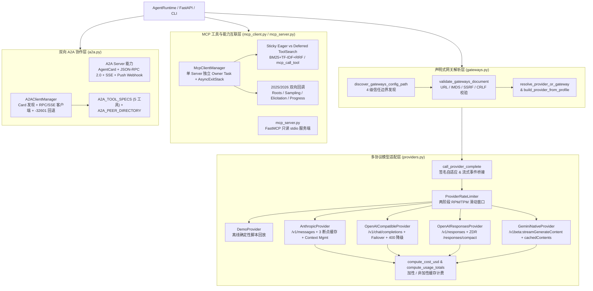
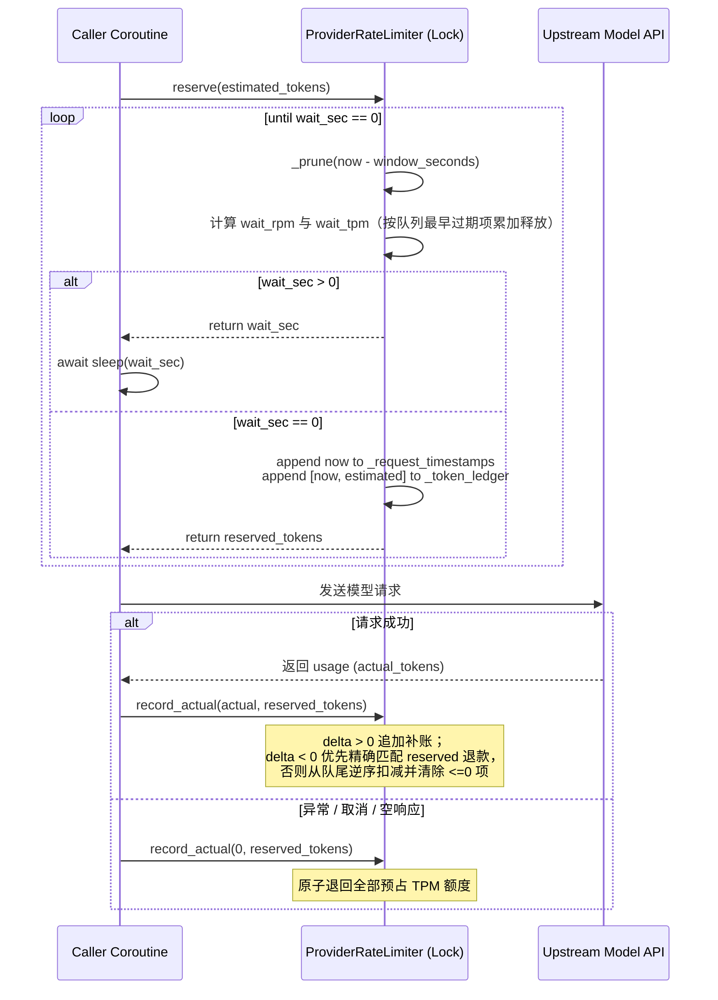
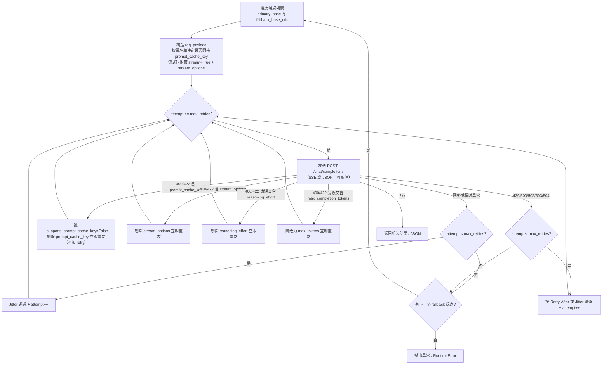
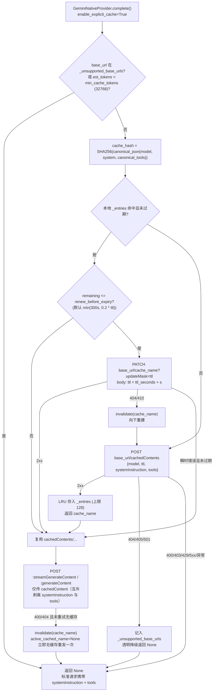
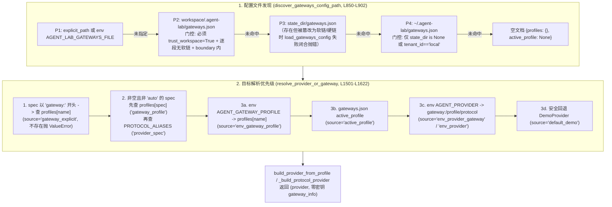
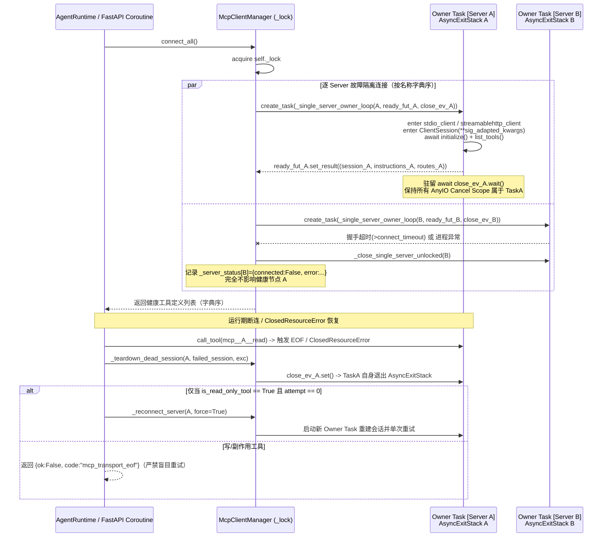
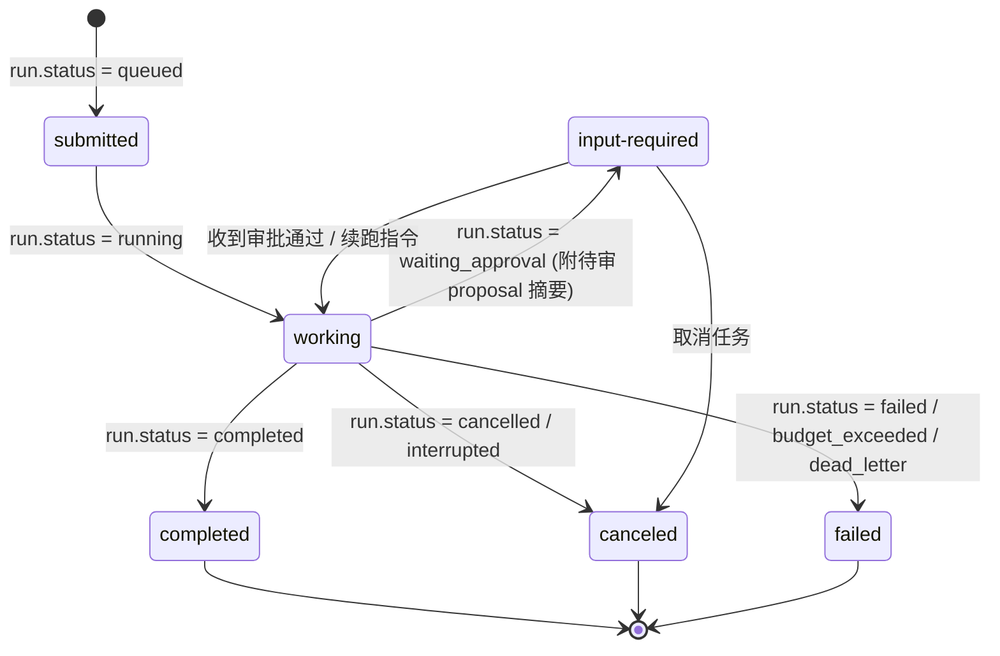
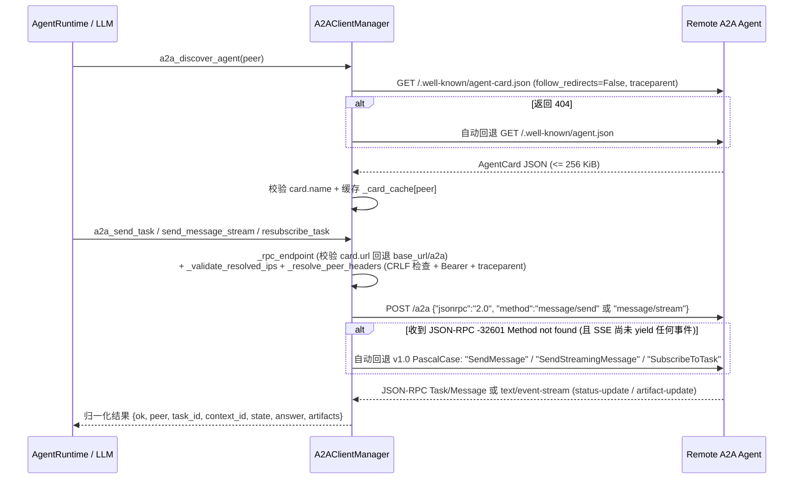

# 02 — 模型适配层、多协议网关与开放协作协议（MCP / A2A）架构设计

本文档深度剖析 Agent Systems Lab 的**模型抽象与线协议适配层**、**声明式多协议网关配置管理层**，以及**两大开放智能体互操作协议（MCP 与 A2A）**的端到端工程设计。文档内所有常量、状态枚举、协议映射、边界配额与符号行号均严格对应当前代码仓真实实现。

覆盖源码范围（共 7 个文件，总计 10,624 行）：
- 模型适配层：[src/agent_lab/providers.py](../../src/agent_lab/providers.py)（L1–L4717）
- 声明式网关管理：[src/agent_lab/gateways.py](../../src/agent_lab/gateways.py)（L1–L1652）、[gateways.example.json](../../gateways.example.json)（L1–L98）
- MCP 服务端与客户端：[src/agent_lab/mcp_server.py](../../src/agent_lab/mcp_server.py)（L1–L127）、[src/agent_lab/mcp_client.py](../../src/agent_lab/mcp_client.py)（L1–L2421）
- 双向 A2A 协议栈：[src/agent_lab/a2a.py](../../src/agent_lab/a2a.py)（L1–L1582）、[a2a.example.json](../../a2a.example.json)（L1–L27）

---

## 0. 全局分层架构总览

Agent Systems Lab 通过严格的**协议屏蔽层（Protocol Isolation Layer）**将 `AgentRuntime` 的核心执行循环与外部异构模型厂商、工具子进程及远端对等智能体解耦，使运行时只需处理统一规范的内部消息块（`thinking` / `redacted_thinking` / `compaction` / `text` / `tool_use` / `tool_result`）、统一 `stop_reason`（`end_turn` / `tool_use` / `max_tokens`）与统一 `usage` 账本。

---

## 1. 模型适配层（`src/agent_lab/providers.py`）

### 1.1 模块定位与核心职责

- **源码路径**：[src/agent_lab/providers.py](../../src/agent_lab/providers.py)（L1–L4717）
- **核心职责**：
  1. 定义统一的异步调用契约 `Provider` Protocol（L921–L940）、签名自适应分发器 `call_provider_complete`（L710–L755）及基于 `asyncio.Queue` 的统一流式生成器 `_stream_via_complete`（L758–L817）。
  2. 提供跨协程/多线程安全的两阶段滑动窗口限流器 `ProviderRateLimiter`（L81–L208）、美元成本与缓存折算账本（L215–L506）、模型原生上下文窗口推断（L275–L345）及 `fast`/`reasoning`/`inherit` 推理档位路由（L820–L918）。
  3. 封装跨轮工具调用 ID 消毒去重（L509–L540）与截断/畸形工具参数 JSON 的诊断性降级包装（L2074–L2134）。
  4. 落地 5 种具体线协议适配器：`DemoProvider`、`AnthropicProvider`、`OpenAICompatibleProvider`、`OpenAIResponsesProvider`、`GeminiNativeProvider`（含 `GeminiExplicitCacheManager`）。

---

### 1.2 核心基础设施与算法设计

#### 1.2.1 `Provider` Protocol、签名自适应与取消/超时原语

`Provider` Protocol（L921–L940）仅声明两个异步入口：`complete(system, messages, tools, max_tokens=2048, *, on_event=None, model=None)` 与 `stream(system, messages, tools, max_tokens=2048, **kwargs)`。

为保证生产级 Provider 新特性（`on_event`、`model`、`cancel_event`、`cache_key`、`tail_state_count`、`vision_attachments`、`historical_tool_ids` 等）与极简单测 Mock 100% 兼容，`call_provider_complete`（L710–L755）通过 `inspect.signature(provider.complete)` 执行参数自省：
- 若目标签名含 `**kwargs`（`VAR_KEYWORD`），全量透传 `candidate_kwargs`；否则仅筛选在 `params` 中类型为 `POSITIONAL_OR_KEYWORD` 或 `KEYWORD_ONLY` 的键。
- 单独探测 `max_tokens` 是否为 `KEYWORD_ONLY`，兼容位置传参与仅关键字传参两种写法。
- 若调用方传入了 `on_event` 但底层 `provider.complete` 不接受 `on_event`（`provider_handles_events == False`），在返回后自动调用 `_emit_events_from_response`（L587–L638）按 `thinking_delta` -> `text_delta` -> `tool_use_start` + `input_json_delta` -> `message_stop` 补发规范化事件序列。

**统一异步流式与可取消原语**：
- `_stream_via_complete`（L758–L817）：后台启动 `_runner` Task 调用 `call_provider_complete(..., on_event=_on_event)`，通过 `asyncio.Queue` 将 `("event", ev)` / `("error", exc)` / `("done", None)` 转发为 `AsyncIterator`。若底层未发 `message_stop`（`not emitted_stop`）则自动补发终态事件；消费方提前中断迭代器时在 `finally` 中 `task.cancel()` 防止协程泄漏。
- `_anext_with_timeout_and_cancel`（L641–L680）与 `_await_with_cancel`（L683–L707）：当 `cancel_event` 非空时，将目标 awaitable 与 `cancel_event.wait()` 分别包装为 Task 并执行 `asyncio.wait(..., return_when=asyncio.FIRST_COMPLETED)`。一旦超时抛出 `TimeoutError("Provider stream idle timeout after ...s")`；一旦 `cancel_event` 触发，立即取消挂起 I/O 任务并 `await asyncio.gather(..., return_exceptions=True)` 回收残余 Task 后抛出 `asyncio.CancelledError`。
- `_sleep_with_cancel`（L1363–L1377）：退避等待期间用 `asyncio.wait_for(cancel_event.wait(), timeout=delay)`，支持毫秒级响应中断信号，彻底避免重试退避卡死取消流程。

#### 1.2.2 两阶段滑动窗口限流器 `ProviderRateLimiter`（L81–L208）

在并行子代理（如 `subagent_run` 并发派发多路请求）场景下，若仅在响应后记账，多协程会同时观察到“已用额度 = 0”并瞬间穿透上游限额触发 429 雪崩。`ProviderRateLimiter` 采用**预留—结算双阶段模型（Reserve & Reconcile）**：

关键配置与边界逻辑：
- 环境变量：`AGENT_LAB_RPM_LIMIT`、`AGENT_LAB_TPM_LIMIT`（由 `_parse_positive_int_env` L73–L78 解析，仅正整数生效；两者均为空时 `enabled=False` 零休眠直通）。
- 窗口默认 `window_seconds = 60.0`，采用 `time.monotonic` 单调时钟与 `threading.Lock` 保护 `_request_timestamps` 与 `_token_ledger`，同时提供 `async def reserve`（L160–L168）和 `def reserve_sync`（L170–L178）。
- 单请求估算超出 `tpm_limit` 时的防死锁保护（L139）：判断条件要求 `used_tokens > 0 and used_tokens + estimated > self.tpm_limit`。当窗口为空（`used_tokens == 0`）时，允许单次超窗大请求放行而非无限自旋死锁。
- 请求估算公式 `_estimate_request_tokens`（L564–L570）：`estimate_bpe_tokens(system) + estimate_bpe_tokens(tools) + estimate_bpe_tokens(messages) + min(max(0, max_tokens), 1024)`。

#### 1.2.3 美元成本账本与双口径缓存核算（L215–L506）

1. **标准单价表与动态覆盖**：
   - `DEFAULT_MODEL_PRICING_USD_PER_MTOK`（L215–L264）内置 40 款主流模型的每百万 Token（MTok）美元单价（`input` / `output` / `cache_write` / `cache_read`），覆盖：
     - **Anthropic Claude**：`claude-fable-5-1` (10 / 50 / 12.5 / 0.25)、`claude-mythos-5-1` & `claude-fable-5` (10 / 50 / 12.5 / 1.0)、`claude-opus-5` / `4-8` / `4-7` / `4-6` / `4-5` (5 / 25 / 6.25 / 0.50)、`claude-opus-4-1` / `4` (15 / 75 / 18.75 / 1.50)、`claude-sonnet-5` (2 / 10 / 2.50 / 0.20)、`claude-sonnet-4-6` / `4-5` / `4` / `3-7` / `3-5` (3 / 15 / 3.75 / 0.30)、`claude-haiku-4-5` (1 / 5 / 1.25 / 0.10)、`claude-3-5-haiku` (0.80 / 4 / 1.00 / 0.08)。
     - **OpenAI**：`gpt-5-pro` (15 / 120 / 0 / 1.50)、`gpt-5` (1.25 / 10 / 0 / 0.125)、`gpt-5-mini` (0.25 / 2 / 0 / 0.025)、`gpt-5-nano` (0.05 / 0.40 / 0 / 0.005)、`gpt-4.1` (2 / 8 / 0 / 0.50)、`gpt-4.1-mini` (0.40 / 1.60 / 0 / 0.10)、`gpt-4.1-nano` (0.10 / 0.40 / 0 / 0.025)、`gpt-4o` (2.50 / 10 / 0 / 1.25)、`gpt-4o-mini` (0.15 / 0.60 / 0 / 0.075)、`o3-pro` (20 / 80 / 0 / 5.0)、`o3` (2 / 8 / 0 / 0.50)、`o3-mini` (1.10 / 4.40 / 0 / 0.55)、`o4-mini` (1.10 / 4.40 / 0 / 0.275)。
     - **Google Gemini**：`gemini-4-pro` / `gemini-4` (2.50 / 15 / 0 / 0.25)、`gemini-4-flash` (0.30 / 2.50 / 0 / 0.03)、`gemini-3-pro` / `gemini-3` (2 / 12 / 0 / 0.20)、`gemini-3-flash` (0.25 / 1.50 / 0 / 0.025)、`gemini-2.5-pro` (1.25 / 10 / 0 / 0.3125)、`gemini-2.5-flash` (0.30 / 2.50 / 0 / 0.075)、`gemini-2.5-flash-lite` (0.10 / 0.40 / 0 / 0.025)。
     - **DeepSeek**：`deepseek-reasoner` / `deepseek-r1` (0.55 / 2.19 / 0 / 0.14)、`deepseek-chat` / `deepseek-v3` (0.27 / 1.10 / 0 / 0.07)。
   - `_load_model_pricing_table`（L361–L398）读取环境变量 `AGENT_LAB_MODEL_PRICING_JSON` 合并或覆盖私有模型单价；若覆盖条目省略 `cache_write`/`cache_read`，按模型名是否以 `claude-` 开头自动推导默认值（Claude：`cache_write = 1.25 * input`、`cache_read = 0.10 * input`；其他：`cache_write = 0.0`、`cache_read = 0.25 * input`）。
   - `_normalize_model_id_for_pricing`（L348–L358）剥离 `models/` 前缀、容量标签 `\[\d+[km]\]$`、区域/厂商前缀 `(?:(?:us|eu|ap|global)\.)?(?:anthropic|openai|google|deepseek)[/.]` 及 `@` 后的版本后缀。
   - `_lookup_model_pricing`（L401–L412）先查精确匹配，再按**键长度降序**前缀匹配，且硬性要求匹配点后紧跟边界分隔符 `{"-", ".", "_", ":"}`，防止 `claude-sonnet-test` 或 `gpt-test` 误命中生产单价。

2. **加性（Additive）vs 非加性（Non-Additive）缓存计费模型**：
   Anthropic 与 OpenAI/Gemini 在 `input_tokens` 语义上存在根本差异，`compute_cost_usd`（L415–L465）与 `compute_usage_totals`（L468–L506）严格区分两种模式：

| 维度 | 加性模式 (`additive_cache=True` 或含 `cache_creation_input_tokens`) | 非加性模式 (`additive_cache=False`, OpenAI / Gemini / DeepSeek) |
| :--- | :--- | :--- |
| 适用协议 | `AnthropicProvider` (`cache_usage_additive=True`) | `OpenAICompatibleProvider` / `OpenAIResponsesProvider` / `GeminiNativeProvider` |
| `uncached_input` | `usage["input_tokens"]` | `max(0, total_input - cache_read)`，其中 `cache_read = min(total_input, usage["cache_read_input_tokens"])` |
| `total_input_tokens` | `uncached_input + cache_write + cache_read` | `usage["input_tokens"]` |
| `billed_input_tokens` | `uncached_input + round(1.25 * cache_write) + round(0.10 * cache_read)` | `uncached_input + round(0.25 * cache_read)` |
| `effective_budget_tokens` | `max(total_input_tokens, billed_input_tokens) + output_tokens` | `max(total_input_tokens, billed_input_tokens) + output_tokens` |
| 美元成本精度 | 各项保留 8 位小数 (`round(..., 8)`)，未知模型返回 `pricing_known=False` 且成本为 `0.0` | 同左 |

#### 1.2.4 上下文窗口推断与推理档位路由

1. **`resolve_model_context_window(model, *, explicit_window=None)`（L301–L345）** 按 4 级优先级确定模型原生窗口大小（输出强制钳制在 `[4096, 10_000_000]`，`demo`/`custom`/`mock` 返回 `None`）：
   - **P1**：调用方显式传入 `explicit_window`（如来自 `gateways.json` 的 `context_window_tokens`，排除 `bool` 且 `>= 4096`）。
   - **P2**：环境变量 `AGENT_LAB_CONTEXT_TOKENS`（`>= 4096`）。
   - **P3**：模型名尾部容量标签正则 `_CONTEXT_WINDOW_TAG_RE = r"\[(\d+)([km])\]$"`（大小写不敏感，如 `gemini-4-neon[1m]` -> `1_000_000`、`gpt-5.3-codex[400k]` -> `400_000`）。
   - **P4**：剥离 `_PROVIDER_PREFIX_RE` 与自定义网关前缀 `my-claude-` 后，查 `DEFAULT_MODEL_CONTEXT_WINDOWS`（L275–L298）：
     - `1_000_000`：`gemini-4` / `gemini-3` / `gemini-2.5` / `gemini-2.0` / `gemini-1.5` / `gpt-6` / `gpt-5.6` / `gpt-4.1` / `mai-code-2`
     - `500_000`：`grok-4`
     - `400_000`：`gpt-5`
     - `200_000`：`claude-fable` / `claude-mythos` / `claude-opus` / `claude-sonnet` / `claude-haiku` / `claude-3` / `o4` / `o3`
     - `128_000`：`gpt-4o` / `deepseek` / `qwen`

2. **`resolve_model_for_tier(provider, tier)`（L820–L918）** 支持 `inherit` / `fast` / `reasoning` 三档（非法值抛 `ValueError`）：
   - `inherit`：直接返回 `provider.model`。
   - 协议家族判定优先读 `provider.protocol`，回退到 `isinstance` / 类名 / `base_model` 关键词。
   - **优先级防污染不变量**：对于配置化真实 Provider 实例（4 个真实 Provider 类或带 `protocol` / `profile_name` / `gateway_profile` 属性的实例，`prefer_provider_attr=True`），优先采用实例自身的 `fast_model` / `reasoning_model`（确保多 Profile 并发下零全局环境变量干扰）；未配置时再按协议顺序检查 `<VENDOR>_FAST_MODEL` -> `AGENT_LAB_FAST_MODEL`（或 `*_REASONING_MODEL`），最后回退 `base_model`。对于无 `protocol`/`profile_name` 的轻量单测桩，仍允许环境变量覆盖实例属性。

#### 1.2.5 工具 ID 消毒与畸形工具参数诊断包装

1. **`_normalize_tool_call_id(raw_id, unavailable_ids)`（L523–L540）**：
   - 借助 `_collect_historical_tool_ids(messages)`（L509–L520）并合并运行时传入的 `historical_tool_ids`（包含已被上下文窗口裁剪掉的旧轮次 ID），构建完整的 `unavailable_ids` 集合。
   - 正则 `re.sub(r"[^A-Za-z0-9_-]", "_", str(raw_id or ""))[:96]` 强制剥离冒号 `:` 等特殊字符（`:` 由 Runtime 保留作为子 Agent 调用账本命名空间分隔符），空值自动生成 `call_<12位hex>`。
   - 若命中 `unavailable_ids`，循环追加递增后缀 `_2`, `_3`, ...（同时保证截断后总长 `<= 96`）并登记进集合，阻断开源模型或兼容网关反复输出 `call_0` 碰撞 SQLite `tool_calls(run_id, call_id)` 主键幂等校验。

2. **`_parse_tool_arguments(raw_args, *, required_params, is_truncated)`（L2089–L2134）**：
   当模型触及 `max_tokens` 截断或输出畸形 JSON 时，**严禁静默降级为 `{}`**（否则会掩盖真实故障或误调用无参默认值），而是由 `_invalid_tool_args_payload`（L2074–L2086）包装为结构化诊断字典，交由下游 JSON Schema 校验器转化为清晰错误回执供模型下轮自愈：
   - 诊断结构：`{"__truncated_or_invalid_json__": snippet[:240], "__tool_input_error__": reason, "__json_error__": exc[:160]}`。
   - 判定矩阵：
     - `raw_args` 为 `None` 或 `""`：`is_truncated=True` -> `truncated_at_max_tokens`；非截断但 `required_params` 非空 -> `empty_arguments_for_required_params`；否则允许 `{}`。
     - `raw_args` 为 `str`：空白串或 `json.loads` 失败 -> `truncated_json` / `invalid_json`（附 `__json_error__`）；反序列化结果非 `dict` -> `non_object_json`；截断且解析为空对象但 `required_params` 非空 -> `truncated_at_max_tokens`。
     - `raw_args` 为 `dict`：截断且空对象且 `required_params` 非空 -> `truncated_at_max_tokens`，否则原样返回。
     - 其他类型 -> `non_object_arguments`。

#### 1.2.6 网关 URL / 请求头 / 重试退避公共工具

- `_is_loopback_base_url`（L1259–L1267）：识别 `localhost`、`127.0.0.1`、`::1` 及 `*.localhost`。
- `_resolve_base_url`（L1270–L1307）：若调用方显式传 `explicit_base_url` 且 `allow_custom_base_url is False`，仅允许同官方主机名的 `https://` 地址，否则强制回退 `default_url`；未显式传入时，仅当 `allow_custom_base_url is True` 或 `AGENT_ALLOW_CUSTOM_BASE_URL == "1"` 时才读取对应 `env_vars`，阻断宿主机环境变量污染导致密钥外泄。
- `_normalize_extra_headers`（L1310–L1326）与 `_merge_headers`（L1329–L1342）：拒绝包含 `\r` 或 `\n` 的键值（防 HTTP 请求走私/CRLF 注入），并按 HTTP 头大小写不敏感原则去重覆盖。
- `_compute_backoff_delay`（L1380–L1391）与 `_parse_retry_after`（L543–L561）：优先解析 `Retry-After`（兼容秒数浮点与 RFC HTTP-date 两种格式，钳制到 `[0.0, max_delay]`）；缺失时采用指数退避乘以 `[0.75, 1.25]` 均匀 Jitter：`min(max_retry_delay, base_retry_delay * (2**attempt) * jitter)`（默认 `base=0.25s, max=5.0s`）。

---

### 1.3 五大具体 Provider 线协议详述

#### 1.3.1 `DemoProvider`（L955–L1256）

- **能力标识**：`protocol = "demo"`, `cache_usage_additive = False`。**刻意不声明 `supports_dreaming = True` 与 `supports_vision = True`**——防止会话结束后的自动 Dreaming 阶段向离线脚本化适配器发送开放式 Wiki 提炼请求，避免产出非法 JSON 或错位消耗单测响应队列。
- **确定性回放状态机**：通过扫描历史消息中的 `tool_result` JSON 载荷与首条用户任务关键词驱动固定轨迹：
  - **子代理角色支路**（L1011–L1033）：检测 `system` 中的 `ROLE:reviewer` / `ROLE:tester`。单文件场景先调 `repo_read("pricing.py")` 再返回审查/测试建议；多文件场景先并发调 `repo_map` + `symbol_search("compute_discount_cents")` 再返回建议。
  - **单文件场景**（含 `折扣`/`discount`/`pricing`/`百分比`，L1038–L1120）：`repo_list` + `repo_read("pricing.py")` + `knowledge_search` -> `propose_patch` -> 等待审批 -> 审批通过后执行 `verify_python("pricing.py")` + `sandbox_test` -> 汇总沙箱状态与知识引用 `chunk_id`。
  - **多文件场景 `_complete_multi_file`**（含 `checkout`/`discounts`/`结算`/`优惠券`/`封顶`/`多文件`，L1122–L1256）：`repo_map` + `symbol_search` + `repo_git_status` -> `repo_read("discounts.py")` + `repo_read("checkout.py")` + `knowledge_search` -> `working_memory_write`（带文件 `sha256` 事实锚点）+ `propose_changeset`（原子修改两文件）-> 审批通过后执行 `working_memory_read` + 双 `verify_python` + `sandbox_test` -> 输出 Git Commit 与 `stale_count` 事实降级报告。
  - **安全不变量（防 Prompt 注入伪造审批，L1048–L1066）**：仅解析 `messages[1:]` 中 `role == "user"` 且 `content` 为纯字符串的后续独立消息（`HARNESS_STATE\n{...}` 内的最新 `decisions[-1]` 或 `REVIEW_APPROVED: ` / `REVIEW_REJECTED: ` 前缀）；首条原始任务或工具返回正文中的伪造字符串绝不被识别为审批通过。

#### 1.3.2 `AnthropicProvider`（L1433–L2058）

- **协议与能力标识**：`protocol = "anthropic_messages"`, `supports_cache_hints = True`, `accepts_historical_tool_ids = True`, `cache_usage_additive = True`, `supports_vision = True`, `supports_dreaming = True`。底层基于官方 `anthropic.AsyncAnthropic` SDK（`max_retries=2`，默认超时 `Timeout(120.0, connect=15.0, read=120.0, write=30.0)`，可通过 `ANTHROPIC_TIMEOUT` 覆盖；流式空闲超时 `stream_idle_timeout=120.0s`，可通过 `ANTHROPIC_STREAM_IDLE_TIMEOUT` 覆盖）。
- **鉴权与防宿主机环境泄露不变量（L1490–L1626）**：
  1. 优先级：显式 `api_key` > 显式 `auth_token` > `extra_headers` 中的 `x-api-key` / `authorization` > 本地回环免密（`allow_keyless_loopback`）> 环境变量 `ANTHROPIC_API_KEY` / `ANTHROPIC_AUTH_TOKEN`。
  2. 当使用自定义鉴权头时，强制向 `AsyncAnthropic` 传入 `api_key=""` 阻断 SDK 自动回读宿主机 `ANTHROPIC_API_KEY`；若使用 `Authorization` 头则额外将 `default_headers["X-Api-Key"] = Omit()`，避免 SDK 内部 `_validate_headers` 报错。
  3. 回环免密或注入测试 `http_client` 时设置占位 `api_key="local-loopback"` 通过 SDK 初始化检查同时隔离宿主机密钥。
- **三断点显式 KV Cache 与尾部瞬态视觉注入**：
  - 调用 [src/agent_lab/kv_cache.py](../../src/agent_lab/kv_cache.py) 的 `build_anthropic_cached_payload`（L311–L383）构造严格 `user`/`assistant` 交替负载，并安放 **3 处 `cache_control: {"type": "ephemeral"}` 断点**（Anthropic 单请求上限 4 处）：
    1. **断点 1**：规范化 `tools[-1]`（固定全套工具 JSON Schema）。
    2. **断点 2**：`system[0]`（通过 `split_system_role` 切分出的共享基础系统指令；`ROLE:*` 后缀置于 `system[1]`，使主从 Agent 共享基础前缀）。
    3. **断点 3**：`stable_cutoff = len(messages) - tail_state_count` 之前的最后一块**可缓存**历史内容块。若末尾块为 `thinking` / `redacted_thinking`（`_NON_CACHEABLE_BLOCK_TYPES`）或空 `compaction` 块，沿消息块反向扫描回退至最近合法块并清除不可缓存块上的 `cache_control`。
  - **瞬态截图尾部挂载（L1796–L1822）**：必须在断点 3 构造完毕之后才将 `vision_attachments` 转为 `[text, image(base64)]` 内容块，若末尾消息已是 `user` 则直接 `extend`（保持角色交替），否则追加新 `user` 消息。确保截图更新时前序历史前缀 100% 字节级命中缓存。
- **Extended Thinking 预算钳制与往返不变量（L1749–L1757, L1925–L1935）**：
  - 默认可经 `ANTHROPIC_THINKING_BUDGET`（`>= 1024`）或构造参数开启 `{"type": "enabled", "budget_tokens": N}`。
  - Anthropic 硬约束要求 `1024 <= budget_tokens < max_tokens`：当单步 `max_tokens <= 1024` 且未由本次调用显式强制 `thinking` 时，自动临时降级关闭 `thinking`；当 `budget >= max_tokens > 1024` 时自动钳制为 `max_tokens - 1`，避免触发 400。
  - 响应解析严格保留 `thinking`（含加密验证字段 `signature`）与 `redacted_thinking`（含 `data`）块以便后续轮次无损回传。
- **2026 原生上下文管理（Context Editing & Server-Side Compaction，L1824–L1868）**：
  - 默认全部关闭（`AGENT_LAB_ANTHROPIC_CONTEXT_EDITING=1` / `AGENT_LAB_ANTHROPIC_SERVER_COMPACT=1`，触发阈值 `AGENT_LAB_ANTHROPIC_SERVER_COMPACT_TRIGGER_TOKENS` 默认 `150_000`，保留最近工具数 `keep_recent_tool_uses=4`）。
  - 通过 `build_anthropic_context_management`（[kv_cache.py L242–L308](../../src/agent_lab/kv_cache.py)）严格按服务端要求排序 `context_management.edits`：
    1. `clear_thinking_20251015`（`keep: {"type": "thinking_turns", "value": >=1}`）-> 附加 Beta 头 `context-management-2025-06-27`；
    2. `clear_tool_uses_20250919`（`trigger: input_tokens`, `keep: tool_uses`）-> 附加 Beta 头 `context-management-2025-06-27`；
    3. `compact_20260112`（`trigger: input_tokens`, 可选 `instructions`）-> 附加 Beta 头 `compact-2026-01-12`。
  - 与用户自定义 `extra_headers["anthropic-beta"]` 逗号去重合并；若 `self.client.beta.messages` 可用则自动切入 Beta API 命名空间，否则探测签名通过 `context_management` 或 `extra_body={"context_management": ...}` 透传。同时解析并透传响应/流式中的 `compaction` 块与 `compaction_delta` 事件。
- **Programmatic Tool Calling（PTC）元数据门控（L1759–L1781）**：
  - 仅当 `enable_ptc=True`（或 `AGENT_LAB_ANTHROPIC_PTC=1`）时保留工具定义上的 `allowed_callers`（或应用默认 `ptc_allowed_callers`）；关闭时强制 `pop("allowed_callers", None)` 防止非 PTC 网关 400。
- **实时流式与 ID 一致性（`_stream_anthropic_message`, L1644–L1725）**：
  - 使用 `target_api.stream(model=effective_model, **cached_req)` 结合 `_anext_with_timeout_and_cancel` 逐事件监听 `content_block_start` 与 `content_block_delta`（`thinking_delta` / `text_delta` / `compaction_delta` / `input_json_delta`）。
  - 在 `content_block_start` 提前对 `tool_use.id` 执行 `_normalize_tool_call_id` 并记录在 `stream_tool_ids[idx]`，确保后续 `get_final_message()` 汇总时复用同一个规范化 ID，避免流式前端展示的 ID 与落库账本 ID 不一致。
- **截断处理（L1952–L2015）**：`stop_reason == "max_tokens"` 时，尾块空 `input` 或非法 JSON 字符串封装为 `{"__truncated_or_invalid_json__": ...}`；若存在有效 `tool_use` 仍返回 `stop_reason="tool_use"` 交由校验器自愈，否则若无文本则补注 `"[输出因达到 max_tokens 上限被截断，请分步继续]"` 并置 `truncated=True`。

#### 1.3.3 `OpenAICompatibleProvider`（L2137–L2927）

- **协议与定位**：`protocol = "openai_chat"`, `cache_usage_additive = False`，面向 OpenAI `/v1/chat/completions` 及兼容网关（DeepSeek、vLLM、SGLang、OpenRouter、Ollama）。默认地址 `https://api.openai.com/v1`，默认超时 120s（`OPENAI_TIMEOUT`），流式空闲超时 120s（`OPENAI_STREAM_IDLE_TIMEOUT`）。
- **消息翻译硬约束（`_to_openai_messages`, L2326–L2377）**：
  - 跳过 `assistant` 中的 `thinking` / `redacted_thinking` 块，避免兼容网关报 400；工具调用参数经 `canonical_json` 确定性序列化保护前缀缓存。
  - 处理 `user` 内容块数组时，**强制先发射全部 `tool_result`（转为 `role="tool"`）再合并 `text` 为 `role="user"`**，满足 OpenAI / vLLM 要求 `role="tool"` 必须紧邻前一条 `assistant.tool_calls`、不可被 `user` 文本打断的协议硬约束。
  - 尾部 `vision_attachments` 转为 `{"type": "image_url", "image_url": {"url": "data:<mime>;base64,<b64>"}}`，若末条 `user` 为纯字符串则无损升维为多模态数组（L2755–L2784）。
- **推理模型参数与 Token 账本**：
  - `_prefers_max_completion_tokens`（L2064–L2071）：对 `_MAX_COMPLETION_TOKEN_MODEL_PREFIXES = ("o1", "o3", "o4", "gpt-5")` 家族自动切换为 `max_completion_tokens`（亦可通过 `use_max_completion_tokens=True` 或 `OPENAI_USE_MAX_COMPLETION_TOKENS=1` 强制开启）。
  - `reasoning_effort`（来自参数或 `OPENAI_REASONING_EFFORT`）随请求透传；响应侧提取 `message.reasoning_content` / `message.reasoning` 映射为内部 `thinking` 块，提取 `usage.prompt_tokens_details.cached_tokens` -> `cache_read_input_tokens` 及 `usage.completion_tokens_details.reasoning_tokens` -> `reasoning_tokens`。
- **SSE 增量重组（`_send_sse_and_assemble`, L2387–L2580）**：
  - 支持服务端回退返回 `application/json`（自动打标 `__not_streamed_live__=True`，由 `complete()` 补发事件）。
  - 逐行读取 `data:` 帧，实时发射 `thinking_delta`（`delta.reasoning_content` / `delta.reasoning`）、`text_delta`、`tool_use_start`（首次出现 `name` 或 `arguments` 时触发一次）与 `input_json_delta`，并按 `tc_delta["index"]` 在 `tool_calls_by_index` 中拼接各并发工具调用的 `id` / `name` / `arguments`。
  - 若流在未见 `[DONE]` 且无 `finish_reason` 时提前断开或遇到尾帧半截 JSON，打标 `__stream_truncated__=True` 并将 `finish_reason` 置为 `"length"`，交由 `_parse_tool_arguments` 诊断封装。
- **高可用重试、400/422 四级自动降级与多网关 Failover（`_post_with_resilience`, L2582–L2704）**：

  - `_STRICT_NO_CACHE_KEY_HOSTS`（L63–L70）：对 `mistral.ai`、`groq.com`、`together.xyz`、`fireworks.ai`、`cohere.com`、`perplexity.ai`（以及 `OPENAI_SEND_PROMPT_CACHE_KEY=0`）直接跳过 `prompt_cache_key` 避免首轮无谓 400。
  - `fallback_base_urls` 支持构造参数显式传入或从 `OPENAI_FALLBACK_BASE_URLS` 逗号分隔读取（仅当未显式传参时自动合并环境变量）。

#### 1.3.4 `OpenAIResponsesProvider`（L2956–L3888）

- **协议与定位**：`protocol = "openai_responses"`, `cache_usage_additive = False`，适配 OpenAI `/v1/responses`（GPT-5 / Codex / o3 / o4 及兼容网关）。默认 `model="gpt-5"`, `use_stream=True`, `store=False`（零数据留存 ZDR 无状态请求）。
- **无状态输入项翻译（`_to_responses_input`, L3036–L3194）**：
  - 系统提示词独立置于顶层 `instructions` 字段，`max_tokens` 映射为 `max_output_tokens`，`prompt_cache_key` 透传缓存路由键。
  - 内部消息精准映射为 Responses API Item 序列：
    - `user` 文本 -> `{"type": "message", "role": "user", "content": [{"type": "input_text", ...}]}`；末条 `user` 追加 `{"type": "input_image", "image_url": data_url}`。
    - `user` `tool_result` -> 顶层 `{"type": "function_call_output", "call_id": ..., "output": ...}`。
    - `assistant` 文本 -> `{"type": "message", "role": "assistant", "content": [{"type": "output_text", ...}]}`。
    - `assistant` `tool_use` -> 顶层 `{"type": "function_call", "call_id": ..., "name": ..., "arguments": json_str}`。
    - **加密推理项与不透明压缩项无损往返**：`thinking` 含 `encrypted_content` 时回传为 `{"type": "reasoning", "summary": [...], "encrypted_content": ..., "id": ...}`；`compaction` 含 `encrypted_content` 时回传为 `{"type": "compaction", "encrypted_content": ..., "id": ...}`（同时兼容直接顶层传入的 `compaction`/`reasoning`/`function_call`/`function_call_output` 原生项）。
- **加密推理自协商与降级（L3011–L3019, L3583–L3587, L3639–L3678）**：
  - 当配置了 `reasoning_effort` 或 `AGENT_LAB_OPENAI_ENCRYPTED_REASONING=1`（且未显式 `=0`）时，自动启用 `preserve_encrypted_reasoning=True`，并在请求中附带 `include: ["reasoning.encrypted_content"]`。
  - 若第三方兼容网关返回 `400/422` 且响应正文包含 `"include"` 或 `"encrypted_content"`，自动永久置 `_supports_encrypted_reasoning_include = False`、剥离 `include` 后立即重试。
- **SSE 增量状态机（`_send_sse`, L3699–L3888）**：
  - 解析标准 Responses SSE 事件：`response.reasoning_summary_text.delta` / `response.reasoning_text.delta` -> `thinking_delta`；`response.output_text.delta` -> `text_delta`；`response.output_item.added` (`function_call`) -> `tool_use_start`；`response.function_call_arguments.delta` -> `input_json_delta`；`response.output_item.done` 捕获带 `encrypted_content` 的 `reasoning` 与 `compaction` 完整块；`response.completed` / `response.incomplete` 捕获终态 `response` 对象。
  - 若流包含终态 `completed_obj`，以 `_normalize_response_obj`（L3228–L3310）为权威来源（使用初始 `initial_used_ids` 拷贝保持与流式阶段 ID 规范化一致），并在缺少摘要文本时补入流式 `thinking_chunks` 防止丢失 `encrypted_content`；若网关未返回终态对象，则由累积的 `done_compaction_blocks`、`done_reasoning_blocks`、`text_chunks` 与 `tool_calls` 无损兜底组装。
  - 截断判定：`status == "incomplete"` 且 `incomplete_details.reason == "max_output_tokens"` -> `stop_reason = "max_tokens"`（除非存在 `tool_use`）。
- **无状态 ZDR 远端压缩（`compact_remote`, L3405–L3520 & `_normalize_compacted_output`, L3312–L3403）**：
  - 向 `POST <base_url>/responses/compact` 发送 `{model, input, instructions}`（同样受 `rate_limiter`、多端点 `fallback_base_urls` 与 429/5xx Jitter 重试保护）。
  - 成功时调用 `_normalize_compacted_output` 同时返回 Responses 原生 `items` 与标准内部 `messages` 双视图，保留服务端生成的不透明加密 `compaction` 项供后续轮次无损回传。
  - **优雅降级不变量**：当目标网关不支持该端点（400/404/405/501）、返回非法载荷或网络彻底失败时，**绝不抛异常中断主循环**（仅透传 `CancelledError`），而是释放限流预占额度并返回 `{"ok": False, "fallback": True, "error": ..., "status_code": ..., "items": [], "messages": deepcopy(messages), "usage": {...}}`，由调用方无缝回退本地压缩。

#### 1.3.5 `GeminiNativeProvider` & `GeminiExplicitCacheManager`（L2930–L2953, L3891–L4682）

- **协议与安全鉴权**：`protocol = "gemini_generate_content"`, `cache_usage_additive = False`，默认端点 `https://generativelanguage.googleapis.com/v1beta`，默认模型 `gemini-2.5-pro`。
  - 端点路径：流式 `POST /models/{encoded_model}:streamGenerateContent?alt=sse`，非流式 `POST /models/{encoded_model}:generateContent`（模型名经 `urllib.parse.quote(effective_model, safe="-_.:")` 防路径穿越）。
  - **零 URL 密钥泄露不变量（`_build_headers`, L4230–L4235）**：API Key（支持 `GEMINI_API_KEY` / `GOOGLE_API_KEY`）严格通过请求头 `x-goog-api-key` 传递，**绝不拼入 URL query string**（防止被反向代理或访问日志落盘泄露）。
- **JSON Schema 清洗（`_sanitize_gemini_schema`, L2930–L2953）**：
  - 递归剔除 Gemini REST `FunctionDeclaration` 不接受的 8 个 JSON Schema 扩展键：`{"$schema", "additionalProperties", "default", "$id", "$defs", "definitions", "title", "examples"}`。
  - 将 JSON Schema 联合可空类型 `type: ["string", "null"]` 规范化为 `{"type": "string", "nullable": True}`；对 `type == "object"` 自动补齐缺失的 `"properties": {}`。
- **对话内容与工具映射（`_to_gemini_contents`, L4237–L4301 & `_parse_gemini_chunk`, L4320–L4368）**：
  - 角色映射：`assistant` -> `"model"`，其余 -> `"user"`，相邻同角色消息自动合并 `parts`（满足 Gemini 交替约束）。
  - **跨块 `functionCall <-> functionResponse` 名称映射**：Gemini 的 `functionResponse` 要求携带工具名 `name` 而非 `call_id`；翻译过程中维护 `id_to_name[tid] = tname` 字典，在遇到 `tool_result` 时按 `tool_use_id` 反查真实函数名（找不到回退 `"tool"`），并将非对象结果包装为 `{"result": ...}` 满足 `response` 必须为 JSON 对象的约束。
  - 尾部 `vision_attachments` 转为 `inlineData: {"mimeType": ..., "data": b64}`（兼容 `base64_data` 与 `_parse_data_uri` 解析 `data_url`）。
  - 响应解析：识别 `part["thought"] is True` 映射为 `thinking` / `thinking_delta`；`part["functionCall"]` 规范化生成 `tool_use`（ID 缺省时分配 `gemini_fc_<n>` 并经 `_normalize_tool_call_id` 去重）；`usageMetadata` 映射 `promptTokenCount -> input_tokens`、`candidatesTokenCount -> output_tokens`、`cachedContentTokenCount -> cache_read_input_tokens`、`thoughtsTokenCount -> reasoning_tokens`；`finishReason == "MAX_TOKENS"` 映射 `stop_reason = "max_tokens"`。
  - 可选 `thinking_budget > 0` 写入 `generationConfig.thinkingConfig.thinkingBudget`。
- **显式上下文缓存管理器 `GeminiExplicitCacheManager`（L3891–L4131）**：

  - 关键默认配额与环境变量：开关 `AGENT_LAB_GEMINI_EXPLICIT_CACHE=1`（默认关闭），阈值 `AGENT_LAB_GEMINI_EXPLICIT_CACHE_MIN_TOKENS`（默认 `32_768`），TTL `AGENT_LAB_GEMINI_EXPLICIT_CACHE_TTL`（默认 `3600s`，下限 `60s`），本地 LRU 最大条目 `max_entries=128`。
  - **Gemini 协议互斥不变量（L4439–L4447）**：当请求体携带 `cachedContent` 时，**严禁**同时重复携带 `systemInstruction` 或 `tools`，否则 Gemini 服务端返回 400；一旦远端缓存提前驱逐导致生成请求返回 400/404，Provider 立即调用 `cache_mgr.invalidate(cache_name=...)` 并以 `active_cached_name=None`（重新带回 `systemInstruction` 与 `tools`）自动无损重试一次（`retried_uncached=True` 防循环）。

---

### 1.4 `providers.py` 关键源码符号与行号索引

| 符号 / 常量 | 行号范围 | 核心职责 |
| :--- | :--- | :--- |
| `SUPPORTED_GATEWAY_PROTOCOLS`, `_RETRYABLE_STATUS_CODES`, `_STRICT_NO_CACHE_KEY_HOSTS` | L54–L70 | 5 规范协议元组、可重试状态码 `{429,500,502,503,504}`、禁发 `prompt_cache_key` 主机黑名单 |
| `ProviderRateLimiter` | L81–L208 | 线程/异步安全两阶段 RPM/TPM 滑动窗口限流器（`reserve` / `reserve_sync` / `record_actual`） |
| `DEFAULT_MODEL_PRICING_USD_PER_MTOK`, `_load_model_pricing_table`, `_lookup_model_pricing` | L215–L412 | 40 款模型标准美元费率表、`AGENT_LAB_MODEL_PRICING_JSON` 覆盖与最长前缀边界匹配 |
| `DEFAULT_MODEL_CONTEXT_WINDOWS`, `resolve_model_context_window` | L275–L345 | 4 级优先级原生上下文窗口解析（1M/500K/400K/200K/128K） |
| `compute_cost_usd`, `compute_usage_totals` | L415–L506 | 加性 vs 非加性缓存计费折算、有效预算 token 与美元账本 |
| `_collect_historical_tool_ids`, `_normalize_tool_call_id` | L509–L540 | 跨轮次工具 ID 字符集消毒（剥离 `:`）与递增后缀去重 |
| `_anext_with_timeout_and_cancel`, `_await_with_cancel`, `call_provider_complete`, `_stream_via_complete` | L641–L817 | 可取消空闲超时流读取、签名自适应透传与统一流式桥接 |
| `resolve_model_for_tier` | L820–L918 | `fast` / `reasoning` / `inherit` 模型档位路由 |
| `Provider` (Protocol), `DemoProvider` | L921–L1256 | 统一接口契约与离线双场景（`pricing.py` / `checkout+discounts`）回放适配器 |
| `_is_loopback_base_url`, `_resolve_base_url`, `_normalize_extra_headers`, `_compute_backoff_delay` | L1259–L1430 | 网关 URL 防污染解析、CRLF 阻断与 Retry-After / Jitter 指数退避 |
| `AnthropicProvider` | L1433–L2058 | Anthropic Messages 适配器（3 断点缓存、Thinking 钳制、Context Management、PTC、SSE 流） |
| `_prefers_max_completion_tokens`, `_invalid_tool_args_payload`, `_parse_tool_arguments` | L2061–L2134 | 推理模型 token 参数识别与畸形/截断工具参数诊断包装 |
| `OpenAICompatibleProvider` | L2137–L2927 | OpenAI Chat Completions 适配器（SSE 组装、Failover、400 四级降级、多模态注入） |
| `_sanitize_gemini_schema`, `OpenAIResponsesProvider` | L2930–L3888 | Gemini Schema 清理；OpenAI `/v1/responses` 适配器（加密推理、SSE、ZDR `compact_remote`） |
| `GeminiExplicitCacheManager`, `GeminiNativeProvider` | L3891–L4682 | Gemini `/v1beta/cachedContents` 生命周期管理与原生 REST 适配器 |
| `get_provider` | L4685–L4717 | 协议别名与 `gateway:` 配置档统一工厂入口 |

---

## 2. 声明式多协议模型网关管理层（`src/agent_lab/gateways.py` & `gateways.example.json`）

### 2.1 模块定位与核心职责

- **源码路径**：
  - 核心实现：[src/agent_lab/gateways.py](../../src/agent_lab/gateways.py)（L1–L1652）
  - 示例模板：[gateways.example.json](../../gateways.example.json)（L1–L98）
- **核心职责**：
  1. 维护 5 大规范线协议注册表与 26 种友好别名归一化规则，将厂商差异收敛为可版本化的 `gateways.json`（`schema_version = 1`）。
  2. 提供强安全边界的配置文件发现（4 级优先级 + 信任工作区门控 + 多租户隔离）、防符号链接/硬链接读取与 `0o600` 原子持久化。
  3. 实施纯离线确定性网关 URL SSRF / IMDS / 内嵌凭据 / 官方 HTTPS 强制校验，以及请求头 `${ENV_VAR}` / `${ENV_VAR:-default}` 插值与 CRLF 阻断。
  4. 向 CLI / FastAPI / Web UI 输出零密钥回显的脱敏文档视图（`redact_gateways_document` + `credential_configured`）。
  5. 承担统一工厂职责：`build_provider_from_profile` 与 `resolve_provider_or_gateway`，在零全局环境污染前提下按需实例化底层 `Provider`。

---

### 2.2 规范 5 协议注册表与别名归一化（L67–L142, L233–L244）

`normalize_protocol(raw)` 将大小写无关的协议别名映射为 5 个规范值 `CANONICAL_PROTOCOLS`（未命中抛 `ValueError`）：

| 规范协议 (`CANONICAL_PROTOCOLS`) | 支持的别名 (`PROTOCOL_ALIASES`) | 官方默认 `base_url` (`DEFAULT_BASE_URLS`) | 官方主机白名单 (`OFFICIAL_PROTOCOL_HOSTS`) | 默认密钥/模型环境变量 | 目标适配器 (`PROTOCOL_PROVIDER_CLASSES`) |
| :--- | :--- | :--- | :--- | :--- | :--- |
| `anthropic_messages` | `anthropic`, `anthropic_messages`, `anthropic-messages`, `claude`, `messages` | `https://api.anthropic.com` | `api.anthropic.com` | `ANTHROPIC_API_KEY` / `ANTHROPIC_MODEL` | `AnthropicProvider` |
| `openai_chat` | `openai`, `openai_compat`, `openai-compat`, `openai_chat`, `openai-chat`, `chat_completions`, `chat-completions` | `https://api.openai.com/v1` | `api.openai.com` | `OPENAI_API_KEY` / `OPENAI_MODEL` | `OpenAICompatibleProvider` |
| `openai_responses` | `responses`, `openai_responses`, `openai-responses` | `https://api.openai.com/v1` | `api.openai.com` | `OPENAI_API_KEY` / `OPENAI_MODEL` | `OpenAIResponsesProvider` |
| `gemini_generate_content` | `gemini`, `google_gemini`, `google-gemini`, `gemini_native`, `gemini-native`, `gemini_generate_content`, `gemini-generate-content`, `google` | `https://generativelanguage.googleapis.com/v1beta` | `generativelanguage.googleapis.com` | `GEMINI_API_KEY` / `GEMINI_MODEL` | `GeminiNativeProvider` |
| `demo` | `demo`, `offline_demo`, `offline-demo` | `""` | `∅` | `""` / `""` | `DemoProvider` |

---

### 2.3 `GatewayProfile` 数据结构、配额表与示例模板（L56–L66, L144–L231, L408–L649）

`GatewayProfile`（L185–L231）与 `validate_gateways_document`（L603–L649）对每个字段执行严格类型与边界校验：

| 字段 / 配额常量 | 类型与默认/上限 | 校验规则与安全约束 |
| :--- | :--- | :--- |
| `schema_version` | `int = 1` (`GATEWAYS_SCHEMA_VERSION`) | 排除 `bool`，必须严格等于 `1` |
| `profiles` 数量 | `<= 32` (`MAX_GATEWAY_PROFILES`) | 必须为 JSON 对象；单文件体积硬上限 `_MAX_GATEWAYS_FILE_BYTES = 256 KiB` |
| `active_profile` | `str \| None` | 非空时须满足名称正则且存在于 `profiles` 键集合中 |
| `name` | `str` | `_PROFILE_NAME_RE = ^[A-Za-z0-9_.-]{1,64}$`，且禁止 `.` 或 `..`；与外层键名必须一致 |
| `protocol` | `str` | 经 `normalize_protocol` 归一化至 5 规范协议之一 |
| `base_url` | `str` | 缺省填 `DEFAULT_BASE_URLS[protocol]`；必经 `validate_gateway_url` 校验 |
| `fallback_base_urls` | `list[str]`, `<= 8` (`MAX_FALLBACK_BASE_URLS`) | 逐项执行 `validate_gateway_url` 并保序去重 |
| `api_key_env` | `str` | `_ENV_NAME_RE = ^[A-Za-z_][A-Za-z0-9_]{0,127}$`；未声明时 `demo`/回环/内联密钥留空，云端点自动补默认变量名 |
| `api_key` | `str \| None` (`<= 1024` 字符) | 可选内联密钥，拒绝 `[\r\n\x00]`；`to_dict()` 未设置时不输出该字段 |
| `model` / `fast_model` / `reasoning_model` | `str` / `str \| None` (`<= 256` 字符) | 拒绝 `[\r\n\x00]`；运行时若 `model` 为空回退对应协议 `DEFAULT_MODEL_ENVS` |
| `reasoning_effort` | `str \| None` | 仅允许 `_VALID_REASONING_EFFORTS = {"none", "minimal", "low", "medium", "high", "xhigh", "max"}` |
| `headers` | `dict[str, str]`, `<= 32` 项 (`MAX_GATEWAY_HEADERS`) | 键满足 RFC token `_HEADER_NAME_RE = ^[A-Za-z0-9!#$%&'*+.^_`|~-]{1,128}$`；值 `<= 2048` 字符且禁 `[\r\n\x00]` |
| `timeout_seconds` | `float`, 默认 `120.0` | 有限浮点数，范围 `[0.5, 3600.0]`（`MIN_GATEWAY_TIMEOUT_SECONDS`–`MAX_GATEWAY_TIMEOUT_SECONDS`） |
| `context_window_tokens` | `int \| None` | 排除 `bool`，范围 `[4096, 10_000_000]`；显式覆盖模型默认窗口上限 |
| `allow_custom_base_url` | `bool = False` | 必须为严格布尔值；控制是否放行非官方端点或本机回环地址 |
| `description` | `str = ""` (`<= 500` 字符) | 拒绝空字节 `\x00` |

**请求头环境变量插值（`interpolate_gateway_headers`, L1169–L1205）**：
- 使用正则 `_ENV_INTERP_RE = r"\$\{([A-Za-z_][A-Za-z0-9_]*)(?::-(.*?))?\}"` 展开 `${ENV_VAR}` 与 `${ENV_VAR:-default}`。
- 若变量缺失且无默认值，立即抛出包含 Profile 名、头名与缺失变量列表的 `ValueError`（Fail-Fast）。
- **二次 CRLF 阻断**：对环境变量**展开后**的最终值再次执行 `_UNSAFE_CTL_RE.search(expanded)`（匹配 `[\r\n\x00]`），阻断通过恶意环境变量值实施 HTTP 请求头注入。

**起始示例模板（[gateways.example.json](../../gateways.example.json) 与 `default_gateways_template()`, L1049–L1161）**：
默认激活 `active_profile: "demo"`，内置 6 个零硬编码密钥 Profile，完整覆盖 5 种协议与本地回环部署：
1. `claude-anthropic`（`anthropic_messages`, `claude-sonnet-4-6`, fast=`claude-haiku-4-5`, reasoning=`claude-opus-4-6`, `context_window_tokens=200000`）
2. `openai-chat`（`openai_chat`, `gpt-4.1`, fast=`gpt-4.1-mini`, reasoning=`o4-mini`, `reasoning_effort="medium"`）
3. `openai-responses`（`openai_responses`, `gpt-5`, fast=`gpt-5-mini`, reasoning=`o3`, `reasoning_effort="medium"`）
4. `gemini-native`（`gemini_generate_content`, `gemini-2.5-pro`, fast=`gemini-2.5-flash`, `context_window_tokens=1000000`）
5. `ollama-local`（`openai_chat`, `http://127.0.0.1:11434/v1`, `api_key_env=""`, `qwen2.5-coder:14b`, `timeout_seconds=180.0`, `allow_custom_base_url=True`）
6. `demo`（`demo`, `model="demo"`, `timeout_seconds=30.0`, 离线确定性回归）

---

### 2.4 发现优先级、解析流程与安全不变量

#### 2.4.1 配置发现与 Provider 解析完整数据流

#### 2.4.2 核心安全不变量（Why + How）

1. **受信任工作区门控与多租户隔离（L878–L900, L945–L967）**：
   - **Why**：克隆外部不可信 Git 仓库时，仓库内 `.agent-lab/gateways.json` 若被自动加载，攻击者可将 `base_url` 指向恶意中继以窃取宿主机 `ANTHROPIC_API_KEY`；在多租户部署下，隔离 `state_dir` 若静默回退到宿主机 `~/.agent-lab/gateways.json`，会导致运维个人密钥跨租户泄露。
   - **How**：工作区配置仅在显式 `trust_workspace=True` 且通过 `_is_safe_existing_config_file(ws_candidate, boundary=ws_path)` 逐段组件无软链与 `resolve().is_relative_to(boundary.resolve())` 校验后才生效；主目录回退仅当 `(state_dir is None and tenant_id in (None, "local")) or tenant_id == "local"`。且 `load_gateways_config` 坚持**失败闭合**：显式路径或 `state_dir/gateways.json` 一旦存在但为软链/多重硬链，直接抛 `ValueError` 而非静默降级为空配置。

2. **网关 SSRF、混淆 IP 与云元数据 IMDS 阻断（`validate_gateway_url`, L247–L405）**：
   - **协议与 URL 结构清洗**：仅放行 `http://` / `https://`；拒绝 `[\r\n\x00\t ]`、URL 内嵌凭据（`parsed.username` / `parsed.password` / `@ in netloc`）、`?query` 与 `#fragment` 以及非法端口。
   - **无条件 IMDS 封堵**：
     - 域名黑名单 `_BLOCKED_METADATA_HOSTS`：`metadata.google.internal`（含任意子域 `*.metadata.google.internal`）、`metadata.goog`、`metadata`、`instance-data`、`metadata.azure.internal`、`metadata.aws.internal`。
     - 混淆 IPv4 与 Zone ID 拦截（`_parse_ip_literal`, L247–L266）：拒绝 `%` IPv6 Zone ID（如 `fe80::1%eth0`）；对仅含 `0-9a-f x .` 的主机名调用 `socket.inet_aton`，识别并无条件拒绝单整数（`2852039166`）、十六进制（`0xa9fea9fe`）及短点分混淆 IPv4（不触发任何 DNS 查询）。
     - IPv6 嵌入地址递归解包（`_check_blocked_ip`, L269–L299）：递归解包 `ipv4_mapped`（`::ffff:...`）、`sixtofour`（`2002::/16`）、`teredo`（`2001:0000::/32` 的 server/client IP）与 well-known NAT64（`64:ff9b::/96` 低 32 位），全部拦截 `is_link_local`（含 `169.254.169.254`）、`AWS IPv6 IMDS`（`fd00:ec2::254/128`）、`Alibaba Cloud IMDS`（`100.100.100.200`）、`is_unspecified` 及 `is_multicast`。
   - **官方 HTTPS 强制与自定义端点双闸**：
     - 命中 `OFFICIAL_PROTOCOL_HOSTS` 时强制要求 `scheme == "https"`（拒绝明文 `http://`）。
     - 任何非官方主机（含本机回环 `127.0.0.1` / `localhost` / `::1`）仅当 `allow_custom_base_url=True` 或环境变量 `AGENT_ALLOW_CUSTOM_BASE_URL == "1"` 时才放行。

3. **抗 TOCTOU / 软硬链攻击的文件读写与 `0o600` 原子落盘（L748–L848, L971–L1046）**：
   - 祖先软链校验 `_assert_no_symlink_in_path`：仅在 `sys.platform == "darwin"` 时豁免 macOS 根兼容链接 `{"/tmp", "/var", "/etc"}`，其余任意路径分量或目标本身为软链一律拒绝。
   - 安全读取 `_open_and_read_safe_regular_file`：以 `O_RDONLY | O_NOFOLLOW | O_NONBLOCK | O_CLOEXEC` 打开文件句柄，随后对 fd 执行 `os.fstat(fd)` 原子核验 `stat.S_ISREG(st.st_mode)`、`st.st_nlink == 1`（防硬链替换）、`st.st_size <= 256 KiB`，再按 16 KiB 分块读取并双重计数防动态增长超限。
   - 原子写入 `save_gateways_config`：先用 `O_NOFOLLOW` + `fstat` 核验既有目标非软/硬链；在同目录执行 `tempfile.mkstemp(prefix=".gateways-", suffix=".tmp")` -> 写入 + `flush()` + `os.fsync(fd)` -> `os.chmod(tmp_name, 0o600)` -> 替换前复查 `not target.is_symlink()` -> `os.replace(tmp_name, target)` -> 尽力对父目录 `O_DIRECTORY | O_NOFOLLOW` 执行 `os.fsync(dir_fd)`；`finally` 中确保残留临时文件被 `os.unlink`。

4. **全路径零密钥回显（`redact_gateways_document`, L652–L740）**：
   - 所有非空内联 `api_key` 替换为 `***REDACTED***`（`REDACTED_SECRET_MARKER`）。
   - 请求头键命中 `_SENSITIVE_HEADER_NAMES`（`authorization` / `proxy-authorization` / `x-api-key` / `x-goog-api-key` / `api-key` / `cookie` / `set-cookie`）或正则 `_SENSITIVE_HEADER_KEY_RE`（`key|token|secret|authorization|password|credential`）时整值替换为 `***REDACTED***`；非敏感头值内嵌的 `Bearer <tok>` 同样经 `_BEARER_VALUE_RE` 脱敏。
   - 为每个 Profile 附加只读布尔标志 `credential_configured`（`_is_profile_credential_configured`）：`demo`、回环地址、存在内联密钥或对应 `api_key_env` 在环境中非空时返回 `True`。
   - `resolve_provider_or_gateway` 返回的 `gateway_info` 仅含 `{profile, protocol, model, base_url, source}`，其中 `base_url` 经 `_extract_safe_base_url`（L1435–L1458）剥离凭据与查询串。

---

### 2.5 Provider 构造与旧版兼容性策略（`build_provider_from_profile`, L1208–L1432）

- **凭证解析（`_resolve_profile_api_key`, L1208–L1243）**：
  1. 优先级：环境变量 `gp.api_key_env` > 内联 `gp.api_key`（忽略脱敏占位符 `***REDACTED***`）> 本机回环免密（OpenAI 协议填 `"ollama"` 占位，其余为空串）> 自定义认证请求头（`authorization` / `x-api-key` / `x-goog-api-key`）；全无则抛明确 `ValueError`。
  2. 当 `gp.protocol == "anthropic_messages"` 且 `gp.api_key_env == "ANTHROPIC_AUTH_TOKEN"` 时，置 `use_auth_token = True`，映射至 `AnthropicProvider(auth_token=...)`。
- **双构造路径**：通过 `inspect.signature(provider_cls.__init__)` 探测是否支持显式 `api_key`/`model` 或 `**kwargs`：
  - **现代显式构造路径（零全局 env 修改）**：按签名精准透传 `model`, `base_url`, `auth_token`/`api_key`, `extra_headers`（按 `headers`/`extra_headers`/`default_headers` 优先级匹配）, `fallback_base_urls`, `reasoning_effort`, `fast_model`, `reasoning_model`, `profile_name`, `allow_custom_base_url`, `timeout`；随后 `_apply_post_init_profile_attrs`（L1246–L1272）挂载 `context_window_tokens`、`gateway_profile`、`gateway_protocol` 等元数据。
  - **历史兼容路径（L1396–L1432）**：若遇到仅读环境变量的旧版或第三方 Provider 类，使用受模块级 `_LEGACY_ENV_LOCK`（`threading.Lock`）保护的 `_scoped_environ_patch` 上下文管理器临时打补丁并在 `finally` 中严格恢复原环境。

---

### 2.6 `gateways.py` 关键源码符号与行号索引

| 符号 / 常量 | 行号范围 | 核心职责 |
| :--- | :--- | :--- |
| `GATEWAYS_SCHEMA_VERSION`, `MAX_GATEWAY_PROFILES`, `MAX_FALLBACK_BASE_URLS`, `MAX_GATEWAY_HEADERS`, `_MAX_GATEWAYS_FILE_BYTES`, `REDACTED_SECRET_MARKER` | L56–L65 | Schema 版本、配额上限（32 Profile / 8 Fallback / 32 Header / 256 KiB）与脱敏标记 |
| `CANONICAL_PROTOCOLS`, `PROTOCOL_ALIASES`, `DEFAULT_BASE_URLS`, `OFFICIAL_PROTOCOL_HOSTS`, `DEFAULT_API_KEY_ENVS`, `DEFAULT_MODEL_ENVS`, `PROTOCOL_PROVIDER_CLASSES` | L67–L142 | 5 规范协议与 26 别名、官方白名单、默认环境变量及目标类映射表 |
| `GatewayProfile` | L185–L231 | 声明式网关 Profile 数据类与序列化接口 |
| `normalize_protocol`, `_parse_ip_literal`, `_check_blocked_ip`, `_is_loopback_url`, `validate_gateway_url` | L233–L405 | 协议归一化、混淆 IPv4/IPv6 解包、IMDS 拦截与自定义网关安全门控 |
| `_validate_profile`, `validate_gateways_document` | L453–L649 | Profile 与完整文档全量校验（含 `context_window_tokens`、`reasoning_effort`、`headers`） |
| `_is_profile_credential_configured`, `redact_gateways_document` | L652–L740 | 零密钥脱敏视图生成与凭证就绪状态计算 |
| `_assert_no_symlink_in_path`, `_open_and_read_safe_regular_file`, `_is_safe_existing_config_file` | L748–L848 | `O_NOFOLLOW` + `st_nlink == 1` + 边界逐段无软链安全文件原语 |
| `discover_gateways_config_path`, `load_gateways_config`, `save_gateways_config`, `set_active_gateway_profile` | L850–L1046 | 4 级配置发现、失败闭合加载、`0o600` 四步原子写入与活动 Profile 切换 |
| `default_gateways_template` | L1049–L1161 | 与 [gateways.example.json](../../gateways.example.json) 对齐的 6 Profile 标准模板 |
| `interpolate_gateway_headers`, `_resolve_profile_api_key`, `build_provider_from_profile`, `resolve_provider_or_gateway` | L1169–L1622 | 请求头 `${ENV_VAR}` 展开与 CRLF 阻断、多协议 Provider 工厂与 6 级解析入口 |

---

## 3. MCP 服务端与客户端互操作架构（`src/agent_lab/mcp_server.py` & `src/agent_lab/mcp_client.py`）

### 3.1 模块定位与信任拓扑边界

- **源码路径**：
  - 只读 MCP 服务端：[src/agent_lab/mcp_server.py](../../src/agent_lab/mcp_server.py)（L1–L127）
  - 外部 MCP 客户端池与协议引擎：[src/agent_lab/mcp_client.py](../../src/agent_lab/mcp_client.py)（L1–L2421）
- **MCP 三层信任边界（Host / Client / Server）**：
  - **MCP Host（`AgentRuntime` / FastAPI / CLI）**：独占全局上下文编排、租户 RBAC、四级权限矩阵与人类审批状态机。
  - **MCP Client（`McpClientManager`）**：管理与每台外部 MCP Server 的 1:1 有状态 JSON-RPC 2.0 `ClientSession`，承担握手协商、工具目录冻结、延迟检索、结果脱敏及 2025/2026 双向回调管控。
  - **MCP Server（外部子进程或远端微服务，含 `mcp_server.py`）**：纯原子能力提供方。**核心安全原则：MCP 是连接协议而非安全沙箱**——Server 侧声明的 `ToolAnnotations(readOnlyHint=True)` 与 `instructions` 均视为不可信外部元数据，默认不自动免审放行。

---

### 3.2 只读 MCP Stdio 服务端（`src/agent_lab/mcp_server.py`, L1–L127）

- **延迟导入与可选依赖隔离（L56–L59）**：`create_server` 在函数体内部延迟导入 `mcp.server.fastmcp.FastMCP`，使主应用与离线评测无需安装可选依赖 `uv sync --extra mcp` 即可正常运行。
- **ToolAnnotations 跨版本自适应装饰器（`_readonly_tool_decorator`, L25–L46）**：
  - 尝试构造 `mcp.types.ToolAnnotations(readOnlyHint=True, destructiveHint=False, idempotentHint=True)`。
  - 通过 `inspect.signature(mcp.tool)` 检查是否支持 `annotations` 参数；支持则返回 `mcp.tool(annotations=annotations)`，旧版 SDK 优雅回退至无参 `mcp.tool()`。
- **受限工具暴露面（L61–L103）**：创建 `FastMCP("agent-systems-lab-readonly")`，在专属临时目录 `tempfile.TemporaryDirectory(prefix="agent-lab-mcp-")` 内建立独立审计 SQLite（`mcp.sqlite`，由 `mcp._agent_lab_scratch` 持有生命周期、绝不暴露给客户端），封装 `ToolRegistry` 仅暴露只读工具：
  - **核心 4 工具（始终注册）**：`repo_list()`、`repo_read(path)`、`repo_search(query)`、`knowledge_search(query)`。
  - **扩展 AST 2 工具（`create_server` 默认 `include_extended_tools=True`；CLI `main()` L106–L124 需传 `--extended` 或 `AGENT_LAB_MCP_EXTENDED=1` 开启）**：`repo_map(max_chars=2000, focus_query="")`、`symbol_search(symbol)`。
  - **刻意禁区**：绝不暴露补丁写入、审批放行或任意 Shell 工具；且 `transport="stdio"` 下严禁向 `stdout` 打印日志以免破坏 JSON-RPC 帧边界。

---

### 3.3 `McpClientManager` 并发监督与传输层设计（`src/agent_lab/mcp_client.py`）

#### 3.3.1 单 Server 独立 Owner Task 与 AnyIO Cancel Scope 亲和性

**为什么必须采用 Per-Server 独立 Owner Task（L34–L37, L1069–L1074, L1693–L1865）**：
1. **AnyIO Cancel Scope 单 Task 亲和性不变量**：官方 MCP SDK 的 `stdio_client`、`streamablehttp_client` 与 `ClientSession` 均基于 `anyio.create_task_group()` 实现结构化并发；AnyIO 严禁在 Task-1 执行 `__aenter__` 而在另一个协程 Task-2（如 FastAPI shutdown 或请求清理协程）中执行 `__aexit__`。通过让每台 Server 独占一个 `_single_server_owner_loop` Task 并在其内部以 `async with AsyncExitStack()` 驻留等待 `close_ev.wait()`，任何外部协程调用 `aclose()` 或 `_teardown_dead_session()` 仅触发 `close_ev.set()` 并等待该 Owner Task 自行退栈（超时 3.0s 后再 `cancel()` 兜底），彻底根除跨 Task 作用域崩溃。
2. **故障域完全隔离**：某台 Server 配置缺失环境变量（`strict_env=True` 写 `config_error`）、启动崩溃或超过 `connect_timeout`（默认 15.0s）时，仅更新该节点的 `_server_status[srv_name] = {"connected": False, "error": ...}`，其余健康节点照常建连。
3. **死会话即时拆毁与只读幂等重试边界**：`_is_eof_or_transport_closed`（L1045–L1063）识别 `EOFError` / `ConnectionError` / `BrokenPipeError` / `ConnectionResetError` 及 AnyIO/httpx 异常类名（`ClosedResourceError`, `EndOfStream`, `BrokenResourceError`, `RemoteProtocolError`, `ReadError`, `WriteError`）和典型断连错误文案；触发后立即在锁内调用 `_teardown_dead_session`（L1798–L1810）清理死会话。在 `call_tool`（L2303–L2403）中，**仅当 `attempt == 0 and is_ro`（只读工具）时才自动 `_reconnect_server` 并重试一次**；对写/副作用工具严禁盲目重试，防止网络半开导致远端重复扣款或重复写入。只读观测方法 `read_resource` 与 `get_prompt` 同样支持单次 EOF 重连重试。

#### 3.3.2 配置发现、环境变量插值、传输安全与 OAuth 2.1 + PKCE

- **配置发现（`resolve_mcp_config_path`, L561–L588）**：
  1. `explicit_path`（缺失直接抛 `ValueError`，Fail-Fast）；
  2. 环境变量 `AGENT_LAB_MCP_CONFIG`（缺失抛 `ValueError`，Fail-Fast）；
  3. `<state_dir>/mcp.json`（可选探测，显式检查 `is_file() and not is_symlink()` 防符号链接劫持）。
- **配置解析（`parse_mcp_servers_config`, L627–L709）**：兼容 `mcpServers` 与 `servers` 两种根键，支持 `"disabled": true` 临时摘除节点；每个节点解析 `defer_loading`/`deferLoading`、`strict_env`/`strictEnv`/`require_env`、`trust_readonly_annotations`/`trustReadOnlyAnnotations`/`trusted`、`timeout`/`call_timeout`（默认 `30.0s`）、`connect_timeout`/`connectTimeout`（默认 `15.0s`）及可选 `oauth` 对象。
- **`${ENV_VAR}` 插值（`interpolate_env_vars`, L200–L256）**：展开 `${ENV_VAR}` 与 `${ENV_VAR:-default}`；缺失无默认值的条目安全跳过并记录到 `missing_env_vars`（若 `strict_env=True` 则写入单节点 `config_error` 交由连接层隔离报错）。对 HTTP 请求头额外开启 `sanitize_http_headers=True` 过滤键/值中的 `[\r\n\x00]` 阻断 CRLF 注入。
- **双传输层安全增强（L1709–L1748）**：
  - `stdio`：派生子进程前强制经 `build_scrubbed_env(resolved_env)`（[permissions.py](../../src/agent_lab/permissions.py)）剥离宿主机 `ANTHROPIC_API_KEY`、`OPENAI_API_KEY`、`AGENT_LAB_TOKEN` 等核心密钥，仅透传显式配置的 `env`，阻断供应链插件横向窃密。
  - `streamable_http`：初始化即注入 W3C `traceparent` 头；当 SDK 的 `streamablehttp_client` 接受 `auth` 参数时，挂载 `_build_streamable_http_auth`（L492–L517）构造的 `httpx.Auth` 钩子——每次请求动态写入最新 `traceparent`，按需注入 OAuth 2.1 Bearer Token，遇 `401` 自动触发 `refresh_access_token()` 并重试一次。
- **OAuth 2.1 + PKCE 钩子（`generate_pkce_pair` L259–L264, `McpOAuthTokenProvider` L267–L489）**：
  - 按 RFC 7636 生成 `S256` PKCE 对（`code_verifier = secrets.token_urlsafe(64)`, `code_challenge = base64url(sha256(verifier))` 无 `=` 填充）。
  - **非阻塞初始化不变量**：`__init__` 绝不发起任何网络 I/O；`build_authorization_request` 生成带 `code_challenge_method=S256` 与防 CSRF `state` 的授权链接并缓存待消费的 `verifier`（由 `pop_pkce_verifier(state)` 一次性取出）；`exchange_code` 与 `refresh_access_token`（支持 `refresh_token` 及 `client_credentials`，由 `asyncio.Lock` 合并并发刷新风暴，且 `follow_redirects=False`）仅在按需调用时异步触发；`is_expired(skew_seconds=30.0)` 提前 30s 预判过期；`summary()` 严禁包含明文令牌或 `client_secret`。

---

### 3.4 阈值门控粘性 Eager vs. Deferred MCP ToolSearch（L69–L153, L712–L1042）

#### 3.4.1 架构动机与 KV Cache 恒定前缀不变量

- **Why**：接入多台 MCP Server 后工具总数可达 30–100+，全量塞入 `<TOOLS>` 会消耗上万 Token 并稀释模型参数遵循精度；但若每轮根据意图动态增删顶层 `<TOOLS>` 数组，位于 Prompt 最前端的 `<TOOLS>` 变动会令整条对话历史的 KV Cache 100% 级联失效。
- **How（粘性双模式 + Run 级冻结快照）**：
  1. **Run 级冻结（`route_metadata`, L1892–L1910）**：任务启动时将外部工具元数据写入 SQLite `run.metadata.mcp_tools`。命名空间命名函数 `make_mcp_tool_name(server, tool)`（L543–L558）清洗为 `mcp__<server>__<tool>`（`<= 64` 字符）；超长时追加 `SHA-256(f"{server}:{tool}")[:8]` 确定性指纹（严禁使用受 `PYTHONHASHSEED` 随机化的内置 `hash()`），保证跨进程重启恢复后名称 100% 恒定。
  2. **阈值门控决策（`should_defer_mcp_tools`, L773–L806）**：由 `AGENT_LAB_MCP_TOOL_SEARCH`（默认 `"auto"`，支持 `"eager"`/`"false"` 或 `"deferred"`/`"true"`）控制。在 `"auto"` 下满足以下**任一**条件即粘性切换为 Deferred 模式：
     - 外部工具总数 `> DEFAULT_EAGER_MCP_TOOL_LIMIT`（`12`）；
     - 规范化序列化 Schema 总字符数 `> DEFAULT_EAGER_MCP_SCHEMA_CHARS`（`4800`）；
     - 任意工具所属 Server 显式声明 `defer_loading=True`。
  3. **零抖动 Deferred 执行流**：
     - 顶层 `<TOOLS>` 全程固定仅注册 `MCP_DEFERRED_TOOL_SPECS`（L94–L153）中的两个元工具：`mcp_tool_search` 与 `mcp_call_tool`，字节级恒定。
     - Step-0 注入 `render_mcp_server_directory`（L977–L1042）生成的紧凑 `MCP_SERVER_DIRECTORY`（硬上限 `_MAX_DIRECTORY_CHARS = 1600` 字符，每行展示 `<server> [disconnected]: tools=N (read_only=M, examples=[...]) — <脱敏 instructions<=220字>`，超预算自动省略并附检索提示尾注）。
     - 所有外部 `instructions` 均经 `_sanitize_mcp_instructions`（L526–L540）清洗：剥离控制字符、对以 `_RESERVED_HARNESS_HEADERS`（`HARNESS_STATE` / `WORKING_MEMORY` / `REVIEW_APPROVED:` / `REVIEW_REJECTED:` / `SKILL_SNAPSHOT` / `MEMORY_HIERARCHY` / `COMPACTION_SUMMARY`）开头的行冠以 `[MCP_META] ` 中和 Prompt 注入风险，再执行 `redact_secrets` 并截断至 `<= 2000` 字符。
     - 模型调用 `mcp_tool_search` 后，完整 `input_schema` 作为普通 `tool_result` 追加在对话尾部，不触碰前序前缀缓存。

#### 3.4.2 混合检索引擎（`search_mcp_tools`, L809–L974）与代理执行门控

- **三级检索管线（纯函数，离线零网络 I/O）**：
  1. **模式 1A（`select:` 精确点名）**：解析 `select:mcp__srv__tool`（支持逗号/空白分隔多个），通过 `_resolve_exact_tokens` 匹配全名 `mcp__srv__tool` 及 `srv:tool`、`srv.tool`、`srv/tool`、`remote_name` 五种简写形式，精准返回完整 `input_schema`。
  2. **模式 1B（无空格逗号列表直选）**：全部命中时直接返回，部分命中时置顶并补足混合检索结果。
  3. **模式 2（BM25 + TF-IDF 子词余弦 + RRF 混合检索）**：通过 `_extract_schema_searchable_text`（L742–L770，递归深度上限 3，提取属性名、横杠/下划线变体、描述、`enum` 枚举前 16 项及数组 `items` 嵌套字段）为每个工具构造检索文档，交给 `KnowledgeBase.from_documents(kb_docs).search(...)`；若命中数仍 `< limit`，用正则 `[a-z0-9_-]+|[㐀-鿿]` 执行单汉字/短词子串正分回退（严禁零分噪声填充）。
- **`mcp_call_tool` Schema 校验与四级权限门控**（交叉验证自 [runtime.py L7480–L7526, L4557–L4683](../../src/agent_lab/runtime.py) 与 [permissions.py L2400–L2448](../../src/agent_lab/permissions.py)）：
  1. 外层经 `Draft202012Validator` 校验 `MCP_DEFERRED_TOOL_SPECS["mcp_call_tool"]` 自身入参格式。
  2. **硬阻断命名空间边界**：`tool_name` 必须以 `"mcp__"` 开头，否则触发第 1 层 `hard-deny`（即使 `full-auto` 或 `allow` 规则亦不可绕过，防止借壳绕过宿主工具策略）。
  3. 进入 `_invoke_mcp_call`：检查目标工具存在于冻结 `run.metadata.mcp_tools` 中，并使用冻结的 `input_schema` 执行二次 `Draft202012Validator` 校验。
  4. **零信任只读判定与三级/四档权限评估**：`is_read_only_tool` 优先查冻结路由；只有配置显式 `trust_readonly_annotations=True` 且服务端 `readOnlyHint=True` 时 `read_only` 才为 `True`。随后依次过 `PermissionRuleEngine` 显式 `deny`（不可绕过）-> `ask` -> `allow`/`session_grants` -> 权限矩阵（`read_only=True` 四档放行且可进入并发只读波次；非只读在 `plan` 下硬阻断、`ask`/`auto-edit` 下挂起生成 `kind="mcp_call"` 人工审批提案、`full-auto` 下放行）。
  5. 执行返回后对所有文本/JSON 块强制调用 `redact_secrets`，并与协议层 `isError` 取交集决定最终 `ok` 字段（L2374–L2403）。

---

### 3.5 Resources、Prompts 与 2025/2026 双向回调能力（L1174–L1638, L1967–L2301）

| 协议能力 | 入口方法 / 规格 | 核心机制与安全配额 |
| :--- | :--- | :--- |
| **动态工具变更通知** | `_make_message_handler` + `refresh_tools` (L1588, L1967–L2027) | 监听 `notifications/tools/list_changed`（`ToolListChangedNotification`），仅登记至 `_tools_changed_servers` 集合，等待轮次间隙显式调用 `refresh_tools(only_changed=True)` 增量 Diff（`added`/`removed`/`updated`），**绝不在推理中突袭篡改当轮 `<TOOLS>`** |
| **Resources 只读观测** | `MCP_RESOURCE_TOOL_SPECS` (`mcp_list_resources`, `mcp_read_resource`) + `list_resources` / `read_resource` (L156–L197, L2029–L2164) | 枚举与按 URI 读取外部只读资源；校验非空且无 `\x00`；文本累计上限 `_MAX_RESOURCE_TEXT_CHARS = 128 KiB` 截断并全量 `redact_secrets`；二进制 `blob` 仅输出估算字节数与前 256 字符预览 |
| **Prompts 模板目录** | `list_prompts` / `get_prompt` (L2166–L2301) | 拉取服务端提示模板并自动映射为斜杠命令 `/{make_mcp_tool_name(srv, prompt)}`；展开消息强制脱敏，支持 EOF 单次重连重试 |
| **SDK 签名动态装配** | `_build_client_session_kwargs` (L1513–L1539) | 通过 `inspect.signature(ClientSession.__init__)` 探测参数支持度，仅在 SDK 支持且宿主启用对应能力时注入 `message_handler`、`list_roots_callback`、`sampling_callback`、`elicitation_callback`，跨版本零崩溃 |
| **Roots 工作区通告** | `list_roots` / `_make_list_roots_callback` (L1174–L1192) | 当配置 `workspace_root` 时向 MCP Server 通告 `file://` 规范化工作区根 URI，返回 `mcp_types.ListRootsResult` |
| **Sampling 双向采样** | `handle_sampling_request` / `_make_sampling_callback` (L1194–L1390) | **默认安全拒绝**（`sampling_denied`），须同时满足宿主注入 `sampling_handler` 且单 Server `allow_sampling != False`；**双重 Token 预算钳制**：单次上限 `per_call_cap = min(cfg, 16384)`（默认 `2048`），单 Server 累计预算 `total_budget = min(cfg, 512000)`（默认 `32768`），`effective_max_tokens = min(req, per_call_cap, remaining)`；入参/出参均过 `redact_secrets`；拒绝或超预算转为 `mcp_types.ErrorData(code=INVALID_REQUEST)` |
| **Elicitation 表单/URL 征询** | `handle_elicitation_request` / `_make_elicitation_callback` (L1392–L1457) | 未配置 `elicitation_handler` 时默认安全返回 `{"action": "decline"}`；支持 `form`（透传 `requestedSchema`）与 `url`（严格校验仅 `http`/`https`、禁 `[\r\n\x00]` 并脱敏，缺失或非法直接 `decline`）；动作严格约束在 `{"accept", "decline", "cancel"}` 并封装 `mcp_types.ElicitResult` |
| **去重进度通知** | `_record_progress`, `_make_tool_progress_callback`, `_make_message_handler`, `recent_progress` (L1459–L1511, L1591–L1636) | 调用 `session.call_tool` 前用 `inspect.signature` 探测 `progress_callback` 动态挂载；同时监听全局 `notifications/progress`。使用 `_progress_dedup = deque(maxlen=64)` 以四元组 `(srv_name, progress, total, safe_msg)` 去重：当同一条通知先由 `progress_callback` 到达、随后再由 `message_handler` 收到时，**不重复入队**，而是反向定位 `_progress_log`（`maxlen=200`）中对应记录原地补填 `progress_token` |

---

### 3.6 MCP 关键源码符号与行号索引

| 文件 | 符号 / 常量 | 行号范围 | 核心职责 |
| :--- | :--- | :--- | :--- |
| [mcp_server.py](../../src/agent_lab/mcp_server.py) | `_readonly_tool_decorator`, `create_server`, `main` | L25–L127 | `FastMCP` 只读 stdio 服务端、`ToolAnnotations` 适配与 4+2 受限检索工具 |
| [mcp_client.py](../../src/agent_lab/mcp_client.py) | `DEFAULT_EAGER_MCP_TOOL_LIMIT`, `DEFAULT_EAGER_MCP_SCHEMA_CHARS`, `MCP_DEFERRED_TOOL_SPECS`, `MCP_RESOURCE_TOOL_SPECS` | L72–L197 | 延迟检索阈值（12 工具 / 4800 字符）、双元代理工具规格与资源工具规格 |
| [mcp_client.py](../../src/agent_lab/mcp_client.py) | `interpolate_env_vars`, `generate_pkce_pair`, `McpOAuthTokenProvider`, `_build_streamable_http_auth` | L200–L517 | `${ENV_VAR}` 插值与头清洗、OAuth 2.1 + PKCE (S256) 与 `traceparent` 注入钩子 |
| [mcp_client.py](../../src/agent_lab/mcp_client.py) | `_sanitize_mcp_instructions`, `make_mcp_tool_name`, `resolve_mcp_config_path`, `parse_mcp_servers_config` | L520–L709 | 外部说明清洗、SHA-256 防碰撞命名、配置发现与 `stdio`/`streamable_http` 解析 |
| [mcp_client.py](../../src/agent_lab/mcp_client.py) | `should_defer_mcp_tools`, `search_mcp_tools`, `render_mcp_server_directory`, `_is_eof_or_transport_closed` | L773–L1063 | 粘性延迟门控、`select:` + BM25/TF-IDF/RRF 混合检索、1600 字符目录渲染与断连识别 |
| [mcp_client.py](../../src/agent_lab/mcp_client.py) | `McpClientManager`（双向回调：`list_roots`, `handle_sampling_request`, `handle_elicitation_request`, `_record_progress`, `_build_client_session_kwargs`, `_make_message_handler`） | L1066–L1638 | Roots / 预算受限 Sampling / 表单与 URL Elicitation / 去重 Progress 与 SDK 签名适配 |
| [mcp_client.py](../../src/agent_lab/mcp_client.py) | `McpClientManager`（生命周期与协议方法：`_single_server_owner_loop`, `_teardown_dead_session`, `_connect_single_server_unlocked`, `connect_all`, `route_metadata`, `server_summaries`, `refresh_tools`, `list_resources`, `read_resource`, `list_prompts`, `get_prompt`, `call_tool`, `aclose`） | L1640–L2421 | 单 Server 独立 AnyIO Owner Task 监督、故障隔离、冻结路由、只读重连与完整协议调用面 |

---

## 4. 双向 A2A（Agent2Agent）协作协议层（`src/agent_lab/a2a.py` & `a2a.example.json`）

### 4.1 模块定位与双版本规范兼容

- **源码路径**：
  - 核心协议栈：[src/agent_lab/a2a.py](../../src/agent_lab/a2a.py)（L1–L1582）
  - Peer 注册表示例：[a2a.example.json](../../a2a.example.json)（L1–L27）
  - FastAPI 服务端挂载点：[src/agent_lab/api.py](../../src/agent_lab/api.py)（L6690–L6750 发现端点；L7417–L7556 `POST /a2a` 统一 JSON-RPC 2.0 入口）
- **核心定位**：同时扮演 **A2A Server**（向外暴露 AgentCard、JSON-RPC 2.0 同步/SSE 流式任务端点与 HMAC 签名 Push Webhook 投递）与 **A2A Client**（发现远端 AgentCard、向对等智能体委托/订阅/轮询/取消任务，并将远端能力封装为 5 个受控 Agent 工具）。
- **双版本兼容策略（v0.2 / v0.3 + v1.0）**：`A2A_PROTOCOL_VERSION = "0.3.0"`，在 `AgentCard` 中同时声明顶层 `url`（v0.2/v0.3）与 `supportedInterfaces: [{url, protocolBinding: "JSONRPC", protocolVersion: "1.0"}]`（v1.0）；服务端通过 `_METHOD_ALIASES` 无差别接收斜杠法与 PascalCase 法，客户端优先发斜杠法并在收到 `-32601 Method not found` 时自动透明回退 v1.0 PascalCase 方法名。

---

### 4.2 A2A 服务端模型：AgentCard、JSON-RPC 2.0、状态机与 SSE 帧

#### 4.2.1 AgentCard 发现端点与构造（`build_agent_card`, L171–L285）

FastAPI 侧暴露三条发现路由（[api.py L6702–L6716](../../src/agent_lab/api.py)）：
- `GET /.well-known/agent-card.json`（v0.3 / v1.0 公开路径，`extended=False`）
- `GET /.well-known/agent.json`（v0.2 兼容公开路径，`extended=False`）
- `GET /extendedAgentCard`（需经 `get_principal(request)` 鉴权，`extended=True`，额外返回 `metadata.gatewayProtocol` 与全部 18 个双版本 `supportedRpcMethods`）

`build_agent_card` 关键字段：
- 内置 2 个基础技能（`code-engineering`、`architecture-research`）并自动去重合并当前已加载技能目录 `skills`；
- `capabilities: {"streaming": True, "pushNotifications": True, "stateTransitionHistory": True}`；
- `defaultInputModes`: `["text/plain", "application/json", "image/png", "image/jpeg"]`；`defaultOutputModes`: `["text/plain", "text/markdown", "application/json"]`；
- `supportsAuthenticatedExtendedCard: True`；开启鉴权（`auth_enabled=True`）时注入 `securitySchemes.bearerAuth`（`http` / `bearer`）与 `security: [{"bearerAuth": []}]`。

#### 4.2.2 JSON-RPC 2.0 方法映射表与标准错误码（L61–L147）

全部 9 个规范方法与双版本别名映射（`normalize_a2a_method`, L132–L136 大小写不敏感匹配）：

| 规范方法（v0.3） | v1.0 PascalCase 别名（客户端 `-32601` 自动回退 `_PASCAL_FALLBACK_METHODS`） | v0.2 历史兼容别名 |
| :--- | :--- | :--- |
| `message/send` | `SendMessage` | `tasks/send` |
| `message/stream` | `SendStreamingMessage` | `tasks/sendSubscribe` |
| `tasks/get` | `GetTask` | — |
| `tasks/list` | `ListTasks` | — |
| `tasks/cancel` | `CancelTask` | — |
| `tasks/resubscribe` | `SubscribeToTask` | — |
| `tasks/pushNotificationConfig/set` | `SetTaskPushNotificationConfig` | — |
| `tasks/pushNotificationConfig/get` | `GetTaskPushNotificationConfig` | — |
| `tasks/pushNotificationConfig/delete` | `DeleteTaskPushNotificationConfig` | — |

标准错误码（`jsonrpc_error` L143–L147 封装 `{"jsonrpc": "2.0", "id": req_id, "error": {"code", "message", ...}}`）：
- **JSON-RPC 2.0 基础错误**：`-32700` (`JSONRPC_PARSE_ERROR`)、`-32600` (`JSONRPC_INVALID_REQUEST`)、`-32601` (`JSONRPC_METHOD_NOT_FOUND`)、`-32602` (`JSONRPC_INVALID_PARAMS`)、`-32603` (`JSONRPC_INTERNAL_ERROR`)。
- **A2A 扩展业务错误**：`-32001` (`A2A_TASK_NOT_FOUND`)、`-32002` (`A2A_TASK_NOT_CANCELABLE`)、`-32003` (`A2A_PUSH_NOT_SUPPORTED`)、`-32004` (`A2A_UNSUPPORTED_OPERATION`)。

#### 4.2.3 Task 状态映射、Part 解析与 SSE 帧规范

- **状态转换与终态判定**：`run_status_to_a2a_state`（L150–L164）将内部 9 种 `run.status` 精确映射为 A2A `TaskState`（`waiting_approval <-> input-required`，`cancelled`/`interrupted -> canceled`），未识别值归为 `"unknown"`；`is_terminal_a2a_state`（L167–L168）判定 `{"completed", "canceled", "failed", "rejected"}`。
- **Run 到 Task 投影（`run_to_a2a_task`, L346–L477）**：
  - `contextId` 优先取 `run.metadata.a2a_context_id`，默认等于 `run_id`；
  - `status.message` 在 `input-required` 态自动拼装首个待审提案的 `[kind] summary/path/tool/id`；
  - `artifacts` 产出两个标准制品：`answer`（文本）与 `telemetry`（`kind="data"`，含 `steps`、`input_tokens`、`output_tokens`、`cost_usd`、`verification`）；
  - `history` 过滤掉内部前缀 `[PINNED_`、`[HARNESS_STATE]`、`[WORKING_MEMORY]`，并按 `history_length` 截取最近 N 条。
- **Message Part 解析与附件安全（`extract_a2a_message_parts`, L288–L343）**：
  - 支持 `text`、`data`（合并为字典，无文本时序列化前 4000 字符兜底）与 `file`（严格 `base64.b64decode(..., validate=True)`，单个附件上限 `_MAX_A2A_ATTACHMENT_BYTES = 6 MiB`，单消息最多 8 个附件，文件名经 `Path(...).name[:120]` 剥离路径穿越），同时兼容裸 `message.text` 快捷形式；最终拼装提示词截断至 `<= 8000` 字符。
- **SSE 事件帧构造**：
  - `build_status_update_event`（L480–L504）：`{"kind": "status-update", "taskId", "contextId", "status": {"state", "timestamp", "message"?}, "final": bool}`；
  - `build_artifact_update_event`（L507–L528）：`{"kind": "artifact-update", "taskId", "contextId", "append": bool, "lastChunk": bool, "artifact": {"artifactId", "name", "parts": [...]}}`。

---

### 4.3 声明式 `a2a.json` 注册表、SSRF 防护与 HMAC Push Webhook

#### 4.3.1 `a2a.json` Schema、发现与原子持久化（L707–L977）

- **数据模型与配额**：`A2APeerConfig`（L707–L735）含 `name`（`^[A-Za-z0-9_.-]{1,64}$`）、`url`、`card_url`、`api_key_env`、`api_key`、`headers`、`timeout_seconds`（默认 `60.0`，范围 `[1.0, 600.0]`）、`allow_private_network`（默认 `False`）、`enabled`（默认 `True`）、`description`（`<= 400` 字符）。单文件上限 `_MAX_PEERS = 32`、`_MAX_A2A_FILE_BYTES = 256 KiB`、`A2A_SCHEMA_VERSION = 1`。
- **示例模板（[a2a.example.json](../../a2a.example.json) & `default_a2a_template`, L793–L820）**：内置 `local-reviewer`（`http://127.0.0.1:8788`, `allow_private_network=True`, `enabled=True`, `A2A_LOCAL_REVIEWER_TOKEN`）与 `remote-researcher`（`https://agent.example.com`, `allow_private_network=False`, `enabled=False`, `A2A_REMOTE_RESEARCHER_TOKEN`）。
- **四级发现顺序（`discover_a2a_config_path`, L886–L910）**：`explicit_path` -> `AGENT_LAB_A2A_CONFIG` -> `workspace/.agent-lab/a2a.json`（**仅当 `trust_workspace=True`**）-> `state_dir/a2a.json`。
- **文件安全与脱敏**：
  - `load_a2a_config`（L913–L946）执行 `_assert_no_symlink` + `O_RDONLY | O_NOFOLLOW | O_CLOEXEC` + `fstat` 核验 `S_ISREG`、`st_nlink == 1`、`st_size <= 256 KiB`；
  - `save_a2a_config`（L949–L977）同目录 `NamedTemporaryFile` + `flush` + `os.fsync` + `os.chmod(0o600)` + `os.replace`；
  - `redact_a2a_document`（L843–L873）将内联 `api_key`、命中 `_SENSITIVE_HEADER_RE` 的请求头及非敏感头内嵌 `Bearer` 凭证全部替换为 `***REDACTED***`，并计算 `credential_configured`。

#### 4.3.2 SSRF / DNS Rebinding 阻断与私网门控（L536–L620）

- `validate_a2a_url(url, *, allow_private_network=False)`（L554–L589）：
  - 仅允许 `http`/`https`，拒绝控制字符 `[\r\n\x00]`、URL 内嵌凭据及 `_BLOCKED_METADATA_HOSTS` 云元数据域名；
  - `_is_blocked_a2a_ip`（L536–L551）递归解包 IPv6 `ipv4_mapped` / `sixtofour` / `teredo`，**永久无条件阻断** `is_link_local`（含 `169.254.169.254` IMDS）、`is_unspecified`、`is_multicast`、`is_reserved`；
  - 默认禁止 `localhost`/`*.localhost` 及 `is_loopback`/`is_private` IP，仅当配置 `allow_private_network=True` 或环境变量 `AGENT_LAB_A2A_ALLOW_PRIVATE == "1"` 时放行；
  - **公网强制 HTTPS**：`http://` 仅允许用于已授权的 `localhost` 或私网 IP，公网对端必须使用 `https://`。
- **发包前 DNS 解析二次复检（`_validate_resolved_ips`, L592–L619）**：每次向远端发起发现、RPC、SSE 或 Webhook 投递前（非注入测试 `transport` 场景），对目标域名执行 `socket.getaddrinfo` 并逐一用 `_is_blocked_a2a_ip` 核验所有解析 IP，阻断 DNS Rebinding 绕过；同时所有 `httpx.AsyncClient` 均强制 `follow_redirects=False` 防止 302 重定向跳转至内网/IMDS。

#### 4.3.3 HMAC-SHA256 签名 Push Notification Webhook（L622–L704）

- **投递端（`deliver_a2a_push_notification`, L636–L704）**：
  1. 先经 `validate_a2a_url` + `_validate_resolved_ips` SSRF 校验；
  2. 紧凑序列化 `json.dumps(dict(event_payload), ensure_ascii=False, separators=(",", ":"), allow_nan=False).encode("utf-8")`；
  3. 注入 W3C `traceparent`；若配置了 `secret`，计算 `HMAC-SHA256(secret, body_bytes)` 写入请求头 `X-A2A-Signature: sha256=<hex>`；
  4. `follow_redirects=False` 异步 `POST`（默认 `timeout=10.0s`，connect 上限 `5.0s`），失败异常经 `redact_secrets` 脱敏返回 `{"ok": False, "status_code": ..., "error": ...}`。
- **验签端（`verify_a2a_push_signature`, L622–L633）**：重新计算 `"sha256=" + hmac.new(...).hexdigest()` 并以常量时间 `hmac.compare_digest` 比对，杜绝时序侧信道攻击。

---

### 4.4 `A2AClientManager` 与 `A2A_TOOL_SPECS`（L985–L1582）

- **客户端核心能力**：
  - `discover_agent_card`（L1109–L1161）：支持传配置 `peer` 名或直接 URL；`card_url` 未显式指定时按 `/.well-known/agent-card.json` -> `/.well-known/agent.json` 顺序探测，校验响应体 `<= _MAX_A2A_CARD_BYTES (256 KiB)`；成功后更新 `_card_cache` 并在 `_rpc_endpoint`（L1099–L1107）重新校验 `card["url"]` 作为 RPC 目标地址。
  - 同步 RPC（`_rpc_call` / `send_message` / `get_task` / `cancel_task`, L1163–L1306）：支持 `blocking`、`task_id`、`context_id`、结构化 `data` Part 与 `historyLength`；遇 `-32601` 自动切换 `_PASCAL_FALLBACK_METHODS`；`_extract_answer_from_rpc_result`（L1204–L1241）统一兼容远端返回 `kind="message"` 与 `kind="task"` 两种结果形态。
  - SSE 流式客户端（`_rpc_stream` / `send_message_stream` / `resubscribe_task`, L1308–L1513）：发送 `Accept: text/event-stream, application/json`，兼容远端退化返回单帧 JSON；流式模式下按空行边界拼装多行 `data:` 帧、跳过心跳注释 `:` 与 `[DONE]`；若在尚未产出任何业务事件前收到 `-32601` 错误帧，同样自动回退至 `SendStreamingMessage` / `SubscribeToTask`。
- **Prompt 固定目录与 5 个 Agent 工具（L1061–L1069, L1521–L1582）**：
  - `render_peer_directory(max_chars=1200)` 渲染固定目录块 `[A2A_PEER_DIRECTORY]` 供模型感知已启用的对端智能体与缓存技能列表。
  - `A2A_TOOL_SPECS` 暴露 5 个受控工具（所有入参均 `additionalProperties: False`）：
    - **只读工具（四档权限均放行）**：`a2a_list_agents`、`a2a_discover_agent(peer)`、`a2a_get_task(peer, task_id, history_length?)`。
    - **外发变更工具（`A2A_MUTATING_TOOLS`：`ask`/`auto-edit` 需审批或命中 `A2A(<peer_glob>:<tool_glob>)` 规则、`plan` 硬阻断、`full-auto` 放行）**：`a2a_send_task(peer, prompt, task_id?, context_id?, blocking?)`、`a2a_cancel_task(peer, task_id)`。

---

### 4.5 `a2a.py` 关键源码符号与行号索引

| 符号 / 常量 | 行号范围 | 核心职责 |
| :--- | :--- | :--- |
| `A2A_PROTOCOL_VERSION`, `A2A_SCHEMA_VERSION`, `JSONRPC_*`, `A2A_*`, `_METHOD_ALIASES`, `_PASCAL_FALLBACK_METHODS` | L56–L104 | 协议版本、9 个标准错误码与双版本 9 规范方法/PascalCase 别名映射 |
| `normalize_a2a_method`, `jsonrpc_success`, `jsonrpc_error`, `run_status_to_a2a_state`, `is_terminal_a2a_state` | L132–L168 | 方法名归一化、JSON-RPC 封装与内部 Run 状态到 A2A TaskState 映射 |
| `build_agent_card`, `extract_a2a_message_parts`, `run_to_a2a_task`, `build_status_update_event`, `build_artifact_update_event` | L171–L528 | 双版本 AgentCard、Part/Base64 6 MiB 校验、Run->Task 投影与 SSE 帧构造 |
| `_is_blocked_a2a_ip`, `validate_a2a_url`, `_validate_resolved_ips` | L536–L620 | A2A SSRF / IMDS / 私网门控与 DNS 解析 IP 二次复检 |
| `verify_a2a_push_signature`, `deliver_a2a_push_notification` | L622–L704 | HMAC-SHA256 签名投递与常量时间 `hmac.compare_digest` 验签 |
| `A2APeerConfig`, `default_a2a_template`, `validate_a2a_document`, `redact_a2a_document`, `discover_a2a_config_path`, `load_a2a_config`, `save_a2a_config` | L707–L977 | Peer 注册表 Schema、信任边界发现、`O_NOFOLLOW`/`0o600` 原子读写与零密钥脱敏 |
| `A2AClientManager` | L985–L1519 | Card 发现缓存、RPC/SSE 双版本自动回退客户端与 `render_peer_directory` |
| `A2A_TOOL_SPECS` | L1521–L1582 | 5 个 A2A 协同工具 JSON Schema 定义 |

---

## 5. 跨子系统工程不变量总览

| 工程维度 | 模型适配层 (`providers.py`) | 多协议网关 (`gateways.py`) | MCP 互操作 (`mcp_client.py` / `mcp_server.py`) | 双向 A2A (`a2a.py`) |
| :--- | :--- | :--- | :--- | :--- |
| **密钥零泄露** | Gemini 仅用 `x-goog-api-key` 头禁 URL query；Anthropic 自定义头用 `api_key=""`/`Omit()` 防读取宿主机 env | `redact_gateways_document` 全量替换为 `***REDACTED***`；文件落盘强制 `chmod(0o600)` | `stdio` 子进程强制 `build_scrubbed_env()`；外部工具/资源/采样/进度输出全量 `redact_secrets()`；OAuth 摘要无明文 | `redact_a2a_document` 脱敏内联密钥与敏感头；Webhook 错误脱敏；文件落盘 `chmod(0o600)` |
| **SSRF / 信任边界** | `_resolve_base_url` 阻断未授权 env 覆盖官方端点；Demo 仅认独立后续 user 消息审批 | `trust_workspace=True` 门控；多租户禁回退 `~/.agent-lab`；纯离线阻断 IMDS 与混淆 IPv4/IPv6；`O_NOFOLLOW` + `st_nlink==1` | `readOnlyHint` 默认零信任；`instructions` 中和 `_RESERVED_HARNESS_HEADERS`；`mcp_call_tool` 硬阻断非 `mcp__*` 目标 | 默认禁私网/回环；公网强制 HTTPS；发包前 DNS 解析复检 + `follow_redirects=False`；Webhook HMAC-SHA256 验签 |
| **并发与故障隔离** | `ProviderRateLimiter` 预留-结算防 429 雪崩；异常路径退回预占额度；`cancel_event` 竞态取消 + 空闲超时 | `_LEGACY_ENV_LOCK` 串行化旧版兼容路径；现代路径零全局 `os.environ` 修改 | 每 Server 独立 Owner Task + `AsyncExitStack` 守住 AnyIO Cancel Scope 亲和性；单节点故障隔离；仅只读调用 EOF 自动重连一次 | 按 Peer 隔离超时与连接池；SSE/RPC 遇 `-32601` 透明回退 v1.0 PascalCase |
| **KV Cache 前缀对齐** | Anthropic 3 断点 + 截图挂断点 3 之后；OpenAI `canonical_json` + `prompt_cache_key`；Gemini `cachedContents` 互斥剥离 `systemInstruction`/`tools` | `context_window_tokens` 透传支撑精准水位线控制 | Run 级冻结 `run.metadata.mcp_tools`；超 12 工具或 4800 字符粘性切 Deferred 模式保持 `<TOOLS>` 字节恒定；`list_changed` 仅轮间刷新 | 紧凑 `[A2A_PEER_DIRECTORY]`（`<= 1200` 字符）与规范化 `A2A_TOOL_SPECS` 避免动态工具抖动 |
