# Volume 3：工具生态、沙箱执行、代码工程与纵深安全防线

> 本文档是 `agent-systems-lab` 架构设计文档第三卷，系统剖析 14 个核心工具、执行后端、隔离沙箱与运行时安全模块的实现机理。全文所有常量、行号、函数签名、状态枚举、协议帧格式与错误码均严格对照当前源码逐行核验。

---

## 全卷架构总览与模块全景索引

在具备真实代码读写、Shell 终端执行、桌面 GUI 操控、外部网络抓取、MCP 及 A2A 交互能力的 Coding Agent 系统中，依赖 System Prompt 的软性约束在遭遇间接提示词注入（Indirect Prompt Injection）时会瞬间崩溃。本系统构建了一套**确定性纵深防御（Deterministic Defense-in-Depth）**与**控制面/执行面解耦（Brain/Hands Decoupling）**的工程体系：

| 章节 | 模块源码（相对路径） | 精确行数 | 架构角色与核心安全边界 |
| --- | --- | --- | --- |
| 第 1 章 | [`src/agent_lab/permissions.py`](../../src/agent_lab/permissions.py) | 2,634 | 策略决策点（PDP）：3 Execution Profiles × 4 Permission Modes 矩阵、毁机熔断、Fail-Closed Bash 分类器、分层规则引擎、`plan` 硬边界、环境变量脱敏与直连工作区校验 |
| 第 2 章 | [`src/agent_lab/hooks.py`](../../src/agent_lab/hooks.py) | 700 | 确定性生命周期钩子管理器：7 大事件拦截与上下文增强、零配置 O(1) 快速通道、工作区信任门禁、脱敏独立进程组执行与可控 `on_error` 策略 |
| 第 3 章 | [`src/agent_lab/egress_dlp.py`](../../src/agent_lab/egress_dlp.py) | 1,291 | CaMeL 启发式血缘污点追踪（`TaintRegistry` 无明文 SHA-256 滑窗指纹）与统一出站密文防泄漏（`EgressDlpInspector` 14 类密钥正则 + 多层解码视图 + `strict_dataflow` 控制流门控） |
| 第 4 章 | [`src/agent_lab/tools.py`](../../src/agent_lab/tools.py) | 1,337 | 沙箱能力网关（`ToolRegistry`）：11 个核心隔离工具分档挂载、五阶路径防御、inode 校验跨进程 `flock`、`apply_proposal` 双轨幂等与 WAL 崩溃前滚 |
| 第 5 章 | [`src/agent_lab/host_tools.py`](../../src/agent_lab/host_tools.py) | 3,262 | 本地宿主工具 PEP：全功能 `fs_*`、四级确定性编辑与 Fast-Apply 草图拼接、macOS SBPL / Linux `bwrap` OS 沙箱、防 64KB 死锁 Bash 执行器、PTY/Pipe 后台进程管理器、DNS-Pinned SSRF 防护 Web 工具 |
| 第 6 章 | [`src/agent_lab/sandbox.py`](../../src/agent_lab/sandbox.py) & [`scripts/sandbox_smoke.py`](../../scripts/sandbox_smoke.py) | 1,661 + 319 | 硬化 Docker 测试边界：`O_NOFOLLOW`/`dir_fd` 快照、双进程 32B HMAC-SHA256 防伪回执、`sys.addaudithook`、远程 HTTP 沙箱工作节点与 7 项端到端真实隔离烟雾验证 |
| 第 7 章 | [`src/agent_lab/execution_backend.py`](../../src/agent_lab/execution_backend.py) | 1,218 | Brain/Hands 解耦协议 `WorkspaceExecutionBackend`：本地 `host_kernel`、持久化会话 `DockerSessionBackend`、远端 MicroVM JSON-RPC 2.0 驱动与 IMDS/SSRF 防护 |
| 第 8 章 | [`src/agent_lab/ptc.py`](../../src/agent_lab/ptc.py) | 961 | 本地沙箱程序化工具调用（`ptc_exec`）：`os.dup(0/1)` + `/dev/null` 双通道 FD 隔离、20 工具 Fail-Closed 只读白名单、配额限流与进程组回收 |
| 第 9 章 | [`src/agent_lab/shadow_workspace.py`](../../src/agent_lab/shadow_workspace.py) | 1,283 | Cursor 风格写前推测性验证（`shadow_verify_edits`）：Darwin APFS CoW 克隆、零密钥/软硬链接隔离、前后 `live_workspace` SHA-256 守恒、AST + Shadow LSP + 无网只读校验 |
| 第 10 章 | [`src/agent_lab/git_repo.py`](../../src/agent_lab/git_repo.py) | 1,033 | 独立 detached Git worktree 管理、含未追踪合成 diff 的 `worktree_status`、验证门控多语言提交、防压缩炸弹/防穿越流式 `tar.gz` 归档与 `.git` 物化 |
| 第 11 章 | [`src/agent_lab/lsp_client.py`](../../src/agent_lab/lsp_client.py) | 882 | 轻量级异步 Stdio `Content-Length` JSON-RPC 2.0 LSP 客户端管理器：4 语言族自动探测、6 项语义导航与编辑后即时诊断、零报错优雅降级 |
| 第 12 章 | [`src/agent_lab/computer.py`](../../src/agent_lab/computer.py) & [`src/agent_lab/browser.py`](../../src/agent_lab/browser.py) | 1,758 + 511 | 原生桌面 GUI（macOS CoreGraphics 64-bit `ctypes` FFI、ARM64 非变参滚轮、Retina `sips` 对齐、UTF-16LE 分块、TCC/AXUIElement、多屏、Linux X11、跨进程/PG 席位锁）vs Headless Playwright ARIA Ref 浏览器与 SSRF 护栏 |

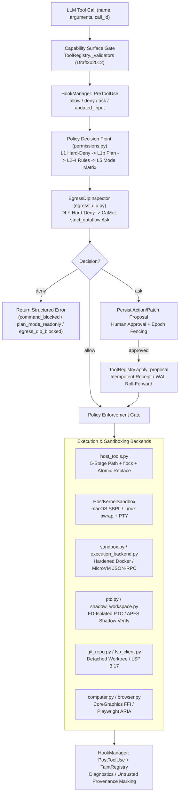

---

## 第 1 章：策略决策点与权限治理 — `permissions.py`

### 1.1 模块定位与核心职责

- **源码路径**：[`src/agent_lab/permissions.py`](../../src/agent_lab/permissions.py)（L1–L2634，共 2,634 行）
- **核心角色**：作为整个系统面向本地直连执行（`host` / `computer`）与规划模式（`plan`）的核心策略决策点（PDP, Policy Decision Point），提供五大确定性安全能力：
  1. 正交解耦的运行环境能力档位（`EXECUTION_PROFILES`）与人工介入审批模式（`PERMISSION_MODES`）；
  2. 毁机级命令双重熔断与 Fail-Closed 漏斗式终端命令静态风险分类器（`classify_bash_command`）；
  3. 基于信任工作区校验的分层声明式规则引擎（`PermissionRuleEngine`）与会话级安全授权模式建议（`suggest_session_grant_pattern`）；
  4. `plan` 严格只读规划模式的 Layer 1b 不可绕过硬边界与 `.agent-lab/plans/` 白名单；
  5. 子进程凭据双层剥离（`build_scrubbed_env`）与直连工作区物理根路径校验（`validate_direct_workspace_path`）。

### 1.2 完整数据流与状态机

系统将“模型看得到哪些工具”（`EXECUTION_PROFILES`）与“执行副作用工具时需要什么人工审批水位”（`PERMISSION_MODES`）正交解耦：

- **Execution Profiles（L84）**：`sandbox`（11 个隔离工具，无任意 Bash/GUI）、`host`（追加 `fs_*` 与 `bash_*`）、`computer`（在 `host` 基础上追加 `computer_*`）。`normalize_execution_profile()`（L560–L573）在 `enable_gui=True` 且 `profile == "host"` 时自动平滑升级为 `"computer"`，但当 `profile == "sandbox"` 时**绝不因 `enable_gui=True` 逃逸出沙箱**。
- **Permission Modes（L99–L103）**：`ask`、`auto-edit`、`full-auto`、`plan`（别名 `plan-mode`、`plan_mode` 经 `_PERMISSION_MODE_ALIASES` 归一至 `plan`）。

`evaluate_tool_permission()`（L2349–L2545）严格遵循 **6 级优先级管道**，确保低层宽松策略永远无法穿透高层安全红线：

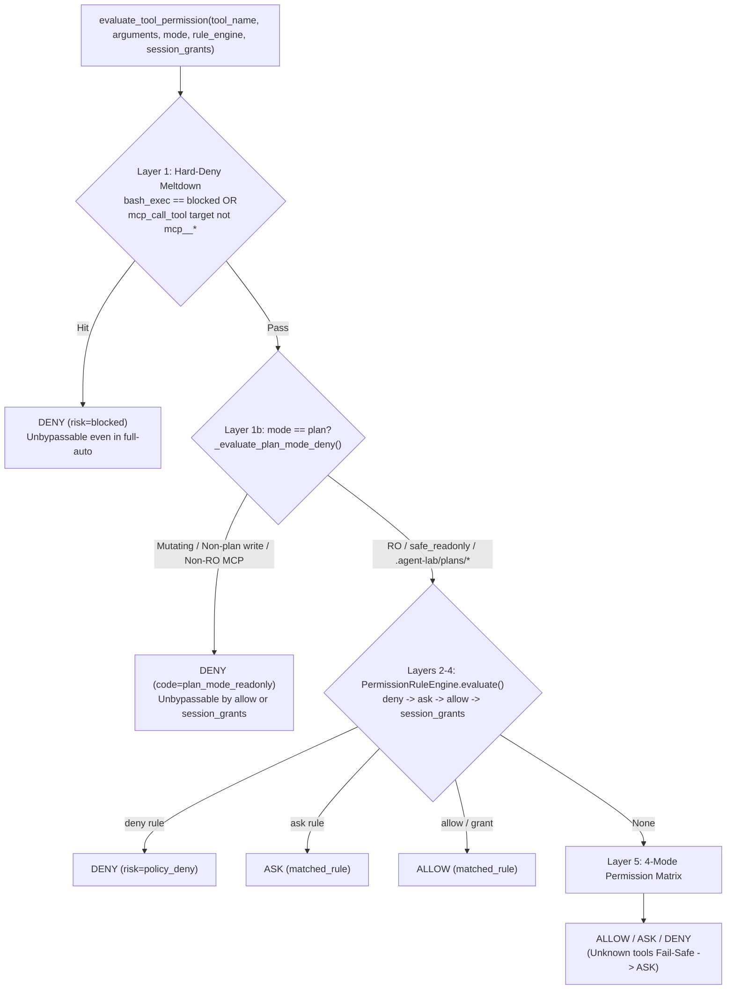

#### 正交 Execution Profiles × 四级 Permission Modes 完整决策矩阵

> 以下矩阵对应无显式规则覆盖时的 Layer 1 / 1b / 5 默认行为（L2257–L2545）：

| 工具类别 / 风险等级 | 暴露于 Profile | `ask` | `auto-edit` | `full-auto` | `plan` | 备注与风险标签（`risk`） |
| --- | --- | --- | --- | --- | --- | --- |
| `READONLY_HOST_TOOLS`（42 个只读/检索/规划/上下文工具，含 `INTERACTIVE_HOST_TOOLS`、`computer_screen`、`ptc_exec`、`shadow_verify_edits`、`browser_snapshot`/`console_logs`/`screenshot`、`a2a_list`/`discover`/`get_task`、`web_search`、`lsp_query`、`bash_output`/`list`） | 按 Profile 子集 | `allow` | `allow` | `allow` | `allow` | `risk="readonly"`；`a2a_*`/`browser_*` 附 `category` |
| `propose_patch` / `propose_changeset` | `sandbox` / `host` / `computer` | `allow` | `allow` | `allow` | **`deny`** (`plan_mode_readonly`) | `risk="proposal"`，自身仅生成提案不改盘 |
| `sandbox_test` | `sandbox` / `host` / `computer` | `allow` | `allow` | `allow` | `allow` | `risk="sandbox"`，运行于无网只读容器副本 |
| `fs_write`（路径位于 `.agent-lab/plans/` 内且无秘密名） | `host` / `computer` | `ask` | `allow` | `allow` | `allow` | `risk="workspace_edit"`；`plan` 仅放行计划产物 |
| `fs_write`（其他工作区路径） | `host` / `computer` | `ask` | `allow` | `allow` | **`deny`** (`plan_mode_readonly`) | `risk="workspace_edit"` |
| `fs_edit` / `fs_sketch_edit`（`MUTATING_FILE_EDIT_TOOLS`） | `host` / `computer` | `ask` | `allow` | `allow` | **`deny`** (`plan_mode_readonly`) | `risk="workspace_edit"` |
| `bash_exec` (`blocked` 毁机/空命令/空字节) | `host` / `computer` | **`deny`** | **`deny`** | **`deny`** | **`deny`** | Layer 1 硬熔断，`risk="blocked"` |
| `bash_exec` (`safe_readonly` 静态证明只读) | `host` / `computer` | `ask` | `allow` | `allow` | `allow` | `risk="safe_readonly"` |
| `bash_exec` (`mutating` 潜在副作用) | `host` / `computer` | `ask` | `ask` | `allow` | **`deny`** (`plan_mode_readonly`) | `risk="mutating"` |
| `bash_write` / `bash_kill` | `host` / `computer` | `ask` | `ask` | `allow` | **`deny`** (`plan_mode_readonly`) | `risk="process_control"` |
| `web_fetch` | `host` / `computer` | `ask` | `ask` | `allow` | `ask` | `risk="network_readonly"`；可用 `WebFetch(...)` 规则放行 |
| `computer_mouse` / `computer_keyboard` / `computer_open` | `computer` | `ask` | `ask` | `allow` | **`deny`** (`plan_mode_readonly`) | `risk="gui_action"` |
| `browser_navigate` / `browser_click` / `browser_type`（`BROWSER_INTERACTIVE_TOOLS`） | 浏览器挂载 | `ask` | `ask` | `allow` | **`deny`** (`plan_mode_readonly`) | `risk="browser"`, `category="browser"` |
| `a2a_send_task` / `a2a_cancel_task`（`A2A_MUTATING_TOOLS`） | A2A 挂载 | `ask` | `ask` | `allow` | **`deny`** (`plan_mode_readonly`) | `risk="a2a"`, `category="a2a"` |
| `mcp__*` / `mcp_call_tool`（已标 `read_only=True`） | MCP 挂载 | `allow` | `allow` | `allow` | `allow` | `risk="mcp_readonly"`；`mcp_call_tool` 非 `mcp__*` 目标在 Layer 1 硬拒绝 |
| `mcp__*` / `mcp_call_tool`（未标只读） | MCP 挂载 | `ask` | `ask` | `allow` | **`deny`** (`plan_mode_readonly`) | `risk="mcp_call"` |
| 未分类未知工具 | 任意 | `ask` | `ask` | `ask` | **`deny`** (`plan_mode_readonly`) | Fail-Safe 兜底，`risk="unknown"` |

### 1.3 毁机级命令熔断与 Fail-Closed `classify_bash_command` 分类器

#### 双层毁机熔断防御（L135–L163、L684–L771、L1157–L1168）

1. **输入完整性检查**：非字符串/空字符串与含空字节 `\x00`（防止 Python 字符串与 C `execve` 的 NUL 截断语义分裂）直接返回 `blocked`。
2. **表层正则 `_CATASTROPHIC_PATTERNS`（5 条）**：拦截 `rm -[rf]+ (/ | ~ | $HOME)`、`mkfs(\.[A-Za-z0-9_+-]+)?`、`dd ... of=/dev/`、Fork Bomb `:(){ :|:& };:`、`shutdown`/`reboot`/`halt`/`poweroff`/`diskutil (eraseDisk|partitionDisk)`。
3. **词法与操作数级 `_has_catastrophic_rm_tokens()`（L705–L771）**：
   - 使用 `_CMD_SPLIT_RE = r"[;&|()`\n\r]+"` 切分复合子句，每段经 `_safe_shlex_tokens()` 分词（引号未闭合时降级按空白切分并剥除引号/反斜杠，防畸形语法绕过）。
   - 循环调用 `_advance_past_wrapper()`（L598–L653）剥离内联环境变量 `KEY=VAL` 与 7 类透明命令包装器 `_TRANSPARENT_WRAPPERS = {"sudo", "env", "command", "exec", "nohup", "nice", "time"}`（精确跳过各自短/长带值标志如 `sudo -u root`、`nice -n 10`，并展开 `env -S "..."` / `--split-string=...`）。
   - 用 `Path(cur[0]).name == "rm"` 捕获 `/bin/rm`、`/usr/bin/rm` 等路径变形；正确处理 `--` 选项终止符、合并短选项 `-rf`/`-R` 与 GNU 长选项 `--recursive`/`--no-preserve-root` 及前缀缩写 `--rec*`。
   - 对每个操作数调用 `_normalize_rm_operand()`（L684–L702）：展开 `~`、`$HOME`、`${HOME}`，使用 `posixpath.normpath` 归约 `/tmp/../..` 与 `/.`，并专门折叠 POSIX 规范下 `posixpath.normpath("//")` 保留的双斜杠 `"//"` -> `"/"`（堵死 `rm -rf //` 绕过），再比对 `{"/", "/*"} | home_targets | {f"{h}/*"}`。

#### Fail-Closed 单管道切分与精确白名单过滤器（L217–L417、L774–L985）

- **`_split_safe_pipe_segments()`（L774–L858）**：基于严格 POSIX 引号状态机（`in_single` / `in_double` / `escaped`）按单管道符 `|` 切分命令，任一以下特征立即返回 `None`（Fail-Closed 判定为 `mutating`）：
  - 换行符 `\n`/`\r`（无论是否在引号内）；
  - 双引号内 `$` 或反引号 `` ` ``（Bash 仍会执行变量/命令替换）；
  - 未加引号的 `; & ` $ > < ( ) #`（显式拦截未加引号 `#` 注释符，防止 `tsc # --noEmit` 注释绕过安全标志检测）；
  - `||` 逻辑或、`|&` 合并管道、空管道段、未闭合引号或悬空转义 `\`。
- **纯 stdin 管道右端（RHS）10 个精确白名单过滤器 `_SAFE_PIPE_FILTERS`（L217）**：`head`, `tail`, `wc`, `grep`, `rg`, `sort`, `uniq`, `cut`, `tr`, `cat`。
  - `_validate_pipe_filter_args()`（L872–L953）严格查表 `_PIPE_FILTER_ALLOWLISTS`（`short_bool` / `short_value` / `long_bool` / `long_value` / `long_eq_only` / `allow_numeric_short` / `max_positionals`），杜绝 GNU `getopt_long` 长选项前缀缩写绕过（如 `sort --o=evil` 写文件或 `rg --pre=evil` 执行外部预处理器）。
  - `grep` / `rg` 仅允许最多 1 个位置参数（模式串），一旦使用 `-e` 或 `--regexp` 则动态将 `eff_max_pos` 收紧为 `0`，彻底禁止在管道右端传入文件路径读取任意文件；`tr` 允许最多 2 个位置参数（字符集）；其余 7 个过滤器强制 `max_positionals = 0`。

#### 单段只读分类器与权限提升防御（L420–L538、L988–L1141）

- **内联环境变量劫持防御（L493–L495、L861–L869）**：`_strip_benign_inline_env` 仅放行 7 个纯显示/区域设置变量 `_BENIGN_INLINE_ENV_KEYS = {"LC_ALL", "LANG", "TZ", "TERM", "NO_COLOR", "FORCE_COLOR", "PYTHONDONTWRITEBYTECODE"}`，阻断 `GIT_EXTERNAL_DIFF`、`GIT_SSH_COMMAND`、`LD_PRELOAD`、`DYLD_INSERT_LIBRARIES`、`PYTHONPATH` 等环境变量劫持 RCE。
- **跨工具链路径前缀提权防御（L1010–L1022）**：严禁 `argv[0]` 包含 `/`（如 `./pytest` 或 `/tmp/ls`），防止在 `auto-edit` 模式下攻击者先免审调用 `fs_write("./pytest")` 再免审运行 `bash_exec("./pytest")`。剥离 `uv run [--no-sync|--locked|-q|--quiet]` 前缀后同样强制二次检查 `argv[0]` 不含 `/`。
- **完整只读工具白名单覆盖**：
  1. 基础只读工具 `_SAFE_SINGLE_BINARIES`（9 个）：`ls`, `pwd`, `which`, `uname`, `whoami`, `wc`, `date`, `true`, `false`（显式排除 `find`/`sed`/`awk`/`xargs`/`env`，且参数不可命中 `is_token_secret()`）。
  2. `git` 只读子命令 `_SAFE_GIT_SUBCOMMANDS`（6 个）：`status`, `diff`, `log`, `branch`, `show`, `rev-parse`；拒绝前置全局标志（如 `git -c ...`、`git -C ...`），拦截 `_UNSAFE_GIT_FLAGS_PREFIX`（`--output`, `--ext-diff`, `--no-index`, `--textconv`, `--git-dir`, `--work-tree`, `--exec`, `-c`），`git branch` 附加参数须全落于 `_SAFE_GIT_BRANCH_FLAGS`（`--show-current`, `-a`, `--all`, `-r`, `--remotes`, `-v`, `-vv`, `--list`）。
  3. Python 检查与测试：`ruff check|version|--version`（拒绝 `--fix`/`--unsafe-fixes`/`--add-noqa`/`-o`/`--output-file`）、`pytest`/`py.test`（拒绝 `-c`/`-o`/`-p` 含紧贴与组合短选项及 `_UNSAFE_PYTEST_PREFIXES` 如 `--basetemp`/`--junitxml`/`--rootdir`/`--confcutdir`）、`python`/`python3 -m unittest|py_compile|pytest|ruff check`。
  4. **非 Python 测试与静态检查白名单（L1094–L1140）**：
     - JS/TS：`npm|pnpm|yarn test`（拦截 `-C` 与 `_UNSAFE_JS_PM_PREFIXES` 如 `--script-shell`/`--userconfig`/`--registry`）；`tsc` 与 `npx [--no-install|--no] tsc`（强制要求含 `--noEmit` 且无 `_UNSAFE_TSC_FLAGS`/`_UNSAFE_TSC_PREFIXES`）；
     - Rust：`cargo check|test|clippy`（拦截 `--config`, `-Z`, `--fix`, `--allow-dirty`, `--allow-staged`）；
     - Go：`go test`（拦截 `-exec`, `-toolexec`, `-o`, `-c`, `-cpuprofile`, `-coverprofile`, `-overlay`, `-modfile` 等 15 个前缀）与 `go vet`（拦截 `-vettool`, `-toolexec`, `-overlay`, `-modfile`）。

### 1.4 分层声明式权限规则引擎 `PermissionRuleEngine`

- **工作区信任门禁与分层加载（L1280–L1492）**：
  - `load_settings_layers()` 读取全局 `<state_dir>/settings.json` 与项目 `<workspace>/.agent-lab/settings.json`（均受 `_MAX_SETTINGS_BYTES = 256 KiB` 体积限制及非符号链接检查）。
  - 项目级配置仅在工作区通过 `is_workspace_trusted()` 校验后生效，信任源包括：① `AGENT_LAB_TRUSTED_WORKSPACES` 环境变量；② `<state_dir>/trusted_workspaces.json`（由 `trust_workspace()` / `untrust_workspace()` 经 `mkstemp + fsync + os.replace` 原子维护）；③ 全局 `settings.json` 的 `trusted_workspaces` 列表。
  - 若 `state_dir` 与 `<workspace>/.agent-lab` 物理同目录，自动去重不重复加载。
- **规则优先级与并集合并（L1898–L2047）**：`PermissionRuleEngine.from_settings()` 将全局与项目级规则分别并入 `deny`、`ask`、`allow` 三个不可变元组，求值顺序恒为 **`deny` → `ask` → `allow` → `session_grants`**，确保项目级 `allow` 永不可覆盖全局 `deny` 或 `ask`。
- **规则语法与工具别名（L1499–L1895）**：正则 `_RULE_SYNTAX_RE = r"^\s*([A-Za-z0-9_*.-]+)\s*(?:\((.*)\))?\s*$"` 支持 `Bash(...)`、`Edit(...)`（映射至 `fs_edit` + `fs_sketch_edit`）、`Write(...)`、`Read(...)`、`Glob(...)`、`Grep(...)`、`WebFetch(...)`（含 `domain:` 前缀、域名通配、域名+路径、完整 URL Glob，亦覆盖 `browser_navigate`）、`WebSearch(...)`、`MCP(server:tool)` / `mcp__srv__*`、`A2A(peer_glob[:tool_glob])`、`Browser(...)`、`Computer(...)`、`LSP(...)`、`PTC(...)`、`Shadow(...)`。
- **防绕过语义不对称（Allow vs Deny/Ask）**：
  - `Bash(...)` 在 `allow_mode=True` 时，除非规则自身显式含元字符，否则强制经 `_split_safe_pipe_segments` 验证无 `&&`/`;`/重定向且右端全为安全管道过滤器（`Bash(cargo test:*)` 绝不放行 `cargo test && curl evil`）；
  - `Bash(...)` 在 `allow_mode=False`（`deny`/`ask`）时，对全串及 `_CMD_SPLIT_RE` 切分出的每个子句调用 `_iter_normalized_bash_candidates()`（L656–L681），剥离内联变量、透明包装器（`sudo`/`env`/`command`/`exec`/`nohup`/`nice`/`time`）、引号转义与绝对路径前缀（`/usr/bin/curl` -> `curl`），彻底封堵 `env /usr/bin/curl`、`FOO=1 \curl` 等绕过。
  - 文件类工具在 `_normalize_rule_path()` 发现 `..` 或 `\x00` 时，`allow_mode=True` 强制返回 `False`，`deny`/`ask` 则允许用原始串兜底拦截。
- **会话级授权模式建议 `suggest_session_grant_pattern()`（L2070–L2185）**：为获批工具生成窄粒度模式（如 `Bash(npm run build:*)`、`Bash(uv run --no-sync pytest:*)`、`Bash(python -m pytest:*)`、`Bash(cargo test:*)`、`Edit(src/**)`、`MCP(server:tool)`、`WebFetch(host)`、`browser_navigate(host)`、`A2A(peer)`），对 `blocked` 命令、串联 Shell、`..` 路径或含通配符/控制字符的 A2A peer 返回 `None`。

### 1.5 `plan` 模式 Layer 1b 硬边界与 `.agent-lab/plans/` 白名单

- `_evaluate_plan_mode_deny()`（L2257–L2346）在 Layer 2–4 规则引擎**之前**执行，拦截一切变更型工具并返回 `{"decision": "deny", "code": "plan_mode_readonly", ...}`，任何 `allow` 规则或 `session_grants` 均无法绕过。
- `fs_write` 在 `plan` 模式下仅对通过 `is_plan_artifact_path()`（L2211–L2228）的路径放行：必须无 `\x00`/尾斜杠/`..`，经 `_normalize_rule_path()` 归一化为相对 POSIX 路径后，满足 `len(parts) >= 3 and parts[0] == ".agent-lab" and parts[1] == "plans"`，且 `parts[2:]` 中任意段均不命中 `is_token_secret()`（拦截 `.env*`、`id_rsa*`、`id_ed25519*`、`*.pem`/`*.key`/`*.p12`/`*.pfx`）。

### 1.6 子进程凭证脱敏与直连工作区根路径校验

- **`build_scrubbed_env()` / 别名 `scrub_subprocess_env`（L2548–L2589）**：
  - 双层黑名单剥离：12 个精确黑名单 `_SECRET_ENV_EXACT`（`ANTHROPIC_API_KEY`, `ANTHROPIC_AUTH_TOKEN`, `OPENAI_API_KEY`, `AGENT_LAB_TOKEN`, `AGENT_LAB_TOKENS_JSON`, `AGENT_LAB_SANDBOX_TOKEN`, `AGENT_LAB_STORAGE_DSN`, `AWS_SECRET_ACCESS_KEY`, `AWS_SESSION_TOKEN`, `GITHUB_TOKEN`, `GH_TOKEN`, `GITLAB_TOKEN`）+ 大小写不敏感正则 `_SECRET_ENV_RE`（匹配 `API_KEY|AUTH_TOKEN|SECRET|PASSWORD|PRIVATE_KEY|CREDENTIAL|ACCESS_KEY|SESSION_TOKEN`）。
  - 保留普通研发工具链变量（`PATH` 默认兜底 `os.defpath`），强制注入防挂起与实时刷盘变量：`GIT_TERMINAL_PROMPT=0`、`PAGER=cat`、`GIT_PAGER=cat`、`PYTHONUNBUFFERED=1`，并过滤含 `\x00` 的异常 `extra_env` 键值。
- **`validate_direct_workspace_path()`（L2592–L2634）**：
  - **关键时序不变量**：先在未 `resolve()` 的 `expanded = Path(raw_str).expanduser().absolute()` 上校验 `not expanded.is_symlink()` 与 `expanded.is_dir()`，再调用 `resolved = expanded.resolve()` 核对系统禁区（`/` 及 11 个 `_FORBIDDEN_DIRECT_ROOTS`：`/System`, `/Library`, `/bin`, `/sbin`, `/usr`, `/etc`, `/private/etc`, `/var/root`, `/private/var/root`, `/dev`, `/proc`）、用户主目录密钥禁区（`_FORBIDDEN_HOME_SUBDIRS = {".ssh", ".gnupg", ".aws", ".kube"}`）以及可选多租户 `allowed_roots`。

### 1.7 失败模式、边界条件与关键源码符号索引

- **失败模式**：非法 `execution_profile`/`permission_mode` 抛出 `ValueError`；畸形或超 256 KiB `settings.json` 静默返回 `{}`（安全降级不阻塞启动）；未信任工作区的项目配置完全忽略；`shlex.split` 解析未闭合引号时，在分类器中 Fail-Closed 判为 `mutating`，在毁机 `rm` 与 `deny` 规则中降级 `_safe_shlex_tokens` 仍强制拦截。

| 符号名 | 精确行号 | 职责摘要 |
| --- | --- | --- |
| `EXECUTION_PROFILES`, `PERMISSION_MODES`, `PLAN_ARTIFACT_DIR` | L84, L99, L104 | 核心能力档位、四级权限模式与计划产物目录常量 |
| `_SECRET_ENV_EXACT`, `_SECRET_ENV_RE` | L108–L129 | 子进程环境变量精确 + 启发式正则脱敏黑名单 |
| `_CATASTROPHIC_PATTERNS`, `_PIPE_FILTER_ALLOWLISTS` | L135–L163, L220–L417 | 毁机命令表层正则与 10 个纯管道过滤器精确选项白名单 |
| `_advance_past_wrapper`, `_has_catastrophic_rm_tokens` | L598–L653, L705–L771 | 透明包装器剥离与 `rm` 递归删根/主目录词法审计 |
| `_split_safe_pipe_segments`, `_validate_pipe_filter_args` | L774–L858, L872–L953 | POSIX 引号状态机单管道切分与管道右端精确选项校验 |
| `classify_bash_command`, `is_token_secret` | L1144–L1187, L1190–L1193 | Fail-Closed 漏斗式命令风险分类器与密钥文件名判断 |
| `READONLY_HOST_TOOLS`, `INTERACTIVE_HOST_TOOLS`, `BROWSER_INTERACTIVE_TOOLS`, `A2A_MUTATING_TOOLS` | L1197–L1272 | 工具风险分类静态集合 |
| `is_workspace_trusted`, `trust_workspace`, `load_settings_layers` | L1296–L1492 | 工作区信任校验、原子登记与分层配置加载 |
| `match_permission_rule`, `PermissionRuleEngine`, `suggest_session_grant_pattern` | L1803–L2185 | 声明式规则匹配、优先级裁决与会话授权模式建议 |
| `is_plan_artifact_path`, `_evaluate_plan_mode_deny`, `evaluate_tool_permission` | L2211–L2545 | `plan` 硬边界与 6 级优先级工具权限裁决入口 |
| `build_scrubbed_env`, `validate_direct_workspace_path` | L2548–L2634 | 脱敏环境构造与直连工作区物理根路径防逃逸校验 |

---

## 第 2 章：确定性生命周期钩子管理器 — `hooks.py`

### 2.1 模块定位与核心职责

- **源码路径**：[`src/agent_lab/hooks.py`](../../src/agent_lab/hooks.py)（L1–L700，共 700 行）
- **核心角色**：实现类似 Claude Code Hooks 的确定性事件拦截与上下文增强管道，覆盖 7 大生命周期事件 `HOOK_EVENTS`（L44–L54）：
  1. `SessionStart`：会话初始化时注入上下文或预检查；
  2. `UserPromptSubmit`：用户提示词提交前拦截（`decision="deny"`）、改写（`updated_prompt`）或追加上下文；
  3. `PreToolUse`：工具执行前拦截（`deny`/`ask`/`allow`）或链式改写入参（`updated_input`）；
  4. `PostToolUse`：工具执行后收集静态诊断（`diagnostics`）与追加上下文（`additional_context`）；
  5. `PreCompact`：上下文压缩前注入保留提示或审计记录；
  6. `Stop`：Agent 试图结束回合时执行最终验证门禁，返回 `veto=True` 否决过早终止；
  7. `Notification`：外部通知与状态推送钩子。

### 2.2 完整数据流与短路聚合状态机

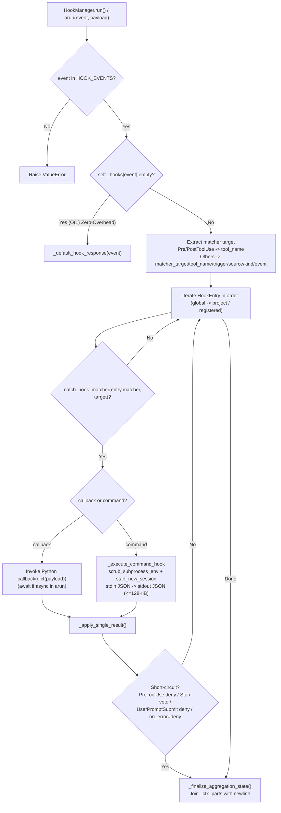

#### 各事件聚合与短路语义（L441–L547）

| 事件类型 | 变更传递 / 聚合字段 | 立即短路条件 | `on_error="deny"` 失败闭合动作 |
| --- | --- | --- | --- |
| `PreToolUse` | `updated_input` 链式回写至 `current_payload["tool_input"]` 供后续钩子观察；`decision` 支持 `deny` / `ask` / `allow`（首个 `allow` 置 `explicit_decision="allow"`，`ask` 可升级） | `decision == "deny"` 或错误且 `on_error == "deny"` | `decision="deny"`, `explicit_decision="deny"`, 记录 `reason` 并短路 |
| `PostToolUse` | `additional_context` 收集至 `_ctx_parts` 后以 `\n` 拼接；`diagnostics` 列表逐条 `extend` | 无短路，顺序执行全部匹配钩子 | 记录至 `errors`，不阻断后续诊断收集 |
| `Stop` | `veto`（布尔）、`reason` | `bool(raw_res.get("veto")) is True` 或错误且 `on_error == "deny"` | `veto=True`, 记录 `reason` 并短路 |
| `UserPromptSubmit` | `updated_prompt` 链式回写 `current_payload["prompt"]`；`additional_context` 拼接 | `decision == "deny"` 或错误且 `on_error == "deny"` | `decision="deny"`, 记录 `reason` 并短路 |
| `SessionStart` / `PreCompact` / `Notification` | `additional_context` 拼接；原始响应字典追加至 `results` | 无短路 | 记录至 `errors` |

### 2.3 核心数据结构、匹配器与协议常量表

- **数据模型**：`@dataclass(frozen=True) class HookEntry`（L63–L75），字段包括 `event`、`matcher="*"`、`command: str | None`、`callback: Callable | None`、`timeout_seconds: float = 10.0`、`on_error: str = "allow"`、`source: str = "inline"`、`name: str | None`。
- **配置解析兼容性（L271–L319）**：`_parse_hooks_config_entries()` 同时兼容扁平格式 `{"matcher": "fs_*", "command": "..."}` 与 Claude Code 嵌套格式 `{"matcher": "fs_*", "hooks": [{"command": "..."}]}`，嵌套项可继承外层 `matcher`、`timeout_seconds` 与 `on_error`。
- **混合通配/正则匹配器 `match_hook_matcher()`（L90–L127）**：
  1. `""` / `"*"` / `".*"` 恒匹配；
  2. `"/pattern/"` 或 `"regex:pattern"` 显式 `re.search`（非法正则 Fail-Closed 返回 `False`）；
  3. 含 `_REGEX_HINT_CHARS = {"|", "^", "$", "(", ")", "+", "{", "}", "\\"}` 时：含 `^`/`$` 用 `re.search`，否则优先 `re.fullmatch`（兼容 `fs_edit|fs_write`），正则报错回退 `fnmatch.fnmatchcase`；
  4. 其余使用大小写敏感的 `fnmatch.fnmatchcase`（兼容 `fs_*`、`mcp__github__*`）。

| 常量 / 协议字段 | 精确取值（源码行号） | 说明 |
| --- | --- | --- |
| `_DEFAULT_HOOK_TIMEOUT` | `10.0` 秒（L56） | 单条命令钩子默认超时 |
| `_MIN_HOOK_TIMEOUT` / `_MAX_HOOK_TIMEOUT` | `0.2` 秒 / `60.0` 秒（L57–L58） | `_normalize_timeout()` 强制夹紧区间 |
| `_MAX_HOOK_STDOUT_BYTES` | `128 * 1024`（128 KiB，L59） | 命令钩子 stdout 截断上限防 OOM |
| 注入环境变量 | `AGENT_LAB_HOOK_EVENT`, `AGENT_LAB_WORKSPACE`（L215–L220） | 叠加在 `scrub_subprocess_env()` 脱敏环境上 |
| 命令执行协议 | `[shell_bin, "-c", entry.command]`（L226–L234） | stdin 传入 UTF-8 JSON `payload`，stdout 返回空串（视作 `{}`）或顶层 JSON `dict`；非零退出码截取 stderr 前 300 字符报错 |

### 2.4 核心安全与性能不变量

1. **零配置零开销不变量（Zero-Overhead No-Op）**：`run()`/`arun()` 及快捷方法 `run_pre_tool_use`/`run_post_tool_use`/`run_stop` 在入口直接检查 `if not self._hooks[event]: return _default_hook_response(event)`（O(1) 判定），未配置钩子时零子进程、零 JSON 序列化、零字典拷贝。
2. **项目配置信任门禁**：`HookManager.from_settings()`（L355–L371）复用 `permissions.load_settings_layers()`，未经信任校验的项目仓库 `<workspace>/.agent-lab/settings.json` 中的 Shell 钩子绝不加载执行。
3. **凭证隔离与进程组零残留**：外部命令始终通过 `scrub_subprocess_env()` 剥离宿主密钥，以 `start_new_session=True` 设为独立会话进程组 Leader（`pgid = proc.pid`）。超时或异常时由 `_reap_hook_process_group()`（L183–L203）执行 `os.killpg(pgid, SIGTERM)` → `proc.wait(0.3)` → 150ms 存活轮询（20ms 步长）→ `os.killpg(pgid, SIGKILL)`，并在 `finally` 中无条件补发 `SIGKILL` 清理残留孙进程。

### 2.5 失败模式、降级策略与源码符号索引

- **同步入口遇异步回调**：在同步 `HookManager.run()` 中若 Python 回调返回 awaitable，会显式关闭未等待协程（`out.close()` 防 `RuntimeWarning`）并记录错误提示改用 `arun()`（L570–L574）。
- **异步入口执行外部命令**：`HookManager.arun()` 通过 `await asyncio.to_thread(_execute_command_hook, ...)` 卸载阻塞子进程 I/O，避免阻塞事件循环（L623–L625）。
- **默认失败策略**：`on_error` 经 `_normalize_on_error()` 严格归一为 `"deny"` 或 `"allow"`（默认 `"allow"`，fail-open 记录诊断至 `errors` 列表；安全门禁钩子可配置 `"on_error": "deny"` 实现 fail-closed）。

| 符号名 | 精确行号 | 职责摘要 |
| --- | --- | --- |
| `HOOK_EVENTS`, `HookEntry` | L44–L75 | 7 大生命周期事件集合与不可变钩子定义 |
| `match_hook_matcher`, `_extract_matcher_target` | L90–L138 | Glob/Regex 混合匹配器与按事件提取匹配目标 |
| `_default_hook_response` | L141–L180 | 零开销快速通道的标准化默认返回结构 |
| `_reap_hook_process_group`, `_execute_command_hook` | L183–L268 | 脱敏独立进程组命令钩子执行与两阶段回收 |
| `_parse_hooks_config_entries` | L271–L319 | 兼容扁平与嵌套 `settings.json` 钩子解析 |
| `HookManager` (`from_settings`, `register`, `run`, `arun`, `_apply_single_result`) | L322–L700 | 钩子管理器主类、同步/异步分发与状态聚合短路 |

---

## 第 3 章：CaMeL 数据血缘追踪与出站密文防泄漏 — `egress_dlp.py`

### 3.1 模块定位与核心职责

- **源码路径**：[`src/agent_lab/egress_dlp.py`](../../src/agent_lab/egress_dlp.py)（L1–L1291，共 1,291 行）
- **核心角色**：实现受 CaMeL（*Defeating Prompt Injections by Design*）启发的两道运行时安全防线，并导出交互式规划工具规范 `INTERACTIVE_TOOL_SPECS`：
  1. **每轮次线程安全血缘污点登记表（`DataProvenance` + `TaintRegistry`）**：记录当前 run 是否摄入过不可信外部数据，并以**零明文 SHA-256 滑窗指纹**登记敏感凭据及其多种编码变体；
  2. **统一出站密文防泄漏与严格数据流检查器（`EgressDlpInspector`）**：在所有具备外发能力的出站汇聚点（Outbound Sink）执行多层解码与全参数递归扫描，同时在 `strict_dataflow=True` 下阻断被污染控制流向未经批准的外部主机外发数据或触发变更型操作。

### 3.2 完整数据流与双层出站审查机制

> **跨模块路由核验（重要实现细节）**：`egress_dlp.py` 的 `OUTBOUND_SINK_TOOLS`（L351–L361）显式包含 7 个工具（`web_fetch`, `web_search`, `mcp_call_tool`, `a2a_send_task`, `a2a_discover_agent`, `a2a_get_task`, `a2a_cancel_task`），`_is_outbound_sink_call()`（L698–L704）额外覆盖全部 `mcp__*` 以及匹配 `_BASH_NETWORK_SINK_PATTERNS` 的联网 `bash_exec`。而在编排层 [`src/agent_lab/runtime.py`](../../src/agent_lab/runtime.py)（L1102–L1134）中，`browser_navigate` 与 `browser_type` 会被桥接路由至 `self._dlp_inspector.inspect_outbound_call("web_fetch", args_dict, ...)`（并将 `reason` 中的 `"web_fetch"` 替换为实际工具名），`browser_click` 在 `strict_dataflow=True` 时桥接至 `"computer_mouse"`，同时 `browser_navigate`/`browser_snapshot`/`browser_console_logs` 的结果会由 `_record_untrusted_provenance()`（`runtime.py:1165-1172`）记为 `UNTRUSTED_WEB` 污点，从而实现覆盖 Web、MCP、A2A、Browser 与联网 Bash 的全通道 DLP 闭环。

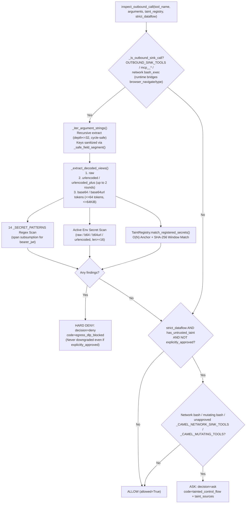

### 3.3 核心数据结构、算法逻辑与配额表

#### `DataProvenance` 信任域枚举（L64–L96）

| 枚举成员 | 序列化值 | `is_untrusted` | `is_sensitive` | 默认归属工具（`infer_tool_provenance` L426–L434） |
| --- | --- | --- | --- | --- |
| `TRUSTED_USER` | `"trusted_user"` | `False` | `False` | 人类用户输入 |
| `WORKSPACE_FILE` | `"workspace_file"` | `False` | `False` | 其余本地工作区读写工具 |
| `UNTRUSTED_WEB` | `"untrusted_web"` | `True` | `False` | `web_fetch`, `web_search`（`runtime.py` 扩展含 `browser_navigate`/`snapshot`/`console_logs`） |
| `UNTRUSTED_MCP` | `"untrusted_mcp"` | `True` | `False` | `mcp__*`, `mcp_call_tool`, `mcp_read_resource` |
| `UNTRUSTED_A2A` | `"untrusted_a2a"` | `True` | `False` | `a2a_send_task`, `a2a_discover_agent`, `a2a_get_task` |
| `SENSITIVE_SECRET` | `"sensitive_secret"` | `False` | `True` | 显式登记的密钥指纹 |

#### `TaintRegistry` 无明文滑窗 SHA-256 指纹机制（L129–L216、L437–L666）

- 线程安全由 `threading.RLock()` 保障；事件队列默认上限 `max_events=256`（最小夹紧至 16），每条 `TaintEvent.summary` 自动经 `redact_secrets()` 脱敏并截断至 240 字符。
- `register_secret(raw_secret, min_length=8)` **绝不存储原始密钥明文**，仅计算：
  1. `SecretFingerprint`：保存完整 `sha256`、`length`、极短显示提示（仅当 `len >= 16` 保留前后各 2 字符 `prefix_token`/`suffix_token`，否则置空仅显示 `***sha256:<10位>`）；
  2. 为 `raw`、`base64`（去 `=` 填充）、`base64url`（去 `=` 填充）、`urlencoded`（`quote(safe="")`）与 `urlencoded_plus`（`quote_plus`）5 种去重变体构造 `_WindowMatcher(variant, length, prefix, suffix, sha256)`：长度 `< 8` 跳过，锚点长度 `anchor_len = 4 if n >= 12 else 2`。
- `_window_matcher_hits(haystack, matcher)`（L190–L209）：利用 `haystack.find(prefix, start)` 快速定位前缀锚点，比对长度固定窗口的尾锚点 `suffix`，仅在双锚点命中时计算 `_sha256_hex(haystack[idx:end]) == matcher.sha256`，实现无明文存储下的 O(N) 精确子串检出。

#### 14 类密文正则与活跃环境变量检测（L244–L348）

`_SECRET_PATTERNS` 按“高精度在前、通用在后”排列，覆盖 14 条规则（对应 7+ 大密钥家族）：

| 规则 ID | 检测对象 | 特征描述（安全脱敏表示） |
| --- | --- | --- |
| `anthropic_api_key` | Anthropic API 密钥 | `sk-ant-` 前缀后接 ≥8 位 `[A-Za-z0-9_-]` |
| `openai_project_key` | OpenAI 项目/服务密钥 | `sk-(proj\|svcacct\|admin\|live\|test)-` 后接 ≥12 位 |
| `openai_api_key` | OpenAI 传统 API 密钥 | `sk-(?!ant-)` 后接 ≥20 位字母数字（含可选 `T3BlbkFJ` 段） |
| `github_pat` / `github_token` | GitHub PAT / 传统令牌 | `github_pat_` 后接 ≥16 位；`gh[pousr]_` 后接 ≥16 位 |
| `aws_access_key_id` | AWS Access Key ID | `AKIA` / `ASIA` 后接 16 位大写字母数字 |
| `google_api_key` | Google API 密钥 | `AIza` 后接 35 位 `[0-9A-Za-z_-]` |
| `slack_token` | Slack Bot/App 令牌 | `xox[baprs]-` 或 `xapp-[0-9]-` 后接 ≥10 位 |
| `stripe_key` | Stripe 密钥 / Webhook | `(sk\|rk)_(live\|test)_` 或 `whsec_` 后接 ≥16 位 |
| `pem_private_key` | PEM 私钥头 | `-----BEGIN ... PRIVATE KEY( BLOCK)?-----` |
| `database_dsn_password` | 含明文密码数据库连接串 | `postgres(ql)` / `mysql` / `mariadb` / `mongodb(+srv)` / `redis(s)` / `amqp(s)` / `mssql` / `sqlserver` / `clickhouse` / `cockroachdb` 协议 URI 中包含 `用户名:密码@主机` 凭据段 |
| `bearer_jwt` / `jwt_token` / `bearer_token` | Bearer JWT / 裸 JWT / Bearer 令牌 | 三段 `eyJ...` 结构或 `Bearer <≥20 chars>`；命中 `bearer_jwt` 时通过 span 覆盖抑制子集 `jwt_token` 与 `bearer_token` 重复告警 |

- **活跃环境变量检测（L219–L235、L881–L928）**：复用 `permissions._SECRET_ENV_EXACT` 与 `_SECRET_ENV_RE` 扫描活跃环境变量中长度 `>= min_env_secret_length`（默认 16）的值，对每个解码视图逐一检验原样、`base64`（去 `=` 且长度 ≥12）、`base64url` 与 `urlencoded`/`urlencoded_plus`。
- **联网 `bash_exec` 汇聚点识别 `_BASH_NETWORK_SINK_PATTERNS`（L328–L348）**：覆盖 `curl`/`wget`/`nc`/`ncat`/`netcat`/`socat`/`xh`/`httpie`/`telnet`/`scp`/`sftp`/`ftp`/`rsync`/`dig`/`nslookup`、`http`/`https` CLI（含透明包装器前缀）、`https?://`、Python/JS 网络库（`urllib`/`requests`/`httpx`/`aiohttp`/`http.client`/`socket`/`smtplib`/`ftplib`/`xmlrpc`/`axios`/`fetch(`）以及 Bash `/dev/(tcp|udp)/` 伪设备。
- **交互式工具规范 `INTERACTIVE_TOOL_SPECS`（L1176–L1270）**：导出 3 个 Draft 2020-12（`additionalProperties: False`）工具契约：`ask_user_question`（`question` ≤2000、`options` ≤8 项、`multi_select`、`context`、`default_option`）、`enter_plan_mode`（`reason`、`plan_file` ≤240）与 `exit_plan_mode`（`summary` ≤4000、`plan_file`、`target_permission_mode` 枚举 `ask`/`auto-edit`/`full-auto`）。

### 3.4 核心安全与并发不变量

1. **零明文留痕不变量**：不仅返回值 `findings`/`reason`/`to_dict()` 绝不输出密钥明文，连字典参数的**键名**也经 `_safe_field_segment()`（L710–L726）校验：若键名不符合 `^[A-Za-z_][A-Za-z0-9_.-]{0,31}$` 或自身命中密钥正则/活跃环境变量/已登记指纹，则将审计字段路径折叠为 `.<key[idx]>`，防止攻击者把密钥藏在 JSON key 中导致审计日志反向泄密。
2. **DLP 永远优先于 CaMeL 审批不变量**：第一道防线（出站密文 DLP）永远返回 `decision="deny", code="egress_dlp_blocked"`，绝不因 `explicitly_approved=True` 或 `strict_dataflow=True` 降级放行。
3. **多层编码抗绕过与有界计算不变量**：`_iter_argument_strings()` 限制递归深度 `max_depth=32` 并用 `seen_containers`（容器 `id()` 集合）防御循环引用；`_extract_decoded_views()` 执行最多 2 轮 URL 解码并对原串与 URL 解码视图扫描最多 `max_b64_tokens=64` 个合法 Base64/Base64URL 候选片段（单个 ≤65536 字符且解码后 ≥12 字符），防止超大载荷导致正则 ReDoS 或内存膨胀。

### 3.5 失败模式、边界条件与源码符号索引

- **CaMeL 主机白名单**：在 `strict_dataflow=True` 且会话受污染时，仅对 `web_fetch`、`a2a_send_task`、`a2a_discover_agent` 校验 `_is_target_approved_in_camel()`（合并 `EgressDlpInspector.default_approved_hosts`、调用级 `approved_hosts` 与 `taint_registry.approve_host()`，支持 `domain:` 前缀与 `fnmatch` 通配符）；`bash_exec`（联网或非 `safe_readonly`）及 `_CAMEL_MUTATING_TOOLS`（含 `fs_write`/`fs_edit`/`fs_sketch_edit`/`bash_write`/`bash_kill`/`computer_*`/`propose_*`/`a2a_send_task`/`a2a_cancel_task`）均返回 `decision="ask", code="tainted_control_flow"`。

| 符号名 | 精确行号 | 职责摘要 |
| --- | --- | --- |
| `DataProvenance`, `UNTRUSTED_PROVENANCES` | L64–L96 | CaMeL 6 态数据血缘枚举与不可信集合 |
| `TaintEvent`, `_WindowMatcher`, `SecretFingerprint` | L109–L169 | 脱敏血缘事件、无明文滑窗匹配器与指纹元数据 |
| `_SECRET_PATTERNS`, `_BASH_NETWORK_SINK_PATTERNS`, `OUTBOUND_SINK_TOOLS` | L244–L391 | 14 类密文正则、联网 Bash 识别模式与出站汇聚点集合 |
| `redact_secrets` | L394–L418 | 原地文本脱敏（正则 + 活跃环境原样/B64/B64URL/URL 编码） |
| `TaintRegistry` (`record_taint`, `register_secret`, `match_registered_secrets`) | L437–L666 | 每 run 线程安全污点与无明文指纹登记表 |
| `_safe_field_segment`, `_iter_argument_strings`, `_extract_decoded_views` | L710–L844 | 键名防泄密路径递归提取与多层 URL+Base64 解码视图 |
| `EgressDlpInspector`, `inspect_outbound_call` | L991–L1169 | 统一出站密文 DLP + CaMeL `strict_dataflow` 检查器 |
| `INTERACTIVE_TOOL_SPECS` | L1176–L1270 | `ask_user_question` / `enter_plan_mode` / `exit_plan_mode` 工具契约 |

---

## 第 4 章：沙箱工具注册表与 WAL 原子提案应用器 — `tools.py`

### 4.1 模块定位与核心职责

- **源码路径**：[`src/agent_lab/tools.py`](../../src/agent_lab/tools.py)（L1–L1337，共 1,337 行）
- **核心角色**：实现面向能力安全（Capability-Based Security）的运行级工具网关 `ToolRegistry`：
  1. **最小能力面分档挂载（L268–L298）**：
     - `sandbox`（默认）：严格只挂载 `_build_definitions()`（L301–L442）的 **11 个隔离工具**（`repo_list`, `repo_map`, `symbol_search`, `repo_git_status`, `repo_read`, `repo_search`, `knowledge_search`, `propose_patch`, `propose_changeset`, `verify_python`, `sandbox_test`）；
     - `host`：深拷贝追加 `HOST_TOOL_SPECS`（通过 `json.loads(json.dumps(...))` 防止下游注入 `cache_control` 污染全局常量字典）；
     - `computer`（或 `enable_gui=True`）：进一步深拷贝追加 `COMPUTER_TOOL_SPECS`；
     - **核心安全不变量**：`apply_proposal` **永远不进入** `_specs` 与 `_validators`，`execute()`（L454–L537）在首行即以 `name not in self._validators` 白名单拦截 + `Draft202012Validator.validate(arguments)` 校验，从根源阻断模型通过提示词注入自我审批或反射调用内部方法。
  2. **五阶路径与 inode 安全边界**（`_validate_relpath` / `_path`）、**跨进程 inode 核验 `flock`**（`_cross_process_apply_lock`）、**三级局部替换**（`_apply_unique_replacement`）以及**双轨幂等 + WAL 崩溃前滚提案应用器**（`apply_proposal`）。

### 4.2 完整数据流与 `apply_proposal` 双轨 WAL 状态机

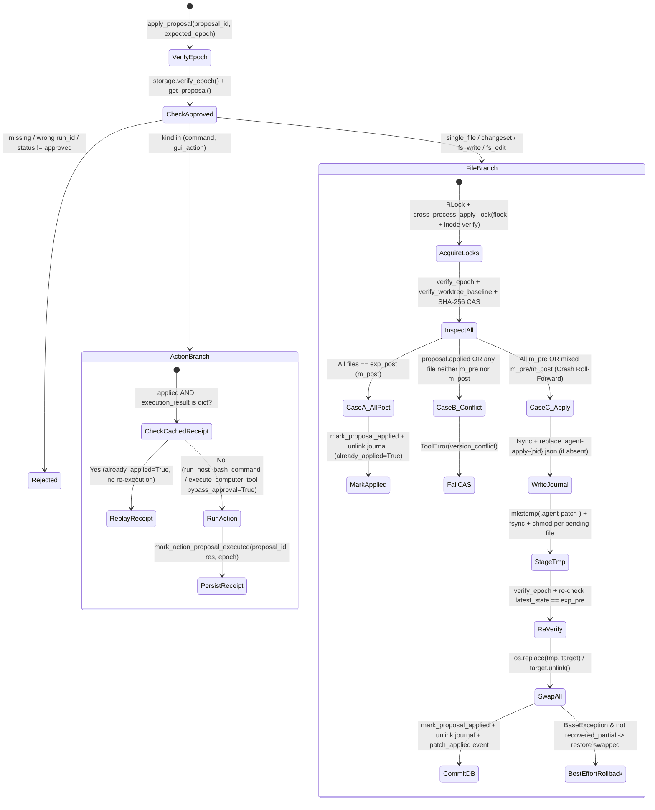

### 4.3 核心数据结构、算法逻辑与配额表

| 常量 / 配置 | 精确值（源码行号） | 作用 |
| --- | --- | --- |
| `_MAX_FILE_BYTES` | `64 * 1024`（64 KiB，L70） | `sandbox` 读写与提案单文件体积硬上限（`allow_host_fs` 时放宽至 512 KiB，L1003） |
| `_MAX_FILES` | `128`（L71） | `repo_list` / `_files` 遍历与索引上限 |
| `_MAX_WORKSPACE_LOCKS` | `256`（L72） | 进程内 `_LOCKS: OrderedDict[str, threading.RLock]` LRU 驱逐阈值（仅驱逐 `_is_rlock_unlocked()` 为真的空闲锁，L113–L130） |
| `_PRICING_TEST_SHA256` | `"a4e151163fff20f772685bf59db2253fba3b5f5960dafb2e207b055b4d3f0f88"`（L74） | 内置示例验收测试基线摘要 |
| `_CHANGESET_SUFFIXES` | `{".py", ".toml", ".json", ".yaml", ".yml", ".cfg", ".ini"}`（L80） | `propose_changeset` 允许修改/创建/删除的扩展名（单次最多 6 个文件，禁止重复路径） |
| `_INDEXED_SUFFIXES` | `_CHANGESET_SUFFIXES \| {".md", ".txt"}`（L81） | `repo_list` / `repo_search`（最多返回 30 条命中，单行截断 500 字符）可索引扩展名 |

#### 关键算法剖析

1. **五阶路径/链接/秘密防御 `_validate_relpath()` & `_path()`（L539–L583）**：
   - ① 词法校验：拒空串、`\`、`:`、`\x00`、绝对路径、`""`/`.`/`..` 及任何以 `.` 开头的隐藏段；
   - ② 逐段 `is_symlink()`：从 `self.workspace` 起逐段拼接检查软链接与非目录中间节点；
   - ③ `candidate.resolve().is_relative_to(self.workspace)` 物理兜底；
   - ④ 敏感文件拦截 `_is_secret_path(pure)`（覆盖 `_SECRET_NAMES`、`_SENSITIVE_STEMS`、`.env*`/`id_rsa*`/`id_ed25519*` 及 `.pem`/`.key`/`.p12`/`.pfx`/`.env`）；可写路径额外检查扩展名白名单与 `_is_protected_test_path()`（拦截 `tests`/`test` 目录、`test_*`、`*_test.py`、`conftest.py`）；
   - ⑤ `_path()` 校验 `is_file()`、`st.st_nlink == 1`（拒多重硬链接与 FIFO）与 `st.st_size <= 64 KiB`。
2. **跨进程 inode 校验 `flock`（`_cross_process_apply_lock`，L147–L208）**：
   - 锁目录 `<storage_dir>/apply_locks`（`0o700`，非符号链接），锁文件 `apply-<sha256(workspace)>.lock` 以 `os.O_RDWR | os.O_CREAT | os.O_NOFOLLOW | O_CLOEXEC`（`0o600`）打开。
   - 针对经典 **`flock` + GC `unlink` 孤儿 inode 竞态**：先查 `fstat` 为常规文件且 `st_nlink <= 1`（`== 0` 重试），执行 `fcntl.flock(LOCK_EX)` 后**二次核对** `os.fstat(fd)` 与 `os.stat(lock_file, follow_symlinks=False)` 的 `st_nlink == 1`、`S_ISREG`、`st_dev`、`st_ino` 完全一致，不一致则解锁关闭并重试（最多 4 次），成功后 `os.utime(fd, None)` 刷新活跃时间。
3. **三级唯一替换 `_apply_unique_replacement()`（L762–L793）**：
   - Tier 1：精确子串唯一匹配（`original.count(old_text) == 1`）；
   - Tier 2：CRLF 归一化唯一匹配（当原文含 `\r\n` 而 `old_text` 仅含 `\n` 时自动转换并保持 `\r\n`）；
   - Tier 3：行尾空白容忍唯一窗口匹配（按行 `rstrip(" \t")` 滑动匹配，仅在 `len(hits) == 1` 时生效并保留原有主换行风格）。
4. **提案幂等重放与 WAL 崩溃前滚**：
   - `propose_patch()`（L893–L943）与 `propose_changeset()`（L945–L996）以 Runtime 传入的 `call_id` 作为 `operation_id`，重放时检索 `get_proposal_by_operation()` 并通过 `_matches_replayed_edit()` 验证意图一致，冲突则抛 `proposal_operation_conflict`。
   - `apply_proposal()`（L1037–L1292）在换盘前通过 `_write_apply_journal()`（L1021–L1035）原子落盘 `.agent-apply-<safe_pid>.json`，记录每个文件的 `old_sha256`/`new_sha256`。所有新内容先经 `tempfile.mkstemp(prefix=".agent-patch-", dir=target.parent)` + `flush()` + `os.fsync()` + `os.chmod()` 暂存，二次校验 `verify_epoch` 与 `latest_state == exp_pre` 后才顺序执行 `os.replace()`。若中途进程崩溃，重入时发现部分文件已达 `m_post`、其余仍为 `m_pre`，直接前滚剩余项并返回 `recovered_partial_apply=True`；若全新应用期间抛出异常，则尽力按逆序恢复已替换文件，且仅在 `not swapped_any` 时清理 journal。
5. **只读验证与受保护验收**：
   - `verify_python()`（L1294–L1316）仅调用 `ast.parse()`（绝不 `import`/`exec`），返回 `verification="syntax_only"` 与 `ast_nodes` 计数；
   - `sandbox_test()`（L1318–L1337）先在宿主校验 `test_oracles` 或 `tests/test_pricing.py`（兼容 LF 归一化）SHA-256，再交由 `SandboxRunner` 在副本中二次核验并执行。

### 4.4 核心不变量、错误码与源码符号索引

- **KV Cache 前缀稳定不变量**：默认 `sandbox` 档位严格不注入 Host/Computer Schema，确保 `<TOOLS>` 前缀字节稳定不破坏缓存命中。
- **典型错误码**：`unknown_tool`, `invalid_arguments`, `unsafe_path`, `secret_access_forbidden`, `edit_forbidden`, `not_found`, `file_too_large`, `duplicate_path`, `file_exists`, `ambiguous_patch`, `empty_patch`, `syntax_error`, `proposal_operation_conflict`, `proposal_not_found`, `approval_required`, `version_conflict`, `invalid_file_type`, `test_oracle_modified`, `apply_error`, `tool_error`。

| 符号名 | 精确行号 | 职责摘要 |
| --- | --- | --- |
| `_is_secret_name`, `_is_secret_path`, `_is_protected_test_path` | L86–L110 | 敏感凭证与受保护验收测试路径判定 |
| `prune_workspace_lock`, `_cross_process_apply_lock` | L133–L208 | 进程内 RLock 驱逐与 inode 核验跨进程 `flock` |
| `ToolRegistry.__init__`, `_build_definitions`, `execute` | L239–L537 | 分档能力挂载、11 工具 Schema 与白名单执行入口 |
| `_validate_relpath`, `_path`, `_files` | L539–L607 | 五阶路径安全校验与受控仓库遍历 |
| `_validate_content_syntax`, `_apply_unique_replacement`, `_prepare_validated_edits` | L743–L868 | Python/JSON/TOML 语法预检、三级替换与整组变更预验证 |
| `propose_patch`, `propose_changeset`, `_write_apply_journal`, `apply_proposal` | L893–L1292 | 幂等提案创建与双轨 WAL/CAS 原子应用器 |
| `verify_python`, `sandbox_test` | L1294–L1337 | 纯 AST 静态验证与受保护测试容器验收入口 |

---

## 第 5 章：宿主工作区工具、OS 内核沙箱、持久化 PTY 与 SSRF 防护 Web 工具 — `host_tools.py`

### 5.1 模块定位与工具契约总览

- **源码路径**：[`src/agent_lab/host_tools.py`](../../src/agent_lab/host_tools.py)（L1–L3262，共 3,262 行）
- **核心角色**：本地直连工作区模式（`host` / `computer`）的策略执行点（PEP），导出 3 组共 14 个 Draft 2020-12（`additionalProperties: False`）工具规范：
  - `HOST_TOOL_SPECS`（L282–L403，并于 L465 并入 `BACKGROUND_PROCESS_TOOL_SPECS` L405–L463，共 11 个）：`fs_read`, `fs_write`, `fs_edit`, `fs_sketch_edit`, `fs_glob`, `fs_grep`, `bash_exec`（支持 `run_in_background` 与 `use_pty`）, `bash_output`, `bash_write`, `bash_kill`, `bash_list`；
  - `WEB_TOOL_SPECS`（L467–L510，2 个）：`web_fetch`, `web_search`；
  - `LSP_TOOL_SPECS`（L512–L557，1 个）：`lsp_query`。

### 5.2 五阶路径防御与 `.gitignore` 原地剪枝遍历

1. **`resolve_host_workspace_path()`（L170–L274）**：
   - 第 1 阶：拒空串、`\x00`、`\`；
   - 第 2 阶：绝对路径仅与 `ws_root` 及 `workspace.expanduser().absolute()` 做**纯词法 `PurePosixPath.relative_to()` 剥离**（绝不先调用 `resolve()`，且禁止绝对路径中出现 `.`/`..`），相对路径禁 `:` 协议伪装；
   - 第 3 阶：词法拦截 `..`、`_FORBIDDEN_DOT_PARTS = {".git", ".ssh", ".gnupg", ".aws", ".kube", ".agent-lab"}` 与 `is_host_secret_segment()`（同时检测 `stem` 与首个点号前 `first_stem`，并拦截 `.agent-apply-`、`.agent-patch-` 原子交换临时文件）；
   - 第 4 阶：自顶向下逐段 `candidate.is_symlink()`（`lstat`）与父目录类型校验，随后 `candidate.resolve()` 捕获符号链接环路并核对 `is_relative_to(ws_root)`；
   - 第 5 阶：对存在目标校验常规文件 + `st.st_nlink == 1`（拒多重硬链接与 FIFO/Socket/设备文件）。
2. **`_walk_workspace_files()`（L560–L608）**：`os.walk(..., followlinks=False)` + 原地切片覆写 `subdirs[:] = kept_dirs` 剪枝 `_ALWAYS_SKIP_DIRS`（11 个目录含 `.git`/`node_modules`/`.venv`/`.agent-lab`）、软链接与 `.gitignore` 规则，按 `sorted()` 确定性输出；`fs_glob` 增强匹配器 `_glob_matches()`（L1272–L1292）支持前导 `**/` 剥离、纯文件名匹配与中间 `/**/` 零层折叠，上限 `_HOST_MAX_GLOB_RESULTS = 200`；`fs_grep` 上限 `_HOST_MAX_GREP_MATCHES = 60` 且单行截断 `line[:400]` 防压缩 JS 撑爆上下文。

### 5.3 四级确定性编辑与 Fast-Apply 草图拼接

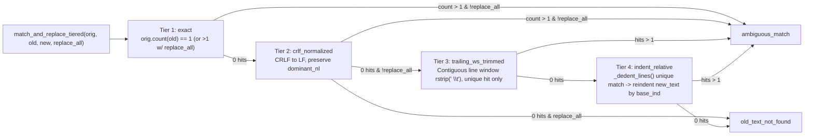

- **`match_and_replace_tiered()`（L856–L947）**：严格坚持“零歧义不变量”——任一层出现多处命中且非 `replace_all` 立即返回 `ambiguous_match`；`replace_all=True` 仅允许在 Tier 1/2 生效，防止模糊层级大范围误伤。
- **Fast-Apply `apply_sketch_edit()`（L950–L1037）**：用 `_SKETCH_MARKER_RE`（L824–L827）识别 `// ... existing code ...`、`# ... existing code ...`、`/* ... unchanged ... */`、`<!-- ... omitted ... -->` 等省略标记将草图切为有序段；无标记时走 `full_replace`，有标记时逐段按 `rstrip(" \t")` 顺序定位首/尾非空锚点行，拼接保留未修改区段，任一锚点缺失即抛 `sketch_anchor_not_found`。
- **事务写盘流水线**：`execute_fs_write`（L688–L821）、`execute_fs_edit`（L1040–L1164）、`execute_fs_sketch_edit`（L1167–L1269）均支持：`ask` 模式生成 `create_changeset_proposal`；自动模式在跨进程 `with cross_lock_cm:` 内先 `storage.verify_epoch()`、重解析路径并读取旧字节、触发 `on_before_mutate(target, pre_bytes, existed)` 检查点钩子，再执行 `_atomic_write_host_file()`（L651–L685：同目录 `mkstemp(".agent-patch-")` → `flush` + `os.fsync` → 继承权限或 `.sh=0o755`/`0o644` → `os.replace`）。

### 5.4 OS 内核级子进程沙箱 `HostKernelSandbox`

- **模式控制（L1385–L1455）**：通过 `AGENT_LAB_HOST_SANDBOX` 或显式参数支持 `auto`（默认，探测自检通过则启用，否则降级直跑）、`strict`（Fail-Closed，无可用内核沙箱即抛 `sandbox_unavailable`）、`off`（关闭）；探测结果缓存于 `_SANDBOX_PROBE_CACHE`（带 `_SANDBOX_PROBE_LOCK`）。
- **macOS Seatbelt SBPL（`build_macos_sbpl`，L1527–L1579）**：
  - 探测 `/usr/bin/sandbox-exec -p "(version 1)(allow default)" /usr/bin/true`（3s 超时）；
  - 路径经 `_sbpl_escape()` 转义 `\` 与 `"`；收集 `$HOME` 与 `pwd.getpwuid(os.getuid()).pw_dir` 双家目录及 `$TMPDIR`/`gettempdir()`/`/private/tmp`；
  - 利用 **SBPL Last-Match-Wins（最后匹配胜出）** 语义编排规则顺序：
    1. `(version 1)` `(allow default)`；
    2. `(deny file-read* ...)`：阻断 `_SENSITIVE_HOME_DIRS = (".ssh", ".aws", ".gnupg", ".config/gcloud", ".kube")` 与 `_SENSITIVE_HOME_FILES = (".netrc",)`；
    3. `(deny file-write*)` 后紧跟 `(allow file-write* ...)`：仅开放 `<ws_resolved>`、合法临时目录与 `/dev/null`、`/dev/zero`、`/dev/dtracehelper`、`/dev/tty`、`/dev/ptmx`、`^/dev/ttys[0-9]+$`；
    4. **关键覆盖段**：在 `(allow file-write* ...)` 之后追加 `(deny file-write* ...)` 显式锁死 `<ws_resolved>/.git`、`<ws_resolved>/.agent-lab` 以及全部宿主敏感目录/文件，防止沙箱内命令向 `.git/hooks` 或 `.agent-lab/settings.json` 植入持久化后门；
    5. 当 `allow_network=False`（默认）追加 `(deny network-outbound)`。
- **Linux bubblewrap（`build_linux_bwrap_argv`，L1582–L1631）**：
  - 组装：`bwrap --die-with-parent --ro-bind / / --dev /dev --proc /proc --tmpfs /tmp --bind <ws> <ws>`（若 `$TMPDIR != /tmp` 则额外 `--bind`）；
  - 在 `--bind <ws> <ws>` 之后对存在的非软链 `.git` 与 `.agent-lab` 覆写 **`--ro-bind`** 只读保护；
  - 对宿主敏感目录以空 `--tmpfs` 遮蔽，对 `.netrc` 以 `--ro-bind /dev/null` 遮蔽；
  - `allow_network=False` 时追加 `--unshare-net`。

### 5.5 终端命令执行与持久化 PTY/Pipe 后台进程管理器

#### `run_host_bash_command()`（L1784–L1931）

1. **消除 64KB 管道死锁与低延迟流式回调**：启动独立守护排水线程 `_drain_stream()`（L1699–L1757）分别消费 `stdout` 与 `stderr`，优先调用底层单次 `read(2)` 的 `read1(4096)` 逐行脱敏推送 `on_output(stream_name, line)`（单行超 4096B 未换行亦主动刷出防膨胀）；当 `bucket` 满 `_HOST_MAX_STREAM_BYTES = 32 KiB` 后置位 `overflow_flag[0] = True`，但**继续循环抽干直至 EOF**，彻底杜绝子进程写满内核管道阻塞或收到 `SIGPIPE`。
2. **独立进程组与 50ms 协作取消**：`subprocess.Popen(..., stdin=DEVNULL, start_new_session=True)` 使 `pgid = proc.pid`，超时夹紧至 `[1, 120]` 秒；若传入 `cancel_event`，以 `min(0.05, remaining)` 切片轮询 `proc.wait()`。
3. **两阶段孤儿进程组清场 `_terminate_process_group()`（L1760–L1781）**：`os.killpg(pgid, SIGTERM)` → `proc.wait(0.4)` → 250ms 窗口内每 30ms 以 `os.killpg(pgid, 0)` 探测孙进程存活 → `os.killpg(pgid, SIGKILL)` → `proc.wait(1.0)`；且在 `finally` 中无条件再发一次 `SIGKILL` 确保排水线程 `join(timeout=1.5)` 永不卡死。

#### `BackgroundProcessManager`（L1939–L2424）

- **配额与环形缓冲**：默认并发运行上限 `max_processes = 6`、总记录槽位 `max_processes * 4`（按 `ended_at` 驱逐最旧已退出进程）、单进程环形缓冲 `max_buffer_chars = 128 KiB`（配合单调递增字符偏移量 `base_offset` / `total_chars` / `next_offset`，读取偏移落后于 `base_offset` 时返回 `truncated_from_ring=True`）。
- **Pipe 与 PTY 双模**：`use_pty=True` 调用 `pty.openpty()` 将 `slave_fd` 绑定到子进程 `stdin`/`stdout`/`stderr` 并立刻在父进程关闭 `slave_fd`，注入 `TERM=xterm-256color`；`use_pty=False` 合并 `stderr=subprocess.STDOUT`。
- **防 FD 复用竞态的独占关闭权不变量（L2005–L2023、L2132–L2169）**：`_pty_reader` 线程通过 `select.select([fd], [], [], 0.1)` 消费 `master_fd`，并拥有 `master_fd` 的**独占关闭权**（`close_fds(close_master=True)`）；外部 `_terminate_item()` 必须先 `stop_event.set()` → `_reap_managed_process_group()` → `reader_thread.join(timeout=1.5)`，彻底杜绝在读线程仍阻塞于 `select`/`os.read` 时关闭 `master_fd` 引发的内核 FD 编号复用读写竞态。
- **幂等无条件进程组回收 `_reap_managed_process_group()`（L2025–L2039）**：在 `item.reap_lock` 串行保护下即使顶层 Shell 已退出仍执行 `_terminate_process_group()` 清剿孙进程，确认 `os.killpg(pgid, 0)` 抛 `ProcessLookupError` 后置 `pgid_reaped = True` 防 PID 复用误杀。

### 5.6 DNS-Pinned SSRF 防护 Web 抓取与多后端 Web 搜索

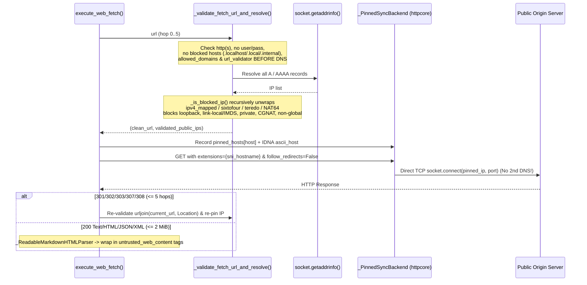

- **IPv6 隧道与特殊网段全解包 `_is_blocked_ip()`（L2608–L2644）**：递归解包 IPv6 `ipv4_mapped`（`::ffff:0:0/96`）、`sixtofour`（`2002::/16`）、`teredo`（同时检查 `server_ip` 与 `client_ip`）与 NAT64 知名网段 `64:ff9b::/96`（提取低 32 位 IPv4 复验），直接拦截 `64:ff9b:1::/48`（NAT64 本地网段）、`100.64.0.0/10`（CGNAT）、回环、链路本地/云元数据、私网/ULA、多播、未指定与任何 `not ip_obj.is_global`。
- **防 DNS Rebinding 与代理绕过（L2763–L2859、L3103–L3109）**：`_PinnedHTTPTransport` 设置 `verify=True, trust_env=False, max_keepalive_connections=0`，`_PinnedSyncBackend.connect_tcp()` 强制直连 `pinned_hosts` 中预校验的公网 IP（并在建连前再次调用 `_is_blocked_ip()`），HTTPS 请求通过 `extensions={"sni_hostname": ascii_host}` 保持原始域名 TLS SNI 与证书主机名校验。
- **响应体边界与不可信围栏（L2599–L2600、L3047–L3097）**：最多跟随 `_WEB_FETCH_MAX_REDIRECTS = 5` 次且每跳重验协议、域名白名单、策略回调与 DNS/IP；仅接受文本/JSON/XML/XHTML MIME；流式读取硬上限 `_WEB_FETCH_MAX_BYTES = 2 MiB`；HTML 经纯标准库 `_ReadableMarkdownHTMLParser`（跳过 `script`/`style`/`noscript`/`template`/`svg`/`head`）转 Markdown，按 `max_chars`（夹紧 `[200, 64000]`，默认 16000）截断并包裹于 `<untrusted_web_content url="...">...</untrusted_web_content>`。
- **`execute_web_search()`（L3134–L3262）**：按优先级支持 `AGENT_LAB_WEB_SEARCH_URL`（可选 `AGENT_LAB_WEB_SEARCH_API_KEY` Bearer，兼容 SearXNG/自定义 JSON）→ `BRAVE_SEARCH_API_KEY`/`BRAVE_API_KEY` → `TAVILY_API_KEY` → `SERPER_API_KEY`；均未配置时返回 `{"ok": False, "code": "web_search_unconfigured", ...}`；统一归一化为 `title[:300]`、`url[:1000]`、`snippet[:1000]` 并标 `trust="untrusted_web_content"`。

### 5.7 失败模式、错误码与源码符号索引

- **典型 `HostToolError` 错误码**：`unsafe_path`, `secret_access_forbidden`, `not_found`, `file_too_large`, `binary_file`, `empty_patch`, `old_text_not_found`, `ambiguous_match`, `sketch_anchor_not_found`, `invalid_regex`, `invalid_sandbox_mode`, `sandbox_unavailable`, `command_blocked`, `process_limit_exceeded`, `process_not_found`, `process_not_running`, `stdin_write_failed`, `background_not_configured`, `invalid_url`, `ssrf_blocked`, `domain_not_allowed`, `url_policy_denied`, `dns_resolution_failed`, `redirect_error`, `too_many_redirects`, `unsupported_content_type`, `fetch_timeout`, `fetch_error`, `dependency_missing`, `invalid_query`, `search_timeout`, `search_error`。

| 符号名 | 精确行号 | 职责摘要 |
| --- | --- | --- |
| `_HOST_MAX_FILE_BYTES`, `_HOST_MAX_GLOB_RESULTS`, `_HOST_MAX_GREP_MATCHES`, `_HOST_MAX_STREAM_BYTES` | L107–L113 | 512 KiB / 200 / 60 / 32 KiB 核心配额常量 |
| `is_host_secret_segment`, `resolve_host_workspace_path` | L146–L274 | 敏感段判定与五阶纵深路径校验流水线 |
| `HOST_TOOL_SPECS`, `BACKGROUND_PROCESS_TOOL_SPECS`, `WEB_TOOL_SPECS`, `LSP_TOOL_SPECS` | L282–L557 | 14 个工具 JSON Schema 契约 |
| `_walk_workspace_files`, `execute_fs_read`, `_atomic_write_host_file`, `execute_fs_write` | L560–L821 | `.gitignore` 剪枝遍历、分页读、POSIX 原子写与事务写 |
| `match_and_replace_tiered`, `apply_sketch_edit`, `execute_fs_edit`, `execute_fs_sketch_edit` | L856–L1269 | 四级确定性局部编辑与 Fast-Apply 草图拼接 |
| `_glob_matches`, `execute_fs_glob`, `execute_fs_grep` | L1272–L1378 | 增强 Glob 与受限行长正则 Grep |
| `HostKernelSandbox` (`build_macos_sbpl`, `build_linux_bwrap_argv`, `build_sandboxed_shell_argv`) | L1437–L1668 | macOS Seatbelt SBPL 与 Linux `bwrap` 内核沙箱 |
| `_drain_stream`, `_terminate_process_group`, `run_host_bash_command` | L1699–L1931 | 防 64KB 管道死锁排水、流式回调与进程组回收 |
| `_ManagedBackgroundProcess`, `_reap_managed_process_group`, `BackgroundProcessManager` | L1939–L2424 | Pipe/PTY 后台进程状态机、环形缓冲与独占 FD 关闭 |
| `execute_bash_tool` | L2458–L2592 | 权限裁决、提案挂起、Epoch 栅栏与前/后台执行编排 |
| `_is_blocked_ip`, `_validate_fetch_url_and_resolve`, `_build_pinned_http_transport`, `execute_web_fetch`, `execute_web_search` | L2608–L3262 | DNS-Pinned SSRF 防护抓取与多后端 Web 搜索 |

---

## 第 6 章：硬化 Docker 测试沙箱、远程 HTTP 沙箱与烟雾验证 — `sandbox.py` & `scripts/sandbox_smoke.py`

### 6.1 模块定位与双进程防伪回执架构

- **源码路径**：[`src/agent_lab/sandbox.py`](../../src/agent_lab/sandbox.py)（L1–L1661）与 [`scripts/sandbox_smoke.py`](../../scripts/sandbox_smoke.py)（L1–L319）
- **核心角色**：在受保护验收测试执行中建立不可伪造的容器隔离边界。相比简单执行 `docker run ... pytest` 仅凭退出码 `0` 判定通过（恶意代码可直接 `os._exit(0)` 或向 stdout 打印伪造成功文本），本模块引入 **外层 Supervisor + 32 字节随机密钥 HMAC-SHA256 独立管道回执 + 内层 `sys.addaudithook` 进程隔离**。

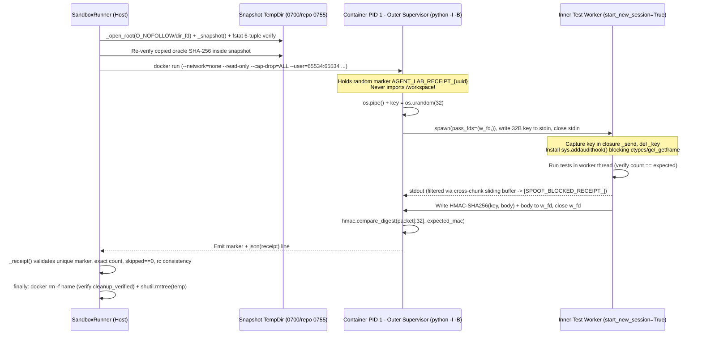

### 6.2 `SandboxPolicy` 只收紧配额与 Docker 硬化参数

- **`SandboxPolicy`（L422–L468）**：所有配额均由 `__post_init__` 校验“只可收紧、不可放宽”，镜像名强制锁定为 `"python:3.12-slim"`（运行前先经 `docker image inspect` 固化解析为不可变 `sha256:<64hex>` `image_id`，永不自动拉取镜像）。

| 策略字段 / Docker 标志 | 硬上限 / 固定值（源码行号） | 安全目的 |
| --- | --- | --- |
| `image` | `"python:3.12-slim"`（L426, L436） | 固定基础镜像并绑定 `sha256` 摘要 |
| `timeout_seconds` | `(0, 30]`，默认 `30`（L427, L441） | 容器墙钟超时（Supervisor 内部宽限 `timeout + 2.0s`） |
| `output_limit_bytes` | `<= 16_384`（16 KiB，L428） | `_capture()` 最多读 `limit+1` 字节，超限即杀 |
| `max_files` / `max_file_bytes` / `max_total_bytes` | `128` / `65_536` (64 KiB) / `2_097_152` (2 MiB)（L429–L431） | 限制快照文件数、单文件与总大小 |
| `max_entries` / `max_depth` | `4096` / `16`（L432–L433） | 流式 `os.scandir` 防止目录项与深度爆炸 |
| `_SANDBOX_SEMAPHORE` | `AGENT_LAB_SANDBOX_CONCURRENCY`（默认 `4`，L342–L349） | 有界并发槽位，支持 50ms 切片 `cancel_event` 排队取消 |
| `_LIMIT_FLAGS`（13 项，L350–L364） | `--pull=never`, `--network=none`, `--read-only`, `--cap-drop=ALL`, `--security-opt=no-new-privileges`, `--pids-limit=64`, `--memory=128m`, `--memory-swap=128m`, `--cpus=1`, `--user=65534:65534`, `--ulimit=nofile=128:128`, `--ulimit=core=0:0`, `--log-driver=none` | 禁网、只读根、零 Capability、禁提权、禁核心转储、防 Fork 炸弹与 OOM、非 root `nobody` 运行 |
| 挂载与环境（L1084–L1093） | `--tmpfs /tmp:rw,noexec,nosuid,size=16m`、`--mount type=bind,source=<snap>,target=/workspace,readonly`、仅注入 `PYTHONDONTWRITEBYTECODE=1` 与 `PYTHONNOUSERSITE=1` | 绝不挂载原工作区，绝不透传宿主机环境变量 |

### 6.3 无 TOCTOU 快照复制与双进程防伪回执机制

1. **逐级 `dir_fd` + `O_NOFOLLOW` 无竞态快照（L515–L818）**：
   - `_open_directory()` 使用 `O_DIRECTORY | O_NOFOLLOW | O_CLOEXEC`（中间穿越段在 Linux 支持时优先 `O_PATH`）；遇到父目录 `EACCES`/`EPERM` 时回退 `_verify_prefixes_and_open_root()`（逐前缀 `os.lstat` + 打开后 `fstat` 核验 `(st_dev, st_ino)`）。
   - `_snapshot()` / `_snapshot_suite()` 用 `os.scandir(directory_fd)` 流式遍历，跳过隐藏项、敏感文件名（`_SENSITIVE_NAMES` / `_SENSITIVE_STEMS`），拒符号链接、多重硬链接与特殊文件；打开每个 `.py`（及 suite 模式下 `tests/` 下的 `_SUITE_FIXTURE_SUFFIXES`）使用 `os.open(name, O_RDONLY | O_NOFOLLOW | O_NONBLOCK, dir_fd=directory_fd)`（防 `lstat` 后替换成 FIFO 挂起宿主线程），读取前后比对 6 元组签名 `(st_dev, st_ino, st_size, st_mtime_ns, st_ctime_ns, st_nlink)`，复制落盘后设为 `0o444`，并在**快照目录内**二次核验 Oracle SHA-256。
   - `discover_test_oracles()`（L386–L419）：仅用宿主机 `ast.parse` 静态遍历 `tests/**/*.py`，统计 `Test*`/`*TestCase` 类内 `test*` 方法与模块顶层 `def test_*`/`async def test_*` 数量，绝不导入待测代码。
2. **外层 Supervisor 与内层审计钩子（L58–L328）**：
   - 外层 Supervisor 从不导入 `/workspace`；为每次运行生成 32 字节密钥 `os.urandom(32)` 经子进程 `stdin` 一次性送入后关闭 `stdin`；同时以 `selectors.DefaultSelector` 多路复用读取 `child.stdout` 与回执管道 `r_fd`（回执上限 8192B）。
   - **跨 chunk 防伪造清洗（L254–L290）**：维护滑动尾缓冲 `pending`，将子进程输出流中任何跨 chunk 拼接出现的 `b"AGENT_LAB_RECEIPT_"` 替换为 `b"[SPOOF_BLOCKED_RECEIPT_]"`，彻底防止待测代码伪造回执前缀。
   - **内层 `sys.addaudithook(_audit)`（L93–L119）**：阻断 `ctypes.*`、导入 `ctypes`/`_ctypes`、`gc.get_objects`/`get_referrers`/`get_referents`、`sys._current_frames`/`_current_exceptions`，以及来自 `<string>` 或非标准库/`inspect.py` 的 `sys._getframe`（防止恶意测试代码通过内存反射或栈帧遍历窃取闭包里的 32 字节 HMAC 密钥）。
   - 子进程在独立工作线程 `_run_tests_in_worker` 中执行测试，结束后由闭包 `_send(receipt)` 写入 `HMAC-SHA256(key, body) + body`；Supervisor 用 `hmac.compare_digest` 恒定时间验签，宿主 `_receipt()`（L912–L940）再校验唯一 marker、计数器类型/范围、`tests_run == expected`、`skipped == 0`、`successful == (failures == errors == 0)` 及 `returncode` 一致性。
3. **容器清理验证与孤儿回收**：不依赖 `--rm`，而在 `finally` 中显式执行 `docker rm -f <name>` 并记录 `cleanup_verified`；若容器清理或临时目录 `shutil.rmtree` 失败，即便测试已通过也会把 `code` 降级为 `sandbox_cleanup_failed`、`ok=False`。`reap_orphan_containers()`（L1400–L1472）扫描带 `agent-lab.managed=1` 标签且 `agent-lab.expires-at <= now` 的孤儿容器强制清理。

### 6.4 远程 HTTP 沙箱工作节点与 `sandbox_smoke.py` 实测探针

- **`RemoteHTTPSandboxBackend`（L1475–L1580）**：配置 `AGENT_LAB_SANDBOX_URL`（仅允许 `http://`/`https://`）与 `AGENT_LAB_SANDBOX_TOKEN` Bearer 鉴权后，将本地已完成安全校验与快照打包的 `files_b64` POST 至 `/api/internal/sandbox/execute`，透传 W3C `traceparent`，禁用重定向（`follow_redirects=False`），严格校验远端返回 `code` 合法性及“若 `ok=True` 必有 `code=='passed'` 且 `tests_executed is True`”（防矛盾伪造回执 `remote_contradictory_receipt`），并剔除远端伪造的本地摘要字段。服务端入口 `execute_remote_sandbox_payload()`（L1583–L1661）复验路径、Base64、深度与体积配额后委托本地 `SandboxRunner(remote_url="")` 执行并核对 `snapshot_sha256` 一致性。
- **`scripts/sandbox_smoke.py`（L1–L319）**：在已备 `python:3.12-slim` 镜像的真实 Docker 环境中输出原子报告 `reports/sandbox-smoke.json`，覆盖 **7 项真实行为验证**：
  1. `baseline_bug`：验证未修复样本必报 `tests_failed` 且 `tests_executed=True`；
  2. `approval_workflow` / `approved_fix`：走完整 `AgentRuntime` 审批流应用补丁后 `passed`；
  3. `isolation_smoke`（`ISOLATION_PROBE`, L31–L104）：在容器内真实断言 `uid/euid != 0`、`os.statvfs("/").f_flag & ST_RDONLY` 与工作区只读挂载、写入根与工作区报 `EROFS/EACCES/EPERM`、`/proc/net/dev` 仅含 `{"lo"}` 且连接 `1.1.1.1:443` 失败、宿主哨兵环境变量 `AGENT_LAB_SANDBOX_HOST_SENTINEL` 未泄漏、`/var/run/docker.sock` 与 `/run/docker.sock` 不存在、`/proc/self/status` 中 `CapEff == 0`、`NoNewPrivs == 1`、`Seccomp == 2`、工作区 `.env` 与宿主机外部哨兵文件不可读且宿主原文件未被修改；
  4. `timeout-repo`（5s 策略 + `time.sleep(3600)`）→ 断言 `sandbox_timeout` 与 `cleanup_verified=True`；
  5. `output-repo`（2048B 上限 + 无限 `os.write(1, ...)`）→ 断言 `sandbox_output_limit` 且输出 `<= 2048B`；
  6. `early_exit`（`os._exit(0)`）→ 断言 `sandbox_incomplete`；
  7. `receipt_spoof`（伪造 `AGENT_LAB_RECEIPT_000...` 后 `os._exit(0)`）→ 断言 `sandbox_incomplete` 且输出含 `[SPOOF_BLOCKED_RECEIPT_]`，最终执行 `reap_orphan_containers()`。

### 6.5 错误码集合与源码符号索引

- **`SANDBOX_FAILURE_CODES`（11 个，L32–L46）**：`tests_failed`, `no_tests_ran`, `test_count_mismatch`, `timeout`, `sandbox_timeout`, `sandbox_output_limit`, `sandbox_incomplete`（退出码 137 时额外标注 `oom_killed=True`）, `sandbox_oom`, `sandbox_snapshot_limit`, `unsafe_workspace`, `test_oracle_modified`。
- **`SANDBOX_INFRA_CODES`（6 个，L47–L56）**：`sandbox_unavailable`, `sandbox_cancelled`, `image_missing`, `daemon_error`, `sandbox_error`, `sandbox_cleanup_failed`。

| 符号名 | 精确行号 | 职责摘要 |
| --- | --- | --- |
| `_CHILD_PREAMBLE`, `_SINGLE_CHILD_TAIL`, `_SUITE_CHILD_TAIL`, `_build_supervisor_driver` | L58–L332 | 双进程 HMAC-SHA256 驱动、跨 chunk 伪造过滤与 `sys.addaudithook` |
| `_LIMIT_FLAGS`, `SandboxPolicy`, `_acquire_sandbox_slot` | L350–L498 | 13 项硬化标志、只收紧策略模型与协作取消并发信号量 |
| `discover_test_oracles` | L386–L419 | 纯宿主 AST 静态测试计数与 Oracle 摘要发现 |
| `SandboxRunner` (`_open_root`, `_snapshot`, `_snapshot_suite`, `_capture`, `_receipt`, `run`, `run_suite`) | L501–L1397 | 无 TOCTOU 快照、受限输出捕获、回执核验与容器清理验证 |
| `reap_orphan_containers` | L1400–L1472 | 过期受管孤儿容器扫描与强删 |
| `RemoteHTTPSandboxBackend`, `execute_remote_sandbox_payload` | L1475–L1661 | 远程 HTTP 沙箱客户端与服务端执行入口 |
| `ISOLATION_PROBE`, `isolation_smoke`, `resource_limit_smoke`, `incomplete_run_smoke` | [`scripts/sandbox_smoke.py`](../../scripts/sandbox_smoke.py) L31–L253 | 7 项端到端真实 Docker 隔离与防伪回执验证 |

---

## 第 7 章：Brain/Hands 解耦执行后端 — `execution_backend.py`

### 7.1 模块定位与 `WorkspaceExecutionBackend` 异步协议

- **源码路径**：[`src/agent_lab/execution_backend.py`](../../src/agent_lab/execution_backend.py)（L1–L1218，共 1,218 行）
- **核心角色**：借鉴 Anthropic Managed Agents 的 **Brain/Hands 解耦架构**，将控制面（Brain：提示词编排、权限与 DLP 裁决、LLM 凭据托管）与工作区执行面（Hands：文件读写编辑与命令执行）彻底隔离在 `@runtime_checkable class WorkspaceExecutionBackend(Protocol)`（L105–L140）之后，统一暴露 6 个异步接口：`read_file`、`write_file`、`edit_file`、`exec_command`、`snapshot_info` 与幂等 `aclose`，支持按隔离等级 `IsolationLevel = Literal["host_kernel", "container", "microvm"]`（L67）无缝切换。

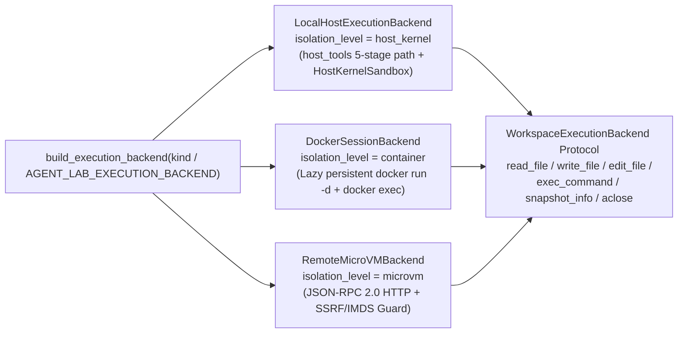

### 7.2 三类执行后端与工厂路由详述

| 后端类 | `backend_kind` / `isolation_level` | 工厂别名（`build_execution_backend` L1175–L1206） | 文件操作实现 | 命令执行与隔离机制 |
| --- | --- | --- | --- | --- |
| `LocalHostExecutionBackend`（L319–L426） | `"local"` / `"host_kernel"` | `local`, `host`, `host_kernel`（默认） | `asyncio.to_thread` 复用 `resolve_host_workspace_path` + `match_and_replace_tiered` + `_atomic_write_host_file` | `run_host_bash_command`（`HostKernelSandbox` + `build_scrubbed_env`，超时夹紧 `[1.0, 120.0]s`） |
| `DockerSessionBackend`（L458–L814） | `"docker"` / `"container"` | `docker`, `container`, `docker_session` | 宿主机侧共享本地工作区安全文件助手（挂入 `/workspace:rw`） | 按会话惰性启动持久化容器（`asyncio.Lock` 串行 `_ensure_container`）→ `docker exec` → `aclose()` 强删容器 |
| `RemoteMicroVMBackend`（L952–L1167） | `"microvm"` / `"microvm"` | `microvm`, `remote`, `remote_microvm`, `firecracker`, `kata`, `e2b`, `daytona` | 先经 `_validate_remote_rel_path` 词法防穿越/防密钥，再发 `workspace.*` JSON-RPC 2.0 | 远端 Firecracker/Kata/E2B/Daytona 节点 HTTP JSON-RPC 2.0（`AGENT_LAB_MICROVM_ENDPOINT` / `AGENT_LAB_MICROVM_TOKEN`） |

#### 1. `DockerSessionBackend` 容器硬化参数与生命周期（L458–L814）

- **入参安全正则验证（L74–L77、L478–L499）**：拒绝工作区路径含 `:`/`\x00`/`\n`/`\r`；严格校验镜像名 `_DOCKER_IMAGE_RE`、内存 `_DOCKER_MEMORY_RE`（默认 `"512m"`）、CPU `_DOCKER_CPUS_RE`（默认 `"1.0"`，`(0, 128]`）、`pids_limit`（默认 `128`，`[16, 4096]`）与 `session_id` `_SAFE_SESSION_ID_RE`（`^[A-Za-z0-9_.-]{1,64}$`）。
- **持久化容器启动命令 `build_run_argv()`（L523–L553）**：`docker run -d --init --name agent-lab-session-<sid[:40]> --network=none --cap-drop=ALL --security-opt=no-new-privileges --read-only --tmpfs /tmp:rw,size=64m --memory=<mem> --cpus=<cpus> --pids-limit=<pids> --label agent_lab.managed=1 --label agent_lab.session=<sid> -v <ws>:/workspace:rw -w /workspace <image> sh -c "trap 'exit 0' TERM INT; while :; do sleep 3600 & wait $!; done"`；启动超时 30s，父进程环境经 `build_scrubbed_env()` 脱敏。
- **零凭据命令执行 `build_exec_argv()`（L555–L582）**：通过 `docker exec -w /workspace[/<rel_cwd>]` 仅注入 4 个防挂起变量（`GIT_TERMINAL_PROMPT=0`, `PAGER=cat`, `GIT_PAGER=cat`, `PYTHONUNBUFFERED=1`），绝不传入宿主 LLM API Key；`stdout`/`stderr` 由异步 `_drain_async_stream()` 持续抽干并限制单流保留 `_MAX_STREAM_BYTES = 32 KiB`，输出经 `redact_secrets()` 脱敏；超时范围 `[0.5, 300.0]s`。
- **幂等销毁 `aclose()`（L785–L814）**：锁内原子取出 `_container_id` 并置 `_closed=True`，调用 `docker rm -f <cid>`（10s 超时）。

#### 2. `RemoteMicroVMBackend` JSON-RPC 2.0 与 IMDS/SSRF 护栏（L822–L1167）

- **静态 + 实时 DNS 双层 SSRF/IMDS 防护（L822–L949）**：
  - `validate_microvm_endpoint_url()` 仅允许 `http`/`https`，拒绝控制字符、内嵌 `username`/`password`、`#fragment` 与非法端口；拦截 `_BLOCKED_METADATA_HOSTS`（`metadata.google.internal`, `metadata.goog`, `metadata`, `instance-data`, `metadata.azure.internal`, `metadata.aws.internal`, `169.254.169.254`, `fd00:ec2::254`）与 `metadata.*.internal`；
  - **IPv4 混淆抗绕过（L900–L907）**：当 `ipaddress.ip_address(host)` 无法直接解析时，进一步调用 `socket.inet_aton(host)` 捕获十进制/十六进制/八进制与简写 IPv4（如 `2852039166`、`0xa9fea9fe`、`127.1`）；
  - `_is_blocked_microvm_ip()` 递归解包 IPv6 `ipv4_mapped`/`sixtofour`/`teredo`/`NAT64`（`64:ff9b::/96`），**无论 `allow_private_network` 取何值，无条件阻断**链路本地（含 `169.254.169.254`）、阿里云 IMDS（`100.100.100.200/32`）、AWS IPv6 IMDS（`fd00:ec2::254/128`）、未指定、多播与保留网段；默认阻断回环、私网与 CGNAT（`100.64.0.0/10`），仅在显式 `allow_private_network=True` 时放行回环与私网测试节点；
  - `_validate_microvm_dns()` 在每次真实 `_rpc_call`（`self._transport is None`）前异步解析全部 A/AAAA 记录防 DNS Rebinding。
- **协议与链路追踪（L1010–L1160）**：5 个标准 JSON-RPC 2.0 方法：`workspace.read_file`、`workspace.write_file`、`workspace.edit_file`、`workspace.exec_command`、`workspace.snapshot_info`；请求头携带 W3C `traceparent`、`X-Session-Id` 与可选 `Authorization: Bearer <token>`；强制 `follow_redirects=False`，收到 3xx 立即抛 `remote_redirect_blocked`；`__repr__()` 与 `snapshot_info()` 仅暴露 `auth_configured: bool`，绝不回显 token。

### 7.3 核心不变量、错误码与源码符号索引

- **典型 `ExecutionBackendError` 错误码**：`invalid_workspace`, `invalid_timeout`, `backend_closed`, `invalid_command`, `unsafe_path`, `secret_access_forbidden`, `unsafe_workspace_path`, `invalid_docker_image`, `invalid_memory_limit`, `invalid_cpus`, `invalid_pids_limit`, `invalid_session_id`, `docker_unavailable`, `docker_start_timeout`, `docker_start_failed`, `invalid_url`, `blocked_scheme`, `credentials_in_url`, `ssrf_blocked`, `dns_resolution_failed`, `remote_timeout`, `remote_transport_error`, `remote_redirect_blocked`, `remote_http_<status>`, `remote_invalid_json`, `remote_invalid_payload`, `remote_rpc_error`, `remote_invalid_result`, `missing_workspace`, `missing_endpoint_url`, `invalid_backend_kind`。

| 符号名 | 精确行号 | 职责摘要 |
| --- | --- | --- |
| `IsolationLevel`, `ExecutionBackendError`, `WorkspaceExecutionBackend` | L67–L140 | 隔离级别枚举、结构化错误与异步后端协议 |
| `_validate_remote_rel_path` | L293–L311 | 远端 MicroVM 相对路径词法防穿越与密钥拦截 |
| `LocalHostExecutionBackend` | L319–L426 | 本地 OS 内核沙箱执行后端 |
| `_drain_async_stream`, `DockerSessionBackend` | L434–L814 | 异步流抽干与持久化硬化 Docker 会话后端 |
| `_is_blocked_microvm_ip`, `validate_microvm_endpoint_url`, `_validate_microvm_dns`, `RemoteMicroVMBackend` | L822–L1167 | SSRF/IMDS 校验与 MicroVM JSON-RPC 2.0 驱动 |
| `build_execution_backend` | L1175–L1206 | 基于环境变量/参数的统一执行后端工厂 |

---

## 第 8 章：本地沙箱程序化工具编排引擎 — `ptc.py`

### 8.1 模块定位与双通道 FD 隔离架构

- **源码路径**：[`src/agent_lab/ptc.py`](../../src/agent_lab/ptc.py)（L1–L961，共 961 行）
- **核心角色**：实现受 Anthropic Programmatic Tool Calling 启发的本地只读编排引擎（工具契约 `PTC_TOOL_SPECS` -> `ptc_exec`，L116–L164）。模型可在单次 LLM 回合提交一段 Python 3 脚本，通过 `call_tool(name, **kwargs)` 或 `tools.<name>(**kwargs)` 在隔离无网子进程中批量循环调用只读工具、在脚本内部过滤聚合，仅通过 `print()` 输出紧凑摘要进入上下文，显著压缩多跳检索的 Token 膨胀与往返延迟。

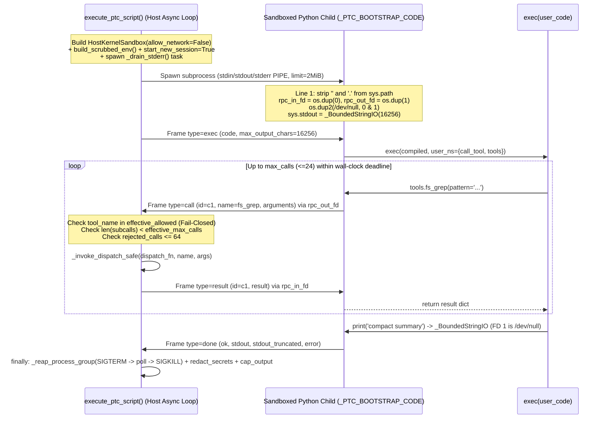

### 8.2 核心数据结构、安全配额表与关键机制

1. **双通道 FD 隔离与反帧伪造（`_PTC_BOOTSTRAP_CODE` L218–L255）**：
   - 启动首行即清洗 `sys.path = [p for p in sys.path if p not in ("", ".")]`（L181），防止工作区内恶意 `json.py`、`io.py`、`os.py` 劫持标准库导入。
   - 立即 `os.dup(0)` / `os.dup(1)` 保存私密 RPC 通道文件描述符，并将原始 FD 0/1 通过 `os.dup2` 重定向至 `/dev/null`，同时将 `sys.stdout` / `sys.__stdout__` 替换为 `_BoundedStringIO`（L189–L215，按字符上限硬截断并置位 `truncated`）。由此无论用户代码执行 `print()`、第三方库写 `sys.stdout`，还是直接底层 `os.write(1, b'{"type":"done",...}')`，均无法污染或伪造 JSON-RPC 帧流。
2. **20 工具 Fail-Closed 只读白名单 `PTC_DEFAULT_ALLOWED_TOOLS`（L70–L96）**：
   - 取自 `READONLY_HOST_TOOLS` 的严格无副作用子集（显式排除 `memory_write`、`working_memory_write`、`subagent_run`、`ask_user_question`、`enter_plan_mode`/`exit_plan_mode`、`ptc_exec` 等状态变更/交互/递归入口）：
     `fs_read`, `fs_grep`, `fs_glob`, `repo_list`, `repo_read`, `repo_search`, `repo_map`, `symbol_search`, `knowledge_search`, `memory_read`, `memory_search`, `skill_search`, `skill_inspect`, `lsp_query`, `mcp_tool_search`, `mcp_list_resources`, `mcp_read_resource`, `a2a_list_agents`, `a2a_discover_agent`, `a2a_get_task`。
   - `filter_ptc_allowed_tools()`（L357–L371）与 `execute_ptc_script()`（L686–L689）始终强制 `- {"ptc_exec"}` 消除无限递归嵌套；任何不在白名单的调用（如 `fs_write`、`bash_exec`）绝不触发 `dispatch_fn`，直接返回 `{"ok": False, "code": "ptc_tool_not_allowed"}`。

| 配额常量 | 精确值（源码行号） | 约束对象 |
| --- | --- | --- |
| `PTC_MAX_SUBCALLS` / `PTC_DEFAULT_MAX_CALLS` | `24` / `16`（L98, L102） | 单次脚本最大/默认有效子工具调用次数（超限返回 `ptc_max_calls_exceeded`） |
| `PTC_MAX_TIMEOUT_SECONDS` / `PTC_DEFAULT_TIMEOUT_SECONDS` | `45` 秒 / `20` 秒（L99, L101） | 全程统一墙钟截止时间上限/默认值 |
| `PTC_MAX_OUTPUT_CHARS` | `16000` 字符（L100） | `_cap_output()` 脱敏并截断上限（附加 `\n... [output truncated]`） |
| `PTC_MAX_CODE_CHARS` | `32000` 字符（L103） | 脚本源码长度硬上限 |
| `_PTC_MAX_RPC_LINE_BYTES` | `2 * 1024 * 1024`（2 MiB，L105） | `StreamReader` 与 `_read_rpc_line()` 单帧体积上限防 OOM |
| `_PTC_MAX_STDERR_BYTES` / `_PTC_MAX_ERROR_CHARS` | `8 KiB` / `4000` 字符（L106–L107） | `stderr` 抽干保留前缀上限与报错截断上限 |
| `_PTC_MAX_REJECTED_CALLS` | `64` 次（L108） | 连续非法/越权/超配额调用超过 64 次立即中止脚本防 RPC 管道泛洪 |

### 8.3 并发取消、失败模式与源码符号索引

- **无损截止时间与双事件取消 `_await_with_deadline_and_cancel()`（L473–L500）**：同时兼容 `threading.Event` 与 `asyncio.Event`，将协程包装为单个 `Task` 后按 50ms 切片 `asyncio.wait(timeout=step)`，避免反复取消底层 `StreamReader.readline()` 导致流状态损坏。
- **两阶段进程组清场 `_reap_process_group()`（L544–L594）**：`finally` 块始终关闭 `stdin`，以 `os.killpg(pgid, 0)` 检测进程组存活，先发 `SIGTERM`（`grace_seconds=0.35` 并每 30ms 轮询存活）再发 `SIGKILL` 彻底回收子孙进程，并设 0.5s 超时汇聚 `stderr_task` 防止孤儿管道阻塞。
- **错误码**：`ptc_tool_not_allowed`, `ptc_max_calls_exceeded`, `ptc_invalid_arguments`, `ptc_subcall_error`。

| 符号名 | 精确行号 | 职责摘要 |
| --- | --- | --- |
| `PTC_DEFAULT_ALLOWED_TOOLS`, `PTC_MAX_*`, `PTC_TOOL_SPECS` | L70–L164 | 20 工具只读白名单、核心配额常量与 `ptc_exec` Schema |
| `_PTC_BOOTSTRAP_CODE` (`_BoundedStringIO`, `call_tool`, `_ToolsProxy`) | L179–L345 | 子进程 `sys.path` 清洗、FD 隔离与同步 JSON-RPC 代理 |
| `filter_ptc_allowed_tools`, `build_ptc_subprocess_argv` | L357–L389 | 白名单交集构造与禁网 `HostKernelSandbox` 启动参数 |
| `_read_rpc_line`, `_drain_stderr`, `_await_with_deadline_and_cancel`, `_reap_process_group` | L439–L594 | 有界帧读、防死锁 stderr 排水、协作取消与进程组回收 |
| `execute_ptc_script` | L602–L946 | PTC 异步桥接主循环与脱敏结果封装 |

---

## 第 9 章：Cursor 风格影子工作区写前验证引擎 — `shadow_workspace.py`

### 9.1 模块定位与写前推测性验证流水线

- **源码路径**：[`src/agent_lab/shadow_workspace.py`](../../src/agent_lab/shadow_workspace.py)（L1–L1283，共 1,283 行）
- **核心角色**：实现 Cursor Shadow Workspace 风格的写前推测性隔离验证引擎（工具契约 `SHADOW_TOOL_SPECS` -> `shadow_verify_edits`，L1183–L1276）。在改动真实工作区（`live_workspace`）任意字节之前，安全克隆隔离影子副本、试应用候选编辑集（`write`/`edit`/`sketch_edit`/`delete`）、串联三层自动验证，并通过前后 SHA-256 守恒核验确保真实工作区毫发无损。

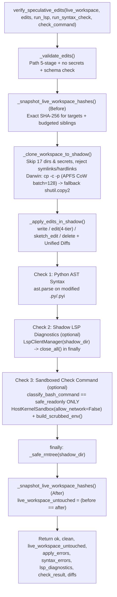

### 9.2 核心克隆策略、配额表与 SHA-256 守恒不变量

| 常量 / 参数 | 精确值（源码行号） | 作用说明 |
| --- | --- | --- |
| `_SHADOW_SKIP_DIRS`（17 个，L71–L91） | `.git`, `.hg`, `.svn`, `.venv`, `venv`, `node_modules`, `__pycache__`, `dist`, `build`, `.mypy_cache`, `.pytest_cache`, `.ruff_cache`, `.agent-lab`, `.ssh`, `.gnupg`, `.aws`, `.kube` | 原地剪枝，避免克隆版本库、依赖树与密钥目录 |
| 额外敏感文件拦截（L94–L96） | 在 `is_host_secret_segment()` 基础上追加 `.netrc`, `.pypirc`, `.npmrc`, `id_ecdsa*`, `id_dsa*`, `*.jks`, `*.keystore` | 零密钥进入影子克隆区 |
| `_SHADOW_MAX_EDITS` / Schema `maxItems` | `64`（内部，L101） / `32`（工具 Schema，L1198） | 单次影子验证编辑条数上限 |
| `_SHADOW_MAX_CLONE_FILES` / `_SHADOW_MAX_CLONE_FILE_BYTES` | `20_000` 文件 / `16 MiB` 单文件（L102–L103） | 防止巨型资产拖垮克隆耗时 |
| `_SHADOW_CP_BATCH_SIZE` | `128` 文件/批（L104） | Darwin APFS `/bin/cp -c -p` 批处理大小 |
| `_SHADOW_MAX_STREAM_BYTES` / `_SHADOW_MAX_DIFF_CHARS` | `32 KiB` / `32_768` 字符（L105–L106） | 校验命令单流上限与每文件 Diff 截断上限 |
| `_SHADOW_HASH_BUDGET_FILES` / `_SHADOW_HASH_BUDGET_BYTES` | `2000` 文件 / `32 MiB`（L107–L108） | 兄弟文件全量 SHA-256 预算（超出后降级为 `stat:{size}:{mtime_ns}`） |

#### 关键工程不变量

1. **APFS Copy-on-Write 批量克隆与透明降级（L248–L288、L425–L532）**：
   - 影子目录创建于 `<tempdir>/agent-lab-shadow/shadow-*`（权限 `0o700`），遍历时排除 `shadow_root_resolved` 与 `shadow_dir` 自身防递归嵌套，每项经 `os.lstat` 拒绝符号链接（`S_ISLNK`）、非常规文件及多重硬链接（`st_nlink != 1`）。
   - 在 macOS（`sys.platform == "darwin"`）上以 128 文件为一批调用 `/bin/cp -c -p -- <src...> <dst_dir>`（30s 超时）利用 APFS 克隆（零数据块拷贝、独立 inode）；一旦遭遇跨卷 `EXDEV` 或非 APFS 文件系统导致非零退出，自动将 `use_apfs_cow` 置为 `False` 并用 `_copy_regular_file_fallback()`（`shutil.copy2(..., follow_symlinks=False)`）补齐剩余文件。
2. **真实工作区零污染 SHA-256 守恒不变量（L162–L228、L1055、L1126–L1139）**：
   - 验证前先对全部目标路径（无论大小强制精确 SHA-256，缺失记 `None`）及预算内兄弟文件采样 `before_hashes`；销毁影子区后重采 `after_hashes`。
   - `ok = live_workspace_untouched and len(apply_errors) == 0`；`clean = ok and len(syntax_errors) == 0 and not has_lsp_errors and check_ok`（仅当 `lsp_diagnostics` 中出现 `severity == "error"` 或 `severity_code == 1` 才拉低 `clean`，Warning 不阻塞）。
3. **验证命令只读 + 无网沙箱双保险（L872–L990）**：
   - `_run_shadow_check_command()` 强制要求 `classify_bash_command(cmd_str)["classification"] == "safe_readonly"`（拒绝任何 `mutating`/`blocked` 命令并返回 `code="unsafe_check_command"`），再以 `HostKernelSandbox.build_sandboxed_shell_argv(..., allow_network=False)` + `build_scrubbed_env()` + `start_new_session=True` 运行于 `shadow_dir`；所有超时、取消与 `finally` 路径均经 `_terminate_async_process_group()`（`SIGTERM` 0.4s → `SIGKILL`）回收进程组。

### 9.3 失败模式、降级策略与源码符号索引

- **影子 LSP 优雅降级（L1087–L1113）**：剩余时间 `> 0.2s` 时才拉起 `LspClientManager(shadow_dir)`，单文件超时按 `min(2.5, max(0.3, remaining / N))` 均分，未安装语言服务器或单文件异常均静默跳过，且 `finally` 必调 `await lsp_manager.close_all()`。
- **只读文件清理自愈**：`_safe_rmtree()`（L127–L147）在 `shutil.rmtree` 遇只读权限错误时自动 `os.chmod(parent/target, 0o700)` 后重试，兼容 Python 3.11（`onerror`）与 3.12+（`onexc`）。

| 符号名 | 精确行号 | 职责摘要 |
| --- | --- | --- |
| `_SHADOW_SKIP_DIRS`, `_is_shadow_secret_name`, `_safe_rmtree` | L71–L147 | 剪枝目录集、增强密钥判定与自愈递归删除 |
| `_snapshot_live_workspace_hashes`, `_copy_file_batch` | L162–L288 | 真实工作区 SHA-256 快照与 APFS CoW 批量克隆/降级 |
| `_check_python_syntax`, `_build_unified_diff` | L343–L396 | Python AST 精确行列报错与 32 KiB 有界 Unified Diff |
| `ShadowWorkspaceManager` (`_clone_workspace_to_shadow`, `_validate_edits`, `_apply_edits_in_shadow`, `_run_shadow_check_command`, `verify_speculative_edits`) | L399–L1151 | 影子工作区全生命周期与三层验证流水线 |
| `execute_shadow_verify_edits`, `SHADOW_TOOL_SPECS` | L1157–L1276 | `shadow_verify_edits` 异步入口与 Draft 2020-12 Schema |

---

## 第 10 章：隔离 Git Worktree、验证门控提交与防炸弹归档 — `git_repo.py`

### 10.1 模块定位与全生命周期数据流

- **源码路径**：[`src/agent_lab/git_repo.py`](../../src/agent_lab/git_repo.py)（L1–L1033，共 1,033 行）
- **核心角色**：为每个 Agent 任务提供隔离的本地 detached Git worktree、含未追踪文件合成 diff 的状态检查、仅在容器验收测试通过后放行的验证门控多语言提交，以及支持跨节点传输的防压缩炸弹/防路径穿越内存级 `tar.gz` 归档与 `.git` 物化引擎。

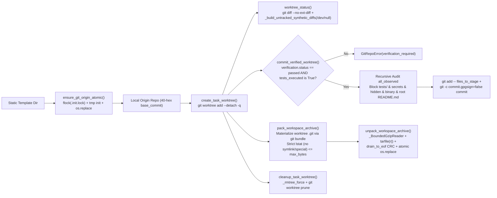

### 10.2 核心数据结构、算法逻辑与配额表

| 常量 / 策略 | 精确值（源码行号） | 作用说明 |
| --- | --- | --- |
| `_GIT_ENV`（L36–L43） | `GIT_TERMINAL_PROMPT=0`, `LC_ALL=C`, 固定 Author/Committer `Agent Systems Lab <agent-lab@local.invalid>` | `_git()` 仅白名单透传 `PATH`/`HOME`/`TMPDIR`/`TEMP`/`TMP`/`SYSTEMROOT`，并设 `GIT_CEILING_DIRECTORIES = str(resolved_cwd.parent)` 防止向上发现宿主机父仓库，超时 15s 且独立进程组 `SIGKILL` |
| `_DEFAULT_ALLOWED_EXTENSIONS`（31 种，L44–L76） | `.py`, `.ts`, `.tsx`, `.js`, `.jsx`, `.mjs`, `.cjs`, `.go`, `.rs`, `.java`, `.kt`, `.c`, `.cpp`, `.h`, `.hpp`, `.rb`, `.php`, `.swift`, `.md`, `.txt`, `.json`, `.yaml`, `.yml`, `.toml`, `.cfg`, `.ini`, `.css`, `.scss`, `.html`, `.sql`, `.sh` | 验证门控提交的默认可暂存多语言文本扩展名集合（`.py` 始终强制包含） |
| `_MAX_UNTRACKED_DIFF_FILES` / `_MAX_UNTRACKED_FILE_BYTES` | `32` 文件 / `64 KiB`（L78–L79） | 未追踪文件合成 diff 配额上限 |
| `_BINARY_SNIFF_BYTES` | `8192` 字节（L80） | 检测前 8 KiB 是否含 `\x00` 判定二进制文件 |
| `_DEFAULT_ARCHIVE_MAX_BYTES` / `_MAX_ARCHIVE_ENTRIES` | `8 MiB` / `10_000` 条目（L94–L95） | 归档压缩/解压体积与条目数防炸弹硬上限 |

#### 关键机制详述

1. **并发原子基线初始化与 Worktree 隔离（L187–L293）**：
   - `ensure_git_origin_atomic()` 对同级锁文件 `.<name>.init.lock` 加 `fcntl.flock(LOCK_EX)`，若目标已含完整 `.git` 且 `HEAD` 合法直接复用；否则在 `.tmp-<name>-<uuid>` 内调用 `init_git_repo_from_dir()`（`git init -q --template=` 禁全局模板钩子 + `-c commit.gpgsign=false` 提交）再 `os.replace()` 原子上线。
   - `create_task_worktree()` 使用 `git worktree add --detach -q <worktree> <base_commit>`，**绝不修改源仓库 `.git/config`**；`cleanup_task_worktree()` 拒绝顶层系统目录（`len(worktree.parts) <= 2`）及等于或包含 `origin_repo_dir` 的危险路径，用兼容只读文件权限自愈的 `_rmtree_force()` 清理后执行 `git worktree prune`。
2. **有界 `worktree_status()` 与未追踪合成 Diff（L305–L441）**：
   - 合并 `git diff --no-ext-diff <anchor> --` 与 `_build_untracked_synthetic_diffs()`，在 `max_diff_chars=8000` 剩余预算内为至多 32 个未追踪常规文件生成对比 `/dev/null` 的标准 `unified_diff`；自动跳过敏感文件、隐藏禁区、符号链接、多重硬链接（`st_nlink != 1`）；超 64 KiB 输出省略占位符，二进制文件输出 `Binary files /dev/null and b/<norm> differ`；`changed_files` 截断前 64 项。
3. **验证门控提交 `commit_verified_worktree()`（L537–L694）**：
   - 首行硬检查 `verification.get("status") == "passed" and verification.get("tests_executed") is True`，否则抛 `verification_required`。
   - 汇总 `all_observed = tracked_vs_head | untracked_normal | untracked_all | diff_vs_base`（基于 `--porcelain -z` 精确解析含空格与 `R`/`C` 重命名双路径），对全部观测路径递归阻断测试路径（`_is_test_path` → `test_oracle_modified`）与敏感路径（`_is_secret_relpath` → `edit_forbidden`）。
   - 未追踪文件默认**不自动暂存**，除非 `allow_untracked=True` 或命中显式 `approved_paths`；每个待暂存文件均经 `_validate_stageable_path()` 校验扩展名白名单、非隐藏路径、非符号链接/硬链接、非二进制，且根目录 `README.md` 必须显式列入 `approved_paths` 才允许提交。
   - 支持幂等重入：若 `head != base_commit` 且工作区已干净无待暂存变更，直接返回 `already_committed=True`；否则若 `head != base_commit` 则抛 `baseline_changed`。
4. **Worktree `.git` 物化与防炸弹流式 `tar.gz` 归档（L697–L1033）**：
   - `pack_workspace_archive()` 检测若 `.git` 为 linked worktree 的指针文件（`S_ISREG`），调用 `_materialize_worktree_gitdir()`（优先 `git bundle create HEAD` → `init` → `bundle unbundle` → `update-ref --no-deref HEAD` → `read-tree HEAD`；若源仓库已删导致 gitdir 悬空，回退复制工作区文件建立独立快照提交）将可移植完整 `.git/` 打包进归档，且全树 `os.lstat` 拒绝一切符号链接与特殊文件。
   - `unpack_workspace_archive()` 用流式 `_BoundedGzipReader`（L897–L932，解压字节硬上限 `max_stream_bytes = max_bytes * 2 + 65536`）包裹 `tarfile.open(..., mode="r|")` 防压缩炸弹与低内存峰值；逐成员拒绝符号链接/硬链接/非 `DIRTYPE|REGTYPE|AREGTYPE`、`_validate_archive_member_path()` 拦截 `..`/`\`/绝对路径/Windows 盘符/`\x00`、拒绝重复覆盖条目与声明长度不符，解压完毕调用 `gz_reader.drain_to_eof()` 强制触发 Gzip 尾部 CRC 校验，最后由 `.tmp-unpack-*` 经 `os.replace()` 原子落盘至空目标目录。

### 10.3 错误码与源码符号索引

- **典型 `GitRepoError` 错误码**：`git_unavailable`, `git_timeout`, `git_command_failed`, `unsafe_repo_path`, `template_not_found`, `repo_exists`, `repo_not_found`, `invalid_git_ref`, `invalid_commit`, `worktree_exists`, `not_git_worktree`, `baseline_changed`, `verification_required`, `test_oracle_modified`, `edit_forbidden`, `invalid_archive_limit`, `workspace_not_found`, `unsafe_archive_entry`, `archive_too_large`, `invalid_archive`, `destination_not_empty`。

| 符号名 | 精确行号 | 职责摘要 |
| --- | --- | --- |
| `_DEFAULT_ALLOWED_EXTENSIONS`, `_git` | L44–L76, L116–L164 | 31 种多语言扩展名策略与隔离 `GIT_CEILING_DIRECTORIES` 执行器 |
| `init_git_repo_from_dir`, `ensure_git_origin_atomic`, `resolve_commit` | L187–L254 | 基线初始化、跨进程 `flock` 原子构建与 40 位 SHA 解析 |
| `create_task_worktree`, `cleanup_task_worktree`, `verify_worktree_baseline` | L257–L293, L444–L453 | 独立 detached worktree 创建、安全清理与基线校验 |
| `_build_untracked_synthetic_diffs`, `worktree_status` | L305–L441 | 含未追踪 `/dev/null` 合成 diff 的有界状态快照 |
| `_validate_stageable_path`, `commit_verified_worktree` | L537–L694 | 验证门控多语言提交、递归测试/密钥拦截与幂等重入 |
| `_materialize_worktree_gitdir`, `pack_workspace_archive`, `_BoundedGzipReader`, `unpack_workspace_archive` | L697–L1033 | `.git` 物化与防炸弹/防穿越流式归档打包解压 |

---

## 第 11 章：异步 Stdio JSON-RPC 2.0 LSP 客户端管理器 — `lsp_client.py`

### 11.1 模块定位与 LSP 3.17 字节分帧时序

- **源码路径**：[`src/agent_lab/lsp_client.py`](../../src/agent_lab/lsp_client.py)（L1–L882，共 882 行）
- **核心角色**：通过纯 Python `asyncio` Stdio 子进程通信实现轻量级 LSP 3.17 客户端管理器 `LspClientManager`，为 Agent 提供编译器级语义导航与编辑后即时诊断，在未安装语言服务器二进制时零报错优雅降级。

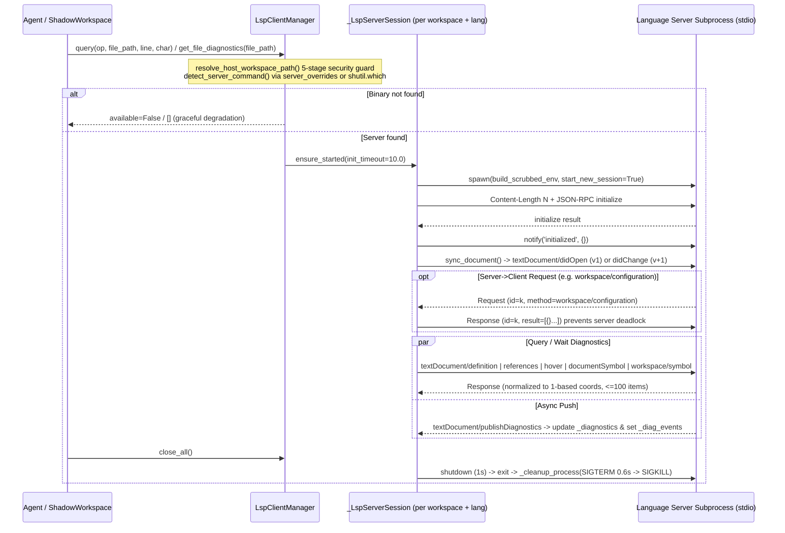

### 11.2 语言服务器探测表、6 项查询操作与诊断同步

| 语言族 | 映射文件扩展名（`_EXT_TO_LANGUAGE`, L56–L67） | 候选服务器启动命令（`_LANGUAGE_SERVER_CANDIDATES`, L70–L78） |
| --- | --- | --- |
| `python` | `.py`, `.pyi` | `basedpyright-langserver --stdio`（优先）→ `pyright-langserver --stdio` |
| `typescript` | `.ts`, `.tsx`, `.js`, `.jsx`, `.mjs`, `.cjs`（精准区分 `typescriptreact`/`javascript`/`javascriptreact` `languageId`） | `typescript-language-server --stdio` |
| `go` | `.go` | `gopls` |
| `rust` | `.rs` | `rust-analyzer` |

- **6 项 `LSP_OPERATIONS`（L41–L50、L722–L873）**：
  1. `goToDefinition`（`textDocument/definition`）：同时兼容 `Location`、`Location[]` 与 `LocationLink[]`（优先 `targetSelectionRange`）；
  2. `findReferences`（`textDocument/references`，`includeDeclaration=True`）；
  3. `hover`（`textDocument/hover`）：统一提取 `MarkupContent` / `MarkedString` / 列表为 Markdown；
  4. `documentSymbol`（`textDocument/documentSymbol`）：递归拍平树形 `DocumentSymbol[]` 与扁平 `SymbolInformation[]`（覆盖 26 种 `_SYMBOL_KIND_NAMES`，L87–L114）；
  5. `workspaceSymbol`（`workspace/symbol`，允许 `file_path` 传入目录并自动挑选首个可用服务器）；
  6. `diagnostics` / `get_file_diagnostics()`（L687–L720）：通过 `sync_document()` 维护 `_opened_docs[norm_uri] = (version, text)` 增量版本——首次发 `didOpen`（v1），内容变化才发 `didChange`（v+1），未变化直接复用缓存；随后用单调递增序号 `_diag_seq[norm_uri]` 与 `asyncio.Event` 等待最新 `publishDiagnostics` 推送（默认超时 2.0s），返回含 `severity`（`error`/`warning`/`information`/`hint`）与 1-based 行列的列表。

### 11.3 核心不变量、失败模式与源码符号索引

1. **字节级 `Content-Length` 分帧不变量（L379–L380、L416–L440）**：严格按 UTF-8 编码后的 `len(body)` 计算字节长度（而非字符数），防止中文注释导致帧错位；接收端拒收 `<= 0` 或超过 `_MAX_LSP_FRAME_BYTES = 16 MiB` 的畸形帧；所有归一化结果强制截断至 `_MAX_RESULT_ITEMS = 100`。
2. **macOS URI 物理规范化不变量**：`_normalize_uri()`（L133–L141）与 `_uri_to_rel_path()`（L117–L130）统一调用 `Path.resolve()`，消除 `/var` 与 `/private/var` 软链路径导致的诊断 URI 键不匹配。
3. **防挂起与防孤儿不变量**：`_handle_incoming()`（L470–L478）对全部服务端反向请求（特别是 `workspace/configuration`）及时回包，避免语言服务器死等响应；后台 `_drain_stderr()` 持续消费 stderr 防管道死锁；`_cleanup_process()`（L549–L583）取消读/排水协程，释放挂起 Future，对进程组 `pgid` 先 `SIGTERM`（等 0.6s）再 `SIGKILL`（等 1.0s）。
4. **优雅降级**：未安装 LSP 二进制或不支持扩展名时，`query()` 返回 `{"ok": True, "available": False, ...}`，`get_file_diagnostics()` 返回 `[]`；启动初始化失败自动从 `_sessions` 摘除并关闭子进程；查询超时/协议报错分别返回 `code="lsp_timeout"` / `code="lsp_error"`。

| 符号名 | 精确行号 | 职责摘要 |
| --- | --- | --- |
| `LSP_OPERATIONS`, `_EXT_TO_LANGUAGE`, `_LANGUAGE_SERVER_CANDIDATES` | L41–L78 | 6 大操作、扩展名映射与 4 语言族服务器探测优先级 |
| `_uri_to_rel_path`, `_normalize_uri`, `_normalize_range`, `_normalize_locations`, `_normalize_hover`, `_normalize_symbols`, `_normalize_diagnostics` | L117–L287 | URI 规范化、0/1-based 坐标转换与 4 类响应归一化 |
| `_LspServerSession` (`ensure_started`, `_send_message`, `_read_loop`, `_handle_incoming`, `sync_document`, `wait_for_diagnostics`, `_cleanup_process`, `close`) | L290–L594 | Stdio JSON-RPC 2.0 会话状态机、诊断事件同步与进程组回收 |
| `LspClientManager` (`detect_server_command`, `get_file_diagnostics`, `query`, `close_all`) | L597–L882 | 多工作区/多语言惰性会话管理器与优雅降级入口 |

---

## 第 12 章：原生桌面 GUI 操控与 Headless Playwright ARIA 浏览器自动化 — `computer.py` & `browser.py`

### 12.1 双引擎定位对比与架构总览

- **源码路径**：[`src/agent_lab/computer.py`](../../src/agent_lab/computer.py)（L1–L1758，1,758 行）与 [`src/agent_lab/browser.py`](../../src/agent_lab/browser.py)（L1–L511，511 行）
- **双轨分工**：桌面原生 GUI（`computer_*`，4 个工具）面向任意跨应用桌面操作，结合视觉截图坐标与 macOS `AXUIElement` 无障碍树定位；Headless 浏览器层（`browser_*`，6 个工具）专攻 Web 应用验收与调试，以确定性 ARIA/DOM 短引用（`e1`, `e2`, ...）替代脆弱的绝对像素点击，并原生捕获浏览器 Console 与 Network 日志。

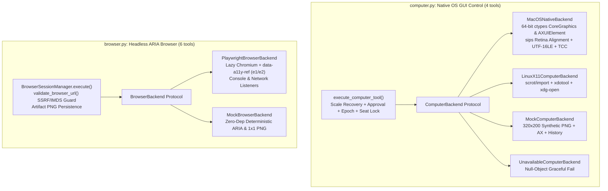

### 12.2 `computer.py` 原生桌面操控核心设计

1. **64 位 `ctypes` FFI 安全绑定与 Apple Silicon ARM64 ABI 约束（L236–L255、L549–L684）**：
   - **防止 32 位指针截断段错误**：所有返回 CoreFoundation / Quartz 句柄的函数（`CGEventCreate`, `CGEventCreateMouseEvent`, `CGEventCreateScrollWheelEvent2`, `CGEventCreateKeyboardEvent`, `AXUIElementCreateSystemWide`, `CFArrayGetValueAtIndex`, `CFStringCreateWithCString`）均显式绑定 `restype = ctypes.c_void_p`，避免 `ctypes` 默认按 32 位 `c_int` 截断 64 位堆指针触发 `SIGSEGV`；结构体 `_CGPoint`/`_CGSize`/`_CGRect` 全部以 `ctypes.c_double` 对齐 `__LP64__` `CGFloat`。
   - **ARM64 非变参滚轮 API**：旧版变参 `CGEventCreateScrollWheelEvent` 在 Darwin AAPCS64 下要求变参压栈而固定参数走寄存器 `x0-x7`，用固定 `argtypes` 调用会读到栈垃圾；此处严格绑定 6 参数固定签名 API `CGEventCreateScrollWheelEvent2(None, _kCGScrollEventUnitPixel, 2, dy, dx, 0)`（L605–L613、L1108–L1110）。
   - **CoreFoundation 内存引用守恒**：所有遵循 Create/Copy Rule 的句柄严格在 `try...finally` 中配对 `CFRelease`；遍历 `AXChildren` 时严格遵守 `CFArrayGetValueAtIndex` 的 Get Rule（借用引用，禁止单独 `CFRelease`）。
2. **Retina 坐标空间对齐与跨审批比例尺恢复（L157、L984–L1049、L1685–L1692）**：
   - `take_screenshot()` 先调 `/usr/sbin/screencapture -x -t png`，再按主屏逻辑分辨率（长边封顶 `_MAX_SCREENSHOT_EDGE = 1440`）调用 `/usr/bin/sips -z <target_h> <target_w>` 重采样，直接解析 PNG `IHDR`（偏移 `16..24` 大端 `>II`，零第三方图像库依赖）更新 `_last_scale_x` / `_last_scale_y`；
   - `execute_computer_tool()` 在调用 `computer_mouse` 前倒序扫描 `storage.events(run_id)` 中最近一条 `gui_screenshot` 事件恢复 `scale_x`/`scale_y`，确保经历 `waiting_approval` 进程重启重建 Backend 后点击依然精确无偏。
3. **TCC 非阻塞预检、多显示器边界与 `AXUIElement` 控件树（L686–L965、L1064–L1085）**：
   - 截屏前调 `CGPreflightScreenCaptureAccess()`（未授权抛 `screen_recording_permission_required`），键鼠与 `ax_tree` 前调 `AXIsProcessTrusted()`（未授权抛 `accessibility_permission_required`），根治静默空图或事件被 WindowServer 吞噬；
   - `_active_displays()` 通过 `CGGetActiveDisplayList`（最多 32 屏）+ `CGDisplayBounds` 获取全部在线显示器逻辑矩形，`_to_logical_point()` 校验换算坐标须落在任一在线显示器边界内；
   - `ax_tree(max_nodes=80[1..200], max_depth=6[1..12])` 遍历当前前台焦点应用焦点窗口（每节点最多 128 子项），返回 `role`/`title`/`value`/`x`/`y`/`width`/`height`/`center_x`/`center_y`；**安全红线**：遇到 `role == "AXSecureTextField"`（密码框）强制将 `raw_val` 置空，且全部文本字段经 `redact_secrets()` 脱敏。
4. **UTF-16LE Unicode 分块输入、快捷键与防注入应用唤起（L1169–L1259）**：
   - `_post_unicode_chunk()` 将文本编码为 UTF-16LE，按 `count = len(utf16_bytes) // 2`（正确处理超出 BMP 的 Emoji 代理对）挂载至 `CGEventKeyboardSetUnicodeString` 并配对 Down/Up 发送，`keyboard_action(action="type")` 按最多 **16 字符分块** + 8ms 节流避免溢出 Quartz 内部 UniChar 缓冲；`action="key"` 查表 `_MODIFIER_FLAGS` 与 `_MACOS_KEYCODES`；
   - `mouse_action()` 点击前先发 `MouseMoved` 激活 hover，双击显式设置 `kCGMouseEventClickState = 1, 2`，拖拽分 5 步线性插值发送 `LeftMouseDragged`（10ms 间隔）；
   - `open_target()` 严禁 `shell=True`：`kind="app"` 强制匹配 `_SAFE_APP_NAME_RE` 后调用 `["/usr/bin/open", "-a", cleaned]`，`kind="url"` 仅放行带 `netloc` 的 `http`/`https`。
5. **跨平台后端与跨进程/PG 物理桌面席位锁（L86–L154、L1297–L1538）**：
   - `get_default_computer_backend()`：Darwin → `MacOSNativeBackend`；Linux → `LinuxX11ComputerBackend`（依赖 `DISPLAY` + `xdotool` + `scrot`/`import`，零 `shell=True`）；其余或缺少依赖 → `UnavailableComputerBackend` 延迟报错。
   - **物理桌面席位互斥锁 `_desktop_gui_seat_lock()`（L115–L154）**：防止多并发 Agent 在同一物理桌面上交错移动光标与键入文字。外层持有进程内 `_GUI_PROCESS_LOCK`（`RLock`）；PostgreSQL 模式下优先获取分布式咨询锁 `SELECT pg_advisory_lock(_PG_GUI_SEAT_LOCK_KEY)`（63 位正整数键由 `sha256(b"agent-lab:desktop-gui-seat")[:8] & 0x7FFFFFFFFFFFFFFF` 确定性派生），连接不可用或 SQLite 模式下自动降级到本地跨进程 POSIX `flock`（`apply_locks/desktop-gui-seat.lock`，`O_NOFOLLOW | O_CLOEXEC`, `0o600`）。

### 12.3 `browser.py` Headless Playwright ARIA 浏览器自动化

1. **SSRF / IMDS 导航护栏 `validate_browser_url()`（L32–L123）**：
   - 仅放行 `http`/`https`，拒控制字符、URL 内嵌 `username`/`password` 与非标准协议（`file://`, `javascript:`, `data:`, `chrome://`）；
   - 硬阻断 6 个云元数据主机名 `_BLOCKED_METADATA_HOSTS`（`metadata.google.internal`, `metadata.goog`, `metadata`, `instance-data`, `metadata.azure.internal`, `metadata.aws.internal`）；
   - `_is_blocked_browser_ip()` 递归解包 IPv6 `ipv4_mapped`/`sixtofour`/`teredo`，无条件阻断链路本地（含 `169.254.169.254`）、未指定、多播、保留与私网地址；回环地址（`localhost`/`*.localhost`/`127.0.0.1`/`::1`）默认拦截，仅在显式传 `allow_loopback=True` 或环境变量 `AGENT_LAB_BROWSER_ALLOW_LOOPBACK=1` 时放行本地开发服务；
   - 在真实 `PlaywrightBrowserBackend` 下开启 `check_dns=True`（`MockBrowserBackend` 关闭以便离线测试），遍历 `socket.getaddrinfo()` 全部记录防私网解析。
2. **ARIA 短引用（`e1`/`e2`）与 6 个 `browser_*` 工具契约（L147–L511）**：
   - `PlaywrightBrowserBackend`（L239–L366）惰性导入可选依赖 `playwright.async_api.async_playwright`（未安装抛 `BrowserUnavailableError`），启动 headless Chromium（`1280x800`）并挂载 `console` 与 `response` 监听器；`snapshot(max_nodes=80[1..200])` 扫描页面可见交互元素与标题（`a, button, input, textarea, select, [role="button"], [role="link"], [role="textbox"], h1, h2, h3`），注入 `data-a11y-ref="e1"`, `"e2"`... 并在 `_ref_selectors` 建立映射，输出截断至 `_MAX_SNAPSHOT_CHARS = 8000` 的紧凑树文本。
   - `MockBrowserBackend`（L147–L236）零依赖维护模拟页面节点（默认 `e1` heading、`e2` textbox、`e3` button）、点击跳转、输入值、Console/Network 日志与 `_tiny_valid_png_bytes()` 1x1 合法 PNG。
   - `BrowserSessionManager`（L369–L434）统一编排 6 个工具：`browser_navigate`、`browser_snapshot`、`browser_click`、`browser_type`（`fill` + 可选 `Enter`）、`browser_console_logs`（按 `debug/info/warning/error` 分级过滤，上限 200 条）与 `browser_screenshot`（落盘至 `<artifacts_dir>/<run_id>/browser_shot_<seq:03d>.png` 并返回 256B `base64_preview`）。

### 12.4 失败模式、错误码与源码符号索引

- **`computer.py` 错误码**：`gui_unavailable`, `unsafe_path`, `invalid_screenshot`, `accessibility_permission_required`, `screen_recording_permission_required`, `ax_unavailable`, `ax_failed`, `osascript_failed`, `screenshot_failed`, `cgevent_failed`, `coordinates_out_of_bounds`, `invalid_arguments`, `invalid_key`, `unsafe_target`, `open_failed`, `x11_command_failed`, `unknown_tool`。
- **`browser.py` 错误码**：`invalid_url`, `blocked_scheme`, `ssrf_blocked`, `browser_unavailable`, `element_not_found`, `unknown_browser_tool`, `browser_error`。

| 模块 | 符号名 | 精确行号 | 职责摘要 |
| --- | --- | --- | --- |
| `computer.py` | `_PG_GUI_SEAT_LOCK_KEY`, `_posix_gui_seat_flock`, `_desktop_gui_seat_lock` | L86–L154 | 进程内 RLock + PG 63-bit 咨询锁 + POSIX `flock` 桌面席位互斥锁 |
| `computer.py` | `_CGPoint`, `_CGSize`, `_CGRect`, `_read_png_dimensions`, `make_synthetic_png` | L236–L285 | 64 位 CoreGraphics C 结构体与零依赖 PNG 编解码 |
| `computer.py` | `ComputerBackend`, `UnavailableComputerBackend`, `MockComputerBackend` | L288–L526 | 硬件抽象协议、优雅降级空后端与无头 CI 仿真后端 |
| `computer.py` | `MacOSNativeBackend` (`_bind_signatures`, `_require_*`, `_active_displays`, `ax_tree`, `take_screenshot`, `mouse_action`, `_post_unicode_chunk`, `keyboard_action`, `open_target`) | L529–L1259 | macOS 64-bit `ctypes` 原生驱动、ARM64 滚轮、Retina 对齐、AX 树与 UTF-16LE 分块 |
| `computer.py` | `LinuxX11ComputerBackend`, `get_default_computer_backend` | L1297–L1538 | Linux X11 `xdotool`/`scrot` 驱动与跨平台自动探测 |
| `computer.py` | `COMPUTER_TOOL_SPECS`, `execute_computer_tool` | L1541–L1758 | 4 个 GUI 工具契约、比例尺恢复、审批挂起与 Epoch 围栏执行 |
| `browser.py` | `_is_blocked_browser_ip`, `validate_browser_url` | L56–L123 | IPv6 隧道解包、云元数据 IMDS 与回环可控 SSRF 护栏 |
| `browser.py` | `BrowserBackend`, `MockBrowserBackend`, `PlaywrightBrowserBackend` | L136–L366 | 浏览器抽象协议、离线仿真后端与 Headless Chromium ARIA 驱动 |
| `browser.py` | `BrowserSessionManager`, `BROWSER_TOOL_SPECS` | L369–L511 | 运行级浏览器会话管理、截图落盘与 6 个 `browser_*` 工具契约 |

---

## 附录：跨模块核心安全不变量总览

| 不变量类别 | 落地模块 | 确定性强制机制 |
| --- | --- | --- |
| **策略优先级不可穿透** | `permissions.py` / `egress_dlp.py` | L1 毁机硬阻断 → L1b `plan` 只读硬阻断 → L2 `deny` → L3 `ask` → L4 `allow`/`session_grants` → L5 四级矩阵；出站 DLP 硬拒绝永远高于 CaMeL 与人工预批 |
| **零明文密钥与凭证隔离** | `permissions.py` / `hooks.py` / `egress_dlp.py` / `host_tools.py` / `sandbox.py` / `execution_backend.py` / `ptc.py` / `shadow_workspace.py` / `lsp_client.py` | 双层精确+正则 `build_scrubbed_env()`；`TaintRegistry` 无明文 SHA-256 滑窗指纹；SBPL/`bwrap` 封堵 `~/.ssh`/`~/.aws`/`~/.gnupg`/`.netrc`；容器与影子克隆零密钥复制 |
| **路径防逃逸与反 TOCTOU** | `permissions.py` / `tools.py` / `host_tools.py` / `sandbox.py` / `shadow_workspace.py` / `git_repo.py` | 词法先于 `resolve()`；逐段 `lstat`/`is_symlink()`；`st_nlink == 1` 拒多重硬链接与 FIFO；`sandbox.py` 使用 `O_NOFOLLOW` + `dir_fd` + `O_NONBLOCK` + 前后 6 元组 `fstat` 校验 |
| **原子落盘、并发锁与脑裂围栏** | `tools.py` / `host_tools.py` / `git_repo.py` / `computer.py` | `mkstemp + fsync + os.replace`；inode 核验跨进程 `flock` + `storage.verify_epoch()`；多文件 `.agent-apply-*.json` WAL 崩溃前滚；桌面 PG/POSIX 席位锁 |
| **防死锁、防孤儿与防伪造** | `hooks.py` / `host_tools.py` / `sandbox.py` / `ptc.py` / `shadow_workspace.py` / `lsp_client.py` | 后台持续排水抽干管道防 64KB 死锁；`start_new_session=True` + 两阶段 `SIGTERM -> SIGKILL` `os.killpg` 清场；`sandbox.py` 32B HMAC-SHA256 + `sys.addaudithook`；`ptc.py` `os.dup(0/1)` + `/dev/null` FD 隔离 |
| **SSRF / IMDS / DNS Rebinding 防御** | `host_tools.py` / `execution_backend.py` / `browser.py` | 递归解包 IPv6 `ipv4_mapped`/`sixtofour`/`teredo`/`NAT64`；封锁 `169.254.169.254`/`fd00:ec2::254`/`100.100.100.200`/混淆 IPv4；`web_fetch` 固定预校验 IP 直连 + TLS SNI + 逐跳重定向复验 |

