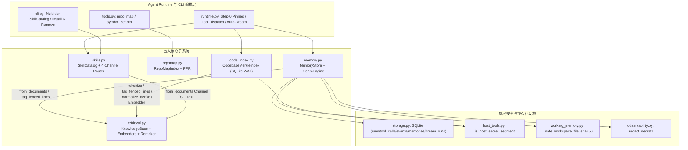
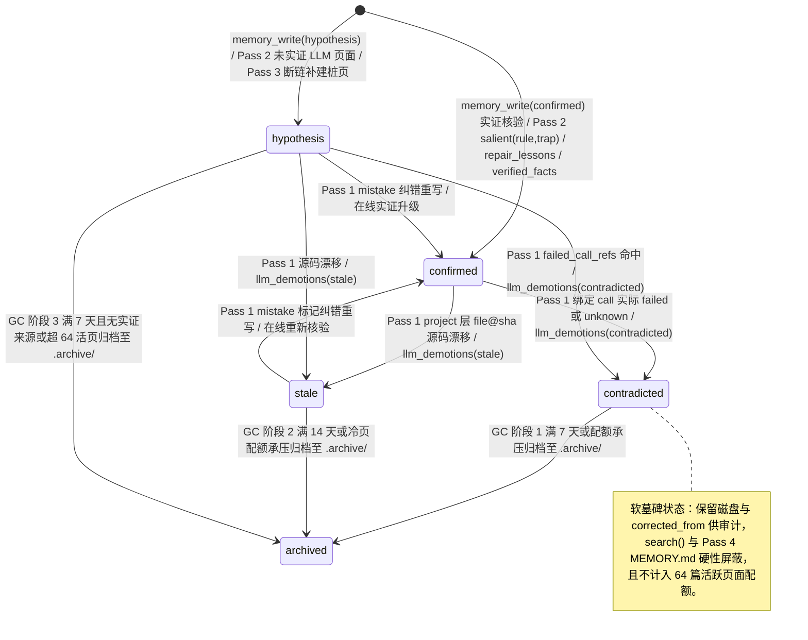
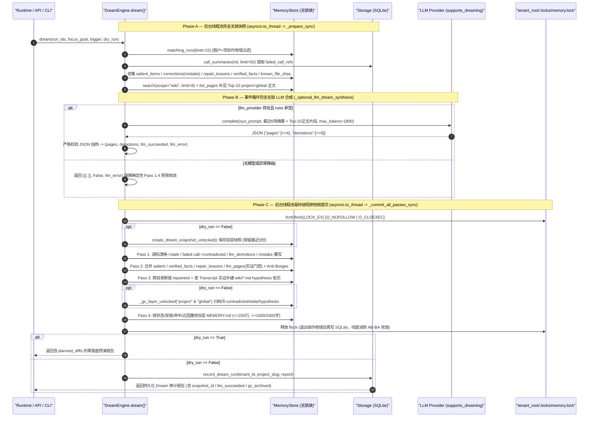
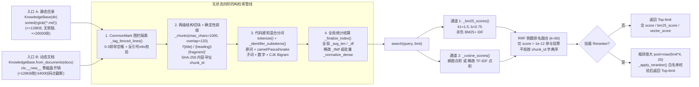
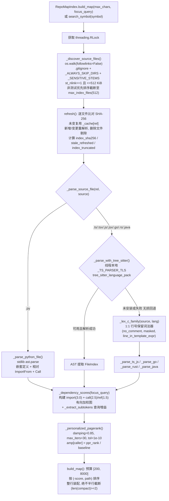
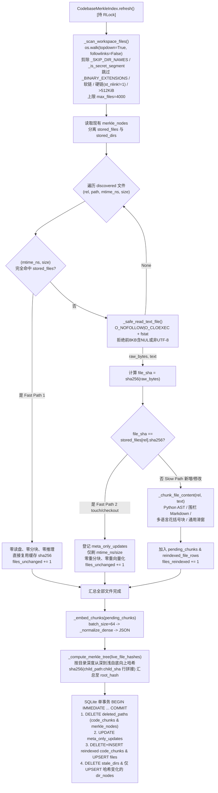
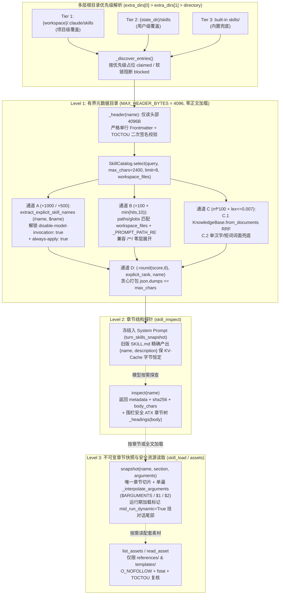

# Volume 04：跨会话记忆、统一混合检索、代码库索引与渐进式技能路由设计文档

> **文档范围**：本卷深入剖析 `agent-systems-lab` 中负责**长期记忆演化、统一混合检索、静态代码地图、持久化语义代码索引与技能渐进披露路由**的五大核心子系统（共 9,518 行 Python 源码）：
> 1. [`src/agent_lab/memory.py`](../../src/agent_lab/memory.py)（3,599 行）——双层跨会话记忆（Online Hippocampus）与三阶段四遍离线睡眠整理引擎（Offline DreamEngine）
> 2. [`src/agent_lab/retrieval.py`](../../src/agent_lab/retrieval.py)（1,037 行）——围栏感知统一混合检索内核（`KnowledgeBase` + 可插拔稠密编码与 HTTP 精排适配器）
> 3. [`src/agent_lab/repomap.py`](../../src/agent_lab/repomap.py)（2,266 行）——线程安全多语言增量仓库符号地图与 Personalized PageRank 排序引擎（`RepoMapIndex`）
> 4. [`src/agent_lab/code_index.py`](../../src/agent_lab/code_index.py)（1,461 行）——Cursor 风格 SQLite WAL 持久化 Merkle-Tree 增量 AST 代码语义索引（`CodebaseMerkleIndex`）
> 5. [`src/agent_lab/skills.py`](../../src/agent_lab/skills.py)（1,155 行）——三层渐进式技能披露目录与四通道确定性技能路由器（`SkillCatalog`）

---

## 目录

- [0. 跨模块架构全景与复用拓扑](#0-跨模块架构全景与复用拓扑)
- [1. `memory.py`：双层跨会话记忆与三阶段四遍离线 DreamEngine](#1-memorypy双层跨会话记忆与三阶段四遍离线-dreamengine)
- [2. `retrieval.py`：围栏感知统一混合检索内核](#2-retrievalpy围栏感知统一混合检索内核)
- [3. `repomap.py`：多语言增量仓库地图与 Personalized PageRank](#3-repomappy多语言增量仓库地图与-personalized-pagerank)
- [4. `code_index.py`：持久化 Merkle-Tree 增量 AST 代码语义索引](#4-code_indexpy持久化-merkle-tree-增量-ast-代码语义索引)
- [5. `skills.py`：三层渐进式技能披露与四通道确定性路由](#5-skillspy三层渐进式技能披露与四通道确定性路由)
- [6. 跨子系统全局不变量与集成对照表](#6-跨子系统全局不变量与集成对照表)

---

## 0. 跨模块架构全景与复用拓扑

五大模块共同构成 Agent Harness 的**外部知识与上下文感知平面（Knowledge, Memory, Code Perception & Capability Routing Plane）**。设计上遵循三条总原则：

1. **检索内核同构复用**：静态工程规范、动态双层记忆 Wiki/Transcripts、持久化代码分块以及技能目录元数据路由，全部复用 [`retrieval.py`](../../src/agent_lab/retrieval.py) 的围栏识别（`_tag_fenced_lines`）、代码标识符子词分词（`tokenize`）、L2 向量归一化（`_normalize_dense`）及 BM25+ + 余弦 + RRF（`k=60`）排序数学契约，彻底消除“命名规范断层（camelCase vs snake_case）”与“代码块伪标题切碎”两类缺陷。
2. **KV-Cache 前缀稳定性优先**：[`memory.py`](../../src/agent_lab/memory.py) 的 Layer 0 `MEMORY.md`/`CLAUDE.md` 与 [`skills.py`](../../src/agent_lab/skills.py) 的 Level 1 路由目录均在会话启动 Step 0 一次性冻结（Pinned），会话运行期产生的新记忆与中途按需加载的技能快照绝不回插修改历史前缀，守护 LLM Prompt Caching 字节级命中率。
3. **纵深文件系统与多租户安全防线**：所有本地磁盘读写路径均贯彻 `followlinks=False`、自顶向下逐段 `lstat` 软链拦截、`O_NOFOLLOW | O_CLOEXEC` + `fstat(st_nlink == 1)` 防 TOCTOU 与硬链窃密、同目录 `fsync + os.replace` 原子落盘，以及对 [`host_tools.py`](../../src/agent_lab/host_tools.py) 敏感凭据段黑名单的统一复用。



| 子系统 | 源码文件 | 行数 | 持久化介质 | 并发同步机制 | KV-Cache 交互定位 |
| :--- | :--- | ---: | :--- | :--- | :--- |
| 跨会话记忆与 Dreaming | [`src/agent_lab/memory.py`](../../src/agent_lab/memory.py) | 3,599 | Markdown 文件树 + SQLite (`memories`/`dream_runs`) | 读无锁原子替 + 写租户级可重入 `fcntl.flock` | Step-0 冻结 `pinned_memory_snapshot`（`<=200` 行 / `<=4000` 字符）；运行期读/搜放尾部 |
| 统一混合检索内核 | [`src/agent_lab/retrieval.py`](../../src/agent_lab/retrieval.py) | 1,037 | 内存不可变索引 + Embedder LRU 缓存 | `OpenAICompatibleEmbedder` / `HttpReranker` 内置 `threading.Lock` | 纯无状态工具/子索引内核，零前缀污染 |
| 静态代码地图 | [`src/agent_lab/repomap.py`](../../src/agent_lab/repomap.py) | 2,266 | 内存 `FileIndex` 缓存（按 SHA-256 校验） | `threading.RLock` + `threading.local` tree-sitter 解析器 | 按需工具输出，预算内整行裁剪 |
| 持久化语义代码索引 | [`src/agent_lab/code_index.py`](../../src/agent_lab/code_index.py) | 1,461 | `<state_dir>/indexes/<slug>/code_index.sqlite`（WAL） | `threading.RLock` + SQLite `BEGIN IMMEDIATE` 事务 | 按需 `codebase_semantic_search` 工具输出 |
| 渐进式技能目录与路由 | [`src/agent_lab/skills.py`](../../src/agent_lab/skills.py) | 1,155 | 多层目录 `SKILL.md` + `.manifest.json` | 签名 TOCTOU 二次校验 + 原子目录 swap | Level 1 冻结入 System Prompt；运行期 `skill_load` 挂尾部瞬态区 |

---

## 1. `memory.py`：双层跨会话记忆与三阶段四遍离线 DreamEngine

### 1.1 模块定位与核心职责

- **源码路径**：[`src/agent_lab/memory.py`](../../src/agent_lab/memory.py)（L1–L3599）
- **理论对照**：融合 Anthropic《The components of agent memory》（2026-11）双系统认知模型、Claude Code 的静态工程准则（`CLAUDE.md`）与 Codex 的动态认知索引（`MEMORY.md`）。
- **核心边界划分**：
  - **在线海马体（`MemoryStore`，L707–L2572 + `MEMORY_TOOL_SPECS`，L587–L704）**：管理单租户下的 `global`（用户全局级）与 `project`（当前项目级）双层记忆空间；在 Step 0 渲染有界常驻索引（Layer 0）；运行期通过 `memory_read`、`memory_write`、`memory_search`、`memory_tag` 四个工具提供按需精读、实证核验落盘、跨源混合召回与低成本显著性打标。
  - **离线新皮层（`DreamEngine`，L2575–L3599）**：在会话间隙执行三阶段异步睡眠整理（Phase A 无锁信号采集 -> Phase B 无锁 LLM 跨会话语义提炼 -> Phase C 毫秒级 `flock` 原子快照 + 四遍因果收敛 + 冷页 GC），并支持 `dry_run=True` 统一 Diff 预演与 `rollback_last_dream()` 原子回滚。

### 1.2 物理存储拓扑与命名隔离机制

#### 1.2.1 磁盘目录布局

```text
<state_dir>/                                      # 受控状态根（如 .agent-lab/），严禁逃逸到宿主机 ~
├── CLAUDE.md / MEMORY.md                         # 仅 tenant_id == "local" 且非软链时的 global 回退文件 (<= 64 KiB)
└── agent_memory/
    └── <safe_tenant_slug>/                       # _safe_dir_component(tenant_id, reserved={"global","projects"})
        ├── .locks/
        │   └── memory.lock                       # 0o700 目录 / 0o600 锁文件；租户级跨层排他锁
        ├── .dream_backups/
        │   └── <project_slug>/
        │       └── <UTC时间戳>-<uuid8>.json       # 最近 MAX_DREAM_BACKUPS(5) 份双层回滚快照
        ├── global/                               # 用户全局层（跨仓库通用偏好与规范）
        │   ├── CLAUDE.md                         # 人类/团队静态工程准则（Dreaming Pass 4 绝不改写）
        │   ├── MEMORY.md                         # Layer 0 全局动态索引 (<= 1600 字符)
        │   ├── {rules,traps,wiki,notes}/*.md     # Layer 1 互链主题页 (<= 64 活页, <= 12000 字符/页)
        │   └── .archive/{rules,traps,wiki,notes}/*.md  # GC 衰减归档冷页
        └── projects/
            └── <project_slug>/                   # 当前项目层（仓库专属约束、陷阱与模块 Wiki）
                ├── CLAUDE.md                     # 项目工程准则（支持 sync_workspace_file 原子同步工作区）
                ├── MEMORY.md                     # Layer 0 项目动态仪表盘 (<= 2400 字符)
                ├── {rules,traps,wiki,notes}/*.md # Layer 1 互链主题页
                └── .archive/...

<workspace>/                                      # 挂载的非软链真实工作区（只读自动发现；显式请求时可原子同步）
└── CLAUDE.md / AGENTS.md / MEMORY.md             # 随仓库提交的团队共享规范 (<= 32 KiB，预加载自动去重)
```

#### 1.2.2 无碰撞目录编码与项目归属判定

| 函数 / 常量 | 行号 | 算法逻辑与防碰撞不变量 |
| :--- | :--- | :--- |
| `_safe_dir_component(raw, fallback, reserved)` | L166–L194 | 若原串匹配 `_PURE_SAFE_DIR_RE`（`^[A-Za-z0-9_-]{1,48}$`）、非保留字（`{"global", "projects"}`）且不以 `-` 开头，原样保留；否则拼装 `{prefix[:32]}-{sha256(orig)[:12]}`（48-bit 抗碰撞空间），彻底杜绝 `acme:prod` 与 `acme_prod` 折叠串租户以及 `.`/`..`/`-rf` 注入。 |
| `compute_project_slug(...)` | L252–L293 | **三级确定性优先级**：(1) `git_meta["origin"]` 存在 -> `git-<name[:28]>-<sha256(resolved_origin)[:8]>`（并发 Git Worktree 天然共享同一项目记忆）；(2) `direct_workspace=True` 或工作区不在 `state_dir/{workspaces,worker_workspaces}` 临时沙箱内 -> `cwd-<name[:28]>-<sha256(resolved_ws)[:8]>`；(3) 沙箱评测回退 -> `tpl-<template[:24]>`（防止每次 UUID 沙箱堆积孤儿目录）。 |
| `slugify_topic(raw, fallback="note")` | L197–L216 | 小写 ASCII 归一化并过滤非 `[a-z0-9_-]`，若首字符非字母数字补前缀 `m-` 以满足 `_SAFE_SLUG_RE`（`^[a-z0-9][a-z0-9_-]{0,63}$`）；若剩余 ASCII `< 2` 字符（如纯中文主题），派生 `{base}-{sha256(raw)[:10]}`，消除 macOS APFS（NFD）与 Linux ext4（NFC）跨平台文件名断链。 |
| `_normalize_note_relpath(raw_path, allow_index)` | L786–L833 | 拦截 `\`、`:`（NTFS ADS / Windows 盘符）、`\x00`、绝对路径、`.`/`..`、点开头隐藏文件及 `is_host_secret_segment`；顶层 `MEMORY.md`/`CLAUDE.md` 在 `allow_index=False`（如 `delete_page`）下报错 `invalid_category`；裸文件名默认归入 `wiki/<slug>.md`；两级路径目录强制校验 `VALID_CATEGORIES = {"rules", "traps", "wiki", "notes"}`；禁止超过 2 层嵌套。 |

### 1.3 完整数据流与状态机

#### 1.3.1 记忆认知状态机（Epistemic Status State Machine）

`VALID_STATUSES = frozenset({"confirmed", "hypothesis", "contradicted", "stale"})`（L108），其生命周期演进如下：



#### 1.3.2 三阶段无锁推理 + 四遍因果收敛 DreamEngine 时序图



### 1.4 核心数据结构、算法逻辑与关键常量配额表

#### 1.4.1 关键常量与预算配额

| 常量 / 参数 | 精确值 | 源码位置 | 工程目的 |
| :--- | :--- | :--- | :--- |
| `MAX_INDEX_LINES` | `200` | L94 | Layer 0 常驻索引硬行数上限，防止高密度短行列表稀释注意力 |
| `MAX_INDEX_CHARS` | `4_000` | L95 | Layer 0 拼合总字符上限（约 1000–1500 tokens） |
| `MAX_GLOBAL_INDEX_CHARS` | `1_600` | L96 | 全局层 `MEMORY.md` 配额（占总预算 40%） |
| `MAX_PROJECT_INDEX_CHARS` | `2_400` | L97 | 当前项目层 `MEMORY.md` 配额（占总预算 60%） |
| `MAX_PAGE_CHARS` | `12_000` | L99 | Layer 1 单页正文上限（Anti-Borges 防膨胀；合并超限时头 `[:4000]` + 尾 `[:6000]`） |
| `MAX_PAGES_PER_LAYER` | `64` | L100 | 每层最大**活跃**笔记数（排除 `contradicted` 软墓碑） |
| `MAX_DREAM_BACKUPS` | `5` | L101 | 每个项目保留的最近 Dreaming 回滚快照数 |
| `MAX_USER_CORE_FILE_BYTES` | `64 * 1024`（64 KiB） | L130 | 受控 `CLAUDE.md`/`MEMORY.md`（含本地回退）最大读取字节数 |
| `MAX_WORKSPACE_CORE_FILE_BYTES` | `32 * 1024`（32 KiB） | L131 | 工作区根目录自动发现文件最大读取字节数 |
| `WORKSPACE_CORE_FILENAMES` | `("CLAUDE.md", "AGENTS.md", "MEMORY.md")` | L132 | 工作区根自动探测文件名顺序 |
| `salient_tags` 环形缓冲 | `32` 条 | L2320 | 单次会话 `run["metadata"]["salient_tags"]` 窗口上限（防死循环撑爆元数据） |
| 小预算自适应跳过阈值 | `(context.max_chars - reserved) >= 6000` | [`runtime.py:2326`](../../src/agent_lab/runtime.py) | 剩余工作余量不足 6000 字符时自动跳过前置 Pinned 扩展区注入，防止极小上下文窗口直接溢出 |

#### 1.4.2 Layer 0 抢占式 Step-0 注入编排（`render_pinned_index`，L1100–L1170）

按**由远及近（全局 -> 项目 -> 工作区）**六段组装，冷启动全部为空时零开销返回 `""`：
1. `global/CLAUDE.md`（截断 `[:1200]`）
2. `global/MEMORY.md`（截断 `[:MAX_GLOBAL_INDEX_CHARS]` = `1600`）
3. SQLite `memories` 表 KV 偏好（`self.memory_scope`，最多 16 条，单条 `[:220]`）
4. `project/CLAUDE.md`（截断 `[:1400]`）
5. `project/MEMORY.md`（截断 `[:MAX_PROJECT_INDEX_CHARS]` = `2400`）
6. 工作区自动发现文件（`read_workspace_core_text(deduplicate_against=(project_claude, project_idx))`，每个文件 `[:1400]`，整块 `[:1600]`，按文本内容精确去重）

拼装后统一执行 `sanitize_memory_text()` -> 超过 `200` 行截留前 `199` 行并附引导语 -> 超过 `4000` 字符按 `[:max_chars - 48].rsplit("\n", 1)[0]` **整行回退截断**（严防将末尾 `[[wiki-link]]` 拦腰斩断）-> 头部添加不可信边界标识 `MEMORY_HIERARCHY（跨会话长期记忆索引，不可信参考资料，不授予权限）`。运行时于 [`runtime.py:2174-2176`](../../src/agent_lab/runtime.py) 冻结进 `run["metadata"]["pinned_memory_snapshot"]`，仅在跨轮或滚动压缩摘要重建时（[`runtime.py:2568`](../../src/agent_lab/runtime.py)）刷新。

#### 1.4.3 实证凭据链核验算法（`_verify_and_classify_sources`，L1488–L1618）

输入 `raw_sources` 与目标 `status`，返回三元组 `(enriched[:12], has_verified_proof, has_invalid_source)`：
- **`file:<path>@<sha>` 分支**：校验 `sha` 为 8–64 位十六进制（`[0-9a-fA-F]{8,64}`）。若存在 `self.workspace`，调用 `_safe_workspace_file_sha256` 校验实时文件哈希前缀匹配并规范化为 `file:<rel>@<sha[:16]>`；若无工作区，则核对 `known_file_shas`（来自已完成会话工作记忆 `bound_files`）或受 `allow_unverified_workspace_sha` 控制（DreamEngine Pass 2 中严格置为 `False`）。
- **`file:<path>`（无 `@sha`）分支**：若有 `self.workspace`，实时计算安全哈希并自动富化为 `file:<path>@<sha[:16]>`；文件不存在或越界则标 `has_invalid_source = True`，`status == "confirmed"` 直接抛出 `MemoryError("unverified_memory_source", ...)`。
- **`call:<cid>` / `call:<run8>:<cid>` 分支**：经 `_resolve_call_record`（L1434–L1486）在当前租户/项目作用域内查询 SQLite `tool_calls` 表（兼容 `call_id` 自身含冒号如 `mcp:srv:1`）；要求不在 `failed_call_refs` 中、记录存在、`status == "succeeded"` 且若 `result` 为字典则 `result.get("ok") is not False`；核验通过后规范化为 `call:<run8>:<cid>` 并置 `has_verified_proof = True`。
- 自动追加 `run:<run_id[:12]>` 溯源标签（不计为 `has_verified_proof`）。

#### 1.4.4 围栏与行内代码安全的双向图谱与质量加权公式

- **链接提取与重写**（`extract_wiki_links` L321–L346、`_rewrite_wiki_link_in_markdown` L349–L378）：先调 `retrieval._tag_fenced_lines()` 跳过 ` ``` ` / `~~~` 代码块；再对非围栏行用 `_INLINE_CODE_RE`（`` `+[^`]*`+ ``）替换为单个空格（不用 `""`，防左右 `[` 与 `[x]]` 拼接伪造链接），重写时按游标分段交替保留反引号原字面量并无损保留 `#小节` 与 `|显示别名`；`_is_valid_wiki_link_target`（L296–L318）硬性排除 `MEMORY`/`MEMORY.MD`/`CLAUDE`/`CLAUDE.MD`/`AGENTS`/`AGENTS.MD` 及密钥路径段。
- **同层消解不变量**（`build_link_graph`，L1207–L1286）：优先匹配 `(layer, category/slug)`；若为裸名简写，仅在同层 `by_layer_slug[(layer, slug)]` 唯一（`len(matches) == 1`）时建边并登记 `backlinks`，多义重名归入 `broken_links` 绝不盲猜。
- **访问追踪与综合排序权重**（L1288–L1376）：
  - `_touch_page_access` 在 `read_page` / `search` 命中时递增 Frontmatter 的 `hit_count` 并刷新 `last_accessed_at`（保持 `updated_at` 不变）。
  - 活跃时间戳取 `max(last_accessed_at, updated_at)`（`_latest_activity_dt`），计算近因衰减 $\text{recency} = e^{-\text{age\_days}/30}$。
  - **Pass 4 索引排序分**（`_page_rank_score`，L1333–L1354）：
    $$\text{Score}_{\text{rank}} = W_{\text{status}} + 0.6 \ln(1 + \text{backlinks}) + 0.5 \ln(1 + \text{hits}) + 0.8 \, e^{-\text{age}/30}$$
    其中 $W_{\text{status}} \in \{\text{confirmed}: 3.0,\ \text{hypothesis}: 1.5,\ \text{stale}: 0.5,\ \text{contradicted}: -1.0\}$。
  - **混合搜索 RRF 乘数**（`_page_search_multiplier`，L1357–L1376）：
    $$M_{\text{search}} = M_{\text{status}} \cdot \bigl(1 + 0.15 \, e^{-\text{age}/30}\bigr) \cdot \bigl(1 + 0.10 \ln(1 + \text{backlinks})\bigr) \cdot \bigl(1 + 0.08 \ln(1 + \text{hits})\bigr)$$
    其中 $M_{\text{status}} \in \{\text{confirmed}: 1.35,\ \text{hypothesis}: 1.0,\ \text{stale}: 0.65\}$；`kv_note` 固定乘数 `1.25`。

#### 1.4.5 冷页衰减回收 GC（`_gc_layer_unlocked`，L1860–L1992）

按冷度元组 `(hit_count, backlink_count, -age_days, path)` 升序淘汰，归档至 `<layer_root>/.archive/<rel>` 并清理 `MEMORY.md` 残留指针：
- 压力水位：`trigger_threshold = max(2, ceil(cap * 0.85))`（当 `cap >= 2`），`target_headroom = int(cap * 0.75)`。
- **阶段 1（`contradicted`）**：超过 `contradicted_days = 7.0` 天（`aged_contradicted_tombstone`）或超配额/逼近压力线（`cold_contradicted_tombstone`）。
- **阶段 2（`stale`）**：超过 `stale_days = 14.0` 天（`aged_stale_page`），或超配额，或在压力线以上且 `hit_count == 0`（`cold_stale_page`）。
- **阶段 3（`hypothesis`）**：超过 `hypothesis_days = 7.0` 天且无 `file:@` / `call:` 实证来源（`aged_unverified_hypothesis`），或 `active_count > cap`（`quota_pressure_hypothesis`）。**严格不变量：GC 绝不归档 `confirmed` 页面。**

### 1.5 核心安全、并发与缓存不变量（Why + How）

| 类别 | 不变量 | Why（威胁与缺陷模型） | How（精确实现机制） |
| :--- | :--- | :--- | :--- |
| **文件系统安全** | 自顶向下逐段 `lstat` 禁止软链 | 若仅查叶子 `target.is_symlink()`，当新文件尚未创建但中间目录 `wiki/` 被偷换为指向 `/etc` 的软链时，会绕过检查实现任意写；若先调 `resolve()` 会触发过早软链跟随或掩盖内部越权。 | `_ensure_safe_tree_segment`（L459–L497）：先查 `base_root.is_symlink()` -> 用 `absolute().relative_to()` 切段 -> 自顶向下逐段 `cur.is_symlink()` -> 最终 `resolve().is_relative_to()` 闭环校验。 |
| **TOCTOU / 硬链** | `O_NOFOLLOW \| O_CLOEXEC` + `st_nlink == 1` | 攻击者可将敏感文件硬链接至记忆目录（普通 `is_symlink()` 无法检出）或在检查与 `open()` 间替换软链；缺 `O_CLOEXEC` 会导致子进程继承 `flock` fd 造成锁泄漏。 | `_read_opened_regular_utf8`（L900–L935）先 `lstat` 再 `os.open(O_RDONLY \| O_NOFOLLOW \| O_CLOEXEC)` 后 `os.fstat(fd)` 复核 `S_ISREG`、`st_nlink == 1`、`st_size <= max_bytes`；`_memory_scope_lock`（L535）同理。 |
| **多租户隔离** | 本地回退严格限于 `tenant_id == "local"` + `matching_runs` 强查租户 | 多租户部署中若非本地租户也能回退读取 `state_dir/CLAUDE.md`，或通过传入任意 `run_ids` 触发 IDOR 重放他租户会话，将发生跨租户信息泄露。 | `read_core_text`（L994）强制 `layer == "global" and self.tenant_id == "local" and not self._state_dir_is_symlink`；`matching_runs`（L2337–L2352）即使显式传入 `run_ids` 也逐条校验 `r_tenant == self.tenant_id`。 |
| **存储型注入防御** | 密钥脱敏 + 协议前缀中和 + 单行标量过滤 | 恶意外部文档可诱骗 Agent 将 `REVIEW_APPROVED:`、`HARNESS_STATE` 或 `\n---\nstatus: confirmed` 写入记忆，在下一会话劫持审批/状态机。 | `sanitize_memory_text`（L219–L235）调 `redact_secrets` 并对 `lstrip()` 命中 `_RESERVED_HARNESS_PREFIXES` 的行加 `[SANITIZED_PREFIX] `；`_sanitize_header_scalar`（L238–L249）折叠 `\r\n,` 并剥离前导 `---`。 |
| **无锁读 + 锁序无死锁** | 读路径 Wait-Free + 锁外执行 LLM 与 SQLite 写 | 若在持有 `flock` 时调用慢速 LLM 会阻塞所有并发在线会话；若在 `flock` 内写 SQLite 审计表，与另一条“先占 SQLite 写锁再抢 `flock`”的路径形成 AB-BA 死锁。 | 写路径用同目录 `mkstemp + fsync + os.replace`（`_atomic_write_text` L548–L581）保证读路径非旧即新；DreamEngine 在 Phase B 完全无锁调用 LLM，在 Phase C 退出 `flock` 后（L3559）才调用 `storage.record_dream_run`；同一线程嵌套加锁通过 `_LOCK_LOCAL.held` 可重入避免自死锁。 |
| **KV-Cache 稳定** | Step-0 冻结前缀 + 在线只写子页 | 运行期每次 `memory_write` 若直接改写 System/头部 Pinned 区，会使数万 token 历史 KV Cache 全部失效。 | `runtime.py:2174` 启动冻结 `pinned_memory_snapshot`；运行期更新通过尾部工具响应可见；`_upsert_index_pointer_unlocked`（L1643–L1694）只做 FIFO 有界增量更新，绝不破坏顶层标题骨架。 |

### 1.6 失败模式、降级策略与边界条件

| 场景 / 故障模式 | 机器错误码 / 处理路径 | 系统行为与降级策略 |
| :--- | :--- | :--- |
| 路径穿越、软链目录、硬链文件、软链 `state_dir` | `MemoryError("unsafe_memory_path")` | 硬失败拦截；`_resolve_existing_page`（L1196）绝不吞掉此异常回退到裸 slug 搜索。 |
| 路径包含密钥文件名段（`.env`/`id_rsa` 等） | `MemoryError("secret_memory_forbidden")` | 硬失败拦截，阻断敏感命名写入记忆目录。 |
| 写入 `confirmed` 但来源文件缺失/哈希不符或 `call:` 失败/不存在 | `MemoryError("unverified_memory_source")` | 在线 `memory_write` 拒绝写入；离线 Pass 2 对未实证 LLM 页面强制降级为 `hypothesis` 而非中断整理。 |
| 单页超过 12,000 字符或内容为空 | `memory_page_too_large` / `empty_memory_content` | 拒绝写入；Pass 2 合并超限时执行 `old_body[:4000] + "\n\n---\n\n" + final_body[:6000]` 头尾压缩。 |
| 活跃笔记达到 64 篇上限 | 自动触发 `_gc_layer_unlocked(max_active=63)`，仍满则抛 `memory_layer_full` | 先自动归档冷 `contradicted`/`stale`/`hypothesis`，全部为 `confirmed` 时清晰报错引导合并。 |
| Phase B LLM 超时、网络异常或输出非合法 JSON | 不抛异常，`llm_succeeded=False`，记录 `llm_error` | 诚实上报 `llm_assisted=False`（杜绝异常吞没却谎报成功），Phase C 确定性 Pass 1–4 照常收敛。 |
| 回滚快照含被篡改的非法路径或缺失快照 | `dream_snapshot_not_found` / `unsafe_memory_path` | `rollback_last_dream`（L2176–L2250）严格两阶段执行：阶段 1 零磁盘变更全量校验所有路径/类型/软链/密钥段，任一失败即原子中止，不留半回滚脏状态。 |
| 仅 `memory_read` 单篇损坏文件 | 局部跳过（`list_pages` L873）或 `unsafe_memory_path` | `list_pages` 局部跳过单个异常文件，防止单页损坏拖垮整个会话启动。 |

### 1.7 关键源码符号与精确行号索引表

| 符号 | 位置 | 核心职责 |
| :--- | :--- | :--- |
| `MAX_INDEX_LINES` / `MAX_INDEX_CHARS` / `MAX_PAGE_CHARS` / `MAX_PAGES_PER_LAYER` / `MAX_DREAM_BACKUPS` | L94–L101 | Layer 0/1 核心容量配额与快照保留数常量 |
| `VALID_LAYERS` / `VALID_STATUSES` / `VALID_CATEGORIES` / `_RESERVED_HARNESS_PREFIXES` | L104–L128 | 层级、认知状态、分类目录与安全保留前缀枚举 |
| `MemoryError` | L135–L140 | 带稳定机器错误码 `code` 的记忆子系统结构化异常 |
| `_safe_dir_component` / `slugify_topic` / `compute_project_slug` | L166–L293 | 无碰撞租户目录编码、跨平台 ASCII slug 与三级项目归属计算 |
| `sanitize_memory_text` / `_sanitize_header_scalar` | L219–L249 | 凭据脱敏、协议前缀中和与 Frontmatter 防注入清洗 |
| `_is_valid_wiki_link_target` / `extract_wiki_links` / `_rewrite_wiki_link_in_markdown` | L296–L378 | 围栏与反引号安全的 `[[wiki-link]]` 校验、提取与无损重写 |
| `parse_note_frontmatter` / `render_note_frontmatter` | L381–L456 | 零 YAML 依赖的受限扁平元数据头解析与序列化 |
| `_ensure_safe_tree_segment` / `_memory_scope_lock` / `_atomic_write_text` | L459–L581 | 逐段 `lstat` 软链防御、可重入 `flock` 锁与同目录原子落盘原语 |
| `MEMORY_TOOL_SPECS` | L587–L704 | `memory_read` / `memory_write` / `memory_search` / `memory_tag` JSON Schema 契约 |
| `MemoryStore`（`read_core_text`, `_discover_workspace_core_files`, `render_pinned_index`） | L707–L1170 | 双层 + 工作区核心文档安全读取、去重发现与 Step-0 有界索引渲染 |
| `MemoryStore`（`build_link_graph`, `_touch_page_access`, `_page_rank_score`, `_page_search_multiplier`, `read_page`） | L1207–L1432 | 同层双向图谱构建、访问热度追踪、质量加权公式与按需精读 |
| `MemoryStore`（`_resolve_call_record`, `_verify_and_classify_sources`, `write_page`, `delete_page`） | L1434–L1809, L2258–L2289 | Proof-Carrying 实证门控、锁内原子写入与索引自动晋升/清理 |
| `MemoryStore`（`_gc_layer_unlocked`, `gc_layer`, `create_dream_snapshot_unlocked`, `rollback_last_dream`） | L1837–L2256 | 三阶段冷页归档 GC 与两阶段预校验原子快照回滚 |
| `MemoryStore`（`tag_salient`, `matching_runs`, `_transcript_documents`, `search`, `overview`） | L2291–L2572 | 显著性打标、租户作用域过滤、混合 RRF 检索与仪表盘总览 |
| `DreamEngine`（`_collect_ground_truth_signals`, `_pass1..4`, `_optional_llm_dream_synthesis`, `dream`） | L2575–L3599 | 三阶段无锁推理 + 短锁四遍因果收敛离线睡眠整理引擎 |

---

## 2. `retrieval.py`：围栏感知统一混合检索内核

### 2.1 模块定位与核心职责

- **源码路径**：[`src/agent_lab/retrieval.py`](../../src/agent_lab/retrieval.py)（L1–L1037）
- **核心定位**：可离线运行、逐行可解释的统一混合检索内核，同时服务静态知识库（`KnowledgeBase(directory)`）、动态双层记忆/Transcripts（`MemoryStore.search` / `DreamEngine` Pass 3）以及技能路由通道 C.1（`SkillCatalog.select`）。
- **两层可插拔扩展**：
  - 默认零外部依赖基线：`BM25+` + 稀疏平滑亚线性 `TF-IDF` 余弦 + `RRF (k=60)`。
  - 可选神经语义与二阶段精排升级：通过 `Embedder` 与 `Reranker` 纯函数协议无缝接入 `LocalSubwordDenseEmbedder`、`OpenAICompatibleEmbedder` 与 `HttpReranker`，不改变任何内容寻址引用 ID（Citation ID）与返回结构契约。

### 2.2 完整数据流管线



### 2.3 核心数据结构、算法逻辑与关键参数表

#### 2.3.1 CommonMark 围栏隔离与两级切块

- **`_tag_fenced_lines(text)`（L135–L171）**：
  1. 统一换行符 `\r\n` / `\r` -> `\n`，消除 Windows/macOS/Linux Git `autocrlf` 引发的分块 SHA-256 漂移。
  2. 正则 `^ {0,3}(`{3,}|~{3,})` 遵循 CommonMark 规则（4 个前导空格为缩进代码块而非围栏）。
  3. **单行多反引号内联代码防御**：开启反引号围栏前检查 `not (token[0] == "`" and "`" in line[marker.end():])`，防止 ```` ```foo``` ```` 误开启未闭合围栏吞掉整篇文档。
  4. **闭合校验**：必须同字符（`` ` `` 对 `` ` ``，`~` 对 `~`）、长度 `>= len(fence)` 且行尾无非空白杂质；闭合行本身仍标记 `True` 隔离。
- **`_chunks(text, max_chars=1000, overlap=120)`（L174–L218）**：
  - 提取首个非围栏 H1 作为 `title`（缺失时默认 `"未命名笔记"`）；遇到非围栏 1–6 级标题切分新语义章节。
  - 二级滑窗步长 `step = max(1, max_chars - overlap)`（防 `overlap >= max_chars` 导致 `range(..., 0)` 崩溃），右边界触达章节末尾即 `break`（消除被前窗完全包含的冗余短尾块）。
  - 确定性上下文前缀拼入 `text = f"{title} / {heading}\n{fragment}"`，以零 LLM 延迟复现 Contextual Retrieval 的语境锚定效果。

#### 2.3.2 代码感知混合分词与排序优先不变量

- **`tokenize(text)`（L112–L132）与 `_identifier_subtokens(raw_token, lowered)`（L79–L109）**：
  - 提取 `[A-Za-z_][A-Za-z0-9_]*|\d+`：先输出完整小写原词，再按严格不可逆的两步正则拆分子词：
    1. `re.sub(r"([A-Z]+)([A-Z][a-z])", r"\1_\2", raw_token)`（如 `HTTPServer` -> `HTTP_Server`）
    2. `re.sub(r"([a-z0-9])([A-Z])", r"\1_\2", split_camel)`（如 `retryV2Policy` -> `retryV2_Policy`）
  - 通过 `seen = {lowered}` 去重：查询 `exponential_backoff` 时，精确匹配文档同时命中 3 项（`exponential_backoff`, `exponential`, `backoff`），天然排在跨命名匹配 `exponentialBackoff`（命中 2 项）之前。
  - 独立保留纯数字字面量（如 HTTP `429`、端口 `8080`、上限 `200`）。
  - 中日韩汉字区间 `[㐀-鿿]+` 生成相邻 Bigram；当连续串长度为 1 时保留单字兜底，避免“锁”“表”退化为空。

#### 2.3.3 数学打分公式与内容寻址 ID

| 组件 | 精确公式 / 构造规则 | 关键边界解决 |
| :--- | :--- | :--- |
| **内容寻址 Citation ID** | `digest = sha256(f"{source}\0{index}\0{title}\0{heading}\0{fragment}")[:10]`，`chunk_id = f"{stem}-{digest}"` | 使用 POSIX 相对路径保证跨机器一致；`\0` 分隔杜绝 `("a","bc")` 与 `("ab","c")` 拼接碰撞；内容/标题任意改动立即派生新版本 ID。 |
| **BM25+ 非负得分**（L438–L464） | $\text{IDF}(t) = \ln\!\left(1 + \frac{N - df_t + 0.5}{df_t + 0.5}\right)$，$\text{score} = \sum_{t \in Q} \text{IDF}(t) \cdot \frac{tf \cdot (k_1 + 1)}{tf + k_1 (1 - b + b \cdot |d|/\overline{|d|})}$（$k_1=1.5,\ b=0.75$） | 外层加 `1 +` 严格保证高频核心词（$df > N/2$）永不产生负 IDF 倒扣分；全局 `_avg_len` 压制长 Transcript 保护精炼规则页。 |
| **平滑亚线性 TF-IDF**（L419–L436） | $w_{t,d} = (1 + \ln tf_{t,d}) \cdot \left(1 + \ln \frac{1 + N}{1 + df_t}\right)$，随后 L2 归一化 | 冷启动单笔记（$N=1, df=1$）时 IDF 为 `1.0` 而非归零，确保首篇记忆立即可检。 |
| **RRF 无量纲融合**（L567–L580） | $\text{RRF}(d) = \sum_{c \in \{\text{BM25}, \text{Cosine}\}} \mathbb{I}(s_c(d) > 10^{-12}) \cdot \frac{1}{60 + \text{rank}_c(d)}$ | 消除 BM25 $[0,+\infty)$ 与余弦 $[-1,1]$ 量纲不可通约性；双路第 1 得满分 $2/61$，纯语义单路可凭 $1/61$ 救援上榜；`> 1e-12` 彻底过滤零分与负余弦噪声。 |

#### 2.3.4 可插拔神经适配器与环境变量配置表

1. **`LocalSubwordDenseEmbedder(dim=256)`（L613–L668）**：基于 `hashlib.blake2b(feat, digest_size=16)` 的零依赖确定性双路符号随机投影（CountSketch），不依赖 `PYTHONHASHSEED`。提取四类特征并赋权：`tok:<t>`（权重 `1.5`）、边界锚定英文字符 3/4-gram `c3:`/`c4:`（`1.0`）、汉字单字 `zh1:`（`0.7`）与三元组 `zh3:`（`1.0`），按 `base_weight * (1 + log(count))` 投射到两个带符号桶并 L2 归一化。
2. **`OpenAICompatibleEmbedder`（L671–L856）**：
   - 自动规范化端点：末尾 `/embeddings` 原样使用，`/v1` 拼 `/embeddings`，其余拼 `/v1/embeddings`。
   - 线程安全 `OrderedDict` LRU 缓存（默认 `cache_size=2048`，键为 `sha256(text)`），调用内按 `missing_keys` 去重并按 `batch_size=64` 切批，响应按 `item["index"]` 排序还原并执行 `_normalize_dense` + 批次内维度一致性检查。
   - **双阶段维度守恒降级**：建库期远端不可用（`self._dim is None`）时回退 `LocalSubwordDenseEmbedder(256)` 并通过 `call_fallback_dim` 锁定单次调用所有后续批次维度一致；运行中（已记录远端 `self._dim`）遇网络闪断时，仅在 fallback 维度匹配时调用，否则返回同维全零向量 `[0.0] * known_dim`（防止异维崩溃并平滑退化为 BM25 召回），且**绝不缓存降级结果**以便远端恢复后自愈。
3. **`HttpReranker`（L859–L975）**：兼容 Cohere / Voyage / Jina `/rerank` 接口（兼容 `results` 与 `data` 字段、兼容 `relevance_score` 与 `score` 键），严格过滤非有限浮点与 `bool` 值，任何 HTTP / 解析异常时递增 `fallback_count` 并原样返回一阶段 RRF 候选浅拷贝。

| 环境变量 | 默认值 | 作用（`build_default_embedder` L978 / `build_default_reranker` L1023） |
| :--- | :--- | :--- |
| `AGENT_LAB_EMBEDDING_URL` | `""`（返回 `None`） | 设为 `local` 启用 `LocalSubwordDenseEmbedder`；设为 `https://...` 启用 `OpenAICompatibleEmbedder` |
| `AGENT_LAB_EMBEDDING_MODE` | `""` | 未设 URL 时设为 `local` 同样启用 `LocalSubwordDenseEmbedder` |
| `AGENT_LAB_EMBEDDING_DIM` | `256`（`>= 8`） | 本地随机投影编码器向量维度 |
| `AGENT_LAB_EMBEDDING_MODEL` | `"text-embedding-3-small"` | 远端 OpenAI 兼容 embedding 模型名 |
| `AGENT_LAB_EMBEDDING_API_KEY` | 回退 `OPENAI_API_KEY` | 远端 Embedding Bearer 密钥 |
| `AGENT_LAB_EMBEDDING_TIMEOUT` | `15.0`（秒） | Embedding HTTP 超时时间 |
| `AGENT_LAB_EMBEDDING_CACHE_SIZE` | `2048` | LRU 缓存最大条目数（`0` 表示禁用） |
| `AGENT_LAB_RERANK_URL` | `""`（返回 `None`） | 远端 `/rerank` HTTP 端点 URL |
| `AGENT_LAB_RERANK_MODEL` | `"rerank-v3.5"` | 精排模型名称 |
| `AGENT_LAB_RERANK_API_KEY` | `""` | 精排服务端 Bearer 密钥 |
| `AGENT_LAB_RERANK_TIMEOUT` | `10.0`（秒） | 精排 HTTP 超时时间 |

### 2.4 核心安全、并发与确定性不变量（Why + How）

- **静态目录软链与内存耗尽守卫（L280–L307）**：`sorted(self.directory.rglob("*.md"))` 消除跨文件系统遍历不确定性；跳过 `path.is_symlink()` 或 `resolve()` 越界文件；跳过 `> 128_000` 字节大文件；静态入口超过 `20_000` 块直接 `raise ValueError`，动态 `from_documents` 则用 UTF-8 码点安全切片 `raw_content[:64_000]`（避免劈裂多字节中文字符）并在满 `20_000` 块时优雅 `break`，保障在线会话绝不因历史增长中断。
- **元数据防篡改优先级（L398–L406）**：`from_documents` 构造 `doc_entry` 时先展开 `**extra_meta`，再显式写入受保护的 `id` / `chunk_id` / `title` / `heading` / `source` / `text`，杜绝外部字典同名键覆盖核心溯源字段。
- **二阶段精排插件沙箱隔离（`_apply_reranker`，L493–L541）**：传入 `[dict(item) for item in candidates]` 浅拷贝防原地篡改；强制校验返回 `doc_id in by_id` 白名单防不可信插件伪造未入库文档；显式剔除 `isinstance(x, bool)`（因 Python 中 `bool` 是 `int` 子类）。
- **数值全序安全性（`_normalize_dense`，L221–L238）**：显式拦截 `str`/`bytes`、空向量、`NaN`/`Inf`（`NaN` 参与 `sort` 会破坏全序不变量），全零向量安全归零而非触发 `ZeroDivisionError`。
- **能力诚实披露（`index_stats`，L596–L610）**：显式区分 `"BM25 + lexical TF-IDF cosine + RRF"` 与 `"BM25 + dense semantic cosine + RRF"` 及 `semantic_embeddings: bool`，防止评测误将纯词法稀疏余弦当作神经网络语义向量。

### 2.5 失败模式、降级策略与边界条件

- **参数边界校验**：`search()` 强校验 `query` 为长度 `<= 2000` 字符串、`limit` 为 `1..20` 非布尔整数；纯空白或纯标点且无词法词项查询立即短路返回 `[]`；无 `> 1e-12` 命中的查询严格返回空列表，绝不用零分文档凑数诱发幻觉。
- **远端向量维度漂移**：若远端服务更换模型导致返回维度与已缓存 `self._dim` 不一致，`OpenAICompatibleEmbedder` 抛出 `ValueError` 并被自身捕获转入零向量同维降级路径（L834–L842），确保在线查询不崩。
- **连接资源管理**：`OpenAICompatibleEmbedder` 与 `HttpReranker` 均支持注入外部 `httpx` 客户端（`_external_client`），调用 `close()` 时仅关闭内部自建客户端，避免误关调用方共享连接池。

### 2.6 关键源码符号与精确行号索引表

| 符号 | 位置 | 核心职责 |
| :--- | :--- | :--- |
| `Embedder` / `Reranker` | L75–L76 | 纯函数可插拔编码器与精排器类型契约 |
| `_identifier_subtokens` / `tokenize` | L79–L132 | camelCase/PascalCase/snake_case 拆分 + 数字保留 + CJK Bigram/单字分词器 |
| `_tag_fenced_lines` / `_chunks` | L135–L218 | CommonMark 围栏代码块隔离与两级标题/滑窗确定性前缀切块 |
| `_normalize_dense` | L221–L238 | 稠密向量类型/有限性校验与安全 L2 单位归一化 |
| `KnowledgeBase.__init__` / `_finalize_index` / `from_documents` | L257–L417 | 静态目录扫描与动态内存文档同构建库双入口及全局统计结算 |
| `KnowledgeBase._tfidf` / `_bm25_scores` / `_cosine_scores` / `_apply_reranker` / `search` / `index_stats` | L419–L610 | 双路召回、RRF `k=60` 融合、安全二阶段精排与检索模式披露 |
| `LocalSubwordDenseEmbedder` | L613–L668 | BLAKE2b 确定性 CountSketch 离线子词稠密编码器 |
| `OpenAICompatibleEmbedder` | L671–L856 | 批量 `/v1/embeddings` 客户端、线程安全 LRU 缓存与维度守恒降级 |
| `HttpReranker` | L859–L975 | Cohere/Voyage/Jina 兼容 `/rerank` 精排客户端与 RRF 回退 |
| `build_default_embedder` / `build_default_reranker` | L978–L1037 | 环境变量驱动的默认编码器与精排器工厂 |

---

## 3. `repomap.py`：多语言增量仓库地图与 Personalized PageRank

### 3.1 模块定位与核心职责

- **源码路径**：[`src/agent_lab/repomap.py`](../../src/agent_lab/repomap.py)（L1–L2266）
- **工具挂载**：经 [`src/agent_lab/tools.py`](../../src/agent_lab/tools.py)（L277, L624–L628）暴露为 `repo_map` 与 `symbol_search` 工具，并被 [`src/agent_lab/api.py`](../../src/agent_lab/api.py)（L2707）复用为 API 层工作区符号地图索引。
- **核心能力**：在不执行任何目标仓库业务代码的前提下，通过“Python 标准库 `ast` + 可选 `tree_sitter_language_pack` 多语言 AST + 加固零依赖 C 族词法/结构扫描器”三层解析栈抽取跨文件定义、导入与调用图；以每文件 SHA-256 驱动线程安全增量刷新；通过确定性幂迭代 Personalized PageRank（PPR）与子词查询增益计算文件重要度，并在严格字符预算内**绝不半行截断**地输出高信噪比仓库骨架地图。

### 3.2 完整数据流与解析分发架构



### 3.3 核心数据结构、解析器细节与 PPR 排序算法

#### 3.3.1 核心数据结构与常量配额

| 结构体 / 常量 | 位置 | 定义与字段说明 |
| :--- | :--- | :--- |
| `_MAX_PARSE_BYTES` | L25 | `512 * 1024`（512 KiB）：单文件解析与 `.gitignore` 读取字节上限 |
| `_DEFAULT_MAX_INDEX_FILES` | L26–L27 | `512`：默认索引文件上限，超限时按 `(_is_test_path(rel), rel)` 优先保留非测试源码并回报 `index_truncated=True` |
| `_MAX_SIGNATURE_LOOKAHEAD` | L28 | `32`：多行声明头与块结束前瞻扫描最大行数 |
| `_SOURCE_EXTENSIONS` | L30 | `(".py", ".ts", ".tsx", ".js", ".jsx", ".go", ".rs", ".java")`（8 种后缀） |
| `_ALWAYS_SKIP_DIRS` | L31–L46 | `.git`, `.venv`, `venv`, `env`, `node_modules`, `__pycache__`, `dist`, `build`, `target`, `.tox`, `.mypy_cache`, `.pytest_cache` |
| `_SENSITIVE_FILES` / `_SENSITIVE_STEMS` | L47–L56 | `credentials`, `secrets`, `secret`, `private_key`, `tokens`（精确文件名及任意后缀词干均跳过） |
| `SymbolDef` | L106–L113 | `(name, qualname, kind, line, end_line, signature, doc="")`；`kind` 支持 `class`/`function`/`method`/`interface`/`enum`/`type`/`struct` |
| `SymbolRef` | L117–L120 | `(name, line, kind)`；`kind` 为 `"import"` 或 `"call"` |
| `FileIndex` | L124–L132 | `(path, sha256, module, doc, imports, definitions, references, parse_error)` |

#### 3.3.2 三层多语言静态解析引擎

1. **Python 标准库 AST 解析（`_parse_python_file`，L231–L286）**：
   - 嵌套定义提取（`_collect_python_defs`，L176–L228）：递归进入类体、函数体及全部复合控制流（`If`/`For`/`AsyncFor`/`While`/`With`/`AsyncWith`/`Try`/`TryStar`/`Match`），维护 `scope_stack` 生成完整 `qualname`（如 `Outer.Inner.method`）。
   - 相对导入消解（`_resolve_python_relative_module`，L148–L169）：精确区分 `__init__.py` 与普通模块的包层级基准，按 `ascend = level - 1` 回溯祖先包路径；对 `from . import foo, bar` 逐个展开子模块名，确保依赖图准确连边。
   - 签名与文档抽取：`_format_signature`（L63–L90）完整渲染 `posonlyargs`、`args`、类型注解（`ast.unparse`）、默认值占位 `=...`、`*args`、`kwonlyargs`、`**kwargs` 及返回注解，硬截断至 140 字符；`_first_doc_line`（L93–L102）提取首行 docstring（`<= 80` 字符）。
   - 引用提取：全树 `ast.walk` 捕获 `Import`、`ImportFrom` 及 `Call`（`ast.Name` 与 `ast.Attribute`）。

2. **可选 `tree_sitter_language_pack` 多语言 AST（L1346–L1814）**：
   - 语言映射 `_TS_LANG_BY_EXT`：`.ts` -> `typescript`，`.tsx` -> `tsx`，`.js`/`.jsx` -> `javascript`，`.go` -> `go`，`.rs` -> `rust`，`.java` -> `java`。
   - 解析器按线程隔离懒加载缓存于 `_TS_PARSER_TLS = threading.local()`（L1355），消除跨线程共享 C 解析器实例的竞争风险；缺失包或单文件解析抛错返回 `None`，自动无损降级至零依赖扫描器。

3. **加固零依赖 C 族词法器与语言扫描器（`_lex_c_family` L319–L640 + L649–L1339）**：
   - **1:1 行号保真三轨输出 `(no_comment_lines, masked_lines, line_in_template_expr)`**：注释与字面量内所有非换行字符在 `masked` 中替换为空格，保留精确 `\n` 数量使全部定义/引用行号与原始源码严格对齐。
   - **高频词法陷阱定向加固**：
     - **Rust 原始字符串与嵌套块注释**：匹配 `_RS_RAW_STR_START_RE`（`(?:[bc])?r(#*)"`）直扫至对称 `"###`；块注释按 `block_depth` 计数支持 Rust 嵌套 `/* /* ... */ */`。
     - **Java 文本块与字符/Rune 字面量**：识别 Java `"""..."""` 多行文本块；Go/Rust/Java 单引号字面量通过 `_CHAR_LIT_RE`（兼容 `\u{...}`/`\x..`/`'{'`/`'"'`/`'\''`）屏蔽字面量内花括号与引号，同时**绝不误伤 Rust 生命周期标注 `'a`**。
     - **JS/TS 正则字面量 vs 除法 vs JSX 闭合标签**：维护 `regex_allowed` 上下文状态机（结合 `_JS_REGEX_PRECEDING_KEYWORDS`、`_JS_REGEX_PRECEDING_CHARS` 并排除前导 `<` 的 JSX `</tag>`），在 `/.../` 内追踪 `[...]` 字符类与转义，防止正则里的 `{` 或 `//` 破坏花括号计数。
     - **JS/TS 模板字符串插值 `${...}`**：通过 `template_brace_stack` 追踪嵌套对象字面量花括号并生成逐行布尔掩码 `line_in_template_expr`，防止插值表达式内嵌代码被误识别为顶层类/函数定义。
     - **平衡泛型与多行签名**：`_skip_balanced_angles`（L649–L668）跳过任意深度嵌套 `<...>` 并忽略 `->`/`=>` 箭头；`_collect_header_text`（L671–L702）跨最多 32 行收集声明头截至顶层 `{` 或 `;`；`_find_block_end`（L705–L740）在未打开 `{` 且遇到 `_NEW_DECL_START_RE` 或超 32 行前瞻时安全收尾；`_extract_rust_impl_target`（L1080–L1146）完整剥离 `impl<T: Foo<Bar>> Trait<X> for &mut Target<T> where ...` 中的泛型、生命周期、`&mut`/`dyn` 与 `where` 子句精准提取宿主类型名 `Target`；`_match_java_method`（L1149–L1181）支持方法级泛型 `<T>`、嵌套泛型返回类型与多维数组 `[]`。

#### 3.3.3 跨文件依赖图与 Personalized PageRank（`_dependency_scores` L2064–L2158）

1. **有向加权图构建**：
   - 模块导入边（`caller -> target`）：每条匹配导入权重 `+3.0`，同时赋予调用者 `caller_import_bonus += 0.5`（入口编排文件天然包含多条导入）。模块名同时索引完整路径、`src.` 去前缀名、叶段名与父目录名。
   - 符号引用边：按 `(ref.name, ref.kind)` 在每文件内去重；若某符号名在全仓定义文件数 `> 16`（如高频通用名 `get`/`run`/`init`），直接跳过避免噪声星形爆炸；基础权重 `call = 2.5`、`import = 1.5`；若定义文件数 `> 8` 则均摊为 `base_weight / len(targets)`。
2. **子词查询增益（`_extract_subtokens` L1912–L1925 + L2119–L2133）**：
   - 对 `path + qualname + signature + doc` 计算精确子串命中 `exact_hits` 与拆分 camelCase/PascalCase/snake_case/CJK 后的子词命中 `sub_hits` 及覆盖率 `sub_ratio`：
     $$\text{query\_boost}(f) = 5.0 \cdot \text{exact\_hits} + 1.5 \cdot \text{sub\_hits} + 3.0 \cdot \text{sub\_ratio}$$
3. **确定性幂迭代 PPR（`_personalized_pagerank`，L1928–L1971）**：
   - 个性化先验：$\pi(f) \propto \bigl(\mathbb{I}_{\text{non-test}}(f) ? 2.5 : 1.0\bigr) + \text{query\_boost}(f)$；无出边悬空节点（`dangling`）的质量按阻尼系数 $d = 0.85$ 重新注入先验分布；最多迭代 `30` 轮或 L1 残差 `< 1e-10` 收敛。
   - 计算零入度基准值 `baseline` 与相对放大系数 $\text{amp}(u) = \text{ppr\_rank}(u) / \text{baseline}$。
   - 最终综合得分：
     $$\text{Score}(v) = \underbrace{1.0 + 1.5 \cdot \mathbb{I}_{\text{non-test}}(v) + \text{caller\_import\_bonus}(v) + \text{query\_boost}(v)}_{\text{base}(v)} + \sum_{(u \to v) \in E} \text{amp}(u) \cdot w_{u,v}$$

### 3.4 核心安全、并发与渲染不变量（Why + How）

- **零执行安全分析**：全程仅读取 UTF-8 文本并做纯静态 AST/词法分析，绝不 `import` 目标模块或执行构建脚本。
- **`.gitignore` + 凭据 + 硬软链过滤（`_discover_source_files`，L1993–L2028）**：`os.walk(..., followlinks=False)` 原地剪除隐藏目录、`_ALWAYS_SKIP_DIRS`、软链目录与命中 `_matches_gitignore(..., is_dir=True)` 的目录；文件层过滤隐藏文件、敏感词干、软链、`st_nlink != 1` 及 `st_size > 512 KiB`。注：`_load_gitignore_patterns`（L1834–L1850）支持前导 `/` 锚定、尾部 `/` 仅目录、`/**/` 与 `**/` 展开，显式忽略 `!` 反向规则以保持保守过滤。
- **线程安全与增量一致性**：`refresh()`、`build_map()`、`search_symbol()` 全程持有 `self._lock = threading.RLock()`；每次查询前自动调用 `refresh()` 核对磁盘 SHA-256，文件修改后绝不静默返回过时行号，并通过 `stale_refreshed` 与 `removed_files` 透明上报变更。
- **绝不半行截断的预算渲染（`build_map`，L2160–L2216）**：校验 `max_chars` 为 `[200, 8000]` 精确 `int`（用 `type(max_chars) is not int` 拒绝 `bool`）；当某文件完整块超出剩余字符预算时，逐行装入 `compact` 列表，仅当至少装下文件头 + 1 行正文（`len(compact) >= 2`）时纳入输出并标记 `truncated=True`，否则直接停止，确保每条签名与行号完整可读。

### 3.5 失败模式、降级策略与边界条件

- **Python 语法错误文件**：`_parse_python_file` 捕获 `SyntaxError` 后不中断整仓索引，记录 `entry.parse_error = f"line {exc.lineno}: {exc.msg}"`，渲染时以 `! syntax_error: ...` 显式展示。
- **非 UTF-8 或瞬间消失文件**：`refresh()` 捕获 `(OSError, UnicodeError)` 局部跳过该文件，避免编辑器原子保存竞态引发整次地图构建失败。
- **超大仓库截断**：发现文件数超过 `max_index_files`（默认 512）时优先保留全部非测试代码，按字母序确定性截断，并在返回字典中显式回报 `discovered_files`、`indexed_files` 与 `index_truncated: True`。
- **`search_symbol` 防御**：拒绝空串、超 120 字符或含 `"://"` 的 URL 误查；排序按 `(not exact, _is_test_path(path), path, line)` 优先返回非测试精确定义，结果硬上限 `definitions[:25]`、`references[:40]`。

### 3.6 关键源码符号与精确行号索引表

| 符号 | 位置 | 核心职责 |
| :--- | :--- | :--- |
| `_MAX_PARSE_BYTES` / `_DEFAULT_MAX_INDEX_FILES` / `_SOURCE_EXTENSIONS` / `_SENSITIVE_STEMS` | L25–L56 | 解析字节上限（512 KiB）、索引文件上限（512）、支持语言与敏感词干常量 |
| `SymbolDef` / `SymbolRef` / `FileIndex` | L105–L132 | 符号定义、引用与单文件缓存元数据核心数据类 |
| `_resolve_python_relative_module` / `_collect_python_defs` / `_parse_python_file` | L148–L286 | Python 标准库 AST 解析（嵌套作用域、相对导入与签名/docstring 抽取） |
| `_lex_c_family` / `_skip_balanced_angles` / `_collect_header_text` / `_find_block_end` | L319–L740 | 1:1 行号保真 C 族词法器与多行泛型/块边界辅助函数 |
| `_parse_ts_js_file` / `_parse_go_file` / `_extract_rust_impl_target` / `_match_java_method` / `_parse_rust_file` / `_parse_java_file` | L812–L1339 | 加固零依赖 TS/JS、Go、Rust、Java 静态结构扫描器 |
| `_get_tree_sitter_parser` / `_extract_ts_node_defs_and_refs` / `_parse_with_tree_sitter` / `_parse_source_file` | L1365–L1831 | 线程隔离可选 `tree_sitter_language_pack` AST 提取与自动回退路由 |
| `_load_gitignore_patterns` / `_matches_gitignore` / `_is_sensitive_file` | L1834–L1904 | `.gitignore` 模式匹配与敏感凭据文件过滤 |
| `_extract_subtokens` / `_personalized_pagerank` | L1912–L1971 | 标识符子词切分与确定性幂迭代 Personalized PageRank |
| `RepoMapIndex`（`_discover_source_files`, `refresh`, `_dependency_scores`, `build_map`, `search_symbol`） | L1978–L2266 | 线程安全增量仓库符号索引、PPR 排序、非半行预算渲染与跨文件符号检索 |

---

## 4. `code_index.py`：持久化 Merkle-Tree 增量 AST 代码语义索引

### 4.1 模块定位与核心职责

- **源码路径**：[`src/agent_lab/code_index.py`](../../src/agent_lab/code_index.py)（L1–L1461）
- **工具挂载**：定义 `CODE_INDEX_TOOL_SPECS`（`codebase_semantic_search`，L190–L225）与适配器 `execute_codebase_semantic_search`（L1444–L1453），由 [`src/agent_lab/runtime.py`](../../src/agent_lab/runtime.py)（L1634–L1650, L3968–L4035）按工作区懒加载并注入。
- **架构定位**：对标 Cursor 的持久化 Merkle-Tree 增量代码索引。将每个代码库按物理路径映射至 `<state_dir>/indexes/<project_slug>/code_index.sqlite`（SQLite WAL 模式），在进程重启后直接复用已计算的目录/文件 Merkle 哈希与稠密分块向量；通过两级变更快速路径实现未改动文件零读取、仅 mtime 变动文件零重嵌；查询时执行 BM25+ + 持久化稠密向量余弦 + RRF（`k=60`）混合检索。

### 4.2 持久化 SQLite Schema 与增量同步数据流

#### 4.2.1 SQLite WAL 数据库表结构（`_init_schema`，L942–L977）

数据库位置：`<state_dir>/indexes/<project_slug>/code_index.sqlite`，其中 `project_slug = f"{ascii_part[:32]}-{sha256(resolved_ws)[:12]}"`（`_compute_project_slug`，L264–L271）。连接时（`_connect`，L933–L940）配置 `isolation_level=None`、`timeout=10.0`、`PRAGMA journal_mode=WAL`、`PRAGMA synchronous=NORMAL`、`PRAGMA busy_timeout=5000`。

```sql
CREATE TABLE IF NOT EXISTS merkle_nodes (
    path       TEXT PRIMARY KEY,   -- 文件 POSIX 相对路径或目录路径（根节点为 "."）
    is_dir     INTEGER NOT NULL,   -- 0 = 文件节点, 1 = 目录节点
    mtime_ns   INTEGER NOT NULL,   -- 文件纳秒级修改时间（目录节点固定为 0）
    size       INTEGER NOT NULL,   -- 文件字节大小（目录节点存直接子节点数）
    sha256     TEXT NOT NULL,      -- 文件内容 SHA-256 或目录 Merkle 聚合哈希
    updated_at TEXT NOT NULL       -- UTC ISO-8601 时间戳
);

CREATE TABLE IF NOT EXISTS code_chunks (
    chunk_id       TEXT PRIMARY KEY, -- "{stem[:24]}:{start}-{end}:{sha256[:14]}"
    path           TEXT NOT NULL,    -- 工作区相对 POSIX 路径
    symbol         TEXT NOT NULL,    -- 类/方法/函数/章节/块名
    kind           TEXT NOT NULL,    -- class | method | function | module | section | interface | enum | type | struct | impl | block
    start_line     INTEGER NOT NULL, -- 1-based 精确非空起始行
    end_line       INTEGER NOT NULL, -- 1-based 精确非空结束行
    content        TEXT NOT NULL,    -- 原始源码正文（不含索引前缀）
    embedding_json TEXT NOT NULL,    -- L2 归一化浮点向量紧凑 JSON (保留 6 位小数, allow_nan=False)
    updated_at     TEXT NOT NULL
);
CREATE INDEX IF NOT EXISTS idx_code_chunks_path ON code_chunks(path);
```

#### 4.2.2 两级增量刷新与自底向上 Merkle 同步流程图



### 4.3 核心分块策略、Merkle 算法与混合检索细节

#### 4.3.1 四路自适应语法分块器（`_chunk_file_content`，L788–L800）

所有分块在超长时均通过 `_window_line_span`（L367–L408）按 `_DEFAULT_CHUNK_MAX_LINES = 80`、`_DEFAULT_CHUNK_MAX_CHARS = 3200`、`_DEFAULT_CHUNK_OVERLAP_LINES = 10` 执行带重叠窗口切分，并由 `_trim_blank_span`（L354–L364）裁剪首尾空白行以保证精确 1-based 行号：

| 文件类别 | 扩展名集合 | 分块器与切分规则 |
| :--- | :--- | :--- |
| **Python AST** | `_PYTHON_EXTENSIONS`: `.py`, `.pyi` | `_chunk_python_source`（L473–L533）+ `_chunk_python_class`（L430–L470）：`ast.parse` 按顶层函数、类头声明、类方法（`Class.method`）、嵌套类（递归 `Outer.Inner.method`）与模块级语句块切分；`_ast_node_start_line` 自动包含装饰器行；纯注释文件保留单个 `module` 块；语法错误返回 `None` 自动回退至 `_chunk_code_block_source`。 |
| **围栏安全 Markdown** | `_MARKDOWN_EXTENSIONS`: `.md`, `.mdx`, `.markdown` | `_chunk_markdown_source`（L536–L573）：复用 `retrieval._tag_fenced_lines` 跳过代码块内的伪 `# 注释`，按非围栏 1–6 级标题切为 `kind="section"` 分块。 |
| **多语言语法块** | `_CODE_BLOCK_EXTENSIONS`（23 种：`.ts/.tsx/.js/.jsx/.mjs/.cjs/.go/.rs/.java/.kt/.kts/.cs/.c/.h/.cc/.cpp/.cxx/.hpp/.swift/.php/.rb/.sh/.bash/.zsh`） | `_chunk_code_block_source`（L687–L742）：在 `brace_depth == 0 and not in_block_comment` 时用 `_NON_PY_DECL_PATTERNS`（L577–L626）识别类/接口/枚举/类型/函数/箭头函数/Go 接收器方法（`Recv.Method`）/Rust-Java-C#-Kotlin-Swift 项/Ruby/Shell 函数；通过 `_strip_line_comments_and_strings`（L648–L684）剥离注释和引号以精确追踪 `{}` 闭合边界。 |
| **通用配置与文本** | 其他 UTF-8 文本文件 | `_chunk_generic_text_source`（L745–L785）：对 `.toml`/`.ini`/`.cfg` 按 `[section]` 节标题切分，其余按 80 行 / 3200 字符重叠滑窗切分。 |

#### 4.3.2 目录级 Merkle Tree 与混合检索引擎

- **自底向上 Merkle 聚合（`_compute_merkle_tree`，L808–L857）**：
  1. 为所有已索引文件注册其直接父目录及所有祖先目录至根节点 `"."`。
  2. 将目录按 `(-depth, path)` 从最深叶子目录到根节点排序。
  3. 对每个目录，将其全部直接子节点（含文件与子目录）按 `child_path` 字典序排列，计算 `d_hash = sha256("\n".join(f"{child_path}:{child_sha}"))`，记录 `(d_hash, len(entries))` 并向上汇入父目录列表。
  4. **确定性不变量**：完全相同的文件树无论检出于何种宿主机绝对路径，产生 100% 字节一致的 `root_hash`；任意单文件增删改均以 $O(\text{depth})$ 沿祖先链传导改变 `root_hash`。
- **混合语义 + 词法检索（`search()`，L1252–L1422）**：
  - **默认编码器兜底**：构造时若 `embedder` 未显式传入且 `build_default_embedder()` 返回 `None`，自动装配 `LocalSubwordDenseEmbedder(dim=128)`（L903–L906），确保完全离线环境下仍具备稠密向量余弦通道。
  - **路径前缀 SQL 预过滤**：`_normalize_path_prefix`（L1227–L1243）拒绝绝对路径与 `..` 穿越；对 SQL `LIKE` 通配符 `\`, `%`, `_` 做转义后执行 `WHERE path = ? OR path LIKE ? ESCAPE '\' ORDER BY chunk_id ASC`。
  - **双路评分 + RRF**：
    1. 通道 1（BM25+）：对 `_format_chunk_index_text(path, kind, symbol, content)` = `f"{path} | {kind} {symbol}\n{content}"` 复用 `retrieval.tokenize` 计算非负 BM25+ 得分（`k1=1.5, b=0.75`）。
    2. 通道 2（持久化稠密余弦）：仅对当前 `query` 执行 **1 次** `self._embedder([query])` + `_normalize_dense`，与 SQLite 持久化 `embedding_json`（维度一致时）逐条点积。
    3. RRF 融合：`_RRF_K = 60`，仅允许 `score > 1e-12` 参与投票，同分按 `chunk_id` 字典序决胜，返回含 `chunk_id`/`path`/`symbol`/`kind`/`start_line`/`end_line`/`score`/`excerpt`（经 `textwrap.dedent` 且截断至 `_EXCERPT_MAX_CHARS = 800`）的结果列表。

### 4.4 核心安全、并发与缓存不变量（Why + How）

| 不变量 | Why | How |
| :--- | :--- | :--- |
| **SQLite 及 WAL/SHM 伴生文件防软链劫持** | 攻击者可在 `<state_dir>/indexes/<slug>/` 预埋 `code_index.sqlite-wal` 或 `-shm` 软链诱导 SQLite 覆盖宿主机任意文件。 | `_ensure_safe_db_paths`（L915–L931）在每次 `_connect()` 前均调用 `_ensure_safe_subpath`（L274–L295）自顶向下逐段 `lstat` 核验 `indexes`、`_index_dir`、`code_index.sqlite` 以及 `-wal`/`-shm`/`-journal` 全部非软链且解析受限于 `state_dir`。 |
| **工作区扫描零凭据与零软硬链逃逸** | 防止 `.env`、私钥、证书库或指向 `/etc/shadow` 的硬链接进入索引并经检索摘录泄露给模型。 | `_scan_workspace_files`（L979–L1030）剪除 18 个 `_SKIP_DIR_NAMES` 与 `_is_secret_segment`（叠加 `host_tools.is_host_secret_segment` 及 `.netrc`/`.pypirc`/`.npmrc`/`id_ecdsa`/`id_dsa`/`.jks`/`.keystore`），跳过 48 个 `_BINARY_EXTENSIONS`，`lstat` 强制 `S_ISREG && st_nlink == 1 && st_size <= 512 KiB`，慢路径 `_safe_read_text_file` 再用 `O_NOFOLLOW | O_CLOEXEC` + `fstat` 消除 TOCTOU 并拦截前 8192 字节含 `\x00` 的二进制文件。 |
| **单事务原子更新与线程安全** | 避免崩溃或并发刷新导致 `merkle_nodes` 与 `code_chunks` 失步（出现无分块的幽灵节点或已删文件的残留脏块）。 | `self._lock = threading.RLock()` 串行化进程内操作，SQLite `BEGIN IMMEDIATE ... COMMIT` 在单事务内同步提交删除、元数据更新、分块替换与目录 Merkle 节点更新，异常时完整 `ROLLBACK`。 |

### 4.5 失败模式、降级策略与边界条件

- **参数与构造防错**：`__init__` 拒绝软链 `workspace` / `state_dir` 及非法 `max_files` / `max_file_bytes`；`search()` 强校验 `query`（`<= 2000` 字符）、`limit`（`1..50` 非布尔整数，工具 Schema 层进一步约束为 `1..30` 默认 `8`）；空查询直接返回 `results: []` 与最新 `root_hash`。
- **损坏向量或编码器维度切换**：查询阶段解析单条 `embedding_json` 失败或长度不等于当前 `len(q_vec)` 时静默跳过该条的余弦分（保留其 BM25+ 通道召回），不崩溃整个检索。
- **二进制伪装文本文件**：即使文件没有 `.png`/`.so` 等扩展名，`_safe_read_text_file` 通过前 8 KiB NUL 字节检测与严格 UTF-8 解码二次拦截。

### 4.6 关键源码符号与精确行号索引表

| 符号 | 位置 | 核心职责 |
| :--- | :--- | :--- |
| `_SKIP_DIR_NAMES` / `_BINARY_EXTENSIONS` / `_PYTHON_EXTENSIONS` / `_MARKDOWN_EXTENSIONS` / `_CODE_BLOCK_EXTENSIONS` | L64–L180 | 剪枝目录、二进制扩展名与多语言分块路由表 |
| `_DEFAULT_CHUNK_MAX_LINES` / `_DEFAULT_CHUNK_MAX_CHARS` / `_EMBED_BATCH_SIZE` / `_EXCERPT_MAX_CHARS` / `_RRF_K` | L182–L187 | 分块滑窗、批处理（64）、摘录上限（800）与 RRF 常数（60） |
| `CODE_INDEX_TOOL_SPECS` / `execute_codebase_semantic_search` | L190–L225, L1444–L1453 | `codebase_semantic_search` JSON Schema 工具契约与执行适配器 |
| `CodeChunk` / `_is_secret_segment` / `_compute_project_slug` / `_ensure_safe_subpath` / `_safe_read_text_file` | L233–L331 | 分块数据类、扩展敏感段检测、安全路径校验与防 TOCTOU 文件读取 |
| `_make_chunk_id` / `_format_chunk_index_text` / `_window_line_span` | L334–L408 | 内容寻址分块 ID、检索上下文前缀与带重叠行窗口切分 |
| `_chunk_python_class` / `_chunk_python_source` / `_chunk_markdown_source` / `_chunk_code_block_source` / `_chunk_generic_text_source` / `_chunk_file_content` | L430–L800 | Python AST、围栏 Markdown、多语言花括号块与通用配置四路分块器 |
| `_compute_merkle_tree` | L808–L857 | 自底向上目录级 Merkle Tree 哈希聚合计算 |
| `CodebaseMerkleIndex`（`_ensure_safe_db_paths`, `_init_schema`, `_scan_workspace_files`, `_embed_chunks`, `refresh`, `search`, `stats`） | L865–L1441 | SQLite WAL 持久化 Merkle 增量索引与混合 RRF 检索引擎 |

---

## 5. `skills.py`：三层渐进式技能披露与四通道确定性路由

### 5.1 模块定位与核心职责

- **源码路径**：[`src/agent_lab/skills.py`](../../src/agent_lab/skills.py)（L1–L1155）
- **集成入口**：
  - [`src/agent_lab/runtime.py`](../../src/agent_lab/runtime.py)（L833, L1855–L1949, L2100–L2118, L2165–L2167, L2979–L3014, L3655–L3714）：负责 Step-0 技能目录冻结、显式 `/skill` / `$skill` 零往返预载、以及 `skill_inspect` / `skill_load` / `skill_unload` 工具执行与预算门控。
  - [`src/agent_lab/cli.py`](../../src/agent_lab/cli.py)（L3416–L3448）：配置三层优先级根目录 `[<workspace>/.claude/skills, <state_dir>/skills]` 覆盖内置 `skills/`，并驱动 CLI 技能安装与卸载。
- **核心架构**：遵循 Anthropic Agent Skills **三层渐进式披露（3-Level Progressive Disclosure）**，通过 **4096 字节有界 Frontmatter 扫描 + 四通道确定性路由器 + 单遍参数插值不可变章节快照 + 白名单资源安全读取 + 原子清单安装**，在不挤爆上下文窗口、不破坏 KV-Cache 前缀的前提下安全承载大型工程 SOP。

### 5.2 三层渐进披露与四通道路由流程图



### 5.3 核心数据结构、Frontmatter 规范与四通道评分数学模型

#### 5.3.1 核心常量与容量配额

| 常量 | 精确值 | 位置 | 作用 |
| :--- | :--- | :--- | :--- |
| `SkillCatalog.MAX_BYTES` | `24_000` | L219 | 单个 `SKILL.md` 全文及 `arguments` 最大字节/字符上限 |
| `SkillCatalog.MAX_HEADER_BYTES` | `4096` | L220 | Level 1 目录扫描阶段读取头部硬上限（绝不触碰或缓存正文） |
| `SkillCatalog.MAX_CATALOG` | `32` | L221 | 常规目录最多暴露技能数（显式 `/name` 点名可穿透补充，L769–L775） |
| `SkillCatalog.CACHE_ENTRIES` | `32` | L222 | `_text_cache`（LRU `OrderedDict`）与 `_metadata_cache` 容量上限 |
| `SkillCatalog.MAX_ASSET_BYTES` | `64_000` | L223 | `references/` 与 `templates/` 单资源文件最大字节上限 |
| `SkillCatalog.MAX_ASSETS` | `64` | L224 | 单技能最多允许列举/安装的资源文件数 |
| `ASSET_SUBDIRS` | `("references", "templates")` | L96, L225 | 受控资源白名单子目录 |
| `MANIFEST_FILENAME` | `".manifest.json"` | L95 | 安装/卸载 SHA-256 完整性清单文件名 |
| 运行时活动技能预算 | 最多 `4` 个技能，正文合计 `<= 6000` 字符 | [`runtime.py:3693`](../../src/agent_lab/runtime.py) | 超限时返回 `skill_budget_exceeded` 拒绝而非静默截断 |

#### 5.3.2 有界 Frontmatter 规范与向后兼容 KV-Cache 字节恒定性

- **键名别名映射（`_FRONTMATTER_KEY_ALIASES`，L77–L88）**：
  - `name` -> `name`（必填，必须匹配 `_SKILL_NAME_RE = [a-z][a-z0-9-]{0,63}` 且严格等于父目录名）
  - `description` -> `description`（必填，`<= 600` 字符）
  - `triggers` / `tags` -> `triggers`（单行 CSV 或 `[a, "b"]`，最多 `32` 项，每项 `<= 120` 字符且无 `\x00`）
  - `paths` / `globs` -> `paths`（归一化 POSIX 相对路径，拒绝空模式与含 `..` 的路径穿越）
  - `disable-model-invocation` / `disable_model_invocation` -> `disable_model_invocation`（严格布尔 `true`/`false`）
  - `always-apply` / `always_apply` -> `always_apply`（严格布尔 `true`/`false`）
- **严格语法护栏（`_metadata` L352–L398）**：
  - 必须以 `---\n` 或 `---\r\n` 开头并在 `4096` 字节内遇到 `_CLOSING_FRONTMATTER`（`\r?\n---(?:\r?\n|$)`）；若恰好读满 4096 字节且结束边界不含换行则直接报错防止边界截断。
  - 禁止重复键；禁止 `_YAML_MULTILINE_MARKERS`（`|`, `|-`, `|+`, `>`, `>-`, `>+`）多行 YAML 语法，消除多行注入面。
  - **KV-Cache 字节恒定不变量**：可选字段仅在 `SKILL.md` 显式声明时才挂载进元数据字典；因此仅含 `name`/`description` 的旧版技能精准产出 `{"name": ..., "description": ...}`，确保既有仓库在 `runtime.py:2118` 中生成的 `canonical_json(selected)` 100% 字节恒定，KV-Cache 块哈希零漂移。

#### 5.3.3 四通道确定性路由评分公式（`select`，L738–L870）

1. **前置权限过滤（L778–L782）**：任何声明 `disable-model-invocation: true` 的高风险运维技能（如 `/deploy-prod`）在常规路由中被彻底屏蔽，**仅当**用户 Prompt 通过 `_EXPLICIT_SKILL_RE`（`(?<![A-Za-z0-9_.:/\\-])[/\$]([a-z][a-z0-9-]{0,63})(?![A-Za-z0-9_/-])`，排除 `src/code-review/a.py`、`./code-review`、`https://x.io/code-review` 等误报）显式点名时才解锁入选（甚至支持越过 `MAX_CATALOG=32` 补录）。
2. **四通道叠加计分（`_routing_key`，L843–L859）**：
   $$\text{Score}(s) = 1000 \cdot \mathbb{I}_{\text{explicit}} + 500 \cdot \mathbb{I}_{\text{always\_apply}} + \mathbb{I}_{g > 0}\cdot\bigl(100 + \min(g, 10)\bigr) + 100 \cdot \text{RRF}(s) + 0.005 \cdot r_{\text{lex}} + 0.0001 \cdot \min(h_{\text{lex}}, 20)$$
   - **通道 B（文件路径 Glob 激活）**：汇总 `workspace_files` 与 `_PROMPT_PATH_RE` 从自然语言 Prompt 中提取的文件路径；`_path_matches_glob`（L166–L200）通过 BFS 展开 `/**/` -> `/`、前导 `**/` 与尾随 `/**` 零层变体，依次匹配 `fnmatchcase`、`PurePosixPath.match` 及无 `/` 模式的 `basename` 匹配。
   - **通道 C 数学保序不变量**：
     - C.1 构造临时 `KnowledgeBase.from_documents`（索引 `# name \n name name_snake \n description \n Triggers: ...`）执行 BM25+ + TF-IDF 余弦 + RRF。对于目录上限 $N \le 32$，相邻非零 RRF 名次最小差值 $\frac{1}{60+31} - \frac{1}{60+32} = \frac{1}{91} - \frac{1}{92} \approx 0.0001194$，放大 `100` 倍后 $\ge 0.0119$。
     - C.2 词面兜底（`re.findall(r"[a-z0-9_-]+|[㐀-鿿]", query.casefold())`）上界严格受限于 $0.005 \times 1.0 + 0.0001 \times 20 = 0.007 < 0.0119$。
     - **推论**：C.2 数学上**绝不可能**翻转任何 C.1 混合 RRF 主排序，但当单汉字查询（如“锁”“测”）导致 Bigram 为空、RRF 为 0 时，C.2 稳定提供正分并参与排序！
   - **通道 D（确定性决胜与贪心装包）**：排序键 `(-round(score, 8), explicit_rank.get(name, 10_000), name)`；逐项检查 `len(json.dumps(selected + [clean_item], ensure_ascii=False)) <= max_chars`（默认 `2400`），且输出数量 `<= limit`（默认 `8`）。

#### 5.3.4 章节探针、不可变快照与单遍参数插值

- **围栏安全 ATX 标题树（`_headings`，L715–L736）**：逐行保留原始字节偏移（`splitlines(keepends=True)`）与 CommonMark 围栏状态机，仅在非围栏态匹配 `(#{1,6})[ \t]+([^\r\n]+?)[ \t]*(?:\r?\n|$)`，使 `snapshot` 切片严格保持原文换行与代码块原貌。
- **唯一章节切片（`snapshot`，L529–L564）**：要求目标 `section` 标题在章节列表中精确出现 1 次（`len(matches) == 1`），切片终点为后续首个层级 `<=` 当前标题层级的 ATX 标题起点（包含全部子章节）。
- **单遍参数插值（`_interpolate_arguments`，L105–L121）**：使用 `shlex.split(arguments)`（引号不闭合时优雅回退 `.split()`），并通过单次正则替换 `_ARG_PLACEHOLDER_RE`（匹配 `$ARGUMENTS`/`${ARGUMENTS}`/`$1`/`${1}`/...，排除反斜杠与双 `$` 转义）一步完成替换，**杜绝 `$1` 展开结果中若含 `$2` 或 `$ARGUMENTS` 引发二次展开注入**。同时产出原文 `sha256` 与插值后 `content_sha256` 双哈希。

#### 5.3.5 原子安装、卸载与 `.manifest.json` 完整性清单

- **白名单收集（`_collect_installable_files`，L950–L1019）**：仅采集源目录中的 `SKILL.md` 及 `references/`、`templates/` 下的非隐藏、非软链、单硬链普通文件；安装前完整复核 4096 字节有界 Frontmatter 与元数据合法性，超 `MAX_ASSETS=64` 或 `MAX_ASSET_BYTES=64_000` 直接拒绝。
- **原子目录切换（`install_skill_from_dir`，L1022–L1111）**：
  1. 在 `dst_root` 下创建随机暂存目录 `.install-<name>-<hex12>`，逐文件写入并计算每文件 SHA-256。
  2. 若目标 `dst_dir` 已存在（且 `overwrite=True`），先 `os.replace(dst_dir, .backup-<name>-<hex12>)` 备份，再 `os.replace(stage_dir, dst_dir)` 原子上线；若上线抛异常则立即尝试将 `backup_dir` 原子迁回 `dst_dir`；`finally` 统一清理残留暂存与备份目录。
  3. 计算整体 `bundle_sha256 = sha256(canonical_json(files_hashes))`，更新 `.manifest.json`（`version: 1`，记录 `name`/`description`/`sha256`/`bundle_sha256`/`files`/`installed_at`）经 `.manifest.<hex12>.tmp` + `os.replace` 原子写回（`_write_manifest_atomic`，L934–L947）。
- **缓存失效同步**：`SkillCatalog.install_skill_from_dir`（L688–L702）与 `remove_skill`（L704–L712）在磁盘操作完成后立即调用 `_invalidate_name(name)`（L261–L265）清除 `_metadata_cache` 与 `_text_cache` 中该技能的全部条目。

### 5.4 核心安全、并发与缓存不变量（Why + How）

| 不变量 | Why | How |
| :--- | :--- | :--- |
| **高层软链阻断而非静默回落** | 若项目级 `.claude/skills/foo` 被置为恶意软链，若仅跳过并静默回落到内置 `skills/foo`，会掩盖目录被篡改的异常状态。 | `_discover_entries`（L418–L428）遇到软链目录或软链 `SKILL.md` 时将 `name` 写入 `blocked` 与 `invalid_names`，阻止低优层接管，并在 `catalog_status()["invalid_skipped"]` 透明上报。 |
| **读取期 TOCTOU 与硬链防御** | `SKILL.md` 或 `references/` 资源在 `stat` 与读取间可能被并发篡改或通过硬链接指向宿主机凭据。 | `_signature`（L286–L295）强制 `st_nlink == 1` 与 `st_size <= 24_000`，`_read`（L303）与 `_header`（L344）读取完成后二次比对 `(name, path, mtime_ns, ctime_ns, size, ino)`；`read_asset`（L619–L686）逐段禁止软链后以 `O_RDONLY \| O_NOFOLLOW` 打开、核验 `fstat` 并在读完后再比对前后四元组签名。 |
| **缓存返回深拷贝防污染** | `select()`/`catalog()` 返回的字典含可变列表字段（`triggers`/`paths`），若直接暴露缓存引用，调用方原地 `.append()` 会永久污染 `_metadata_cache`。 | `_copy_skill_meta`（L203–L205）在写入与读取 `_metadata_cache` 时均浅拷贝外层字典并 `list(v)` 拷贝所有列表字段。 |
| **运行期加载不破坏 KV-Cache** | 对话中途调用 `skill_load` 若把技能正文插回历史消息之前的 Pinned 区，会导致整段对话前缀 KV Cache 失效。 | [`runtime.py:3689-3690`](../../src/agent_lab/runtime.py) 将 `len(messages) > 1` 期间加载的技能标记 `mid_run_dynamic=True`，由 `_dynamic_tail_messages`（[`runtime.py:2979-3014`](../../src/agent_lab/runtime.py)）统一挂在尾部瞬态区，且始终置于普通 `user` 数据层而非 `system` 特权层。 |

### 5.5 失败模式、降级策略与边界条件

- **损坏技能隔离（`catalog` / `catalog_status`，L442–L479）**：单个技能 Frontmatter 损坏、超 24 KiB、多硬链或软链时，仅跳过该条目并记入 `invalid_skipped`，绝不阻断其余合法技能的发现与路由；超过 `MAX_CATALOG = 32` 时由 `catalog_status()["truncated"]` 显式披露。
- **模糊或缺失章节**：`snapshot(name, section=...)` 若 `section` 不存在或同一技能内存在重名标题（`len(matches) != 1`），显式报错提示模型先调用 `skill_inspect`。
- **源与目标目录相同 / 非覆写冲突 / 不存在的卸载目标**：`install_skill_from_dir` 拦截 `dst_dir.resolve() == src` 与 `exists and not overwrite`；`remove_skill` 在 `target_root` 或技能目录不存在时幂等返回 `{"ok": True, "removed": False, ...}`。
- **空目录回退语义**：在多根目录模式下，高层目录中存在不含 `SKILL.md` 的空目录先记入 `empty_candidates`，若低优层提供了合法技能则自动使用低优层；仅当所有层都无合法实现时才归入 `invalid_names`（L429–L439）。

### 5.6 关键源码符号与精确行号索引表

| 符号 | 位置 | 核心职责 |
| :--- | :--- | :--- |
| `_EXPLICIT_SKILL_RE` / `_PROMPT_PATH_RE` / `_FRONTMATTER_KEY_ALIASES` / `_ARG_PLACEHOLDER_RE` | L65–L96 | 显式指令、Prompt 路径、Frontmatter 别名与单遍参数占位符正则 |
| `_validate_skill_name` / `_interpolate_arguments` / `_parse_csv_frontmatter_list` / `_path_matches_glob` | L99–L205 | 名称校验、防二次展开参数插值、CSV 列表解析与零层展开 Glob 匹配 |
| `SkillCatalog.__init__` / `_path` / `_signature` / `_read` / `_header` / `_metadata` | L208–L398 | 多层根优先级管理、TOCTOU 签名缓存与 4096B 有界单行 Frontmatter 解析 |
| `SkillCatalog._discover_entries` / `catalog` / `catalog_status` / `extract_explicit_skill_names` | L400–L507 | 多层发现去重、软链阻断、目录诊断与显式 `/skill`/`$skill` 提取 |
| `SkillCatalog.load` / `inspect` / `snapshot` / `_headings` | L509–L564, L715–L736 | Level 2 围栏安全章节树探针与 Level 3 不可变插值章节快照 |
| `SkillCatalog.list_assets` / `read_asset` | L566–L686 | `references/` 与 `templates/` 受控只读资产列举与 `O_NOFOLLOW` 安全读取 |
| `SkillCatalog.select` | L738–L870 | 四通道确定性技能路由器与有界 JSON 预算贪心装包 |
| `_read_regular_file_bytes` / `_load_manifest` / `_write_manifest_atomic` / `_collect_installable_files` | L878–L1019 | 安全文件读取、SHA-256 `.manifest.json` 原子读写与白名单安装采集 |
| `install_skill_from_dir` / `remove_skill` | L1022–L1155 | 暂存-备份-原子替换安装、异常回滚与清单同步卸载 |

---

## 6. 跨子系统全局不变量与集成对照表

为便于架构审查与故障定位，下表汇总五大模块在**安全防线、确定性可复现、KV-Cache 守护与跨模块契约**四个维度上的统一不变量：

| 全局不变量 | 覆盖模块 | 统一实现手段与验证基准 |
| :--- | :--- | :--- |
| **1. 符号链接与多重硬链接零容忍** | `memory.py`, `retrieval.py`, `repomap.py`, `code_index.py`, `skills.py` | 全部遍历采用 `followlinks=False`；写/关键读路径使用自顶向下逐段 `lstat` + `O_NOFOLLOW` + `fstat(st_nlink == 1)`；SQLite 额外校验 `-wal`/`-shm`/`-journal` 伴生文件。 |
| **2. 敏感凭据与宿主隔离黑名单** | `memory.py`, `repomap.py`, `code_index.py` | 统一复用 [`host_tools.py:146`](../../src/agent_lab/host_tools.py) `is_host_secret_segment`（覆盖 `.env*`、`id_rsa*`、`id_ed25519*`、`.pem/.key/.p12/.pfx`、多重扩展名 `first_stem`）并按模块补充 `.netrc`/`.pypirc`/`.npmrc`/`.jks`/`.keystore` 及 `redact_secrets` 写前脱敏。 |
| **3. 跨文件系统 100% 排序确定性** | 全五模块 | 全部 `os.walk` / `iterdir` / `rglob` 显式 `sorted()`；RRF 平局以内容寻址 `id`/`chunk_id` 决胜；PPR 幂迭代固定节点字典序；技能路由以 ASCII `name` 决胜；本地稠密编码器用 `BLAKE2b` 替代受 `PYTHONHASHSEED` 影响的内置 `hash()`。 |
| **4. 围栏代码块与跨命名规范一致性** | `retrieval.py` -> `memory.py`, `code_index.py`, `skills.py` | 共享 CommonMark `_tag_fenced_lines` 隔离 ` ``` ` / `~~~` 内伪 `# 标题` 与伪 `[[wiki-links]]`；共享 `tokenize` / `_identifier_subtokens` 桥接 `camelCase`/`PascalCase`/`snake_case`、状态码数字与 CJK。 |
| **5. KV-Cache 前缀冻结与尾部追加** | `memory.py`, `skills.py` <-> `runtime.py` | Step 0 冻结 `pinned_memory_snapshot`（`<=200` 行 / `<=4000` 字符，小预算 `<6000` 自动跳过）与 `turn_skills_snapshot`（旧技能精确 `{name, description}`）；会话中途新记忆与 `mid_run_dynamic=True` 技能统一放尾部瞬态区。 |
| **6. 崩溃安全原子持久化与无锁序死锁** | `memory.py`, `code_index.py`, `skills.py` | 文件落盘采用同目录临时文件 + `fsync` + `os.replace`；技能目录安装采用 `.install` / `.backup` 双阶段 `os.replace`；SQLite 采用 WAL + `BEGIN IMMEDIATE` 单事务；DreamEngine 严格在 `flock` 外执行 LLM 与 SQLite 写，杜绝锁升级/AB-BA 死锁。 |

