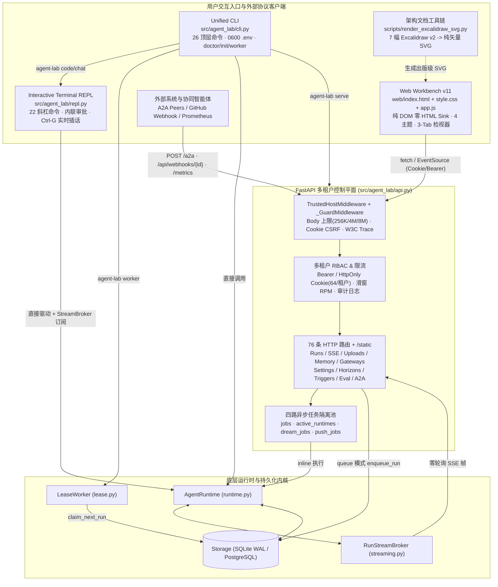
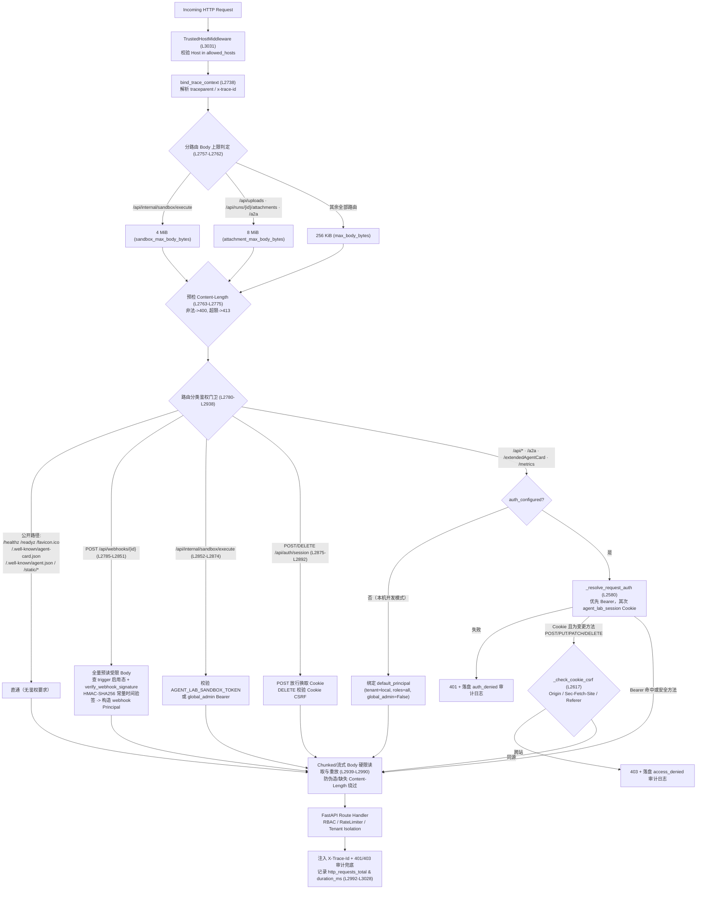
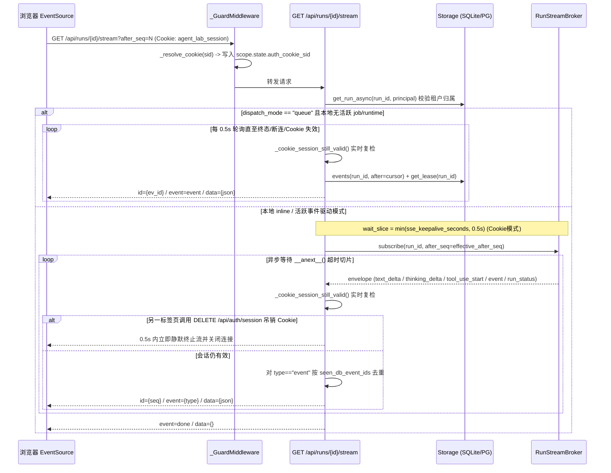
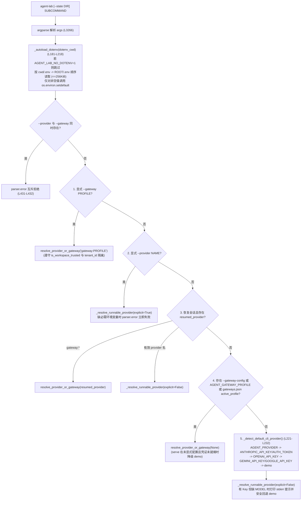
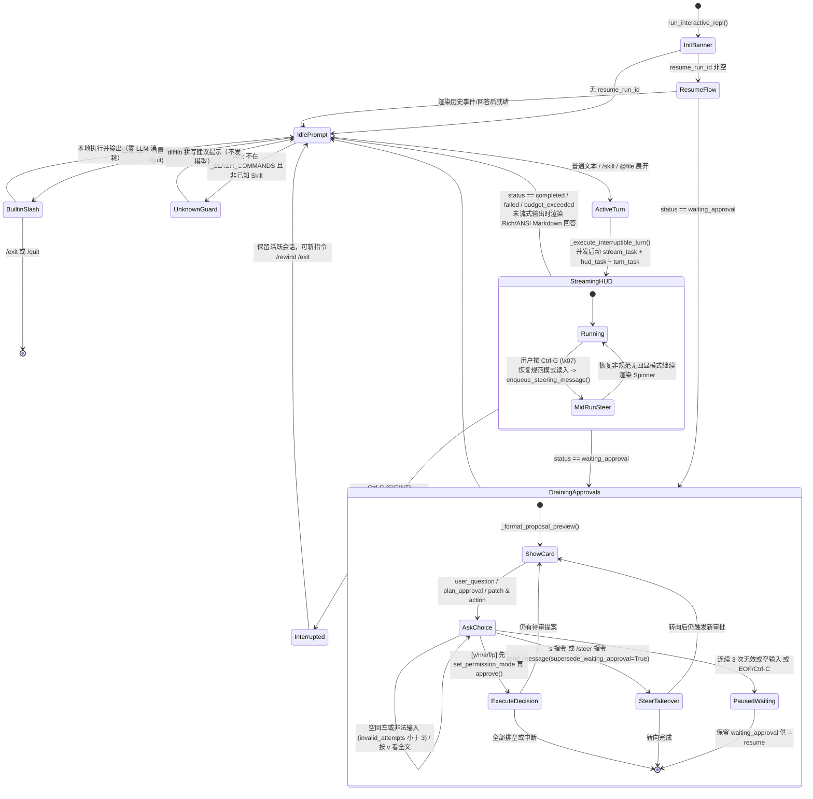
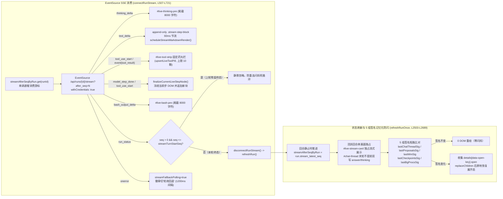

# 06 — 控制平面 API、CLI 命令树、交互式 REPL、Web 工作台与矢量图渲染架构设计

本文档深度剖析 Agent Systems Lab 面向开发者、自动化流水线与外部协同智能体的**全部用户交互平面与工程工具链**，涵盖 **FastAPI 多租户控制平面**、**统一 CLI 命令树与引导体系**、**本地交互式终端工作台（REPL）**、**零 HTML Sink 纯 DOM Web 工作台 v11** 以及 **零依赖确定性 Excalidraw v2 → SVG 架构图渲染器**。文内所有 HTTP 路由、状态码、常量配额、CLI 标志、斜杠命令、CSS 变量、安全不变量与源码行号均逐行核对自仓库真实代码。

覆盖源码范围（共 7 个核心源码文件，总计 **27,718 行**，另含 `docs/diagrams/` 下 **7 幅** Excalidraw v2 架构图与对应 SVG 矢量产物）：
- FastAPI 多租户控制平面：[src/agent_lab/api.py](../../src/agent_lab/api.py)（L1–L8869，8,869 行）
- CLI 命令树与启动引导：[src/agent_lab/cli.py](../../src/agent_lab/cli.py)（L1–L4124，4,124 行）
- 本地交互式终端工作台：[src/agent_lab/repl.py](../../src/agent_lab/repl.py)（L1–L2770，2,770 行）
- Web 工作台 v11 静态外壳与样式：[web/index.html](../../web/index.html)（L1–L1358，1,358 行）、[web/style.css](../../web/style.css)（L1–L3910，3,910 行）
- Web 工作台 v11 纯 DOM 客户端：[web/app.js](../../web/app.js)（L1–L5848，5,848 行）
- 确定性 Excalidraw → SVG 渲染器：[scripts/render_excalidraw_svg.py](../../scripts/render_excalidraw_svg.py)（L1–L839，839 行）及图集索引 [docs/diagrams/README.md](../diagrams/README.md)

---

## 0. 全局用户交互平面与工程工具链总览

Agent Systems Lab 遵循 **“极薄交互外壳 + 单一事实源内核”** 架构：Web 浏览器、CLI 子命令、交互式 REPL、A2A 远端智能体与外部 Webhook 触发器五类入口均不维护独立的会话真值，所有状态收敛于 `AgentRuntime` + `Storage` + `RunStreamBroker`。



### 跨模块源码全景索引

| 序号 | 文件路径 | 总行数 | 核心定位 |
| --- | --- | ---: | --- |
| 1 | [`src/agent_lab/api.py`](../../src/agent_lab/api.py) | 8,869 | FastAPI 多租户控制平面：纵深防御中间件、RBAC、76 条业务/协议/运维路由、事件驱动 SSE、双向 A2A 服务端与后台协程隔离池 |
| 2 | [`src/agent_lab/cli.py`](../../src/agent_lab/cli.py) | 4,124 | `agent-lab` 命令行总入口：零覆盖 `.env` 自动加载、多协议网关与 Provider 解析、26 个顶层子命令（含 `code`/`chat` 别名）与信号优雅停机 |
| 3 | [`src/agent_lab/repl.py`](../../src/agent_lab/repl.py) | 2,770 | 终端多轮交互工作台：无 PTY 注入测试接口、剪枝缓存补全、防误批内联审批循环、异步安全 SIGINT 与 `Ctrl-G` 实时插话 |
| 4 | [`web/index.html`](../../web/index.html) | 1,358 | Web 工作台 v11 语义化骨架：双态布局、吸顶审批条、3-Tab 检视器、7 个无障碍 Modal 与堆叠 Toast 容器 |
| 5 | [`web/style.css`](../../web/style.css) | 3,910 | 4 主题 × 62 CSS 变量设计系统、CJK `>=12px` 字号下限、3 列 Diff 网格与 5 档响应式布局 |
| 6 | [`web/app.js`](../../web/app.js) | 5,848 | 纯 DOM 零 HTML Sink 客户端：单调游标零闪烁 SSE、5 组签名记忆化重绘、纯 DOM Markdown/Diff、`/` & `@` 补全与 `⌘K` 面板 |
| 7 | [`scripts/render_excalidraw_svg.py`](../../scripts/render_excalidraw_svg.py) | 839 | 纯标准库 Excalidraw v2 → SVG 1.1 确定性渲染器：Liang-Barsky 端点裁剪、二次贝塞尔转角、CJK 宽度估算与 XML 自检 |

---

## 1. FastAPI 多租户控制平面（`src/agent_lab/api.py`）

### 1.1 模块定位与核心职责

- **源码路径**：[`src/agent_lab/api.py`](../../src/agent_lab/api.py)（全长 **8,869 行**；核心应用工厂 `create_app` 位于 `L2133–L8869`）。
- **核心职责**：
  1. **纵深防御 HTTP 入口（`TrustedHostMiddleware` + `_GuardMiddleware`）**：强制 `Host` 白名单、按路由分级的请求体字节上限（256 KiB / 4 MiB / 8 MiB）、基于 `Origin` / `Sec-Fetch-Site` / `Referer` 的 Cookie CSRF 校验、W3C `traceparent` 链路透传、Prometheus 路由级指标打点以及失败鉴权自动落盘 `security_audit_logs`。
  2. **多租户 RBAC 与安全会话管理**：支持单令牌 `AGENT_LAB_TOKEN` 与多租户 JSON 映射 `AGENT_LAB_TOKENS_JSON`，通过 `hmac.compare_digest` 常量时间比对与 `HttpOnly + SameSite=Strict` 会话 Cookie 兼顾编程调用与浏览器 `EventSource`；严格执行直连工作区门卫（`_can_use_direct_workspace`）与异人双审（`AGENT_LAB_REQUIRE_DISTINCT_APPROVER`）。
  3. **双模调度与四路异步池隔离**：同时承载 `inline`（单进程协程池 `jobs`）与 `queue`（委托 `LeaseWorker` 持久队列）两种调度模式，并将实时运行对象 `active_runtimes`、出带记忆睡眠池 `dream_jobs`、A2A Webhook 推送池 `push_jobs` 与主任务池 `jobs` 彻底解耦。
  4. **零轮询事件驱动 SSE 与双向 A2A 服务端**：通过 `RunStreamBroker` 推送细粒度流式增量帧并在 `queue` 模式下优雅回退数据库游标轮询；原生实现 A2A v0.2/v0.3/v1.0 AgentCard 发现、JSON-RPC 2.0 端点 `/a2a`、SSE 流式任务与异步推送配置。
  5. **受控文件与多模态资产网关**：提供 6 MiB 解码上限（8 MiB HTTP 体）的分阶段上传 `/api/uploads`、工作区文件浏览与目录选择器，以及防软链/硬链逃逸与 CSP 脚本禁闭的产物分发端点。

---

### 1.2 请求纵深防御流水线与 SSE 实时鉴权数据流

#### 1.2.1 HTTP 请求纵深防御与分发流水线



#### 1.2.2 事件驱动 SSE 与运行中 Cookie 会话实时吊销时序



---

### 1.3 `_GuardMiddleware` 纵深防御机制详解（L2721–L3031）

1. **双层 ASGI 中间件栈顺序（L3030–L3031）**：
   - `app.add_middleware(_GuardMiddleware)` 先注册，`app.add_middleware(TrustedHostMiddleware, allowed_hosts=allowed_hosts)` 后注册；由于 Starlette 中间件呈外包洋葱栈，**`TrustedHostMiddleware` 位于最外层**，先于一切业务逻辑拦截 DNS Rebinding / 伪造 `Host` 头攻击。
   - 默认 `allowed_hosts`（L2140–L2145）为 `["localhost", "127.0.0.1", "[::1]", "testserver"]`，可通过逗号分隔环境变量 `AGENT_LAB_ALLOWED_HOSTS` 扩展。
2. **分路由三级请求体硬上限（L2154–L2168、L2757–L2775、L2957–L2990）**：
   - 若显式配置了 `AGENT_LAB_MAX_BODY_BYTES`，所有路由统一收紧至该值；否则按路由分级：
     - 普通路由默认：`256 KiB`（`256 * 1024`，L2155）；
     - 远程沙盒执行 `/api/internal/sandbox/execute`：`4 MiB`（`AGENT_LAB_SANDBOX_MAX_BODY_BYTES`，L2159）；
     - 附件/暂存上传及 A2A 含内联二进制附件端点（`POST /api/uploads`、`POST /api/runs/{run_id}/attachments`、`POST /a2a`）：`8 MiB`（`AGENT_LAB_ATTACHMENT_MAX_BODY_BYTES`，L2166），用于容纳 `6 MiB` 原始文件经 Base64 编码后约 33% 的体积膨胀（`6 * 4 / 3 = 8 MiB`）。
   - **双阶段防绕过**：先预检 `Content-Length`（非整数或 `<0` 立即 `400`，超限 `413`），随后对所有 `POST` / `PUT` / `PATCH` 请求在中间件层流式累积实际 `http.request` 分块字节，实时校验 `len(buffered) > body_cap`（彻底阻断 `Transfer-Encoding: chunked` 或谎报小 `Content-Length` 绕过），再通过 `_replay_receive`（或 Webhook 专用的 `_replay_pre_receive`）无损重放给下游 FastAPI 解析器。
3. **跨源与 Cookie CSRF 纵深护盾（L2595–L2633、L2781–L2784、L2900–L2904）**：
   - 对所有 `/api/*`、`/a2a`、`/extendedAgentCard` 请求，只要携带了 `Origin` 头即强制校验 `_origin_matches_request`（协议、主机名、显式/默认端口三元组全等，拒绝 `Origin: null`），跨源立即 `403`。
   - 对使用 `agent_lab_session` Cookie 认证的变更请求（`POST` / `PUT` / `PATCH` / `DELETE`，含 `DELETE /api/auth/session` 注销），额外执行 `_check_cookie_csrf`（L2617–L2633）：
     - 若存在 `Origin` 但非同源 → 拒绝；
     - 若存在 `Sec-Fetch-Site` 且不等于 `same-origin` → 拒绝；
     - 若无 `Origin` 但存在 `Referer` 且非同源 → 拒绝；
     - 若 `Origin` 与 `Sec-Fetch-Site` 均缺失且请求主机不在回环白名单 `{"localhost", "127.0.0.1", "::1", "testserver"}` → 拒绝。
4. **公开端点与 Webhook 特权通道清单（L2785–L2938）**：
   - **完全公开（免鉴权）**：`GET /healthz`、`GET /readyz`、`GET /favicon.ico`、`GET /.well-known/agent-card.json`、`GET /.well-known/agent.json`、`GET /`、`GET /static/*`。
   - **HMAC 独立验签通道**：`POST /api/webhooks/{trigger_id}`（L2785–L2851），绕过全局 Bearer/Cookie 检查，改为在中间件内预读受限 Body → 查库确认触发器存在（否则 `404`）、已启用且 `kind == "webhook"`（否则 `403`）→ 校验 `X-Hub-Signature-256` 或 `X-Agent-Lab-Signature` 头存在（否则 `401`）→ 调用 `verify_webhook_signature` 常量时间验签（否则 `403`），验签通过后构造受限租户主体 `Principal(wh_tenant, f"webhook:{wh_trigger_id}", {"operator"}, global_admin=False)`。
   - **生产强制鉴权启动门禁（L2150–L2152）**：当 `AGENT_LAB_REQUIRE_AUTH` 为 `1`/`true`/`yes`（`agent-lab serve` 绑定非回环地址时自动注入）且既未配置 `AGENT_LAB_TOKEN` 也未配置 `AGENT_LAB_TOKENS_JSON` 时，`create_app()` 直接抛出 `RuntimeError` 拒绝启动。

---

### 1.4 多租户 RBAC、HttpOnly Cookie 会话与限流配额

#### 1.4.1 四级身份权限模型与门卫函数

`Principal` 不可变数据类（L231–L240）由 `(tenant_id, actor_id, roles, global_admin)` 构成，其中 `VALID_ROLES = frozenset({"operator", "approver", "admin"})`（L152）。`memory_scope()`（L238–L239）在 `local` 租户下映射为 `"user"`，其余租户映射为 `"tenant:{tenant_id}:user"`。

| 身份类别 | 配置方式 | 典型可访问边界 | 受限禁区 |
| --- | --- | --- | --- |
| `operator` | `AGENT_LAB_TOKENS_JSON` 中 `roles: ["operator"]` | 创建/追问/分叉/压缩/回退/删除/取消本租户任务、上传附件、管理本租户触发器、触发 Dreaming 与轨迹采集、A2A 发现与发送 | 无法审批提案（`403`）、无法切换权限档位、无法读写全局规则/网关/A2A 对端、无法访问审计日志与 GC |
| `approver` | `roles: ["approver"]` | 查看本租户任务、审批提案（`POST /proposals/{pid}`）、切换运行权限模式（`PATCH /permissions`）、取消任务 | 无法创建任务、修改记忆或管理配置；若开启 `AGENT_LAB_REQUIRE_DISTINCT_APPROVER=1`，禁止审批自己发起的任务（L5807–L5810） |
| `admin`（单租户） | `roles: ["admin"]`, `global_admin=False` | 本租户全量权限 + 查看本租户 `/api/audit-logs`；仅 `tenant_id == "local"` 的 `admin` 可挂载宿主机直连工作区 | 无法跨租户查看其他租户任务、无法修改全局 `/api/gateways`、`/api/a2a/peers`、`global` 规则及多租户下的 `/api/admin/gc` |
| `global_admin` | `AGENT_LAB_TOKEN` 自动映射，或 JSON 中 `global_admin: true` 且含 `"admin"` | 全租户跨边界访问（`all_tenants=true`）、宿主机直连目录与 Horizon、网关/A2A/全局规则配置、全局 GC、远程沙盒执行 | 仍受路径黑名单（`_FORBIDDEN_DOT_PARTS`、`validate_direct_workspace_path`）与 `AGENT_LAB_ALLOWED_WORKSPACES` 白名单约束 |

核心权限门卫函数：
- `_can_use_direct_workspace(principal)`（L3064–L3075）：未开启鉴权返回 `True`；开启鉴权后仅放行 `(principal.global_admin and "admin" in principal.roles)` 或 `(principal.tenant_id == "local" and "admin" in principal.roles)`。
- `_require_global_admin(principal, detail)`（L3077–L3083）：开启鉴权后强制要求 `global_admin` + `"admin"`；未开鉴权仅校验 `"admin"`。
- `_can_run_admin_gc(principal)`（L3085–L3102）：显式存在 `global_admin` 时仅放行之；多租户无 `global_admin` 时仅放行 `local` 租户 `admin`；单租户无独立 `global_admin` 时放行该唯一租户 `admin`。
- `_can_access_run(run, principal)`（L3040–L3046）：跨租户读取/操作一律在 `get_run` / `get_run_async`（L3048–L3062）返回 `404 "任务不存在"`，避免泄漏租户任务 ID 存在性。

#### 1.4.2 关键安全常量、会话配额与限流参数表

| 常量 / 环境变量 | 默认值 | 源码行号 | 工程语义与不变量 |
| --- | --- | --- | --- |
| `SESSION_COOKIE_NAME` | `"agent_lab_session"` | L153 | `HttpOnly`、`SameSite=Strict`、`Secure` 随 HTTPS 自动开启、`Path=/` |
| `_SESSION_TTL_SECONDS` | `86_400.0` (24h) | L154 | 内存会话过期时间，访问时 LRU 刷新顺序（L2570） |
| `_MAX_COOKIE_SESSIONS_PER_TENANT` | `64` | L156, L2530–L2537 | 单租户 FIFO 上限，防止单一租户刷 Cookie 挤占其他租户或管理员会话 |
| `_MAX_COOKIE_SESSIONS` | `1024` | L155, L2539–L2555 | 全局会话槽上限；超限时优先淘汰当前持有会话数最多的租户中最旧会话（fair-share 驱逐） |
| `AGENT_LAB_RATE_LIMIT_RPM` | `120` | L2174 | `_TenantRateLimiter` 按租户 60 秒滑动窗口 RPM 上限（`OrderedDict` 最多追踪 1024 个租户键，L267） |
| `AGENT_LAB_AUTH_RATE_LIMIT_RPM` | 同 `rate_limiter.limit_rpm` (120) | L2175–L2177 | `POST /api/auth/session` 专用限流器，同时按 `ip:{client_ip}`（L3588）与 `tenant:{tenant_id}`（L3613）双维度防暴力爆破 |
| `AGENT_LAB_MAX_INLINE_JOBS` | `16` | L2173 | `inline` 模式下最大并发活跃编码主任务数（不计 `dream_jobs`） |
| `AGENT_LAB_MAX_QUEUE_DEPTH` | `64` | L2172 | `queue` 模式下 `run_leases` 中 `queued`/`claimed` 状态最大排队深度 |
| `AGENT_LAB_SSE_KEEPALIVE_SECONDS` | `15.0` s（下限 `0.05`） | L2169–L2171 | SSE `: keepalive` 心跳间隔 |
| `_MAX_ATTACHMENT_BYTES` | `6 * 1024 * 1024` (6 MiB) | L171 | 单附件解码后二进制硬上限；单会话最多 32 个附件（L1226），单请求最多 8 个（L328） |
| `_STAGED_UPLOAD_TTL_SECONDS` | `3600.0` s | L172 | `/api/uploads` 暂存文件过期清理周期 |
| `_MAX_STAGED_UPLOADS_PER_TENANT` | `64` | L173, L1013 | 单租户同时活跃暂存上传文件上限 |
| `_BROWSE_MAX_DIRS` | `120` | L174 | `/api/workspaces/browse` 单目录最多返回子目录数 |
| `_MAX_SETTINGS_BYTES` | `256 * 1024` (256 KiB) | L175 | `settings.json` 单文件读写硬上限 |
| `_MAX_REPOMAP_CACHE` | `32` | L176, L2717 | `app.state.repomap_cache` LRU 缓存上限，GC 时自动清理失效路径 |

---

### 1.5 完整分组 HTTP API 路由总目录（全部 76 条路由 + `/static`）

#### (1) 认证与安全审计（Auth & Audit）

| Method | Path | 状态码 | 鉴权与 RBAC | 核心职责 | 行号 |
| --- | --- | ---: | --- | --- | --- |
| `GET` | `/api/auth/session` | 200 | Bearer / Cookie | 查询当前认证主体（`tenant_id`、`actor_id`、`roles`、`global_admin`） | L3568 |
| `POST` | `/api/auth/session` | 200 | IP+租户限流，令牌验证 | 用 Body `token` 或 `Bearer` 换取 `HttpOnly+SameSite=Strict` 会话 Cookie，记 `auth_session_created` | L3581 |
| `DELETE` | `/api/auth/session` | 200 | Cookie CSRF 校验 | 服务端吊销会话并清除 Cookie，记 `auth_session_deleted` | L3647 |
| `GET` | `/api/audit-logs` | 200 | 开启鉴权后需 `admin` | 倒序分页读取 `security_audit_logs`（`limit<=1000`, `action`, `actor`, `tenant_id`）；非全局管理员强制锁死本租户 | L3672 |

#### (2) 配置、健康探针、可观测与运维（Config / Health / Metrics / Admin）

| Method | Path | 状态码 | 鉴权与 RBAC | 核心职责 | 行号 |
| --- | --- | ---: | --- | --- | --- |
| `GET` | `/healthz` | 200 | 公开 | 进程存活探针 `{"ok": true, "status": "alive"}` | L3546 |
| `GET` | `/readyz` | 200/503 | 公开 | 深度就绪探针：SQLite/PG `SELECT 1`、工作区写入探针、沙盒可用性、Worker 注册数 | L3550 |
| `GET` | `/metrics` | 200 | 开启鉴权需登录 | Prometheus 0.0.4 文本指标（动态刷新 `agent_lab_inline_active_jobs`） | L3555 |
| `GET` | `/api/metrics` | 200 | 标准鉴权 | JSON 结构化指标快照（`METRICS.snapshot()`） | L3563 |
| `GET` | `/api/config` | 200 | 标准鉴权 | 返回当前 Provider、可用模型、脱敏网关列表、A2A 对端计数、37 项 `capabilities`、`host_capabilities`、知识库与技能目录 | L3697 |
| `GET` | `/api/workers` | 200 | 标准鉴权 | 返回当前 `dispatch_mode` 与已注册 Worker 列表 | L4297 |
| `GET` | `/api/kv-benchmark` | 200 | 标准鉴权 | 运行 KV Cache 离线消融基准（`turns` 4..40、`max_chars` 2400..64000、`block_chars` 16..512） | L4301 |
| `POST` | `/api/admin/gc` | 200 | `_can_run_admin_gc` | 并发回收过期托管工作区、Git Origin、Artifacts、孤儿容器、过期暂存上传与失效 RepoMap 缓存，记 `admin_gc` | L6631 |
| `POST` | `/api/internal/sandbox/execute` | 200 | `AGENT_LAB_SANDBOX_TOKEN` 或 `global_admin` | 远端 HTTP 沙盒池执行入口（4 MiB 请求体上限） | L6674 |

#### (3) 任务会话全生命周期与检查点（Runs Lifecycle）

| Method | Path | 状态码 | 鉴权与 RBAC | 核心职责 | 行号 |
| --- | --- | ---: | --- | --- | --- |
| `POST` | `/api/runs` | 202 | `operator`/`admin` + 限流 + 直连/full-auto 门卫 | 创建新任务（支持 `sample`/`multi_file`/`local_cwd`、`isolate_worktree`、`gateway_profile`、`model`、`max_cost_usd`、`attachments`、host 模式 `@file` 展开） | L4529 |
| `GET` | `/api/runs` | 200 | 标准鉴权（`all_tenants` 需 `global_admin`） | 键集游标分页 + 搜索 `q` + 状态 `status` + `include_archived`，回填失败任务的 `error_detail` | L4579 |
| `GET` | `/api/runs/{run_id}` | 200 | 租户归属校验 | 聚合详情：`proposals`、`pending_steering`、`context`、`kv_cache`、`cost_breakdown`、`checkpoints`、`working_memory` 实时审计、`conversation_thread`、`stream_latest_seq` | L4604 |
| `PATCH` | `/api/runs/{run_id}` | 200 | `operator`/`admin` | 重命名会话 `title` 或切换 `archived` 归档态 | L4678 |
| `DELETE` | `/api/runs/{run_id}` | 200 | `operator`/`admin`（运行中 `409`） | 删除持久化记录并安全 `rmtree` 专属 `artifacts/<id>` 与 `checkpoints/<id>`（绝不删直连工作区或审计日志） | L4707 |
| `POST` | `/api/runs/{run_id}/fork` | 200 | `operator`/`admin` + 直连门卫 | 从指定 `up_to_message_idx` 分叉独立会话分支并自愈悬空 `tool_use` | L4745 |
| `GET` | `/api/runs/{run_id}/checkpoints` | 200 | 租户 + 直连门卫 | 列出该会话所有轮次检查点清单及 `file_manifest` | L4782 |
| `POST` | `/api/runs/{run_id}/rewind` | 200 | `operator`/`admin` + 直连门卫（运行中 `409`） | 时间旅行回退至 `checkpoint_id`（`scope`: `both`/`files`/`messages`），记 `run_rewind` 审计 | L4799 |
| `PATCH` | `/api/runs/{run_id}/permissions` | 200 | `approver`/`admin`（运行中 `409`） | 热切换 `permission_mode`（`ask`/`auto-edit`/`full-auto`/`plan`）并写入事件 | L5032 |
| `POST` | `/api/runs/{run_id}/compact` | 200 | `operator`/`admin` + 直连门卫（运行中 `409`） | 手动触发滚动上下文压缩（`keep_recent_groups` 1..20、`focus`、`use_llm`） | L5062 |
| `POST` | `/api/runs/{run_id}/messages` | 202 | `operator`/`admin` + 限流 + 直连门卫 | 运行中写入 `run_steering_messages` 零冲突实时插话；`waiting_approval` 自动接管撤销提案；空闲态追加新一轮并延展步数/Token 预算 | L5106 |
| `POST` | `/api/runs/{run_id}/resume` | 202 | `operator`/`admin` + 直连门卫 | 恢复失败/中断任务（不重置累计预算）；`queue` 模式校验活跃租约防双派 | L5750 |
| `POST` | `/api/runs/{run_id}/cancel` | 200 | `operator`/`approver`/`admin` | 持久化取消标记 + 调用 `active_rt.cancel_active_run` + 取消协程并等待最多 1.0s | L5774 |
| `POST` | `/api/runs/{run_id}/proposals/{proposal_id}` | 202 | `approver`/`admin` + 双人复核门禁 | 审批补丁/命令/GUI/MCP/A2A/提问/计划；支持幂等去抖、`selected_files` 局部应用、CAS 写入 `session_grants`、`answer_text` 与权限热升级 | L5802 |

#### (4) 任务诊断、后台进程、文件与实时流（Observability / Processes / Stream）

| Method | Path | 状态码 | 鉴权与 RBAC | 核心职责 | 行号 |
| --- | --- | ---: | --- | --- | --- |
| `GET` | `/api/runs/{run_id}/files` | 200 | 租户 + 直连门卫 | 列出该会话工作区非敏感常规文件（支持 `q` 与 `limit<=200`，最多扫描 10,000 文件） | L5441 |
| `GET` | `/api/runs/{run_id}/processes` | 200 | 租户归属 | 返回活跃 `active_runtimes` 下的后台 PTY/Shell 进程及异步子 Agent 任务 | L5457 |
| `POST` | `/api/runs/{run_id}/processes/{proc_id}/kill` | 200 | `operator`/`admin` + 直连门卫 | 终止指定后台进程组，落盘 `background_process_killed` 事件与 `process_kill` 审计 | L5483 |
| `GET` | `/api/runs/{run_id}/repomap` | 200 | 租户归属 | 复用 LRU 缓存的 `RepoMapIndex` 构建 AST 代码地图（`max_chars` 200..6000、`focus`） | L5531 |
| `GET` | `/api/runs/{run_id}/calls` | 200 | 租户归属 | 返回持久化 `tool_calls` 摘要列表 | L5543 |
| `GET` | `/api/runs/{run_id}/tool-result` | 200 | 租户归属 | 按 `call_id` 分页读取完整工具输出（`offset>=0`, `limit` 1..8000） | L5548 |
| `GET` | `/api/runs/{run_id}/events` | 200 | 租户归属 | 按主键游标 `after` 增量拉取持久化事件 | L5564 |
| `GET` | `/api/runs/{run_id}/grade` | 200 | 租户归属 | 调用 `grade_trajectory` 执行四维量化评分与摩擦信号提取 | L5569 |
| `GET` | `/api/runs/{run_id}/stream` | 200 | 租户归属 + 实时 Cookie 复检 | 事件驱动 SSE 实时流（`text/event-stream`，`X-Accel-Buffering: no`），`queue` 模式自动回退 0.5s DB 轮询 | L5584 |

#### (5) 附件暂存、安全产物与本地工作区浏览（Uploads / Artifacts / Workspaces）

| Method | Path | 状态码 | 鉴权与 RBAC | 核心职责 | 行号 |
| --- | --- | ---: | --- | --- | --- |
| `POST` | `/api/uploads` | 200 | `operator`/`admin` + 限流 | 8 MiB Body 上限，接收 Base64 校验扩展名/MIME/魔数并原子落盘 `staged_uploads/<tenant_slug>/upl_<hex>` | L4111 |
| `POST` | `/api/runs/{run_id}/attachments` | 200 | `operator`/`admin` + 限流 | 向已有会话直接追加附件（6 次 `state_version` CAS 重试，失败自动清理磁盘孤儿文件） | L4851 |
| `GET` | `/api/runs/{run_id}/artifacts/{artifact_name}` | 200 | 租户归属 | 扩展名白名单 + 逐段拒软链 + `O_NOFOLLOW` + `st_nlink==1` + 64 KiB 分块流式返回 + CSP 脚本禁闭头 | L4943 |
| `GET` | `/api/workspaces/browse` | 200 | `_can_use_direct_workspace` | 受控本地目录浏览器：过滤隐藏/敏感/软链目录，返回 `current_path`、`parent_path`、`recent_workspaces` 与 `is_git` 标记 | L4143 |
| `GET` | `/api/workspaces/files` | 200 | `_can_use_direct_workspace` | 列出直连本地目录常规文件路径供新建任务 `@file` 补全 | L4272 |

#### (6) 分层记忆、双层文档与 Dreaming（Memory & Dreaming）

| Method | Path | 状态码 | 鉴权与 RBAC | 核心职责 | 行号 |
| --- | --- | ---: | --- | --- | --- |
| `GET` | `/api/memory` | 200 | 标准鉴权 | 读取当前 `principal.memory_scope()` 的轻量键值偏好表 | L6181 |
| `POST` | `/api/memory` | 200 | `operator`/`admin` | 写入轻量键值偏好（key 匹配 `^[\w\- ]+$`, `<=80` 字符；value `<=2000` 字符） | L6187 |
| `GET` | `/api/memory/overview` | 200 | 标准鉴权 + 四级作用域解析 | 返回双层 `CLAUDE.md`/`MEMORY.md`、Wiki 页面列表、链接图谱统计与近期 Dreaming 报告 | L6195 |
| `GET` | `/api/memory/page` | 200 | 同上 | 按 `layer`（`global`/`project`）与 `path` 读取单篇记忆页、出链与反向入链 | L6208 |
| `PUT` | `/api/memory/page` | 200 | `operator`/`admin`（`sync_workspace_file` 需直连门卫） | 新建或修订 `CLAUDE.md`/`MEMORY.md`/Wiki 页，记 `memory_page_write` 审计 | L6227 |
| `DELETE` | `/api/memory/page` | 200 | `operator`/`admin` | 删除子页并原子摘除顶层索引对应 `[[wiki-link]]`，记 `memory_page_delete` 审计 | L6267 |
| `GET` | `/api/memory/search` | 200 | 标准鉴权 | 跨 `all`/`wiki`/`transcripts` 执行混合 RRF 检索（`limit` 1..15） | L6299 |
| `POST` | `/api/memory/dream` | 200 | `operator`/`admin` + 限流 | 按需运行四阶段 Dreaming，支持 `dry_run=true` 零落盘预演 Diff；`finally` 释放模型客户端 | L6315 |
| `GET` | `/api/memory/dream/snapshots` | 200 | 标准鉴权 | 列出当前项目可用的 Dreaming 原子回滚快照清单 | L6367 |
| `POST` | `/api/memory/dream/rollback` | 200 | `operator`/`admin` | 恢复最近或指定 `snapshot_id` 的双层记忆快照，记 `memory_dream_rollback` 审计 | L6387 |

#### (7) 多协议网关、声明式规则与 Hooks（Gateways & Settings）

| Method | Path | 状态码 | 鉴权与 RBAC | 核心职责 | 行号 |
| --- | --- | ---: | --- | --- | --- |
| `GET` | `/api/gateways` | 200 | 标准鉴权（非管理员剥离 `config_path`） | 返回脱敏 `gateways.json` 配置、当前活跃网关与支持的 5 种规范线协议 | L3879 |
| `PUT` | `/api/gateways` | 200 | `_require_global_admin` | 还原 `***REDACTED***` 占位符 → 校验 → 原子落盘 `0600` → 热刷新运行态 Provider 并释放旧连接池，记 `gateways_config_update` | L3921 |
| `POST` | `/api/gateways/activate` | 200 | `_require_global_admin` | 先构造验证目标 Provider，再原子更新 `active_profile` 并热替换运行态，失败不污染线上状态，记 `gateway_activate` | L4042 |
| `GET` | `/api/settings/rules` | 200 | `admin` + 直连门卫 | 读取 `global` / `project` / `effective` 合并权限规则（`deny`/`ask`/`allow`）、生命周期 Hooks 与工作区信任状态 | L6420 |
| `PUT` | `/api/settings/rules` | 200 | `global` 需 `global_admin`；`project` 需 `admin` + 直连 | 校验规则/Hook 合法性（`timeout_seconds` 0.2..60s），`fsync` + `0600` 原子替换 `settings.json`，支持切换 `trust_workspace`，记 `settings_rules_update` | L6498 |

#### (8) 双向 A2A 协议服务端与对端管理（Agent2Agent）

| Method | Path | 状态码 | 鉴权与 RBAC | 核心职责 | 行号 |
| --- | --- | ---: | --- | --- | --- |
| `GET` | `/.well-known/agent-card.json` | 200 | 公开 | A2A v0.3/v1.0 标准公开 AgentCard（零密钥、零内部路径） | L6702 |
| `GET` | `/.well-known/agent.json` | 200 | 公开 | A2A v0.2 兼容公开 AgentCard | L6707 |
| `GET` | `/extendedAgentCard` | 200 | 标准鉴权 | 鉴权后返回完整 RPC 方法目录与扩展能力元数据 | L6712 |
| `POST` | `/a2a` | 200 | 标准鉴权 + 限流（8 MiB 上限） | JSON-RPC 2.0 统一端点：支持 `message/send`（同步/异步）、`message/stream`（SSE）、`tasks/get`、`tasks/list`（走 `a2a_context_id` 索引）、`tasks/cancel`、`tasks/resubscribe` 及 `tasks/pushNotificationConfig/{set,get,delete}` | L7417 |
| `GET` | `/api/a2a/peers` | 200 | 标准鉴权（非管理员剥离 `config_path`） | 返回脱敏 `a2a.json` 对端智能体配置 | L7956 |
| `PUT` | `/api/a2a/peers` | 200 | `_require_global_admin` | 还原脱敏占位符、SSRF 校验并原子落盘 `a2a.json`，记 `a2a_peers_config_update` | L7989 |
| `POST` | `/api/a2a/discover` | 200 | `operator`/`admin` + 限流 | 发现远端 A2A AgentCard（SSRF 防护，可选 `allow_private_network`） | L8054 |
| `POST` | `/api/a2a/send` | 200 | `operator`/`admin` + 限流 | 向已配置对端委托任务并记 `a2a_send_message` 审计 | L8096 |

#### (9) Horizon 超长程战役、触发器、评测飞轮与静态资源（Horizons / Triggers / Eval / Static）

| Method | Path | 状态码 | 鉴权与 RBAC | 核心职责 | 行号 |
| --- | --- | ---: | --- | --- | --- |
| `GET` | `/api/horizons` | 200 | `_can_use_direct_workspace` | 列出直连工作区下所有 Horizon Campaign 及进度摘要 | L8186 |
| `POST` | `/api/horizons` | 200 | `operator`/`admin` + 直连门卫 + 限流 | 初始化 Horizon Campaign（生成不可变 `feature_list.json`、`init.sh`、`progress.md`），记 `horizon_campaign_create` | L8209 |
| `POST` | `/api/horizons/lint` | 200 | `_can_use_direct_workspace` | 运行 `MechanicalInvariantChecker` 返回结构化架构违规与修复指引 | L8263 |
| `GET` | `/api/horizons/{campaign_id}` | 200 | `_can_use_direct_workspace` | 获取指定 Campaign 完整特征账本、收据与交接日志（不存在 `404`） | L8291 |
| `GET` | `/api/triggers` | 200 | 标准鉴权（`all_tenants` 需 `global_admin`） | 列出租户触发器定义（`webhook_secret` 恒掩码为 `***REDACTED***`） | L8463 |
| `POST` | `/api/triggers` | 200 | `operator`/`admin` + 限流 | 创建 Cron（`CronSchedule.parse` + `ZoneInfo` 校验）或 Webhook 触发器；绑定直连目录需直连门卫，记 `trigger_create` | L8488 |
| `DELETE` | `/api/triggers/{trigger_id}` | 200 | `operator`/`admin` | 原子删除触发器及触发记录，记 `trigger_delete` | L8590 |
| `GET` | `/api/triggers/{trigger_id}/fires` | 200 | 租户归属 | 分页查询指定触发器的触发历史（`limit<=1000`） | L8612 |
| `POST` | `/api/webhooks/{trigger_id}` | 202/200 | HMAC-SHA256 验签 + 限流 | 幂等去重（`_scoped_webhook_dedup_key` 截断<=256 字符防碰撞；重复返回 `200 deduplicated=true`）、模板渲染、任务派发并记 `webhook_trigger_fire` | L8634 |
| `POST` | `/api/evals/harvest` | 200 | `operator`/`admin` + 限流 | 通过 `_TenantScopedStorageProxy` 隔离租户扫描失败/高摩擦轨迹并双重脱敏落盘回归集，记 `eval_harvest` | L8762 |
| `GET` | `/favicon.ico` | 200 | 公开 | 内联 SVG 站点图标（`Cache-Control: public, max-age=86400`） | L8854 |
| `GET` | `/` | 200 | 公开 | 返回 `web/index.html`（`Cache-Control: no-store, no-cache, must-revalidate`） | L8862 |
| `MOUNT` | `/static` | — | 公开 | `StaticFiles(directory=ROOT / "web")` 挂载前端静态资源（L8852） | L8852 |

---

### 1.6 核心子引擎算法与工程机制

#### 1.6.1 分阶段上传（`/api/uploads`）与产物零逃逸门卫（L599–L1242、L4943–L5030）
1. **五重附件合法性门禁**：
   - 文件名匹配 `_SAFE_FILENAME_RE`（`^[A-Za-z0-9][A-Za-z0-9_.-]{0,159}$`，拒绝 `/`, `\`, `..`, `\x00`, 点前缀）；
   - 扩展名与 MIME 双向映射表强绑定（`_ATTACHMENT_MIME_TO_EXTS`，仅允许 `png`/`jpeg`/`webp`/`gif`/`pdf`/`txt`/`md`，彻底禁绝 `.html`/`.svg`）；
   - Base64 预检长度防内存放大（`((_MAX_ATTACHMENT_BYTES * 4) // 3) + 64`）与 `base64.b64decode(..., validate=True)`；
   - 文件头魔数严格校验（`_validate_attachment_magic`，L617–L642：PNG `\x89PNG\r\n\x1a\n`、JPEG `\xff\xd8\xff`、WebP `RIFF....WEBP`、GIF `GIF87a`/`GIF89a`、PDF `%PDF-`、文本禁 NUL 字节且合法 UTF-8）；
   - PNG 自动探查 IHDR 宽高（`_probe_png_dimensions`，L591–L596，限制 `1..16384`）。
2. **原子认领与事务性回滚（`_claim_staged_upload` / `_claim_attachment_batch`，L1112–L1215、L4333–L4355）**：
   - 上传落盘时以 `tempfile.mkstemp` + `fsync` + `0600` + `os.replace` 先写 `.meta.json` 再写 Blob，隔离在 `staged_uploads/<tenant_slug>/`；
   - 被 `POST /api/runs` 或 `POST /api/runs/{id}/messages` 引用时，在 `staged_upload_lock` 锁内用 `O_NOFOLLOW` + `st_nlink == 1` 核验租户归属与 SHA-256 哈希，再 `os.replace(blob_path, claimed_path)` 原子认领，杜绝并发双消费；
   - 任一后续步骤失败时调用 `_restore_staged_claims` 将已认领 Blob 原位还原，同时 `_cleanup_written_attachments` 清理已写入目标 `artifacts/<run_id>` 的孤儿文件；完全落库成功后 `_finalize_staged_claims` 清除暂存文件。
3. **安全产物分发（`GET /api/runs/{run_id}/artifacts/{artifact_name}`，L4943–L5030）**：
   - 扩展名白名单 `_ARTIFACT_SERVE_RE`（支持媒体/文档 + `.json`）；
   - **Pre-resolve 逐段反软链校验**：在调用 `.resolve()` 前分别检验 `artifacts_root`、`raw_run_dir`、`raw_target` 的 `is_symlink()`，再用 `os.open(path, os.O_RDONLY | O_NOFOLLOW)` 与 `os.fstat(fd)` 确认 `S_ISREG` 且 `st_nlink == 1`（防硬链跨目录偷渡）；
   - 强制注入四项安全响应头：
     - `Content-Security-Policy: default-src 'none'; img-src 'self'`
     - `X-Content-Type-Options: nosniff`
     - `Cache-Control: private, max-age=300`
     - `Content-Length: <size_bytes>`

#### 1.6.2 `_build_conversation_thread` 多轮重建与活跃前导语抑制（L1461–L1695）
- **输入**：`stored["messages"]`、`meta["conversation_turns"]`、`meta["user_attachments"]` 及当前 `status`。
- **内部消息过滤**：通过 `_INTERNAL_USER_MSG_PREFIXES`（15 个系统前缀，L183–L198，含 `REVIEW_APPROVED:`、`HARNESS_STATE\n`、`COMPACTION_SUMMARY`、`PINNED_MEMORY` 等）剔除框架自动注入消息，仅保留真实用户回合与 `_STEERING_MSG_PREFIX`（`"[用户运行中实时补充指令]\n"`）插话。
- **单步文本与 Extended Thinking 提取（L1510–L1533）**：遍历 assistant 消息块列表，拼接所有 `thinking` 块到 `thinking_parts`；仅当该步 `step_tool_uses == 0`（无工具调用）时将文本记为 `final_text`，含工具调用的中间说明记为 `fallback_text`。
- **活跃回合前导语抑制（L1552–L1555）**：
  - `is_active_turn = (not is_terminal) and (seg_i == len(raw_segments) - 1)`；
  - 活跃回合中仅输出 `seg["final_text"]`（跳过 `fallback_text`），彻底防止模型在调用工具前的过渡语被同时渲染在 `#chat-thread` 与 `#live-stream-card` 导致页面闪烁重影；进入终态或历史回合时恢复 `final_text or fallback_text`，保障异常中断不丢内容。
- **批量同拍 Steering 拆分与附件三层归属（L1581–L1693）**：探测连续 `steering` 元数据记录并按 `\n\n` 拼接比对拆分还原独立气泡；用户附件按 `steering_id` → `turn_message_idx` → `uploaded_at <= turn.started_at` 时间就近匹配三级优先级精确归入对应回合。

#### 1.6.3 四路后台异步池隔离与迟到 Steering 弥合（L2498–L2502、L3194–L3451）
- **`jobs`（主编码任务池）**：按 `run_id` 互斥，受 `max_inline_jobs`（默认 16）并发配额限制，完成回调 `forget_finished` 即时移除键不泄漏内存。
- **`active_runtimes`（在途运行实例表）**：供 `POST /cancel` 毫秒级触发 `cancel_active_run`、`GET /processes` 实时查询 PTY 进程、`POST /messages` 实时将运行中上传的新附件注册进内存态 `register_external_attachments`。
- **`dream_jobs`（出带睡眠整理池，L3194–L3221）**：`dispatch()` 强制设置 `runtime.defer_auto_dream = True`（L3305）；待主协程退出执行锁、完成 `runtime.aclose()` 并关闭流通道后，再向独立 `dream_jobs` 集合投递 `_dream_worker()`。因此慢速 Wiki 合成既不挤占主并发槽位误报 429，也不阻塞用户立刻发起下一轮追问。
- **极窄窗口迟到 Steering 弥合（L3372–L3428）**：在主任务落盘 `completed` 至 `runtime.aclose()` 之间的毫秒窗口内若恰好有新插话写入 `run_steering_messages`，`work()` 在关闭后立即执行一次 `drain_steering_messages`，若非空则自动 `append_user_turn`、回填附件 `turn_message_idx` 并无缝重新 `dispatch()` 续跑。
- **`push_jobs` 与 `a2a_push_run_ids`（L3223–L3299）**：A2A 任务进入终态或 `input-required` 后尽力异步投递 Webhook 通知，结果落盘 `a2a_push_delivered` / `a2a_push_failed` 事件；`a2a_push_run_ids` 有界 `OrderedDict` 上限 4096 项防内存增长；`lifespan` 关机时等待 `push_jobs` 最多 `0.5s` 再优雅取消（L2683–L2691）。

---

### 1.7 核心安全、并发与高可用不变量（Why + How）

| 不变量 | Why（防什么风险） | How（源码精确实现） |
| --- | --- | --- |
| 跨租户存在性零泄漏 | 防止攻击者借 `403` vs `404` 枚举其他租户 `run_id`/`trigger_id` | `get_run` / `get_run_async`（L3048–L3062）跨租户统一抛 `404`；`/api/evals/harvest` 通过 `_TenantScopedStorageProxy`（L512–L552）二次校验归属 |
| 密钥编辑回传零覆盖且零明文 | 防止前端保存脱敏 JSON 时把原密钥覆写为字面 `"***REDACTED***"` | `_merge_preserved_gateway_secrets`（L1885–L1973）与 `_merge_preserved_a2a_secrets`（L2014–L2102）在校验落盘前精准还原已有密钥及大小写不敏感请求头；发现无对应原值的占位符直接拒绝 `400` |
| 局部文件审批原子重算校验和 | 防止多文件变更集勾选子集后与 `old_sha256`/`new_sha256` 失配 | `_narrow_proposal_files`（L5870–L5923）在 `BEGIN IMMEDIATE` 事务内过滤 `files` 并按 `canonical_json` 重算组合 SHA-256，保留 `original_paths` 与 `skipped_files` 审计轨迹 |
| 审批幂等去抖 | 防止网络抖动或前端双击触发第二次审批报 409 错误 | L5816–L5821：若提案状态已等于目标决定且后台任务仍在运行，直接返回 `202 already_in_progress=True` |
| 直连工作区不可删、审计日志不可删 | 防止 `DELETE /api/runs/{id}` 误删用户真实项目代码或篡改审计证据 | `delete_run`（L4726–L4742）仅按 `_SAFE_RUN_ID_RE` 校验后删除 `artifacts/<id>` 与 `checkpoints/<id>`，逐段拒绝软链，绝不触碰直连工作区与 `security_audit_logs` |

---

### 1.8 失败模式、降级策略与边界条件处理

| 场景 / 故障模式 | 触发条件 | 处理与降级策略 | 源码位置 |
| --- | --- | --- | --- |
| 默认 `gateways.json` 启动凭证缺失 | 未显式传 `AGENT_GATEWAY_PROFILE` / `gateway_config`，且无安全违规（软链/IMDS） | 捕获 `ValueError/RuntimeError` 自动安全回退离线 `demo`（`source="fallback_demo"`）；安全错误或显式指定时强制 fail-fast 抛错 | L2348–L2375 |
| `queue` 模式下 SSE 跨进程无本地 Broker Writer | `dispatch_mode == "queue"` 且本地 `jobs`/`active_runtimes` 均无此 `run_id` | 自动切换 0.5s 间隔 DB 增量事件轮询，兼容 `Last-Event-ID` 与 `: keepalive`，同时保持 Cookie 吊销检测 | L5611–L5647 |
| 远程 Worker 持锁期间注入运行中附件 | `storage.save_run` 触发 `fencing_inline_blocked_by_claimed_lease` | 允许继续写 `attachment_uploaded` 事件（不回滚磁盘产物），由 `state_version` 冲突重试最多 8 次处理并发写 | L5255–L5282 |
| `POST /api/gateways/activate` 落盘失败 | 已成功构造新 Provider 但 `set_active_gateway_profile` 写盘抛错 | 在线程外显式 `_close_provider_safely(failed_built_prov)` 释放连接池，不修改 `active_gateway_state` | L4063–L4089 |
| 同机另一进程持排他锁（`RunBusy`） | CLI 与 API 并发触发同一 `run_id` | 捕获 `RunBusy` 后仅记 `run_busy` 事件，绝不将对方正在运行的任务覆盖为 `failed` | L3352–L3355 |

---

### 1.9 `api.py` 关键源码符号与精确行号索引表

| 符号 / 类 / 函数 | 精确行号 | 职责摘要 |
| --- | --- | --- |
| `Principal` / `_TenantRateLimiter` / `_parse_tokens_config` | L231–L307 | 多租户主体模型、按租户 60s 滑窗限流器与令牌 JSON 强校验解析 |
| `TaskInput` .. `EvalHarvestInput`（20 个 Pydantic Schema） | L310–L510 | 全部 `extra="forbid"` 严格入参模型（`ApprovalInput` 额外启用 `strict=True`） |
| `_TenantScopedStorageProxy` | L512–L552 | 限制 `/api/evals/harvest` 在单租户边界内的只读 Storage 代理 |
| `_validate_attachment_filename` / `_validate_attachment_magic` / `_parse_attachment_payload` | L599–L748 | 附件扩展名、MIME 互检、Base64 预检与文件头魔数验证 |
| `_write_staged_upload` / `_claim_staged_upload` / `_finalize_staged_claims` / `_restore_staged_claims` | L996–L1215 | 租户隔离暂存上传与原子认领/提交/回滚状态机 |
| `_expand_at_file_mentions` / `_list_workspace_files` | L1285–L1426 | 7,800 字符上限的 `@file` 安全上下文展开与 5 级相关度排序文件列举 |
| `_build_conversation_thread` | L1461–L1695 | 多轮对话线程、Thinking、批量 Steering 拆分与活跃回合前导语抑制 |
| `_merge_preserved_gateway_secrets` / `_merge_preserved_a2a_secrets` | L1885–L2102 | 脱敏占位符无损密钥还原器（覆盖内联 `api_key` 与敏感自定义请求头） |
| `create_app` / `_init_active_gateway_state` | L2133–L2390 | FastAPI 应用工厂与 5 级优先级网关/Provider 初始化 |
| `_create_cookie_session` / `_resolve_cookie` / `_check_cookie_csrf` | L2521–L2633 | HttpOnly Cookie 会话生命周期、单租户 64 限额与同源 CSRF 护盾 |
| `lifespan` | L2658–L2696 | 启动绑定流事件循环与 TriggerScheduler；关机回收四路异步池与 Provider |
| `_GuardMiddleware` | L2721–L3031 | 纵深防御 ASGI 中间件（Body 硬限、Webhook 预验签、鉴权、CSRF、审计与指标） |
| `_can_use_direct_workspace` / `_require_global_admin` / `_can_run_admin_gc` | L3064–L3102 | 多租户宿主机与全局管理边界三门卫 |
| `_schedule_background_dream` / `_schedule_a2a_push_notification` / `dispatch` | L3194–L3451 | 出带 Dreaming、A2A Webhook 推送、主任务派发与迟到 Steering 弥合 |
| `stream`（`GET /api/runs/{run_id}/stream`） | L5584–L5748 | 事件驱动 SSE 主流、Cookie 实时吊销检测与 `queue` 模式轮询回退 |
| `approve`（`POST /api/runs/{run_id}/proposals/{proposal_id}`） | L5802–L6072 | 双人复核、幂等去抖、多文件子集裁剪与 CAS 会话授权 |
| `a2a_jsonrpc`（`POST /a2a`） | L7417–L7954 | 双版本兼容 A2A JSON-RPC 2.0 统一路由与 SSE 流式响应器 |

---

## 2. 统一命令行控制面与引导体系（`src/agent_lab/cli.py`）

### 2.1 模块定位与核心职责

- **源码路径**：[`src/agent_lab/cli.py`](../../src/agent_lab/cli.py)（全长 **4,124 行**；入口 `main()` 位于 `L2719–L4121`，在 `pyproject.toml` 注册为 `agent-lab = "agent_lab.cli:main"`）。
- **核心职责**：
  1. **零依赖引导与环境自检**：自动加载 `.env`（绝不覆盖显式 Shell 变量）、提供 `<30s` `0600` 权限 `.env` 生成向导（`init`）、覆盖 8 项全栈体检的 `doctor`（`.env`/Provider、Gateways、A2A、Docker、OS 内核沙箱、LSP、Python 可选扩展、macOS TCC）。
  2. **多协议模型提供方与网关智能解析**：统一处理 `--provider`、`--gateway`、`--gateway-config`、历史会话继承、`AGENT_GATEWAY_PROFILE`、`gateways.json` `active_profile` 与环境变量密钥自动推断，并在未显式指定时安全回退离线 `demo`。
  3. **完整 26 个顶层命令（含 `code`/`chat` 别名，25 类功能域）**：统一驱动 Web 控制面（`serve`）、持久队列守护进程（`worker`）、交互式终端工作台（`code`/`chat`）、单次任务与演示（`run`/`demo`）、会话全治理（`list`/`approve`/`resume`/`cancel`/`gc`/`trace`/`calls`/`result`）、声明式生态（`gateway`/`a2a`/`skill`/`dream`/`horizon`/`index`/`trigger`）以及分层离线基准（`eval`/`model-eval`/`kv-benchmark`）。
  4. **终端友好排版与安全生命周期控制**：基于 East Asian Width 计算中英文视觉列宽（`_display_width` / `_truncate_display` / `_pad_display`），对所有异步运行路径强制套用 `with_runtime()` 确保退出前调用 `runtime.aclose()`，并对 `worker` 接管 `SIGINT`/`SIGTERM` 实现无损归还租约。

---

### 2.2 启动引导与模型提供方 / 网关 5 级解析决策树



---

### 2.3 零依赖 `.env` 加载与 Provider 自动探测机制

1. **词法解析 `_parse_dotenv_line`（L140–L178）**：
   - 剥离 UTF-8 BOM（`0xFEFF`），跳过空行与 `#` 注释行，剥离可选 `export ` / `export\t` 前缀；
   - 键名须严格匹配 `_DOTENV_KEY_RE`（`^[A-Za-z_][A-Za-z0-9_]*$`，L92）；
   - 双引号值支持 `\n`/`\r`/`\t`/`\"`/`\\` 转义；单引号值原样保留字面量；无引号值按 `\s+#` 剥离行尾注释。
2. **文件扫描与覆盖优先级 `_autoload_dotenv`（L181–L218）**：
   - 若设置 `AGENT_LAB_NO_DOTENV=1`，完全跳过加载；
   - 按 `[cwd/.env, ROOT/.env]` 顺序去重读取，跳过非普通文件或大于 `_DOTENV_MAX_BYTES`（`256 KiB`，L93）的文件；
   - 仅对非空解析值执行 `os.environ.setdefault(key, val)` —— **Shell 显式导出变量 > `cwd/.env` > `ROOT/.env`**，空值（如模板中的 `ANTHROPIC_API_KEY=`）绝不会覆盖后续文件或环境值。
3. **Provider 就绪度检查 `_provider_env_readiness`（L235–L277）**：
   - 支持 `_CLI_PROVIDER_CHOICES` 六大选项（L94–L101）：`demo`、`anthropic`、`openai`、`openai_compat`、`openai_responses`、`gemini`；
   - `anthropic` 要求 `ANTHROPIC_API_KEY`（或 `ANTHROPIC_AUTH_TOKEN`）+ `ANTHROPIC_MODEL`；
   - `openai` / `openai_compat` 要求 `OPENAI_API_KEY` + `OPENAI_MODEL`；
   - `openai_responses` 仅强求 `OPENAI_API_KEY`（模型默认 `"gpt-5"`，L263）；
   - `gemini` 要求 `GEMINI_API_KEY`（或 `GOOGLE_API_KEY`，模型默认 `"gemini-2.5-pro"`，L273）。
4. **宿主机家目录隔离 `_cli_gateway_tenant_id`（L280–L287）**：
   - 仅当 `--state` 解析为默认仓库 `.agent-lab` 目录时返回 `"local"` 允许回退读取 `~/.agent-lab/gateways.json`；显式传入隔离 `--state`（如自动化测试临时目录）时返回 `None`，彻底杜绝串读宿主机家目录配置。

---

### 2.4 完整 CLI 命令树与参数行为矩阵

全局根参数：`--state <Path>`（默认 `ROOT / ".agent-lab"`，L2722）。

| 命令 / 子命令组 | 关键标志与默认值 | 核心行为与退出码语义 | 源码行号 |
| --- | --- | --- | --- |
| `init` | `--cwd .`, `--provider {anthropic,openai,demo}`, `--model`, `--non-interactive`, `--force` | TTY 下运行 30 秒交互向导（`getpass.getpass` 隐藏密钥输入），基于 `.env.example`（或 `_DEFAULT_ENV_TEMPLATE`）保留注释更新键值，通过 `_write_env_file_0600` 原子落盘 `0600`；已存在且未传 `--force` 时返回退出码 `1`，中断返回 `130` | L2540–L2668, L2733–L2747 |
| `doctor` | `--cwd .`, `--gateway-config`, `--a2a-config`, `--json` | 零密钥回显收集 8 项体检（非 Darwin 7 项）：(1) `.env` & Provider、(1b) Gateway Config、(1c) A2A Peers、(2) Docker 守护进程与 `python:3.12-slim`（4s 超时）、(3) OS 内核沙箱 (`sandbox-exec`/`bwrap`)、(4) 5 款 LSP 二进制、(5) 5 项 Python extras（`mcp`/`psycopg`/`tree_sitter_language_pack`/`prompt_toolkit`/`rich`）、(6) macOS TCC；输出彩色表格或 JSON | L1772–L2351, L2724–L2731 |
| `gateway init\|list\|use` | `init [--path] [--force] [--json]`；`list [--config] [--json]`；`use <profile> [--config] [--json]` | `init` 生成 `0600` 全协议模板（拒软链、防误覆盖）；`list` 渲染带 `*` 活跃标记与脱敏凭证状态的对齐表；`use` 原子切换 `active_profile` | L539–L655, L2749–L2775 |
| `a2a init\|list\|card\|send` | `init [--path] [--force]`；`list [--config] [--json]`；`card [--url] [--base-url http://127.0.0.1:8787] [--allow-private] [--extended]`；`send <peer> <prompt> [--task-id] [--context-id] [--async]` | `card` 无 `--url` 输出本节点 AgentCard，传 `--url` 通过 `A2AClientManager.discover_agent_card` 探测远端；`send` 通过 A2A JSON-RPC 2.0 同步或异步委托，失败退出码 `1` | L748–L916, L2777–L2829 |
| `horizon init\|list\|status\|step\|lint` | `init --goal --feature F001:Title:Desc [--smoke-cmd "pytest -q"] [--campaign-id] [--cwd .]`；`list`/`status <id>`；`step <id> [--provider\|--gateway] [--permission-mode] [--run-smoke] [--verify]`；`lint [--cwd .] [--json]` | 管理跨窗口超长程战役：`step` 每次以全新干净上下文派生 `AgentRuntime(execution_profile="host", auto_dream=False)` 调用 `run_horizon_session`；`lint` 发现违规退出码 `1` 并打印可执行 `remediation` | L1127–L1241, L2831–L2909 |
| `index` | `--cwd .`, `--query`, `--limit 8` (1..50), `--path-prefix`, `--json` | 刷新 `CodebaseMerkleIndex` 打印 Merkle Root 与增删改统计；传入 `--query` 后执行 BM25 + 稠密向量 RRF 混合语义检索（`auto_refresh=False` 复用刚刷新的索引） | L1295–L1346, L2911–L2932 |
| `serve` | `--host 127.0.0.1`, `--port 8765`, `--dispatch {inline,queue}`, `--gateway`, `--gateway-config` | **非回环安全门禁**（L3311–L3324）：`host not in {"127.0.0.1","localhost","::1"}` 时强制校验已设 `AGENT_LAB_TOKEN`/`AGENT_LAB_TOKENS_JSON`（除非显式 `AGENT_LAB_ALLOW_INSECURE_LOCAL=1`）并注入 `AGENT_LAB_REQUIRE_AUTH=1`；解析网关/Provider 后调用 `uvicorn.run("agent_lab.api:create_app", factory=True)` | L2934–L2944, L3309–L3403 |
| `worker` | `--worker-id`, `--lease-ttl 15.0`, `--poll-interval 0.8`, `--once`, `--metrics-port`, `--metrics-host 127.0.0.1`, `--gateway`, `--gateway-config` | 启动 `LeaseWorker` 消费持久队列；支持每任务按 `run.provider` 动态构建网关或基础 Runtime（绑定 `expected_epoch` 与 `defer_auto_dream=True`）；`--metrics-port` 启独立纯标准库 `/metrics` & `/healthz`；常驻模式经 `_serve_worker_gracefully` 优雅退场 | L2683–L2716, L2946–L2963, L3521–L3631 |
| `code` / `chat` | `[prompt]`, `--cwd .`, `--provider` / `--gateway` / `--gateway-config`, `--mode`, `--permission-mode`, `--gui`, `--worktree`, `--mcp-config`, `--no-auto-dream`, `-c/--continue`, `--resume <prefix>` | 交互式多轮终端工作台：`-c` 与 `--resume` 互斥；`-c` 调用 `_find_continue_run` 匹配当前工作区/`project_slug`/`origin_repo` 最近未归档会话（无匹配回退全局最近）；`--resume` 支持唯一 UUID 短前缀并自动对齐原工作区与配额；`--gui` 触发 macOS TCC 预检 | L2467–L2510, L2998–L3035, L3785–L3956 |
| `run` | `<prompt>`, `--provider`/`--gateway`, `--mode`, `--template {sample,multi_file}`, `--repo`, `--cwd`, `--profile {sandbox,host,computer}`, `--permission-mode`, `--gui`, `--worktree`, `--mcp-config`, `--no-auto-dream`, `--ref HEAD`, `--max-repair-rounds 2` | 单次执行任务：无 `--cwd` 时创建隔离副本或 Git worktree 并锁定 `test_oracles`；交互式 TTY（`os.isatty(0)`）遇到 `waiting_approval` 自动拉起 `drain_approvals_interactively`；终态为 `failed`/`budget_exceeded` 返回退出码 `1` | L2965–L2996, L3957–L4070 |
| `demo` | `--auto-approve`, `--mode`, `--template {sample,multi_file}` | 强制离线 `demo` Provider 运行内置定价/多文件结算回归场景；`--auto-approve` 自动批准首个提案 | L3100–L3103, L3957–L4070 |
| `list` | `--json`, `--table`, `--limit 20` (1..1000), `--all` | 默认输出对齐彩色表格（补齐累计 USD 费用，支持中英文列宽对齐）；`--json` 与 `--table` 互斥 | L2354–L2434, L3115–L3119, L3649–L3659 |
| `approve` / `resume` | `approve <run_id> <proposal_id> [--reject]`；`resume <run_id>` | 支持唯一短前缀定位 `run_id`，严格从 `run["metadata"]` 还原原 `workspace`、`provider`/`gateway:`、`max_steps`、`max_tokens`、`context_chars`、`execution_profile`、`permission_mode`（断点续跑绝不重置预算） | L3104–L3109, L4071–L4120 |
| `cancel` | `<run_id>`, `--reason cli_cancel` | 短前缀查找任务并调用 `storage.request_cancel_run` | L3110–L3112, L3632–L3639 |
| `trace` / `calls` / `result` | `trace <run_id>`；`calls <run_id>`；`result <run_id> <call_id> [--offset 0] [--limit 4000]` | 分别输出持久化事件流、工具调用摘要与分页工具结果文本/哈希（均支持短前缀匹配） | L3120–L3128, L3660–L3683 |
| `gc` | `--retention-seconds 86400.0` | 执行 `storage.gc_expired_resources`（绝对豁免 `direct_workspace=True`）+ `reap_orphan_containers()` | L3113–L3114, L3640–L3648 |
| `skill list\|install\|remove` | `list [--cwd .]`；`install <source_dir> [--target]`；`remove <name> [--target]` | 管理三级分层技能库（`<cwd>/.claude/skills > <state>/skills > ROOT/skills`），原子安装并维护 SHA-256 `.manifest.json` | L3037–L3070, L3415–L3447 |
| `dream` | `--cwd .`, `--run-id`, `--goal`, `--provider`/`--gateway`, `--dry-run`, `--rollback [SNAPSHOT_ID]` | `--dry-run` 与 `--rollback` 互斥；`--run-id` 自动继承原任务的 `workspace` 与 `execution_profile` 归入同一 `project_slug`；`--dry-run` 零落盘并附加 `diff_summary`；`--rollback` 使用 `demo` 离线恢复原子快照 | L3072–L3099, L3684–L3784 |
| `trigger create\|list\|delete\|tick` | `create --name --kind {cron,webhook} [--cron] [--prompt] [--secret-env] [--cwd] [--timezone] [--disabled]`；`list [--enabled-only] [--json]`；`delete <id>`；`tick [--now ISO8601] [--provider\|--gateway] [--enqueue-only]` | `--secret-env` 从环境变量读取 HMAC 密钥（输出恒掩码 `***REDACTED***`）；`tick` 支持确定性 `--now` 扫描单拍到期 Cron 任务，可选 `--enqueue-only` 仅入队供 Worker 消费 | L1460–L1632, L3129–L3215, L3518–L3520 |
| `eval` | `--report reports/eval.json`, `--trials 1`, `--suite {core,subsystems,all}`, `--harvest [--output-dir] [--limit 20] [--min-friction 1]`, `--grade-run <run_id>` | `--harvest` 与 `--grade-run` 互斥；`--grade-run` 执行单轨迹四维打分；`--harvest` 脱敏采集回归集；默认运行 `run_all_eval_suites`，存在失败用例退出码 `1` | L3217–L3253, L3448–L3498 |
| `model-eval` | `--provider {anthropic,openai,reference}`, `--report`, `--trials 1`, `--task` (可重复), `--max-repair-rounds 2`, `--skip-baseline-check` | 运行 5 任务真实仓库 Docker 编码基准，存在模型失败或基础设施失败退出码 `1` | L3254–L3260, L3499–L3516 |
| `kv-benchmark` | `--turns 16`, `--max-chars 6800`, `--block-chars 64`, `--report` | 运行 KV Cache 消融实验；若优化后命中率未严格高于基线则退出码 `1`（供 CI 回归门禁） | L3261–L3265, L3404–L3414 |

---

### 2.5 关键工程安全不变量与边界处理

1. **`0600` 原子 `.env` 写入（`_write_env_file_0600`，L2540–L2570）**：
   - 先拦截 `target_path.is_symlink()`；再以 `os.O_WRONLY | os.O_CREAT | os.O_EXCL | O_NOFOLLOW` 和权限 `0o600` 创建同目录临时文件 → `fchmod(0o600)` → 全量写循环 + `os.fsync(fd)` → `os.replace` 原子覆盖 → 再次 `os.chmod(0o600)`。彻底消除密钥落盘瞬间的 `0644` 权限窗口。
2. **macOS `--gui` 启动前零 Token TCC 预检（`_warn_macos_gui_tcc_if_needed`，L1713–L1732）**：
   - 在 `code --gui`、`chat --gui`、`run --gui` 发起任何模型请求之前，调用 `MacOSNativeBackend` 的 `_require_accessibility()` 与 `_require_screen_recording()` 静默检测权限；缺失时在 `stderr` 打印精确的 macOS 系统设置路径指引，防止盲跑消耗 LLM Token 后才发现键鼠注入被丢弃或截屏全黑。
3. **Worker 双信号优雅停机（`_serve_worker_gracefully`，L2683–L2716）**：
   - 优先通过 `loop.add_signal_handler` 注册 `SIGINT` / `SIGTERM`，在 Windows 或非主线程环境中自动降级至 `signal.signal` + `loop.call_soon_threadsafe(_on_signal)`；触发时先 `stop_event.set()` 再 `main_task.cancel()`，使 `LeaseWorker` 完整走完租约释放与 `worker_shutdown_requeued` 重入队，并在 `finally` 中恢复原信号处理器。
4. **唯一短前缀消歧（`_resolve_run_by_id_or_prefix`，L2437–L2464；`_resolve_trigger_by_id_or_prefix`，L1359–L1381）**：
   - 先精确查库，未命中再扫描匹配小写前缀；匹配 `0` 条抛 `LookupError`，匹配 `>1` 条抛 `ValueError` 并列出前 5 个冲突短 ID 及状态，拒绝盲选第一条。

---

### 2.6 `cli.py` 关键源码符号与精确行号索引表

| 符号 / 函数 | 精确行号 | 职责摘要 |
| --- | --- | --- |
| `_parse_dotenv_line` / `_autoload_dotenv` | L140–L218 | 零依赖 `.env` 解析器与不覆盖 Shell 变量的加载器 |
| `_detect_default_cli_provider` / `_provider_env_readiness` | L221–L277 | 环境变量自动推断 Provider 与脱敏就绪度检查 |
| `_resolve_cli_provider_or_gateway` | L416–L536 | 5 级优先级 CLI Provider / 多协议网关统一解析器 |
| `_run_gateway_command` / `_run_a2a_command` | L539–L916 | `gateway` 与 `a2a` 子命令组完整实现（零密钥回显） |
| `_run_horizon_command` / `_run_index_command` / `_run_trigger_command` | L1127–L1632 | `horizon`、`index`、`trigger` 子命令组实现 |
| `_check_macos_tcc_permissions` / `_warn_macos_gui_tcc_if_needed` | L1667–L1732 | Darwin 平台非阻塞 TCC 辅助功能与录屏权限预检 |
| `_display_width` / `_truncate_display` / `_pad_display` | L1735–L1769 | 兼容 CJK 全角字符的终端视觉列宽计算与对齐原语 |
| `_collect_doctor_report` / `_render_doctor_table` | L1772–L2351 | 全栈 8 项环境体检引擎与彩色表格渲染 |
| `_render_runs_table` / `_resolve_run_by_id_or_prefix` / `_find_continue_run` | L2354–L2510 | 任务表格渲染、UUID 短前缀消歧与 `-c/--continue` 查找 |
| `_write_env_file_0600` / `_run_init_command` | L2540–L2668 | `0600` 原子 `.env` 落盘与 `<30s` 首次配置向导 |
| `with_runtime` / `_serve_worker_gracefully` | L2675–L2716 | 强制 `aclose()` 包装器与 Worker 双信号优雅退场 |
| `main` | L2719–L4121 | 26 个顶层 CLI 子命令注册与主分发入口 |

---

## 3. 交互式终端工作台状态机（`src/agent_lab/repl.py`）

### 3.1 模块定位与核心职责

- **源码路径**：[`src/agent_lab/repl.py`](../../src/agent_lab/repl.py)（全长 **2,770 行**；主入口 `run_interactive_repl` 位于 `L1688–L2770`，内联审批驱动 `drain_approvals_interactively` 位于 `L904–L1215`）。
- **核心职责**：
  1. **极薄本地交互壳**：仅维护 `current_run`、`event_cursor`、单调 `stream_after_seq: dict[str, int]`、`streamed_event_ids: set[int]` 与 `pre_plan_mode`，全部业务状态委托底层 `AgentRuntime` + `Storage`。
  2. **无 PTY 依赖注入与 TTY 富交互双模式**：默认标准 I/O 且 `stdin`/`stdout` 均为真实 TTY 时启用 `prompt_toolkit`（平滑降级 `readline`）剪枝缓存 Tab 补全、历史持久化、ANSI 彩色 Diff、Rich/ANSI Markdown 渲染、`stderr` 动态 Spinner HUD 与 `Ctrl-G` 运行中插话；测试注入 `input_fn`/`output_fn` 时退化为 100% 确定性纯文本管道。
  3. **防误批内联审批状态机**：以结构化边框卡片展示 `user_question`、`plan_approval`、`command`、`gui_action`、`mcp_call`、`a2a_call` 与文件统一 Diff，强制拒绝空回车误批准，并支持 `[y/n/a/f/p/v/s:...]` 全套交互流。
  4. **异步安全回合级 `Ctrl-C` 取消与 22 个内置斜杠命令**：保证中断仅取消当前生成回合而不崩掉 REPL 进程，并通过未知 `/xxx` 拼写纠错守卫避免把错误斜杠命令直接发给大模型白烧 Token。

---

### 3.2 REPL 主循环、内联审批与实时插话状态机

#### 3.2.1 交互回合与审批状态迁移图



#### 3.2.2 实时流式消费、Spinner HUD 与安全 `SIGINT` 协同序列

```mermaid
sequenceDiagram
    participant User as 终端用户
    participant Loop as asyncio EventLoop
    participant Turn as turn_task (AgentRuntime)
    participant Stream as _consume_live_stream
    participant HUD as _run_tty_hud_and_steer (stderr)

    Loop->>Stream: subscribe(run_id, after_seq=start_seq)
    Loop->>HUD: tcsetattr 关闭 ICANON|ECHO（保留 ISIG!）
    Loop->>Turn: execute() / send_message() / approve()
    loop 每 0.12s
        HUD-->>User: \r\x1b[2K ⠋ 思考中 · 1.2s · Ctrl-G 实时插话 · Ctrl-C 中断
    end
    Turn-->>Stream: text_delta / thinking_delta / tool_use_start / bash_output_delta / event
    Stream->>HUD: _clear_spinner_line() + paused_for_output=True
    Stream-->>User: stdout 增量输出（记录 rendered_event_ids 防重复）
    opt 运行中用户按 Ctrl-G (\x07)
        User->>HUD: select([stdin], 0) 读到 \x07
        HUD->>HUD: 临时恢复 old_termios 规范模式
        HUD->>User: "\n[实时插话] > " (asyncio.to_thread(input))
        HUD->>Turn: storage.enqueue_steering_message(run_id, steer_clean)
        HUD->>HUD: 恢复非规范无回显模式继续 Spinner
    end
    opt 用户按 Ctrl-C (SIGINT)
        User->>Loop: SIGINT（ISIG 保留）
        Note over Loop: 严禁在信号处理器内写 SQLite！<br/>通过 loop.add_signal_handler 或 call_soon_threadsafe 调度
        Loop->>Turn: runtime.cancel_active_run(run_id, reason="repl_sigint") + turn_task.cancel()
        Loop->>HUD: stop_stream.set() + 恢复 old_termios + 擦除 Spinner
        Loop->>Stream: cancel() 并更新单调 next_seq
    end
```

---

### 3.3 I/O 依赖注入、剪枝 Tab 补全与安全 `@file` 展开

1. **真实 TTY 判定（`_is_interactive_tty`，L103–L110）**：
   - 仅当 `input_fn is input and output_fn is print and sys.stdin.isatty() and sys.stdout.isatty()` 同时成立时才启用富终端特性；自动化单测传入自定义 `input_fn`/`output_fn` 时不触碰 `termios`、`signal`、`prompt_toolkit` 或 ANSI 颜色转义，保障 100% 无 PTY 确定性。
2. **剪枝 5 秒缓存 Tab 补全与历史持久化（`_build_tty_prompt_reader`，L775–L879）**：
   - `_list_workspace_files_pruned`（L235–L265）使用 `os.walk(ws, followlinks=False)` **原地剪枝** `_PRUNED_WALK_DIRS`（`.git`, `.venv`, `venv`, `node_modules`, `__pycache__`, `dist`, `build`, `.pytest_cache`, `.ruff_cache`, `.mypy_cache`）、所有点前缀隐藏目录/文件、敏感文件名（`is_host_secret_segment`）及符号链接，上限 `limit=200` 文件；
   - 文件列表按 `time.monotonic()` 缓存 **5.0 秒**（L789），且**仅当当前光标词以 `@` 开头时才触发扫描**（L821–L823），输入普通 `/` 斜杠命令绝不触发磁盘遍历；
   - 支持 **子参数级上下文补全**（L797–L819）：`/mode` → `ask|auto-edit|full-auto|plan`；`/plan` → `on|off|ask|auto-edit|full-auto`；`/model` → `default` + 定价表模型；`/gateway` → `load_gateways_config` 全部 Profile；`/a2a` → 层级补全 `list|discover|send` 及对端名称；`/dream` → `--dry-run|--rollback`；`/claude` → `global|project`；`/rewind` → `both|files|messages`；以及 `/<skill>` 动态技能列表；
   - 优先加载 `prompt_toolkit`（`PromptSession` + `FileHistory(<state_dir>/repl_history.txt)`），不可用时平滑降级至标准库 `readline`（历史上限 `500` 条，`atexit` 落盘，自动适配 macOS `libedit` 的 `bind ^I rl_complete` 与 GNU readline 的 `tab: complete`）。
3. **安全 `@file` 展开（`_safe_read_workspace_text` / `_expand_at_file_mentions`，L514–L579）**：
   - 正则 `_AT_FILE_RE`（`(?<![A-Za-z0-9._+-])@([A-Za-z0-9_./-]{1,180})`，L75）避免误匹配邮箱地址；
   - 逐段拒绝符号链接、路径穿越 `..`、`.git` 与 `is_host_secret_segment`，使用 `os.O_RDONLY | O_NOFOLLOW | O_CLOEXEC` 打开并要求 `st_nlink == 1`、`st_size <= 128 KiB`、无 NUL 字节且合法 UTF-8；
   - 单次提示词最多展开 **4 个文件**（`max_files=4`），单文件最多 **2,400 字符**（`max_chars_per_file=2400`），以 `[已引用工作区文件上下文]` 区块附于用户输入末尾。

---

### 3.4 内联审批排空引擎 `drain_approvals_interactively`（L904–L1215）

1. **反空回车与反误输安全不变量**：
   - 任何审批/提问分支中，空回车 `""` **绝不视为同意**，计入 `invalid_attempts` 并重问；无法识别的键入也**绝不静默拒绝**（防把 `y` 误打成 `t` 导致误拒整批修改）；连续 3 次空输入或无效输入（或遇 `EOFError`/`KeyboardInterrupt`/`StopIteration`）安全暂停并保持 `waiting_approval` 状态，允许稍后通过 `--resume` 继续。
2. **三类提案差异化交互流**：
   - **`user_question`（L945–L1019）**：展示问题正文、背景与带 `[推荐]` 标记的编号选项；单选支持输入编号或任意自定义文本；`multi_select=True` 支持逗号分隔多编号去重拼接；`n`/`no`/`reject`/`cancel` 跳过；`s:<指令>`/`/steer <指令>` 转向接管；通过 `_build_approve_coro`（L657–L677）动态检查签名传入 `answer_text`。
   - **`plan_approval`（L1020–L1081）**：展示计划文件、批准后目标权限模式与前 40 行正文；支持 `y`（批准并切入目标权限）、`n` / `n:<修改意见>`（带反馈拒绝计划，L1175–L1179）、`a`/`f`（升级权限并批准）、`v`（以 Rich/ANSI Markdown 展开完整计划，必要时安全回读 `plan_file`）、`s:<指令>` 转向。
   - **常规补丁与高危动作（`single_file`/`multi_file`/`command`/`gui_action`/`mcp_call`/`a2a_call`，L1082–L1182）**：
     - 展示真实 ANSI 彩色统一 Diff（`_build_proposal_diff_lines` 预览上限 80 行，按 `v` 时 `max_lines=0` 展开全文，L127–L187）；
     - 存在 `suggested_grant_pattern` 时提示按 `p` 批准并将该模式写入本会话 `session_grants`；
     - **严格顺序不变量（L1160–L1168）**：按 `a`（`auto-edit`）或 `f`（`full-auto`）时，**必须先调用 `runtime.set_permission_mode(...)` 落库新权限，再调用 `runtime.approve(...)` 触发后续自动续跑**，避免后续工具步仍以旧权限拦截。

---

### 3.5 全部 22 个内置斜杠命令与未知命令守卫手册

`_SLASH_COMMANDS`（L77–L100）定义 22 个规范命令（另有 `/quit` 作为 `/exit` 别名，L1786），并按单调游标 `stream_after_seq` 与 `streamed_event_ids` 避免流式输出与落库事件重复打印。

| 命令 | 语法与参数 | 核心行为与副作用 | 源码行号 |
| --- | --- | --- | --- |
| `/help` | `/help` | 打印全部内置斜杠命令速查说明 | L1789–L1814 |
| `/mode` | `/mode [ask\|auto-edit\|full-auto\|plan]` | 无参时在 TTY 弹出 `[1..4]` 交互选择菜单；有参则零缓存失效切换 `permission_mode` 并同步更新 `pre_plan_mode` | L2600–L2639 |
| `/plan` | `/plan [on\|off\|ask\|auto-edit\|full-auto]` | 无参切换进出只读规划模式（退出时恢复 `pre_plan_mode`，默认 `auto-edit`）；有参按指令切换 | L2564–L2599 |
| `/compact` | `/compact [keep_recent] [focus]` | 校验正整数 `keep_recent_groups`，调用 `runtime.compact_context` 压缩早期消息组并预览 `COMPACTION_SUMMARY` 前 10 行 | L2084–L2128 |
| `/skills` | `/skills` | 列出多通道技能目录及 `[ACTIVE \| always-apply \| explicit-only \| paths=...]` 徽章 | L1815–L1840 |
| `/mcp` | `/mcp` | 展示外部 MCP 连接池状态、冻结工具数及模式（`Deferred ToolSearch` vs `Eager Direct`） | L1841–L1869 |
| `/a2a` | `/a2a [list \| discover <peer\|url> \| send <peer> <prompt>]` | 列出脱敏 A2A 对端、探测远端 AgentCard 或阻塞委托远端任务（自动复用 `runtime.a2a_manager` 或临时构造并 `aclose()`） | L1870–L2019 |
| `/steer` | `/steer <instruction>` | 无活跃会话则新建；`running`/`queued` 写入 `run_steering_messages` 零锁插话；`waiting_approval` 自动 `supersede_waiting_approval=True` 接管 | L2020–L2083 |
| `/claude` | `/claude [global\|project] [text]` | 无正文展示双层 `CLAUDE.md` + `MEMORY.md` 及去重后的工作区自动发现文档；有正文则自动补 `- ` 前缀追加写入目标层 `CLAUDE.md` | L2129–L2178 |
| `/dream` | `/dream [--dry-run \| --rollback [id] \| goal]` | 运行四阶段离线 Dreaming、零落盘预演 Diff（最多 6 项彩色 Diff 预览）或回滚指定/最近快照 | L2191–L2241 |
| `/memory` | `/memory` | 打印项目 `project_slug`、`MEMORY.md` 行数预算、Wiki 节点/边/断链统计与顶层固定索引预览 | L2179–L2190 |
| `/rewind` | `/rewind [checkpoint_id\|turn] [both\|files\|messages]` | 无参列出全部检查点（TTY 下提供交互编号 + 范围 + `y` 二次确认）；有参支持前缀或 `turn_index` 匹配立即回退 | L2242–L2309 |
| `/fork` | `/fork [title]` | 调用 `storage.fork_run` 分叉创建独立分支并立即切换 `current_run`，重置 `event_cursor=0` | L2310–L2325 |
| `/cost` | `/cost` | 输出模型、Input/Output/Billed Token、KV 命中率、累计费用与上限以及 4 项费用细目（`in`/`cache_w`/`cache_r`/`out`） | L2326–L2348 |
| `/model` | `/model [model_id\|default] [--force]` | 无参在 TTY 展示定价表前 12 款模型编号菜单；未知模型名触发 `difflib.get_close_matches` 拼写警告（加 `--force` 放行）；支持 `default`/`reset`/`none` 重置 | L2349–L2405 |
| `/gateway` | `/gateway [profile]` | 无参展示当前网关与所有脱敏 Profile（TTY 支持编号热选）；有参热替换 `runtime.provider`、释放旧连接池、清空 `model` 覆盖并持久化到 `current_run`，**100% 保留对话历史** | L2406–L2520 |
| `/hooks` | `/hooks` | 展示已加载生命周期 Hooks 摘要、声明式权限规则摘要及本会话 `session_grants` | L2521–L2539 |
| `/bg` | `/bg` | 枚举 `_bg_process_managers` 中所有后台 Shell/PTY 进程及 `runtime.subagent_status` 异步子 Agent | L2540–L2563 |
| `/status` | `/status` | 一行速览 Run ID、状态、轮次、Token、费用、上下文水位百分比、已归档组数与 KV 命中率 | L2645–L2663 |
| `/diff` | `/diff` | 检测 Git worktree 并以 ANSI 彩色输出 `worktree_status(workspace)["diff"]`（含未跟踪文件） | L2664–L2676 |
| `/clear` | `/clear` | 置空 `current_run=None` 与 `event_cursor=0`，下一输入开启全新上下文 | L2640–L2644 |
| `/exit` (`/quit`) | `/exit` 或 `/quit` | 优雅退出 REPL 循环并返回最后活跃任务字典 | L1786–L1788 |

**未知命令纠错守卫（L2679–L2689）**：以单斜杠 `/` 开头（排除 `//` 注释/路径）且既不在 `_SLASH_COMMANDS` 又不在 `runtime.skills.catalog()` 中的输入会被本地拦截，调用 `difflib.get_close_matches(..., n=3, cutoff=0.5)` 给出相近命令或技能建议，避免误发模型。

---

### 3.6 失败模式、降级策略与 `repl.py` 源码符号索引

| 失败场景 | 降级与恢复行为 | 源码行号 |
| --- | --- | --- |
| `rich` 未安装或终端非 TTY | `_render_terminal_markdown` 在非 TTY 返回原文；TTY 且缺 `rich` 时退回零依赖 ANSI Markdown 渲染器（盒式代码块、青色标题与行内代码、粗体） | L190–L232 |
| `prompt_toolkit` 不可用 | 自动降级标准库 `readline`；两者均失败则直接回退传入的 `input_fn` | L835–L879 |
| `loop.add_signal_handler` 不受支持（Windows/非主线程） | 降级为 `signal.signal(SIGINT, _on_raw_sigint)`，处理器内仅原子置位 `sigint_event` + `loop.call_soon_threadsafe(_cancel_from_loop)`，**绝对避免在信号处理器内操作 SQLite 锁导致死锁** | L1572–L1591 |
| `termios` 不可用或异常中断 | `_run_tty_hud_and_steer` 在 `finally` 块始终擦除 Spinner 并 `tcsetattr` 还原 `old_termios`，绝不残留无回显坏终端 | L1309–L1311, L1367–L1373 |
| 回合已结束但流消费者尚未收尾 | `_execute_interruptible_turn` 正常结束时最多等待 `stream_task` `0.35s` 排空尾帧，超时后安全取消并推进 `next_seq = max(next_seq, last_seq, _broker_latest_seq)` | L1632–L1662 |

#### `repl.py` 关键源码符号与精确行号索引表

| 符号 / 函数 | 精确行号 | 职责摘要 |
| --- | --- | --- |
| `_SLASH_COMMANDS` / `_PRUNED_WALK_DIRS` / `_AT_FILE_RE` | L71–L100 | 22 个内置斜杠命令表、目录剪枝集合与 `@file` 正则 |
| `_build_proposal_diff_lines` / `_colorize_diff_line` | L113–L187 | 单/多文件统一 Diff 构造与 ANSI 着色 |
| `_render_terminal_markdown` | L190–L232 | Rich 优先、零依赖 ANSI 回退的终端 Markdown 渲染 |
| `_list_workspace_files_pruned` / `_safe_read_workspace_text` / `_expand_at_file_mentions` | L235–L265, L514–L579 | 原地剪枝工作区遍历与安全 `@file` 上下文展开 |
| `_extract_question_fields` / `_extract_plan_fields` / `_format_proposal_preview` | L582–L772 | 三类提案字段提取与结构化终端边框预览卡片 |
| `_build_tty_prompt_reader` | L775–L879 | 5s 缓存剪枝子参数/`@file`/技能 Tab 补全与持久化历史 |
| `drain_approvals_interactively` | L904–L1215 | 反空回车误批、三态交互、先切权后批与转向接管排空循环 |
| `_run_tty_hud_and_steer` / `_consume_live_stream` / `_execute_interruptible_turn` | L1286–L1664 | 动态 Spinner HUD、`Ctrl-G` 插话、单调游标流式消费与异步安全 SIGINT 取消 |
| `_render_turn_events` / `run_interactive_repl` | L1667–L2770 | 事件去重补绘与 REPL 全生命周期主循环 |

---

## 4. Web 工作台 v11 架构设计（`web/index.html`、`web/style.css`、`web/app.js`）

### 4.1 模块定位、零 HTML Sink 安全不变量与 CI 门禁

- **源码路径**：
  - 语义化骨架：[`web/index.html`](../../web/index.html)（L1–L1358，1,358 行，版本查询串 `?v=11`）
  - 主题与响应式样式系统：[`web/style.css`](../../web/style.css)（L1–L3910，3,910 行）
  - 纯 DOM 客户端逻辑：[`web/app.js`](../../web/app.js)（L1–L5848，5,848 行）
- **核心安全不变量（100% 纯 DOM API · Zero HTML Sinks）**：
  - Agent 输出、工具回显、Git Diff、Wiki 笔记与第三方 MCP/A2A 响应均属**不可信外部数据**。`web/app.js` 严格通过 `document.createElement`、`textContent`、`document.createTextNode` 与 `replaceChildren` 构建全部界面（含自研 Markdown 解析器 `renderSafeMarkdown` 与 3 列 Diff 查看器 `renderUnifiedDiff`），彻底杜绝任何字符串拼接 HTML 注入向量。
  - **自动化 CI 强门禁**：[`.github/workflows/ci.yml`](../../.github/workflows/ci.yml)（L32–L74）的 `frontend-gate` 作业在每次 Push / PR 上执行：(1) `node --check web/*.js` 语法校验；(2) 剥离注释后用正则 `/\.(?:innerHTML|outerHTML|insertAdjacentHTML)\b|\bdocument\s*\.\s*write(?:ln)?\s*\(/g` 扫描全部 `web/*.js`，发现任意一处即刻红灯阻断合并。
  - **Markdown 链接协议白名单**：`appendInlineMarkdown`（`web/app.js` L724–L757）仅允许 `https://`、`http://` 或站内根相对路径 `/` 渲染为 `<a>`（强制附加 `target="_blank"` + `rel="noopener noreferrer"`），自动过滤 `javascript:` / `data:` 伪协议。

---

### 4.2 视觉设计系统、双态布局与响应式架构

1. **4 主题 × 62 个 CSS 自定义属性体系（`web/style.css` L1–L270）**：
   - 定义 `editorial`（松霜雅致，默认浅色，L1–L75）、`dark`（极客暗夜，L76–L140）、`ocean`（科技深海，L141–L205）、`warm`（琥珀暖砂，L206–L270）四套完整配色方案；每套主题对称定义全部 **62 个**语义 Token（涵盖主文字/次文字、品牌绿、画布/卡片/侧边栏底色、状态徽章、6 组 Diff 行号/增删/Hunk 语义色、深色代码块、流式卡片、Toast 与三档阴影），由 `applyTheme`（`web/app.js` L5829–L5847）持久化到 `localStorage["agent_lab_theme"]`。
2. **中文字号下限与无障碍焦点环**：
   - 全站 195 处字号声明严格遵守 **`>= 12px`** 清晰度底线（最小 `12px`，正文 `14px`，行高 `1.55`–`1.8`），消除 CJK 小字号发虚问题；
   - 通过 `:focus-visible`（L311–L326）为键盘导航提供 `2px solid var(--green)` + `3px/4px` 外光晕焦点环，同时以 `:focus:not(:focus-visible)`（L327–L332）消除鼠标点击时的冗余边框。
3. **双模式主布局（New Session vs Active Session）与主列视觉优先级**：
   - 未选中任务时呈现 `#intro-hero` + `#new-task-card`（含折叠式 `#composer-advanced-panel`）；选中任务后 `setSessionMode(run)`（`web/app.js` L3771–L3791）为 `document.body` 添加 `.session-active`，CSS（L724–L745）立即隐藏新建任务区并激活紧凑 `#active-session-bar`（展示会话标题、工作区/权限药丸、模型药丸与快捷新建/检视切换按钮）。
   - 主列 `.primary` 采用 Flex `order` 精确排布视觉层级（L1176、L3701–L3723）：吸顶审批条（`-1`）→ 新建任务卡（`0`）→ 待审批卡（`1`）→ 执行轨迹与多轮对话（`2`）→ 实时流式输出卡（`3`）→ 兜底结果卡（`4`）→ 吸底追问/实时引导卡（`5`）。
4. **桌面双侧可折叠面板与 5 档响应式断点**：
   - 桌面端支持独立收起左侧会话栏（`body.sidebar-collapsed`，L3724–L3738）与右侧 316px 检视面板（`body.inspector-collapsed`，L862–L873），状态持久化到 `localStorage`（`web/app.js` L4395–L4419）；
   - 5 档响应式断点：`>=1500px`（拓宽至 1560px）、`<=1200px`（5 列指标转 3 列、隐藏顶栏按钮文字标签）、`<=1100px`（侧边栏 224px / 检视栏 276px）、`<=820px`（侧边栏转为 `translateX(-100%)` 抽屉 + 遮罩层、主内容单列排布、行操作常显）、`<=560px`（指标转 2 列、隐藏面包屑、用户气泡放宽至 96%）。

---

### 4.3 零闪烁流式渲染与单调游标架构



核心防闪烁工程机制（全部核验自 `web/app.js`）：
1. **单调流游标与过期终态过滤（L38、L41、L495–L505、L682–L699、L2605–L2611）**：
   - `streamAfterSeqByRun`（`Map<runId, number>`）记录每个会话已消费的最大 `seq`；回合静止时（`!isActivelyRunning`）将其推进至服务端 `run.stream_latest_seq`；
   - 建立连接时记录本轮起点 `streamTurnStartSeq = afterSeq`，收到 `run_status` 时若 `seq > 0 && seq <= streamTurnStartSeq` 直接丢弃，彻底消除多轮对话 Turn 2 刚连上即读到 Turn 1 缓冲 `completed` 帧造成的“连接 → 断开 → 重连”闪烁死循环。
2. **Append-Only 分步块与 60ms 节流（L291–L343）**：
   - 活跃流式回答不再整段反复覆盖，而是每遇到 `tool_use_start` 或 `model_step_done` 调用 `finalizeCurrentLiveStepNode()` 冻结当前 `.stream-step-block` 并追加新块；当前活跃块由 `scheduleStreamMarkdownRender()` 以 **60ms 节流间隔**增量渲染 Markdown，配合 CSS `contain: layout style` 与 `overflow-anchor: auto`（`web/style.css` L1570–L1571）消除滚动跳动。
   - `#live-tool-strip`（L312–L330）通过 `upsertLiveToolPill` 按 `call_id` 原位更新状态药丸（`⚙ running` → `✓ done` / `✕ error`，保留最近 10 颗）。
3. **活跃回合单画面独占（L2628–L2633、L4046–L4052）**：
   - 当 `isActivelyRunning` 为真时，`renderChatThread` 对末轮（`isCurrentActiveTurn`）显式将 `ansText` 与 `thinkText` 置空，让 `#live-stream-card` 独占实时展示；回合一旦结束，`#live-stream-card` 隐藏，`#chat-thread` 接管最终持久化回答与思考过程，且当存在富对话流时隐藏冗余的 `#answer-card`。
4. **5 组签名记忆化 + `<details>` 展开态保留 + 并发刷新合并**：
   - `refreshRun()`（L2478–L2502）用 `refreshInFlight` + `refreshQueued` 合并并发触发；SSE 健康期间将后台元数据兜底轮询放宽至 **4,500ms**，降级轮询时为 **1,200ms**（L2680）；
   - `renderChatThread`、`renderProposals`、`renderWorkingMemory`、`renderCheckpointsAndExtras`、`loadBackgroundProcesses` 均在 DOM 变更前比对状态签名，未变化则 0 重绘；重绘 `#chat-thread` 前扫描 `details[data-open-key]`（如 `t0:ro:0`、`t0:thinking`、`t0:diff:<ev_id>`、`t0:ev:<ev_id>`）并原地恢复展开状态（L3930–L3933、L3982–L4066）；`renderEvents` 则通过 `renderedEventIds`（L36、L1657–L1662）只追加新增事件节点。

---

### 4.4 核心工作台交互模块详解

| 子模块 | 源码位置 | 核心设计与交互细节 |
| --- | --- | --- |
| **统一多轮对话流与只读工具合并** | `web/app.js` L3733–L3754, L3808–L4088 | 按 `turn.started_at` 将工具事件分桶至各轮次；20 个只读工具（`READONLY_GROUP_TOOLS`：`fs_read`/`fs_grep`/`fs_glob`/`repo_*`/`symbol_search`/`knowledge_search`/`memory_read`/`memory_search`/`skill_search`/`skill_inspect`/`lsp_query`/`mcp_tool_search`/`mcp_list_resources`/`mcp_read_resource`/`a2a_list_agents`/`a2a_discover_agent`/`a2a_get_task`）连续出现时自动折叠为 `.tool-group-card`；变更工具（`bash_exec`/`fs_write`/`fs_edit`/`subagent_run`/`gui_screenshot`）独立呈现可折叠终端、彩色 Diff、子 Agent 报告与截图；每条助手气泡附“复制 Markdown”按钮与可折叠 Extended Thinking |
| **3 列 Diff 网格与选择性审批** | `web/style.css` L1715–L1842; `web/app.js` L374–L434, L1666–L2008 | `renderUnifiedDiff` 输出 `44px 18px minmax(0,1fr)` 三列网格（行号/符号/代码，默认截断 220 行）；多文件变更集渲染复选框列表 + “全选/反选”，仅勾选子集时携带 `selected_files` 提交；完整支持 `user_question`（单选直交、多选累积、自定义文本）、`plan_approval`、会话模式授权（`grant_pattern`）与切为 `full-auto` 一步批准 |
| **吸顶审批条与浏览器/桌面提醒** | `web/app.js` L4100–L4280 | `IntersectionObserver`（`threshold: 0.08`）监测 `#proposal-card` 滚出视野时自动弹出 `#sticky-approval-bar`（含“查看 Diff”/“拒绝”/“批准并继续”）；`updateTabTitleAndNotify` 动态更新 `document.title`（`⚠ (N 待审批)` / `● 运行中` / `✓ 已完成`），当页面后台不可见（`document.hidden`）且开启桌面通知时触发浏览器 `Notification` |
| **右侧 3-Tab 工程检视面板** | `web/index.html` L567–L1062; `web/app.js` L2016–L2263, L3314–L3707, L4421–L5320 | **Tab 1 运行态**：调度/Worker 统计、80%→55% 自动滞回压缩可视化水位标尺（含高低水位刻度与手动 `/compact`）、带 `stale` 标记的 `WorkingMemory`、AST `RepoMap` 及后台 PTY/子 Agent 进程监控与一键终止；**Tab 2 记忆图谱**：`MEMORY.md` 行预算、Dreaming 聚焦目标/零落盘预演 Diff/立即运行/确认回滚、双层 `CLAUDE.md` & `MEMORY.md` 编辑器（含工作区同步与宽屏编辑弹窗）、Wiki 芯片与双向链接查阅器、键值偏好笔记；**Tab 3 工具规则**：知识块统计、可点击插入 `/skill` 芯片、多协议 Gateways 切换器与脱敏 JSON 编辑器、A2A 本节点 AgentCard 链接/远端发现/配置编辑、`settings.json` 规则（`global`/`project`/`effective`）与 Hooks 摘要、安全审计日志、工作区文件树（点击插入 `@path`） |
| **分阶段上传 + 剪贴板贴图/拖拽** | `web/app.js` L2410–L2475, L2938–L2965, L5395–L5435 | 客户端限制单文件 `<=6 MiB`、单次最多 `8` 文件；提交时 `prepareAttachmentsForSubmit` 将 `content_base64.length > 140000` 或 `size > 120000` 的文件优先上传至 `POST /api/uploads`（8 MiB 请求体通道）换取 `upload_id`，彻底避免触碰 `/api/runs` 256 KiB 上限；支持 `Ctrl/Cmd+V` 贴图与拖放高亮（`.drop-target-active`） |
| **行内 `/` & `@` 补全与本地命令拦截** | `web/app.js` L3026–L3086, L5438–L5554 | 双输入框监听光标前 `[/@][A-Za-z0-9_./-]{0,80}`，自动定位上下方向浮层（`/` 补全 `/plan`, `/compact`, `/rewind`, `/fork` + 技能目录；`@` 补全工作区文件，上限 8 项，支持 `↑↓`/`Enter`/`Tab`/`Esc`）；追问框本地拦截 `/compact`、`/fork`、`/rewind`、`/plan` 直接调控制面 API 不烧 Token |
| **`⌘K` 命令面板与 7 个无障碍 Modal** | `web/index.html` L1090–L1350; `web/app.js` L5556–L5728 | `⌘K`/`Ctrl+K` 呼出命令面板（12 项快捷操作与主题切换 + 最近 10 条会话实时过滤）；7 个 `role="dialog" aria-modal="true"` 弹窗（认证、重命名、受控目录选择器、命令面板、高风险确认框、宽屏编辑/Diff、帮助指南），统一支持点击遮罩与 `Escape` 关闭 |
| **堆叠 Toast、Blob 回收与完整登出清理** | `web/app.js` L143–L225, L3171–L3297 | `#toast-stack` 最多保留 5 条（悬停暂停计时，错误 `6500ms` / 常规 `4200ms`）；认证态截图以 `Blob URL` 缓存（上限 40 条），在切换会话、新建会话、注销及 `beforeunload` 时全量 `URL.revokeObjectURL` 防内存泄漏；`auth-logout-btn` 彻底断流、清定时器、重置 18 项状态变量与全部 DOM 容器后调用 `DELETE /api/auth/session` |

---

### 4.5 失败模式、降级策略与前端源码符号索引

| 失败模式 / 边界条件 | 降级与自愈处理 | 源码位置 |
| --- | --- | --- |
| 浏览器不支持 `EventSource` 或 SSE 断连报错 | `es.onerror` 断开流、置位 `streamFallbackPolling = true`、徽章切黄色“轮询回退”，自动启用 1200ms `refreshRun` 轮询 | `web/app.js` L508–L511, L708–L720 |
| `navigator.clipboard` 在非 HTTPS 上下文受限 | `copyTextToClipboard` 捕获异常自动降级到离屏 `<textarea>` + `document.execCommand("copy")` | `web/app.js` L227–L246 |
| 侧边栏误点删除会话 | 实行二次点击确认（首次切换红底 `"确认?"` 并在 4 秒后自动复位），防止误删历史轨迹 | `web/app.js` L1043–L1060 |
| 正在编辑核心记忆 / Gateways / A2A JSON 时触发后台刷新 | 通过 `coreDocDirty` / `gatewayEditorDirty` / `a2aEditorDirty` 与 `document.activeElement !== editorEl` 双门控，绝不覆盖用户未保存编辑；追问框只更新 `placeholder` 绝不改写 `value` | `web/app.js` L2232–L2235, L3361–L3365, L4705, L5013 |
| 持久化事件超过单页 2,000 条 | `refreshRunOnce` 循环分页拉取 `events?after=cursor`（最多连续 10 页 = 20,000 条）并在请求返回后比对 `current !== id` 丢弃过时竞态响应 | `web/app.js` L2512, L2528–L2541 |

#### `web/app.js` 关键源码符号与精确行号索引表

| 符号 / 函数 | 精确行号 | 职责摘要 |
| --- | --- | --- |
| `revokeArtifactBlobs` / `attachArtifactImage` | L143–L184 | 鉴权图片 Blob 缓存（上限 40）与生命周期防泄漏回收 |
| `toast` / `makeCopyButton` / `maybeStickBottom` | L191–L289 | 堆叠通知队列、降级剪贴板复制与智能吸底滚动按钮 |
| `ensureCurrentLiveStepNode` / `finalizeCurrentLiveStepNode` / `upsertLiveToolPill` / `scheduleStreamMarkdownRender` | L292–L343 | Append-only 分步流节点、固定工具药丸栏与 60ms 节流 Markdown 渲染 |
| `renderUnifiedDiff` / `renderSafeMarkdown` / `appendInlineMarkdown` | L374–L434, L724–L919 | 纯 DOM 零 HTML Sink 的 3 列 Diff 查看器与 GFM Markdown 解析器 |
| `connectRunStream` / `_recordStreamSeq` / `disconnectRunStream` | L481–L721 | 单调游标 EventSource 订阅、过期 `run_status` 过滤与轮询降级 |
| `loadRuns` / `selectRun` / `refreshRun` / `refreshRunOnce` | L948–L1121, L2478–L2689 | 会话列表签名渲染、切换重置、并发刷新合并与双频轮询调度 |
| `buildEventNode` / `renderEvents` / `renderProposals` | L1381–L2008 | 增量事件节点构造与三态提案（提问/计划/多文件勾选）审批卡片 |
| `renderContextStats` / `renderFollowupCard` / `renderWorkingMemory` / `renderCheckpointsAndExtras` | L2016–L2408 | 80%→55% 水位标尺、三态追问/转向卡、工作记忆与检查点签名渲染 |
| `prepareAttachmentsForSubmit` / `readFilesAsAttachments` / `bindPasteAndDrop` | L2439–L2475, L2938–L2965, L5395–L5435 | 6 MiB 校验、>120KB 分阶段 `/api/uploads` 路由与贴图/拖放接入 |
| `openAuthModal` / `auth-logout-btn` | L3171–L3297 | HttpOnly Cookie 登录弹窗与全状态注销清理 |
| `loadMemoryOverview` / `preview-dream` / `rollback-dream` | L3414–L3707 | 双层记忆总览、核心文档编辑、Dreaming 零落盘预演与确认回滚 |
| `renderChatThread` / `buildToolGroupNode` / `syncStickyApprovalBanner` / `updateTabTitleAndNotify` | L3808–L4280 | 签名记忆化多轮线程（保留 `<details>` 展开态）、只读工具聚合、吸顶审批条与桌面提醒 |
| `loadGatewaysConfig` / `loadA2APeers` / `loadDeclarativeRules` / `loadAuditLogs` / `openBrowseModal` | L4609–L5392 | Tab 3 网关/A2A/规则/审计/文件浏览与受控目录选择器 |
| `handleAutocompleteInput` / `openCmdPalette` / `applyConfigSnapshot` / `applyTheme` | L5438–L5848 | 行内 `/` & `@` 补全、`⌘K` 命令面板、配置应用与 4 主题持久化 |

---

## 5. 零依赖确定性 Excalidraw v2 → SVG 矢量渲染引擎（`scripts/render_excalidraw_svg.py` & `docs/diagrams/*`）

### 5.1 模块定位与核心职责

- **源码路径**：[`scripts/render_excalidraw_svg.py`](../../scripts/render_excalidraw_svg.py)（全长 **839 行**），图集文档与资产位于 [`docs/diagrams/README.md`](../diagrams/README.md) 及 [`docs/diagrams/svg/`](../diagrams/svg/)。
- **核心职责**：
  1. **零第三方依赖与字节级确定性**：仅使用 Python 3.11+ 标准库（`argparse`、`json`、`math`、`pathlib`、`re`、`unicodedata`、`xml.etree.ElementTree`、`xml.sax.saxutils`），无需 Node.js、无头浏览器或原生绘图库；通过稳定数值格式化（`_fmt` 最多 2 位小数且消除 `-0.0`）与排序后的 `<defs>` `<marker>` 列表，确保相同 `.excalidraw` 输入跨平台生成逐字节一致的 SVG 1.1 输出。
  2. **完整还原 Excalidraw v2 几何与中英文排版语义**：支持 `rectangle`（自适应圆角）、`ellipse`、`diamond`、`line`/`arrow`（多折点二次贝塞尔转角、容器边界 Liang-Barsky 裁剪、箭头微缩与双向着色 `<marker>`）以及容器/连线绑定多行 `<tspan>` 文本。
  3. **内建良构 XML 自检门控**：每次落盘后强制调用 `xml.etree.ElementTree.parse` 二次解析并验证根节点为 `svg`，杜绝非法控制字符或转义遗漏破坏 GitHub 页面预览。

---

### 5.2 两遍确定性渲染流水线图

```mermaid
flowchart LR
    IN["docs/diagrams/*.excalidraw<br/>(Excalidraw v2 JSON)"] --> VALID{"type == 'excalidraw'?<br/>过滤 isDeleted=true (L524-L529)"}
    VALID --> BOUNDS["_compute_canvas_bounds (L439-L506)<br/>展开旋转角四角 / 箭头余量 / 东亚字宽<br/>计算外接视口 (vx, vy, vw, vh) + padding=36"]
    BOUNDS --> PASS1["Pass 1: 收集全部 (dir, kind, color)<br/>sorted(needed_markers) -> 稳定 defs / marker (L537-L575)"]
    PASS1 --> BG["绘制圆角画布底板 rx=12 ry=12<br/>兼顾 GitHub 浅色/深色模式 (L578-L581)"]
    BG --> PASS2["Pass 2: 按图层顺序逐图元渲染 (L587-L767)"]

    subgraph PRIMS["图元渲染分发"]
        P_SHAPE["rectangle / ellipse / diamond<br/>_corner_radius + _fill_attrs + _stroke_attrs<br/>实心非旋转矩形登记入 prior_backdrops"]
        P_LINE["line / arrow<br/>Liang-Barsky 绑定裁剪 + 1.5px 箭头微缩<br/>多折点圆角 Q 贝塞尔路径 / polyline / polygon"]
        P_TEXT["text<br/>连线标签反向采样 prior_backdrops 画圆角胶囊遮罩<br/>0.82 基线校准 + 多行 tspan(dy) + 层次字重 700/600"]
    end

    PASS2 --> PRIMS --> OUT["写入 svg/*.svg (UTF-8)"]
    OUT --> CHECK["xml.etree.ElementTree.parse(out_path)<br/>校验 100% 良构 XML 1.0 + SVG 1.1 (L793-L796)"]
```



---

### 5.3 核心几何与排版算法详解

| 算法组件 | 源码位置 | 精确公式与工程细节 |
| --- | --- | --- |
| **非法 XML 过滤与确定性数值格式** | `_fmt` (L56–L65), `_ILLEGAL_XML_CHARS_RE` (L53), `_esc_text`/`_esc_attr` (L68–L77) | 剔除 `[\x00-\x08\x0b\x0c\x0e-\x1f￾￿]`；浮点数 `<1e-9` 归 `"0"`，其余 `round(v, 2)` 去尾零，消除浮点表示漂移与 `-0.0` |
| **矩形归一化与自适应圆角** | `_normalize_rect` (L110–L122), `_corner_radius` (L125–L143) | 负宽高自动平移原点取正；`roundness.type == 2` 取 `min(min_dim * 0.25, 24.0)`，`type == 3`（工程卡片）取 `min(14.0, min_dim * 0.12)`，自定义数值封顶 `min_dim * 0.5` |
| **描边虚线与手绘填充折算** | `_stroke_attrs` (L146–L167), `_fill_attrs` (L170–L180) | `dashed` → `dash=max(6.0, sw*4.0), gap=max(4.5, sw*3.0)`；`dotted` → `dot=max(1.5, sw*1.1), gap=max(3.5, sw*2.4)` + `linecap="round"`；`hachure`/`cross-hatch` 折算为 `fill-opacity="0.35"` 保持工程图文字清晰 |
| **绑定端点裁剪与箭头微缩** | `_adjust_bound_endpoint` (L234–L284) | 当 `startBinding`/`endBinding` 指向矩形/菱形/椭圆且端点落入目标框内（内缩 1.5px）且线段长 `>=12px` 时，用 **Liang-Barsky 射线-矩形求交**回退至外框交点；若带箭头且线段长 `>16px`，沿来向回缩 **1.5px** 使箭头尖端精准落于边框外沿不压线 |
| **多折点二次贝塞尔转角** | `_build_routed_path_d` (L287–L315) | 对折点数 `>=3` 且开启 `roundness` 的非闭合折线，在每个内拐点取 `radius = min(12.0, len1 * 0.35, len2 * 0.35)`，输出 `L start_arc Q p_curr end_arc` 平滑圆角路径 |
| **SVG 1.1 双向 `<marker>`** | `_marker_id` / `_render_marker_def` (L318–L356) | 显式区分 `start`（`refX="1.5"` 反向路径）与 `end`（`refX="10.5"` 正向路径），规避旧渲染器不支持 SVG 2 `auto-start-reverse`；支持 `dot`、`bar` 及默认实心流线箭头（`arrow`/`triangle`） |
| **CJK/等宽字宽估算与基线校准** | `_estimate_line_width` (L96–L107), `_compute_text_layout` (L359–L436) | 基于 `unicodedata.east_asian_width`：`W`/`F` 全角字符按 `1.02 * font_size`，其余字符按等宽 `0.62` / 比例 `0.58`；首行基线 `top_y + (line_px - font_size) * 0.5 + font_size * 0.82`；空白行填充 `&#160;` 防止浏览器忽略空 `<tspan>` 的 `dy` 行距推进（L759–L760） |
| **连线标签防穿线遮罩与字重层级** | `_find_backdrop_color` (L509–L519), L711–L752 | 连线/箭头上的文本标签按中心点反向查 `prior_backdrops` 获取所在分区底色，先绘制外扩 `(pad_x=5.0, pad_y=2.5, rx=4, fill-opacity="0.92")` 的圆角胶囊再绘文字；自由文本 `>=22px` 字重 `700`、`>=16px`（非 `subtitle*`）字重 `600`，多行容器卡片首行自动加 `font-weight="600"` |

---

### 5.4 七幅嵌入式架构图资产清单

下表所有图元总数、类型分布与生成 SVG 体积均经代码仓真实文件逐一核验（由 `uv run --no-sync python scripts/render_excalidraw_svg.py` 确定性生成）：

| 编号 | 源文件 (`docs/diagrams/`) | 矢量产物 (`docs/diagrams/svg/`) | 非删除图元总数 | 图元分布 (`text / rectangle / arrow`) | SVG 体积 | 主题摘要 |
| --- | --- | --- | ---: | --- | ---: | --- |
| **01** | [`01-system-overview.excalidraw`](../diagrams/01-system-overview.excalidraw) | [`01-system-overview.svg`](../diagrams/svg/01-system-overview.svg) | 100 | `51 / 26 / 23` | 35.7 KiB | 全景五平面系统架构总览 |
| **02** | [`02-agent-loop-and-kv-cache.excalidraw`](../diagrams/02-agent-loop-and-kv-cache.excalidraw) | [`02-agent-loop-and-kv-cache.svg`](../diagrams/svg/02-agent-loop-and-kv-cache.svg) | 90 | `46 / 22 / 22` | 33.6 KiB | Agent 主循环状态机与 KV Cache 三断点布局 |
| **03** | [`03-sandbox-git-and-retrieval.excalidraw`](../diagrams/03-sandbox-git-and-retrieval.excalidraw) | [`03-sandbox-git-and-retrieval.svg`](../diagrams/svg/03-sandbox-git-and-retrieval.svg) | 89 | `46 / 24 / 19` | 32.0 KiB | 双进程防伪沙盒、Git Worktree 基线与混合检索 |
| **04** | [`04-host-permissions-and-computer-use.excalidraw`](../diagrams/04-host-permissions-and-computer-use.excalidraw) | [`04-host-permissions-and-computer-use.svg`](../diagrams/svg/04-host-permissions-and-computer-use.svg) | 89 | `46 / 23 / 20` | 31.9 KiB | 三级权限治理、防逃逸宿主执行与原生桌面 Computer Use |
| **05** | [`05-multi-agent-and-mcp.excalidraw`](../diagrams/05-multi-agent-and-mcp.excalidraw) | [`05-multi-agent-and-mcp.svg`](../diagrams/svg/05-multi-agent-and-mcp.svg) | 93 | `48 / 25 / 20` | 32.6 KiB | 并行/动态 Multi-Agent 编排与双向 MCP |
| **06** | [`06-memory-hierarchy-and-dreaming.excalidraw`](../diagrams/06-memory-hierarchy-and-dreaming.excalidraw) | [`06-memory-hierarchy-and-dreaming.svg`](../diagrams/svg/06-memory-hierarchy-and-dreaming.svg) | 83 | `43 / 22 / 18` | 31.0 KiB | 海马体在线编码、互链 Wiki 检索与四阶段 Dreaming |
| **07** | [`07-ha-queue-wal-and-observability.excalidraw`](../diagrams/07-ha-queue-wal-and-observability.excalidraw) | [`07-ha-queue-wal-and-observability.svg`](../diagrams/svg/07-ha-queue-wal-and-observability.svg) | 105 | `54 / 28 / 23` | 40.3 KiB | 高可用队列租约、Epoch Fencing、多文件 WAL 与可观测性 |

---

### 5.5 失败模式、边界条件与 `render_excalidraw_svg.py` 源码符号索引

| 边界条件 / 失败模式 | 处理机制 | 源码行号 |
| --- | --- | --- |
| 空画布（无非删除图元） | `_compute_canvas_bounds` 安全回退默认视口 `(0.0, 0.0, 800.0, 600.0)` | L445–L446 |
| 零长度连线或单点 `points` 数组 | `_extract_world_points` 剔除相邻间距 `<= 1e-3` 的重复点；仅剩 1 点时补 `(x + 0.01, y)` 防除零 | L227–L230 |
| 非法 JSON 类型或目录无 `.excalidraw` | `render_excalidraw_to_svg` 校验 `type == "excalidraw"` 否则抛 `ValueError`；`convert_directory` 空目录抛 `FileNotFoundError` | L524–L525, L780–L781 |
| 极端转义字符导致 XML 损坏 | `_esc_text` / `_esc_attr` 剔除 XML 1.0 禁控字符并转义 `& < > "`，落盘后 `ET.parse` 强制验真 | L68–L77, L793–L796 |

#### `scripts/render_excalidraw_svg.py` 关键源码符号与精确行号索引表

| 符号 / 函数 | 精确行号 | 职责摘要 |
| --- | --- | --- |
| `DEFAULT_INPUT_DIR` / `DEFAULT_OUTPUT_DIR` / `DEFAULT_PADDING` / `FONT_*` | L33–L53 | 仓库相对路径约定、`36.0px` 默认留白与 CJK 兼容字体栈 |
| `_fmt` / `_esc_text` / `_esc_attr` / `_color_token` / `_font_family_for` | L56–L93 | 确定性浮点格式化、XML 安全转义与字体枚举映射 |
| `_estimate_line_width` / `_normalize_rect` / `_corner_radius` | L96–L143 | 东亚字宽估算、负宽高归一化与自适应圆角计算 |
| `_stroke_attrs` / `_fill_attrs` / `_opacity_attr` / `_rotation_attr` / `_rotate_point` | L146–L209 | SVG 描边/填充/透明/旋转属性构造与旋转包围盒顶点计算 |
| `_extract_world_points` / `_adjust_bound_endpoint` / `_build_routed_path_d` | L212–L315 | 全局折点提取、Liang-Barsky 绑定裁剪与二次贝塞尔圆角路径编译 |
| `_marker_id` / `_render_marker_def` | L318–L356 | SVG 1.1 双向着色箭头/圆点/竖杠 `<marker>` 定义 |
| `_compute_text_layout` / `_compute_canvas_bounds` / `_find_backdrop_color` | L359–L519 | 多行基线布局、全局外接视口计算与连线标签背景采样 |
| `render_excalidraw_to_svg` / `convert_directory` / `main` | L522–L839 | 两遍确定性 SVG 生成、批量目录转换、XML 校验与 CLI 入口 |


