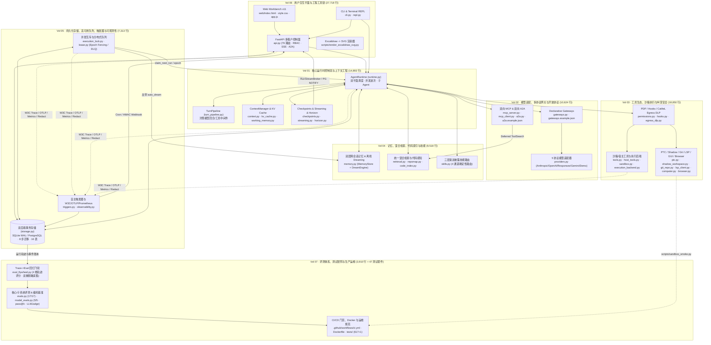

# Agent Systems Lab · 7 卷全栈工程设计大典（Master Navigation Hub）

> **大典定位**：本目录收纳 `agent-systems-lab` 全部 **48 个核心源码/脚本文件**（43 个 `src/agent_lab/*.py` 模块 + 3 个 `web/*` 前端文件 + 2 个 `scripts/*.py` 脚本）与 **2 个声明式协议配置模板**（`gateways.example.json`、`a2a.example.json`），总计 **92,826 行** 代码与模板的逐模块源码级工程设计详述。所有架构图、类与函数签名、数据表字段、阈值常量、安全不变量与协议状态机均严格核对自当前主干代码。
>
> **当前已验证仓库基线（PR `#1` 合并提交 `a674d9f`）**：
> - **代码与数据规模**：43 个 Python 模块、3 个零 HTML Sink 前端文件、2 个运维/渲染脚本、**8 步版本化 `schema_migrations`**（16 张 SQLite WAL / PostgreSQL 物理表）、47 个测试套件文件。
> - **测试与评测基线**：**617 项离线测试全部通过 + 1 项真实 PostgreSQL 16 集成测试通过**；**17 / 17** 离线核心控制流与子系统评测全绿（10 项核心控制流 + 7 大核心子系统）；PR `#1` 全部 **11 / 11 CI & GitGuardian Checks 全绿**。
> - **配套宏观与复盘文档**：[项目主页 (`README.md`)](../../README.md) · [系统全景架构 (`docs/architecture.md`)](../architecture.md) · [2026 前沿 Agent Harness 架构设计与复盘手册 (`docs/frontier-harness-engineering.md`)](../frontier-harness-engineering.md) · [7 幅 Excalidraw 可编辑架构图集 (`docs/diagrams/README.md`)](../diagrams/README.md) · [验证记录 (`docs/validation.md`)](../validation.md)

---

## 1. 全景系统地图（7 卷协作拓扑）

---

## 2. 七卷分册总索引（7-Volume Compendium）

| 卷次 | 设计文档 | 核心架构平面 | 覆盖源码/模板 | 代码行数 | 核心工程主题 |
| :---: | :--- | :--- | :--- | ---: | :--- |
| **Vol 01** | [`01-runtime-control-flow-and-context.md`](01-runtime-control-flow-and-context.md) | 运行时控制流与上下文工程 | 8 个 Python 模块 | 14,893 | `AgentRuntime` 状态机、并发只读波次、`subagent_run`、双预算 Tier-1/Tier-2 `80%→55%` 滞回压缩、3 断点 KV Cache、SHA-256 `WorkingMemory`、`TurnPipeline` 洋葱中间件、`/rewind` 检查点、`RunStreamBroker`、跨会话 `Horizon` 战役与机械边界 Lint |
| **Vol 02** | [`02-providers-gateways-and-protocols.md`](02-providers-gateways-and-protocols.md) | 模型适配、多协议网关与开放协议 | 5 个 Python 模块 + 2 个 JSON 模板 | 10,624 | 5 协议模型适配器（Anthropic/OpenAI Chat/Responses/Gemini/Demo）、USD 成本账本、RPM/TPM 限流、声明式 `gateways.json` 热切换、MCP Server/Client（延迟 `mcp_tool_search` 与 2025/2026 双向回调）、双向 A2A v0.2/0.3/1.0（AgentCard/SSE/HMAC Push） |
| **Vol 03** | [`03-tools-sandbox-execution-and-security.md`](03-tools-sandbox-execution-and-security.md) | 工具生态、沙箱执行与纵深安全 | 13 个 Python 模块 + 1 个验证脚本 | 18,850 | 6 层 PDP 权限决策、`plan` 硬只读边界、生命周期 `HookManager`、CaMeL 污点追踪 + 14 类出站密文 DLP、WAL 多文件前滚、`HostKernelSandbox`（SBPL/`bwrap`）、常驻 PTY、双进程 HMAC Docker 沙箱、`WorkspaceExecutionBackend`、本地 `ptc_exec`、APFS `ShadowWorkspace`、Git Worktree、LSP、桌面 GUI 与 Playwright ARIA 浏览器 |
| **Vol 04** | [`04-memory-retrieval-indexing-and-skills.md`](04-memory-retrieval-indexing-and-skills.md) | 跨会话记忆、混合检索、代码索引与技能 | 5 个 Python 模块 | 9,518 | 双层 `CLAUDE.md`/`MEMORY.md`、实证门控与无锁合成 + 短 `flock` 四遍离线 `DreamEngine`（`dry_run`/`rollback`）、围栏安全 BM25+Dense+RRF 混合检索内核、Tree-sitter/PPR 多语言 `RepoMapIndex`、SQLite WAL Merkle 增量 AST `CodebaseMerkleIndex`、三层渐进四通道 `SkillCatalog` |
| **Vol 05** | [`05-storage-ha-distributed-and-observability.md`](05-storage-ha-distributed-and-observability.md) | 持久存储、高可用队列、触发器与可观测性 | 5 个 Python 模块 | 7,313 | SQLite WAL / PostgreSQL `psycopg_pool` 双后端、词法安全 SQL 翻译、**8 步 `schema_migrations`（16 张表）**、Kleppmann `epoch` fencing、`state_version` CAS、`FOR UPDATE SKIP LOCKED`、PG `LISTEN/NOTIFY` 推式唤醒、DLQ 毒丸隔离、POSIX `flock`、Cron/Webhook 触发器、W3C/OTLP Span 与 Prometheus 脱敏可观测性 |
| **Vol 06** | [`06-api-cli-repl-and-web-workbench.md`](06-api-cli-repl-and-web-workbench.md) | 多租户 API、CLI、REPL、Web 工作台与图集工具 | 3 个 Python 模块 + 3 个 Web 文件 + 1 个脚本 | 27,718 | FastAPI 76 条路由、多租户 RBAC & `HttpOnly` Cookie CSRF、`security_audit_logs`、事件驱动 SSE、26 个 CLI 子命令与 `init`/`doctor`、22 斜杠命令交互式 REPL（`Ctrl-G` 实时插话）、零 HTML Sink 纯 DOM Web Workbench v11 与零依赖 Excalidraw→SVG 渲染器 |
| **Vol 07** | [`07-evaluation-testing-and-operations.md`](07-evaluation-testing-and-operations.md) | 评测体系、测试架构与 CI/运维交付 | 4 个 Python 模块 + 47 个测试套件 & CI/部署配置 | 3,910 | 10 项核心控制流 + 7 大子系统离线评测（17/17）、5 任务 Git/Docker 编码基准、无偏 `pass@k` + `LLMJudge` + SWE-bench 适配器、4 维 `grade_trajectory` 与双脱敏 Trace→Eval 回归飞轮、617 离线 + 1 实时 PG 测试矩阵、11/11 CI & GitGuardian 门禁与容器化运维 |

---

## 3. 全仓库 48 个核心源码文件（+ 2 个配置模板）→ 卷次速查表

> 下表逐一映射仓库中全部 **43 个 `src/agent_lab/*.py` 模块**、**3 个 `web/*` 前端文件**、**2 个 `scripts/*.py` 脚本**（共 **48 个源码/脚本文件**）以及根目录 **2 个声明式协议配置模板**（共 **50 条** 100% 无遗漏索引）。点击文件路径可直达源码，点击归属卷次可直达对应工程设计详述。

### 3.1 Python 核心源码模块（`src/agent_lab/*.py`，共 43 个模块）

| # | 文件路径 | 行数 | 归属卷次 | 一句话核心职责 |
| :-: | :--- | ---: | :---: | :--- |
| 1 | [`src/agent_lab/__init__.py`](../../src/agent_lab/__init__.py) | 3 | [Vol 07](07-evaluation-testing-and-operations.md) | 包入口元数据与语义版本号声明（`__version__ = "0.1.0"`） |
| 2 | [`src/agent_lab/a2a.py`](../../src/agent_lab/a2a.py) | 1,582 | [Vol 02](02-providers-gateways-and-protocols.md) | 双向 A2A（Agent2Agent）协议适配层：v0.2/0.3/1.0 AgentCard、JSON-RPC 2.0、SSE 流式与 HMAC Push Webhook |
| 3 | [`src/agent_lab/api.py`](../../src/agent_lab/api.py) | 8,869 | [Vol 06](06-api-cli-repl-and-web-workbench.md) | FastAPI 多租户控制平面：纵深防御中间件、RBAC/Cookie 鉴权、76 条 REST/SSE/A2A/Webhook 路由与异步协程隔离池 |
| 4 | [`src/agent_lab/browser.py`](../../src/agent_lab/browser.py) | 511 | [Vol 03](03-tools-sandbox-execution-and-security.md) | Headless/CDP Playwright 浏览器自动化层：基于 ARIA 无障碍 Ref 快照定位与 SSRF/IMDS 防护护栏 |
| 5 | [`src/agent_lab/checkpoints.py`](../../src/agent_lab/checkpoints.py) | 709 | [Vol 01](01-runtime-control-flow-and-context.md) | 内容寻址 SHA-256 写前快照仓库与 `/rewind`（`both`/`files`/`messages`）三模式安全回退管理器 |
| 6 | [`src/agent_lab/cli.py`](../../src/agent_lab/cli.py) | 4,124 | [Vol 06](06-api-cli-repl-and-web-workbench.md) | `agent-lab` 统一命令行入口：零覆盖 `.env` 加载、26 个顶层子命令（`code`/`serve`/`worker`/`doctor`/`horizon`/`trigger` 等）与优雅停机 |
| 7 | [`src/agent_lab/code_index.py`](../../src/agent_lab/code_index.py) | 1,461 | [Vol 04](04-memory-retrieval-indexing-and-skills.md) | Cursor 风格持久化 Merkle-Tree 增量 AST 代码语义索引（SQLite WAL 存储与 `codebase_semantic_search`） |
| 8 | [`src/agent_lab/computer.py`](../../src/agent_lab/computer.py) | 1,758 | [Vol 03](03-tools-sandbox-execution-and-security.md) | 原生桌面级 GUI Computer Use：macOS CoreGraphics 64 位 FFI / AXUIElement、Retina 逻辑坐标对齐、Linux X11 与跨进程席位锁 |
| 9 | [`src/agent_lab/context.py`](../../src/agent_lab/context.py) | 1,109 | [Vol 01](01-runtime-control-flow-and-context.md) | 字符 + BPE Token 双预算窗口、完整 `(tool_use, tool_result)` 原子分组、Tier-1 微压缩与 Tier-2 `80%→55%` 滞回/LLM 摘要 |
| 10 | [`src/agent_lab/egress_dlp.py`](../../src/agent_lab/egress_dlp.py) | 1,291 | [Vol 03](03-tools-sandbox-execution-and-security.md) | CaMeL 启发式数据血缘污点追踪（`TaintRegistry`）与统一出站密文防泄漏检查器（`EgressDlpInspector`，14 类密钥与多层解码） |
| 11 | [`src/agent_lab/eval_flywheel.py`](../../src/agent_lab/eval_flywheel.py) | 1,001 | [Vol 07](07-evaluation-testing-and-operations.md) | 线上 Trace→Eval 回归飞轮：4 维轨迹评分器（`grade_trajectory`）与双脱敏/匿名化摩擦案例采集器（`harvest_failure_traces`） |
| 12 | [`src/agent_lab/evals.py`](../../src/agent_lab/evals.py) | 1,634 | [Vol 07](07-evaluation-testing-and-operations.md) | 离线可复演 Harness 回归评测：10 项核心控制流场景 + 7 大核心子系统评测（`run_subsystem_evals`，共 17/17）与 AST 安全评分器 |
| 13 | [`src/agent_lab/execution_backend.py`](../../src/agent_lab/execution_backend.py) | 1,218 | [Vol 03](03-tools-sandbox-execution-and-security.md) | Brain/Hands 解耦执行后端协议 `WorkspaceExecutionBackend`：Local OS 沙箱、持久化 Docker 会话容器与远端 MicroVM JSON-RPC 驱动 |
| 14 | [`src/agent_lab/execution_lock.py`](../../src/agent_lab/execution_lock.py) | 273 | [Vol 05](05-storage-ha-distributed-and-observability.md) | 本机跨进程非阻塞互斥锁 `exclusive_run`：`O_NOFOLLOW` + `st_dev/st_ino` 校验防止 `flock+unlink` 竞态 |
| 15 | [`src/agent_lab/gateways.py`](../../src/agent_lab/gateways.py) | 1,652 | [Vol 02](02-providers-gateways-and-protocols.md) | 声明式多协议模型网关管理器：4 级信任发现、URL/IMDS/SSRF 校验、`0600` 原子持久化与零密钥回显热切换 |
| 16 | [`src/agent_lab/git_repo.py`](../../src/agent_lab/git_repo.py) | 1,033 | [Vol 03](03-tools-sandbox-execution-and-security.md) | 分离 HEAD Git Worktree 事务基线（40 位 `base_commit`）、验证门控提交、含未追踪文件 Diff 与防压缩炸弹跨节点归档 |
| 17 | [`src/agent_lab/hooks.py`](../../src/agent_lab/hooks.py) | 700 | [Vol 03](03-tools-sandbox-execution-and-security.md) | 确定性生命周期钩子管理器（`SessionStart`/`UserPromptSubmit`/`PreToolUse`/`PostToolUse`/`PreCompact`/`Stop` 等），零配置零开销与信任门控 |
| 18 | [`src/agent_lab/horizon.py`](../../src/agent_lab/horizon.py) | 685 | [Vol 01](01-runtime-control-flow-and-context.md) | 多会话超长程 Horizon 战役接力（不可篡改 `feature_list.json` + SHA-256 验收收据）与机械化架构边界 Lint（`MechanicalInvariantChecker`） |
| 19 | [`src/agent_lab/host_tools.py`](../../src/agent_lab/host_tools.py) | 3,262 | [Vol 03](03-tools-sandbox-execution-and-security.md) | 本地宿主工具 PEP：五阶路径防逃逸 `fs_*`、四级模糊编辑与 `fs_sketch_edit`、`HostKernelSandbox`（SBPL/`bwrap`）、常驻 PTY 与 SSRF 防护 Web 工具 |
| 20 | [`src/agent_lab/kv_cache.py`](../../src/agent_lab/kv_cache.py) | 576 | [Vol 01](01-runtime-control-flow-and-context.md) | Harness 级 KV Cache 规范化序列化、3 断点 `cache_control` 排布、链式块哈希追踪与 40.48%→78.96% 离线消融基准 |
| 21 | [`src/agent_lab/lease.py`](../../src/agent_lab/lease.py) | 872 | [Vol 05](05-storage-ha-distributed-and-observability.md) | 分布式持久队列 `LeaseWorker`（1/3 TTL 心跳自熔断、`epoch` 隔离、PG `LISTEN` 推式唤醒、出带 Dreaming）与独立 `WorkerMetricsServer` |
| 22 | [`src/agent_lab/lsp_client.py`](../../src/agent_lab/lsp_client.py) | 882 | [Vol 03](03-tools-sandbox-execution-and-security.md) | 异步 Stdio JSON-RPC 2.0 `LspClientManager`：4 语言族自动探测、`lsp_query` 语义导航、编辑后即时诊断与无服务器优雅降级 |
| 23 | [`src/agent_lab/mcp_client.py`](../../src/agent_lab/mcp_client.py) | 2,421 | [Vol 02](02-providers-gateways-and-protocols.md) | 外部 MCP 连接池（单 Server Owner Task + OAuth PKCE）、超阈值延迟发现 `mcp_tool_search` 与 2025/2026 双向回调（Sampling/Elicitation/Roots/Progress） |
| 24 | [`src/agent_lab/mcp_server.py`](../../src/agent_lab/mcp_server.py) | 127 | [Vol 02](02-providers-gateways-and-protocols.md) | 基于官方 MCP Python SDK v1 的只读 `stdio` 服务端，对外安全暴露仓库/检索/RepoMap 只读工具 |
| 25 | [`src/agent_lab/memory.py`](../../src/agent_lab/memory.py) | 3,599 | [Vol 04](04-memory-retrieval-indexing-and-skills.md) | 双层 `CLAUDE.md`/`MEMORY.md` 预载、互链 `[[wiki-links]]` 知识图谱与实证门控无锁合成 + 短 `flock` 四遍离线 `DreamEngine`（含 `dry_run`/回滚） |
| 26 | [`src/agent_lab/model_evals.py`](../../src/agent_lab/model_evals.py) | 1,272 | [Vol 07](07-evaluation-testing-and-operations.md) | 5 任务真实 Git Worktree + Docker 容器编码基准、失败归因分离（模型 vs 设施）、无偏 `pass@k`、`LLMJudge` 与 SWE-bench 适配器 |
| 27 | [`src/agent_lab/observability.py`](../../src/agent_lab/observability.py) | 818 | [Vol 05](05-storage-ha-distributed-and-observability.md) | W3C `traceparent` 与层次化 OTLP Span 后台导出器（含 SSRF 校验）、递归凭证脱敏 `redact_secrets` 与 Prometheus 0.0.4 指标注册表 |
| 28 | [`src/agent_lab/permissions.py`](../../src/agent_lab/permissions.py) | 2,634 | [Vol 03](03-tools-sandbox-execution-and-security.md) | 核心 PDP 策略决策点：3 执行档位 × 4 权限模式矩阵、毁机硬熔断、Layer 1b `plan` 只读边界、分层声明式规则引擎与子进程环境脱敏 |
| 29 | [`src/agent_lab/providers.py`](../../src/agent_lab/providers.py) | 4,717 | [Vol 02](02-providers-gateways-and-protocols.md) | 5 协议模型适配器（`Demo`/`Anthropic`/`OpenAI Chat`/`OpenAI Responses`/`Gemini`）、流式输出、两阶段 RPM/TPM 限流、档位路由与 USD 成本账本 |
| 30 | [`src/agent_lab/ptc.py`](../../src/agent_lab/ptc.py) | 961 | [Vol 03](03-tools-sandbox-execution-and-security.md) | 本地沙箱程序化工具编排引擎（`ptc_exec`）：双通道 FD 隔离、20 工具 Fail-Closed 只读白名单与单轮多跳聚合降噪 |
| 31 | [`src/agent_lab/repl.py`](../../src/agent_lab/repl.py) | 2,770 | [Vol 06](06-api-cli-repl-and-web-workbench.md) | `agent-lab code` 交互式终端工作台：22 条斜杠命令、`[y/n/a/f]` 链式内联审批、`Ctrl-G` 运行期实时插话与无 PTY 确定性测试接口 |
| 32 | [`src/agent_lab/repomap.py`](../../src/agent_lab/repomap.py) | 2,266 | [Vol 04](04-memory-retrieval-indexing-and-skills.md) | 线程安全多语言增量仓库符号地图（512 KiB 上限、Tree-sitter AST / 词法回退、`.gitignore` 过滤）与确定性 Personalized PageRank 排序 |
| 33 | [`src/agent_lab/retrieval.py`](../../src/agent_lab/retrieval.py) | 1,037 | [Vol 04](04-memory-retrieval-indexing-and-skills.md) | 围栏感知统一混合检索内核：代码子词分词、BM25 + TF-IDF/稠密余弦 + RRF（`k=60`）与可插拔 Embedder / HTTP Reranker 适配器 |
| 34 | [`src/agent_lab/runtime.py`](../../src/agent_lab/runtime.py) | 9,781 | [Vol 01](01-runtime-control-flow-and-context.md) | 核心执行引擎 `AgentRuntime`：运行状态机、并发只读波次、测试驱动修复闭环、`subagent_run` 异构/Worktree 子代理、实时转向与恢复 |
| 35 | [`src/agent_lab/sandbox.py`](../../src/agent_lab/sandbox.py) | 1,661 | [Vol 03](03-tools-sandbox-execution-and-security.md) | 硬化 Docker 测试沙箱：不可变镜像 ID、`O_NOFOLLOW` 只读快照、双进程 32B HMAC 回执、`sys.addaudithook`、孤儿回收与 `RemoteHTTPSandboxBackend` |
| 36 | [`src/agent_lab/shadow_workspace.py`](../../src/agent_lab/shadow_workspace.py) | 1,283 | [Vol 03](03-tools-sandbox-execution-and-security.md) | Cursor 风格写前推测性验证（`shadow_verify_edits`）：APFS CoW 零密钥克隆、活工作区 SHA-256 守恒、AST + Shadow LSP + 无网校验 |
| 37 | [`src/agent_lab/skills.py`](../../src/agent_lab/skills.py) | 1,155 | [Vol 04](04-memory-retrieval-indexing-and-skills.md) | 三层渐进式技能目录 `SkillCatalog` 与四通道确定性路由（`/skill`、`paths`/`globs`、RRF 检索与运行期动态置尾防缓存失效） |
| 38 | [`src/agent_lab/storage.py`](../../src/agent_lab/storage.py) | 4,234 | [Vol 05](05-storage-ha-distributed-and-observability.md) | SQLite WAL / PostgreSQL `psycopg_pool` 双后端事务引擎、8 步版本化 `schema_migrations`（16 表）、`epoch` fencing、`state_version` CAS 与 `gc` |
| 39 | [`src/agent_lab/streaming.py`](../../src/agent_lab/streaming.py) | 946 | [Vol 01](01-runtime-control-flow-and-context.md) | 每 Run 单调序号 + 256 帧环形缓冲异步事件代理 `RunStreamBroker` 与 `InMemory`/`Callback`/`PostgresNotify` 跨节点扇出传输层 |
| 40 | [`src/agent_lab/tools.py`](../../src/agent_lab/tools.py) | 1,337 | [Vol 03](03-tools-sandbox-execution-and-security.md) | 沙箱能力网关 `ToolRegistry`：JSON Schema 校验、分档工具挂载、五阶路径保护、提案幂等与 `.agent-apply-*.json` WAL 崩溃前滚 |
| 41 | [`src/agent_lab/triggers.py`](../../src/agent_lab/triggers.py) | 1,116 | [Vol 05](05-storage-ha-distributed-and-observability.md) | 自主调度与事件触发引擎：零依赖 5 字段 `CronSchedule`、GitHub/自定义 Webhook HMAC-SHA256 验签防重放与 `TriggerScheduler` |
| 42 | [`src/agent_lab/turn_pipeline.py`](../../src/agent_lab/turn_pipeline.py) | 615 | [Vol 01](01-runtime-control-flow-and-context.md) | 可组合洋葱模型回合与工具中间件流水线 `TurnPipeline`，内置出站 DLP、预算守卫与 W3C Span 遥测拦截器 |
| 43 | [`src/agent_lab/working_memory.py`](../../src/agent_lab/working_memory.py) | 472 | [Vol 01](01-runtime-control-flow-and-context.md) | 会话内抗投毒结构化工作记忆（`<=2400` 字符）：`bound_files` SHA-256 绑定、源码变更自动判 `stale` 与陈旧优先淘汰 |

### 3.2 Web 前端工作台文件（`web/*`，共 3 个文件）

| # | 文件路径 | 行数 | 归属卷次 | 一句话核心职责 |
| :-: | :--- | ---: | :---: | :--- |
| 44 | [`web/app.js`](../../web/app.js) | 5,848 | [Vol 06](06-api-cli-repl-and-web-workbench.md) | 纯 DOM 零 HTML Sink Web 客户端：单调游标零闪烁 SSE、5 组签名记忆化重绘、纯 DOM Markdown/Diff、`/` 与 `@` 补全及 `⌘K` 命令面板 |
| 45 | [`web/index.html`](../../web/index.html) | 1,358 | [Vol 06](06-api-cli-repl-and-web-workbench.md) | Web 工作台 v11 语义化文档骨架：双态布局、吸顶审批条、3-Tab 右侧检视器、7 个无障碍 Modal（含网关/A2A/触发器配置）与堆叠 Toast |
| 46 | [`web/style.css`](../../web/style.css) | 3,910 | [Vol 06](06-api-cli-repl-and-web-workbench.md) | 4 主题 × 62 CSS 变量设计系统、CJK `>=12px` 字号护栏、3 列统一 Diff 网格与 5 档响应式布局样式表 |

### 3.3 工具链与真实隔离验证脚本（`scripts/*.py`，共 2 个脚本）

| # | 文件路径 | 行数 | 归属卷次 | 一句话核心职责 |
| :-: | :--- | ---: | :---: | :--- |
| 47 | [`scripts/render_excalidraw_svg.py`](../../scripts/render_excalidraw_svg.py) | 839 | [Vol 06](06-api-cli-repl-and-web-workbench.md) | 零第三方依赖 Excalidraw v2 → SVG 1.1 确定性渲染器（Liang-Barsky 裁剪、二次贝塞尔拐角、CJK 排版与 XML 良构自检） |
| 48 | [`scripts/sandbox_smoke.py`](../../scripts/sandbox_smoke.py) | 319 | [Vol 03](03-tools-sandbox-execution-and-security.md) · [Vol 07](07-evaluation-testing-and-operations.md) | Linux CI 真实 Docker 容器 7 项端到端隔离烟雾验证（非 root、只读、禁网、seccomp、超时、超量输出与 `os._exit(0)` 防伪） |

### 3.4 声明式协议配置模板（根目录，共 2 个模板）

| # | 文件路径 | 行数 | 归属卷次 | 一句话核心职责 |
| :-: | :--- | ---: | :---: | :--- |
| 49 | [`gateways.example.json`](../../gateways.example.json) | 98 | [Vol 02](02-providers-gateways-and-protocols.md) | 多协议模型网关声明式配置模板（预置 `claude-anthropic`/`openai-chat`/`openai-responses`/`gemini-native`/`ollama-local`/`demo` 6 档 Profile） |
| 50 | [`a2a.example.json`](../../a2a.example.json) | 27 | [Vol 02](02-providers-gateways-and-protocols.md) | 远端 A2A 协同智能体对端声明式模板（示范本机回环显式授权与远端 HTTPS 凭证引用配置） |

---

## 4. 四条端到端请求生命周期全链路走读

以下四条跨卷端到端链路把分散在 7 卷中的模块串联为真实可运行的请求流，适合快速打通全局心智模型或用于系统设计面试白板推演。

### 4.1 链路一：Web UI / API 实时流式执行 + 审批门控 + `/rewind` 时间旅行回退

1. **多租户入口与 CSRF/追踪防护**（[Vol 06](06-api-cli-repl-and-web-workbench.md) · [Vol 05](05-storage-ha-distributed-and-observability.md)）：用户在 `web/app.js` 提交任务，携带 `HttpOnly` 会话 Cookie（`agent_lab_session`）发起 `POST /api/runs`；`api.py` 经 `TrustedHostMiddleware` + `_GuardMiddleware` 完成 Host 白名单、请求体字节限长、Origin/Sec-Fetch-Site CSRF 校验、多租户 RBAC 鉴权与 W3C `traceparent` 注入。
2. **双模持久化调度与世代栅栏**（[Vol 05](05-storage-ha-distributed-and-observability.md)）：`Storage` 将初始状态写入 `runs` 与 `run_leases`。`inline` 模式提交至 `api.py` 异步协程池；`queue` 模式调用 `enqueue_run`（PostgreSQL 下额外发送 `pg_notify('agent_lab_queue')` 唤醒 `LeaseWorker`），由 Worker 通过 `FOR UPDATE SKIP LOCKED` 领取并绑定单调递增 `epoch` 令牌与 `1/3 TTL` 心跳续租。
3. **洋葱流水线与零轮询跨节点流式推送**（[Vol 01](01-runtime-control-flow-and-context.md) · [Vol 02](02-providers-gateways-and-protocols.md) · [Vol 06](06-api-cli-repl-and-web-workbench.md)）：`AgentRuntime.execute()` 驱动 `TurnPipeline` 中间件（预算守卫 + W3C Span + 出站 DLP）调用解析自 `gateways.py` 的真实线协议适配器（`AnthropicProvider` / `OpenAIResponsesProvider` / `GeminiNativeProvider`）；模型 `thinking_delta`/`text_delta`/`tool_use_start` 与实时 `bash_output_delta` 经 `RunStreamBroker`（本地环形缓冲或 `PostgresNotifyStreamTransport` 跨 Pod 扇出）通过 `GET /api/runs/{id}/stream?after_seq=...` 推送至 `web/app.js` 零闪烁渲染。
4. **纵深策略裁决、提案暂停与写前快照**（[Vol 03](03-tools-sandbox-execution-and-security.md) · [Vol 01](01-runtime-control-flow-and-context.md) · [Vol 05](05-storage-ha-distributed-and-observability.md)）：写文件或高风险动作依次穿过 `HookManager(PreToolUse)` → `evaluate_tool_permission()`（6 级优先级）→ `EgressDlpInspector`；命中 `ask` 时将提案（含 `(run_id, operation_id)` 幂等键、确定性 `fifo_seq` 与各文件原始 SHA-256）持久化至 `proposals` 表并把运行置为 `waiting_approval`，前端吸顶审批条立即可见；在文件首次修改前，`CheckpointManager` 将原始文件写入 `<state_dir>/checkpoints/` 内容寻址 SHA-256 Blob 并登记 `run_checkpoints`。
5. **单事务审批入队、WAL 原子应用与 LSP 即时诊断**（[Vol 05](05-storage-ha-distributed-and-observability.md) · [Vol 03](03-tools-sandbox-execution-and-security.md)）：审批人点击批准触发 `POST /api/runs/{id}/proposals/{pid}`，若开启异人复核则强制校验 `actor_id != created_by`，随后 `Storage.approve_and_enqueue` 在单个数据库事务中写入审批决策、重新入队并记录 `security_audit_logs`；`ToolRegistry.apply_proposal()` 在 `epoch` 复验与跨进程 `flock` 保护下写入 `.agent-apply-<pid>.json` 写前日志（支持断电前滚恢复）完成原子落盘，紧接着由 `LspClientManager` 附加编辑后静态诊断。
6. **三模式时间旅行 `/rewind`**（[Vol 01](01-runtime-control-flow-and-context.md) · [Vol 05](05-storage-ha-distributed-and-observability.md) · [Vol 06](06-api-cli-repl-and-web-workbench.md)）：若用户需撤销至上一安全轮次，调用 `POST /api/runs/{id}/rewind`（支持 `both`/`files`/`messages`）：`CheckpointManager.rewind()` 使用 `O_DIRECTORY | O_NOFOLLOW` 抗符号链接方式精确恢复工作区文件，截断对话并自动闭合任何悬空 `tool_use` 块，再经 `runs.state_version` 乐观锁 CAS 原子写回。

---

### 4.2 链路二：多 Agent 动态子代理 + 延迟 MCP ToolSearch + A2A 远端委托

1. **KV 根前缀冻结与阈值门控延迟 MCP 目录**（[Vol 01](01-runtime-control-flow-and-context.md) · [Vol 02](02-providers-gateways-and-protocols.md)）：会话初始化阶段，`kv_cache.py` 规范化 `<TOOLS> + <SYSTEM_BASE>` 根前缀并设置三断点 `cache_control`。当 `McpClientManager` 接入的外部 MCP 工具总数超过内联阈值（`should_defer_mcp_tools`）时，仅把轻量代理工具 `mcp_tool_search` 与 `mcp_call_tool` 放入首轮 `<TOOLS>`，守住 Prompt Caching 字节级前缀稳定。
2. **混合检索按需激活与 MCP 2025/2026 双向回调**（[Vol 04](04-memory-retrieval-indexing-and-skills.md) · [Vol 02](02-providers-gateways-and-protocols.md) · [Vol 03](03-tools-sandbox-execution-and-security.md)）：模型调用 `mcp_tool_search`，经 `retrieval.py` 的 BM25 + TF-IDF + RRF 检索定位目标 `mcp__<server>__<tool>` 并激活 Schema；调用 `mcp_call_tool` 时，经 `PermissionRuleEngine`、`EgressDlpInspector` 与去敏环境放行，由该 MCP Server 专属的单宿主 AnyIO Owner Task + `AsyncExitStack` 执行，同时透明承接服务端反向发起的 `Roots`、`Progress`、预算门控 `Sampling` 与持久化 `Elicitation` 回调。
3. **动态并发子代理（`subagent_run`）与异构/Worktree 隔离**（[Vol 01](01-runtime-control-flow-and-context.md) · [Vol 02](02-providers-gateways-and-protocols.md) · [Vol 03](03-tools-sandbox-execution-and-security.md)）：面对多模块并行调研或并行修复，父 `AgentRuntime` 按 Effort-Scaling 与四要素委派契约派发 1—4 个子 Agent：仅注入 `<=1600` 字符洁净 `PARENT_CONTEXT_BRIEF`、共享父协调者 `<TOOLS>+<SYSTEM_BASE>` 前缀命中缓存、通过 `providers.py` 路由 `model_tier`（`fast`/`inherit`/`reasoning`）、为并发 `mode="operator"` 写子代理自动经 `git_repo.py` 分配独立隔离 Git worktree，且所有子任务在共享 `_budget_lock` 下计入全局 Token 与 `max_cost_usd` 上限；支持 `run_in_background=True` + `subagent_status` 异步拉取并通过 `RunStreamBroker` 推送 `subagent_progress`。
4. **跨节点/跨组织 A2A 协议发现与流式委托**（[Vol 02](02-providers-gateways-and-protocols.md) · [Vol 03](03-tools-sandbox-execution-and-security.md) · [Vol 05](05-storage-ha-distributed-and-observability.md) · [Vol 06](06-api-cli-repl-and-web-workbench.md)）：需要外部专业智能体协同时，模型先用只读 `a2a_list_agents` / `a2a_discover_agent` 探测 `a2a.json` 中远端节点的 `/.well-known/agent-card.json`（强制 SSRF/IMDS 校验），再发起受 `A2A(<peer>)` 声明式规则与 `a2a_call` 审批门控的 `a2a_send_task`；请求以 JSON-RPC 2.0 `SendStreamingMessage` / `message/stream` 经 SSE 消费远端 `status-update` 与 `artifact-update`（低版本 `-32601` 自动回退），并借助 Migration `#7` 的 `runs.a2a_context_id` 索引与 `a2a_push_configs` HMAC 签名 Webhook 支持异步回调与多轮续跑。

---

### 4.3 链路三：`80%→55%` 两级自动压缩 + 运行期零争用实时引导 + 会话后无锁 Dreaming

1. **双预算感知与 Tier-1 / 原生上下文微压缩**（[Vol 01](01-runtime-control-flow-and-context.md) · [Vol 02](02-providers-gateways-and-protocols.md)）：每轮调用前，`ContextManager` 同步校验序列化字符上限（`max_chars`）与校准 BPE Token 上限（`max_tokens`）。在触及 `80%` 高水位前，先执行 Tier-1 `micro_compact_messages` 剥离陈旧 `thinking` 块并折叠早期超大 `tool_result` 存根（保留最近 3 个原子组与持久化单调 `micro_compaction_cursors`，完整原始输出保留在 `tool_calls` 表供 `tool_result_get` 分页回取）；若对接支持原生上下文工程的厂商，还可联动 Anthropic Context Editing、OpenAI `/v1/responses/compact` 或 Gemini `cachedContents`。
2. **Tier-2 `80%→55%` 滞回阶梯压缩与防缓存雪崩**（[Vol 01](01-runtime-control-flow-and-context.md) · [Vol 03](03-tools-sandbox-execution-and-security.md)）：任一维度触及 `80%` 高水位时，先触发 `HookManager(PreCompact)`，再按完整 `assistant(tool_use) + user(tool_result)` 原子组一次性将早期轨迹折叠回落至 `55%` 低水位，并在同拍原位注入结构化滚动摘要 `COMPACTION_SUMMARY`（启用 `use_llm=True` 时调用 `fast` 档模型提炼并经 `finalize_llm_compaction_summary` 逐行防注入消毒，异常安全回退确定性摘要）。与此同时，`WorkingMemory` 将追踪 `bound_files` SHA-256 哈希的关键事实保留于缓存断点之后的尾部瞬态区，彻底避免每步滑窗导致的 KV Cache 级联重算。
3. **运行期零 CAS 争用实时转向（Live Steering）**（[Vol 06](06-api-cli-repl-and-web-workbench.md) · [Vol 05](05-storage-ha-distributed-and-observability.md) · [Vol 01](01-runtime-control-flow-and-context.md)）：任务执行期间，用户通过 Web 界面或 REPL `Ctrl-G` 发送纠偏指令（`POST /api/runs/{id}/steer`），消息纯追加写入独立表 `run_steering_messages`，完全绕开活跃 Worker 对 `runs.state_version` 的乐观锁争用。`AgentRuntime` 在工具步闭合与 `end_turn` 收敛两处安全检查点原子排空收件箱注入对话；若任务正停在 `waiting_approval`，则自动触发 `supersede_waiting_approval` 平滑转向接管。
4. **出带异步四遍无锁 Dreaming 记忆巩固与一键回滚**（[Vol 05](05-storage-ha-distributed-and-observability.md) · [Vol 04](04-memory-retrieval-indexing-and-skills.md)）：任务抵达终态后，API `dream_jobs` 或 `LeaseWorker` 出带触发离线 `DreamEngine`（不占用主队列并发槽位）：阶段 1—3 全程**无锁**执行（扫描定向、基于实证门控将缺少 `file:@sha` 或成功 `call:` 凭据的 LLM 合成页强制降级为 `hypothesis`、晋升已完成会话的 `verified_facts` 与修复教训、执行排除软墓碑的衰减回收 GC 至 `.archive/`）；阶段 4 仅短暂持有租户级可重入 `fcntl.flock` 完成回滚快照备份、`MEMORY.md`/`[[wiki-links]]` 原子替换与 `dream_runs` 审计落库，并支持 `dry_run` 预览与 `rollback_last_dream` 一键回滚。

---

### 4.4 链路四：多会话 Horizon 战役 + Shadow Workspace 预检 + Cron/Webhook 触发 → Eval 回归飞轮

1. **自主事件入口（Cron / Webhook）与多会话战役初始化**（[Vol 05](05-storage-ha-distributed-and-observability.md) · [Vol 06](06-api-cli-repl-and-web-workbench.md) · [Vol 01](01-runtime-control-flow-and-context.md)）：自主任务既可由 `TriggerScheduler` 按 5 字段 `CronSchedule` 周期唤醒，也可由外部系统经 `POST /api/webhooks/{id}` 携带 HMAC-SHA256 签名触发（通过 Migration `#8` 的 `trigger_definitions`/`trigger_fires` 表实现原子幂等防重放），或由开发者通过 `agent-lab horizon` / `POST /api/horizons` 发起。`HorizonCampaignManager` 先运行 Initializer 原子创建不可篡改 `feature_list.json`（全量 `passes: false`）、`init.sh`（`0700`）与只追加 `progress.md`，再由 `run_horizon_session` 逐项为唯一待办特性派生干净上下文的新 `AgentRuntime`。
2. **代码语义索引、PTC 编排与 Shadow Workspace 写前预检**（[Vol 04](04-memory-retrieval-indexing-and-skills.md) · [Vol 03](03-tools-sandbox-execution-and-security.md)）：增量 Worker 可通过 `CodebaseMerkleIndex`（`codebase_semantic_search`）与 `RepoMapIndex` 精准定位符号，通过双通道 FD 隔离的 `ptc_exec` 在单轮内完成多跳只读聚合以压缩 Token 膨胀；在真正改动活工作树之前，调用 `shadow_verify_edits`（`ShadowWorkspaceManager`）经 APFS CoW 克隆零密钥/零软链影子副本，在无网隔离下执行 AST 校验、Shadow LSP 静态诊断与只读验证，并校验前后 `live_workspace` SHA-256 严格守恒。
3. **机械化架构护栏、隔离验收与 SHA-256 完工收据**（[Vol 01](01-runtime-control-flow-and-context.md) · [Vol 03](03-tools-sandbox-execution-and-security.md)）：单会话结束后，`MechanicalInvariantChecker` 扫描工作区执行 `.agent-lab/invariants.json` 规则（AST `forbidden_import`、`max_file_lines`、`forbidden_pattern`，违规附带模型可执行修复指引），随后在脱敏环境（或 `SandboxRunner` / `WorkspaceExecutionBackend` 硬化 Docker / MicroVM 容器）中运行 `verification_cmd`；仅当状态完成、护栏全绿且退出码为 `0` 且输出非空时，`mark_feature_passed()` 才签发 SHA-256 `verification_receipt` 将特性翻转为 `passes: true` 并追加交接日志至 `progress.md`。
4. **线上轨迹评分与双脱敏 Trace→Eval 回归飞轮**（[Vol 07](07-evaluation-testing-and-operations.md) · [Vol 05](05-storage-ha-distributed-and-observability.md) · [Vol 06](06-api-cli-repl-and-web-workbench.md)）：运行完成后，`eval_flywheel.py` 的 `grade_trajectory(run, events)` 从 `completion`（0.35）、`tool_efficiency`（0.25）、`safety_compliance`（0.25）、`steering_responsiveness`（0.15）四个维度量化轨迹并识别摩擦信号；执行 `agent-lab eval --harvest` 调用 `harvest_failure_traces()` 扫描异常与高摩擦轨迹，经 `observability.redact_secrets` 与 `egress_dlp.redact_secrets` 双重密文脱敏及路径/身份匿名化后，原子落盘为离线回归用例，持续反哺 `evals.py`（17/17）与 `model_evals.py`（5/5）的 CI 自动化防回归门禁。

---

## 5. 按角色定制阅读路线（Role-Based Reading Paths）

### 路线 A：初次上手 / 工程全景入门（Newcomer）
> 目标：半天跑通全栈闭环并建立清晰的分层架构心智。
1. 动手跑通快速开始与 5 分钟演示：[项目主页 (`README.md`)](../../README.md) → [5 分钟演示手册 (`docs/demo-walkthrough.md`)](../demo-walkthrough.md) → [7 幅交互架构图集 (`docs/diagrams/README.md`)](../diagrams/README.md)。
2. 掌握核心控制流与上下文机制：通读 [Vol 01](01-runtime-control-flow-and-context.md)（重点读模块 1 `runtime.py` 状态机与模块 2 `context.py`）。
3. 了解交互入口与验证基线：速览 [Vol 06](06-api-cli-repl-and-web-workbench.md) 第 0/2/3 节（CLI/REPL）与 [Vol 07](07-evaluation-testing-and-operations.md)（离线 `pytest` 与 17/17 评测命令），并按 [14 天学习路线 (`docs/learning-path.md`)](../learning-path.md) 循序精读。

### 路线 B：功能研发 / 提交 PR 贡献者（Contributor）
> 目标：不破坏核心安全、KV Cache 与分布式一致性不变量的前提下高效扩展功能。
1. 先读不变量基座：[Vol 01](01-runtime-control-flow-and-context.md)（`runtime.py` 双平面调度、`turn_pipeline.py` 中间件、`kv_cache.py` 前缀不变量）与 [2026 前沿 Harness 复盘手册](../frontier-harness-engineering.md)。
2. 按改动领域精读对应分卷：协议/模型改 [Vol 02](02-providers-gateways-and-protocols.md)；工具/权限/沙箱改 [Vol 03](03-tools-sandbox-execution-and-security.md)；记忆/检索/索引/技能改 [Vol 04](04-memory-retrieval-indexing-and-skills.md)；表结构迁移（需递增 `schema_migrations`）/队列改 [Vol 05](05-storage-ha-distributed-and-observability.md)；API/CLI/Web 改 [Vol 06](06-api-cli-repl-and-web-workbench.md)（特别注意 `web/app.js` 零 HTML Sink 硬门禁）。
3. 对照提交前门禁清单：[Vol 07](07-evaluation-testing-and-operations.md) 与 [验证记录 (`docs/validation.md`)](../validation.md)（本地跑通 `pytest -q`、`ruff check src tests scripts`、`node --check web/app.js` 与 `agent-lab eval`）。

### 路线 C：Agent 系统设计面试备考（System Design Interviewee）
> 目标：能用真实源码机制、数字证据与边界取舍回答高频 L5/L6 Agent 系统设计追问。
1. **控制流与上下文/成本工程**：精读 [Vol 01](01-runtime-control-flow-and-context.md)（两级 `80%→55%` 滞回压缩、3 断点 KV Cache 消融 40.48%→78.96%、`WorkingMemory` 抗投毒、`subagent_run` 隔离与前缀共享）+ [KV Cache 专题](../kv-cache-harness.md)。
2. **工具安全与隔离执行**：精读 [Vol 03](03-tools-sandbox-execution-and-security.md)（WAL 崩溃前滚、双进程 32B HMAC 防伪 Docker 沙箱、`HostKernelSandbox`、CaMeL 污点与 DLP、Brain/Hands 执行后端解耦与 Shadow Workspace）。
3. **记忆、代码智能与高可用分布式**：精读 [Vol 04](04-memory-retrieval-indexing-and-skills.md)（无锁合成 + 短 `flock` 离线 Dreaming 实证门控、PPR RepoMap、Merkle 增量索引）与 [Vol 05](05-storage-ha-distributed-and-observability.md)（Kleppmann `epoch` fencing、`state_version` CAS、`FOR UPDATE SKIP LOCKED`、PG `LISTEN/NOTIFY` 与 DLQ）。
4. **诚实评测与模拟刷题**：精读 [Vol 07](07-evaluation-testing-and-operations.md)（模型失败 vs 基础设施失败分离、无偏 `pass@k`、Trace→Eval 飞轮），结合 [44 道基础面试题](../interview-guide.md) 与 [36 道进阶补充](../interview-supplement.md) 实战演练。

### 路线 D：安全审计与红队评估（Security Auditor）
> 目标：沿信任边界、逃逸面、密文外泄面与多租户隔离面系统核查纵深防线。
1. **核心权限与数据流纵深防线**：逐章审查 [Vol 03](03-tools-sandbox-execution-and-security.md) —— 第 1 章（Layer 1 毁机熔断、Layer 1b `plan` 不可绕过、Fail-Closed Bash 分类器）、第 2 章（`hooks.py` 工作区信任门控）、第 3 章（`egress_dlp.py` 14 类密文与多层解码、CaMeL `strict_dataflow`）、第 4–6 章（五阶路径/软硬链/TOCTOU 防御、`HostKernelSandbox` SBPL/`bwrap`、双进程 HMAC + `sys.addaudithook` 容器沙箱）、第 7–12 章（MicroVM/Browser/Web 工具 DNS-Pinned SSRF & IMDS 阻断、APFS Shadow 零密钥拷贝、FD 隔离 PTC）。
2. **协议网关与外部互操作面**：审查 [Vol 02](02-providers-gateways-and-protocols.md)（`gateways.py` 4 级信任发现与自定义 URL 显式开关、`mcp_client.py` 环境变量脱敏与 OAuth PKCE、`a2a.py` `O_NOFOLLOW` + SSRF/IMDS 阻断与 HMAC Push）。
3. **多租户控制面、存储审计与供应链门禁**：审查 [Vol 06](06-api-cli-repl-and-web-workbench.md)（`api.py` `TrustedHostMiddleware`、`_GuardMiddleware` Body 限长、Cookie CSRF、多租户 RBAC 404 防枚举、异人审批与 `web/app.js` 零 HTML Sink 强制校验）、[Vol 05](05-storage-ha-distributed-and-observability.md)（`security_audit_logs`、`direct_workspace` GC 绝对豁免、Webhook HMAC-SHA256 防重放、`observability.py` 递归脱敏与 OTLP SSRF 阻断）以及 [Vol 07](07-evaluation-testing-and-operations.md)（`eval_flywheel.py` 双重密文脱敏、`sandbox_smoke.py` Linux 内核隔离探针与 GitGuardian 扫描门禁）。
