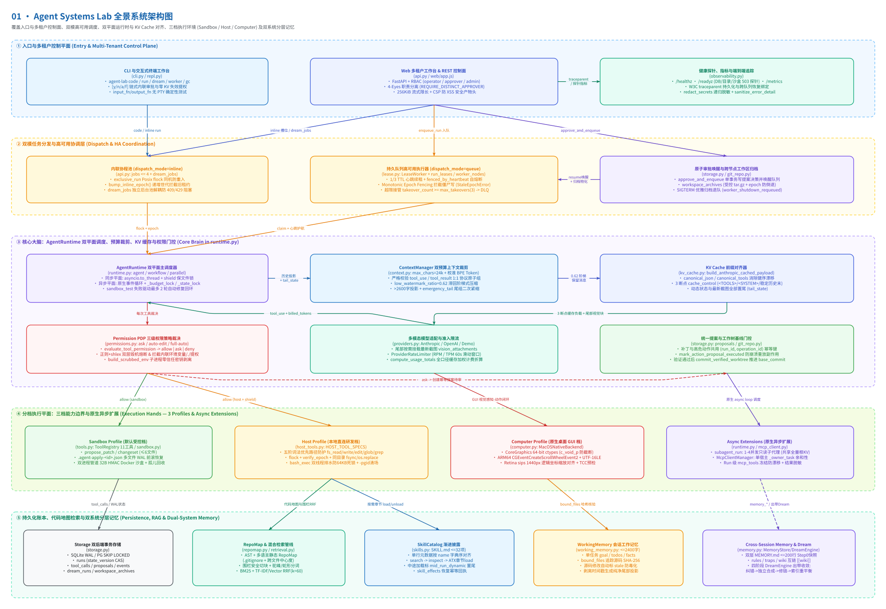
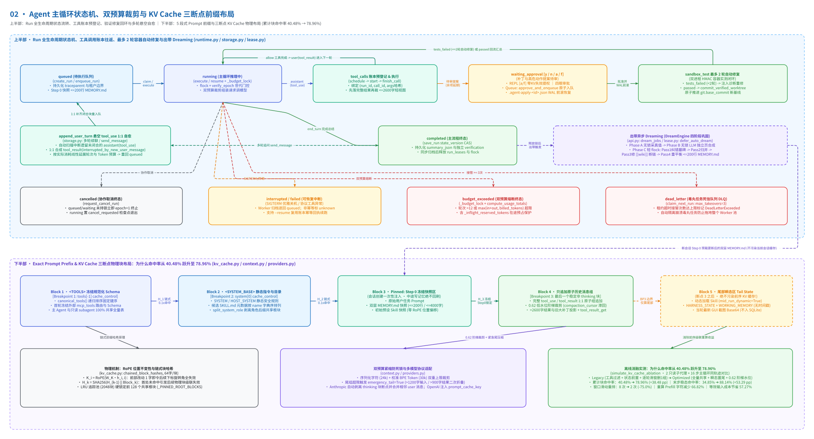
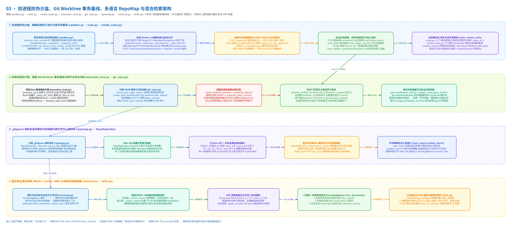
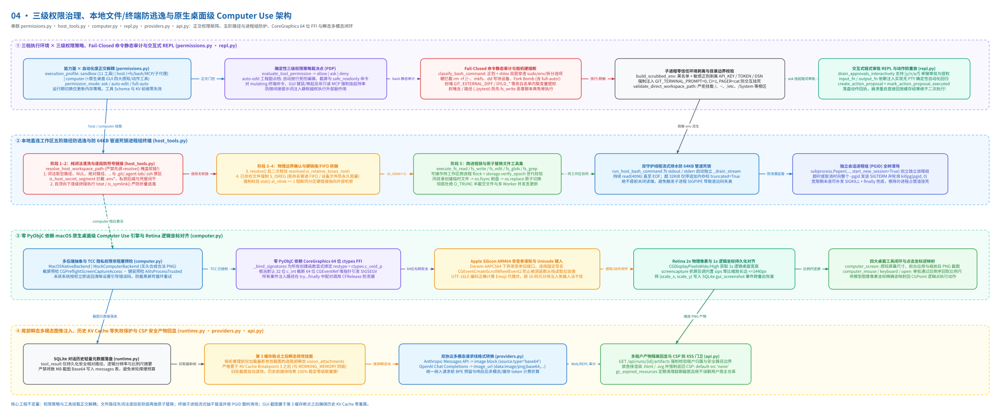
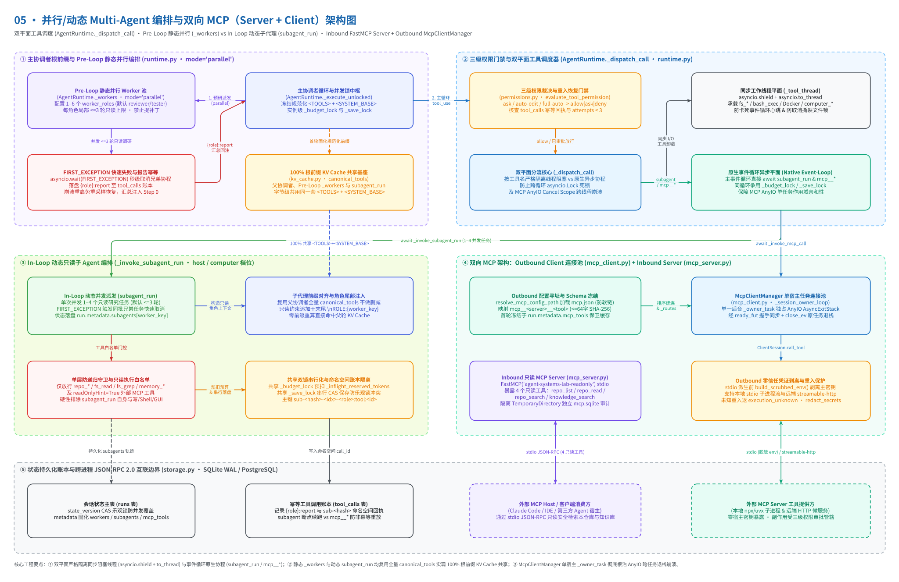
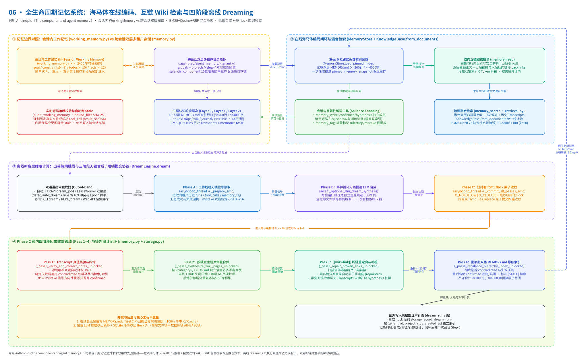
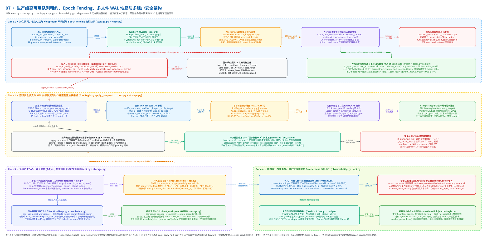

# Agent Systems Lab · Excalidraw 系统架构图集（7 幅全量索引与矢量预览）

本目录收录覆盖 `agent-systems-lab` 全栈源码（`src/agent_lab/` 全部核心模块）的 **7 幅 Excalidraw v2 可编辑工程架构图**，并在 [`svg/`](svg/) 子目录下提供由零第三方依赖脚本 [`scripts/render_excalidraw_svg.py`](../../scripts/render_excalidraw_svg.py) 确定性渲染的**出版级纯矢量 SVG 图集**（支持在 GitHub 页面直接高清浏览）。从宏观五平面总览，到主循环状态机与 KV Cache 三断点物理块布局、双进程 HMAC 防伪沙盒与 Git Worktree 事务基线、三级权限策略与原生桌面级 Computer Use、并行/动态 Multi-Agent 与双向 MCP、海马体—新皮层双系统分层 Dreaming 记忆，再到生产级高可用队列租约、Epoch Fencing 与多文件 WAL 崩溃前滚恢复，每幅图中的类名、函数名、数据表与状态机均与仓库真实代码严格对应。

---

## 1. 如何浏览、编辑 `.excalidraw` 与重新生成矢量 `svg/*.svg`

所有 `.excalidraw` 文件均为标准 **Excalidraw v2 JSON** 格式，无需专有闭源软件，既可直接在下方在线浏览渲染好的 `svg/*.svg` 矢量预览，也可任选以下方式打开源文件交互式二次编辑：

1. **VS Code / Cursor 插件（最推荐，仓库内零切换）**
   - 在扩展市场搜索并安装官方社区高分插件 **`Excalidraw`**（扩展 ID：`pomdtr.excalidraw-editor`）。
   - 安装后直接双击 `docs/diagrams/*.excalidraw` 即可在编辑器标签页内交互式缩放、拖拽节点、查看双向绑定连线并一键导出 SVG / PNG。
2. **浏览器在线打开（零安装，开箱即用）**
   - 访问 **[https://excalidraw.com](https://excalidraw.com)**。
   - 点击左上角菜单 **`Open`（打开）**（或快捷键 `Cmd/Ctrl + O`），选择本目录下的任意 `.excalidraw` 文件（或直接将文件拖入浏览器画布），全程纯前端本地渲染，无需登录。
3. **Obsidian 知识库集成**
   - 在 Obsidian 社区插件中安装并启用 **`Excalidraw`（`obsidian-excalidraw-plugin`）**。
   - 将仓库或 `docs/` 作为 Vault 打开（或软链/复制 `docs/diagrams/`），即可与 `docs/*.md` 专题文档双链联动阅读。
4. **确定性批量重渲染 `svg/*.svg`（修改画布后同步矢量图）**
   - 修改任意 `.excalidraw` 文件后，在仓库根目录执行：
     ```bash
     uv run --no-sync python scripts/render_excalidraw_svg.py
     ```
   - 脚本仅依赖 Python 标准库，自动计算视口包围盒、渲染圆角容器/有向箭头/中英文基线排版，并通过 `xml.etree.ElementTree.parse` 对全部输出做良构 XML 校验。

---

## 2. 七幅架构图索引与源码映射总表

| 编号 | 可编辑源文件 (`.excalidraw`) | 矢量预览 (`svg/*.svg`) | 核心主题 | 对应核心源码模块 (`src/agent_lab/`) | 配套深度文档 |
| :--- | :--- | :--- | :--- | :--- | :--- |
| **01** | [`01-system-overview.excalidraw`](01-system-overview.excalidraw) | [`svg/01-system-overview.svg`](svg/01-system-overview.svg) | 全景五平面系统架构总览 | `cli.py`、`repl.py`、`api.py`、`lease.py`、`runtime.py`、`context.py`、`kv_cache.py`、`permissions.py`、`providers.py`、`tools.py`、`host_tools.py`、`computer.py`、`mcp_client.py`、`storage.py`、`repomap.py`、`retrieval.py`、`working_memory.py`、`memory.py`、`observability.py` | [`architecture.md`](../architecture.md) |
| **02** | [`02-agent-loop-and-kv-cache.excalidraw`](02-agent-loop-and-kv-cache.excalidraw) | [`svg/02-agent-loop-and-kv-cache.svg`](svg/02-agent-loop-and-kv-cache.svg) | Agent 主循环状态机、双预算裁剪与 KV Cache 三断点布局 | `runtime.py`、`context.py`、`kv_cache.py`、`providers.py`、`storage.py`、`lease.py` | [`kv-cache-harness.md`](../kv-cache-harness.md)、[`context-skills-state.md`](../context-skills-state.md) |
| **03** | [`03-sandbox-git-and-retrieval.excalidraw`](03-sandbox-git-and-retrieval.excalidraw) | [`svg/03-sandbox-git-and-retrieval.svg`](svg/03-sandbox-git-and-retrieval.svg) | 双进程防伪沙盒、Git Worktree 基线、多语言 RepoMap 与混合检索 | `sandbox.py`、`evals.py`、`model_evals.py`、`execution_lock.py`、`git_repo.py`、`repomap.py`、`retrieval.py`、`skills.py` | [`sandbox-mechanisms.md`](../sandbox-mechanisms.md)、[`validation.md`](../validation.md) |
| **04** | [`04-host-permissions-and-computer-use.excalidraw`](04-host-permissions-and-computer-use.excalidraw) | [`svg/04-host-permissions-and-computer-use.svg`](svg/04-host-permissions-and-computer-use.svg) | 三级权限治理、本地文件/终端防逃逸与原生桌面 Computer Use | `permissions.py`、`host_tools.py`、`computer.py`、`repl.py`、`providers.py`、`api.py` | [`computer-use-and-memory-architecture.md`](../computer-use-and-memory-architecture.md) |
| **05** | [`05-multi-agent-and-mcp.excalidraw`](05-multi-agent-and-mcp.excalidraw) | [`svg/05-multi-agent-and-mcp.svg`](svg/05-multi-agent-and-mcp.svg) | 并行/动态 Multi-Agent 编排与双向 MCP（Server + Client） | `runtime.py`、`mcp_client.py`、`mcp_server.py`、`permissions.py`、`kv_cache.py`、`storage.py` | [`computer-use-and-memory-architecture.md`](../computer-use-and-memory-architecture.md) |
| **06** | [`06-memory-hierarchy-and-dreaming.excalidraw`](06-memory-hierarchy-and-dreaming.excalidraw) | [`svg/06-memory-hierarchy-and-dreaming.svg`](svg/06-memory-hierarchy-and-dreaming.svg) | 海马体在线编码、双层互链 Wiki 检索与四阶段离线 Dreaming | `working_memory.py`、`memory.py`、`retrieval.py`、`storage.py`、`runtime.py` | [`computer-use-and-memory-architecture.md`](../computer-use-and-memory-architecture.md) |
| **07** | [`07-ha-queue-wal-and-observability.excalidraw`](07-ha-queue-wal-and-observability.excalidraw) | [`svg/07-ha-queue-wal-and-observability.svg`](svg/07-ha-queue-wal-and-observability.svg) | 生产级高可用租约、Epoch Fencing、多文件 WAL 恢复与多租户可观测性 | `lease.py`、`storage.py`、`tools.py`、`api.py`、`permissions.py`、`observability.py` | [`production-ha-hardening.md`](../production-ha-hardening.md) |

---

## 3. 分图详解、矢量预览与关键设计要点

### 01 · 全景系统架构图（[`01-system-overview.excalidraw`](01-system-overview.excalidraw) ｜ [`svg/01-system-overview.svg`](svg/01-system-overview.svg)）



- **画布结构**：5 个架构分区、21 个核心组件框、23 条有向数据/控制流连线（共 100 个图元）。
- **覆盖内容**：
  1. **入口与多租户控制平面**：CLI / 多轮 REPL（`cli.py`、`repl.py`）、FastAPI 多租户 RBAC 服务与中文工作台（`api.py`、`web/app.js`）、W3C `traceparent` 与 Prometheus `/metrics`（`observability.py`）。
  2. **双模任务分发与高可用协调层**：单进程内联 `jobs` / `dream_jobs` vs 多进程/跨节点 `LeaseWorker` 持久队列、单事务 `approve_and_enqueue`、单调递增 `epoch` 脑裂拦截、`workspace_archives` 快照与 `dead_letter` 死信隔离。
  3. **核心大脑（`AgentRuntime`）**：同步/异步双平面工具调度、`0.62` 低水位阶梯上下文裁剪、三断点 KV Cache 前缀对齐、三级权限策略裁决（PDP）及滑动窗口 RPM/TPM 准入限流。
  4. **分档执行平面**：`sandbox` / `host` / `computer` 三档能力边界、动态只读 `subagent_run` 与外部 `McpClientManager`。
  5. **持久化账本与双系统记忆**：SQLite WAL / PostgreSQL `FOR UPDATE SKIP LOCKED`、多语言 `RepoMapIndex`、围栏安全混合 RRF 检索、`WorkingMemory`（`bound_files` 哈希核验）以及双层 `CLAUDE.md` / `MEMORY.md` + 四阶段离线 `DreamEngine`。

### 02 · Agent 主循环状态机与 KV Cache 三断点布局（[`02-agent-loop-and-kv-cache.excalidraw`](02-agent-loop-and-kv-cache.excalidraw) ｜ [`svg/02-agent-loop-and-kv-cache.svg`](svg/02-agent-loop-and-kv-cache.svg)）



- **画布结构**：上下双栏对照分区、20 个节点、22 条状态/前缀演化连线（共 90 个图元）。
- **覆盖内容**：
  - **上半部（Run 全生命周期状态机）**：`queued → running → tool_calls 账本预登记 → waiting_approval ([y/n/a/f] 或 approve_and_enqueue) → WAL 前滚应用 → sandbox_test 最多 2 轮自动修复 → completed → 出带异步 Dreaming`，完整标注 `cancelled`、`interrupted`、`failed`、`budget_exceeded`、`dead_letter` 异常分支及 `append_user_turn` 悬空 `tool_use` 1:1 闭合自愈。
  - **下半部（5 段式 Prompt 前缀与三断点 KV Cache 物理布局）**：详解 `<TOOLS>` `[BP1]` → `<SYSTEM_BASE>` `[BP2]` → `Step 0 冻结双层 CLAUDE.md / MEMORY.md & 初始 Skill` → `只追加原子历史组（0.62 水位阶梯压缩）` `[BP3]` → `尾部瞬态区（mid_run_dynamic 技能 + HARNESS_STATE + WORKING_MEMORY + 最新 GUI 截图 Base64）`，配合 RoPE 位置编码与链式块哈希解释离线消融命中率如何从 **40.48% 跃升至 78.96%（+38.48 pp）**。

### 03 · 双进程防伪沙盒、Git Worktree 事务基线、多语言 RepoMap 与混合检索（[`03-sandbox-git-and-retrieval.excalidraw`](03-sandbox-git-and-retrieval.excalidraw) ｜ [`svg/03-sandbox-git-and-retrieval.svg`](svg/03-sandbox-git-and-retrieval.svg)）



- **画布结构**：4 个专题分区、20 个工程节点、19 条因果连线（共 89 个图元）。
- **覆盖内容**：
  1. **双进程防伪沙盒与分层评测（[`sandbox.py`](../../src/agent_lab/sandbox.py)、[`evals.py`](../../src/agent_lab/evals.py)、[`model_evals.py`](../../src/agent_lab/model_evals.py)）**：`O_NOFOLLOW` 防 TOCTOU `0444` 快照、本地 Docker 不可变 Image ID vs 解耦 `RemoteHTTPSandboxBackend`、容器内 `PID 1 Supervisor` 匿名管道 32B HMAC 回执 + `Child sys.addaudithook` 防 `sys.exit(0)` 伪造、`completed` 与 `verification.status` 严格分离、孤儿容器回收，以及 10 场景控制流评测 + 5 真实仓库编码基准（`_oracles_intact` 防篡改核验）。
  2. **排他执行锁与 Git Worktree 事务基线（[`execution_lock.py`](../../src/agent_lab/execution_lock.py)、[`git_repo.py`](../../src/agent_lab/git_repo.py)）**：`exclusive_run()` `st_dev/st_ino` 防 `flock+unlink` 竞态、分离 HEAD `create_task_worktree` 绑定 40 位 `base_commit`、`verify_worktree_baseline` 脏基线拦截、仅 `verification.status == 'passed'` 放行的 `commit_verified_worktree` 基线推进，以及 `_BoundedGzipReader` 防 Zip Bomb 跨节点归档。
  3. **多语言静态代码地图（[`repomap.py`](../../src/agent_lab/repomap.py)）**：分层 `.gitignore` 过滤、SHA-256 增量 `refresh()`、Python `ast` + TS/JS/Go/Rust/Java 静态扫描、`_dependency_scores` 跨文件引用中心度排序与字符预算裁剪。
  4. **围栏安全混合检索与渐进式技能（[`retrieval.py`](../../src/agent_lab/retrieval.py)、[`skills.py`](../../src/agent_lab/skills.py)）**：追踪 ```` ``` ```` / `~~~` 状态机的 Markdown 切块、子词分词、`BM25+` + `TF-IDF/Dense Cosine` + `RRF(k=60)` 倒数秩融合（复用规范文档、记忆 Wiki、历史 Transcripts 三源底座），以及 `SkillCatalog` 三级渐进披露与 `mid_run_dynamic` 置尾护缓存。

### 04 · 三级权限治理、本地文件/终端防逃逸与原生桌面级 Computer Use（[`04-host-permissions-and-computer-use.excalidraw`](04-host-permissions-and-computer-use.excalidraw) ｜ [`svg/04-host-permissions-and-computer-use.svg`](svg/04-host-permissions-and-computer-use.svg)）



- **画布结构**：4 个专题分区、19 个工程节点、20 条控制/数据连线（共 89 个图元）。
- **覆盖内容**：
  1. **正交权限治理与交互式 REPL（[`permissions.py`](../../src/agent_lab/permissions.py)、[`repl.py`](../../src/agent_lab/repl.py)）**：`execution_profile`（`sandbox`/`host`/`computer`）× `permission_mode`（`ask`/`auto-edit`/`full-auto`）正交解耦与零缓存失效切换；`classify_bash_command` 失败闭合审计（正则 + `shlex` 硬熔断毁机命令、封堵内联变量提权与 `./` 相对路径劫持）；`build_scrubbed_env` 凭据剥离；REPL `[y/n/a/f]` 链式审批与动作回执防崩溃重放。
  2. **五阶宿主路径防逃逸与防死锁进程组终端（[`host_tools.py`](../../src/agent_lab/host_tools.py)）**：`resolve_host_workspace_path` 词法优先清洗、自顶向下逐级 `lstat` 拒软链、`st_nlink == 1` 防跨界硬链、跨进程 `flock` + `epoch` + 同目录 `fsync/replace` 原子写；`run_host_bash_command` 双守护排水线程防 64KB 管道死锁与 `SIGPIPE`，配合 `start_new_session=True` 独立进程组 `-pgid` `SIGTERM → SIGKILL` 全树清场。
  3. **零 PyObjC 依赖 macOS 原生 Computer Use（[`computer.py`](../../src/agent_lab/computer.py)）**：TCC 屏幕录制与辅助功能预检、`ctypes.c_void_p` 防 64 位 `CGEventRef` 高位截断 `SIGSEGV` + `CFRelease`、Apple Silicon ARM64 非变参 `CGEventCreateScrollWheelEvent2`、UTF-16LE 代理对安全分块键入，以及 Retina 2x 物理像素与 1x 逻辑点比例尺 `(scale_x, scale_y)` 持久化还原。
  4. **瞬态多模态图像挂载与安全产物回显（[`runtime.py`](../../src/agent_lab/runtime.py)、[`providers.py`](../../src/agent_lab/providers.py)、[`api.py`](../../src/agent_lab/api.py)）**：SQLite 仅存轻量路径与比例尺元数据、最新截图置于第 3 缓存断点之后构造 `vision_attachments`、Anthropic / OpenAI 双协议线格式转换，以及 `CSP: default-src 'none'` 防同源 XSS 产物门卫。

### 05 · 并行/动态 Multi-Agent 编排与双向 MCP 架构（[`05-multi-agent-and-mcp.excalidraw`](05-multi-agent-and-mcp.excalidraw) ｜ [`svg/05-multi-agent-and-mcp.svg`](svg/05-multi-agent-and-mcp.svg)）



- **画布结构**：5 个专题分区、20 个工程节点、20 条跨平面连线（共 93 个图元）。
- **覆盖内容**：
  - **双平面工具调度器（`AgentRuntime._dispatch_call`）**：同步工作线程平面（`asyncio.shield` + `asyncio.to_thread`）vs 原生事件循环异步平面（`subagent_run` 与 `mcp__*`）。
  - **Pre-Loop 静态并行（`_workers`）vs In-Loop 动态子代理（`_invoke_subagent_run`）**：1–6 个静态 `worker_roles`（`FIRST_EXCEPTION` 快速取消与 `{role}:report` 幂等恢复）对比运行期 1–4 个动态只读子任务（防无限递归门控、共享 `_budget_lock` / `_save_lock`、`sub-<hash>-<idx>-<role>:tool:<id>` 账本隔离及 100% `<TOOLS> + <SYSTEM_BASE>` 根缓存前缀共享）。
  - **双向 MCP（[`mcp_server.py`](../../src/agent_lab/mcp_server.py) + [`mcp_client.py`](../../src/agent_lab/mcp_client.py)）**：对内暴露 4 个只读工具的 FastMCP `stdio` Server（隔离临时审计库）；对外连接 `stdio` / `streamable-http` 的 `McpClientManager`（单宿主 `_owner_task` 持有 AnyIO `AsyncExitStack` 防跨 Task Cancel Scope 崩溃、子进程凭据剥离及 `run.metadata.mcp_tools` Schema 冻结）。

### 06 · 海马体在线编码、互链 Wiki 检索与四阶段离线 Dreaming（[`06-memory-hierarchy-and-dreaming.excalidraw`](06-memory-hierarchy-and-dreaming.excalidraw) ｜ [`svg/06-memory-hierarchy-and-dreaming.svg`](svg/06-memory-hierarchy-and-dreaming.svg)）



- **画布结构**：4 个专题分区、18 个工程节点、18 条演进连线（共 83 个图元）。
- **覆盖内容**：
  - 对照 Anthropic《The components of agent memory》划清**会话内 `WorkingMemory`**（`<=2400` 字符、`bound_files` SHA-256 实时判旧）与**跨会话双层多租户图谱**（`.agent-lab/agent_memory/<tenant>/` 下 `global/` + `projects/<slug>/`、双层 `CLAUDE.md` 工程准则 + `MEMORY.md` 演进索引、防碰撞编码与逐段拒软链）的职责边界。
  - **在线海马体闭环（`MemoryStore`）**：Step 0 冻结预载 `<=200` 行 / `<=4000` 字符双层 `CLAUDE.md` / `MEMORY.md` 快照、`memory_write` 证据哈希门控、`memory_tag` 显著性标记、`memory_read` 双向 `[[wiki-links]]` 图谱与 `memory_search` 混合检索。
  - **离线新皮层睡眠巩固（`DreamEngine.dream`）**：出带异步解耦触发 → Phase A 无锁快照收集 → Phase B 无锁慢速 LLM 候选合成 → Phase C 毫秒级 `fcntl.flock` 锁内四阶段因果收敛（Pass 1 Transcript 真值纠错 → Pass 2 独立主题页合成 → Pass 3 围栏安全断链修复 → Pass 4 `MEMORY.md <=200` 行重平衡）→ 锁外写入 `dream_runs` 审计表。

### 07 · 生产级高可用队列租约、Epoch Fencing、多文件 WAL 恢复与多租户可观测性（[`07-ha-queue-wal-and-observability.excalidraw`](07-ha-queue-wal-and-observability.excalidraw) ｜ [`svg/07-ha-queue-wal-and-observability.svg`](svg/07-ha-queue-wal-and-observability.svg)）



- **画布结构**：4 个专题分区、24 个工程节点、23 条状态/防护连线（共 105 个图元）。
- **覆盖内容**：
  1. **持久队列、租约心跳与 Kleppmann Epoch Fencing（[`storage.py`](../../src/agent_lab/storage.py)、[`lease.py`](../../src/agent_lab/lease.py)）**：`approve_and_enqueue` 单事务入队、PostgreSQL `FOR UPDATE SKIP LOCKED` / SQLite `BEGIN IMMEDIATE` + 同机 `exclusive_run` 双保险、1/3 TTL 续租与锁忙保守自杀、跨节点 `workspace_archives` 物化、`takeover_count >= 3` 自动入 `dead_letter`（DLQ）、全入口 `_verify_epoch_tx` + `state_version` CAS 抛 `StaleEpochError` 阻断僵尸脑裂，以及先归档放锁再出带运行 `auto_dream` 的四步释放时序。
  2. **多文件 WAL 前滚恢复与动作防重放（[`tools.py`](../../src/agent_lab/tools.py)）**：双层锁 + 防软硬链逃逸、三态 SHA-256 CAS 预检、`.agent-apply-<pid>.json` 写前日志 `fsync`、二次 `verify_epoch` 后 `os.replace` 断电前滚补齐，以及 `mark_action_proposal_executed` 缓存回执防外部副作用二次重放。
  3. **多租户 RBAC、异人复核（4-Eyes）与直连目录 GC 豁免（[`api.py`](../../src/agent_lab/api.py)、[`storage.py`](../../src/agent_lab/storage.py)）**：`AGENT_LAB_TOKENS_JSON` 四角色常量时间鉴权与滑窗限流、`AGENT_LAB_REQUIRE_DISTINCT_APPROVER=1` 禁自审、`_can_use_direct_workspace` 宿主目录门卫，以及 `gc_expired_resources` 对 `direct_workspace=True` 的绝对删除豁免。
  4. **全链路可观测性（[`observability.py`](../../src/agent_lab/observability.py)）**：W3C `traceparent` 跨 HTTP/队列透传与防日志注入定长化、`redact_secrets` 递归脱敏与 DSN 密码擦除、`/healthz` & `/readyz` 深度探针，以及线程安全无阻塞 `MetricsRegistry` Prometheus 0.0.4 文本导出。

---

## 4. 几何、引用与 SVG XML 完整性校验

本目录下全部 7 幅 `.excalidraw` 源文件及 `svg/*.svg` 渲染产物均通过严格自动化校验：
- 合法 Excalidraw v2 JSON 结构（`type == "excalidraw"`, `version == 2`, 非空图元集）；
- 非分区组件框之间 **0 重叠**，分区框之间 **0 重叠**；
- 100% 组件框完整落入所属分区 `(x, y + 36, x + width, y + height)` 边界内（绝无节点半截悬出分区外框或压盖分区标题）；
- 100% 连线具备合法 `startBinding` / `endBinding` 与双向对偶 `boundElements` 引用，且不穿越无关节点；
- 100% 容器绑定文本完整居中容纳于外框宽高内，且连线文字带有分区同色衬底遮罩防穿线；
- 全部 7 幅生成的 `svg/*.svg` 均通过 Python `xml.etree.ElementTree.parse` 严格 XML 解析校验，具备字节级确定性复现能力。
