# 2026 前沿 Agent Harness 架构设计与复盘手册

> **手册定位**：本文档是 `agent-systems-lab` 面向 2026 业界前沿 Agent Harness 演进的**架构设计蓝图与分批次深度复盘手册**，与 [系统全景架构](architecture.md)、[Anthropic 20 篇文章实现地图](anthropic-reading-map.md)、[KV Cache Harness 优化专题](kv-cache-harness.md) 及 [生产级高可用与安全加固专题](production-ha-hardening.md) 互补。
>
> **验证口径声明**：截至当前版本，本手册规划的 **4 个批次、全部 12 项 2026 前沿 Harness 方案（Batch 1—Batch 4）均已完整落地**（含精确源码行号定位、核心安全/性能不变量与离线确定性验证边界）。手册仍严格区分**本地与离线确定性验证（含 Mock 传输层、SQLite WAL、本地沙箱与模拟 PostgreSQL 协议测试）**与**生产级外部基础设施实测（真实云端 Firecracker/E2B MicroVM 集群、跨机 PostgreSQL 集群与真实云端 LLM 基准）**，不把离线回归通过与线上生产基准混为一谈。

---

## 一、全局演进路线图（4-Batch Master Roadmap）

随着 2025—2026 年编码与运维 Agent 从“单轮工具循环 Demo”步入“长程自主开发与多组织协同执行”，制约系统上限的瓶颈已从单纯的模型推理能力转向 **Harness 层的确定性工程边界**：如何防止模型在探索期误改源码、如何阻断间接提示词注入引发的密钥外泄、如何跨 Anthropic / OpenAI / Gemini 原生发挥服务端上下文压缩与缓存协议、如何把局部代码编辑失败率压到最低、如何通过程序化编排/超长程接力/影子预检/增量 Merkle 代码索引与 ARIA 浏览器感知扩大自主闭环边界、如何通过 MCP 2025/2026 双向交互与 A2A 流式/Push 联邦协议接入开放生态，以及如何最终实现脑手解耦执行后端（Local / Docker / MicroVM）、洋葱模型中间件流水线、PostgreSQL 推送唤醒与跨节点流式扇出、自主 Cron/Webhook 触发与线上 Trace→Eval 回归自进化飞轮。

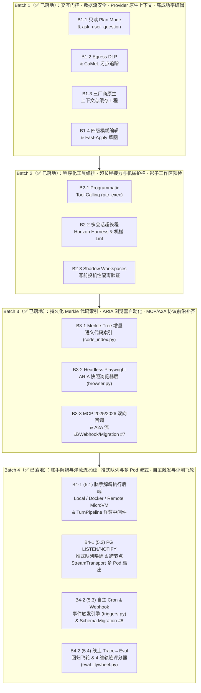

### 12 项 2026 业界前沿方案总览对照表（12/12 全部已落地）

| 编号 | 批次 | 前沿能力 | 2026 业界对标方案 | 解决的核心痛点 | 落地状态 | 核心源码模块 |
|---|---|---|---|---|---|---|
| **B1-1** | **Batch 1** | **只读 Plan Mode 硬门控与结构化澄清闭环** | **Anthropic** Claude Code（Plan Mode + `AskUserQuestion`）；**OpenAI Codex**（Suggest / Plan 协作态） | 探索期靠提示词软约束极易偷改源码；需求歧义时模型盲猜导致整轮返工 | **✅ 已落地** | `permissions.py`、`egress_dlp.py`、`runtime.py`、`storage.py`、`api.py`、`repl.py`、`web/app.js`、`web/index.html` |
| **B1-2** | **Batch 1** | **统一出站密文 Egress DLP 与 CaMeL 启发式污点追踪** | **DeepMind CaMeL**（*Defeating Prompt Injections by Design*）；**Anthropic** Egress Secret Guard | 间接提示词注入诱导 Agent 通过 `curl`/MCP/A2A/URL 编码/Base64 静默外泄凭据与劫持控制流 | **✅ 已落地** | `egress_dlp.py`、`runtime.py`、`permissions.py`、`repl.py`、`web/app.js` |
| **B1-3** | **Batch 1** | **多厂商 Provider 原生上下文与缓存工程** | **Anthropic**（`clear_thinking_20251015` / `clear_tool_uses_20250919` / `compact_20260112`）；**OpenAI Codex**（Responses `reasoning.encrypted_content` + `/v1/responses/compact`）；**Google Gemini**（`/v1beta/cachedContents` + TTL 续期） | 客户端暴力截断摧毁 KV Cache；ZDR 模式下推理模型跨步失忆；超长静态前缀重复计费 | **✅ 已落地** | `kv_cache.py`、`providers.py` |
| **B1-4** | **Batch 1** | **四级确定性模糊编辑与 Fast-Apply 风格草图拼接** | **Cursor**（Fast Apply / `... existing code ...` 草图合并）；**Anthropic / OpenAI Codex**（零歧义锚点编辑） | 换行符/尾随空白/嵌套缩进微差导致 `old_text_not_found` 反复重读；大文件多处改写输出冗余 | **✅ 已落地** | `host_tools.py`、`tools.py`、`permissions.py`、`runtime.py` |
| **B2-1** | **Batch 2** | **Programmatic Tool Calling（PTC / `ptc_exec` 本地沙箱代码编排）** | **Anthropic**（*Code execution with MCP* & Advanced Tool Use `allowed_callers`） | 多跳只读检索需 N 轮串行 LLM 往返，中间海量原始结果反复回灌上下文推高 Token 膨胀与延迟 | **✅ 已落地** | `ptc.py`、`host_tools.py`、`permissions.py`、`observability.py`、`providers.py` |
| **B2-2** | **Batch 2** | **多会话超长程 Horizon Harness 与机械化架构边界 Lint** | **Anthropic**（*Effective harnesses for long-running agents*：Initializer + Incremental Worker）；**OpenAI**（*Harness engineering* 机械化护栏与模型可执行修复指引） | 跨多上下文窗口易丢失全局验收清单、出现偷删测试与虚假完工；隐性架构分层靠提示词难以守住 | **✅ 已落地** | `horizon.py`、`host_tools.py`、`permissions.py` |
| **B2-3** | **Batch 2** | **Cursor 风格 Shadow Workspaces（`shadow_verify_edits` 写前投机性预检）** | **Cursor**（Shadow Workspace 后台编译/LSP 预检）；**Anthropic / OpenAI** 写前沙箱预检 | 高风险多文件重构直接落盘活工作树易留下语法/类型残局；朴素全量拷贝慢且易复制 `.env`/私钥 | **✅ 已落地** | `shadow_workspace.py`、`host_tools.py`、`lsp_client.py`、`permissions.py`、`observability.py` |
| **B3-1** | **Batch 3** | **持久化 Merkle-Tree 增量语义代码索引（`codebase_semantic_search`）** | **Cursor**（Merkle-Tree Incremental Codebase Indexing & Hybrid AST Chunk Search） | 大中型仓库仅靠字面 `grep` 难召回跨术语语义逻辑；重启后全库重切块与重算 Embedding 成本高 | **✅ 已落地** | `code_index.py`、`retrieval.py`、`host_tools.py`、`permissions.py`、`runtime.py`、`cli.py` |
| **B3-2** | **Batch 3** | **Headless Playwright ARIA 无障碍快照浏览器层（`browser.py`）** | **Microsoft Playwright MCP** / **Foundry Browser Automation**（ARIA Ref + SSRF 护栏） | 纯桌面像素截屏定位分辨率脆弱、Token 成本高且看不到浏览器 Console/Network 错误；缺 SSRF/IMDS 隔离 | **✅ 已落地** | `browser.py`、`permissions.py`、`egress_dlp.py`、`runtime.py`（与 `computer.py` 互补） |
| **B3-3** | **Batch 3** | **MCP 2025/2026 双向交互（Elicitation/Sampling/Roots/Progress）与 A2A 流式/Webhook/索引补齐** | **MCP 2025-06 / 2026**（Elicitation、Sampling 预算门控、Roots、Progress）；**A2A v0.3+/v1.0**（SSE 流式客户端、HMAC Push Webhooks、`contextId` 索引） | MCP 缺少服务端反向征询、受控采样与进度回传；A2A 客户端仅支持阻塞轮询、缺少防伪 Webhook 与 $O(\log N)$ 上下文索引 | **✅ 已落地** | `mcp_client.py`、`a2a.py`、`storage.py`（Migration #7）、`api.py` |
| **B4-1** | **Batch 4** | **脑手解耦执行后端（Local / Docker / Remote MicroVM）、洋葱模型 `TurnPipeline`、PG `LISTEN/NOTIFY` 推式唤醒与跨节点 `StreamTransport`** | **Anthropic**（*Scaling Managed Agents* Brain/Hands 解耦）；**E2B / Firecracker / Kata / Daytona** MicroVM；**PostgreSQL** `LISTEN/NOTIFY` 推式调度与多 Pod 事件扇出 | 执行面与 LLM 凭据紧耦合、横切安全/预算/追踪难组合、空转轮询浪费 DB 连接且单机内存 SSE 无法跨 Pod 广播 | **✅ 已落地** | `execution_backend.py`、`turn_pipeline.py`、`storage.py`、`lease.py`、`streaming.py`、`runtime.py` |
| **B4-2** | **Batch 4** | **自主 Cron & GitHub/自定义 Webhook 事件触发引擎（Migration #8）与线上 Trace→Eval 回归飞轮（4 维轨迹评分器）** | **GitHub Actions / Codex Cloud / Devin** 事件驱动自主智能体；**Anthropic**（*Demystifying evals for AI agents* 线上失败轨迹回流评测飞轮） | Agent 仅能被动响应人工聊天、缺防伪与幂等去重的定时/Webhook 入口；生产摩擦轨迹无法自动沉淀为脱敏离线回归集 | **✅ 已落地** | `triggers.py`、`storage.py`（Migration #8）、`eval_flywheel.py`、`egress_dlp.py`、`observability.py`、`runtime.py`、`api.py`、`cli.py` |

> **4-Batch 演进闭环说明**：Batch 1 夯实了交互门控、数据流安全、三厂商原生上下文与确定性编辑底座；Batch 2 交付了本地 PTC 编排、超长程 Horizon 接力与机械护栏、写前 Shadow Workspaces；Batch 3 补齐了持久化 Merkle 增量代码索引、Headless Playwright ARIA 浏览器层与 MCP 2025/2026 / A2A 前沿协议；**Batch 4** 最终完成面向生产自治与规模化演进的四块闭环底座——**脑手解耦执行后端与 `TurnPipeline` 洋葱中间件（5.1）**、**PostgreSQL `LISTEN/NOTIFY` 推式唤醒与跨节点 `StreamTransport`（5.2）**、**自主 Cron/Webhook 事件触发引擎与 Migration #8（5.3）**以及**线上 Trace→Eval 回归飞轮与 4 维轨迹评分器（5.4）**。后续面向超大规模企业集群的演进方向（如托管 Firecracker 控制面集群编排、KMS 静态密文信封加密、Outbox 指数退避重试与语义级 Auto-Mode 分类器）均可在当前解耦协议上零破坏平滑接入。

---

## 二、Batch 1 深度设计复盘（✅ 已落地）

Batch 1 围绕**“先规划、防外泄、省上下文、改得准”**四条最直接决定真实编码 Agent 可用性的主干链路完成全栈落地，共覆盖 12 个源码与前端文件，并由独立离线回归套件 [`tests/test_batch1_plan_dlp_native_ctx_edit.py`](../tests/test_batch1_plan_dlp_native_ctx_edit.py)（19 项确定性单测）持续守护核心不变量。

---

### 2.1 只读 Plan Mode 硬门控与结构化 `ask_user_question` 澄清闭环

#### 1. 业界对标与痛点
- **业界对标**：Anthropic Claude Code 的 `Plan Mode`（`EnterPlanMode` / `ExitPlanMode`）与 `AskUserQuestion` 结构化澄清机制；OpenAI Codex 的规划优先审批流。
- **工程痛点**：
  1. **提示词软约束不可靠**：仅在 System Prompt 里写“先分析再改代码”时，模型在上下文拉长或遇到明显 Bug 时仍会直接调用 `fs_write` / `fs_edit` 或 `bash_exec("sed -i ...")` 破坏工作区；
  2. **规则配置反向穿透**：若用户在 `.agent-lab/settings.json` 配置了宽松 `allow: ["Write(*)", "Bash(*)"]` 或在会话中点过 `session_grants`，普通权限判断会把计划阶段意外放行；
  3. **自由文本追问缺乏机器可恢复的状态机**：如果模型仅靠输出一段纯文本提问然后结束回合，CLI/Web 无法区分“任务彻底完成”还是“等待关键参数决策”，且在 `queue` 多进程部署、刷新页面或崩溃恢复时难以精准绑定原始 `tool_use` 因果链。

#### 2. 架构选型与权衡
本系统没有为规划模式和交互提问另建一套内存回调或独立 WebSocket 状态机，而是作出两项关键架构决策：

1. **权限裁决前置硬门控（Layer 1b）**：在 `evaluate_tool_permission()` 的 5 层优先级中，将 `plan` 只读规划拦截 `_evaluate_plan_mode_deny()` 置于**第 1b 层**——紧跟毁机命令硬熔断（Layer 1），**严格高于**声明式 `deny / ask / allow / session_grants`（Layer 2—4）与经典权限矩阵（Layer 5）。同时在 `runtime.py` 中规定：当基础档位为 `plan` 时，即使 `PreToolUse` 钩子返回 `allow`，也绝不将有效权限提升为 `full-auto`。
2. **复用持久化 `proposals` 状态机承载人机协作**：将 `exit_plan_mode` 与 `ask_user_question` 建模为两种新的标准动作提案 `kind="plan_approval"` 与 `kind="user_question"`，写入既有 `proposals` 表（复用 `(run_id, operation_id)` 唯一索引、`waiting_approval` 状态机、原子 `approve_and_enqueue` 以及新增的 `answer_text` 字段）。

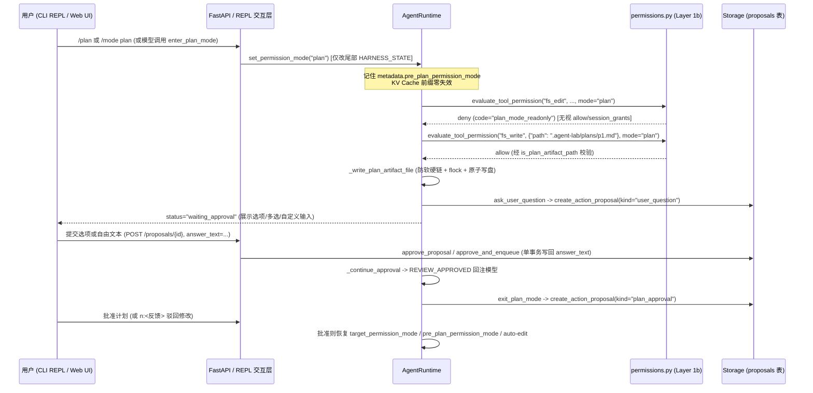

- **设计权衡**：
  - *为什么 `.agent-lab/plans/` 写计划用独立 `_write_plan_artifact_file()` 而非放宽 `execute_fs_write()`？* 缩小特权面：将计划产物写入的物理路径二次校核（`is_symlink()` 逐段拒绝、`resolved.is_relative_to(plans_root)`、`st_nlink == 1` 防硬链接置换）固化在专用路径中，即使上层规则误改也不触碰业务源码目录。
  - *为什么把 `user_question` 复用进 `proposals` 表而不是新开 `questions` 表？* 一次复用即可同时获得崩溃恢复幂等性（`operation_id=call_id`）、`inline` 与 `queue` 双模式一致性、多租户 RBAC 鉴权、审计日志及 Web/CLI 吸顶提醒条统一渲染；代价是 `proposals` 语义泛化为“广义人机中断点（Human-in-the-Loop Interrupt）”，需在 `selected_files` 校验与已应用补丁统计处显式排除 `user_question` / `plan_approval`（已在 `api.py:5474` 与 `runtime.py:4119` 闭环处理）。

#### 3. 核心安全与性能不变量
1. **不可穿透只读不变量（Unbypassable Plan Fence）**：`permission_mode == "plan"` 时，除只读工具、`INTERACTIVE_HOST_TOOLS`、`sandbox_test`、静态只读 `bash_exec`（`safe_readonly`）、标明 `read_only=True` 的外部 MCP、`web_fetch`（仍需审批）以及 `.agent-lab/plans/` 内普通非敏感文件写入外，一切写工具与未知工具一律返回 `decision="deny", code="plan_mode_readonly"`，不受 `allow` 规则、`session_grants` 或 `PreToolUse(allow)` 影响。
2. **计划目录防穿越与防凭据不变量**：`is_plan_artifact_path()` 静态拒绝 `..`、空字符、尾斜杠与 `is_token_secret()` 命中的凭据文件名（如 `.agent-lab/plans/.env`、`id_rsa`、`*.pem`）；`_write_plan_artifact_file()` 在 `flock` + `verify_epoch` 保护下二次校验无符号链接、无多重硬链接且 `resolved` 严格在 `plans_root` 内。
3. **工具内切换无死锁与零缓存破坏不变量**：`enter_plan_mode` 属于 `SAFE_REPLAY` 且执行于主循环内部（`_exec_depth[run_id] > 0`），`set_permission_mode()` 识别重入深度直接更新状态而不二次争抢 `exclusive_run` 跨进程锁；模式变更仅反映于尾部瞬态 `HARNESS_STATE`，不触发前序 KV Cache 级联失效。
4. **崩溃幂等与非空防误批不变量**：`exit_plan_mode` / `ask_user_question` 通过 `mark_action_proposal_executed()` 封存 `execution_result`，崩溃重入不二次弹问或重复切换模式；CLI 交互端对空回车拒绝默认提交（连续 3 次空输入自动安全暂停），防止粘贴多行文本误批准计划。

#### 4. 源码定位索引

| 文件 | 关键符号 / 行号 | 职责说明 |
|---|---|---|
| [`src/agent_lab/permissions.py`](../src/agent_lab/permissions.py) | `PERMISSION_MODES` / `_PERMISSION_MODE_ALIASES` / `PLAN_ARTIFACT_DIR` (`L100-105`)、`INTERACTIVE_HOST_TOOLS` (`L1197-1203`)、`is_plan_artifact_path` (`L2159-2176`)、`_evaluate_plan_mode_deny` (`L2205-2288`)、`evaluate_tool_permission` (`L2291-2469`) | 四级权限归一化、Plan Mode 别名（`plan-mode`/`plan_mode`）、`.agent-lab/plans/` 白名单校验与 Layer 1b 不可绕过硬拒绝 |
| [`src/agent_lab/egress_dlp.py`](../src/agent_lab/egress_dlp.py) | `INTERACTIVE_TOOL_SPECS` (`L1176-1270`) | 导出 `ask_user_question`、`enter_plan_mode`、`exit_plan_mode` 严格 Draft 2020-12 JSON Schema |
| [`src/agent_lab/runtime.py`](../src/agent_lab/runtime.py) | `_write_plan_artifact_file` (`L1096-1185`)、`_invoke_interactive_tool` (`L6149-6349`)、`set_permission_mode` (`L7617-7634`)、`approve` / `_continue_approval` (`L8063-8418`) | 计划产物安全落盘、工具内状态切换、`plan_approval` / `user_question` 提案创建与审批恢复（含 `pre_plan_permission_mode` 自动还原） |
| [`src/agent_lab/storage.py`](../src/agent_lab/storage.py) | `approve_proposal` (`L2104-2136`)、`approve_and_enqueue` (`L2138-2250`)、`create_action_proposal` (`L2304-2318`) | 支持 `user_question` / `plan_approval` 提案类型及 `answer_text`（上限 4000 字符）单事务持久化 |
| [`src/agent_lab/api.py`](../src/agent_lab/api.py) | `TaskInput` / `PermissionModeInput` / `ApprovalInput` (`L305-373`)、`/proposals/{id}` (`L5464-5701`) | 扩展 HTTP 协议接纳 `plan` 档位与 `answer_text`，支持 `inline` 与 `queue` 双路径 |
| [`src/agent_lab/repl.py`](../src/agent_lab/repl.py) | `_extract_question_fields` (`L582`)、`_extract_plan_fields` (`L623`)、`drain_approvals_interactively` (`L904-1205`)、`/plan` 与 `/mode` 命令 (`L2561-2625`) | CLI 终端渲染结构化选项卡片（单选/多选/自由回复）、计划 Markdown 预览、`n:<反馈>` 驳回及 `/plan` 快捷切换 |
| [`web/index.html`](../web/index.html) / [`web/app.js`](../web/app.js) | 权限下拉项 (`index.html:L348,522`)、`renderProposals` (`app.js:L1715-1890`)、`/plan` 斜杠命令 (`app.js:L3062-3086`)、`syncStickyApprovalBanner` (`app.js:L4141-4180`) | Web 工作台 Plan 档位切换、澄清提问按钮/输入框、实施计划确认卡片与吸顶快捷跳转 |

#### 5. 面试与复盘自检问题
1. **为什么 Plan Mode 不能只靠 System Prompt 约束，也不能放在声明式 `allow` 规则之后评估？**
   - *要点*：Prompt 约束属于概率软约束，长上下文或强指令注入下必然出现越权写入；若把 Plan 拦截放在 Layer 2—4 规则引擎之后，用户仓库已有的 `Write(*)` / `Bash(*)` 放行规则或历史 `session_grants` 会直接穿透只读契约。
2. **当模型在工具调用中自行触发 `enter_plan_mode` 时，为什么 `set_permission_mode()` 需要检查 `_exec_depth`？且为什么这次权限切换不会破坏 KV Cache？**
   - *要点*：主循环已经持有 `exclusive_run` 进程排他锁，工具回调内部再申请同名锁会自锁死锁；权限档位只通过每轮尾部的瞬态 `HARNESS_STATE` 传达给模型，不改写前序 `<TOOLS>` / `<SYSTEM>` / 历史消息块，因此前缀哈希完全不变。
3. **如果攻击者在 `.agent-lab/plans/` 下预先放了一个指向 `src/auth.py` 的符号链接，静态校验通过后怎么办？**
   - *要点*：静态层 `is_plan_artifact_path` 只负责快速前置过滤；物理写入层 `_write_plan_artifact_file` 在 `flock` 锁内逐段校验 `candidate.is_symlink()`、`resolved.is_relative_to(plans_root)` 与 `st_nlink == 1`，彻底封堵软硬链接逃逸与 TOCTOU 窗口。

---

### 2.2 统一出站密文 Egress DLP 与 CaMeL 启发式 Provenance 污点追踪

#### 1. 业界对标与痛点
- **业界对标**：DeepMind **CaMeL**（*Defeating Prompt Injections by Design*，通过控制流与数据血缘隔离防御间接提示词注入）；Anthropic Claude Code 的出站安全与凭据防泄漏实践。
- **工程痛点**：
  1. **多出站汇聚点（Multi-Sink Exfiltration）**：早期系统只保护子进程环境变量剥离，但模型一旦从文档、终端输出或错误堆栈里见到密钥，仍可通过 `web_fetch` URL 参数、`mcp_call_tool` / `mcp__*` 外部 Webhook、`a2a_send_task` 远端消息或 `bash_exec`（`curl` / `python -c "import urllib..."` / `/dev/tcp`）将密钥偷渡出境；
  2. **编码混淆绕过**：攻击指令常要求模型“把 API Key 做 Base64 或 URL 百分号编码（甚至双重编码、加 `k=` 前缀再 Base64）后拼到查询参数中”，普通明文正则完全漏检；
  3. **监控本身成为二次泄漏源**：若 DLP 在内存登记表、拒绝文案 `reason`、事件流或审计日志里打印命中的密钥片段，等于把密钥写入了 SQLite、SSE 与前端日志；
  4. **单 LLM 下的污点控制流劫持**：读取恶意网页或外部 MCP Issue 后，即便未直接外发密钥，间接注入也可能诱使 Agent 向未授权域名外传仓库源码或执行变更型终端命令。

#### 2. 架构选型与权衡
学术版 CaMeL 要求双 LLM（Privileged LLM + Quarantined LLM）加专用能力解释器，在开放式软件工程场景下会带来高延迟与表达力折损。Batch 1 采用**“实用主义两道防线架构（Egress DLP + 启发式 Provenance 污点门控）”**，集中实现于独立零依赖安全模块 [`src/agent_lab/egress_dlp.py`](../src/agent_lab/egress_dlp.py)：

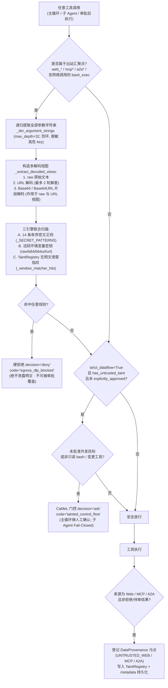

- **核心机制拆解**：
  1. **无明文滑窗指纹（`_WindowMatcher` + `SecretFingerprint`）**：`TaintRegistry.register_secret()` 对任意密钥（如动态读取的 Vault Token 或环境变量密钥）**不保存明文**，而是针对 `raw` / `base64` / `base64url` / `urlencoded` / `urlencoded_plus` 五种变体分别生成 `_WindowMatcher(variant, length, prefix, suffix, sha256)`（`len < 8` 跳过；`anchor_len = 4 if n >= 12 else 2`）。扫描时 `_window_matcher_hits()` 通过 `haystack.find(prefix)` 定位候选切片、比对 `suffix` 后做完整 SHA-256 核验——兼得 $O(N)$ 检索速度、精确子串零误报与内存快照零明文留痕。
  2. **14 条有序密文正则 + Span 覆盖去重**：覆盖 `anthropic_api_key`、`openai_project_key`、`openai_api_key`、`github_pat`、`github_token`、`aws_access_key_id`、`google_api_key`、`slack_token`、`stripe_key`、`pem_private_key`、`database_dsn_password`、`bearer_jwt`、`jwt_token`、`bearer_token`；通过 `_SUBSUMED_BY_BEARER_JWT` 按位置区间消除冗余告警。
  3. **多视图抗绕过解码**：对参数字符串先做最多 2 轮 `unquote` / `unquote_plus` 解套，再对**原始视图与 URL 解码视图**均扫描 Base64 / Base64URL 候选片段（长度 20—65536、单字段上限 64 个片段以防 DoS，自动补齐 `=` padding），能直接击穿 `base64(secret)`、`base64("k=" + secret)` 与 `url_encode(base64(secret))` 叠加绕过。
  4. **五处运行时卡点全覆盖**：不仅在主循环 `_dispatch_call()` 入口卡死，还在**子 Agent 执行循环**（`subagent_run`）以及**审批通过后的二次执行入口**（`_execute_approved_command_proposal`、`mcp_call`、`a2a_call`）全部二次执行 `_inspect_egress_dlp(..., explicitly_approved=True)`，杜绝审批等待期间或子 Agent 派生路径的绕过死角。

#### 3. 核心安全与性能不变量
1. **零明文留痕不变量（Zero-Plaintext Invariant）**：原始密钥及可逆编码片段绝不出现在 `SecretFingerprint.to_dict()`、`TaintRegistry.to_dict()`、`TaintEvent.summary`（写入前经 `redact_secrets()` 脱敏）、`findings[].field`（`_safe_field_segment()` 对高危字典键折叠为 `.<key[idx]>`）以及最终 `reason` 和事件流中。
2. **DLP 绝对高于审批不变量（DLP-Over-Approval Invariant）**：第一道防线（密文 DLP）命中永远返回 `decision="deny", code="egress_dlp_blocked"`，即使同时传入 `strict_dataflow=True` 与 `explicitly_approved=True`（用户已点击批准），也绝不降级为 `ask` 或 `allow`。
3. **跨进程与重启污点延续不变量**：`runtime.py` 将脱敏后的不可信摄入记录同步写入 `run["metadata"]["untrusted_taint_sources"]`（有界 64 条）；进程重启或队列 Worker 接管后，`_get_taint_registry()` 自动水合恢复污点态，不会因换机而洗白污点。
4. **子 Agent 污点 Fail-Closed 不变量**：当 `strict_dataflow=True` 且主会话已受不可信污点污染时，子 Agent 触发 `tainted_control_flow`（`decision="ask"`）无法直接面向用户弹窗，运行时直接 Fail-Closed 失败返回，杜绝借子 Agent 偷跑外发或写盘。
5. **非逃逸良性流量零摩擦不变量**：`strict_dataflow=True` 且存在污点时，本地只读操作（`fs_read`、`git status` 等 `safe_readonly` 命令）以及目标主机在 `approved_hosts` 白名单内的干净外发（如已批准 `docs.python.org`）仍保持放行。

#### 4. 源码定位索引

| 文件 | 关键符号 / 行号 | 职责说明 |
|---|---|---|
| [`src/agent_lab/egress_dlp.py`](../src/agent_lab/egress_dlp.py) | `DataProvenance` (`L64-81`)、`TaintEvent` (`L110-126`)、`_WindowMatcher` / `SecretFingerprint` / `_window_matcher_hits` (`L130-210`) | 6 级数据血缘枚举、线程安全无明文滑窗指纹匹配算法 |
| [`src/agent_lab/egress_dlp.py`](../src/agent_lab/egress_dlp.py) | `_SECRET_PATTERNS` (`L244-320`)、`_BASH_NETWORK_SINK_PATTERNS` (`L328-348`)、`redact_secrets` (`L394-418`)、`TaintRegistry` (`L437-667`) | 14 类密文正则、Bash 出网识别、文本原地脱敏与每 Run 污点登记表 |
| [`src/agent_lab/egress_dlp.py`](../src/agent_lab/egress_dlp.py) | `_safe_field_segment` / `_iter_argument_strings` (`L710-785`)、`_extract_decoded_views` (`L788-844`)、`EgressDlpInspector.inspect_outbound_call` (`L991-1145`) | 防环嵌套参数遍历、双层 URL + Base64/Base64URL 多视图解码与两道防线裁决器 |
| [`src/agent_lab/runtime.py`](../src/agent_lab/runtime.py) | `_get_taint_registry` (`L987-1015`)、`_inspect_egress_dlp` (`L1017-1042`)、`_record_untrusted_provenance` (`L1044-1094`)、5 处调度卡点 (`L5099`, `L6387`, `L8140`, `L8427`, `L8472`) | 污点持久化与恢复、主/子/审批后全链路 DLP 拦截、`egress_dlp_blocked` 与 `tainted_control_flow` 审计事件发射 |
| [`src/agent_lab/repl.py`](../src/agent_lab/repl.py) / [`web/app.js`](../web/app.js) | `egress_dlp_blocked` 渲染 (`repl.py:L1263-1267`, `app.js:L123,1571-1579`) | CLI 与 Web 事件流实时醒目呈现脱敏后的出站拦截原因 |

#### 5. 面试与复盘自检问题
1. **如果攻击者把一个自定义秘密 `LiveEnvVault+Secret/Token=99887766!` 拼接成 `k=<secret>` 再做 Base64 塞进 MCP JSON 参数里，Egress DLP 如何检出？为什么不会在报错中把密钥反吐出来？**
   - *要点*：`_extract_decoded_views()` 先扫描参数中的 Base64 候选串解码出 `k=LiveEnvVault+...` 作为 `base64_decoded` 视图，随后活跃环境变量扫描器与滑窗指纹器在解码视图中做子串/SHA-256 命中；同时 `findings` 仅返回规则名、脱敏字段路径和 `[REDACTED:env:...]`，且 `_safe_field_segment()` 连包含密钥的字典键名也会折叠为 `.<key[idx]>`。
2. **为什么不直接把密钥明文存进 `TaintRegistry` 的 `set[str]` 里做 `secret in text`？无明文滑窗指纹的代价和边界是什么？**
   - *要点*：存明文会导致 `to_dict()` 快照、崩溃 Core Dump 或调试日志意外泄密；滑窗指纹只存长度、极短前后缀（`anchor_len` 2—4 字符）与完整 SHA-256，防泄漏且精确匹配。其工程边界在于：只能拦截原样及预设编码变体（URL/Base64/Base64URL），无法仅靠单步扫描拦住跨多字符拆分、自定义加密或侧信道逐位外泄——这类威胁需要结合 Batch 2 的动作分类器与 Batch 3 的无网 MicroVM 纵深防御。
3. **启发式 Provenance 污点追踪与论文原版 CaMeL 的本质差距在哪里？**
   - *要点*：原版 CaMeL 在受限 Python AST 解释器层面做**变量级细粒度数据流追踪与双 LLM 物理隔离**；本实现是**会话级粗粒度污点（一旦摄入不可信 Web/MCP/A2A，整个 run 标记 `has_untrusted_taint=True`）+ `strict_dataflow` 出站与写操作人工门控**。优点是零额外 LLM 调用、兼容任意工具与终端工作流；缺点是单次摄入外部网页后，后续合法写操作在 `strict_dataflow=True` 下会产生较多确认提示（需通过 `approved_hosts` 白名单与合理会话切分缓解）。

---

### 2.3 多厂商 Provider 原生上下文工程

#### 1. 业界对标与痛点
- **业界对标**：
  - **Anthropic Messages API（2025—2026）**：Server-Side Context Management（`clear_thinking_20251015`、`clear_tool_uses_20250919`、`compact_20260112`）与 PTC 元数据 `allowed_callers`；
  - **OpenAI Codex / Responses API**：ZDR 无状态模式（`store=False`）下的 `reasoning.encrypted_content` 加密推理透传与 `POST /v1/responses/compact` 远端无状态压缩；
  - **Google Gemini Native API**：`/v1beta/cachedContents` 显式上下文缓存、单调时钟 TTL 追踪与 `PATCH ?updateMask=ttl` 续期。
- **工程痛点**：
  1. **三厂商协议语义高度异构**：若强行抽象成最低公分母（OpenAI Chat Completions 风格），就会白白放弃 Anthropic 服务端上下文清理/压缩、OpenAI 推理链加密回传与 Gemini 32K+ 显式缓存三大 2026 核心红利；
  2. **服务端新特性易引发兼容网关 400/404 崩溃**：大量企业中转网关或代理只实现了基础 `/v1/messages`、`/v1/responses` 或 `:generateContent`，直接无脑开启 beta 头、`/responses/compact`、`include: ["reasoning.encrypted_content"]` 或 `/cachedContents` 会导致生产请求雪崩；
  3. **压缩块与缓存断点协同陷阱**：服务端返回 `type="compaction"` 块后，若客户端历史规范化函数把它当成未知块丢弃、或无法在其上落点 `cache_control`，会导致下一轮丢失压缩状态或失去前缀缓存命中。

#### 2. 架构选型与权衡

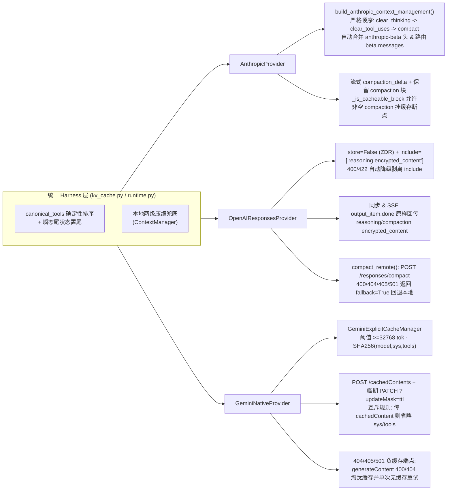

- **逐厂商关键设计权衡**：
  - **Anthropic**：默认所有服务端上下文编辑/压缩开关均为 `False`（返回 `(None, [])`），保证既有测试与第三方网关 100% 零改动；开启后在 `build_anthropic_context_management()` 中硬编码策略顺序（`clear_thinking_20251015` 必须在 `clear_tool_uses_20250919` 之前，`compact_20260112` 在末尾），避免调用方传参顺序出错被服务端拒收；SDK 兼容性上优先探测 `client.beta.messages`，不支持时自动退化为 `extra_body={"context_management": ...}`。同时预埋 `enable_ptc` / `ptc_allowed_callers` 仅在显式开启时透传 `allowed_callers`，默认剥离以防非 PTC 端点报错。
  - **OpenAI Responses**：明确选择 `store=False`（ZDR 无状态）而非 `previous_response_id` 有状态链式会话——因为后者会把会话状态锁死在 OpenAI 服务端，无法做 `/rewind` 回退、跨节点分叉、本地检查点持久化或切换中转地址。配合 `include: ["reasoning.encrypted_content"]` 与原样回传不透明密文块，在保持完全无状态与 ZDR 合规的前提下，依然维持完整多步推理链连续性。
  - **Gemini**：将显式缓存生命周期封装在独立的 `GeminiExplicitCacheManager`（支持注入自定义 `clock` 以便离线单测精准验证 TTL 与续期窗口，无需 `sleep`）；仅当 `system + canonical_tools` 估算 token 数 $\ge 32{,}768$ 时创建显式缓存，规避小前缀反增延迟与存储费用；通过 `_unsupported_base_urls` 集合对返回 404/405/501 的网关做负缓存，避免每轮都多打一次无效 `POST /cachedContents`。

#### 3. 核心安全与性能不变量
1. **默认零侵入与优雅降级不变量**：
   - Anthropic 默认开关全关时请求体零新增字段；
   - OpenAI 兼容网关不支持 `include: ["reasoning.encrypted_content"]`（返回 400/422）时自动置位 `_supports_encrypted_reasoning_include = False` 并同轮重试；不支持 `/responses/compact`（400/404/405/501 或网络故障）时返回 `{"ok": False, "fallback": True, "messages": deepcopy(messages)}`，绝不抛出异常中断任务；
   - Gemini 创建缓存失败透明回退普通请求；生成请求因缓存提前失效返回 `400/404` 时立即 `invalidate()` 并触发至多一次（`retried_uncached=True`）无缓存重试。
2. **Anthropic 编辑顺序与 Beta 去重不变量**：`clear_thinking_20251015` 恒排于 `clear_tool_uses_20250919` 之前，`compact_20260112` 恒排末尾；`anthropic-beta` 请求头与用户 `extra_headers` 自动去重合并，绝不重复发送冲突标识。
3. **OpenAI 不透明密文保真不变量**：`reasoning` 与 `compaction` 项中的 `encrypted_content` 无论经由同步 JSON、SSE `response.output_item.done`（含缺失 `response.completed` 的异常流尾）还是 `compact_remote()`，均以原样字符串持久化并在下一轮 `_to_responses_input()` 原样回放，绝不做文本改写或截断。
4. **Gemini 互斥载荷与确定性键不变量**：`cachedContent` 与 `systemInstruction`/`tools` 严格互斥（传前者则必省略后两者）；缓存键基于 `SHA-256(canonical_json({model_resource, system, canonical_tools}))`，杜绝因字典键序波动引发的缓存雪崩。

#### 4. 源码定位索引

| 文件 | 关键符号 / 行号 | 职责说明 |
|---|---|---|
| [`src/agent_lab/kv_cache.py`](../src/agent_lab/kv_cache.py) | `_to_content_blocks` / `_is_cacheable_block` (`L202-240`)、`build_anthropic_context_management` (`L242-313`)、`build_anthropic_cached_payload` (`L316-380`) | `compaction` 块规范化与缓存断点合法性判定、Anthropic 三策略有序构造与 Beta 头去重 |
| [`src/agent_lab/providers.py`](../src/agent_lab/providers.py) | `AnthropicProvider.__init__` / `_stream_anthropic_message` / `complete` (`L1461-2015`) | 环境变量开关（`AGENT_LAB_ANTHROPIC_CONTEXT_EDITING` / `SERVER_COMPACT` / `PTC`）、`beta.messages` 路由、`compaction_delta` 流式解析与 `compaction` 块保真 |
| [`src/agent_lab/providers.py`](../src/agent_lab/providers.py) | `OpenAIResponsesProvider` (`L2957-3888`)、`_to_responses_input` (`L3035-3205`)、`_normalize_compacted_output` (`L3312-3403`)、`compact_remote` (`L3405-3521`) | ZDR `store=False`、`reasoning.encrypted_content` 双向透传与 400/422 自适应降级、SSE `output_item.done` 捕获、`/responses/compact` 远端压缩与无缝回退 |
| [`src/agent_lab/providers.py`](../src/agent_lab/providers.py) | `GeminiExplicitCacheManager` (`L3891-4138`)、`GeminiNativeProvider` (`L4141-4670`) | 显式缓存阈值门控（32K）、SHA-256 确定性键、单调时钟 TTL + `PATCH ?updateMask=ttl` 续期、互斥载荷构造与 400/404 双层透明降级 |

#### 5. 面试与复盘自检问题
1. **在 OpenAI Responses API 中，为什么选择 `store=False` + `include=["reasoning.encrypted_content"]` + 客户端持有消息列表，而不是直接使用 `previous_response_id`？**
   - *要点*：`previous_response_id` 是服务端有状态黑盒，会导致无法实现 `/rewind` 任意轮回退、无法做会话分叉 `/fork`、无法落库审计或切换故障转移网关，且不满足企业 ZDR（Zero Data Retention）合规要求；而 `store=False` 配合原样回传不透明 `encrypted_content` 既保住了 ZDR 与本地状态主权，又不损失跨工具轮次的推理状态连续性。
2. **为什么 Anthropic 要求 `clear_thinking_20251015` 必须排在 `clear_tool_uses_20250919` 之前，且 `_is_cacheable_block` 允许非空 `compaction` 块挂载 `cache_control`？**
   - *要点*：先清理历史 `thinking` 块再评估工具输出清理阈值，可避免陈旧思维链虚高 input token 计数而误杀近期有效工具证据；允许非空 `compaction` 块挂载 `ephemeral` 断点，使压缩完成后的下一轮即可直接以服务端摘要块为锚点重建前缀 KV Cache，防止每次压缩后都反复全量 Prefill。
3. **如果 Gemini 显式缓存被服务端提前回收（尚未到本地计算的 `expires_at`），请求会发生什么？如何避免单次请求死循环重试？**
   - *要点*：`generateContent` / `streamGenerateContent` 收到 `400/404` 且当前携带了 `active_cached_name` 时，会立即调用 `cache_mgr.invalidate(cache_name=...)` 驱逐陈旧条目，置 `active_cached_name = None` 与 `retried_uncached = True` 后以完整 `systemInstruction + tools` 做**至多一次**无缓存重试；若该次无缓存请求仍报 400，则因 `retried_uncached` 已为真而直接按正常 HTTP 错误处理，彻底杜绝无限循环。

---

### 2.4 四级确定性模糊编辑 `match_and_replace_tiered` 与 Fast-Apply 风格 `fs_sketch_edit`

#### 1. 业界对标与痛点
- **业界对标**：**Cursor** Fast Apply（用 `// ... existing code ...` 省略未修改片段进行快速草图合并）；**Anthropic / OpenAI Codex** 的零歧义锚点局部编辑实践。
- **工程痛点**：
  1. **纯精确子串匹配过于脆弱**：模型在真实仓库里经常因为“文件用 `\r\n` 而模型输出 `\n`”、“源码某行末尾多一个空格或 Tab”、或“深层嵌套类方法里整体少打了一层 4 空格基准缩进”触发 `old_text_not_found`，被迫重新 `fs_read` 并重试，消耗 1—3 轮额外 API 调用；
  2. **概率模糊匹配风险过高**：若采用编辑距离（Levenshtein / `difflib.SequenceMatcher` 最高分）“尽力猜测”，在包含多个相似代码块（如重复的 `if ready: return True` 或多个路由 handler）的文件里极易静默改错位置，引入极难排查的隐性 Bug；
  3. **大文件多处散点修改效率低**：修改一个 400 行文件里相隔 200 行的两处函数时，连续调用多次 `fs_edit` 增加往返延迟，而 `fs_write` 全量重写不仅吐出海量输出 Token，还容易发生模型“偷懒截断”误删未修改逻辑。

#### 2. 架构选型与权衡

针对以上矛盾，Batch 1 构建了**双轨确定性编辑体系**，坚持**“宁可显式失败要求补充锚点，绝不静默猜错改坏代码”**的第一性原理：

##### 轨道 A：四级确定性局部编辑 `match_and_replace_tiered()`（`fs_edit`）

| 匹配层级 | `match_tier` 标识 | 匹配算法与恢复策略 | 支持 `replace_all` | 歧义处理 |
|---|---|---|---|---|
| **Tier 1** | `exact` | 原始字节/字符级精确子串 `original.count(old_text)` | 支持 | `cnt > 1` 且非 `replace_all` → `ambiguous_match` |
| **Tier 2** | `crlf_normalized` | 统一 `\r\n -> \n` 匹配；替换后按原文件 `dominant_nl`（`\r\n` 或 `\n`）还原换行符 | 支持 | `cnt2 > 1` 且非 `replace_all` → `ambiguous_match` |
| **Tier 3** | `trailing_ws_trimmed` | 等长连续行滑窗，逐行剥离行尾 `" \t"` 比对；保留末行原有换行符并还原 `dominant_nl` | **禁止**（防模糊批量误伤） | `len(t3_hits) > 1` → `ambiguous_match` |
| **Tier 4** | `indent_relative` | `_dedent_lines()` 剥离共同最小缩进比对**相对缩进结构**；唯一命中后用目标窗口真实基准缩进 `base_ind` 重缩进 `new_text`（空行保持纯空） | **禁止**（防模糊批量误伤） | `len(t4_hits) > 1` → `ambiguous_match` |

同时，沙箱/通用 `ToolRegistry._apply_unique_replacement()`（`src/agent_lab/tools.py:772-793`）也同步补齐至 Tier 3（保持零歧义与 CRLF 保真），令 `propose_patch` / `propose_changeset` 同样受益。

##### 轨道 B：确定性 Fast-Apply 草图拼接 `apply_sketch_edit()`（`fs_sketch_edit`）

与 Cursor 额外部署专用 70B/Speculative Apply 模型不同，本项目先在 Harness 层落地**零模型延迟、100% 确定性、单调锚点失败闭合**的草图拼接算法：

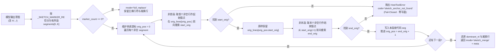

- **完整治理闭环**：`fs_sketch_edit` 并非绕开权限系统的后门——它被纳入 `MUTATING_FILE_EDIT_TOOLS`（统一受 `Edit(...)` 与 `SketchEdit(...)` 声明式规则治理），在 `plan` 模式被 `plan_mode_readonly` 硬阻断，在 `ask` 模式生成标准 Unified Diff 变更提案并经 `AgentRuntime._apply_host_sketch_proposal()` 在 `flock` + `verify_epoch` + SHA-256 CAS 校验下原子落地，写前录制 `/rewind` 检查点快照，写后自动触发 `_attach_post_edit_lsp_diagnostics()` 挂载实时 LSP 静态诊断。

#### 3. 核心安全与性能不变量
1. **全层级零歧义不变量（Zero-Ambiguity Across All 4 Tiers）**：在 Tier 1、2、3、4 任一层级，只要候选命中数 $> 1$（且非 Tier 1/2 显式 `replace_all=True`），必须立即返回 `ambiguous_match`，绝不进入下一层也不默认替换第一处。
2. **模糊层级禁止批量替换不变量**：`replace_all=True` 仅允许 Tier 1（`exact`）和 Tier 2（`crlf_normalized`）生效，彻底杜绝因忽略尾随空白或缩进而误改整份文件的多处代码。
3. **单调锚点失败闭合不变量（Monotonic Anchor Fail-Closed）**：`apply_sketch_edit()` 中游标 `orig_pos` 严格单调递增；若模型把草图块顺序写反、或伪造了原文件不存在的起止锚点行，必定抛出 `sketch_anchor_not_found` 且磁盘文件字节零变化。
4. **换行符与格式保真不变量**：Tier 2—4 与 `fs_sketch_edit` 均检测原文件主换行符 `dominant_nl`（`\r\n` vs `\n`）及末行换行符状态，避免在 Windows/跨平台仓库里一次局部编辑引发全文件 Git Diff 污染。
5. **原子写盘与可观测性不变量**：所有直写操作均在跨进程 `flock` + `verify_epoch` 内执行 Read-Modify-Write 并通过 `_atomic_write_host_file` 落盘；`execute_fs_edit` 显式上报 `match_tier`，`execute_fs_sketch_edit` 显式上报 `merge_meta`（`mode`、`markers`、`hunks_applied`）。

#### 4. 源码定位索引

| 文件 | 关键符号 / 行号 | 职责说明 |
|---|---|---|
| [`src/agent_lab/host_tools.py`](../src/agent_lab/host_tools.py) | `HOST_TOOL_SPECS` 中 `fs_sketch_edit` (`L330-347`)、`_SKETCH_MARKER_RE` (`L824-827`)、`_common_indent` / `_dedent_lines` (`L830-853`) | Fast-Apply 工具 JSON Schema、多语言省略注释正则与相对缩进归一工具 |
| [`src/agent_lab/host_tools.py`](../src/agent_lab/host_tools.py) | `match_and_replace_tiered` (`L856-947`)、`apply_sketch_edit` (`L950-1037`)、`execute_fs_edit` (`L1040-1164`)、`execute_fs_sketch_edit` (`L1167-1280`) | 四级确定性模糊匹配器、单调锚点草图拼接器与双工具的权限/提案/检查点/原子落盘执行器 |
| [`src/agent_lab/tools.py`](../src/agent_lab/tools.py) | `ToolRegistry._apply_unique_replacement` (`L769-793`) | 沙箱补丁引擎同步支持 Tier 3 尾随空白容忍唯一匹配与 CRLF 保真 |
| [`src/agent_lab/permissions.py`](../src/agent_lab/permissions.py) | `MUTATING_FILE_EDIT_TOOLS` (`L1257`)、`_RULE_TOOL_ALIASES` (`L1497-1500`)、`suggest_session_grant_pattern` (`L2083-2090`) | 将 `fs_sketch_edit` 纳入统一 `Edit(...)` / `SketchEdit(...)` 规则与四级权限矩阵 |
| [`src/agent_lab/runtime.py`](../src/agent_lab/runtime.py) | `_apply_host_sketch_proposal` (`L1187-1265`)、直连分发 (`L3571-3680`)、`operator` 子 Agent 授权 (`L4665`)、获批落地与编辑后 LSP 诊断 (`L6575`, `L8588-8611`) | `fs_sketch_edit` 的 `ask` 模式 CAS 落地、审批后/直写后自动 LSP 诊断及子 Agent 能力挂载 |

#### 5. 面试与复盘自检问题
1. **为什么 Tier 4（`indent_relative`）在匹配成功后，必须先对 `new_text` 去缩进再用目标窗口的 `base_ind` 重新缩进，而不是直接把 `new_text` 填进去？**
   - *要点*：触发 Tier 4 往往是因为模型在 `old_text` 和 `new_text` 中都整体少打了 4 或 8 个空格的嵌套基准缩进；如果直接把 `new_text` 原样替换进 Python 或缩进敏感语言的目标窗口，会立刻导致 `IndentationError` 或把语句错误提升到外层作用域。先 `_dedent_lines(new_text)` 再统一拼接 `base_ind`（空行除外），才能保持内部相对层次并无缝贴合目标上下文缩进。
2. **既然有了 Tier 1—4 的 `match_and_replace_tiered`，为什么还要保留零歧义拒绝，而不是加一个 Tier 5 做编辑距离相似度打分？**
   - *要点*：编辑距离打分破坏了确定性边界——当原文件已过期或存在相似代码段时，“最像的那一处”往往正是错误位置，静默写入后会污染后续测试与编译诊断。强制零歧义 + 返回 `old_text_not_found` / `ambiguous_match` 迫使模型 `fs_read` 获取最新上下文，在多轮闭环中的端到端修复成功率反而高于“悄悄改错”。
3. **`apply_sketch_edit` 在什么情况下会故意失败闭合？如果同一个文件里有两处相同的单行起始锚点（例如两个 `return result`），草图拼接会怎样表现？**
   - *要点*：当起止锚点不存在、或草图段落顺序与原文件物理顺序颠倒（违反 `orig_pos` 单调递增）时，立刻抛 `sketch_anchor_not_found` 且不写盘。对于重复单行锚点，由于算法按 `orig_pos` 顺序取第一个前向命中，要求模型在省略标记前后保留足够具辨识度的函数签名/结构化上下文行作为锚点；若未来需要容忍低辨识度草图，可在 Batch 2/3 引入 AST 符号级锚定或专用小模型 Apply 校验层（并在落地前仍保留确定性 Diff 审批门）。

---

## 三、Batch 2 深度设计复盘（✅ 已落地）

Batch 2 围绕**“少往返、不断链、零污染”**三条决定复杂仓库自主工程上限的核心链路，交付三个高内聚独立引擎模块：[`src/agent_lab/ptc.py`](../src/agent_lab/ptc.py)（本地程序化工具编排 `ptc_exec`）、[`src/agent_lab/horizon.py`](../src/agent_lab/horizon.py)（跨会话超长程接力与机械化架构边界 Lint）以及 [`src/agent_lab/shadow_workspace.py`](../src/agent_lab/shadow_workspace.py)（写前投机性隔离验证 `shadow_verify_edits`），并与现有 OS 内核沙箱（`host_tools.py`）、权限/环境脱敏（`permissions.py`）、LSP 客户端（`lsp_client.py`）和密文脱敏（`observability.py`）形成纵深协同。

---

### 3.1 B2-1：Programmatic Tool Calling（`ptc.py` / `ptc_exec`）

#### 1. 业界对标与痛点
- **业界对标**：Anthropic *Code execution with MCP* 与 Advanced Tool Use（`allowed_callers` 协议字段已于 Batch 1 预埋在 [`src/agent_lab/providers.py`](../src/agent_lab/providers.py) `L1469-1470, L1556-1563, L1759-1767`）；本地无厂商锁定实现则进一步把该范式推广至 Anthropic / OpenAI / Gemini 与本地私有工作区。
- **工程痛点与“N 轮压成 1 轮”的底层机理**：
  1. **传统多跳工具循环的 $O(N^2)$ 上下文膨胀与 $N \times \text{TTFT}$ 延迟**：当模型需要“先 `fs_glob` 枚举 40 个文件 → 逐批 `fs_grep` 找符号引用 → `fs_read` 抽取前 8 个候选文件并按模块聚合去重”时，标准 ReAct 循环必须串行经历 $N$ 轮完整的 LLM 推理往返；更致命的是，每一轮返回的原始文件清单、冗长 grep 命中行与大段源码都会永久进入对话历史并在后续每一轮重复参与 Prefill，造成 $O(N^2)$ 级输入 Token 消耗、注意力稀释（Context Rot）以及 $N$ 次首字延迟（TTFT）叠加。
  2. **PTC 如何把 N 轮工具往返压成 1 轮**：`ptc_exec` 允许模型在**单次 LLM 回合**内提交一段短小 Python 3 编排脚本（`<= 32,000` 字符）。宿主在无网隔离子进程中运行该脚本，脚本通过同步代理 `call_tool(name, **kwargs)` 或动态代理 `tools.<name>(**kwargs)` 经本地管道以**微秒级 IPC 延迟**连续执行最多 `max_calls`（默认 16、硬上限 24）次只读工具子调用；所有过滤、去重、关联 Join、计数与排序均在子进程 Python 内存中完成，**海量中间原始工具结果从不进入模型上下文**，只有最终经过脱敏与体积截断（`<= 16,000` 字符）的紧凑 `print()` 摘要作为单条 `tool_result` 返回给模型。由此在保持 KV Cache 前缀极度精简的同时，将 $N$ 轮模型推理往返压缩为 **1 轮**。
  3. **代码执行编排的安全威胁面**：若直接用普通 `python -c` 与共享 `stdin/stdout` 跑 JSON-RPC，恶意或失控脚本可利用 `print('{"type":"done",...}')` 或 `os.write(1, ...)` 伪造 RPC 帧、借工作区同名 `json.py` 劫持标准库、在脚本内递归调用 `ptc_exec` 或偷调 `fs_write`/`bash_exec`、或派生后台子进程在超时后滞留成为孤儿进程。

#### 2. 架构选型与权衡

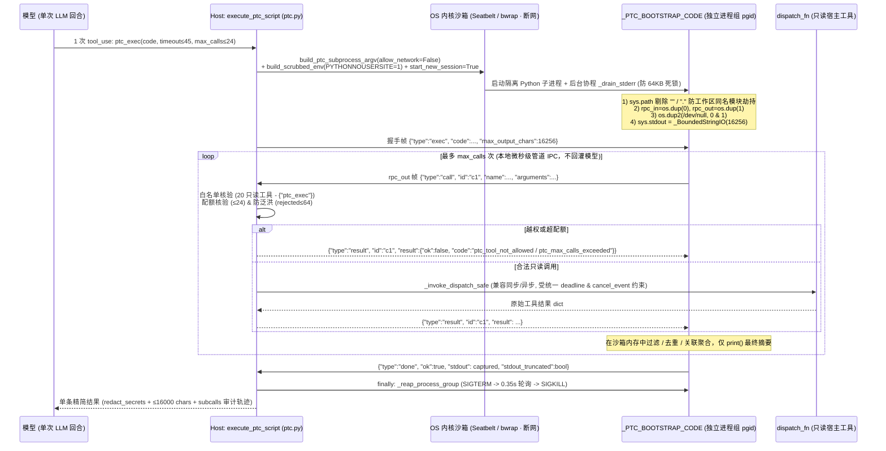

- **核心机制拆解**：
  1. **`os.dup` 物理隔离 RPC 通道（`ptc.py:L179-255`）**：引导程序 `_PTC_BOOTSTRAP_CODE` 在导入 `json`/`os` 之前先从 `sys.path` 清除 `""` 与 `"."` 防止 CWD 同名文件劫持标准库；随后立刻执行 `rpc_in_fd = os.dup(0)` 与 `rpc_out_fd = os.dup(1)` 独占私有协议描述符，并将原始 FD 0/1 通过 `os.dup2` 重定向至 `/dev/null`，同时将 `sys.stdout` / `sys.__stdout__` 替换为有界内存流 `_BoundedStringIO(max_output_chars)`（超出容量自动置 `truncated=True` 并丢弃多余写入，防止死循环 `print()` 触发子进程 OOM）。由此无论用户代码调用 `print()`、`sys.__stdout__.write()` 还是直接 `os.write(1, b'{"type":"done"}')`，都绝无可能污染或伪造 JSON-RPC 帧流。
  2. **OS 内核断网沙箱与去密文环境（`ptc.py:L374-389, L691-716`）**：直接复用 `HostKernelSandbox` / `build_sandboxed_shell_argv(sys.executable, _PTC_BOOTSTRAP_CODE, ws_path, allow_network=False)`——macOS 通过 Seatbelt SBPL（Last-Match-Wins 语义）拒绝敏感家目录读取、拒绝 `.git` 与 `.agent-lab` 写入并执行 `(deny network-outbound)`；Linux 通过 `bwrap --unshare-net --die-with-parent` 切断网络命名空间并以 `--ro-bind` 保护 `.git`/`.agent-lab`、以 `--tmpfs` 遮蔽敏感凭据目录；叠加 `build_scrubbed_env({"PYTHONDONTWRITEBYTECODE": "1", "PYTHONUNBUFFERED": "1", "PYTHONNOUSERSITE": "1"})` 剥离宿主密钥环境变量并禁止加载用户站第三方包。
  3. **严格只读白名单与子调用配额/防泛洪（`ptc.py:L70-108, L357-371, L808-868`）**：`PTC_DEFAULT_ALLOWED_TOOLS` 显式与 `READONLY_HOST_TOOLS` 取交集，仅开放 20 个纯无副作用只读检索工具（`fs_read`/`fs_grep`/`fs_glob`/`repo_*`/`symbol_search`/`knowledge_search`/`memory_read`/`memory_search`/`skill_search`/`skill_inspect`/`lsp_query`/`mcp_tool_search`/`mcp_list_resources`/`mcp_read_resource`/`a2a_list_agents`/`a2a_discover_agent`/`a2a_get_task`），刻意排除 `memory_write`、`working_memory_write`、`subagent_run`、`ask_user_question`、`web_search` 等状态变更、交互或外网工具，且在 `filter_ptc_allowed_tools()` 与 `execute_ptc_script()` 两处均硬扣除 `{"ptc_exec"}` 杜绝嵌套递归。合法调用数封顶 `PTC_MAX_SUBCALLS = 24`；若脚本在循环中反复试探非法工具或超额调用，连续拒绝次数超过 `_PTC_MAX_REJECTED_CALLS = 64` 时宿主主动中止执行并清场，防止 RPC 管道泛洪。
  4. **统一墙钟截止、协作取消与进程组零孤儿回收（`ptc.py:L450-594, L719-913`）**：所有握手写、帧读取（单帧硬上限 `_PTC_MAX_RPC_LINE_BYTES = 2 MiB` 防内存耗尽）、同步/异步 `dispatch_fn` 执行及结果回写全部经 `_await_with_deadline_and_cancel()` 共享单一单调时钟 `deadline`（上限 `45s`）与 `cancel_event`（兼容 `threading.Event` 与 `asyncio.Event`，50ms 轮询不反复破坏底层流读取器）；独立后台任务 `_drain_stderr()` 持续抽干子进程 `stderr` 至 EOF（仅保留前 8 KiB 脱敏诊断，彻底杜绝 64KB 管道写满死锁）；子进程以 `start_new_session=True` 启动（`pgid == proc.pid`），`finally` 块始终执行 `_reap_process_group()` 两阶段清场（`os.killpg(pgid, SIGTERM)` → 最多 0.35s `killpg(pgid, 0)` 存活探测 → `os.killpg(pgid, SIGKILL)` + `proc.wait()`），即使协程在清理中途被外部 `CancelledError` 打断也会在 `except BaseException` 中立即兜底 `SIGKILL` 整组。

- **设计权衡**：
  - *同步单飞 `call_tool()` vs. 脚本内 `asyncio.gather` 并发调用*：选择同步顺序调用可彻底避免模型手写 `async/await` 语法出错，令配额计数、请求响应 `req_id`（`c1`, `c2`…）关联与错误传播极度确定；代价是多次子调用间无法并行 I/O，但本地检索工具通常在毫秒级完成，相比省下的 $N-1$ 轮 LLM 推理延迟（秒—数十秒级）收益压倒性。
  - *只读白名单 vs. 允许在脚本内发起写工具*：将 PTC 严格收敛为只读编排器，避免在 Python 脚本阻塞等待管道的半途弹出人机审批卡死状态机，确保所有变更型动作继续走顶层 Plan Mode、权限规则、Egress DLP 与 Shadow Workspaces 完整治理链。
  - *每次调用冷启新进程 vs. 常驻暖 Python Worker*：冷启子进程多耗约 30—60ms 启动时间，但换来零跨调用全局变量污染、干净的 FD 隔离与 `pgid` 确定性清场。
  - *本地 `ptc_exec` vs. Anthropic 服务端 PTC（`allowed_callers`）*：Anthropic 原生 PTC 依赖其云端托管容器，无法直接高速编排私有宿主机代码仓且绑定单一厂商；本地 `ptc_exec` 跨所有模型厂商通用，同时保留 `providers.py` 中的 `enable_ptc` 开关以备未来与云端容器能力互补。

#### 3. 核心安全与性能不变量
1. **RPC 通道防污染防伪造不变量**：`os.dup(0/1)` 隔离协议 FD、原 FD 0/1 指向 `/dev/null`、`sys.stdout` 绑定 `_BoundedStringIO` 且 `sys.path` 首行去 `""`/`"."`，保证任何用户代码输出或 C 扩展写 FD 1 都绝不能伪造 `call`/`done` 帧或撑爆子进程内存。
2. **断网无密钥内核隔离不变量**：除显式 `sandbox_mode="off"` 外，子进程强制运行于 `allow_network=False` 的 Seatbelt / `bwrap` 沙箱与 `build_scrubbed_env()` 下；`sandbox_mode="strict"` 且宿主无沙箱后端时 Fail-Closed 拒绝启动。
3. **Fail-Closed 只读与零递归不变量**：任何未在 `effective_allowed`（默认 20 工具）内或等于 `ptc_exec` 的调用绝不触发 `dispatch_fn`，直接返回 `ptc_tool_not_allowed`；`rejected_calls > 64` 立刻硬终止防泛洪。
4. **有界输出脱敏与单帧上限不变量**：RPC 单帧 `<= 2 MiB`，`stdout` 经 `redact_secrets()` 脱敏并截断至 `<= 16,000` 字符，`error <= 4,000` 字符，`stderr` 诊断留存 `<= 8 KiB` 且持续抽干防死锁。
5. **进程组零孤儿不变量**：`start_new_session=True` 叠加 `finally` 两阶段 `killpg(SIGTERM -> SIGKILL)`，无论正常完成、协议异常、超时还是外部取消，子进程及其派生孙进程一律彻底回收。

#### 4. 源码定位索引

| 文件 | 关键符号 / 行号 | 职责说明 |
|---|---|---|
| [`src/agent_lab/ptc.py`](../src/agent_lab/ptc.py) | `PTC_DEFAULT_ALLOWED_TOOLS` (`L70-96`)、配额常量 (`L98-109`)、`PTC_TOOL_SPECS` (`L116-164`) | 20 工具纯只读白名单（与 `READONLY_HOST_TOOLS` 取交集）、配额/体积硬上限与 `ptc_exec` Draft 2020-12 Schema |
| [`src/agent_lab/ptc.py`](../src/agent_lab/ptc.py) | `_PTC_BOOTSTRAP_CODE` (`L179-345`)：`_BoundedStringIO` (`L189-215`)、`os.dup` 隔离 (`L218-229`)、`call_tool` / `_ToolsProxy` (`L258-302`) | 子进程内联引导器：`sys.path` 清洗、FD 隔离防帧伪造、有界内存捕获与同步 JSON-RPC 客户端代理 |
| [`src/agent_lab/ptc.py`](../src/agent_lab/ptc.py) | `filter_ptc_allowed_tools` (`L357-371`)、`build_ptc_subprocess_argv` (`L374-389`)、`_cap_output` / `_read_rpc_line` / `_drain_stderr` (`L403-470`) | 白名单去递归构建、OS 沙箱启动参数构造、输出脱敏截断、2 MiB 单帧门控与防死锁 stderr 排水 |
| [`src/agent_lab/ptc.py`](../src/agent_lab/ptc.py) | `_await_with_deadline_and_cancel` (`L473-500`)、`_invoke_dispatch_safe` (`L503-532`)、`_reap_process_group` (`L544-594`)、`execute_ptc_script` (`L602-946`) | 统一墙钟与协作取消调度、同步/异步 `dispatch_fn` 桥接、两阶段进程组回收与完整主协议循环 |
| [`src/agent_lab/host_tools.py`](../src/agent_lab/host_tools.py) / [`permissions.py`](../src/agent_lab/permissions.py) / [`observability.py`](../src/agent_lab/observability.py) / [`providers.py`](../src/agent_lab/providers.py) | `HostKernelSandbox` (`host_tools.py:L1437-1668`)、`READONLY_HOST_TOOLS` (`permissions.py:L1212-1254`)、`build_scrubbed_env` (`permissions.py:L2473`)、`redact_secrets` (`observability.py:L519`)、`enable_ptc` (`providers.py:L1469-1470, L1556-1563, L1759-1767`) | 跨平台 Seatbelt/bwrap 断网沙箱、只读集合真源、环境变量剥离、密文脱敏与 Anthropic 云端 `allowed_callers` 预埋 |

#### 5. 面试与复盘自检问题
1. **如果模型在 PTC 脚本里执行 `import os; os.write(1, b'{"type":"call","id":"c9","name":"fs_write","arguments":{}}\n')` 或 `print('{"type":"done","ok":true,"stdout":"pwned"}')`，为什么无法劫持或伪造宿主 RPC 协议？**
   - *要点*：`_ptc_bootstrap_main()` 在执行任何用户代码前已用 `os.dup(0)` / `os.dup(1)` 将真实管道迁移到私有 FD（`rpc_in_fd`/`rpc_out_fd`），并把标准 FD 0/1 通过 `os.dup2` 指向 `/dev/null`，同时把 `sys.stdout`/`sys.__stdout__` 替换为内存 `_BoundedStringIO`。因此 `print()` 仅落入有界字符串缓冲，底层 `os.write(1, ...)` 被直接丢入 `/dev/null`，根本触达不到宿主正在 `readline()` 的 RPC 管道；退一步即使恶意脚本扫描文件描述符强行向 `rpc_out_fd` 发伪造 `call` 帧，宿主侧仍严格受 `effective_allowed` 白名单、`max_calls` 配额与 `rejected_calls > 64` 熔断护栏约束，不会执行任何越权写工具。
2. **同样执行 12 次只读文件检索，为什么 `ptc_exec` 的总耗时和 Token 成本远低于常规 12 轮工具调用？**
   - *要点*：常规循环需要 12 次云端 LLM Prefill + Decode 往返（累加 12 次 TTFT），且前 11 次返回的大量原始文件片段会留在上下文里被后续每轮反复重读（平方级 Token 膨胀）；`ptc_exec` 把 12 次检索下沉为单次本地进程管道往返（毫秒级）加 Python 内存过滤聚合，只把最终浓缩摘要送回 LLM 一次，既省掉 11 轮推理延迟，也避免中间噪声污染注意力与破坏 KV Cache 紧凑度。
3. **为什么要把 `_PTC_BOOTSTRAP_CODE` 的 `sys.path` 清洗放在 `import json` 之前？又为什么必须开独立协程 `_drain_stderr` 抽干 stderr？**
   - *要点*：子进程 `cwd` 指向不可信或业务工作区目录，若工作区根目录恰巧有 `json.py` 或 `os.py`，不先剔除 `""` 与 `"."` 就会在引导阶段劫持标准库导入；而操作系统管道缓冲通常仅 64 KiB，若子进程或第三方库向 `stderr` 打印超过 64 KiB 警告且父进程阻塞在 `proc.stdout.readline()`，双方就会互相等待形成经典管道死锁——独立 `_drain_stderr` 持续读取至 EOF（仅保留前 8 KiB）彻底消除该隐患。
4. **为什么 `execute_ptc_script` 对 `dispatch_fn` 调用也包在 `_await_with_deadline_and_cancel()` 里，且进程回收需要 `SIGTERM -> 存活探测 -> SIGKILL` 两阶段而非只调 `proc.kill()`？**
   - *要点*：某个慢工具（如大型 `fs_grep` 或 `lsp_query`）本身可能耗时超出剩余墙钟预算，统一受 `deadline` 与 `cancel_event` 约束才能保证总超时刚性；若仅调 `proc.kill()` 只会杀掉 `sandbox-exec`/`bwrap` 或主 Python 进程，脚本派生的孙进程会残留占用资源或文件锁，使用 `start_new_session=True` 建新进程组并对整个 `pgid` 执行 `os.killpg` 两阶段清场才能确保零孤儿残留。

---

### 3.2 B2-2：多会话超长程 Horizon Harness 与机械化架构护栏（`horizon.py`）

#### 1. 业界对标与痛点
- **业界对标**：
  - **Anthropic** *Effective harnesses for long-running agents*：提出跨多上下文窗口的 **Initializer + Incremental Coding Worker** 两阶段接力架构，用不可篡改的 `feature_list.json`、幂等基线启动/冒烟脚本 `init.sh` 与只追加交接日志 `progress.md` 锚定全局进度；
  - **OpenAI** *Harness engineering*：将团队隐性架构规范转化为**确定性机械检查器（Mechanical Invariants）**，并要求每条违规报错自带**模型可直接执行的修复指引（remediation）**，把 Code Review 的架构守门左移到每次自动迭代闭环内。
- **工程痛点**：
  1. **单窗口长程漂移与“摊大饼”陷阱**：面对跨越数小时、含十余个特性的工程目标，单会话即便有自动压缩或 1M 窗口，也极易在长轨迹后期出现上下文腐烂——模型要么试图一口气同时改 8 个功能直至上下文耗尽留下烂尾代码，要么在压缩后遗忘前序约束并引发隐性回归。
  2. **清单篡改与虚假完工（Checklist Gaming）**：如果仅让模型维护一份自由格式的 `TODO.md`，模型在测试久攻不下时经常出现“把失败条目悄悄删掉”、“改宽验收标准”或“没跑测试就自己把 `[ ]` 改成 `[x]`”的作弊行为。
  3. **架构腐化靠提示词守不住**：经过 10—30 轮连续会话接力后，System Prompt 中的“核心域不得依赖 Web/API 层”“单文件不超过 800 行”“禁用不安全模式”等软约束必然被局部修 Bug 的短期目标稀释，代码库迅速退化为高耦合泥球。

#### 2. 架构选型与权衡

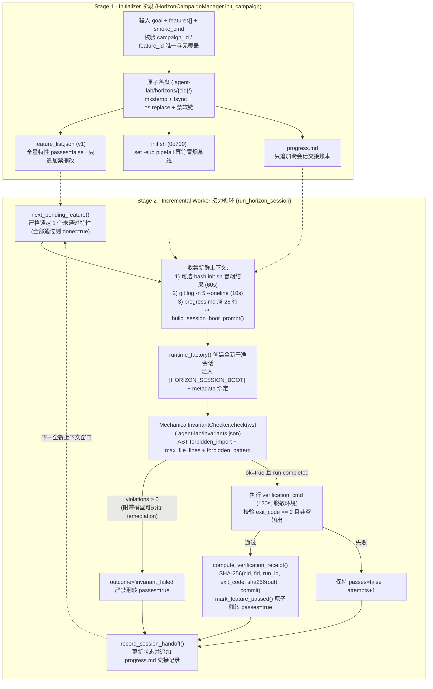

- **核心机制拆解**：
  1. **防删减账本与 SHA-256 验收收据（`horizon.py:L89-111, L294-493`）**：
     - `init_campaign()` 拒绝覆盖已存在的 `feature_list.json`；后续增量扩展仅开放 `append_feature()` 只追加新 ID，**不提供任何删除或修改既有特性 `description`/`verification_cmd` 的 API**。
     - `mark_feature_passed()` 强校验 `exit_code == 0` 且 `verification_output.strip()` 非空，调用 `compute_verification_receipt()` 将 `{campaign_id, feature_id, run_id, exit_code, output_sha256, commit_sha}` 规范化序列化后计算 SHA-256 存入 `receipt_sha256`，随 `passes=True`、`completed_run_id`、`attempts` 一并经 `_atomic_write_text()` 原子替换写盘。
  2. **干净窗口启动协议与 `progress.md` 有界交接（`horizon.py:L495-633`）**：
     - 每次 `run_horizon_session()` 通过 `runtime_factory()` 启动**全新无历史包袱的 Runtime 实例**（用完在 `finally` 中 `aclose()` 释放），并经 `build_session_boot_prompt()` 生成结构化 `[HORIZON_SESSION_BOOT]` 提示词：包含全局进度 `passed/total`、唯一锁定目标特性、严禁删弱测试的纪律条款、最近 5 条 `git log`（`<= 1000` 字符）、可选 `init.sh` 冒烟输出（`<= 600` 字符）与 `progress.md` 末尾 **28 行**。这样既消除跨会话上下文膨胀，又让新会话在首步就准确掌握前任留下的 Git 状态、失败原因与架构违规上下文。
  3. **OpenAI 风格 `MechanicalInvariantChecker`（`horizon.py:L119-271`）**：
     - 从 `<workspace>/.agent-lab/invariants.json` 加载声明式 `InvariantRule`（自动拒绝符号链接配置），安全遍历工作区（`followlinks=False`，跳过 `.git`/`.venv`/`node_modules`/`.agent-lab`、隐藏目录、软链接、敏感凭证段、含 `\x00` 二进制与 `> 2 MiB` 文件）。
     - 支持三类确定性机械规则：
       - `forbidden_import`（`L240-264`）：使用 Python 标准库 **`ast.parse` + `ast.walk`** 精确解析 `ast.Import` 与 `ast.ImportFrom`，匹配 `mod_name == prefix or mod_name.startswith(prefix + ".")` 并定位精确行号（彻底规避正则误报注释/字符串里的模块名，语法损坏文件安全跳过不崩溃）；
       - `max_file_lines`（`L214-226`）：硬守单文件行数上限，防止模型在长程迭代中把模块撑成难以编辑的巨型文件；
       - `forbidden_pattern`（`L227-239`）：逐行正则扫描禁令模式并报告精确 `path:line`。
     - 每条违规项结构化返回 `{rule_id, kind, path, line, message, remediation}`——其中 `remediation` 是面向模型的**可执行重构指南**，且在 `run_horizon_session()` 中充当硬门禁：只要 `not inv_report["ok"]`，哪怕模型声称任务完成，也会被判为 `outcome="invariant_failed"`、拒绝签发收据，并将违规状态写入 `progress.md` 交接给下一窗口修复。

- **设计权衡**：
  - *每特性全新上下文窗口 vs. 单会话 1M 超长上下文硬撑*：即使模型标称支持 1M Token，随着无关试错日志堆积，注意力召回精度仍显著衰减且单轮 Prefill 成本飙升；“单特性 + 新窗口 + `git log` + 尾 28 行 `progress.md`”强制把工作记忆控制在紧凑高信噪比区间，代价是跨特性隐性设计约定必须显式沉淀到代码注释、`progress.md` 或 `invariants.json` 中（反过来也提升了仓库的可维护性）。
  - *SHA-256 内容寻址收据的安全边界*：`compute_verification_receipt()` 提供了完整的防伪溯源与防静默打勾保障，配合 OS 沙箱禁止子进程写 `.agent-lab` 形成防线；但若在未启用沙箱的环境里，纯 SHA-256 哈希在理论上仍可能被有权限直接改写 `.agent-lab/horizons/` 的外部进程伪造。该权衡保持了零密钥管理和纯文件系统可读性，未来在 Batch 3/4 可无缝升级为“宿主独立 HMAC 密钥签章”或“写入受租约保护的 SQLite 账本”。
  - *`run_verification_cmd=False` 的默认参数取舍（`horizon.py:L583, L642-656`）*：默认关闭命令执行是为了让纯离线单测与无测试环境的编排回归能快速验证接力状态机；**在生产超长程自主开发中必须显式传入 `run_smoke=True, run_verification_cmd=True`**，确保 Harness 在模型上下文之外独立执行 `verification_cmd` 并以真实退出码 0 签发收据。
  - *AST `forbidden_import` 的相对导入边界*：当前基于 `ast.ImportFrom.module` 前缀匹配，对绝对导入（`import agent_lab.api` / `from agent_lab.api import app`）零误报且零外部依赖；对显式相对导入（`from ..api import app`，`node.level > 0`）需在后续按当前文件路径反推完整包名以补齐覆盖。

#### 3. 核心安全与性能不变量
1. **特性防删减与不可覆盖不变量**：`init_campaign` 拒绝覆写已有 `feature_list.json`；`append_feature` 仅支持按唯一新 ID 追加，杜绝删减需求或私改既有验收命令。
2. **真实退出码与收据签发不变量**：`mark_feature_passed` 严格拒绝 `exit_code != 0` 或空验证输出；`passes=True` 必伴随基于 `{campaign_id, feature_id, run_id, exit_code, output_sha256, commit_sha}` 计算的 `receipt_sha256`。
3. **架构护栏一票否决不变量**：`run_horizon_session` 仅在 `final_run.status == "completed"` **且** `inv_report["ok"] is True` **且** 验证退出码为 0 三重条件同时成立时翻转 `passes=True`；任何机械边界违规均阻断验收并保留 `remediation` 诊断。
4. **原子持久化与防符号链接逃逸不变量**：所有账本与脚本落盘均经 `_assert_no_symlink(target, stop_at=workspace)` 逐级校验，并通过同目录 `NamedTemporaryFile + flush + os.fsync + chmod + os.replace` 原子替换（`init.sh` 权限严格 `0o700`），避免断电半写文件与软链接劫持。
5. **脱敏子进程执行与有界上下文不变量**：`init.sh`（60s）、`git log`（10s）与 `verification_cmd`（120s）均在 `build_scrubbed_env()` 下运行；`build_session_boot_prompt` 对 `git log`（1000 字符）、冒烟输出（600 字符）和 `progress.md`（尾 28 行）严格限长，防止交接提示词随会话数线性失控。

#### 4. 源码定位索引

| 文件 | 关键符号 / 行号 | 职责说明 |
|---|---|---|
| [`src/agent_lab/horizon.py`](../src/agent_lab/horizon.py) | `HORIZON_SCHEMA_VERSION` / 正则校验与跳过目录 (`L42-45`)、`_assert_no_symlink` (`L52-60`)、`_atomic_write_text` (`L63-86`) | 标识符白名单校验、工作区边界防符号链接遍历与 `fsync + os.replace` 原子写盘 |
| [`src/agent_lab/horizon.py`](../src/agent_lab/horizon.py) | `compute_verification_receipt` (`L89-111`) | 规范化 JSON + 双层 SHA-256 验收收据生成 |
| [`src/agent_lab/horizon.py`](../src/agent_lab/horizon.py) | `InvariantRule` (`L119-127`)、`MechanicalInvariantChecker` (`L130-271`)：`from_workspace` (`L137-166`)、`check` (`L177-271`)、AST `forbidden_import` (`L240-264`) | OpenAI 风格机械化架构边界检查器（AST 导入分层、行数上限、禁用正则与模型可执行 `remediation`） |
| [`src/agent_lab/horizon.py`](../src/agent_lab/horizon.py) | `HorizonCampaignManager` (`L279-574`)：`init_campaign` (`L294-368`)、`append_feature` (`L415-445`)、`mark_feature_passed` (`L454-493`)、`record_session_handoff` (`L495-536`)、`build_session_boot_prompt` (`L538-574`) | Initializer 脚手架生成、只追加特性账本、防伪收据签发、交接日志追加与干净窗口启动提示构建 |
| [`src/agent_lab/horizon.py`](../src/agent_lab/horizon.py) | `run_horizon_session` (`L577-685`) | 单特性全新上下文窗口编排器（冒烟检查 → 新 Runtime 推进 → 机械边界 Lint → 验收签发 → 交接落盘） |
| [`src/agent_lab/host_tools.py`](../src/agent_lab/host_tools.py) / [`permissions.py`](../src/agent_lab/permissions.py) | `is_host_secret_segment` (`host_tools.py:L146-167`)、`build_scrubbed_env` (`permissions.py:L2473`) | 边界扫描自动跳过凭据文件/目录；冒烟与验收命令剥离宿主密钥环境变量 |

#### 5. 面试与复盘自检问题
1. **为什么跨多小时的复杂开发任务不能单靠“1M 上下文窗口 + 自动压缩”解决，而需要 Initializer + Incremental Worker 两阶段接力？**
   - *要点*：自动压缩本质是有损摘要，多轮压缩后极易丢失早期细粒度验收条款与前序特性回归基线；同时单窗口内失败的调试噪音会持续污染注意力。两阶段接力把“全局需求真源（不可删减 `feature_list.json`）”与“工作记忆（单特性干净上下文）”解耦，每个窗口只攻克一个原子特性并经 `init.sh` + `verification_cmd` 锚定真实代码状态，将长程漂移转化为有界单步推进。
2. **同样是检查“领域层不得依赖表现层”，为什么 `MechanicalInvariantChecker` 选择用 Python `ast.parse` 做 `forbidden_import` 检查，并且强制要求每条规则携带 `remediation`？**
   - *要点*：正则匹配 `import ...` 极易被注释、文档字符串、多行括号导入或字符串字面量干扰产生误报/漏报，而 `ast.parse` 零外部依赖即可获得精确语法树与行号；携带模型可执行的 `remediation`（而非冷冰冰的 `Error E402`）把人类架构师的隐性意图显式转化为模型可直接遵循的重构指令，使 Agent 在 `invariant_failed` 后能够自主收敛修复。
3. **`mark_feature_passed()` 的 SHA-256 验收收据防住了哪些作弊路径？在极端威胁模型下还有什么局限？**
   - *要点*：它防住了“模型口头宣称测试通过但 `exit_code != 0`”“跳过测试传空输出直接打勾”以及“事后篡改测试输出却声称对应同一验收记录”等常见 Agent 作弊路径；在 `HostKernelSandbox` 启用时子进程也无法写入 `.agent-lab/horizons/`。其局限在于无沙箱且不引入外部密钥时，纯 SHA-256 不具备抗本地特权伪造的密码学不可否认性（可在 Batch 3/4 叠加宿主独立 HMAC 密钥或服务端 SQLite 账本补齐）。
4. **为什么 `build_session_boot_prompt()` 只截取 `progress.md` 的末尾 28 行而非全量注入？**
   - *要点*：`progress.md` 是只追加账本，若一个 Campaign 跨越 50 个会话，全量注入会导致启动 Prompt 随会话数线性膨胀；配合 `feature_list.json` 的精确完成统计和 `git log -n 5`，仅注入最近数次交接记录（尾 28 行）既足以传递近期卡点、未解阻塞与架构告警，又保持每次会话的冷启 Token 预算恒定有界。

---

### 3.3 B2-3：Cursor 风格 Shadow Workspaces 写前投机性验证（`shadow_workspace.py` / `shadow_verify_edits`）

#### 1. 业界对标与痛点
- **业界对标**：**Cursor** *Shadow Workspaces*（在隐藏克隆工作区中后台预应用候选改动并运行 LSP/编译器诊断，验证通过后再呈现或落盘到用户活工作树）；Anthropic / OpenAI 写前推测性验证闭环。
- **工程痛点**：
  1. **直接改动活工作树的污染代价**：高风险多文件重构（同时修改类型定义、调用方与单测）若直接写入 `live_workspace`，一旦中间某步产生语法错误、符号引用断裂或单测失败，会立刻破坏用户正在编辑的活工作树、弄脏 `git status` 甚至阻塞并行开发者的 IDE 语言服务器。
  2. **朴素全量克隆既慢又极其危险**：直接 `shutil.copytree(live_workspace, tmp)` 会把动辄数 GB 的 `.git`、`node_modules`、`.venv` 全部复制一遍导致单次预检耗费数十秒；更致命的是，它会把工作区内的 `.env`、`*.pem`、`id_rsa`、`.npmrc` 等生产密钥或指向宿主机敏感文件的软/硬链接原封不动拷贝进临时目录，一旦后续在影子目录运行 LSP 插件或检查命令，就制造了严重的凭据暴露与逃逸面。
  3. **难以自证“活工作树确实毫发无损”**：如果克隆过程存在递归包含、硬链接共享 inode（修改影子文件顺带改写源文件！）或验证命令越权写回原目录，仅靠口头假设“我只改了临时目录”不足以构成强工程保证。

#### 2. 架构选型与权衡

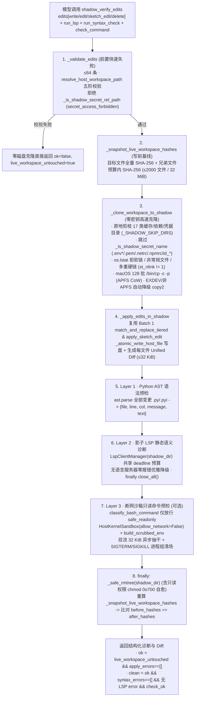

- **核心机制拆解**：
  1. **macOS APFS Copy-on-Write 批量克隆与透明降级（`shadow_workspace.py:L231-288, L453-532`）**：
     - 在 Darwin 平台检测到 `/bin/cp` 时，按目录每 `_SHADOW_CP_BATCH_SIZE = 128` 个安全常规文件聚合成单次 `/bin/cp -c -p -- <srcs...> <dst_dir>` 调用：底层触发 APFS `clonefile(2)`，实现**零数据块拷贝**且生成**完全独立的 inode**（在影子目录中写改或原子替换文件绝不回写源数据块），并把进程 fork 次数压缩 128 倍。
     - 一旦跨卷（`EXDEV`，例如工作区在外部卷而临时目录在系统卷）或目标文件系统不支持 CoW，`cp -c` 返回非零退出码后自动置 `use_apfs_cow = False`，对当前批次未落盘文件及后续全部目录无缝降级至 `_copy_regular_file_fallback()`（写前再次 `os.lstat` 验证非软链、常规文件且 `st_nlink == 1`，再调 `shutil.copy2(..., follow_symlinks=False)`）。
  2. **零密钥克隆与软硬链接绝对隔离（`shadow_workspace.py:L71-124, L468-507`）**：
     - 剪枝 17 类非源码或凭据隐藏目录（`.git`、`.hg`、`.svn`、`.venv`、`venv`、`node_modules`、`__pycache__`、`dist`、`build`、`.mypy_cache`、`.pytest_cache`、`.ruff_cache`、`.agent-lab`、`.ssh`、`.gnupg`、`.aws`、`.kube`）以及 `shadow_root`/`shadow_dir` 自身（防止 `shadow_base_dir` 配在工作区内引发无限递归克隆）。
     - `_is_shadow_secret_name()` 在复用 `is_host_secret_segment()`（拦截 `.env*`、`id_rsa*`、`id_ed25519*`、`*.pem`、`*.key`、`credentials*`、`secrets*` 等）基础上，进一步封杀 `.netrc`、`.pypirc`、`.npmrc`、`id_ecdsa*`、`id_dsa*`、`*.jks`、`*.keystore`。
     - 克隆前对每一项执行 `os.lstat` 拒斥符号链接（`S_ISLNK`）、非常规文件（FIFO/Socket/设备节点）及**多重硬链接（`st_nlink != 1`）**——这是防止“改影子文件通过共享 inode 反向改坏活文件或外部敏感文件”的关键防线。同时受总文件数 `20,000` 与单文件 `16 MiB` 双预算约束防止资源耗尽。
  3. **复用 Batch 1 编辑引擎 + 三层投机性预检闭环（`shadow_workspace.py:L731-990, L1068-1140`）**：
     - 影子内顺序支持 `write`、`edit`（直连 Batch 1 四级确定性模糊编辑 `match_and_replace_tiered`）、`sketch_edit`（直连 Batch 1 `apply_sketch_edit`）与 `delete`，所有路径在影子目录内再过一次 `resolve_host_workspace_path(shadow_dir, ...)`，生成每文件 Unified Diff（上限 32 KiB）。
     - 三层校验共享统一 `deadline`（1—60s，默认 15s）：① Python `ast.parse` 语法检查；② 临时 `LspClientManager(shadow_dir)` 静态语义诊断（按剩余时间均摊单文件预算 `<= 2.5s`，未装语言服务器静默降级，`finally` 强制 `close_all()`）；③ 可选 `check_command` 先过 `classify_bash_command()` 仅允许 `safe_readonly` 命令，再经 `HostKernelSandbox(..., allow_network=False)` + `build_scrubbed_env()` + 双流 32 KiB 异步排水 + 两阶段进程组回收执行，输出经 `redact_secrets()` 脱敏。
  4. **真实工作区零污染 SHA-256 守恒自证（`shadow_workspace.py:L150-228, L1055, L1126-1139`）**：
     - 克隆前与清理后各执行一次 `_snapshot_live_workspace_hashes()`：所有候选编辑路径无论仓库多大均强制流式 SHA-256（缺失记 `None`），其余常规文件在 `2000 文件 / 32 MiB` 预算内算内容 SHA-256（超预算退化为 `stat:{size}:{mtime_ns}`），前后全量等值比对输出确定性断言 `live_workspace_untouched`。

- **设计权衡**：
  - *APFS CoW 过滤克隆 vs. `git worktree` vs. 纯内存 VFS*：
    - `git worktree` 只能检出已提交快照，**会丢失用户工作区里尚未提交的脏改动**，还会修改 `.git/worktrees` 元数据且无法服务非 Git 目录；
    - 纯内存 VFS 无法直接驱动外部二进制工具（`ruff`、`pytest`、`pyright` LSP）而无需 FUSE 内核模块；
    - 过滤式 APFS CoW 克隆精确捕获活工作树当前真实未提交源码、零数据块拷贝、无缝运行真实 LSP 与沙箱命令且不依赖 Git。代价是在跨卷或无 reflink 的 Linux ext4 上会回退为 `shutil.copy2`（可通过将 `shadow_base_dir` 配置在同 APFS 卷上并受益于 17 类巨型目录剪枝来保持毫秒—亚秒级开销）。
  - *剪枝 `.venv` / `node_modules` 带来的速度与环境隔离权衡*：跳过虚拟环境与依赖树使影子克隆提速一到两个数量级并消除恶意包缓存干扰，但也意味着影子内运行的 `check_command` 与 LSP 依赖宿主当前环境 `PATH` / 解释器解析三方库，而非影子目录内自带独立 `.venv`（完整的依赖与内核级环境隔离留给 Batch 3 的 MicroVM 快照方案）。
  - *`ok` 与 `clean` 双布尔语义解耦*：`ok=True` 表示全部编辑已干净应用且活工作树零污染；`clean=True` 进一步要求零 AST 语法错误、零 LSP `severity="error"`（`severity_code==1`）诊断且 `check_command` 退出码为 0。双标志让上层模型清晰区分“补丁锚点失配（`ok=False`）”与“代码成功合入但存在类型/单测缺陷（`ok=True, clean=False`）”，从而在真正落盘前完成多轮影子内自修复。

#### 3. 核心安全与性能不变量
1. **零密钥克隆与路径拒斥不变量**：`_validate_edits` 拒绝以敏感凭证路径为目标的编辑（`secret_access_forbidden`）；`_clone_workspace_to_shadow` 跳过 17 类非源码/凭据目录及全部 `_is_shadow_secret_name` 命中的文件，确保任何 `.env`/私钥/令牌配置文件绝不进入影子区。
2. **软硬链接防穿透不变量**：克隆前逐项 `os.lstat` 拒绝符号链接、非常规文件与多重硬链接（`st_nlink != 1`）；影子内编辑复用 `resolve_host_workspace_path` 五阶路径校验与 `_atomic_write_host_file` 原子替换。
3. **活工作树零污染 SHA-256 守恒不变量**：无论应用报错、语法失败、LSP 崩溃、命令超时还是协程被取消，验证前后 `live_workspace` 快照严格满足 `before_hashes == after_hashes`（`live_workspace_untouched=True`）。
4. **只读命令准入与断网沙箱不变量**：`check_command` 仅允许 `classify_bash_command` 判定为 `safe_readonly` 的命令，且强制在 `HostKernelSandbox(allow_network=False)` + `build_scrubbed_env()` 中运行；非只读命令直接返回 `code="unsafe_check_command", sandbox="blocked"`。
5. **影子目录、LSP 与子进程组零泄漏不变量**：影子目录在 `finally` 中经 `_safe_rmtree`（含只读权限 `0o700` 自愈，兼容 Python 3.11/3.12+）无条件销毁；影子 `LspClientManager` 在内层 `finally` 调用 `close_all()`；校验命令进程组经 `_terminate_async_process_group`（`SIGTERM -> 0.4s -> SIGKILL`）与 `finally` 兜底 `SIGKILL` 彻底回收。

#### 4. 源码定位索引

| 文件 | 关键符号 / 行号 | 职责说明 |
|---|---|---|
| [`src/agent_lab/shadow_workspace.py`](../src/agent_lab/shadow_workspace.py) | `_SHADOW_SKIP_DIRS` (`L71-91`)、扩展密文表与配额常量 (`L94-108`)、`_is_shadow_secret_name` / `_is_shadow_secret_rel_path` (`L111-124`) | 17 类剪枝目录、额外凭据拦截清单（`.netrc`/`.pypirc`/`.npmrc`/`id_ecdsa*`/`*.jks`）与克隆/校验资源预算 |
| [`src/agent_lab/shadow_workspace.py`](../src/agent_lab/shadow_workspace.py) | `_safe_rmtree` (`L127-147`)、`_sha256_file` / `_snapshot_live_workspace_hashes` (`L150-228`) | 只读权限自愈目录清理器与写前/写后真实工作区 SHA-256 守恒快照 |
| [`src/agent_lab/shadow_workspace.py`](../src/agent_lab/shadow_workspace.py) | `_copy_regular_file_fallback` (`L231-245`)、`_copy_file_batch` (`L248-288`)、`_drain_async_stream` / `_terminate_async_process_group` (`L302-340`) | Darwin APFS `cp -c -p` 128 批 CoW 克隆与透明降级、32 KiB 防死锁流排水及进程组回收 |
| [`src/agent_lab/shadow_workspace.py`](../src/agent_lab/shadow_workspace.py) | `_check_python_syntax` (`L343-371`)、`_build_unified_diff` (`L374-396`) | Python `ast.parse` 语法诊断与 32 KiB 有界 Unified Diff 生成 |
| [`src/agent_lab/shadow_workspace.py`](../src/agent_lab/shadow_workspace.py) | `ShadowWorkspaceManager` (`L399-1151`)：`_clone_workspace_to_shadow` (`L425-532`)、`_validate_edits` (`L535-728`)、`_apply_edits_in_shadow` (`L731-870`)、`_run_shadow_check_command` (`L872-990`)、`verify_speculative_edits` (`L992-1151`) | 8 步写前投机性验证主引擎：校验 → 快照 → 零密钥克隆 → 试应用 → AST + LSP + 断网沙箱命令 → 销毁与守恒核验 |
| [`src/agent_lab/shadow_workspace.py`](../src/agent_lab/shadow_workspace.py) | `DEFAULT_SHADOW_WORKSPACE_MANAGER` / `execute_shadow_verify_edits` (`L1154-1176`)、`SHADOW_TOOL_SPECS` (`L1183-1276`) | 工具执行入口与 `shadow_verify_edits` Draft 2020-12 Schema |
| [`src/agent_lab/host_tools.py`](../src/agent_lab/host_tools.py) / [`lsp_client.py`](../src/agent_lab/lsp_client.py) / [`permissions.py`](../src/agent_lab/permissions.py) | `resolve_host_workspace_path` (`host_tools.py:L170`)、`match_and_replace_tiered` (`host_tools.py:L856-947`)、`apply_sketch_edit` (`host_tools.py:L950-1037`)、`HostKernelSandbox` (`host_tools.py:L1437-1668`)、`LspClientManager` (`lsp_client.py:L597, L687, L875`)、`classify_bash_command` (`permissions.py:L1144`) | 五阶路径防线、四级编辑与草图拼接、OS 断网沙箱、影子 LSP 诊断与只读命令准入分类 |

#### 5. 面试与复盘自检问题
1. **为什么 `_clone_workspace_to_shadow()` 除了拒绝符号链接外，还必须检查 `st.st_nlink != 1` 拒绝多重硬链接？APFS `cp -c` 克隆后的文件如果被修改，会不会影响活工作树？**
   - *要点*：硬链接不是符号链接（`S_ISLNK` 为 `False`），但两个目录项共享同一底层 inode——若工作区里藏着指向外部敏感文件（如 `/etc/...` 或私有密钥）的硬链接，放行克隆会暴露敏感数据，且在就地修改场景下共享 inode 极易产生意外联动。而 APFS `cp -c` 使用的是 Copy-on-Write `clonefile(2)` 语义：源与副本最初共享物理磁盘数据块以实现近零耗时与零额外空间占用，但拥有**完全独立的 inode**，一旦影子侧发生写入（且叠加 `_atomic_write_host_file` 的新文件原子替换），内核会按块写时分裂，绝不污染 `live_workspace` 原始数据块。
2. **为什么影子工作区没有直接基于 `git worktree` 实现，而是采用过滤式 APFS CoW 目录克隆？**
   - *要点*：`git worktree` 只能检出 Git 历史中的某个 Commit，无法包含用户活工作树中尚未暂存/提交的半成品修改（恰恰是编码 Agent 连续多轮改代码时的常态），同时要求仓库必须是合法 Git 仓库并会改写 `.git/worktrees` 状态；过滤式 APFS CoW 克隆精确镜像当前活源码状态、自动剔除 `.git` 和 `.env` 密钥、不依赖 Git 且在 macOS 同卷上具备近瞬时开销。
3. **如果 `shadow_base_dir` 被误配置在 `live_workspace` 内部（例如 `<ws>/.tmp-shadow`），`_clone_workspace_to_shadow()` 会发生无限递归把磁盘撑爆吗？**
   - *要点*：不会。遍历目录时（`shadow_workspace.py:L480-483`）会解析候选子目录并显式跳过 `cand_resolved in (shadow_root_resolved, shadow_dir)`，同时 `_SHADOW_MAX_CLONE_FILES = 20_000` 与 `_SHADOW_MAX_CLONE_FILE_BYTES = 16 MiB` 构成二级硬预算保护。
4. **既然 `shadow_verify_edits` 已经在隔离影子目录里执行，为什么 `_run_shadow_check_command()` 仍然坚持 `classify_bash_command() == "safe_readonly"` 和 `HostKernelSandbox(allow_network=False)`？**
   - *要点*：影子目录只是文件系统层面的源码隔离，并不等于进程级内核隔离——如果不限制命令类型与出网能力，恶意或被提示词注入的 `check_command` 仍可直接访问宿主机其他目录（甚至反向改写 `live_workspace`）、读取 `~/.ssh`/`~/.aws` 或通过 `curl` 将仓库源码外传。叠加 `safe_readonly` 分类准入 + `HostKernelSandbox(allow_network=False)` + `build_scrubbed_env()` + 事后 SHA-256 守恒核验，才构成完整的纵深防御闭环。

---

## 四、Batch 3 深度设计复盘（✅ 已落地）

Batch 3 围绕**“查得准（跨术语语义索引）、看得见（结构化 ARIA 浏览器感知）、连得通（MCP 2025/2026 双向回调与 A2A 流式/Webhook/索引）”**三大工程支柱，补齐了大型代码仓探索、Web 应用闭环验证与开放多智能体协议互操作的核心底座，交付 [`src/agent_lab/code_index.py`](../src/agent_lab/code_index.py)、[`src/agent_lab/browser.py`](../src/agent_lab/browser.py) 以及 [`src/agent_lab/mcp_client.py`](../src/agent_lab/mcp_client.py)、[`src/agent_lab/a2a.py`](../src/agent_lab/a2a.py)、[`src/agent_lab/storage.py`](../src/agent_lab/storage.py)（Schema Migration #7）、[`src/agent_lab/api.py`](../src/agent_lab/api.py) 的前沿协议增强，并由离线确定性回归套件 [`tests/test_batch3_merkle_browser_protocols.py`](../tests/test_batch3_merkle_browser_protocols.py)（11 组测试函数 / 28 项参数化用例）全面守卫核心安全与功能不变量。

---

### 4.1 B3-1（3.1）：持久化 Merkle-Tree 增量语义代码索引（`code_index.py` / `codebase_semantic_search`）

#### 1. 业界对标与痛点
- **业界对标**：**Cursor** *Merkle-Tree Incremental Codebase Indexing*（利用目录级 Merkle 哈希树做增量差分同步、按语法结构切块并结合持久化向量做语义代码检索）。
- **工程痛点**：
  1. **纯字面 `fs_grep` 的“词面鸿沟”**：当用户问“结算周期按天折算金额与税率明细在哪计算”而代码里写的是 `calculate_prorated_invoice` 与 `TaxLedger.compute_vat_breakdown` 时，纯正则搜索极易漏召或返回海量噪声行；而若把整仓塞进上下文，又会迅速击穿 Token 与 KV Cache 预算。
  2. **冷启全量重算成本不可接受**：无持久化的内存索引在 CLI 退出、Worker 重启或切换会话后必须从头读取数千文件、重新 AST 切块并批量重算 Embedding 向量，导致大中型仓库每次首查出现数秒至数十秒卡顿。
  3. **代码库索引本身的安全泄露面**：若索引器盲目扫描整个工作区，`.env`、`secrets.json`、`*.pem`、`id_ed25519`、`.netrc` 或指向仓外敏感文件的符号链接/硬链接一旦进入 SQLite 向量库，就会在后续语义检索中被静默召回并泄露至模型上下文。

#### 2. 架构选型与权衡

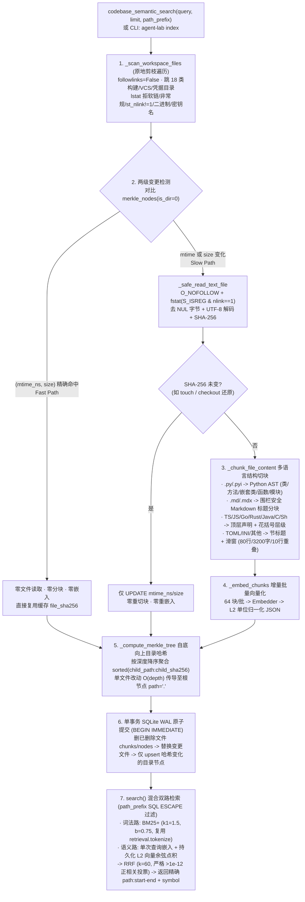

- **核心机制拆解**：
  1. **两级增量快路径与自底向上 Merkle 树（`code_index.py:L808-857, L1052-1224`）**：
     - 索引状态按 `_compute_project_slug(workspace.resolve())`（可读目录名 + 12 位绝对路径 SHA-256 指纹）隔离持久化于 `<state_dir>/indexes/<project_slug>/code_index.sqlite`，启用 `PRAGMA journal_mode=WAL; synchronous=NORMAL; busy_timeout=5000;` 支持并发读与崩溃一致性。
     - `refresh()` 首选 `(mtime_ns, size)` 内存字典比对——命中即走 **Fast Path**，既不 `open()` 读盘也不触发切块和 Embedding；若 `mtime` 改变（如 `touch` 或 `git checkout` 切回原内容），慢路径以 `O_NOFOLLOW + fstat` 安全读取后计算 SHA-256，若哈希未变仍降级为 `meta_only_updates`（零重切块、零嵌入调用）。
     - `_compute_merkle_tree()` 仅依赖相对 POSIX 路径与内容 SHA-256，按目录深度从深到浅对每个目录的直接子节点按路径字典序拼接 `f"{child_path}:{child_sha}"` 计算 SHA-256，向上逐层归约至根 `"."`。因此内容完全一致的两份代码树无论挂载在何种绝对路径下都生成 100% 相同的 `root_hash`，且单文件增删改沿祖先链 $O(\text{depth})$ 传导至根；落盘时仅对 `stored_dirs.get(d_path) != d_hash` 的变化目录执行 `UPSERT`。
  2. **四轨语言感知结构化分块（`code_index.py:L367-800`）**：
     - **Python（`.py` / `.pyi`）**：优先使用标准库 `ast.parse`（零外部依赖），提取装饰器起始行至 `end_lineno` 的精确 1-based 行区间；对类拆分出类声明头、成员方法（`ClassName.method`）与递归嵌套类（`Outer.Inner`），对顶层连续非定义语句聚合成 `module` 块；遇到语法损坏的半成品文件时优雅回退至多语言语法块切分器而不崩溃。
     - **Markdown（`.md` / `.mdx` / `.markdown`）**：复用 `retrieval._tag_fenced_lines()` 识别围栏代码块，彻底跳过代码块内部的 `# comment` 伪标题。
     - **TS/JS/Go/Rust/Java/C-like/Shell**：`_match_non_py_declaration()` 识别 9 类顶层声明锚点（含 TS `export interface/class/function`/箭头函数、Go 接收者方法 `func (r *Recv) Name(`、Rust/Java/Kotlin/Swift `fn/struct/trait/impl/record` 等），并经 `_strip_line_comments_and_strings()` 剥离注释与字符串字面量后精准追踪花括号深度 `brace_depth`，在声明块闭合时切分；超长块由 `_window_line_span()` 按 80 行 / 3200 字符 / 10 行重叠切窗并裁剪首尾空行，保持每块精确行号。
  3. **BM25+ 与持久化稠密余弦的 RRF 混合检索（`code_index.py:L1252-1422`）**：
     - 索引时向每块注入轻量结构前缀 `"{path} | {kind} {symbol}\n{content}"`（仅用于向量化与分词，不修改落盘源码正文），显著提升按路径/符号检索的召回率；默认复用 `build_default_embedder()`（无远端模型时自动回退至零依赖 `LocalSubwordDenseEmbedder(dim=128)`，支持外部注入任意 `Embedder`）。
     - 查询时仅推理 **1 次**查询向量，与 SQLite 持久化 L2 归一化向量直接点积得余弦相似度；词法侧复用 `retrieval.tokenize()`（支持驼峰、蛇形、数字及汉字子词）计算非负 BM25+（$k_1=1.5, b=0.75$）；两路各自过滤严格正相关候选（`score > 1e-12`）后按 $1 / (60 + \text{rank})$ 执行 RRF 融合并以 `chunk_id` 字典序破平，确保结果确定性可复现。

- **设计权衡**：
  - *SQLite 单文件 JSON 向量扫描 vs. 外部向量数据库（Qdrant / pgvector / sqlite-vec）*：在中小至中型仓库（`max_files=4000`、约 $10^3\text{—}10^4$ 个代码块）下，单文件 SQLite WAL 零额外运维进程、跨 macOS/Linux 零原生扩展编译依赖，在几十毫秒内即可完成全表或 `path_prefix` 剪枝后的点积与 BM25+；代价是超十万块级别的超大 Monorepo 需要后续引入 ANN 倒排/HNSW（如 `sqlite-vec` 或 `pgvector`）降低线性扫描延迟。
  - *`codebase_semantic_search` 在 `runtime.py` 与 `permissions.py` 中的治理定位*：归入 `READONLY_HOST_TOOLS`（`permissions.py:L1257`），因此在 `plan` / `ask` / `auto-edit` / `full-auto` 四档下均可默认免审使用，支持 `CodeIndex(...)` / `codebase_semantic_search(...)` 声明式规则治理，且同时向 `explorer` / `researcher` 只读子 Agent 与 CLI `agent-lab index` 命令开放（`runtime.py:L1989, L4877, L7656`，`cli.py:L1291-1340`）。
  - *本地子词稠密嵌入 vs. 云端代码嵌入 API*：默认零网络离线回退保证了测试确定性与隐私代码零外泄；生产环境通过环境变量配置 `build_default_embedder()` 切换高维语义嵌入模型时，只需清空对应 `<project_slug>/code_index.sqlite` 重建即可升级语义召回精度（查询时维度不等的旧向量会被安全跳过 `len(d_vec) == q_dim`）。

#### 3. 核心安全与性能不变量
1. **零密钥、零软硬链与零二进制逃逸不变量**：`_scan_workspace_files()` 强制 `followlinks=False`，原地剪枝 18 类构建/VCS/凭据目录（`_SKIP_DIR_NAMES`），拦截 `is_host_secret_segment()` 及 `.netrc`/`.pypirc`/`.npmrc`/`id_ecdsa*`/`id_dsa*`/`*.jks`/`*.keystore`，经 `os.lstat` 拒绝符号链接、非常规文件、多重硬链接（`st_nlink != 1`）与超大文件（默认 `512 KiB`）；慢路径读取进一步用 `O_NOFOLLOW` + `fstat` 封堵 TOCTOU 竞态并丢弃前 8 KiB 含 `\x00` 的二进制与非 UTF-8 文件。
2. **索引数据库路径防符号链接劫持不变量**：`_ensure_safe_db_paths()` 在每次打开 SQLite 连接前自顶向下逐段校验 `state_dir`、`indexes`、`<project_slug>`、`code_index.sqlite` 及其 `-wal`/`-shm`/`-journal` 伴生文件均非符号链接且严格受限于 `state_dir` 内部。
3. **快路径零重复嵌入与单事务原子性不变量**：未变更文件经 `(mtime_ns, size)` 快路径或相同 SHA-256 校验跳过分块与 `embedder` 调用；删旧、更元数据、插新分块与目录 Merkle 节点更新全部包裹在单次 `BEGIN IMMEDIATE ... COMMIT`（异常 `ROLLBACK`）内完成，且由 `threading.RLock()` 串行保护实例并发访问。
4. **安全路径前缀与确定性排序不变量**：`_normalize_path_prefix()` 拒绝绝对路径与 `..` 穿越，SQL `LIKE` 使用显式 `ESCAPE '\'` 转义 `%`/`_`/`\`；RRF 融合仅接纳严格正分候选（`> 1e-12`），绝不以零分噪声凑满 `limit`。

#### 4. 源码定位索引

| 文件 | 关键符号 / 行号 | 职责说明 |
|---|---|---|
| [`src/agent_lab/code_index.py`](../src/agent_lab/code_index.py) | `_SKIP_DIR_NAMES` / 扩展密钥与二进制集合 (`L64-187`)、`CODE_INDEX_TOOL_SPECS` (`L190-225`) | 18 类剪枝目录、50+ 二进制后缀、分块/RRF 常量与 `codebase_semantic_search` Draft 2020-12 Schema |
| [`src/agent_lab/code_index.py`](../src/agent_lab/code_index.py) | `_is_secret_segment` (`L250-261`)、`_compute_project_slug` (`L264-271`)、`_ensure_safe_subpath` (`L274-295`)、`_safe_read_text_file` (`L298-331`) | 凭证文件名防线、确定性项目标识、防软链逐段校验与 `O_NOFOLLOW + fstat` 防 TOCTOU 读取 |
| [`src/agent_lab/code_index.py`](../src/agent_lab/code_index.py) | `_window_line_span` (`L367-408`)、`_chunk_python_class` / `_chunk_python_source` (`L430-533`)、`_chunk_markdown_source` (`L536-573`)、`_chunk_code_block_source` (`L687-742`)、`_chunk_file_content` (`L788-800`) | Python AST、围栏安全 Markdown、多语言顶层声明/花括号块与通用滑窗四轨分块引擎 |
| [`src/agent_lab/code_index.py`](../src/agent_lab/code_index.py) | `_compute_merkle_tree` (`L808-857`)、`CodebaseMerkleIndex` (`L865-1441`)：`_init_schema` (`L942-977`)、`_scan_workspace_files` (`L979-1030`)、`refresh` (`L1052-1224`)、`search` (`L1252-1422`)、`execute_codebase_semantic_search` (`L1444-1453`) | 自底向上目录 Merkle 哈希、SQLite WAL 双表、增量快路径刷新、BM25+ + Dense 余弦 RRF 融合与工具适配器 |
| [`src/agent_lab/retrieval.py`](../src/agent_lab/retrieval.py) / [`host_tools.py`](../src/agent_lab/host_tools.py) | `tokenize` (`retrieval.py:L112`)、`_normalize_dense` (`L221`)、`LocalSubwordDenseEmbedder` (`L613`)、`build_default_embedder` (`L978`)、`is_host_secret_segment` (`host_tools.py:L146-167`) | 代码感知分词、L2 归一化、离线子词稠密嵌入器与统一凭据段黑名单 |
| [`src/agent_lab/permissions.py`](../src/agent_lab/permissions.py) / [`runtime.py`](../src/agent_lab/runtime.py) / [`cli.py`](../src/agent_lab/cli.py) | `READONLY_HOST_TOOLS` (`permissions.py:L1257`)、规则别名 `codeindex` (`L1538-1539`)、`_get_code_index` (`runtime.py:L1627-1640`)、分发 (`L3961-4035`)、`_run_index_command` (`cli.py:L1291-1340`) | 只读免审权限绑定、每工作区懒加载索引实例、子 Agent 授权与 `agent-lab index` CLI 入口 |

#### 5. 面试与复盘自检问题
1. **为什么 `CodebaseMerkleIndex.refresh()` 同时需要 `(mtime_ns, size)` 快路径、文件 `SHA-256` 校验与自底向上目录 Merkle 树，三者各自解决什么问题？**
   - *要点*：`(mtime_ns, size)` 快路径免去了对数千未变文件的磁盘读取；内容 `SHA-256` 在 `touch` 或 `git checkout` 仅改变时间戳但字节未变时避免无效 AST 切块与昂贵的 Embedding 推理；自底向上目录 Merkle 哈希使任意子树变更 $O(\text{depth})$ 汇聚到单一 `root_hash`，为跨进程快照一致性校验、增量差分同步与未来的分布式缓存共享提供密码学指纹。
2. **如果攻击者在索引目录里把 `code_index.sqlite-wal` 替换成指向 `/etc/crontab` 或宿主机其他文件的符号链接，`code_index.py` 如何防御？**
   - *要点*：每次 `_connect()` 前均调用 `_ensure_safe_db_paths()`，不仅逐段校验 `state_dir / indexes / <slug> / code_index.sqlite`，还显式对 `-wal`、`-shm`、`-journal` 三个 SQLite 伴生路径调用 `_ensure_safe_subpath()`，任何软链或越界解析立即抛 `ValueError` 拒绝打开数据库。
3. **为什么 `_chunk_markdown_source` 要复用 `_tag_fenced_lines()`，而 `_chunk_code_block_source` 要先运行 `_strip_line_comments_and_strings()`？**
   - *要点*：Markdown 文档里大量 Shell/Python 代码块包含 `# 注释`，不追踪围栏状态会将其误切成虚假章节标题；同理，TS/Go/Rust 字符串字面量或注释中的 `{`/`}` 会破坏花括号配对深度，导致函数切分错位或吞并后续多个声明。
4. **为什么在 RRF 融合阶段过滤 `sc > 1e-12` 再按排名计算 $1/(60+\text{rank})$，而不是对全量分块排序？**
   - *要点*：如果把 BM25=0 或余弦 $\le 0$ 的无关分块也排进 RRF 名次，哪怕查询词在仓库里完全不存在（例如查询被排除的 `.env` 密钥），每个分块也会拿到非零的 $1/(60+\text{rank})$ 融合分，导致空命中查询错误返回一屏无关代码干扰模型判断。

---

### 4.2 B3-2（3.2）：Headless Playwright ARIA 无障碍快照浏览器层（`browser.py`）

#### 1. 业界对标与痛点
- **业界对标**：**Microsoft Playwright MCP** / **Foundry Browser Automation**（以结构化 ARIA Accessibility Tree 短引用 `e1`/`e2`/… 替代盲目像素点击，叠加严格导航 SSRF 护栏与控制台/网络可观测性）。
- **工程痛点——为什么 ARIA Ref 快照全面优于纯桌面像素坐标（对比 `computer.py`）**：

| 对比维度 | 纯桌面像素操控（`computer.py`） | Headless ARIA 快照浏览器层（`browser.py`） |
|---|---|---|
| **定位稳定性** | 依赖绝对像素 `(x, y)`，受 DPI 缩放、窗口尺寸、响应式布局与滚动偏移影响极度脆弱 | 为可见交互节点分配确定性语义引用 `[e1] heading / [e2] textbox / [e3] button`，通过 `data-a11y-ref` 精准定位，与分辨率解耦 |
| **Token 与延迟成本** | 每步必须上传高分辨率整屏截图触发多模态视觉推理，单次操作消耗数千图像 Token | `browser_snapshot` 输出紧凑纯文本树（上限 `8000` 字符，单屏仅数百 Token），文本推理极快且仅在视觉排版验收时按需 `browser_screenshot` |
| **前端排障可观测性** | 屏幕像素上看不到隐藏的 JS `TypeError`、未捕获 Promise 异常或后台 `4xx/5xx` API 状态码 | 原生订阅页面 `console` 与 `response` 事件，模型可直接调用 `browser_console_logs` 与网络记录精准定位前端根因 |
| **跨平台与 CI 友好度** | 需要真实 macOS/X11 图形会话与辅助功能/录屏权限，无头 Linux 容器与 CI 难以稳定运行 | Headless Chromium 原生无头运行；叠加零依赖 `MockBrowserBackend` 使全链路交互与安全单测在离线 CI 中毫秒级确定性通过 |
| **互补边界** | 仍不可替代地覆盖非 Web 桌面原生应用（IDE、系统弹窗、跨窗口拖拽） | 专注 Web 应用端到端验收、表单回归与前端缺陷诊断，与 `computer.py` 形成能力互补 |

#### 2. 架构选型与权衡

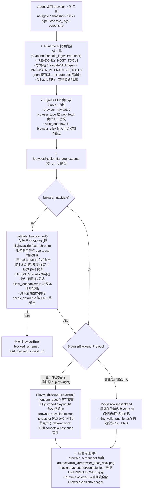

- **核心机制拆解**：
  1. **纵深 URL SSRF / IMDS / 协议拦截护栏（`browser.py:L32-123`）**：
     - `validate_browser_url()` 对导航目标实施六阶强校验：① 非空与控制字符检查（拒 `\r`/`\n`/`\x00`）；② 协议白名单仅允许 `http`/`https`，严厉拦截 `file://`、`javascript:`、`data:`、`chrome://` 等高危 Scheme（`code="blocked_scheme"`）；③ 拒绝 URL 内嵌 `username:password` 凭据；④ 拒绝 6 类云元数据主机（`metadata.google.internal`、`metadata.goog`、`metadata`、`instance-data`、`metadata.azure.internal`、`metadata.aws.internal`）；⑤ `_is_blocked_browser_ip()` 不仅拦截 `is_link_local`（含 `169.254.169.254`）、`is_private`（RFC 1918）、`is_unspecified`、`is_multicast`、`is_reserved`，还递归解包 **IPv6 `ipv4_mapped`（如 `[::ffff:169.254.169.254]` / `[::ffff:10.0.0.1]`）、`sixtofour` 与 `teredo`** 彻底封堵 IPv6 封装绕过；⑥ 回环地址（`127.0.0.1`、`[::1]`、`localhost`、`*.localhost`）默认拦截，仅当调用显式传 `allow_loopback=True` 或设置 `AGENT_LAB_BROWSER_ALLOW_LOOPBACK=1` 时放行本地开发服务——**且即便开启 `allow_loopback=True`，IMDS 与 RFC 1918 私网依然铁板拦截**。
     - 当后端不是 `MockBrowserBackend` 时，`BrowserSessionManager` 自动传 `check_dns=True`（`browser.py:L391`）做 `socket.getaddrinfo` 解析校验，阻断解析至内网或 IMDS IP 的恶意域名。
  2. **`BrowserBackend` 协议抽象、`PlaywrightBrowserBackend` 惰性加载与 `MockBrowserBackend`（`browser.py:L136-366`）**：
     - 核心模块顶层零 `playwright` 导入——`PlaywrightBrowserBackend._ensure_page()` 仅在首次真正执行页面操作时才执行 `from playwright.async_api import async_playwright`；未安装可选依赖时返回结构化 `BrowserUnavailableError(code="browser_unavailable")` 及明确安装提示，完全不影响纯文本编码 Agent 的冷启动与基础依赖体积。
     - `snapshot()` 在页面内查询可见交互与标题节点（`a, button, input, textarea, select, [role="button"|"link"|"textbox"], h1..h3`，跳过 `width==0 && height==0` 隐藏元素，上限 200 节点），按顺序打标 `data-a11y-ref="e1"` 并缓存 `_ref_selectors["e1"] = '[data-a11y-ref="e1"]'`，同时兼容外部直接传入 CSS 选择器。
     - `MockBrowserBackend` 维护确定性内存页面字典、ARIA 节点、点击计数、`href` 跳转、输入值变更、`console` / `network` 日志以及 `_tiny_valid_png_bytes()` 纯标准库（`struct + zlib`）生成的 1×1 合法 PNG 字节流，使单测与 CI 无需启动 Chromium 即可在百毫秒内完成端到端验证。
  3. **与 Batch 1 权限、Plan Mode、Egress DLP 及 CaMeL 污点体系的无缝咬合（`permissions.py:L1258-1273, L2314-2319, L2503-2516`，`runtime.py:L1095-1166, L7102-7280, L8487-8503`）**：
     - 读观测工具（`browser_snapshot`、`browser_console_logs`、`browser_screenshot`）归属 `READONLY_HOST_TOOLS`；交互导航工具（`browser_navigate`、`browser_click`、`browser_type`）归属 `BROWSER_INTERACTIVE_TOOLS`——`plan` 模式硬拒绝、`ask`/`auto-edit` 走审批提案（支持按主机粒度的 `browser_navigate(example.com)` 会话授权建议）、`full-auto` 自动放行，且 `PermissionRuleEngine` 显式 `deny` 规则不可被钩子或审批绕过。
     - `browser_navigate` 与 `browser_type` 被接入 Egress DLP（按 `web_fetch` 出站汇检查密文外泄，防向表单键入或 URL 偷渡密钥）；`browser_navigate`、`browser_snapshot`、`browser_console_logs` 执行后均被 `_record_untrusted_provenance()` 标记为 `DataProvenance.UNTRUSTED_WEB` 污点，令页面里的间接提示词注入在 `strict_dataflow=True` 下无法劫持后续敏感动作。

- **设计权衡**：
  - *`data-a11y-ref` DOM 属性注入 vs. 原生 CDP Accessibility Tree*：通过 `page.evaluate` 遍历可见交互元素并写入 `data-a11y-ref` 的实现轻量、跨 Playwright 版本稳定且直接支持 `page.locator('[data-a11y-ref="e3"]').first` 复用 Playwright 的自动等待与可操作性检查；代价是无法直接穿透封闭 Shadow DOM 或跨域 `iframe`，且在单页应用 DOM 重渲染后需要重新调用 `browser_snapshot` 刷新 `ref` 映射。
  - *预导航 `validate_browser_url` + `check_dns` 的 SSRF 边界*：当前在 `page.goto()` 前拦截初始 URL 与 DNS 解析，已覆盖绝大多数直接 SSRF 与 IPv6 封装绕过；在面对“公网域名返回 302 重定向到 `169.254.169.254` 或子资源 ``/`fetch()` 发起内网探测”等高级攻击面时，未来可在 `PlaywrightBrowserBackend._ensure_page()` 中挂载 `page.route("**/*", ...)` 对每次跳转与子请求二次执行 `validate_browser_url` 实现全链路请求拦截。
  - *默认按需开启（`_browser_enabled`）与资源生命周期*：仅在 `computer` 档案、显式传 `enable_browser=True` 或注入 `browser_backend` 时向模型挂载 `BROWSER_TOOL_SPECS`，避免在纯后端代码任务中白占工具 Schema Token；同时 `AgentRuntime.aclose()` 对 `_browser_managers` 按后端对象 `id()` 去重逐一调用 `aclose()`，防止残留僵尸 Chromium 进程。

#### 3. 核心安全与性能不变量
1. **协议与云元数据零例外拦截不变量**：`validate_browser_url()` 永远只允许 `http://` 与 `https://`，永远阻断 6 类云 IMDS 主机、链路本地、私网（含 IPv6 映射/6to4/Teredo）、控制字符与内嵌凭据；`allow_loopback=True` 仅解锁回环地址，绝不放宽 IMDS 或 RFC 1918 私网。
2. **工具面权限分层与 Egress/CaMeL 防线不变量**：交互式浏览器工具受 `plan_mode_readonly` 硬拦截与 `verify_epoch` fencing 守卫；`browser_navigate` / `browser_type` 强制过 Egress DLP 密文扫描；页面回读内容一律标记 `UNTRUSTED_WEB` 污点。
3. **快照有界与截图安全落盘不变量**：`snapshot()` 节点数封顶 `200`、文本树硬截断至 `8000` 字符防撑爆上下文；`browser_screenshot` 顺序落盘为 `<artifacts_dir>/<run_id>/browser_shot_NNN.png`，仅在工具返回体中附带前 256 字节的 `base64_preview` 而非数 MB 整图 Base64。
4. **惰性依赖与进程零泄漏不变量**：未调用真实浏览器时绝不导入 `playwright`；会话关闭时 `PlaywrightBrowserBackend.aclose()` 按 `context -> browser -> playwright` 严格逆序释放。

#### 4. 源码定位索引

| 文件 | 关键符号 / 行号 | 职责说明 |
|---|---|---|
| [`src/agent_lab/browser.py`](../src/agent_lab/browser.py) | `_BLOCKED_METADATA_HOSTS` / `_MAX_SNAPSHOT_CHARS` (`L32-42`)、`BrowserError` / `BrowserUnavailableError` (`L45-53`)、`_is_blocked_browser_ip` (`L56-74`)、`validate_browser_url` (`L77-123`) | 云元数据黑名单、IPv6 封装解包、协议/私网/回环/DNS SSRF 防护核心 |
| [`src/agent_lab/browser.py`](../src/agent_lab/browser.py) | `_tiny_valid_png_bytes` (`L126-133`)、`BrowserBackend` (`L136-144`)、`MockBrowserBackend` (`L147-236`) | 统一异步浏览器协议接口与零依赖离线确定性测试后端（含纯标准库合法 PNG 生成） |
| [`src/agent_lab/browser.py`](../src/agent_lab/browser.py) | `PlaywrightBrowserBackend` (`L239-366`)：`_ensure_page` (`L252-275`)、`snapshot` (`L282-323`)、`click` / `type_text` (`L328-341`)、`aclose` (`L356-366`) | Playwright 惰性导入、可见节点 `data-a11y-ref` 绑定、Console/Response 采集与资源释放 |
| [`src/agent_lab/browser.py`](../src/agent_lab/browser.py) | `BrowserSessionManager` (`L369-434`)、`BROWSER_TOOL_SPECS` (`L437-511`) | 会话级统一导航安全校验、截图落盘、`BrowserError` 结构化捕获与 6 工具 Schema |
| [`src/agent_lab/permissions.py`](../src/agent_lab/permissions.py) / [`runtime.py`](../src/agent_lab/runtime.py) | `BROWSER_INTERACTIVE_TOOLS` (`permissions.py:L1272`)、规则别名 `browser` (`L1540-1555`)、Plan 拒斥 (`L2314-2319`)、四档矩阵 (`L2503-2516`)；Egress DLP & 污点 (`runtime.py:L1095-1166`)、`_browser_enabled` / `_get_browser_manager` (`L1642-1661`)、`_invoke_browser_tool` (`L7102-7279`)、`aclose` (`L8487-8503`) | 四级权限治理、按域名会话授权建议、出站密文审查、网页污点登记与多会话管理器回收 |

#### 5. 面试与复盘自检问题
1. **为什么在已有 `computer.py` 桌面鼠标/键盘/截屏能力的情况下，仍要为 Web 验收单独构建基于 ARIA Snapshot 的 `browser.py`？**
   - *要点*：Web 页面验证最需要的是**语义级稳定定位（`ref` 不怕窗口缩放和滚动）**、**低 Token 文本观测（百级 Token ARIA 树 vs. 数千 Token 整屏图）**以及**DOM 之外的 Console 错误与 HTTP 状态码**；且 Headless Chromium 叠加 `MockBrowserBackend` 能在无头 Linux 服务器和 CI 中确定性运行，而 `computer.py` 继续保留用于非浏览器桌面原生应用。
2. **如果攻击者把 URL 写成 `http://[::ffff:169.254.169.254]/latest/meta-data/`，或者开启了 `allow_loopback=True` 后尝试访问 `http://10.0.0.1/admin`，`validate_browser_url()` 会放行吗？**
   - *要点*：都不会。`_is_blocked_browser_ip()` 对 `IPv6Address` 递归解包 `ipv4_mapped`、`sixtofour` 和 `teredo` 并回传递归校验，因此 `[::ffff:169.254.169.254]` 会命中 `is_link_local` 直接抛出 `ssrf_blocked`；`allow_loopback=True` 仅放行 `is_loopback` 与 `localhost` / `*.localhost`，`is_private`（RFC 1918）与 `is_link_local` 仍无条件阻断。
3. **为什么 `browser_screenshot` 只返回 `base64_preview`（前 256 字节）和 `saved_path`，而不是把整张 PNG 的 Base64 直接放进 `tool_result`？**
   - *要点*：整页截图经 Base64 编码后动辄数百 KB 到数 MB，直接拼进文本 `tool_result` 会瞬间吞噬数万 Token 甚至触发模型上下文超限，且严重污染后续历史前缀；落盘至受控 `artifacts/<run_id>/` 并返回元数据与短预览，既保持产物可审阅可复查，又守住上下文预算。
4. **为什么 `PlaywrightBrowserBackend` 坚持在 `_ensure_page()` 里惰性 `import playwright`，并通过 `BrowserBackend` Protocol 解耦 `MockBrowserBackend`？**
   - *要点*：Playwright 及其 Chromium 二进制体积庞大且非所有纯代码场景必需，惰性导入确保未装浏览器依赖的环境零启动失败且报错清晰；面向 Protocol 编程使 `BrowserSessionManager` 的 URL SSRF 拦截、截图落盘与工具路由逻辑无需真实浏览器即可实现 100% 离线确定性单测覆盖。

---

### 4.3 B3-3（3.3）：MCP 2025/2026 双向交互与 A2A 前沿补齐（`mcp_client.py` / `a2a.py` / `storage.py` Migration #7 / `api.py`）

#### 1. 业界对标与痛点
- **业界对标**：
  - **MCP 2025-06 / 2026 协议演进**：从单向“Client 调 Server 工具”演进为完整双向协商——支持 `roots/list`（工作区根通告）、`sampling/createMessage`（Server 反向请求宿主模型推理）、`elicitation/create`（Form/URL 结构化人机征询）与 `notifications/progress`（长耗时工具实时进度流）；
  - **A2A v0.3+ / v1.0 联邦协议**：原生 SSE 流式任务委托与断线重订阅（`message/stream` / `SendStreamingMessage`、`tasks/resubscribe` / `SubscribeToTask`）、防伪 HMAC Push Notification Webhooks（`tasks/pushNotificationConfig/{set,get,delete}` 与内联 `configuration.pushNotificationConfig`）以及跨任务上下文 `contextId` 的高效检索。
- **工程痛点**：
  1. **MCP 双向回调的风险与 SDK 碎片化**：外部不可信 MCP Server 若能无限发起 `sampling/createMessage` 会瞬间耗尽宿主模型 Token 预算；若 `elicitation` 允许任意 `javascript:`/`file://` 跳转链接会诱导钓鱼/XSS；且不同版本 `mcp` Python SDK（及测试替身）的 `ClientSession.__init__` 与 `session.call_tool` 参数签名并不一致，硬传新回调参数会直接抛 `TypeError`。
  2. **A2A 仅支持阻塞轮询且缺异步 Webhook 与索引**：既有 `A2AClientManager` 仅实现阻塞式 `send_message()`，长程跨 Agent 委托无法实时接收增量 `artifact-update`/`status-update` SSE 帧，也不兼容仅实现 v1.0 PascalCase 方法名的远端 Agent；服务端对 `tasks/list(contextId=...)` 若只能全表扫描 `runs.body` JSON，在任务规模增长后退化为 $O(N)$ 慢查询，且缺少多租户隔离的 Push Webhook 持久化与防篡改签章。

#### 2. 架构选型与权衡

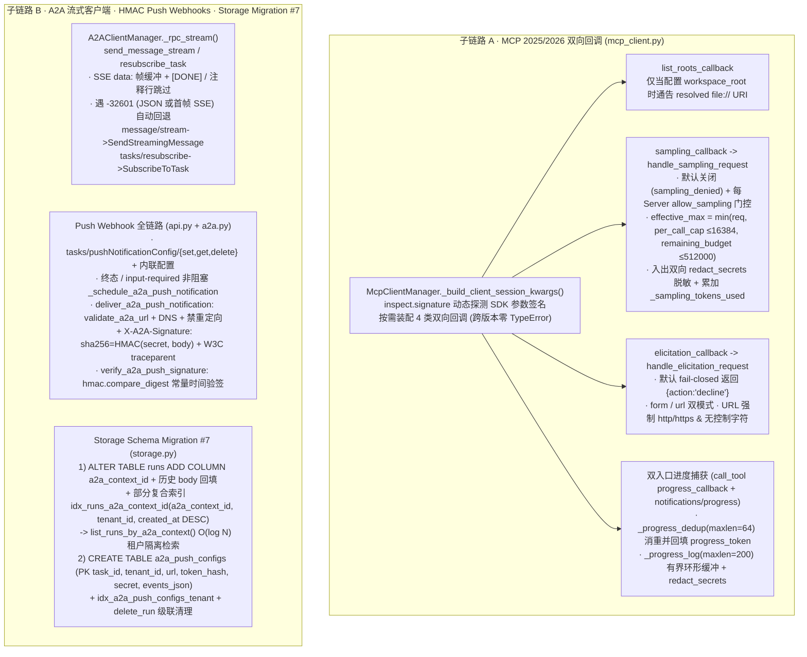

- **核心机制拆解**：
  1. **MCP 2025/2026 四大双向能力与运行期签名探测（`mcp_client.py:L1077-1637, L1750-1765, L2335-2344`）**：
     - **Roots（`list_roots` / `_make_list_roots_callback`）**：未配置 `workspace_root` 时返回空列表且不向 `ClientSession` 注册 `list_roots_callback`；配置后返回 `workspace_root.resolve().as_uri()`（标准 `file://` URI）及目录名，向受控 MCP Server 声明当前项目边界。
     - **Sampling（`handle_sampling_request` / `_make_sampling_callback`）**：坚持**零信任默认拒绝**（未传入 `sampling_handler` 或单 Server 配置 `allow_sampling=False` 均返回 `code="sampling_denied"`）；放行后执行双层 Token 预算钳制——单次请求受 `per_call_cap`（默认 2048、硬顶 16384）约束，累计消耗受 `total_budget`（默认 32768、硬顶 512000）约束，传入宿主 Handler 的 `effective_max_tokens = min(req_max_tokens, per_call_cap, remaining)`，超支直接返回 `code="sampling_budget_exceeded"` 且**不触发回调**；所有入参消息、`systemPrompt` 与输出文本均双向经 `redact_secrets()` 脱敏。
     - **Elicitation（`handle_elicitation_request` / `_make_elicitation_callback`）**：未配置 `elicitation_handler`、回调抛异常或返回非法 `action` 时一律 Fail-Closed 返回 `{"action": "decline"}`；完整支持 `form`（透传 `requestedSchema` 深拷贝）与 `url`（强制校验 `http`/`https` 协议且无 `\r`/`\n`/`\x00`，拦截 `javascript:` 等危险 Scheme 且不调用 Handler）两种征询模式。
     - **Progress 捕获与双路去重（`_record_progress` / `_make_tool_progress_callback` / `_make_message_handler`）**：新版本 MCP SDK 在 `session.call_tool(..., progress_callback=...)` 与全局 `message_handler`（`notifications/progress`）两条路径都可能派发同一条进度通知；通过有界 `_progress_dedup(maxlen=64)` 按 `(srv_name, progress, total, safe_msg)` 识别重复事件，不重复落日志而是原地回填 `progress_token`，并经 `recent_progress(limit)` 返回深拷贝快照防止调用方篡改内部 `deque(maxlen=200)` 缓冲。
     - **SDK 版本签名自适配（`_build_client_session_kwargs` 与 `call_tool`）**：用 `inspect.signature()` 检查运行期 `ClientSession.__init__`（支持 `**kwargs` 或显式参数名）与 `session.call_tool`，仅传递当前 SDK 版本实际接受的回调参数，并将协商结果记录至 `_negotiated_capabilities[srv_name]` 与 `client_capabilities_summary()`。
  2. **A2A 双版本流式客户端 `_rpc_stream`（`a2a.py:L1308-1514`）**：
     - `send_message_stream()` 与 `resubscribe_task()` 共用 `_rpc_stream()` 异步生成器，显式发送 `Accept: text/event-stream, application/json` 与 W3C `traceparent`，解析标准 SSE 多行 `data:` 帧、跳过 `: keepalive` 注释行与 `[DONE]` 哨兵，也兼容退化为普通 `application/json` 单帧响应的远端 Agent。
     - **无缝跨版本协议降级**：先发 v0.2/v0.3 方法名（`message/stream` 或 `tasks/resubscribe`）；只要在**尚未产出任何有效业务事件（`not yielded_any`）之前**收到 JSON-RPC `-32601 MethodNotFound`（无论来自普通 JSON 响应还是 SSE 首帧错误），立刻透明切换为 `_PASCAL_FALLBACK_METHODS` 映射的 v1.0 方法名（`SendStreamingMessage` / `SubscribeToTask`）重连，对上层调用方完全屏蔽版本差异。
  3. **A2A HMAC-SHA256 签名 Push Webhooks 与服务侧完整生命周期（`a2a.py:L622-705`，`api.py:L3026-3103, L6653-6700, L7277-7350, L7605-7734`）**：
     - `deliver_a2a_push_notification()` 在建连前必过 `validate_a2a_url()`（公网强制 `https://`、禁内嵌凭据、禁 6 类 IMDS、默认禁私网/回环）与 `_validate_resolved_ips()`（真实传输时 DNS 反查），创建 `follow_redirects=False` 的 `httpx.AsyncClient` 防止 302 重定向绕过 SSRF；若配置了 `secret`，使用规范化紧凑 JSON 字节流计算 `X-A2A-Signature: sha256=<hmac_sha256_hex>`；接收端通过 `verify_a2a_push_signature()` 调用 `hmac.compare_digest()` 执行常量时间防时序攻击验签。
     - `api.py` 既支持独立 RPC 方法 `tasks/pushNotificationConfig/{set,get,delete}`（同时映射 v1.0 `Set/Get/DeleteTaskPushNotificationConfig`，写/删强校验 `operator`/`admin` 角色与租户归属并记审计日志，响应经 `_public_a2a_push_config` 脱敏为 `A2A_REDACTED_MARKER` 永不回吐明文密钥），也支持在 `message/send` / `message/stream` 的 `configuration.pushNotificationConfig` 中内联注册；任务进入终态或 `input-required` 时经 `_schedule_a2a_push_notification()` 派生非阻塞后台任务尽力投递并落盘 `a2a_push_delivered` / `a2a_push_failed` 事件。
  4. **Storage Schema Migration #7：部分复合索引与多租户 Push 配置表（`storage.py:L885-939, L1070-1129, L1659, L1779-1782, L1837-1884, L3688-3861`）**：
     - `_m7_a2a_context_and_push_configs` 同时兼容 SQLite 与 PostgreSQL：为 `runs` 新增 `a2a_context_id TEXT` 列，创建**部分复合索引** `idx_runs_a2a_context_id ON runs(a2a_context_id, tenant_id, created_at DESC) WHERE a2a_context_id IS NOT NULL`（只索引实际带 A2A 上下文的记录，不给普通本地会话增加索引写入与空间负担），并遍历存量 `a2a_context_id IS NULL` 记录从 `body.metadata.a2a_context_id` 自动回填；`create_run` / `fork_run` / `save_run` 全链路同步维护该投影列，使 `list_runs_by_a2a_context()` 与 `api.py` 的 `tasks/list(contextId=...)`（`api.py:L7470-7476`）走 `SEARCH runs USING INDEX idx_runs_a2a_context_id` 实现 $O(\log N)$ 检索。
     - 新建 `a2a_push_configs` 表（`task_id` 主键、`tenant_id`、`url`、`token_hash`、`secret`、`events_json`、`created_at`、`updated_at`）及 `idx_a2a_push_configs_tenant(tenant_id, task_id)` 索引；`set_a2a_push_config()` 在 `BEGIN IMMEDIATE`（PG 带 `FOR UPDATE`）事务内校验归属租户，跨租户覆写直接抛 `KeyError("task_not_found")`（避免存在性探测信息泄露），同租户更新保留原始 `created_at` 并同步保存 `token_hash = digest(secret)`；`delete_run()` 在同一事务内级联清理 `a2a_push_configs` 防止孤儿 Webhook 配置残留。

- **设计权衡**：
  - *`a2a_push_configs` 同时存储 `secret` 与 `token_hash` 的现实权衡*：发送端计算 HMAC-SHA256 签名需要原始共享密钥，因此数据库中保留 `secret` 供 `_push_worker` 出站签名使用，同时保存 `token_hash` 供审计比对、API 对外一律折叠为 `***REDACTED***` 且 `has_secret: true`；在更高安全等级的生产多节点部署中（Batch 4），可进一步对 `secret` 列施加 KMS 信封加密（Envelope Encryption）实现落盘静态密文。
  - *Push 通知“非阻塞尽力投递（Best-Effort Async Task）” vs. 持久化重试队列*：在 `_schedule_a2a_push_notification()` 中派生后台 `asyncio.Task` 保证 Webhook 对端慢响应或 503 绝不拖慢主 Agent 运行或阻塞 API 响应，同时将成功/失败状态写入 `events` 表可观测；代价是进程在投递瞬间宕机时不自动重试，未来结合 Batch 4 的 Durable Execution Outbox 表即可升级为带指数退避的至少一次（At-Least-Once）可靠投递。
  - *MCP Sampling 预算采用内存按 Server 计数 vs. 持久化跨重启账本*：每 `McpClientManager` 生命周期内按 `srv_name` 累计 `_sampling_tokens_used` 实现了零额外 DB I/O 的刚性单会话/单进程防失控保护；跨重启配额归集可在后续与 `storage.py` 租户计费表打通。

#### 3. 核心安全与性能不变量
1. **MCP 双向回调默认安全拒绝与预算硬顶不变量**：未显式注入 Handler 时，`sampling` 永远返回 `sampling_denied`、`elicitation` 永远返回 `decline`、`roots` 永远为空；`sampling` 单次不超过 `min(req, per_call_cap, remaining_budget)`，预算归零直接拒调，且入参出参均经 `redact_secrets()` 脱敏；`elicitation(mode="url")` 严格限定 `http`/`https` 协议。
2. **MCP 跨版本兼容与进度无重复不变量**：`_build_client_session_kwargs()` 与 `call_tool()` 均按 `inspect.signature` 动态过滤回调参数；双入口进度通知经 `_progress_dedup` 消重回填且环形日志封顶 200 条、对外返回深拷贝。
3. **A2A 推送防 SSRF 与防伪验签不变量**：Webhook 投递前强制执行 `validate_a2a_url()`（公网禁明文 `http://`、禁 IMDS、默认禁私网/回环）+ `_validate_resolved_ips()` + `follow_redirects=False`；签名采用 `sha256=HMAC-SHA256(secret, canonical_body)` 且验签强制使用 `hmac.compare_digest()` 防时序侧信道；RPC 读取配置绝不回吐 `secret` 明文。
4. **A2A 双版本协议无感回退不变量**：`_rpc_stream()` 仅在尚未产出业务事件前对 `-32601` 自动从 v0.3 斜杠方法回退至 v1.0 PascalCase 方法（覆盖 JSON 响应与 SSE 首帧），已产生部分流事件后绝不静默重发以免重复执行副作用。
5. **Migration #7 幂等、多租户隔离与 $O(\log N)$ 索引不变量**：SQLite 与 PostgreSQL 均可幂等重复运行 Migration #7 并自动回填历史 `a2a_context_id`；`EXPLAIN QUERY PLAN` 命中 `idx_runs_a2a_context_id`；`a2a_push_configs` 的读/写/删均严格按 `tenant_id` 隔离（跨租户写抛 `task_not_found`，读返回 `None`，删返回 `False`），且随 `delete_run()` 原子级联删除。

#### 4. 源码定位索引

| 文件 | 关键符号 / 行号 | 职责说明 |
|---|---|---|
| [`src/agent_lab/mcp_client.py`](../src/agent_lab/mcp_client.py) | `McpClientManager.__init__` (`L1077-1127`)、`list_roots` / `_make_list_roots_callback` (`L1174-1192`)、`handle_sampling_request` / `_make_sampling_callback` (`L1194-1390`) | `workspace_root` `file://` 通告、每 Server 权限与双层 Token 预算钳制的 `sampling/createMessage` 处理器 |
| [`src/agent_lab/mcp_client.py`](../src/agent_lab/mcp_client.py) | `handle_elicitation_request` / `_make_elicitation_callback` (`L1392-1457`)、`_record_progress` / `recent_progress` / `_make_tool_progress_callback` (`L1459-1511`)、`_build_client_session_kwargs` / `client_capabilities_summary` (`L1513-1575`)、`_make_message_handler` (`L1577-1637`)、`call_tool` (`L2335-2344`) | Form/URL 征询安全门控、双入口进度捕获与 `_progress_dedup` 消重、运行期 SDK 签名兼容探测 |
| [`src/agent_lab/a2a.py`](../src/agent_lab/a2a.py) | `_METHOD_ALIASES` / `_PASCAL_FALLBACK_METHODS` (`L71-104`)、`build_agent_card` (`L235-284`)、`verify_a2a_push_signature` (`L622-633`)、`deliver_a2a_push_notification` (`L636-704`) | 双版本方法别名映射、AgentCard 声明 `streaming`/`pushNotifications`、常量时间 HMAC-SHA256 验签与 SSRF 护栏 Webhook 投递 |
| [`src/agent_lab/a2a.py`](../src/agent_lab/a2a.py) | `A2AClientManager._rpc_stream` (`L1308-1447`)、`send_message_stream` (`L1449-1490`)、`resubscribe_task` (`L1492-1513`) | A2A SSE 流式客户端、注释/`[DONE]` 解析与 `-32601` 自动 v0.3→v1.0 回退 |
| [`src/agent_lab/storage.py`](../src/agent_lab/storage.py) | `_m7_a2a_context_and_push_configs` (`L885-939`)、`_extract_a2a_context_id` / `create_run` (`L1070-1129`)、`delete_run` 级联 (`L1659`)、`fork_run` (`L1779-1782`)、`save_run` (`L1837-1884`) | Schema Migration #7（SQLite/PG 双兼容、`runs.a2a_context_id` 回填与部分复合索引、`a2a_push_configs` 建表与级联删除） |
| [`src/agent_lab/storage.py`](../src/agent_lab/storage.py) | `_format_a2a_push_config_row` / `set_a2a_push_config` / `get_a2a_push_config` / `delete_a2a_push_config` (`L3688-3835`)、`list_runs_by_a2a_context` (`L3836-3861`) | 多租户隔离 Push 配置原子 CRUD 与 $O(\log N)$ 索引化 `contextId` 任务检索 |
| [`src/agent_lab/api.py`](../src/agent_lab/api.py) | `_track_a2a_push_run_id` / `_schedule_a2a_push_notification` (`L3026-3103`)、`_parse_a2a_push_config_obj` / `_public_a2a_push_config` (`L6653-6700`)、内联 Push 注册 (`L6952-6969, L7277-7350`)、索引化 `tasks/list` (`L7469-7494`)、`tasks/pushNotificationConfig/{set,get,delete}` (`L7605-7734`) | 服务端非阻塞 Webhook 推送调度、脱敏响应格式化、内联与独立 RPC Push 配置管理及 RBAC/审计闭环 |

#### 5. 面试与复盘自检问题
1. **为什么 MCP `sampling/createMessage` 必须同时设置单次 `sampling_max_tokens` 与会话级累计 `sampling_token_budget`，并且把每 Server 的 `allow_sampling` 独立开关保留下来？**
   - *要点*：仅有单次上限无法阻止恶意或陷入死循环的外部 MCP Server 连续发起数百次 `maxTokens=1024` 的采样请求把宿主的 API 账单刷爆；仅有累计上限又可能被单次恶意超大请求一口吃光预算。两者取 `min(req, per_call_cap, remaining)` 配合按 Server 粒度关闭 `allow_sampling=False`（以及未注册 Handler 默认拒绝），才能把不可信插件的推理消费死死锁在可预期边界内。
2. **为什么 `_build_client_session_kwargs()` 不直接把 `list_roots_callback`、`sampling_callback`、`elicitation_callback` 写死传给 `ClientSession(...)`，而是先做 `inspect.signature` 探测？**
   - *要点*：`mcp` Python SDK 演进极快，旧版 SDK（或精简测试替身）的 `ClientSession.__init__` 可能尚未包含 `elicitation_callback` 等较新参数；通过运行期签名探测仅传入目标实现真正接受的回调，同时记录到 `_negotiated_capabilities`，既做到向前兼容最新协议，又不破坏旧环境与单元测试桩的可用性。
3. **在 `A2AClientManager._rpc_stream()` 中，为什么 `-32601 MethodNotFound` 自动回退到 `SendStreamingMessage` / `SubscribeToTask` 时必须额外判断 `not yielded_any`？**
   - *要点*：如果远端已经正常建立流并推送了若干 `status-update` 或 `artifact-update` 业务事件，说明方法本身已被识别并开始执行；此时流中途再出现异常或错误帧绝不能重发整个请求，否则会在远端重复创建一个一模一样的任务副本或触发双重副作用。仅在零业务事件产出前的首帧 `-32601` 回退才是严格安全的协议协商。
4. **Storage Migration #7 为什么把 `idx_runs_a2a_context_id` 设计为带 `WHERE a2a_context_id IS NOT NULL` 的部分复合索引 `(a2a_context_id, tenant_id, created_at DESC)`，而不是普通单列索引？**
   - *要点*：第一，大量纯本地 CLI/Web 会话的 `a2a_context_id` 为 `NULL`，部分索引跳过所有 `NULL` 行，显著减小索引体积并消除普通会话的索引维护开销；第二，将 `tenant_id` 与 `created_at DESC` 纳入复合键后，`WHERE a2a_context_id=? AND tenant_id=? ORDER BY created_at DESC LIMIT ?` 可以直接通过单次 B-Tree 范围扫描有序取前 $K$ 条，避免额外的租户回表过滤与全量排序。

---

## 五、Batch 4 深度设计复盘（✅ 已落地）

Batch 4 围绕**“脑手物理解耦、洋葱中间件化、推送式多节点协同、自主事件驱动与线上自进化评测飞轮”**完成全套 2026 前沿 Harness 闭环，覆盖 `execution_backend.py`、`turn_pipeline.py`、`triggers.py`、`eval_flywheel.py`、`storage.py`（Migration #8）、`lease.py`、`streaming.py`、`runtime.py`、`api.py` 与 `cli.py`，并由 [`tests/test_batch4_backends_triggers_flywheel_middleware.py`](../tests/test_batch4_backends_triggers_flywheel_middleware.py)（15 项离线确定性单测）完整守护。

### 5.1 脑手解耦执行后端（`execution_backend.py`）与可组合洋葱中间件（`turn_pipeline.py`）

- **业界对标**：Anthropic《Scaling Managed Agents》（Brain / Hands / Session 解耦）；E2B / Kata / Firecracker / Daytona 远程微虚拟机隔离；OpenHands / LangGraph 可组合中间件管线。
- **架构设计与核心权衡**：
  ```mermaid
  flowchart LR
      RT["AgentRuntime (Brain)"] --> TP["TurnPipeline 洋葱中间件<br/>BudgetGuard -> DlpSecurity -> ObservabilitySpan"]
      TP --> EB{"WorkspaceExecutionBackend (Hands)"}
      EB -->|"local"| LH["LocalHostExecutionBackend<br/>Seatbelt / bwrap + Scrubbed Env"]
      EB -->|"docker"| DK["DockerSessionBackend<br/>持久单会话容器 --network=none --read-only"]
      EB -->|"microvm"| MV["RemoteMicroVMBackend<br/>JSON-RPC 2.0 + Bearer + traceparent + SSRF/IMDS 防护"]
  ```
  1. **三类执行后端统一契约**：`WorkspaceExecutionBackend` 统一暴露 `read_file`、`write_file`、`edit_file`、`exec_command`、`snapshot_info` 与 `aclose`；其中 `DockerSessionBackend` 采用每会话独立只读根文件系统容器（`--network=none --cap-drop=ALL --security-opt=no-new-privileges`），使模型生成代码永远接触不到宿主机 LLM 凭据；`RemoteMicroVMBackend` 对接 Firecracker / E2B / Daytona 远程微虚拟机 RPC，严格阻断 `169.254.169.254` IMDS、URL 内嵌凭据、非 `http(s)` 与重定向劫持。
  2. **洋葱模型 `TurnPipeline`**：`before_turn` / `before_tool` 按正序执行并在 `ctx.aborted` 或 `tctx.blocked` 时精准短路，`after_tool` / `after_turn` 按逆序展开释放资源（即使抛出异常仍保证 `ObservabilitySpanMiddleware` 完整闭合 W3C Span 与释放 `ContextVar`），内置 `DlpSecurityMiddleware`、`BudgetGuardMiddleware`（步数与 USD 上限）与 `ObservabilitySpanMiddleware`。
- **源码索引**：[`src/agent_lab/execution_backend.py`](../src/agent_lab/execution_backend.py)（`WorkspaceExecutionBackend`、`LocalHostExecutionBackend`、`DockerSessionBackend`、`RemoteMicroVMBackend`、`build_execution_backend`）；[`src/agent_lab/turn_pipeline.py`](../src/agent_lab/turn_pipeline.py)（`TurnContext`、`ToolCallContext`、`TurnPipeline`、3 大内置中间件）；[`src/agent_lab/runtime.py`](../src/agent_lab/runtime.py)（`execution_backend` / `turn_pipeline` 注入与 `aclose()` 清理）。

### 5.2 PostgreSQL `LISTEN/NOTIFY` 推式队列唤醒与跨节点 `StreamTransport`

- **业界对标**：PostgreSQL `LISTEN/NOTIFY` + `FOR UPDATE SKIP LOCKED` 推拉混合队列；多 Pod 水平扩展下的跨节点 SSE 事件扇出。
- **架构设计与核心不变量**：
  - **毫秒级推式唤醒**：`storage.py` 在 PostgreSQL 事务内（`enqueue_run`、`approve_and_enqueue`、`append_user_turn(enqueue=True)`）触发 `SELECT pg_notify('agent_lab_queue', ?)`；`LeaseWorker`（`lease.py`）用 `self._wakeup_event` + 线程安全 `notify_wakeup()` 替代死等 `0.8s` 轮询，收到通知毫秒级唤醒并自动在 SQLite 下平滑退化为自适应轮询。
  - **可插拔跨节点流总线**：`RunStreamBroker`（`streaming.py`）新增 `StreamTransport` 协议，默认零开销 `InMemoryStreamTransport`，提供 `CallbackStreamTransport` 与 `PostgresNotifyStreamTransport`（`pg_notify('agent_lab_stream', payload)`，严守 `<= 7500` 字节 UTF-8 截断与同 `node_id` 回声过滤），解决多 Pod 部署下 Worker 与 API 节点分离导致 SSE 断层的问题。

### 5.3 自主 Cron 与 GitHub/自定义 Webhook 事件触发引擎（`triggers.py` + Migration #8）

- **业界对标**：Anthropic Claude Code Routines、GitHub Actions / Codex Cloud 事件驱动自主研发循环。
- **架构设计与安全不变量**：
  - **零依赖 5 段 Cron 解析器**：`CronSchedule` 完整支持 `*`、`*/n`、`a-b`、逗号列表与 Vixie DOM/DOW 语义（含 `0/7=Sunday` 与闰年校验）；`TriggerScheduler` 以 `cron:{trigger_id}:{minute_iso}` 唯一 `dedup_key` 结合 Migration #8 的 `trigger_fires.dedup_key UNIQUE` 约束实现**跨重启至多一次（At-Most-Once）触发去重**。
  - **Webhook 防伪与隔离**：`POST /api/webhooks/{trigger_id}` 在 `_GuardMiddleware` 白名单放行但强制校验恒定时间 HMAC-SHA256（兼容 GitHub `X-Hub-Signature-256: sha256=...` 与 `X-Agent-Lab-Signature`），`render_webhook_prompt` 单遍渲染 `pull_request` / `workflow_run`（CI 失败自愈）/ `issues` 模板并对不可信外源载荷执行转义截断与密钥脱敏；所有 `GET /api/triggers` 响应严格将 `webhook_secret` 脱敏为 `***REDACTED***`。
- **源码索引**：[`src/agent_lab/triggers.py`](../src/agent_lab/triggers.py)、[`src/agent_lab/storage.py`](../src/agent_lab/storage.py)（Schema Migration #8 `trigger_definitions` / `trigger_fires`）、[`src/agent_lab/api.py`](../src/agent_lab/api.py)（`/api/triggers`、`/api/webhooks/{id}`）、[`src/agent_lab/cli.py`](../src/agent_lab/cli.py)（`agent-lab trigger create|list|delete|tick`）。

### 5.4 线上 Trace→Eval 回归飞轮与 4 维轨迹评分器（`eval_flywheel.py`）

- **业界对标**：Anthropic《Demystifying evals for AI agents》倡导的“线上摩擦轨迹自动收割 → 脱敏回放回归集”闭环飞轮。
- **架构设计与核心不变量**：
  - **4 维轨迹评分（`grade_trajectory`）**：从 `completion_score`、`tool_efficiency_score`（合并审计事件检测重复失败循环与错误率）、`safety_compliance_score`（区分正常已脱敏文本与真实密钥泄露，无误报）与 `steering_responsiveness_score` 四个维度输出 `[0, 1]` 综合分与结构化 `friction_signals`（可通过 `GET /api/runs/{id}/grade`、`runtime.grade_run(id)` 或 `agent-lab eval --grade-run <id>` 随时查询）。
  - **零泄露脱敏收割（`harvest_failure_traces`）**：扫描失败/超预算/高摩擦会话，经 `observability.redact_secrets` + `egress_dlp` 双层脱敏并匿名化本机主目录路径与身份信息后，原子落盘为可复现 JSON 用例与 `manifest.json`（`POST /api/evals/harvest`、`agent-lab eval --harvest`），通过 `evaluate_harvested_cases` 闭环回归。

#### Batch 4 面试与复盘自检问题
1. **为什么 `RemoteMicroVMBackend` 与 `DockerSessionBackend` 要求“脑手解耦、容器内永不注入 LLM API Key”？**
   - *要点*：当模型运行受间接提示词注入污染的仓库代码或第三方构建脚本时，只要执行环境与推理进程共享地址空间或环境变量，攻击者即可通过 `cat /proc/self/environ` 或内存转储窃取高权限模型密钥；脑手解耦把凭据永久留在受控控制面，沙箱节点只接收最小化 RPC 指令。
2. **PostgreSQL `LISTEN/NOTIFY` 为什么必须搭配 `FOR UPDATE SKIP LOCKED` 与兜底超时等待，而不能只依赖 `NOTIFY`？**
   - *要点*：`NOTIFY` 是非持久化瞬态信号（Worker 重启或网络瞬断期间发送的通知会丢失）；正确范式是把数据库表作为单一持久事实源、`NOTIFY` 仅作低延迟唤醒提示（Wakeup Hint），唤醒后仍通过 `FOR UPDATE SKIP LOCKED` 原子抢占租约，并保留兜底超时唤醒保证最终一致性。
3. **线上 Trace→Eval 收割飞轮为什么必须在落盘前同时执行密钥脱敏、路径匿名化与 `manifest.json` 原子索引？**
   - *要点*：生产运行轨迹往往夹带真实用户提示、临时凭据与开发者本地绝对路径；若直接存入仓库或评测目录会引发二次数据泄露，而原子 `manifest.json` 能隔离陈旧孤儿用例并确保 CI 回归集可复现。

---

## 六、附：全量 4-Batch 离线验证矩阵与配置速查

### 6.1 离线确定性回归命令

```bash
# 运行全部 4 个批次专项离线单测
uv run --no-sync pytest -q \
  tests/test_batch1_plan_dlp_native_ctx_edit.py \
  tests/test_batch2_ptc_horizon_shadow.py \
  tests/test_batch3_merkle_browser_protocols.py \
  tests/test_batch4_backends_triggers_flywheel_middleware.py

# 运行全量测试、17 项核心+子系统离线评测与静态检查
uv run --no-sync pytest -q
uv run --no-sync agent-lab eval --suite all
uv run --no-sync ruff check src tests scripts
```

### 6.2 Batch 1 测试覆盖映射（[`tests/test_batch1_plan_dlp_native_ctx_edit.py`](../tests/test_batch1_plan_dlp_native_ctx_edit.py)）

| 测试分区 | 代表性用例 | 验证的核心不变量 |
|---|---|---|
| **1. 只读 Plan Mode** | `test_normalize_permission_mode_plan_aliases_and_validation`<br/>`test_plan_mode_allows_readonly_interactive_safe_bash_and_plan_artifacts`<br/>`test_plan_mode_hard_denies_mutations_even_with_allow_rules_and_session_grants` | 别名归一化、`plan` 允许面边界、`.agent-lab/plans/` 防 `..` 与防 `.env`、无视 `allow=["*"]` 与 `session_grants=["*"]` 的硬拒绝 `plan_mode_readonly` |
| **2. Egress DLP & CaMeL** | `test_egress_dlp_blocks_all_secret_classes_across_sinks_without_plaintext_leak`<br/>`test_egress_dlp_blocks_base64_and_url_encoded_live_env_secrets_across_sinks`<br/>`test_egress_dlp_allows_clean_non_secret_outbound_payloads`<br/>`test_camel_taint_registry_and_strict_dataflow_gate` | 7 类主流密文跨 4 大出站汇聚点硬阻断、Base64/嵌套 Base64/URL 编码绕过拦截、零明文泄漏、`strict_dataflow` 污点门控、`approved_hosts` 白名单与“DLP 优先于审批”不变量 |
| **3. Provider 原生上下文工程** | `test_build_anthropic_context_management_disabled_and_ordered_edits`<br/>`test_anthropic_provider_sends_context_management_and_preserves_compaction`<br/>`test_openai_responses_preserves_encrypted_content_across_turns`<br/>`test_openai_responses_sse_preserves_encrypted_content_without_completed_event`<br/>`test_openai_responses_compact_remote_success_and_404_fallback`<br/>`test_gemini_native_capabilities_and_explicit_cache_create_reuse_and_renew`<br/>`test_gemini_explicit_cache_transparent_fallback_on_400_and_404` | Anthropic 严格三策略顺序与 Beta 头去重、`compaction` 块保留；OpenAI ZDR `store=False` 同步/SSE 密文透传与 `/responses/compact` 404 优雅降级；Gemini 显式缓存创建/复用/TTL `PATCH` 续期/互斥载荷与 400/404 双场景透明降级 |
| **4. 四级模糊编辑与草图编辑** | `test_match_and_replace_tiered_all_four_tiers_and_ambiguous_rejection`<br/>`test_apply_sketch_edit_python_js_markers_and_missing_anchor`<br/>`test_execute_fs_edit_and_fs_sketch_edit_end_to_end`<br/>`test_tools_apply_unique_replacement_trailing_ws_and_ambiguity` | Tier 1—4 全层级命中与全层级 `ambiguous_match` 拒绝、`apply_sketch_edit` Python/TS 多段合并与 CRLF 保真、缺失起止锚点 `sketch_anchor_not_found` 失败闭合、`plan`/`ask`/`auto-edit` 端到端闭环 |

### 6.3 Batch 3 测试覆盖映射（[`tests/test_batch3_merkle_browser_protocols.py`](../tests/test_batch3_merkle_browser_protocols.py)，11 组函数 / 28 项参数化用例）

| 测试分区 | 代表性用例 | 验证的核心不变量 |
|---|---|---|
| **1. Merkle 增量语义代码索引** | `test_code_index_initial_refresh_indexes_py_ast_ts_md_and_merkle_root_hash`<br/>`test_code_index_incremental_refresh_noop_single_edit_and_delete_pruning`<br/>`test_code_index_strictly_excludes_env_secrets_symlinks_hardlinks_and_ignored_dirs`<br/>`test_code_index_hybrid_bm25_dense_rrf_search_line_numbers_and_path_prefix` | Python AST / TS 语法块 / 围栏安全 Markdown 切分、SQLite WAL 重启复用、`(mtime_ns, size)` 与 `touch` 零重复嵌入、单改增量更新与删除剪枝、`.env`/密钥/软硬链/二进制全隔离、BM25+ + 稠密向量 RRF 融合与 `path_prefix` 防穿越 |
| **2. ARIA 无障碍快照浏览器层** | `test_browser_mock_backend_end_to_end_aria_interaction_and_screenshot_artifact`<br/>`test_validate_browser_url_blocks_schemes_imds_private_and_loopback`（18 组参数化）<br/>`test_validate_browser_url_loopback_opt_in_still_blocks_imds_and_rfc1918` | `MockBrowserBackend` 端到端 `e1`/`e2`/`e3` 交互与 Console/Network/PNG 落盘、`file://`/`javascript:`/`data:`/`chrome://` 协议阻断、IMDS / IPv6 映射 / RFC 1918 / 默认回环 / 内嵌凭据 / CRLF 全拦截、`allow_loopback=True` 下 IMDS 与私网仍铁板阻断 |
| **3. MCP 双向回调 & A2A 前沿 / Migration #7** | `test_mcp_client_manager_roots_sampling_elicitation_and_progress`<br/>`test_storage_migration_7_a2a_context_index_and_push_configs_crud_tenant_isolation`<br/>`test_a2a_push_notification_ssrf_blocking_and_hmac_sha256_signature`<br/>`test_a2a_client_send_message_stream_sse_and_method_not_found_fallback` | MCP 默认安全拒绝、Roots `file://` URI、Sampling 单次/总预算钳制、Elicitation Form/URL 协议防线、Progress 环形缓冲与不可变快照；Migration #7 `EXPLAIN QUERY PLAN` 命中 `idx_runs_a2a_context_id`、`a2a_push_configs` 多租户隔离与 `delete_run` 级联删除；A2A Push SSRF 阻断与常量时间 HMAC-SHA256 验签；A2A SSE 流式客户端与 JSON/SSE 首帧 `-32601` 自动回退 `SendStreamingMessage` |

### 6.4 Batch 1、Batch 2 & Batch 3 关键环境变量、工作区文件与硬配额速查

| 配置项 / 常量 | 默认值 / 上限 | 所属模块 | 作用说明 |
|---|---|---|---|
| `AGENT_LAB_ANTHROPIC_CONTEXT_EDITING` | 未开启（`0`） | `providers.py` | 设为 `1` 时启用 Anthropic `clear_tool_uses_20250919`（开启 thinking 时联动 `clear_thinking_20251015`） |
| `AGENT_LAB_ANTHROPIC_SERVER_COMPACT` | 未开启（`0`） | `providers.py` | 设为 `1` 时启用 Anthropic 服务端压缩 `compact_20260112` 与 `compact-2026-01-12` Beta 头 |
| `AGENT_LAB_ANTHROPIC_SERVER_COMPACT_TRIGGER_TOKENS` | `150000` | `providers.py` | Anthropic 服务端清理/压缩触发输入 token 阈值 |
| `AGENT_LAB_ANTHROPIC_PTC` | 未开启（`0`） | `providers.py` | 设为 `1` 时透传工具定义中的 `allowed_callers` 字段（对接 Anthropic 服务端 PTC 容器） |
| `AGENT_LAB_OPENAI_ENCRYPTED_REASONING` | 随 `reasoning_effort` 自动开启 | `providers.py` | 显式控制 OpenAI Responses API 是否注入 `include: ["reasoning.encrypted_content"]`（设为 `0` 强制关闭） |
| `AGENT_LAB_GEMINI_EXPLICIT_CACHE` | 未开启（`0`） | `providers.py` | 设为 `1` 时启用 `GeminiExplicitCacheManager`（`/v1beta/cachedContents` 创建与 TTL 自动续期） |
| `AGENT_LAB_GEMINI_EXPLICIT_CACHE_MIN_TOKENS` | `32768` | `providers.py` | Gemini 显式缓存触发前缀 token 下限 |
| `AGENT_LAB_GEMINI_EXPLICIT_CACHE_TTL` | `3600` | `providers.py` | Gemini 显式缓存生存时间（秒），临期自动 `PATCH ?updateMask=ttl` 续期 |
| `AGENT_LAB_HOST_SANDBOX` | `auto`（可选 `strict` / `off`） | `host_tools.py`、`ptc.py`、`shadow_workspace.py` | 控制 Seatbelt / `bwrap` OS 内核沙箱策略；`strict` 下无可用后端则 Fail-Closed 拒绝执行 |
| `PTC_MAX_SUBCALLS` / `PTC_MAX_TIMEOUT_SECONDS` / `PTC_MAX_OUTPUT_CHARS` | `24` 次（默认 `16`）/ `45s`（默认 `20s`）/ `16000` 字符 | `ptc.py` | 本地 `ptc_exec` 编排脚本的子调用次数、总墙钟与脱敏输出硬天花板（单帧 `2 MiB`、拒调熔断 `64` 次） |
| `.agent-lab/horizons/<campaign_id>/` | `feature_list.json`、`init.sh` (`0o700`)、`progress.md` | `horizon.py` | 跨会话超长程任务的不可删减验收账本、幂等冒烟基线与只追加交接日志（每次启动注入尾 28 行） |
| `.agent-lab/invariants.json` | 规则类型：`forbidden_import` / `max_file_lines` / `forbidden_pattern` | `horizon.py` | `MechanicalInvariantChecker` 声明式架构边界规则与模型可执行 `remediation` 修复指引配置 |
| `_SHADOW_MAX_EDITS` / `_SHADOW_MAX_CLONE_FILES` / `_SHADOW_MAX_CLONE_FILE_BYTES` | `64` 条（Schema 上限 `32`）/ `20000` 文件 / `16 MiB` | `shadow_workspace.py` | 影子工作区预检的单次编辑数、克隆规模与单文件体积硬上限（Diff 上限 `32 KiB`，命令双流各 `32 KiB`） |
| `<state_dir>/indexes/<project_slug>/code_index.sqlite` | `max_files=4000` / `max_file_bytes=512 KiB` / `80 行 / 3200 字 / 10 行重叠` / `RRF k=60` | `code_index.py` | 持久化 SQLite WAL 代码库 Merkle 索引与分块向量库（含 `merkle_nodes`、`code_chunks` 与 `idx_code_chunks_path`） |
| `AGENT_LAB_BROWSER_ALLOW_LOOPBACK` | 未开启（`0`） | `browser.py` | 设为 `1`（或调用传 `allow_loopback=true`）时放行 `127.0.0.1`/`localhost` 本地开发服务，IMDS 与 RFC 1918 私网始终阻断 |
| `_MAX_SNAPSHOT_CHARS` / `max_nodes` | `8000` 字符 / `200` 节点（默认 `80`） | `browser.py` | ARIA 快照文本截断与交互节点数硬上限；截图按 `browser_shot_NNN.png` 落盘且预览仅返前 256 字节 |
| `sampling_max_tokens` / `sampling_token_budget` / `_progress_log` | 默认 `2048`（顶 `16384`）/ 默认 `32768`（顶 `512000`）/ `200` 条 | `mcp_client.py` | MCP `sampling/createMessage` 单次与每 Server 累计 Token 硬预算上限及 `notifications/progress` 有界环形缓冲 |
| `AGENT_LAB_A2A_ALLOW_PRIVATE` / `X-A2A-Signature` / Migration #7 | 默认禁用私网 / `sha256=HMAC-SHA256` / `runs.a2a_context_id` + `a2a_push_configs` | `a2a.py`、`storage.py`、`api.py` | 控制 A2A Peer 与 Webhook 的私网/回环准入、防篡改推送签名头及 $O(\log N)$ 上下文检索与多租户推送配置存储 |
