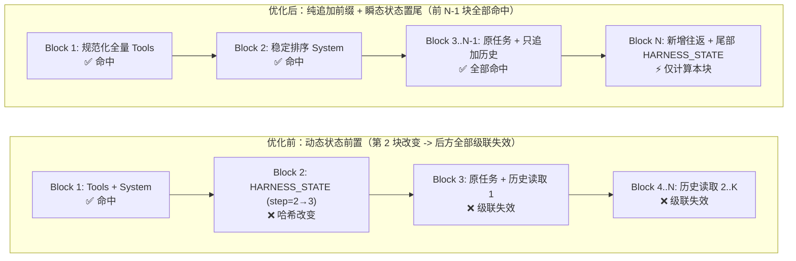
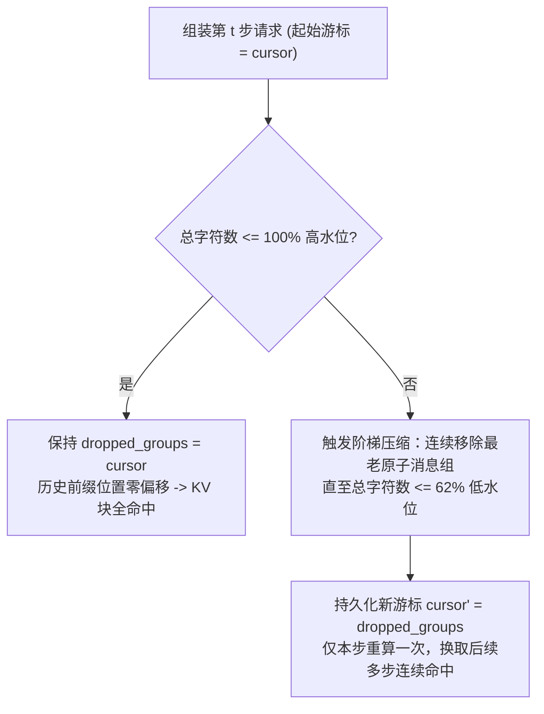

# Harness 级 KV Cache 命中率优化：为什么做与底层原理

在单轮问答应用里，Prompt 前缀改几个字几乎感知不到差异；但在需要连续执行 10—30 步工具调用的代码开发 Agent 中，**KV Cache（键值缓存）命中率直接决定了系统的单任务成本、首字延迟（TTFT）与吞吐上限**。更关键的事实是：即使底层推理引擎已经开启了 vLLM Automatic Prefix Caching（APC）、SGLang RadixAttention 或商业 API 的 Prompt Caching，**真正决定缓存能不能命中的往往不是推理框架，而是上层 Agent Harness 组装上下文的方式**。

本文档系统说明两件事：**为什么要做 Harness 级 KV Cache 优化**，以及**每一项优化背后的注意力物理机制、哈希原理与代码落地方式**。

---

## 1. 为什么要做这些优化？

### 1.1 代码 Agent 的输入/输出比高度失衡（15:1 至 30:1）

在典型的仓库修复闭环（`repo_map → repo_read → working_memory_write → propose_changeset → Docker 测试 → 修复重试`）中，模型每一步新生成的 `tool_use` 只有 100—350 个输出 token，但每一步都必须把完整工具 JSON Schema、系统指令、原始任务描述以及此前所有工具往返证据重新作为输入发给模型。

设固定前缀（Tools + System + 原任务）长度为 $S_0$，每一步新增一对 `tool_use / tool_result` 的平均长度为 $\Delta$。在 $T$ 步工具循环中：

- 总输出 token 仅随步数线性增长：$O(T)$；
- 总输入 token 却随步数呈二次阶梯膨胀：
  $$\sum_{t=1}^{T} \bigl(S_0 + (t-1)\Delta\bigr) = T \cdot S_0 + \frac{T(T-1)}{2}\Delta$$

当 $S_0 = 2500$、$\Delta = 800$、$T = 16$ 时，累计输出仅约 $4000$ tokens，而累计输入高达 **$136{,}000$ tokens**（输入输出比达 **34:1**）。其中超过 **85%** 的输入字节在相邻轮次之间本来是完全重复的历史内容。

### 1.2 推理预填充（Prefill）算力与 API 计费的十倍级差价

LLM 推理由两个阶段组成：

1. **Prefill（预填充阶段，计算密集型 Compute-Bound）**：对输入序列做全量投影与因果自注意力计算，生成每一层、每一个 token 的 Key 与 Value 张量。未命中缓存时，GPU 必须重新对几万个历史 token 执行矩阵乘，直接拉高首字响应时间（TTFT）。
2. **Decode（解码阶段，访存密集型 Memory-Bandwidth-Bound）**：逐个生成新 token，每步直接读取已缓存的 $K, V$ 张量。

主流模型服务与开源推理引擎都已将 KV Cache 复用直接映射为价格与延迟收益：

| 维度 | 未命中 KV Cache（全量重算 Prefill） | 命中 KV Cache（复用历史前缀块） | 实际工程影响 |
|---|---|---|---|
| **商业 API 输入单价** | `1.0x` 全价输入 | Anthropic `cache_read` 为 **`0.1x`**（90% 折扣）；OpenAI `cached_tokens` 为 **`0.25x`—`0.5x`** | 16 步代码任务等效输入账单可下降 **50%—75%** |
| **首字延迟（TTFT）** | 随上下文长度超线性增长 | 跳过命中块的 Prefill 矩阵运算，仅计算尾部新增块 | 长上下文下每步决策等待时间缩短 **50%—80%** |
| **服务端吞吐与配额** | 反复消耗计算单元 FLOPs | 仅占用显存/主机内存页表引用 | 多 Worker 并发评测时显著降低超时与限流风险 |

如果 Harness 每一步都在 Prompt 靠前的位置改动哪怕几十个字符，系统就会退化回“每一步都按全价把整段历史重新 Prefill 一遍”的最坏情况。

---

## 2. 优化的底层原理是什么？

要理解为什么有些看似无害的代码写法会彻底摧毁缓存，必须回到自回归 Transformer 与分页缓存引擎的两个刚性不变量。

### 2.1 因果自注意力（Causal Self-Attention）与旋转位置编码（RoPE）

在解码器 Transformer 的第 $l$ 层中，第 $i$ 个位置（从 $0$ 开始计数）的隐状态 $h_i^{(l)}$ 只关注 $0 \le j \le i$ 的前序位置；其写入 KV Cache 的键值向量为：

$$K_i^{(l)} = \mathrm{RoPE}\!\left(W_K^{(l)} h_i^{(l-1)},\, i\right), \qquad V_i^{(l)} = W_V^{(l)} h_i^{(l-1)}$$

注意这两个式子隐含了 **KV 张量可复用的充要条件**：

1. **严格前缀内容不变性（Content Prefix Invariance）**：$h_i^{(l-1)}$ 是前序所有位置 $x_0, x_1, \dots, x_i$ 经过多层自注意力混合后的结果。只要某个前序下标 $k < i$ 的 token 发生了变化，位置 $i$ 的注意力分布就会改变，旧的 $K_i^{(l)}, V_i^{(l)}$ 在数学上不再等价。
2. **严格位置下标不变性（Positional Index Invariance）**：$\mathrm{RoPE}(\cdot, i)$ 将位置下标 $i$ 直接编码为复平面旋转角 $e^{\mathrm{i} \cdot i \theta_d}$。即使历史消息 $M_5$ 的文本一字未改，只要它前面的某段消息被删除或缩短了 30 个 token，导致 $M_5$ 的起始下标从 $1200$ 左移到 $1170$，它对应的所有 $K^{(l)}$ 向量都会因为旋转角变化而**全部失效**，标准推理引擎无法直接跨位置平移复用。

### 2.2 PagedAttention 链式块哈希与级联失效（Cascade Invalidation）

在工程实现上（以 vLLM Automatic Prefix Caching 与商业推理网关为例），服务端将 token 流按固定块大小 $B$（例如 16 或 64 tokens）切分为物理块，并用**密码学链式哈希**寻址缓存页：

$$H_1 = \mathrm{SHA256}(\text{root} \parallel \text{Block}_1), \qquad H_k = \mathrm{SHA256}(H_{k-1} \parallel \text{Block}_k)$$

检索时引擎从 $k=1$ 向后逐块查表，**一旦遇到第一个未命中的 $H_{k_0}$，后续所有块由于父哈希 $H_{k_0}$ 已经改变，必然全部未命中**。



这就是 Harness 级优化的第一性原理：**把一切静态、共享、只追加的内容严格锚定在序列左侧，把一切高频变化、角色私有、带墙钟噪声的内容推迟到序列最右端或彻底剥离，并把上下文裁剪从“每步微移”改为“低频阶梯跳变”。**

---

## 3. 本项目落地的 6 项 Harness 优化详解

围绕上述原理，我们在 [`kv_cache.py`](../src/agent_lab/kv_cache.py)、[`context.py`](../src/agent_lab/context.py)、[`runtime.py`](../src/agent_lab/runtime.py)、[`working_memory.py`](../src/agent_lab/working_memory.py) 与 [`providers.py`](../src/agent_lab/providers.py) 中排查并修复了 5 类典型的缓存破坏模式，形成了 6 项可验证机制。

### 3.1 瞬态尾部状态注入（Tail Transient State Injection）

- **优化前的问题**：旧版 `AgentRuntime._pinned()` 把包含当前步数 `step`、最近 6 次调用摘要 `recent_calls` 的 `HARNESS_STATE`，以及包含最新事实的 `WORKING_MEMORY`，全部插在 `messages[1]`（紧跟原任务之后、所有历史工具对话之前）。由于 `step` 和 `recent_calls` **每一轮必定改变**，`messages[2:]` 中积累的上万字符代码读取与测试输出在每一轮都会从第 2 条消息处整体失效。
- **优化后的机制**：
  - [`ContextManager.build()`](../src/agent_lab/context.py) 新增 `tail_state` 参数，组装顺序改为 `[原任务, *pinned(低频技能快照), *保留历史消息组, *tail_state]`，且 `tail_state` 的 JSON 字节开销与外层标点一并计入严格预算校验。
  - [`AgentRuntime._pinned()`](../src/agent_lab/runtime.py) 仅保留任务内极少变动的 `SKILL_SNAPSHOT`；高频变化的 `HARNESS_STATE` 与 `WORKING_MEMORY` 移至 [`AgentRuntime._tail_state()`](../src/agent_lab/runtime.py) 追加在最末尾。
  - 结果：在未触发窗口溢出的任意连续轮次中，稳定前缀 `messages[:-len(tail_state)]` 实现 **100% 字节级只追加（Append-Only）**，同时 `HARNESS_STATE` 位于最末尾反而受益于近因效应（Recency Bias），模型对最新审批与验证状态的遵循更稳定。

### 3.2 确定性紧凑序列化与跨任务目录稳定对齐

- **优化前的问题**：
  1. `WORKING_MEMORY` 中的每条事实带有精确到秒的 UTC 时间戳 `recorded_at`，只适合人类与数据库审计，放进 Prompt 只会产生无信息量的字节漂移；
  2. `AgentRuntime._system()` 直接将 `skills.select(run["prompt"])` 的相关度排序结果序列化进 `SYSTEM`——当任务 A 提问“编写测试”而任务 B 提问“代码审查”时，即便两者选出的都是同一批技能元数据，列表顺序变为 `[testing, code-review]` vs `[code-review, testing]`，直接击穿跨任务的 `System` 缓存；
  3. 字典键序与 `_project_history()` 重复投影可能引入细微序列化差异。
- **优化后的机制**：
  - [`canonical_json()`](../src/agent_lab/kv_cache.py) 统一使用 `json.dumps(..., ensure_ascii=False, sort_keys=True, separators=(",", ":"))` 规范化所有工具 Schema、技能快照、历史 `tool_calls.arguments` 与尾部状态；
  - [`prompt_view_working_memory()`](../src/agent_lab/working_memory.py) 为模型构造无墙钟噪声的纯净视图（保留 SQLite 内的完整 `recorded_at` 供审计 API 查询）；
  - [`AgentRuntime._system()`](../src/agent_lab/runtime.py) 在有界词面筛选后按技能 `name` 字典序稳定排列，使不同 Prompt 的跨任务请求在技能集相同时共享 **100% 字节一致的 `<TOOLS> + <SYSTEM>` 根前缀**。

### 3.3 高低水位滞回阶梯压缩（Hysteresis Watermark Step Compaction）

- **优化前的问题**：传统滑动窗口在上下文达到 `max_chars`（100% 水位）后，第 $t$ 步删掉最老的第 1 组工具往返，第 $t+1$ 步又溢出再删第 2 组，第 $t+2$ 步再删第 3 组……由于 RoPE 位置下标在**每一步**都整体前移一组，满窗口后的每一轮历史缓存命中率都会断崖式跌回仅剩 `Tools + System`。
- **优化后的机制**：
  - [`ContextManager`](../src/agent_lab/context.py) 引入 `low_watermark_ratio`（Runtime 默认设为 `0.62`）与持久化游标 `min_dropped_groups`（保存在 `run.metadata.compaction_cursors[worker]`）。
  - **平时（未超 100% 高水位）**：严格沿用上一步游标 `cursor`，只追加新消息，历史块 100% 命中；
  - **一旦触及 100% 高水位**：一次性原子丢弃多组最老历史，直到总请求体积回落至 `62%` 低水位以下，释放出 **38% 的连续缓冲空间**，并更新 `compaction_cursor`。随后连续多轮工具调用再次回到纯追加高命中状态。



- **附：为什么未满窗口时频繁调用 `skill_unload` 可能是“负优化”？**
  假设前置 `SKILL_SNAPSHOT` 占 $500$ tokens，其后已积累 $15{,}000$ tokens 对话历史。若此时卸载该技能，表面上省了 $500$ tokens 空间，却导致后方 $15{,}000$ tokens 位置下标左移而全部脱离 `0.1x` 缓存（等效损失 $15{,}000 \times 0.9 = 13{,}500$ 未缓存计费单位，远大于省下的 $500 \times 0.1 = 50$ 单位）。因此工程上应当**优先按章节精确 `skill_load`，仅在上下文逼近预算上限时才调用 `skill_unload`**。

### 3.4 多子代理根前缀共享与执行层权限解耦

- **优化前的问题**：在 `parallel` 模式下，`reviewer` 和 `tester` 两个只读子代理原本通过过滤输入列表（仅传入 7 个只读工具 Schema）来限制能力，而主协调者 `coordinator` 传入全量 16 个工具 Schema。因为推理引擎将 `<TOOLS>` 放在整个序列的最前端（第 0 号块），工具列表少一个元素就会导致子代理与主代理连 `<SYSTEM>` 缓存都无法共享。
- **优化后的机制**：
  - 在 [`AgentRuntime._workers()`](../src/agent_lab/runtime.py) 中，向 `reviewer`、`tester` 与 `coordinator` 传入**完全一致的全量规范化工具列表** `canonical_tools(registry.definitions() + EXTRA_TOOLS)`；
  - 子代理系统提示保持 `共享基础 SYSTEM + "\nROLE:{role}\n只读研究（仅允许调用：...）"` 结构，使前半段 `<TOOLS> + <SYSTEM_BASE>` 的所有物理块哈希与主代理 100% 重合；
  - **安全边界零退让**：执行器层的 `if call["name"] not in allowed: return {"ok": False, "code": "permission_denied"}` 原封不动保留，越权调用 `propose_patch` 仍被确定性拒绝并有单测覆盖。

### 3.5 商业模型协议原生对齐（Anthropic 显式断点 + OpenAI 路由键）

不同模型服务商暴露缓存能力的方式不同，[`providers.py`](../src/agent_lab/providers.py) 与 [`kv_cache.py`](../src/agent_lab/kv_cache.py) 分别做了无侵入协议适配：

- **Anthropic Messages API（[`build_anthropic_cached_payload`](../src/agent_lab/kv_cache.py)）**：
  - 严格遵守单请求最多 4 个 `cache_control` 断点的限制，精确布置 **3 处 `{"type": "ephemeral"}` 断点**：
    1. `tools[-1]`：固定整套工具定义缓存；
    2. `system[0]`（`split_system_role` 切出的共享基础系统提示）：主从 Agent 共享系统缓存，尾部 `ROLE:` 块不打断点以免浪费配额；
    3. **尾部瞬态状态之前的最后一个稳定历史内容块**：让每一步新增的 `tool_use + tool_result` 滚动推进缓存边界，而每步变化的 `HARNESS_STATE / WORKING_MEMORY` 留在断点之外。
  - **自动合并相邻 `user` 消息**：当历史最后一条是 `user(tool_result)`、紧接着又是 `user(HARNESS_STATE)` 时，自动合并为单条 `user` 消息的多个内容块，既满足 Anthropic 严格的 `user / assistant` 角色交替约束，又保持精确到内容块级别的断点位置。
- **OpenAI 兼容 Chat Completions API（[`OpenAICompatibleProvider`](../src/agent_lab/providers.py)）**：
  - 自动附带 `prompt_cache_key = run["id"]`，帮助负载均衡器把同一任务的连续轮次路由至持有该前缀 KV 块的推理实例；
  - 自动解析响应中的 `usage.prompt_tokens_details.cached_tokens`（以及 Anthropic 的 `cache_read_input_tokens` / `cache_creation_input_tokens`），统一汇入 `run.metadata.kv_cache`。

### 3.6 链式块哈希追踪器与实时可观测性

为了在没有外部 API 密钥的本机学习环境与离线评测中也能定量诊断缓存友好度，[`kv_cache.py`](../src/agent_lab/kv_cache.py) 实现了 `record_kv_step()`：

- 默认按 `DEFAULT_BLOCK_CHARS = 64`（约对应 16—20 个源码/JSON tokens，贴近 vLLM 默认 16-token 块粒度）计算链式 SHA-256 块哈希，记录每一步的命中块数、未命中字符数、单步命中率 `step_hit_rate` 与累计命中率 `cumulative_hit_rate`；
- 通过 `model_start` / `model_end` 事件、`GET /api/runs/{run_id}` 的 `kv_cache` 字段、网页工作台的 `EPOCH / KV 缓存 / TOKENS` 指标栏以及 `uv run agent-lab kv-benchmark` 直接暴露。

---

## 4. 离线消融实验与量化收益

运行内置消融基准即可在完全相同的多子代理（`reviewer` + `tester`）+ 16 步主循环工具轨迹（`max_chars=6800`）上对比优化前后的真实块命中表现：

```bash
uv run agent-lab kv-benchmark --report docs/kv-cache-ablation-sample.json
```

实测结果（完整 JSON 见 [`kv-cache-ablation-sample.json`](kv-cache-ablation-sample.json)）：

| 指标（2 子代理 + 16 步主循环，`block_chars=64`） | Legacy（工具过滤 + 状态前置 + 逐轮滑动裁剪） | Optimized（工具共享 + 状态置尾 + 62% 阶梯水位） | 变化幅度 |
|---|---:|---:|---:|
| 模型请求总步数（`steps_recorded`） | 18 | 18 | 相同任务轨迹 |
| 累计序列化输入字符（`total_chars`） | 94,378 | 88,590 | -6.13% |
| **命中缓存字符数（`cached_chars`）** | 38,208 | **69,952** | **+83.08%** |
| **未命中需重算 Prefill 字符数（`uncached_chars`）** | 56,170 | **18,638** | **减少 66.82%** |
| **累计块命中率（`cumulative_hit_rate`）** | 40.48% | **78.96%** | **+38.48 pp** |
| **末步稳态块命中率（`last_step_hit_rate`）** | 34.85% | **88.14%** | **+53.29 pp** |
| **上下文窗口滑动重排次数（`compaction_events`）** | 8 次 | **2 次** | **减少 75.0%** |
| **等效输入计费成本（按命中 `0.1x` 折扣估算）** | 59,990.8 单位 | **25,633.2 单位** | **节省 57.27%** |

可以看到：Legacy 方案在后半程几乎每一步都在触发滑动删除且前部动态状态不断破坏历史哈希，末步命中率卡死在 **34.85%**（仅能保住最前面的 `Tools + System`）；而 Optimized 方案将滑动重排压缩到仅 **2 次**，末步稳态命中率达到 **88.14%**，需要重新 Prefill 的字符量直接下降了三分之二。

---

## 5. 工程边界与诚实限制

在实际生产与面试讨论中，同样需要清楚这套 Harness 优化的物理边界：

1. **服务端缓存 TTL 与人工审批长等待**：商业 API 的前缀缓存不是永久存储（例如 Anthropic 默认 `ephemeral` TTL 为 5 分钟，OpenAI 自动前缀缓存通常在 5—10 分钟无访问后驱逐；自建 vLLM 则受 GPU/CPU 显存池 LRU 容量限制）。当任务进入 `waiting_approval` 等待人工审查超过 TTL 后再点击“批准”，恢复后的第一轮请求会自然经历一次缓存重建（Cache Miss / Creation），随后在连续自动测试与修复轮次中立即恢复高命中。
2. **本地字符块诊断器与服务端真实 BPE 分词器的区别**：`record_kv_step` 使用 64 字符定长块做无外部依赖的确定性前缀诊断，能够 100% 捕捉前部字节突变、字典乱序和滑动裁剪引起的失效；但它不等同于特定商业模型私有 BPE Tokenizer 的精确 token 页边界。连接真实模型时，财务核算应以 `run.metadata.kv_cache.provider_cache_read_input_tokens` 记录的服务端真实回执为准。
3. **最小缓存长度门槛**：主流商业 API 通常要求可缓存前缀至少达到 `1024`（部分模型为 `2048`—`4096`）tokens 才会激活缓存写入。对于只有两三句话的极简问答，断点不会产生折扣；而携带完整工具 Schema、系统规范与多轮代码证据的代码开发 Agent 天然跨越该门槛，正是这项优化收益最高的核心场景。

## 6. 对应源码与测试入口

- 核心实现：[`src/agent_lab/kv_cache.py`](../src/agent_lab/kv_cache.py)
- 阶梯水位与尾部瞬态组装：[`src/agent_lab/context.py`](../src/agent_lab/context.py)、[`src/agent_lab/runtime.py`](../src/agent_lab/runtime.py)
- 无时间戳工作记忆投影：[`src/agent_lab/working_memory.py`](../src/agent_lab/working_memory.py)
- Anthropic / OpenAI 缓存协议适配：[`src/agent_lab/providers.py`](../src/agent_lab/providers.py)
- 专项回归测试（8 项端到端与契约验证）：[`tests/test_kv_cache_harness.py`](../tests/test_kv_cache_harness.py)
