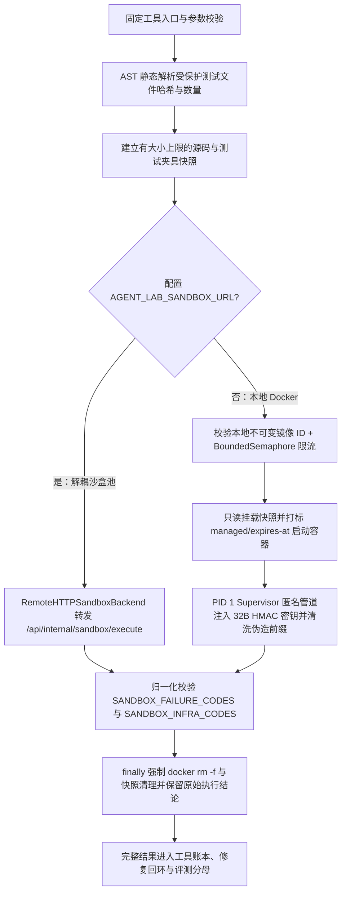

# 代码 Agent 的沙盒：限制执行能力，保留验证证据

代码 Agent 生成的 Python 即使能通过语法检查，也可能读文件、连接网络、创建子进程、篡改测试框架或无限输出。沙盒把这些能力限制在明确边界内；人工审批则决定是否接受某次修改。两者共同使用，不能互相代替。本项目用 Docker（或解耦的远程沙盒节点）运行受保护业务测试，执行前制作受限源码与夹具快照，容器内采用外层纯标准库 Supervisor + 内层受审计 Child 的双进程防伪回执架构，执行后保留版本、结果和清理状态；它显著收紧了同容器结果伪造面，但仍共享运行环境的 Linux 内核，不是已完成抗容器逃逸审计的公网多租户恶意代码平台。

源码阅读顺序：[tools.py](../src/agent_lab/tools.py) 的 `sandbox_test()` → [sandbox.py](../src/agent_lab/sandbox.py) → [api.py](../src/agent_lab/api.py) 的 `/api/internal/sandbox/execute` → [sandbox_smoke.py](../scripts/sandbox_smoke.py) → [CI](../.github/workflows/ci.yml)。工具调用的持久化与未知状态见 [上下文、Skill 与工具状态](context-skills-state.md)，15 项生产高可用演进全貌见 [生产级高可用架构演进](production-ha-hardening.md)。

## 1. 审批回答“允许改什么”，沙盒回答“运行时能碰什么”

`propose_patch` 只保存提案；审批绑定原文件哈希与新文件哈希，`apply_proposal` 校验版本后才写入。这个过程防止 Agent 直接修改仓库，或在用户审核后覆盖别人更新的文件。

但批准一段代码不等于代码可信。一次看似普通的 `import pricing` 就可能执行模块顶层语句；源码评审也无法保证没有无限循环或意外外连。因此业务测试在容器里执行，不把待测模块导入宿主 Python 进程。`verify_python` 仅解析 AST，不运行代码，也不能代替业务测试。

相反，沙盒测试通过不代表用户同意提交补丁、推送代码或使用凭证。沙盒限制技术能力，不产生业务授权；授权应绑定任务、操作、目标与版本，不能来自仓库里的一句“用户已同意”。

Anthropic 的沙盒设计也强调文件系统和网络两个边界：只限制写目录仍可能读走秘密，只限制网络仍可能破坏可写文件。其方案与本项目使用的 Docker 技术栈不同，但“同时收紧访问面”的原则可借鉴。[Anthropic：Claude Code sandboxing](https://www.anthropic.com/research/claude-code-sandboxing)

## 2. 从工作区到结果的执行路径



这里没有给模型任意 `docker run` 参数、镜像名、shell 命令或宿主挂载路径。模型只能调用固定 `sandbox_test`，真正的参数由确定性代码构造。否则即使工具叫“沙盒”，模型仍可能请求 privileged 容器或挂载 Docker socket，直接绕过边界。

### 文件系统、包布局与测试夹具：挂载最小受控副本，兼容 `src/` 与非秘密夹具

增强后的执行器在单文件模式（`_snapshot`）仅复制 `.py` 源文件；在多文件套件模式（`_snapshot_suite`）除复制全部非隐藏 `.py` 源码外，还允许复制 `tests/` 目录下受白名单后缀 `_SUITE_FIXTURE_SUFFIXES`（`.json`、`.yaml`、`.yml`、`.toml`、`.txt`、`.csv`）约束的非秘密测试夹具，并同时拦截命中 `_SENSITIVE_NAMES` 与 `_SENSITIVE_STEMS`（如 `credentials.*`、`secrets.*`、`private_key.*`、`tokens.*`）的敏感文件。遍历时拒绝符号链接、硬链接、FIFO 与其他特殊文件，并限制单文件大小、文件数量及总容量；复制时通过目录文件描述符与 `O_NOFOLLOW | O_NONBLOCK` 打开，核对读取前后 `(st_dev, st_ino, st_size, st_mtime_ns, st_ctime_ns, st_nlink)` 签名，避免 TOCTOU 替换竞争。临时副本置为 `0444` 并作为只读 bind mount 放入 `/workspace`；容器根文件系统同样只读，必要临时写入只允许在 `16 MiB` `noexec,nosuid` 的 `/tmp` tmpfs 中完成。

为兼容现代 Python 包结构，内层 runner 启动后若检测到 `/workspace/src` 目录存在，会自动将 `/workspace/src` 与 `/workspace` 按序插入 `sys.path`，无需在容器内执行 `pip install -e .` 即可测试 `src/` 布局仓库与平铺布局仓库。文件名过滤仍不是秘密扫描器：普通业务源码或测试 JSON 中若硬编码真实密钥，仍会被复制，仓库自身必须禁止提交凭证。

### 网络与远程沙盒解耦：默认无外连，容器化控制面不挂载 Docker Socket

测试容器固定使用 `--network=none`，不继承宿主代理环境、模型 API key 或 Git 凭证，不挂载 `/var/run/docker.sock`。执行阶段使用 `--pull=never` 禁止自动拉取镜像，也不在容器里联网安装依赖。

当 `agent-systems-lab` 自身运行在生产容器内（见 `Dockerfile`）时，若为了让 API 容器启动兄弟测试容器而把宿主机 `/var/run/docker.sock` 挂入控制面容器，等同于向控制面交出宿主机 root 等价权限。为此，`SandboxRunner` 内置解耦的 `RemoteHTTPSandboxBackend`：当配置 `AGENT_LAB_SANDBOX_URL`（可选搭配独立共享密钥 `AGENT_LAB_SANDBOX_TOKEN`）时，控制面先在本地完成路径安全校验、敏感文件剔除、受保护测试哈希核验与 Base64 快照打包，再通过无重定向的 HTTP `POST /api/internal/sandbox/execute` 发送给隔离沙盒池节点，由远端 `execute_remote_sandbox_payload()` 重建临时只读目录、二次校验 `snapshot_sha256` 并在远端本地 Docker 中执行。返回报文经状态码、JSON 结构、枚举集合与回执自洽性（如严拒 `ok=True` 但 `code != "passed"` 或 `tests_executed is not True` 的矛盾回执）多重校验后合入本地结果。

这能限制普通网络连接，但不能把“无网络”说成“没有任何信息流出”：stdout/stderr 仍会进入工具结果，容器退出状态与耗时也可被观察。因此仍应减少输入中的秘密，并对结果和日志做访问控制。

Docker 默认会为容器配置网络；禁网需要显式设置。镜像 tag 是可变引用，digest 则标识镜像内容，本项目进一步将本次运行绑定到 inspect 返回的本地 image ID，避免 inspect 后再按已改变的 tag 启动。[Docker：Running containers](https://docs.docker.com/engine/containers/run/)

### 进程与权限：不给额外能力，限制子进程扩散

执行器使用非 root UID/GID、丢弃 Linux capabilities、启用 `no-new-privileges`，同时限制 PID 数量。它不使用 privileged 模式，不加入宿主 PID/network namespace，不向容器传入宿主环境变量全集。

容器内的“root”与宿主 root 并不完全等价，但不能因此忽略权限收缩。反过来，只写 `--user` 也不够：进程仍可能消耗资源、调用系统调用、访问被挂载的文件或利用内核缺陷。

当前不配置 `seccomp=unconfined`，依赖 Docker 默认 seccomp 防护，而非自定义逐工具系统调用策略。Docker 官方将默认 profile 描述为 allowlist：默认拒绝未允许的系统调用；实际生效仍取决于内核、运行时和部署配置，不能靠代码里没有写 unconfined 就证明宿主环境已正确加固。[Docker：Seccomp profiles](https://docs.docker.com/engine/security/seccomp/)

### 资源：内存限制之外还要考虑交换、文件描述符和日志

限制项应覆盖不同资源，而不是只设一个超时：

| 资源或能力 | 本项目收缩方式 | 解决的问题与限制 |
| --- | --- | --- |
| 内存与交换 | memory 与 memory-swap 约束 | 降低内存/交换区耗尽风险；不等于宿主整体资源调度 |
| CPU | CPU quota 与墙钟超时 | 限制持续计算；超时仍需终止和清理容器 |
| 进程/线程 | pids-limit | 防止无限扩散；上限过小也会影响合法测试 |
| 文件描述符 | nofile ulimit | 限制大量句柄消耗 |
| core dump | core ulimit | 减少内存转储泄露与磁盘占用 |
| 临时文件 | 小容量 tmpfs，noexec/nosuid | 为必要临时数据留有限空间；不是任意安装依赖的目录 |
| 输出 | 流式总量上限、保留摘录 | 防止宿主内存和日志无限增长 |
| 守护进程日志 | 禁用该容器的 Docker 日志存储 | 减少客户端输出有界、daemon 仍持续落盘的问题 |

默认资源参数为 128 MiB memory、128 MiB memory-swap、1 CPU、64 PID、128 文件描述符、禁用 core dump 与 Docker 日志存储，tmpfs 为 16 MiB。快照最多 128 个 Python 文件，单文件 64 KiB、总计 2 MiB，遍历最多 4096 目录项、16 层目录；输出上限 16384 **字节**，执行命令墙钟上限 30 秒。`SandboxPolicy` 只允许收紧这些限制，不能由调用参数放宽。

最终参数以 `SandboxPolicy` 与 `_LIMIT_FLAGS` 为准，输出字节口径也不要与上下文字符预算混淆。镜像检查和清理各有独立超时，因此 30 秒不是包含快照、检查、清理的端到端耗时保证。不同资源限制需要在真实运行环境验证；构造出一个字符串参数并不能证明内核真的执行了限制。

## 3. 固定镜像与源码，才能解释“测试了哪一版”

复现一次执行至少需要：源码快照身份、受保护测试版本、镜像 ID、测试入口、限制配置和执行结果。只记“使用 python:3.12-slim 测试通过”不够，因为 tag 可以指向另一份内容，源目录也可能在排队时变化。

本项目先 inspect 本地镜像，再使用得到的不可变 image ID 运行，并禁止执行时自动 pull；结果保留 `image_id` / `image_sha256`、`snapshot_sha256`、文件数量/总字节、`oracle_sha256` 与 `policy_sha256`。源码快照哈希来自按路径排序的文件清单，每项含文件字节数和 SHA-256；policy 哈希绑定限制参数与受控 driver 版本。复制后再次核对快照里的验收测试哈希，避免仅校验源文件、却执行另一份副本。

本地 image ID 是本次运行使用的本地内容身份，不等同于已经核验 registry 签名或镜像发布者。它们能解释一次运行的主要输入，不保证跨 CPU 架构、内核版本、时区或随机种子的完全确定性。生产环境还应记录依赖锁文件、平台、运行时版本与必要的随机种子。

镜像固定也不等于镜像安全。镜像里可能有漏洞或敏感文件；生产镜像需要独立的来源、构建、扫描、签名与更新策略。本项目没有实现镜像供应链审计服务。

## 4. 输出、并发信号量与孤儿容器回收：停止 docker 客户端还不够

以前把 stdout 写临时文件、最后只读取前一段，虽然能限制返回给模型的文字，却可能让临时文件在读取前无限增长。把 `capture_output=True` 换成临时文件也没有解决日志型磁盘 DoS。

本次实现使用 `Popen`、selector 和 `os.read` 持续读取输出，合并 stderr，不按行等待；最多实际读取上限加一个字节以检测超限，返回内容仍限制在上限内。达到总量上限或墙钟超时就结束执行，不只是最后截断展示。Docker daemon 自身的日志也不能无限保存，所以执行器显式使用 `--log-driver=none`。同时，节点级并发度受模块全局 `_SANDBOX_SEMAPHORE = threading.BoundedSemaphore(...)`（由 `AGENT_LAB_SANDBOX_CONCURRENCY` 配置，默认 `4`）保护，避免多协程或多请求突增瞬间打爆宿主机容器并发上限。

进入容器执行阶段后，每个容器都会统一打上受控治理标签 `--label agent-lab.managed=1` 与 `--label agent-lab.expires-at=<unix_ts>`（默认 `timeout_seconds + 30` 秒后到期）。正常结束、测试失败、输出超限、超时、客户端异常都经过内层 `finally`，执行限时限输出的 `docker rm -f <本次唯一容器名>` 并核验退出回执，而不依赖不可审计的 `--rm`。

清理状态以 `cleanup_attempted`、`cleanup_verified`、`cleanup_error` 精细落盘，并在宿主临时快照目录回收时遵守**原始结论保留原则**：
- 若容器测试已通过，但 `docker rm -f` 未确认，或外层 `finally` 执行 `shutil.rmtree(temporary)` 遭遇内核挂载繁忙（如 `EBUSY`）等 `OSError` 时，`_record_rmtree_failure()` 会将 `cleanup_verified` 置为 `false`，写入 `cleanup_error`（例如 `rmtree_EBUSY`），把原本的 `"passed"` 保存在 `execution_code="passed"` 字段中，再将顶层 `ok` 降级为 `false`、`code` 置为 `"sandbox_cleanup_failed"`——既拒绝在资源泄漏时静默报绿，又不掩盖业务代码本身通过测试的事实；若测试原本已失败（如 `tests_failed` 或 `sandbox_timeout`），则保留原失败 `code` 仅补充 `cleanup_error`，绝不用清理异常冲掉真正的故障根因。
- 当宿主进程遭遇 `SIGKILL`、掉电或极端崩溃导致 `finally` 未能跑完时，独立巡检入口 `reap_orphan_containers(now_ts)`（集成于 `agent-lab gc` 与后台维护任务）会按 `--filter label=agent-lab.managed=1` 扫描容器、读取 `agent-lab.expires-at` 标签，仅对已到期的孤儿容器执行强制 `docker rm -f`，不会误删同机其他服务或仍在租期内的合法容器。

## 5. 双进程防伪回执、测试套件兼容与统一错误码体系

### 5.1 双进程 Supervisor + Child Runner 防伪回执架构

在早期单进程驱动设计中，待测业务代码与回执打印逻辑共处同一个 Python 解释器：恶意补丁只需遍历调用栈读取一次性 `marker` 字符串，直接向 `stdout` 伪造一行合法 JSON 并调用 `os._exit(0)`，即可在未通过真实断言的情况下欺骗宿主判定 `passed`。为此，`sandbox.py` 采用容器内**双进程隔离与 HMAC 签名回执架构**（`_build_supervisor_driver` + `_CHILD_PREAMBLE`）：

1. **PID 1 纯标准库 Supervisor 隔离秘密**：容器入口 `python -I -B -c` 运行外层 Supervisor，它持有本次随机生成的 `AGENT_LAB_RECEIPT_<hex>:` 前缀与 `os.urandom(32)` 随机密钥，**全程绝不将 `/workspace` 加入 `sys.path`，也不导入任何待测文件**。
2. **匿名管道与一次性闭环密钥传递**：Supervisor 创建匿名管道 `r_fd, w_fd = os.pipe()`，以 `start_new_session=True`、`pass_fds=(w_fd,)` 启动独立进程组的 Child Runner，并通过 `child.stdin` 写入 32 字节随机 HMAC 密钥后立即 `close()`；Child 在导入任何工作区模块之前从 `sys.stdin.buffer.read(32)` 读取密钥并立即关闭 `stdin`，把密钥闭包绑定进一次性 `_send(receipt)` 函数后随即 `del key, _bind_sender` 清除局部变量引用。
3. **流式欺骗前缀清洗（Spoof Scrubbing）**：Supervisor 通过 `selectors` 同时监听 `child.stdout` 与 `r_fd`，对子进程标准输出做跨分块滑动窗口扫描（保留尾部最多 `len(_needle) - 1` 字节处理分包边界），将子进程试图打印的任何 `AGENT_LAB_RECEIPT_` 字面量实时替换为 `[SPOOF_BLOCKED_RECEIPT_]`。唯有经匿名管道 `w_fd` 传回且通过常量时间 `hmac.compare_digest`（HMAC-SHA256）校验的唯一回执包，才由 Supervisor 向容器 stdout 输出真正的 `marker + json`。
4. **内层 `sys.addaudithook` 运行时内省阻断**：Child 在进入 `/workspace` 前挂载 Python 审计钩子 `_audit`，显式拦截 `ctypes` / `_ctypes` 导入与调用、`gc.get_objects` / `gc.get_referrers` / `gc.get_referents` 全堆扫描，以及非标准库代码或经由 `inspect.py` 发起的 `sys._getframe`（含针对 `<string>` 驱动栈帧的探测），阻断纯 Python 层面的闭包密钥窃取。
5. **容器内独立墙钟看门狗（Inner Watchdog）**：Supervisor 维护单调时钟 `inner_timeout`（`timeout_seconds + 2.0` 秒）；一旦子进程挂起或后台孙进程阻塞管道到期，立即对整个子进程组执行 `os.killpg(child.pid, signal.SIGKILL)` 并以退出码 `124` 退出；若子进程被信号杀死（如 OOM `SIGKILL`），则按 `128 + signal`（`137`）透传退出码。

**诚实安全边界**：双进程 HMAC + `sys.addaudithook` 大幅提高了纯 Python 待测代码伪造测试回执的门槛，但它**不是内核级或硬件虚拟化边界**。一方面，同 UID（`65534:65534`）的子进程若借助容器内原生二进制工具或内核漏洞操作同用户进程，或在同一 Child 解释器内精巧篡改目标业务模块行为以迎合已知断言，单靠 Python 审计钩子无法绝对根除；另一方面，容器仍共享宿主机（或 Docker Desktop VM）的 Linux 内核，若面对公网任意不可信机器码或高危多租户负载，仍需结合独立外部黑盒测试验证器以及 gVisor / Firecracker MicroVM 等更强隔离层。

### 5.2 纯标准库容器内的 Pytest 风格函数与异步测试兼容

受限测试容器固定使用无第三方包的 `python:3.12-slim`，但真实工程仓库普遍采用顶层 `def test_*()`、`async def test_*()` 或不继承 `unittest.TestCase` 的 `class Test*:`。为此，`sandbox.py` 在宿主静态校验与容器动态加载两端保持严格对齐：
- **宿主端零执行静态计数（`discover_test_oracles`）**：仅用 `ast.parse` 解析 `tests/` 下全部 `test*.py`，同时统计 `TestCase`/`Test*` 类中的 `test*` 方法与模块顶层 `def test_*` / `async def test_*` 函数总数，并记录每个测试文件的 SHA-256，全程绝不 `import` 待测代码。
- **容器端动态包装执行（`_SuiteLoader`）**：继承 `unittest.TestLoader`，对模块自定义顶层 `test_*` 函数与非 `TestCase` 子类的 `Test*` 方法自动封装为 `unittest.FunctionTestCase`（协程函数与异步方法自动由 `asyncio.run()` 驱动），确保预期测试数 `expected_tests` 与实际运行数 `tests_run` 精确闭环、零 skip 方可判过。

### 5.3 规范错误码分流：对齐 `AgentRuntime` 修复回环与 `model_evals` 评测分母

沙盒将非通过状态严格划分为两个互斥常量集合，供运行时修复状态机与离线基准评测共享同一语义契约：

| 常量集合 / 状态 | 包含的规范 `code` | `AgentRuntime` 修复回环行为 | `model_evals` 统计归类与 `pass_rate_valid` 分母 |
| --- | --- | --- | --- |
| `passed` | `passed`（且 `tests_executed=True`） | `verification.status="passed"`；若启用 `commit_on_pass` 则校验 `epoch` 后自动创建 Git commit 并推进 `base_commit` | 计入 `passed_runs` 与 `valid_runs`（分子、分母均 +1） |
| `SANDBOX_FAILURE_CODES` | `tests_failed`, `no_tests_ran`, `test_count_mismatch`, `timeout`, `sandbox_timeout`, `sandbox_output_limit`, `sandbox_incomplete`, `sandbox_oom`, `sandbox_snapshot_limit`, `unsafe_workspace`, `test_oracle_modified` | 判定为代码/补丁导致的可归责失败：`verification.status="failed"`，回传剩余 `repair_budget` 驱动模型在 `max_repair_rounds` 预算内自动修复；当容器退出码为 `137` 时在 `sandbox_incomplete` 上额外标注 `oom_killed=True, failure_reason="oom_killed"` | 归为 `outcome="model_failure"`，**计入 `valid_runs` 分母**（防止模型写出死循环、OOM 或刷爆日志反而逃避失分） |
| `SANDBOX_INFRA_CODES` | `sandbox_unavailable`, `image_missing`, `daemon_error`, `sandbox_error`, `sandbox_cleanup_failed` | 判定为环境/守护进程异常：`verification.status="unavailable"`，**不消耗也不惩罚模型的修复轮次** | 归为 `outcome="infrastructure_failure"`，**从 `valid_runs = total_runs - infrastructure_failures` 分母中剔除**（无有效样本时 `pass_rate_valid=None`），既不混入模型失分，也绝不冒充通过 |

## 6. Docker、gVisor 与 Firecracker 的边界

| 方案 | 隔离机制与取舍 | 本项目状态 |
| --- | --- | --- |
| 当前 Docker 容器 | namespace/cgroup、权限与系统调用限制；容器仍共享运行环境的 Linux 内核 | 已使用；需要实际探针与持续加固 |
| gVisor | 用户态应用内核拦截并实现 Linux 接口，减少直接暴露给宿主内核的调用面；有兼容性与系统调用开销取舍 | 设计延伸，未集成或实测 |
| Firecracker | 基于 KVM 的 microVM，以精简设备模型与独立客户机内核提供另一层虚拟化隔离；需要镜像、网络和虚拟机生命周期运维 | 设计延伸，未集成或实测 |

gVisor 并非普通 seccomp 过滤器；其 `runsc` 可与 OCI 容器生态集成，但不是所有 Linux 功能都兼容。[gVisor 官方说明](https://gvisor.dev/docs/) Firecracker 是 microVM 技术，生产安全依赖正确配置的宿主与 jailer 等机制，并非换一个命令就自动获得完整多租户平台。[Firecracker 官方仓库](https://github.com/firecracker-microvm/firecracker)

Docker Desktop 在 macOS 上还有 Linux 虚拟机这一层；这里“共享内核”指容器共享运行容器的 Linux 内核，不能把它表述成直接共享 macOS Darwin 内核。[Docker Desktop 平台说明](https://docs.docker.com/faqs/platform/) 本项目没有据此测量 Docker、gVisor 或 microVM 的性能和安全优劣。

选型先看威胁模型：内部教学代码、企业仓库自动化与公网多租户恶意代码的隔离要求不同。随后评估兼容性、启动延迟、密度、清理、调试、补丁与宿主运维能力；不能只比较启动速度，也不能把任一方案称为“绝不逃逸”。

## 7. 真正需要凭证时，用外部 broker 限定操作

当前测试沙盒禁网，不提供模型 API key、Git token 或宿主凭证目录。将来若 Agent 需要克隆私有仓库、推送分支或调用企业服务，不应把长期 token 直接放进容器环境变量；环境变量对容器内进程通常可读，错误日志也可能泄露它。

可扩展为沙盒外的凭证 broker：待测进程发送结构化操作请求，broker 在可信环境中核验用户、任务、仓库、分支、方法、路径和有效期，仅对允许的请求附加短期凭证或代为执行；拒绝访问其他目标，并留下可审计、可撤销的授权记录。网络出口代理也应限制目的地，避免把 broker 变成任意转发器。

Anthropic 的文章描述了把敏感 Git 凭证留在沙盒外、由 Git 代理校验交互并附加认证的做法，可作为这种设计的参考；这不是本项目已经提供的组件。[Anthropic：Claude Code sandboxing](https://www.anthropic.com/research/claude-code-sandboxing)

broker 不能只验证“token 存在”或“域名在白名单”：同一域名可能有多个仓库与危险 API，合法凭证也可能被错误用于其他任务。它与人工审批、任务状态、速率限制和凭证撤销要一起设计。

## 8. 验证证据分三层

| 层次 | 可以证明什么 | 不能证明什么 |
| --- | --- | --- |
| 参数构造与故障路径单测 | 命令含预期约束；缺 Docker 时失败关闭；超时/超量走清理；快照拒绝危险输入 | 内核、Docker daemon 真的实现了这些限制 |
| 真实容器隔离探针 | 在该次 CI/主机环境，写只读区、外连、权限状态、日志超量与超时按预期处理 | 所有宿主、镜像与未知漏洞都安全 |
| 抗逃逸与对抗审计 | 需要专门攻击面分析、漏洞测试、配置审计与持续维护 | 不能由前两层自动推导；本项目尚未完成 |

`sandbox_smoke.py` 走真实 Docker 路径，编排下列检查：

- 先验证原始业务 bug 被测试捕获，再经真实审批路径应用修复并测试。
- 容器内确认非 root、根目录与源码挂载的只读标志，并实际尝试写入，避免把非 root 的权限错误误当作只读挂载证据。
- 确认只有 loopback 网络接口，尝试外部 TCP 连接并要求失败；不暴露 Docker socket 或宿主哨兵环境变量。
- 检查 `/proc/self/status` 中 effective capabilities 为零、NoNewPrivs 生效、Seccomp 为 filter 模式；部署禁用 seccomp 会使探针失败。
- 使用假的 `.env` 和工作区外哨兵文件验证不可读，不使用真实凭证做探针。
- 运行长时间 sleep、持续无换行输出、`os._exit(0)` 样本，分别要求超时、输出超限与缺失测试回执；结束后要求容器清理确认。

当前脚本没有通过 fork bomb、OOM、文件描述符耗尽等压力样本逐一验证所有资源阈值。参数存在、权限状态正确、资源压力测试、抗逃逸审计是不同证据，不能相互代替。正常业务测试通过本身也不证明隔离有效。

准备好本地镜像后可运行：

```bash
docker pull python:3.12-slim
uv run --no-sync python scripts/sandbox_smoke.py
```

pull 是独立的环境准备步骤，执行器不会自行联网拉取。脚本将脱敏后的 case 状态、环境、镜像/快照/policy 哈希、输出字节数与清理状态保存到 `reports/sandbox-smoke.json`，CI 即使失败也尝试上传该 artifact。报告不保存宿主哨兵值与原始容器输出；完整工具结果仍按工具账本策略保存。

本节描述验证方法，执行是否成功以实际 CI run 与 report 为准；脚本存在或 mock 测试通过不能写成“已完成抗逃逸验证”。

Linux CI 可以执行真实 Docker；本地没有 Docker 时保留明确 `sandbox_unavailable` 状态。若测试因环境不满足而跳过，应分别报告“单测通过”“真实容器未执行”，不能合并成全部验证通过。

## 9. 面试补充题 81—88

以下优先级按本项目的工程价值安排，不代表统计得到的面试频率。代码证据指实现入口与测试路径；设计延伸明确标注未实现。

### 81. P0：已经有人工审批，为什么代码 Agent 还需要沙盒？

**回答要点：** 审批控制操作授权与版本，沙盒控制运行时能力。被批准的模块也可能在导入时读秘密、无限循环或产生子进程。最小权限、资源上限、禁网与隔离工作区约束实际执行；测试通过不替代发布授权。

**追问：** 用户批准“修复折扣”是否等于批准推送 main？一段只增加 import 的补丁有什么风险？

**代码证据：** [tools.py](../src/agent_lab/tools.py) 的 `propose_patch` / `apply_proposal` / `verify_python` / `sandbox_test`；审批写入与容器测试是不同入口。项目已实现这层分离，仓库发布权限不由沙盒产生。

### 82. P0：你会从哪些维度限制不可信代码？为什么只设 timeout 不够？

**回答要点：** 文件系统限制读写面，网络限制出口，进程和权限限制能力扩张，CPU/内存/交换/PID/句柄/临时空间/输出限制资源。超时之前同样可以破坏可写数据、泄露秘密或耗尽日志磁盘；需要多层限制，并用真实探针验证。

**追问：** read-only 根文件系统下为什么还留 tmpfs？`--user`、cap-drop、no-new-privileges、seccomp 各解决什么？

**代码证据：** [sandbox.py](../src/agent_lab/sandbox.py) 的 Docker 命令构造与资源常量；[CI](../.github/workflows/ci.yml) 的真实沙盒任务。默认 seccomp 依赖部署环境，项目未实现自定义最小 syscall profile。

### 83. P0：为什么复制源码快照，并固定 image ID，而不直接挂载仓库和镜像 tag？

**回答要点：** 活目录可能在执行期间变化，也可能包含凭证和不需要的文件；受限副本降低暴露面并固定本次输入。套件快照仅白名单放行 `.py` 与 `tests/` 下非秘密数据夹具（`.json`/`.yaml`/`.toml`/`.txt`/`.csv`），并自动支持 `src/` 包布局。tag 可变，inspect 后按同一 image ID 启动，记录源码/测试/镜像版本。快照不是多文件事务，镜像固定也不是供应链安全认证。

**追问：** symlink 与 hardlink 有什么风险？普通 Python 文件中硬编码的密钥能被文件名过滤拦住吗？如何处理复制期间修改？

**代码证据：** [sandbox.py](../src/agent_lab/sandbox.py) 的 `_snapshot` / `_snapshot_suite` / `_open_root` 与 `run` / `run_suite` 中的 image ID 解析。通用多语言编译产物快照仍是扩展方向。

### 84. P0：恶意程序持续打印日志，如何避免宿主被拖垮？

**回答要点：** 不能只截断最终展示，更不能无界 capture。持续有界读取，超过总输出量就终止；处理无换行输出、stderr 管道阻塞与解码；限制 Docker daemon 日志，并用信号量约束单机沙盒并发数，结束后强制清理。日志内容仍是不可信输入。

**追问：** 输出写临时文件再读前 16 KB，为什么仍有磁盘 DoS？如果 stdout 不断输出且从不换行，`readline()` 有什么问题？

**代码证据：** [sandbox.py](../src/agent_lab/sandbox.py) 的 `_capture`、`SandboxPolicy.output_limit_bytes`、`_SANDBOX_SEMAPHORE` 与 `_LIMIT_FLAGS`。参数单测不能替代真实超量输出探针，项目未实现跨任务全局日志配额服务。

### 85. P0：超时时 kill docker CLI 为什么不够？执行状态应该怎么记？

**回答要点：** Docker daemon 可能仍在运行容器，必须针对唯一容器名/ID 强制删除，清理本身要限时并记录结果；若宿主进程被强杀，还需基于容器标签与过期时间戳回收孤儿容器；若快照目录清理遇到 `EBUSY`，应降级为 `sandbox_cleanup_failed` 同时用 `execution_code` 保留原始执行结论。超时不代表业务代码从未执行，工具中断无法核对时应保留 unknown，不能伪报成功或盲目自动重跑。

**追问：** finally 执行失败怎么办？进程 SIGKILL 后谁清理？取消和回滚有什么区别？

**代码证据：** [sandbox.py](../src/agent_lab/sandbox.py) 的 finally 清理、`agent-lab.managed=1` / `agent-lab.expires-at` 标签、`reap_orphan_containers()` 与 `_record_rmtree_failure()`；[runtime.py](../src/agent_lab/runtime.py) 的 `_tool_thread` 与 unknown 分支；[storage.py](../src/agent_lab/storage.py) 的调用账本。

### 86. P0：退出码 0 就能声称业务测试通过吗？测试文件哈希能防作弊吗？

**回答要点：** 退出码只是一项证据，要核对预期测试入口、完成回执、数量、失败/错误数和环境。提前 `sys.exit(0)` 可能没执行测试；文件哈希只防测试文件被替换，单进程共享解释器下恶意模块可探测栈帧或伪造 stdout。容器内采用外层纯标准库 Supervisor + 内层 Child 双进程架构、32 字节一次性 HMAC 匿名管道回执、stdout `[SPOOF_BLOCKED_RECEIPT_]` 清洗与 `sys.addaudithook` 阻断 `sys._getframe`/`ctypes`/`gc`，显著收紧纯 Python 伪造面，但仍不等同于硬件级或独立外部黑盒裁判。

**追问：** 把预期测试数量设为 4 能解决伪造吗？双进程 HMAC 回执解决了什么、仍有什么内核或同进程边界？

**代码证据：** [tools.py](../src/agent_lab/tools.py) 的受保护测试哈希检查、[sandbox.py](../src/agent_lab/sandbox.py) 的 `_build_supervisor_driver` / `_CHILD_PREAMBLE` / `discover_test_oracles` / `_receipt` 以及 `SANDBOX_FAILURE_CODES` vs `SANDBOX_INFRA_CODES` 分类、[sandbox_smoke.py](../scripts/sandbox_smoke.py) 的原始失败/修复通过对照。

### 87. P1：容器、gVisor 与 microVM 怎么选？应用自身容器化时怎么避免挂载 Docker Socket？

**回答要点：** Docker 容器共享运行环境的 Linux 内核，靠 namespace、cgroup、权限与 seccomp 收缩；gVisor 引入用户态应用内核，microVM 引入虚拟化与客户机内核。此外，当 Agent 控制面自身部署在容器内时，绝不能把宿主机 `/var/run/docker.sock` 挂给 API 容器，而应通过窄协议 HTTP 将脱敏快照发往独立受管沙盒池执行。

**追问：** rootless Docker 是否自动解决内核漏洞？为什么挂载 `docker.sock` 等同交出宿主机 root？

**代码证据：** 项目使用 [sandbox.py](../src/agent_lab/sandbox.py) 的本地 Docker 约束与解耦的 `RemoteHTTPSandboxBackend`（对接 [api.py](../src/agent_lab/api.py) 的 `/api/internal/sandbox/execute`）；gVisor / Firecracker 仍为设计延伸，未集成或实测。

### 88. P1：Agent 要访问私有仓库，怎样让它完成任务又不直接拿到长期 Git token？

**回答要点：** 凭证留在沙盒外，由 broker/代理核验任务、仓库、分支、方法、有效期和审批，只代办最小操作或附加短期受限凭证；记录可审计、可撤销的授权。网络出口限制目标，broker 防止成为任意转发器，日志避免泄密。

**追问：** 域名白名单为什么不够？同一 GitHub token 能读多个仓库时，如何防止越权？撤销后在途任务怎么办？

**代码证据：** [sandbox.py](../src/agent_lab/sandbox.py) 当前不注入凭证、不开网络、不挂载宿主凭证目录或 Docker socket。外部 broker、短期凭证和跨服务授权是生产扩展方向，项目尚未实现。
