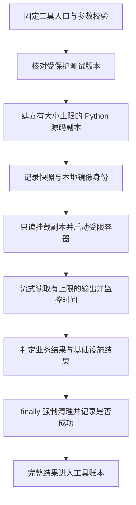

# 代码 Agent 的沙盒：限制执行能力，保留验证证据

代码 Agent 生成的 Python 即使能通过语法检查，也可能读文件、连接网络、创建子进程或无限输出。沙盒把这些能力限制在明确边界内；人工审批则决定是否接受某次修改。两者共同使用，不能互相代替。本项目用 Docker 运行教学仓库的业务测试，执行前制作受限源码快照，执行后保留版本、结果和清理状态；它不是已经完成抗容器逃逸审计的恶意代码执行平台。

源码阅读顺序：[tools.py](../src/agent_lab/tools.py) 的 `sandbox_test()` → [sandbox.py](../src/agent_lab/sandbox.py) → [sandbox_smoke.py](../scripts/sandbox_smoke.py) → [CI](../.github/workflows/ci.yml)。工具调用的持久化与未知状态见 [上下文、Skill 与工具状态](context-skills-state.md)。

## 1. 审批回答“允许改什么”，沙盒回答“运行时能碰什么”

`propose_patch` 只保存提案；审批绑定原文件哈希与新文件哈希，`apply_proposal` 校验版本后才写入。这个过程防止 Agent 直接修改仓库，或在用户审核后覆盖别人更新的文件。

但批准一段代码不等于代码可信。一次看似普通的 `import pricing` 就可能执行模块顶层语句；源码评审也无法保证没有无限循环或意外外连。因此业务测试在容器里执行，不把待测模块导入宿主 Python 进程。`verify_python` 仅解析 AST，不运行代码，也不能代替业务测试。

相反，沙盒测试通过不代表用户同意提交补丁、推送代码或使用凭证。沙盒限制技术能力，不产生业务授权；授权应绑定任务、操作、目标与版本，不能来自仓库里的一句“用户已同意”。

Anthropic 的沙盒设计也强调文件系统和网络两个边界：只限制写目录仍可能读走秘密，只限制网络仍可能破坏可写文件。其方案与本项目使用的 Docker 技术栈不同，但“同时收紧访问面”的原则可借鉴。[Anthropic：Claude Code sandboxing](https://www.anthropic.com/research/claude-code-sandboxing)

## 2. 从工作区到结果的执行路径



这里没有给模型任意 `docker run` 参数、镜像名、shell 命令或宿主挂载路径。模型只能调用固定 `sandbox_test`，真正的参数由确定性代码构造。否则即使工具叫“沙盒”，模型仍可能请求 privileged 容器或挂载 Docker socket，直接绕过边界。

### 文件系统：挂载最少的副本，而不是整个活工作区

增强后的执行器只复制运行当前教学测试需要的 `.py` 源文件，跳过隐藏路径、已知敏感文件名和不需要的数据；对遍历到的非隐藏路径拒绝符号链接、硬链接、FIFO 与其他特殊文件，并限制单文件大小、文件数量及总容量。复制时通过目录文件描述符与 `O_NOFOLLOW` 打开，核对打开文件的属性及读取前后签名，避免把路径检查后被替换的链接当成普通源文件。临时副本作为只读 bind mount 放入容器；容器根文件系统同样只读，必要临时写入只允许在有界 tmpfs 中完成。

这样既减少把 `.git`、`.env`、密钥文件或无关材料暴露给待测代码的机会，也避免测试直接读到主工作区随后变化的文件。文件名过滤不是秘密扫描器：普通 `.py` 文件里若已经硬编码密钥，仍可能被复制。仓库自身仍应禁止提交凭证。

“源码副本快照”也不是整个虚拟机快照或多文件事务快照。逐个复制文件时若另一个执行者同时修改源目录，仍需要锁或版本校验来定义一致性；当前读取校验与版本记录不能泛化成任意仓库的全局一致快照。仅复制 Python 的策略适用于这个教学仓库，不支持所有包含资源文件、动态库和构建产物的工程。

### 网络：默认无外连，依赖准备和测试执行分开

容器使用 `--network=none`，不继承宿主代理环境、模型 API key 或 Git 凭证，不挂载 Docker socket。执行阶段不自动拉取镜像，也不在容器里联网安装依赖；镜像应由操作者或 CI 的准备步骤事先获得。

这能限制普通网络连接，但不能把“无网络”说成“没有任何信息流出”：stdout/stderr 仍会进入工具结果，容器退出状态与耗时也可被观察。因此仍应减少输入中的秘密，并对结果和日志做访问控制。

Docker 默认会为容器配置网络；禁网需要显式设置。镜像 tag 是可变引用，digest 则标识镜像内容，本项目进一步将本次运行绑定到 inspect 返回的本地 image ID，避免 inspect 后再按已改变的 tag 启动。[Docker：Running containers](https://docs.docker.com/engine/containers/run/)

### 进程与权限：不给额外能力，限制子进程扩散

执行器使用非 root UID/GID、丢弃 Linux capabilities、启用 `no-new-privileges`，同时限制 PID 数量。它不使用 privileged 模式，不加入宿主 PID/network namespace，不向容器传入宿主环境变量全集。

容器内的“root”与宿主 root 并不完全等价，但不能因此忽略权限收缩。反过来，只写 `--user` 也不够：进程仍可能消耗资源、调用系统调用、访问被挂载的文件或利用内核缺陷。

当前不配置 `seccomp=unconfined`，依赖 Docker 默认 seccomp 防护，而非自定义逐工具系统调用策略。Docker 官方将默认 profile 描述为 allowlist：默认拒绝未允许的系统调用；实际生效仍取决于内核、运行时和部署配置，不能靠代码里没有写 unconfined 就证明宿主环境已正确加固。[Docker：Seccomp profiles](https://docs.docker.com/engine/security/seccomp/)

### 资源：内存限制之外还要考虑交换、文件描述符和日志

限制项应覆盖不同资源，而不是只设一个超时：

| 资源或能力 | 本项目收缩方式 | 解决的问题与限制 |
| --- | --- | --- |
| 内存与交换 | memory 与 memory-swap 约束 | 降低内存/交换区耗尽风险；不等于宿主整体资源调度 |
| CPU | CPU quota 与墙钟超时 | 限制持续计算；超时仍需终止和清理容器 |
| 进程/线程 | pids-limit | 防止无限扩散；上限过小也会影响合法测试 |
| 文件描述符 | nofile ulimit | 限制大量句柄消耗 |
| core dump | core ulimit | 减少内存转储泄露与磁盘占用 |
| 临时文件 | 小容量 tmpfs，noexec/nosuid | 为必要临时数据留有限空间；不是任意安装依赖的目录 |
| 输出 | 流式总量上限、保留摘录 | 防止宿主内存和日志无限增长 |
| 守护进程日志 | 禁用该容器的 Docker 日志存储 | 减少客户端输出有界、daemon 仍持续落盘的问题 |

默认资源参数为 128 MiB memory、128 MiB memory-swap、1 CPU、64 PID、128 文件描述符、禁用 core dump 与 Docker 日志存储，tmpfs 为 16 MiB。快照最多 128 个 Python 文件，单文件 64 KiB、总计 2 MiB，遍历最多 4096 目录项、16 层目录；输出上限 16384 **字节**，执行命令墙钟上限 30 秒。`SandboxPolicy` 只允许收紧这些限制，不能由调用参数放宽。

最终参数以 `SandboxPolicy` 与 `_LIMIT_FLAGS` 为准，输出字节口径也不要与上下文字符预算混淆。镜像检查和清理各有独立超时，因此 30 秒不是包含快照、检查、清理的端到端耗时保证。不同资源限制需要在真实运行环境验证；构造出一个字符串参数并不能证明内核真的执行了限制。

## 3. 固定镜像与源码，才能解释“测试了哪一版”

复现一次执行至少需要：源码快照身份、受保护测试版本、镜像 ID、测试入口、限制配置和执行结果。只记“使用 python:3.12-slim 测试通过”不够，因为 tag 可以指向另一份内容，源目录也可能在排队时变化。

本项目先 inspect 本地镜像，再使用得到的不可变 image ID 运行，并禁止执行时自动 pull；结果保留 `image_id` / `image_sha256`、`snapshot_sha256`、文件数量/总字节、`oracle_sha256` 与 `policy_sha256`。源码快照哈希来自按路径排序的文件清单，每项含文件字节数和 SHA-256；policy 哈希绑定限制参数与受控 driver 版本。复制后再次核对快照里的验收测试哈希，避免仅校验源文件、却执行另一份副本。

本地 image ID 是本次运行使用的本地内容身份，不等同于已经核验 registry 签名或镜像发布者。它们能解释一次运行的主要输入，不保证跨 CPU 架构、内核版本、时区或随机种子的完全确定性。生产环境还应记录依赖锁文件、平台、运行时版本与必要的随机种子。

镜像固定也不等于镜像安全。镜像里可能有漏洞或敏感文件；生产镜像需要独立的来源、构建、扫描、签名与更新策略。本项目没有实现镜像供应链审计服务。

## 4. 输出与超时：停止 docker 客户端还不够

以前把 stdout 写临时文件、最后只读取前一段，虽然能限制返回给模型的文字，却可能让临时文件在读取前无限增长。把 `capture_output=True` 换成临时文件也没有解决日志型磁盘 DoS。

本次实现使用 `Popen`、selector 和 `os.read` 持续读取输出，合并 stderr，不按行等待；最多实际读取上限加一个字节以检测超限，返回内容仍限制在上限内。达到总量上限或墙钟超时就结束执行，不只是最后截断展示。Docker daemon 自身的日志也不能无限保存，所以执行器显式使用 `--log-driver=none`。

进入容器执行阶段后，正常结束、测试失败、输出超限、超时、客户端异常都经过 finally，尝试 `docker rm -f <本次唯一容器名>`。执行器不依赖 `--rm` 自动删除，而检查这次清理命令的回执。因为终止 docker CLI 不一定终止服务端容器，不能只对 `Popen` 调用 kill 就宣布“沙盒已销毁”。

结果用 `cleanup_attempted`、`cleanup_verified`、`cleanup_error` 记录状态；清理命令同样限时、限输出。如果业务测试通过但清理未确认，工具将 `ok` 改为 false，返回 `sandbox_cleanup_failed`，并保留原执行结论。若早在快照或镜像检查阶段失败、尚未尝试创建容器，`cleanup_attempted=false`；不能仅凭初始 `cleanup_verified=true` 声称“执行后容器已删除”。

进程被强制终止、主机掉电或 Docker daemon 完全失联时，finally 不一定能完成。生产执行服务还需独立清理器，按受控标签/容器 ID 对照任务状态处理遗留资源，避免误删其他任务的容器。当前 finally 清理与可观测字段不能代替跨重启的资源回收系统。

## 5. 退出码 0、测试通过和“恶意代码可信”是三件事

基础判断至少区分：没有启动、基础设施错误、业务测试失败、正常测试完成、超时、输出超限、执行结果未知与清理异常。Docker 的启动错误不能显示成业务测试失败；Docker 不可用不能自动退回宿主执行后仍声称隔离测试通过。

退出码 0 可能来自“程序提前 `sys.exit(0)`”，不代表预期测试真的跑完。本项目使用固定 driver，只发现受保护的 `test_pricing.py`；预期恰好 4 个测试，要求无 skip。`python -I -B -c` 先导入标准库、再加入工作区，降低工作区 `json.py` / `unittest.py` 直接遮蔽 driver 标准库的风险。

driver 输出一次性标记后的 JSON 回执；宿主 `_receipt()` 检查字段类型、测试数、skip、失败/错误数、successful 与退出码的一致性，再给出 passed / tests_failed。缺失或不一致的回执返回 `sandbox_incomplete`。超时、输出超限与无法确认执行完成时，`tests_executed=null`，不能解释成“确定未执行”；启动前失败才使用 false，收到完整有效回执使用 true。这里的回执用于识别普通失败和意外提前退出，不是不可伪造的认证。

更强的限制必须明确：受测模块与 unittest 若在同一个 Python 解释器里，恶意代码可能 monkeypatch unittest、伪造输出或直接操纵回执渠道。测试文件哈希未改变只证明原文件没有被替换，不证明测试框架运行时没有被篡改；要求“恰好 4 个测试”的回执也不是恶意代码不可伪造的证明。

因此本项目把测试结果作为教学样例的验证证据，不能宣称已经实现对任意恶意代码的可信业务判定。需要更强威胁模型时，应设计独立可信验证器与窄协议，把验证凭证、结果签名能力和外部期望留在待测进程之外，并针对作弊路径做对抗测试。仅更换容器 runtime 不会自动解决“受测进程自己证明自己正确”的问题。

## 6. Docker、gVisor 与 Firecracker 的边界

| 方案 | 隔离机制与取舍 | 本项目状态 |
| --- | --- | --- |
| 当前 Docker 容器 | namespace/cgroup、权限与系统调用限制；容器仍共享运行环境的 Linux 内核 | 已使用；需要实际探针与持续加固 |
| gVisor | 用户态应用内核拦截并实现 Linux 接口，减少直接暴露给宿主内核的调用面；有兼容性与系统调用开销取舍 | 设计延伸，未集成或实测 |
| Firecracker | 基于 KVM 的 microVM，以精简设备模型与独立客户机内核提供另一层虚拟化隔离；需要镜像、网络和虚拟机生命周期运维 | 设计延伸，未集成或实测 |

gVisor 并非普通 seccomp 过滤器；其 `runsc` 可与 OCI 容器生态集成，但不是所有 Linux 功能都兼容。[gVisor 官方说明](https://gvisor.dev/docs/) Firecracker 是 microVM 技术，生产安全依赖正确配置的宿主与 jailer 等机制，并非换一个命令就自动获得完整多租户平台。[Firecracker 官方仓库](https://github.com/firecracker-microvm/firecracker)

Docker Desktop 在 macOS 上还有 Linux 虚拟机这一层；这里“共享内核”指容器共享运行容器的 Linux 内核，不能把它表述成直接共享 macOS Darwin 内核。[Docker Desktop 平台说明](https://docs.docker.com/faqs/platform/) 本项目没有据此测量 Docker、gVisor 或 microVM 的性能和安全优劣。

选型先看威胁模型：内部教学代码、企业仓库自动化与公网多租户恶意代码的隔离要求不同。随后评估兼容性、启动延迟、密度、清理、调试、补丁与宿主运维能力；不能只比较启动速度，也不能把任一方案称为“绝不逃逸”。

## 7. 真正需要凭证时，用外部 broker 限定操作

当前测试沙盒禁网，不提供模型 API key、Git token 或宿主凭证目录。将来若 Agent 需要克隆私有仓库、推送分支或调用企业服务，不应把长期 token 直接放进容器环境变量；环境变量对容器内进程通常可读，错误日志也可能泄露它。

可扩展为沙盒外的凭证 broker：待测进程发送结构化操作请求，broker 在可信环境中核验用户、任务、仓库、分支、方法、路径和有效期，仅对允许的请求附加短期凭证或代为执行；拒绝访问其他目标，并留下可审计、可撤销的授权记录。网络出口代理也应限制目的地，避免把 broker 变成任意转发器。

Anthropic 的文章描述了把敏感 Git 凭证留在沙盒外、由 Git 代理校验交互并附加认证的做法，可作为这种设计的参考；这不是本项目已经提供的组件。[Anthropic：Claude Code sandboxing](https://www.anthropic.com/research/claude-code-sandboxing)

broker 不能只验证“token 存在”或“域名在白名单”：同一域名可能有多个仓库与危险 API，合法凭证也可能被错误用于其他任务。它与人工审批、任务状态、速率限制和凭证撤销要一起设计。

## 8. 验证证据分三层

| 层次 | 可以证明什么 | 不能证明什么 |
| --- | --- | --- |
| 参数构造与故障路径单测 | 命令含预期约束；缺 Docker 时失败关闭；超时/超量走清理；快照拒绝危险输入 | 内核、Docker daemon 真的实现了这些限制 |
| 真实容器隔离探针 | 在该次 CI/主机环境，写只读区、外连、权限状态、日志超量与超时按预期处理 | 所有宿主、镜像与未知漏洞都安全 |
| 抗逃逸与对抗审计 | 需要专门攻击面分析、漏洞测试、配置审计与持续维护 | 不能由前两层自动推导；本项目尚未完成 |

`sandbox_smoke.py` 走真实 Docker 路径，编排下列检查：

- 先验证原始业务 bug 被测试捕获，再经真实审批路径应用修复并测试。
- 容器内确认非 root、根目录与源码挂载的只读标志，并实际尝试写入，避免把非 root 的权限错误误当作只读挂载证据。
- 确认只有 loopback 网络接口，尝试外部 TCP 连接并要求失败；不暴露 Docker socket 或宿主哨兵环境变量。
- 检查 `/proc/self/status` 中 effective capabilities 为零、NoNewPrivs 生效、Seccomp 为 filter 模式；部署禁用 seccomp 会使探针失败。
- 使用假的 `.env` 和工作区外哨兵文件验证不可读，不使用真实凭证做探针。
- 运行长时间 sleep、持续无换行输出、`os._exit(0)` 样本，分别要求超时、输出超限与缺失测试回执；结束后要求容器清理确认。

当前脚本没有通过 fork bomb、OOM、文件描述符耗尽等压力样本逐一验证所有资源阈值。参数存在、权限状态正确、资源压力测试、抗逃逸审计是不同证据，不能相互代替。正常业务测试通过本身也不证明隔离有效。

准备好本地镜像后可运行：

```bash
docker pull python:3.12-slim
uv run --no-sync python scripts/sandbox_smoke.py
```

pull 是独立的环境准备步骤，执行器不会自行联网拉取。脚本将脱敏后的 case 状态、环境、镜像/快照/policy 哈希、输出字节数与清理状态保存到 `reports/sandbox-smoke.json`，CI 即使失败也尝试上传该 artifact。报告不保存宿主哨兵值与原始容器输出；完整工具结果仍按工具账本策略保存。

本节描述验证方法，执行是否成功以实际 CI run 与 report 为准；脚本存在或 mock 测试通过不能写成“已完成抗逃逸验证”。

Linux CI 可以执行真实 Docker；本地没有 Docker 时保留明确 `sandbox_unavailable` 状态。若测试因环境不满足而跳过，应分别报告“单测通过”“真实容器未执行”，不能合并成全部验证通过。

## 9. 面试补充题 81—88

以下优先级按本项目的工程价值安排，不代表统计得到的面试频率。代码证据指实现入口与测试路径；设计延伸明确标注未实现。

### 81. P0：已经有人工审批，为什么代码 Agent 还需要沙盒？

**回答要点：** 审批控制操作授权与版本，沙盒控制运行时能力。被批准的模块也可能在导入时读秘密、无限循环或产生子进程。最小权限、资源上限、禁网与隔离工作区约束实际执行；测试通过不替代发布授权。

**追问：** 用户批准“修复折扣”是否等于批准推送 main？一段只增加 import 的补丁有什么风险？

**代码证据：** [tools.py](../src/agent_lab/tools.py) 的 `propose_patch` / `apply_proposal` / `verify_python` / `sandbox_test`；审批写入与容器测试是不同入口。项目已实现这层分离，仓库发布权限不由沙盒产生。

### 82. P0：你会从哪些维度限制不可信代码？为什么只设 timeout 不够？

**回答要点：** 文件系统限制读写面，网络限制出口，进程和权限限制能力扩张，CPU/内存/交换/PID/句柄/临时空间/输出限制资源。超时之前同样可以破坏可写数据、泄露秘密或耗尽日志磁盘；需要多层限制，并用真实探针验证。

**追问：** read-only 根文件系统下为什么还留 tmpfs？`--user`、cap-drop、no-new-privileges、seccomp 各解决什么？

**代码证据：** [sandbox.py](../src/agent_lab/sandbox.py) 的 Docker 命令构造与资源常量；[CI](../.github/workflows/ci.yml) 的真实沙盒任务。默认 seccomp 依赖部署环境，项目未实现自定义最小 syscall profile。

### 83. P0：为什么复制源码快照，并固定 image ID，而不直接挂载仓库和镜像 tag？

**回答要点：** 活目录可能在执行期间变化，也可能包含凭证和不需要的文件；受限副本降低暴露面并固定本次输入。tag 可变，inspect 后按同一 image ID 启动，记录源码/测试/镜像版本。快照不是多文件事务，镜像固定也不是供应链安全认证。

**追问：** symlink 与 hardlink 有什么风险？普通 Python 文件中硬编码的密钥能被文件名过滤拦住吗？如何处理复制期间修改？

**代码证据：** [sandbox.py](../src/agent_lab/sandbox.py) 的 `_snapshot` / `_open_root` 与 `run` 中的 image ID 解析。项目只复制教学测试所需 Python 文件，通用多语言构建快照是扩展方向。

### 84. P0：恶意程序持续打印日志，如何避免宿主被拖垮？

**回答要点：** 不能只截断最终展示，更不能无界 capture。持续有界读取，超过总输出量就终止；处理无换行输出、stderr 管道阻塞与解码；限制 Docker daemon 日志，并在结束后清理。日志内容仍是不可信输入。

**追问：** 输出写临时文件再读前 16 KB，为什么仍有磁盘 DoS？如果 stdout 不断输出且从不换行，`readline()` 有什么问题？

**代码证据：** [sandbox.py](../src/agent_lab/sandbox.py) 的 `_capture`、`SandboxPolicy.output_limit_bytes` 与 `_LIMIT_FLAGS`。参数单测不能替代真实超量输出探针，项目未实现跨任务全局日志配额服务。

### 85. P0：超时时 kill docker CLI 为什么不够？执行状态应该怎么记？

**回答要点：** Docker daemon 可能仍在运行容器，必须针对唯一容器名/ID 强制删除，清理本身要限时并记录结果。超时不代表业务代码从未执行，协程取消也不等于同步线程停止；工具中断无法核对时应保留 unknown，不能伪报成功或盲目自动重跑。

**追问：** finally 执行失败怎么办？进程 SIGKILL 后谁清理？取消和回滚有什么区别？

**代码证据：** [sandbox.py](../src/agent_lab/sandbox.py) 的 finally 清理；[runtime.py](../src/agent_lab/runtime.py) 的 `_tool_thread`、安全恢复列表与 unknown 分支；[storage.py](../src/agent_lab/storage.py) 的调用账本。项目未实现跨重启的独立容器清理服务。

### 86. P0：退出码 0 就能声称业务测试通过吗？测试文件哈希能防作弊吗？

**回答要点：** 退出码只是一项证据，要核对预期测试入口、完成回执、数量、失败/错误数和环境。提前 `sys.exit(0)` 可能没执行测试；文件哈希只防测试文件被替换，同进程恶意模块仍能 monkeypatch 框架或伪造输出。健壮性回执与对抗恶意代码的可信验证是不同能力。

**追问：** 把预期测试数量设为 4 能解决伪造吗？如果验证器和待测代码共享解释器，信任边界在哪里？

**代码证据：** [tools.py](../src/agent_lab/tools.py) 的受保护测试哈希检查、[sandbox.py](../src/agent_lab/sandbox.py) 的 `_DRIVER` / `_receipt` 与结果分类、[sandbox_smoke.py](../scripts/sandbox_smoke.py) 的原始失败/修复通过对照。项目没有宣称已经建立恶意代码不可伪造的业务结果证明。

### 87. P1：容器、gVisor 与 microVM 怎么选？Docker 算安全边界吗？

**回答要点：** Docker 容器共享运行环境的 Linux 内核，靠 namespace、cgroup、权限与 seccomp 收缩；gVisor 引入用户态应用内核，microVM 引入虚拟化与客户机内核。需要按威胁模型、兼容性、启动/运行成本和宿主运维评估，不用一个性能数字代替隔离审计。

**追问：** rootless Docker 是否自动解决内核漏洞？换成 Firecracker 后，凭证、结果伪造与网络出口问题是否自然消失？

**代码证据：** 项目实际使用 [sandbox.py](../src/agent_lab/sandbox.py) 的 Docker 约束；gVisor / Firecracker 仅为本节引用官方资料的设计延伸，未集成、未做性能比较。

### 88. P1：Agent 要访问私有仓库，怎样让它完成任务又不直接拿到长期 Git token？

**回答要点：** 凭证留在沙盒外，由 broker/代理核验任务、仓库、分支、方法、有效期和审批，只代办最小操作或附加短期受限凭证；记录可审计、可撤销的授权。网络出口限制目标，broker 防止成为任意转发器，日志避免泄密。

**追问：** 域名白名单为什么不够？同一 GitHub token 能读多个仓库时，如何防止越权？撤销后在途任务怎么办？

**代码证据：** [sandbox.py](../src/agent_lab/sandbox.py) 当前不注入凭证、不开网络、不挂载宿主凭证目录或 Docker socket。外部 broker、短期凭证和跨服务授权是生产扩展方向，项目尚未实现。
